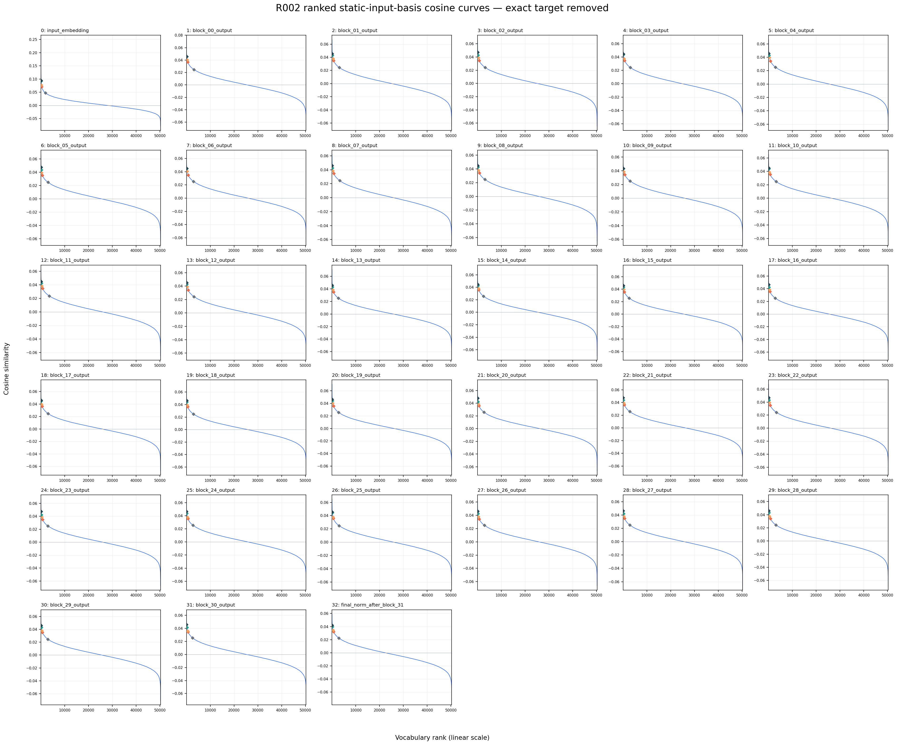
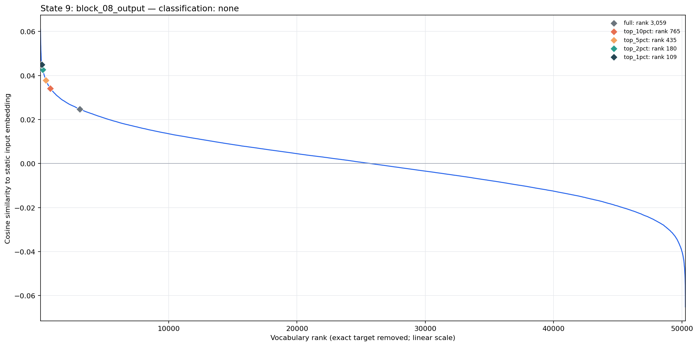
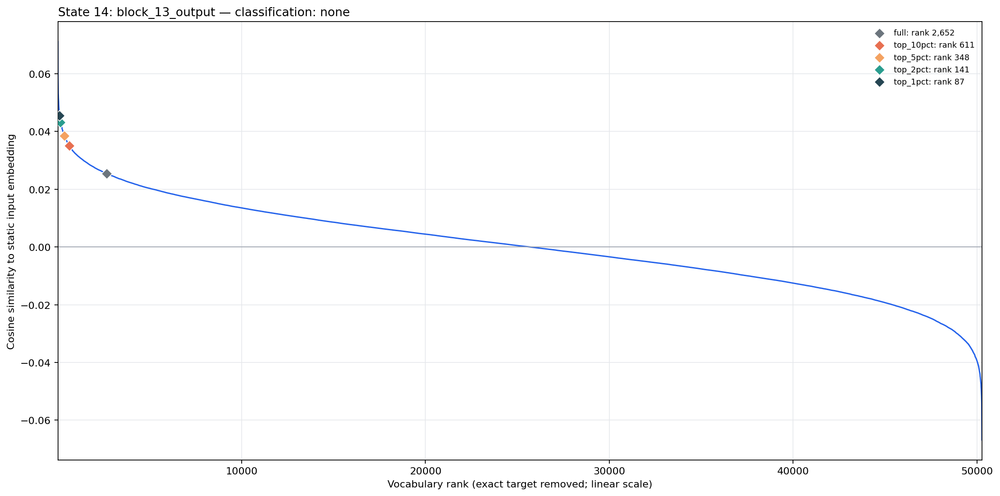
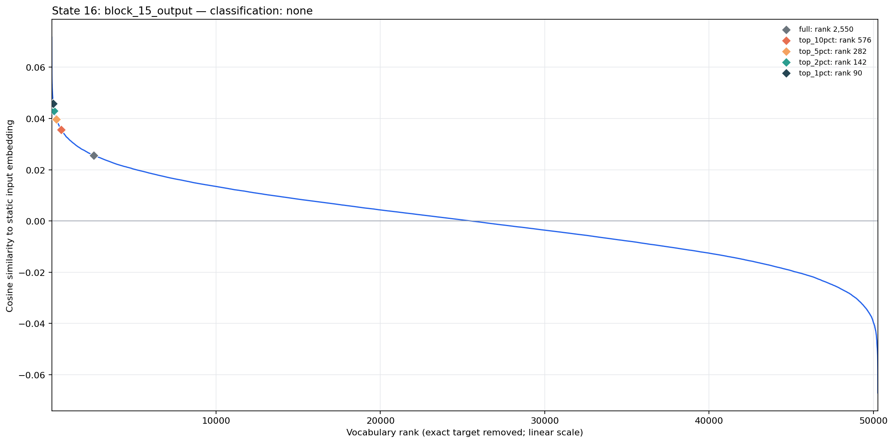
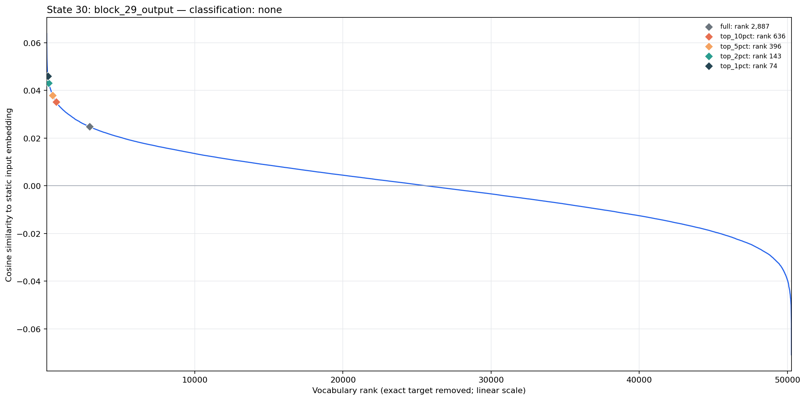
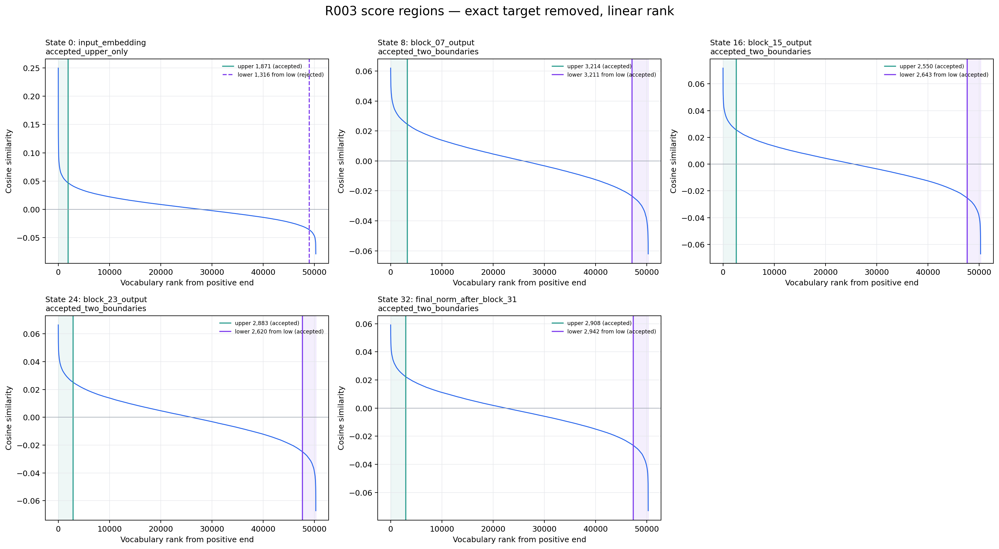

# LLM Topology Meta-analysis

## Agent usage instructions

This file is the chronological interpretive record for the LLM semantic
topology project. Agents working on the project must use it as follows:

1. Before adding an entry, read the canonical operating rules in
   `D:\Sync\zzCodexLearnings\AGENTS.md`, the project `README.md`, this section,
   and the manifest for every run discussed by the entry.
2. Treat existing entries as an append-only historical record. Do not silently
   rewrite, reorder, summarize or remove an earlier entry. Append a dated
   correction that cites the affected entry when a correction is necessary.
3. Assign entries sequential IDs in the form `MA-NNNN`. Never reuse an entry
   ID, including for corrections, failed runs or inconclusive analyses.
4. Timestamp every entry in ISO 8601 format with its UTC offset and record the
   named timezone. Use `Australia/Sydney` unless the project owner directs
   otherwise. If an original post time is unavailable, record the time the
   entry was added and state that limitation.
5. Record the author or source, entry type, related run IDs and preservation
   mode. Content marked `verbatim` must remain exactly as posted.
6. Keep directly observed findings, project-owner thoughts, assistant thoughts,
   limitations, decisions and proposed next steps explicitly separate. Do not
   convert an interpretation into a finding through repetition.
7. Link findings to a run manifest or artifact where possible. Preserve the
   distinction between behavioural observations, model-generated explanation,
   measured internal representations and causal conclusions.
8. Record negative, failed and ambiguous results. Do not allow the file to
   become a success-only narrative.
9. Use neutral run names chosen before results are inspected. When an entry
   reanalyses existing tensors rather than creating a new capture, identify its
   source run explicitly.
10. Keep machine-generated measurements in manifests and artifacts. Use this
    file for chronology, interpretation, disagreement, methodological changes
    and decisions rather than duplicating complete data tables.

## Entries

### MA-0001 — Semantic map of the project thread

- Entry timestamp: `2026-11-12T19:01:12+11:00`
- Timezone: `Australia/Sydney`
- Author: `Codex assistant`
- Entry type: `thread semantic map`
- Related runs: `R001`
- Preservation mode: `verbatim`
- Source: immediately preceding assistant response in the project thread
- Timestamp note: the original UI post time was unavailable; the entry timestamp
  records when this verbatim response was added to the project file

#### Verbatim input

The thread forms a clear progression from broad research theory to a specific measurable object, followed by experimental-governance requirements.

Legend: `[DONE]`, `[DECIDED]`, `[PLANNED]`, `[OPEN]`

```text
LLM SEMANTIC TOPOLOGY RESEARCH
|
|-- 1. Research foundations
|   |
|   |-- [DONE] Project handover supplied
|   |   |-- Semantic conflict in language models
|   |   |-- Internal representation geometry
|   |   |-- Relationship between behaviour and hidden structure
|   |   `-- Need to separate observation, interpretation and causation
|   |
|   |-- [DONE] Zombie-survival ChatGPT case examined
|   |   |-- Behavioural evidence of unstable/conflicting answers
|   |   |-- Demonstrates limitations of model self-explanation
|   |   |-- Does not directly measure internal representations
|   |   `-- Provides possible controlled stimuli for later experiments
|   |
|   `-- [DONE] External Gemini/Qwen discussion considered as context
|
|-- 2. Central research question
|   |
|   |-- How does a token's semantic neighbourhood change through a transformer?
|   |
|   |-- Initial hypotheses
|   |   |-- Final layer may be especially important
|   |   |-- Intermediate layers may contain more useful structure
|   |   `-- The optimal analytical layer should be tested, not assumed
|   |
|   `-- Intended eventual analysis
|       |-- Identify semantic neighbourhoods
|       |-- Detect topic-like groups
|       |-- Track their development across layers
|       `-- Determine which layers offer the most informative structure
|
|-- 3. Project infrastructure
|   |
|   |-- [DONE] Independent local Git repository
|   |   `-- D:\Sync\Python Projects\llm_topology
|   |
|   |-- [DONE] Published analysis copy
|   |   `-- chatgpt-analysis/projects/llm-topology
|   |
|   |-- [DECIDED] Repository roles
|   |   |-- Local repository = authoritative working project
|   |   `-- GitHub subproject = curated material for ChatGPT analysis
|   |
|   |-- [DONE] Shared model storage established
|   |   `-- D:\AI\cache\huggingface
|   |
|   `-- [DONE] Cross-project model-storage rule documented
|       `-- D:\Sync\zzCodexLearnings\AGENTS.md
|
|-- 4. Model familiarisation
|   |
|   |-- [DONE] Pythia prompt playground created
|   |
|   |-- Model progression
|   |   |-- Pythia 410M
|   |   |   `-- Lightweight initial behavioural baseline
|   |   |
|   |   |-- Pythia 6.9B
|   |   |   `-- Practical balance for representation analysis
|   |   |
|   |   `-- Pythia 12B
|   |       `-- Fits narrowly on the RTX 4090 but limits experimental headroom
|   |
|   |-- [DONE] Notebook made model-switchable
|   |
|   `-- [DECIDED] Smaller models remain scientifically useful
|       |-- Faster iteration
|       |-- More layers/prompts can be examined
|       `-- Greater experimental control
|
|-- 5. Representation-object clarification
|   |
|   |-- Input embedding matrix
|   |   |-- Static vocabulary-scale representation
|   |   `-- Provides interpretable semantic neighbours
|   |
|   |-- Hidden states
|   |   |-- Contextual token representations
|   |   |-- Change through transformer states
|   |   `-- Are not themselves vocabulary embedding matrices
|   |
|   |-- Final predictions
|   |   |-- Generation-facing probabilities
|   |   `-- Must not be treated as equivalent to embedding similarity
|   |
|   `-- [DECIDED] These objects must remain analytically distinct
|
|-- 6. Proof-of-concept scope
|   |
|   |-- [DECIDED] One prompt
|   |   `-- Battery demand, mineral supply, electric vehicles, and
|   |       energy storage all shape the market for lithium
|   |
|   |-- [DECIDED] One target token
|   |   `-- " lithium"
|   |
|   |-- [DECIDED] One model
|   |   `-- EleutherAI/pythia-6.9b
|   |
|   `-- Initial purpose
|       |-- Validate hidden-state capture
|       |-- Inspect available outputs
|       `-- Determine which outputs deserve further development
|
|-- 7. R001: Lithium initial output inspection
|   |
|   |-- [DONE] Successful model execution
|   |   |-- 33 recorded representation states
|   |   |-- 19 prompt tokens
|   |   |-- 4096 hidden dimensions
|   |   `-- Artifact hashes verified
|   |
|   |-- Produced artifacts
|   |   |
|   |   |-- hidden_states.safetensors
|   |   |   `-- Primary captured representation data
|   |   |
|   |   |-- semantic_neighbors.csv
|   |   |   |-- Input-embedding cosine neighbours
|   |   |   `-- Final-prediction probabilities
|   |   |
|   |   |-- target_relationships.csv
|   |   |   `-- Target-to-prompt-token similarities by state
|   |   |
|   |   |-- layer_metrics.csv
|   |   |   `-- Norm, distance and angular diagnostics
|   |   |
|   |   |-- tokens.csv
|   |   |   `-- Tokenization and target-position provenance
|   |   |
|   |   `-- Figures
|   |       |-- Target trajectory
|   |       |-- Target relationships
|   |       `-- Prompt-token similarity by selected state
|   |
|   `-- [DONE] Meaningful run identity assigned
|       `-- R001_lithium-initial-output-inspection__
|           20261112T063540Z_pythia-6.9b_52ff8f97c2
|
|-- 8. Interpretation of R001
|   |
|   |-- Project-owner assessment
|   |   |
|   |   |-- layer_metrics
|   |   |   `-- Not immediately useful as a primary analytical result
|   |   |
|   |   |-- semantic_neighbors
|   |   |   |-- decoded_token is useful
|   |   |   `-- input_embedding results are the most useful output
|   |   |
|   |   |-- target_relationships
|   |   |   |-- Evolution of other_token is interesting
|   |   |   `-- Probably secondary to the wider vocabulary relationships
|   |   |
|   |   `-- tokens.csv
|   |       |-- Interesting for confirming the true target
|   |       `-- Not a primary analytical result
|   |
|   `-- Assistant interpretation
|       |
|       |-- layer_metrics
|       |   |-- Diagnostic rather than semantic
|       |   `-- May reveal architectural boundaries such as final normalization
|       |
|       |-- target_relationships
|       |   `-- Measures prompt-local rather than vocabulary-scale structure
|       |
|       |-- tokens.csv
|       |   `-- Provenance and quality-control evidence
|       |
|       `-- Missing primary object
|           `-- Vocabulary-scale semantic neighbours at every model state
|
|-- 9. Semantic-neighbour cutoff problem
|   |
|   |-- Proposed neighbourhood definition
|   |   `-- Include tokens whose semantic-neighbour score passes a cutoff
|   |
|   |-- Current score meanings
|   |   |-- input_embedding score = cosine similarity
|   |   `-- final_prediction score = probability
|   |
|   |-- [DECIDED] Different metrics cannot be mixed into one cutoff
|   |
|   |-- Raw-score cutoff
|   |   |-- Defines a fixed geometric radius
|   |   |-- Allows neighbourhood expansion and contraction
|   |   `-- Requires sensitivity analysis
|   |
|   |-- Elbow cutoff
|   |   |-- Can be applied to any ranked continuous score distribution
|   |   |-- Must be applied separately by state, source and metric
|   |   |-- Produces an adaptive boundary
|   |   `-- Must be allowed to report "no viable elbow"
|   |
|   `-- Important caveats
|       |-- Current top-20 list is too truncated
|       |-- Lexical fragments may form their own apparent elbow
|       |-- An elbow is mathematical structure, not automatically semantic
|       `-- Cutoff movement must be separated from token-score movement
|
|-- 10. Next analytical experiment
|   |
|   |-- [PLANNED] Calculate full vocabulary score vectors
|   |   |
|   |   |-- For every recorded model state
|   |   |-- Target representation compared with every input embedding
|   |   `-- Approximately 33 x 50,000 scores
|   |
|   |-- [DECIDED] Do not calculate a 50,000 x 50,000 matrix yet
|   |
|   |-- [PLANNED] Determine cutoff viability for every state
|   |   |
|   |   |-- Elbow rank
|   |   |-- Elbow score
|   |   |-- Elbow strength
|   |   |-- Score gap
|   |   `-- Status: viable, weak or none
|   |
|   |-- [PLANNED] Preserve both analytical views
|   |   |-- Adaptive elbow neighbourhood
|   |   `-- Fixed raw-score neighbourhood
|   |
|   `-- [DEFERRED] Relations and topic modelling
|       |-- Token entry and exit
|       |-- Persistence
|       |-- Neighbourhood overlap
|       |-- Token-relation graphs
|       `-- Topic/community evolution
|
`-- 11. Experimental governance
    |
    |-- [DONE] Run-naming convention established
    |   `-- RNNN_<target>-<purpose>__<UTC>_<model>_<prompt-hash>
    |
    |-- [DECIDED] Naming principles
    |   |-- Purpose chosen before inspecting results
    |   |-- No result-biased names
    |   |-- Run numbers never reused
    |   `-- Failed and invalid runs remain part of the sequence
    |
    |-- [PLANNED] Meta-analysis record
    |   |
    |   |-- Findings
    |   |-- Project-owner thoughts
    |   |-- Assistant thoughts
    |   |-- Limitations and confounds
    |   |-- Decisions
    |   `-- Next task
    |
    `-- [OPEN] Meta-analysis design decisions
        |-- Exact file structure
        |-- Run-entry template
        |-- How much verbatim conversation to preserve
        |-- How to distinguish evidence from retrospective interpretation
        `-- How derived analyses should reference their source run
```

The central semantic sequence is:

```text
broad theory
    -> model familiarisation
        -> single-prompt capture
            -> inspection of available outputs
                -> input-embedding neighbours identified as primary
                    -> full-vocabulary layerwise scoring proposed
                        -> cutoff viability becomes the next experiment
                            -> repeated runs require formal meta-analysis
```

### MA-0002 — Contextual relationship networks versus static-basis neighbours

- Entry timestamp: `2026-11-12T19:16:56+11:00`
- Timezone: `Australia/Sydney`
- Authors: `ChatGPT external analysis`; `Codex assistant follow-on`
- Entry type: `external methodological analysis and follow-on assessment`
- Related runs: `R001`
- Preservation mode: `verbatim`
- Source: ChatGPT response supplied by the project owner, followed by the
  immediately preceding Codex response in the project thread
- Timestamp note: the original ChatGPT UI post time was unavailable; the entry
  timestamp records when both verbatim responses were added to the project file

#### External ChatGPT response (verbatim)

The objective is therefore to determine where semantic relationships become most useful, how they change, and whether particular transformer layers organise topics more effectively than others.

That requires comparing semantic neighbourhoods across layers, not merely tracking individual token vectors.

## Proposed measurement
```sql
CONTROLLED TOKEN SET
        |
        v
Capture contextual representations
at every transformer layer
        |
        v
For each layer:
    |
    +-- Calculate pairwise token similarities
    +-- Rank semantic neighbours
    +-- Identify meaningful cutoffs
    +-- Construct relationship networks
    `-- Identify topic clusters
        |
        v
COMPARE LAYERS
    |
    +-- Which relationships persist?
    +-- Which relationships emerge?
    +-- Which relationships disappear?
    +-- Which topics become more distinct?
    +-- Which topics become interconnected?
    `-- Which layers recover known relationships best?
```

## The critical methodological distinction

|   |
| - |

Comparison

|   |
| - |

What it measures

|   |
| - |

Contextual token vs static input embedding

|   |
| - |

Compatibility with the original embedding basis

|   |
| - |

Contextual token vs contextual token at the same layer

|   |
| - |

How semantic relationships are organised at that layer

|   |
| - |

Relationship networks across layers

|   |
| - |

How that organisation evolves

The second comparison should become the primary measurement.

The static embedding neighbourhood remains useful as a baseline.

## How to establish semantic usefulness

A layer should not be considered superior merely because its clusters are tighter.

It should be evaluated against independently established relationships.

For example:

- Accuracy: Does it recover known topic associations?
- Separation: Does it distinguish unrelated topics?
- Stability: Do relationships survive changes in context?
- Connectivity: Does it recover meaningful relationships between topics?
- Generalisability: Do results hold for unseen tokens and contexts?

Neighbour cutoffs should be evaluated for stability, since differences in similarity distributions across layers can otherwise create artificial changes in network structure.

## The key distinction

There are two questions:

1\. Descriptive

> How do semantic relationships evolve across transformer layers?

2\. Evaluative

> Which layers most reliably recover meaningful semantic relationships between topics?

The first requires observing changes in neighbourhood structure.

The second requires independent evidence of what constitutes a meaningful relationship.

Recommendation: Retain the existing input-embedding analysis, but build the next experiment around pairwise contextual representations at each layer, using identical target observations and independently defined topic relationships.

This preserves the original research objective without assuming that the final layer, the most tightly clustered layer or the layer with the greatest vector displacement is necessarily the most semantically useful.

#### Codex follow-on response (verbatim)

ChatGPT’s response is methodologically important. It identifies a limitation in our proposed full-vocabulary analysis:

> Comparing each contextual `lithium` vector with the static input-embedding matrix measures how the target moves relative to a fixed vocabulary basis. It does not measure how relationships among contextualized vocabulary tokens evolve.

That does not invalidate the planned analysis, but it narrows what we can claim from it.

| Measurement | Valid interpretation |
|---|---|
| Contextual `lithium` vs static vocabulary embeddings | Which vocabulary tokens the target resembles at each layer |
| Contextual prompt token vs contextual prompt token | How relationships among observed prompt tokens evolve |
| Controlled contextual token set | How a predefined semantic system reorganizes across layers |

The ChatGPT response is right that the second or third measurement is needed if the central goal is evolving relationship networks and topic organization.

## What R001 already supports

R001 contains representations for all 19 prompt tokens at every recorded state. We can therefore construct a complete `19 × 19` contextual similarity matrix at each state without rerunning the model.

The existing `target_relationships.csv` is only one row of that matrix: `lithium` against every other prompt token.

Expanding it would allow genuinely changing contextual relationships, but it would remain limited because:

- the tokens come from one sentence rather than a controlled semantic set;
- punctuation and subword fragments are included;
- there are too few observations for credible topic clustering;
- syntactic and semantic relationships are entangled.

It would be a useful method check, not yet a topic-modelling experiment.

## A major confound not addressed in the response

Pythia is a causal language model. Tokens at different positions do not receive identical context:

- later tokens can incorporate earlier tokens;
- earlier tokens cannot incorporate later tokens;
- position and preceding context therefore affect pairwise geometry.

Putting a controlled token set into one list or sentence would not create genuinely controlled observations. A token appearing later has seen more of the set.

A stronger experiment would place each target token at the same position in a matched carrier context, for example:

```text
The concept being considered is lithium
The concept being considered is cobalt
The concept being considered is football
```

The representation at the final target position could then be compared across tokens at every layer. Multiple carrier contexts and randomized templates would later test stability.

## What this means for the planned full-vocabulary task

I would still perform it next because it:

- uses the existing R001 capture;
- directly tests whether meaningful score cutoffs exist;
- establishes the vocabulary-basis baseline;
- helps reveal lexical, chemical and contextual neighbour transitions;
- is inexpensive compared with designing a controlled-token experiment.

But it should be described more precisely as:

```text
full-vocabulary input-basis compatibility analysis
```

not as a complete map of evolving contextual token relationships.

Its output answers:

```text
At each layer, which static vocabulary embeddings are most compatible
with the contextual representation of lithium?
```

It does not yet answer:

```text
At each layer, how do contextual relationships among a semantic token
population reorganize?
```

## Recommended trajectory

```text
R001 existing capture
    |
    +-- Full-vocabulary static-basis scores
    |       `-- Test cutoff/elbow viability
    |
    +-- Full 19 x 19 prompt-token matrices
    |       `-- Validate contextual relationship tracking
    |
    `-- Controlled-token experiment
            |-- Matched contexts
            |-- Known related and unrelated groups
            |-- Complete pairwise matrices per layer
            |-- Relationship-network evolution
            `-- External evaluation of topic recovery
```

So ChatGPT is broadly right about the eventual primary measurement. The proposed full-vocabulary analysis remains the correct next calibration step, but it should be treated as a static-basis probe rather than the final form of semantic-topology analysis. The pasted response would also make a useful verbatim external-analysis entry in the meta-analysis log.

### MA-0003 — R002 static-basis cutoff feasibility result

- Entry timestamp: `2026-11-12T19:32:35+11:00`
- Timezone: `Australia/Sydney`
- Author: `Codex assistant`
- Entry type: `run result and interpretation`
- Related runs: `R002`; source run `R001`
- Preservation mode: `evidence-backed synthesized entry`
- Run manifest:
  `single_prompt_topology/runs/R002_lithium-static-basis-cutoff-feasibility__20261112T083025Z_pythia-6.9b_52ff8f97c2/manifest.json`

#### Question before the run

Does the full distribution of cosine similarities between the contextual
`lithium` representation and Pythia's static input-embedding vocabulary
support a stable, defensible elbow cutoff at any recorded state?

#### Directly observed findings

- The run completed successfully using the verified R001 hidden states. It did
  not execute another transformer forward pass.
- The persisted vocabulary score matrix has shape `[33, 50277]`. Fifteen output
  artifacts were independently checked against the hashes and sizes recorded
  in the successful manifest.
- All 33 states were classified `none` for cutoff viability when the exact
  target token was removed. All 33 were also classified `none` when it was
  retained.
- With the target removed, median candidate elbow rank was 257, with a range of
  143–334. Median candidate cutoff score was 0.0405, with a range of
  0.0369–0.0833.
- Elbow curvature was not weak: median normalized strength was 0.535, with a
  range of 0.480–0.742. The failure was stability. Relative rank median absolute
  deviation ranged from 0.404 to 0.637, and no state received consensus support
  under the predeclared window-stability rule.
- At the input-embedding state, the leading target-removed neighbours were
  `Li`, `Li`, `Lith`, `potassium`, `magnesium`, `cobalt`, `helium`, `sodium`,
  `assium`, and `odium`. These are visibly lexical or chemically related.
- Immediately after block 0, the leading input-basis matches became tokens such
  as `refreshing`, `PARTICULAR`, `administrative`, `)`, and `seeking`.
  Later-state leading matches were similarly heterogeneous and not visibly
  lithium-related.
- The exact `lithium` input embedding moved from cosine 1.000 and rank 1 at the
  input state to rank 11 after block 0, rank 120 after block 1, rank 840 after
  block 7, rank 3,088 after block 15, rank 3,262 after block 30, and rank 2,130
  in the final normalized state.
- The prompt-local contextual diagnostic produced `[33, 19, 19]` matrices.
  Mean off-diagonal cosine rose from 0.113 at the input state to 0.717 after
  block 7, 0.853 after block 15, and 0.920 after block 23. It was 0.864 after
  block 30 and fell to 0.458 after final normalization.

#### Project-owner thoughts

No post-run project-owner interpretation had been recorded when this entry was
created.

#### Assistant thoughts

- The ranked score curves contain curvature, but not a scale-independent elbow.
  Apparent cutoff rank changes substantially when the inspected upper-tail
  window changes. Selecting one of those elbows would therefore import the
  analyst's window choice into the claimed neighbourhood boundary.
- Input-embedding neighbours are coherent at the input state, but raw hidden
  states rapidly cease to be interpretable through direct cosine comparison
  with that fixed basis. This supports treating the analysis as a compatibility
  probe rather than as a layer-wise vocabulary-semantic map.
- The prompt-token matrices show a strong common-direction effect through the
  middle and late blocks. Raw contextual cosine would therefore risk producing
  artificially dense relationship networks unless centering, a null model or
  another anisotropy control is introduced.
- The negative cutoff result is informative: the current evidence does not
  justify selecting a natural full-vocabulary neighbourhood boundary at any
  recorded state under this method.

#### Limitations and confounds

- The viability classifications depend on a documented heuristic elbow method,
  analysis windows and predeclared stability thresholds. They do not prove that
  no alternative cutoff method could ever be useful.
- Only the static input-embedding basis was tested. The output/unembedding basis
  and trained intermediate decoding lenses were not tested.
- The 19 contextual prompt tokens are not a controlled semantic population;
  they contain punctuation, subword pieces, position effects and unequal causal
  context.
- The capture API preserved the final normalized state but replaced the raw
  output after the final transformer block, so those two objects cannot be
  compared from R001.
- No independently labelled topic relationships were evaluated.

#### Decisions and next step

No new methodological decision is recorded until the project owner reviews the
result. Candidate implications are to retain the input-embedding neighbourhood
as the static baseline, avoid forcing an elbow cutoff, and make controlled
contextual token relationships the next primary experimental design.

### MA-0004 — Visual cutoff reinspection and PNG record

- Entry timestamp: `2026-11-12T19:49:05+11:00`
- Timezone: `Australia/Sydney`
- Author: `Codex assistant`
- Entry type: `visual reinspection and methodological correction`
- Related runs: `R002`; source run `R001`
- Preservation mode: `derived graph-image references and verbatim assistant response`
- Run manifest:
  `single_prompt_topology/runs/R002_lithium-static-basis-cutoff-feasibility__20261112T083025Z_pythia-6.9b_52ff8f97c2/manifest.json`
- Derived-image directory:
  `single_prompt_topology/reports/R002_cutoff_score_curves_png/`
- Derivation script:
  `single_prompt_topology/export_cutoff_score_pngs.py`
- Artifact note: these PNGs were generated after the successful R002 run from
  its verified `vocabulary_scores.safetensors` and cutoff tables. They are
  inspection reports outside the immutable R002 run manifest.

#### Relationship to MA-0003

MA-0003 correctly records the pipeline result that all states failed the
predeclared cross-window cutoff-consensus rule. Visual inspection subsequently
showed that this result should not be paraphrased as absence of a visible
full-curve elbow. The full-curve elbow is consistent across states, while its
absolute rank changes when the curve is truncated and renormalized. The
distinction is between a visible global candidate and a scale-independent
cutoff validated across differently sized analysis windows.

#### Overview graph



#### Individual state graphs

<details>
<summary>Expand all 33 full-resolution state plots</summary>

##### State 00 — input embedding


##### State 01 — block 00 output


##### State 02 — block 01 output


##### State 03 — block 02 output


##### State 04 — block 03 output


##### State 05 — block 04 output


##### State 06 — block 05 output


##### State 07 — block 06 output


##### State 08 — block 07 output


##### State 09 — block 08 output



##### State 10 — block 09 output


##### State 11 — block 10 output


##### State 12 — block 11 output


##### State 13 — block 12 output


##### State 14 — block 13 output



##### State 15 — block 14 output


##### State 16 — block 15 output



##### State 17 — block 16 output


##### State 18 — block 17 output


##### State 19 — block 18 output


##### State 20 — block 19 output


##### State 21 — block 20 output


##### State 22 — block 21 output


##### State 23 — block 22 output


##### State 24 — block 23 output


##### State 25 — block 24 output


##### State 26 — block 25 output


##### State 27 — block 26 output


##### State 28 — block 27 output


##### State 29 — block 28 output


##### State 30 — block 29 output



##### State 31 — block 30 output


##### State 32 — final norm after block 31


</details>

#### Verbatim assistant response

You were right: the PNGs show a clear global knee. The earlier `none` classification was misleading.


Across the 33 states, the full-curve elbow occurs at:

- Range: rank 1,871–3,491
- Median: rank 2,934
- Middle 50%: rank 2,733–3,063
- Approximately 4–7% of the vocabulary

The problem is methodological: the classifier required the elbow’s absolute rank to remain stable after repeatedly truncating and renormalising the curve. That produces different knees by construction. For state 0, for example, the candidate ranks were 313, 205, 81 and 75 across the truncated windows, so the classifier rejected the visually obvious full-curve elbow at 1,871.

The plots actually show nested structure:

1. A small, high-similarity head.
2. A clear global shoulder around 2,000–3,500 tokens.
3. A long central body.
4. A sharp negative tail.

Therefore, the correct conclusion is:

> A consistent global cutoff candidate exists, but its semantic usefulness has not yet been established.

The next methodological correction should report the full-curve elbow as the primary candidate and retain the truncated-window elbows as a multiscale diagnostic—not use their disagreement to erase the global cutoff.

I exported 33 individual plots plus the [overview PNG folder](</D:/Sync/Python Projects/llm_topology/single_prompt_topology/reports/R002_cutoff_score_curves_png>) using the reproducible [export script](</D:/Sync/Python Projects/llm_topology/single_prompt_topology/export_cutoff_score_pngs.py>). Nothing was committed or pushed.

### MA-0005 — Why the negative tail belongs in topology analysis

- Entry timestamp: `2026-11-12T19:53:39+11:00`
- Timezone: `Australia/Sydney`
- Author: `Codex assistant`
- Entry type: `methodological interpretation`
- Related runs: `R002`; source run `R001`
- Preservation mode: `verbatim`
- Source: immediately preceding assistant response in the project thread
- Timestamp note: the original UI post time was unavailable; the entry timestamp
  records when this verbatim response was added to the project file

#### Verbatim assistant response

Because your real interest is not merely “which tokens are nearest to lithium?” It is the larger semantic organisation created around the prompt representation. That organisation potentially includes attraction, neutrality, contrast and opposition.

The ranked curve can be interpreted as three regions:

- Top tokens: strongly aligned with the contextual `lithium` vector.
- Middle tokens: approximately orthogonal or weakly related under this measurement.
- Negative tail: aligned in the opposite direction in the static embedding basis.

So excluding the negative tail discards one side of the geometry. It could contain useful information about:

- the boundary separating the neighbourhood from the rest of the vocabulary;
- whether the representation develops a contrasting semantic pole;
- tokens moving from positive to negative alignment across layers;
- tokens moving from the negative tail into the leading neighbourhood;
- whether the positive neighbourhood becomes more sharply separated;
- whether the entire score distribution rotates, compresses or polarises.

However, the relationship between a negative token and a top token is currently only indirect. Given target vector \(h\):

```text
top token:       cosine(h, token) is strongly positive
negative token:  cosine(h, token) is negative
```

This does not determine:

```text
cosine(top token, negative token)
```

The two tokens occupy opposite sides of the target’s projection axis, but they are not necessarily semantic opposites or even directly dissimilar. The current analysis reduces each token to one relationship with `lithium`; it does not measure relationships among the vocabulary tokens themselves.

That is probably the source of your intuition: the top-token cutoff identifies a neighbourhood, but it does not describe the topology surrounding that neighbourhood. The negative tail supplies potential contrast information that nearest-neighbour analysis alone cannot provide.

I would therefore treat the regions separately:

1. Positive head — candidate semantic neighbourhood.
2. Central body — background or null comparison population.
3. Negative tail — candidate opposition or anti-alignment population.

Then track across layers:

- membership in each region;
- score and rank trajectories;
- positive-to-negative and negative-to-positive crossings;
- direct pairwise relationships within and between the positive and negative sets;
- whether results survive centering or whitening the embedding space.

The important caution is that “negative” should initially be labelled anti-aligned, not suppressed or semantically opposed. If the bottom tokens form coherent contrasting groups—and this persists after geometric controls—then semantic opposition becomes a testable interpretation rather than an assumption.

### MA-0006 — R003 pre-run decision and housekeeping contract

- Entry timestamp: `2026-11-12T20:00:33+11:00`
- Timezone: `Australia/Sydney`
- Author: `project owner and Codex assistant`
- Entry type: `project-owner directive and pre-run contract`
- Related runs: planned `R003`; source run `R002`; ultimate source run `R001`
- Preservation mode: `verbatim project-owner directive and synthesized plan`
- R002 manifest:
  `single_prompt_topology/runs/R002_lithium-static-basis-cutoff-feasibility__20261112T083025Z_pythia-6.9b_52ff8f97c2/manifest.json`
- R003 plan: `single_prompt_topology/R003_PLAN.md`

#### Project-owner directive — verbatim

use r002 where possible, but carry this out as r003. ensure all housekeeping documentation is taking place. first carry out the housekeeping, then report status.

#### Decisions recorded before implementation

- `R003` is reserved and will not be reused. Its neutral run name is
  `lithium-score-region-boundaries`.
- R003 is a derived reanalysis of R002. It will hash-validate and reuse R002's
  vocabulary scores, token metadata and full-curve upper-elbow candidates.
- No transformer forward pass, model-weight load, download or score-matrix
  recalculation is authorized for R003.
- The primary objects are a layer-specific upper geometric boundary, a
  layer-specific lower geometric boundary and the three resulting token
  regions: positive head, central body and negative tail.
- Full-distribution and sign-restricted candidates are endpoint-sensitivity
  comparisons. The prior R002 truncated-window results remain multiscale
  diagnostics and no longer act as the R003 cutoff-consensus classifier.
- Negative cosine is recorded as anti-alignment in the static input-embedding
  basis, not as statistical, predictive or causal suppression.
- Detailed methods, the `0.20` candidate-agreement tolerance, required outputs,
  success conditions, failure conditions and scope boundaries are fixed in
  `single_prompt_topology/R003_PLAN.md` before implementation.

#### Inferred question

Can the existing R002 full-vocabulary score distributions define reproducible
upper and lower layer-specific boundaries that support inspection of positive,
central and anti-aligned token populations without overstating them as causal
or fully contextual vocabulary relationships?

#### Successful outcome

An operationally successful R003 validates its R002 inputs, completes every
required component and hashes every planned artifact. The scientific outcome
may accept two boundaries, accept only one boundary or reject both as unstable.
A documented negative result remains a successful experiment.

#### Unsuccessful or inconclusive outcome

The analysis is inconclusive if boundary candidates are invalid or disagree
beyond the predeclared tolerance. The run is unsuccessful if provenance checks,
required components, output creation or artifact hashing fail.

#### Scope-drift indicators

R003 moves out of scope if it introduces new prompts or models, transformer
execution, topic modelling, clustering, causal or logit analysis, post-inspection
threshold adjustment, alternative embedding bases or claims that static
vocabulary embeddings acquire evolving pairwise contextual relationships.

#### Housekeeping status at entry creation

- The R003 identity and lineage are reserved.
- The pre-run plan and output contract are documented.
- The root and pipeline READMEs describe R002 reuse and R003's planned status.
- No implementation file or R003 run directory has been created.
- No R003 computation has been executed.

### MA-0007 — R003 score-region boundary result

- Entry timestamp: `2026-11-12T20:09:01+11:00`
- Timezone: `Australia/Sydney`
- Author: `Codex assistant`
- Entry type: `run result, validation and interpretation`
- Related runs: `R003`; source run `R002`; ultimate source run `R001`
- Preservation mode: `evidence-backed synthesized entry`
- Run manifest:
  `single_prompt_topology/runs/R003_lithium-score-region-boundaries__20261112T090711Z_pythia-6.9b_52ff8f97c2/manifest.json`
- Pre-run contract: `single_prompt_topology/R003_PLAN.md`

#### Project-owner authorization

The project owner instructed the assistant to proceed after the R003
housekeeping phase. No post-run project-owner interpretation had been recorded
when this entry was created.

#### Directly observed findings

- R003 completed successfully in approximately 9.4 seconds. All five required
  components completed, all five required R002 source artifacts passed hash and
  size validation, and all six R003 output artifacts independently matched the
  hashes and sizes recorded in the manifest.
- The run reused the R002 `[33, 50277]` score matrix on the CPU. It did not load
  model weights, execute a transformer forward pass or recalculate vocabulary
  scores.
- Upper geometric boundaries were accepted at 32 of 33 states. State 31
  (`block_30_output`) was rejected because its full and positive-only candidate
  ranks differed by 0.2522 relative to their median, exceeding the predeclared
  0.20 tolerance.
- Lower geometric boundaries were accepted at 29 of 33 states. They were
  rejected at the input embedding and after blocks 10, 18 and 25. Their relative
  candidate-rank differences were 0.6089, 0.2003, 0.2544 and 0.2351.
- Twenty-eight states accepted both boundaries, four accepted only the upper
  boundary, and one accepted only the lower boundary. No state rejected both.
- Full-distribution upper candidate ranks ranged from 1,871 to 3,491 with a
  median of 2,934. Their cosine thresholds had a median of 0.02483; the input
  embedding was the high outlier at 0.04708.
- Full-distribution lower candidate ranks, measured from the negative end,
  ranged from 1,316 to 3,313 with a median of 2,942. Their original cosine
  thresholds had a median of -0.02415; the input embedding was the low outlier
  at -0.03576 and its lower boundary was rejected.
- The accepted regions produced 178,979 state-token tail memberships. The union
  contained 23,543 token IDs, recorded across all states as 776,919 trajectory
  rows.
- The median local pre-boundary to post-boundary gap ratio was 1.43 for upper
  candidates and 1.53 for lower candidates. The curves change slope rather than
  exhibiting a discrete score discontinuity.
- The input embedding's leading positive-head tokens remained visibly lexical
  or chemically related to lithium. Tokens immediately around its upper
  boundary at rank 1,871 were heterogeneous. Leading positive and negative
  tokens and boundary-adjacent tokens at the inspected later states were also
  heterogeneous, with no directly observed semantic contrast transition.
- Among the 23,543 trajectory tokens, the mean recorded region-change rate
  between consecutive states was 10.2%. This includes artificial transitions
  where a boundary was rejected and its corresponding tail was left empty, so
  it must not be read as a pure semantic-change measurement.

#### Figures




#### Assistant thoughts

- R003 supports a reproducible broad upper geometric partition at almost every
  state and a broad lower geometric partition at most states under the
  predeclared method. This corrects the overly strong R002 interpretation that
  no useful full-curve boundary was present.
- The result does not yet support calling either boundary semantic. In
  particular, the broad tails contain thousands of tokens, boundary-adjacent
  tokens do not show a visible semantic transition and later-state leaders are
  not visibly organised around lithium.
- The negative tail is now measurable as an anti-aligned population, but it is
  not evidence of downweighting, suppression or a coherent opposite topic.
- Membership trajectories can describe changes in compatibility with the
  contextual target. They cannot show evolving pairwise contextual geometry
  among the static vocabulary embeddings.

#### Limitations

- The 0.20 agreement tolerance and elbow method are preregistered heuristics,
  not independently validated semantic criteria.
- Sign-restricted candidates use zero cosine as an endpoint-sensitivity
  partition even though zero is not a statistical or predictive boundary.
- Only one prompt, one target token and the static input-embedding basis were
  analysed.
- No external semantic labels, topic-recovery benchmark, centering, whitening
  or alternative basis were used.
- Rejected boundaries produce empty corresponding regions, which inflates some
  apparent transition counts when a boundary disappears or reappears.

#### Decision and next step

R003 is accepted as a successful geometric-boundary analysis. Its overall
interpretive decision is `accepted_geometric_boundaries_only`; no semantic
boundary or suppression claim is accepted. Before topic modelling, the next
decision is whether to evaluate semantic enrichment within the accepted tails
against matched central-body controls or to move to the controlled contextual
token experiment described in MA-0002.

### MA-0008 — Cutoff abstraction-inflation correction

- Entry timestamp: `2026-11-12T20:18:35+11:00`
- Timezone: `Australia/Sydney`
- Author: `Codex assistant`
- Entry type: `methodological correction`
- Related runs: `R003`; source run `R002`
- Preservation mode: `verbatim`
- Source: immediately preceding assistant response in the project thread
- Timestamp note: the original UI post time was unavailable; the entry timestamp
  records when this verbatim response was added to the project file

#### Verbatim input

The abstraction inflation occurred when I turned “calculate an elbow cutoff” into “validate and accept a semantic boundary.”

A cutoff candidate was successfully calculated for every layer and tail. I then added unnecessary machinery:

- Recalculated the elbow using both the full score distribution and a sign-restricted distribution.
- Required their ranks to agree within an arbitrary 20% tolerance.
- Classified cutoffs as “accepted” or “rejected.”
- Left the accepted-cutoff fields blank when that validation failed.

That extra test does not determine whether an elbow exists. It only measures whether two different versions of the calculation produce similar ranks. Those versions operate on different populations, so disagreement is not inherently grounds for discarding either cutoff.

The clearest example is block 10’s lower cutoff: it was rejected because its disagreement was 20.025%, just 0.025 percentage points beyond the chosen tolerance. That is procedural brittleness, not evidence that no cutoff could be calculated.

The simpler and more appropriate treatment is:

1. Calculate the cutoff rank and score for every layer.
2. Save it unconditionally.
3. Retain the alternative estimate as a sensitivity measure.
4. Label disagreements as `stable` or `sensitive`, rather than `accepted` or `rejected`.
5. Test later whether these geometric cutoffs correspond to meaningful semantic regions.

So my earlier statement that some cutoffs “could not be established” was misleading. The cutoffs were calculated; five were merely rejected by an additional validation rule I introduced. The current report preserves those candidate values, but the blank accepted-cutoff fields reflect this unnecessary abstraction.

### MA-0009 — R004 ungated full-curve cutoff result

- Entry timestamp: `2026-11-12T20:28:02+11:00`
- Timezone: `Australia/Sydney`
- Author: `project owner and Codex assistant`
- Entry type: `project-owner directive, corrective run result and decision`
- Related runs: `R004`; corrects `R003`; source run `R002`; ultimate source run
  `R001`
- Preservation mode: `verbatim project-owner directive and evidence-backed
  synthesized result`
- Run manifest:
  `single_prompt_topology/runs/R004_lithium-full-curve-cutoffs__20261112T092701Z_pythia-6.9b_52ff8f97c2/manifest.json`
- Pre-run contract: `single_prompt_topology/R004_PLAN.md`

#### Project-owner directive — verbatim

rerun r003 without the cutoff shenanigans. record it as r004.

#### Directly observed findings

- R004 completed successfully in approximately 11.9 seconds. All five required
  components completed, all three required R002 source artifacts passed hash
  and size validation, and all six R004 output artifacts independently matched
  the hashes and sizes recorded in the manifest.
- The run reused the R002 `[33, 50277]` score matrix on the CPU. It did not load
  model weights, execute a transformer forward pass or recalculate vocabulary
  scores.
- All 33 states received one upper and one lower full-curve cutoff. No cutoff
  was subjected to a sign-restricted comparison, tolerance or secondary
  accepted/rejected decision.
- R004's upper and lower cutoff ranks exactly match R003's corresponding
  full-distribution candidate ranks. The correction changes how those cutoffs
  are used; it does not move the elbows.
- Upper cutoff ranks range from 1,871 to 3,491 with a median of 2,934. Lower
  cutoff ranks from the negative end range from 1,316 to 3,313 with a median of
  2,942.
- The median state includes 5.84% of retained tokens in the positive head and
  5.85% in the negative tail. The median combined inclusion is 11.78%; the
  observed state range is 6.34% to 13.00%.
- R004 records 191,872 tail memberships, 12,893 more than R003. It restores the
  lower tails omitted by R003 at the input embedding and after blocks 10, 18
  and 25, containing 1,316, 3,060, 2,669 and 3,313 tokens respectively. It also
  restores the 2,536-token upper head after block 30.
- Exact-rank assignment removed one extra lower-tail membership after block 6
  that R003's score-threshold assignment had included beyond its cutoff rank.
- The union contains 24,364 token IDs and 804,012 state-token trajectory rows.
  The mean recorded region-change rate between consecutive states is 8.03%.
  This remains descriptive and is not evidence of semantic or causal change.
- Visual inspection confirmed that both cutoffs and both shaded tail regions
  appear at every selected state without accepted/rejected styling.

#### Figures


#### Assistant thoughts

- R004 is the simpler result the cutoff question required: every full-curve
  elbow is preserved as a measured cutoff, while uncertainty about semantic
  usefulness remains a separate downstream question.
- The R003 acceptance gate changed data availability rather than determining
  whether a cutoff existed. Its rejected tails created artificial empty-region
  transitions; R004 removes that artifact.
- The broad tails still contain thousands of tokens and should not yet be
  described as coherent topics, semantic opposites or suppressed alternatives.

#### Decision

R004 supersedes R003 as the primary cutoff-membership dataset. R003 remains an
immutable historical record of the discarded endpoint-agreement policy. The
next analysis should inspect relationships and semantic composition within the
R004 regions without redefining or revalidating the cutoffs.

### MA-0010 — Curvature density, coherence and topological conflict hypothesis

- Entry timestamp: `2026-11-12T20:42:00+11:00`
- Timezone: `Australia/Sydney`
- Authors: `ChatGPT external analysis`; `Codex assistant follow-on`
- Entry type: `external research framing and follow-on assessment`
- Related runs: `R004`
- Preservation mode: `verbatim`
- Source: ChatGPT response supplied by the project owner, followed by the
  immediately preceding Codex response in the project thread
- Timestamp note: the original ChatGPT UI post time and immediately preceding
  Codex response time were unavailable; the entry timestamp records when both
  verbatim texts were added to the project file

#### External ChatGPT response — verbatim

The key is to explain that curvature density is the proposed geometric signature of competing semantic constraints, while coherence measures how consistently those constraints can be represented together.

Their relationship is a hypothesis to test, not an established mathematical equivalence.

## Curvature Density and Semantic Coherence — Research Definition

**Core hypothesis:** Regions containing competing or contradictory semantic relationships may exhibit distinctive local geometric curvature in transformer representations.

### Definitions

- **Coherence:** The degree to which semantic relationships remain mutually consistent and stable under perturbation, without excluding contradictory evidence.
- **Coherence stability:** How reliably those relationships survive changes in context, wording or additional information.
- **Semantic conflict density:** The concentration of competing or incompatible relationships within a defined semantic neighbourhood.
- **Curvature density:** A proposed measure of local geometric structure, requiring an explicitly defined curvature estimator and neighbourhood.

### Five research questions

1. Where is coherence most stable?
2. Where is coherence least stable?
3. What addition A increases coherence without suppressing evidence?
4. What addition B conceals contradiction by masking conflict?
5. What trajectory follows from A versus B?

### Hypothesised relationship
```sql
SEMANTIC RELATIONSHIPS
|
+-- Compatible constraints
|   `-- Coherence potentially stable
|
+-- Competing constraints
|   `-- Coherence potentially unstable
|       |
|       +-- A: Integrate conflicting evidence
|       |   `-- Test for stable reorganisation
|       |
|       `-- B: Conceal conflicting evidence
|           `-- Test for apparent stability
|
`-- REPRESENTATIONAL GEOMETRY
    |
    +-- Measure local curvature
    +-- Identify geometric concentrations
    +-- Compare with semantic conflict
    `-- Track changes across transformer layers
```

### Experimental requirement

Measure semantic coherence independently of geometric curvature.

Determine whether:

- High semantic conflict predicts distinctive local curvature.
- Low semantic conflict predicts different geometric properties.
- Addition A changes geometry while preserving conflicting evidence.
- Addition B changes apparent coherence without resolving the conflict.
- These relationships remain reproducible across transformer layers and controlled prompts.

Do not assume high curvature means contradiction. Positive and negative curvature can reflect different geometric structures, and neither inherently establishes semantic conflict.

**Research objective:** Determine whether local representational geometry predicts where coherence is stable, unstable, genuinely improved or merely made to appear stable.

One additional distinction matters for the current Pythia project:

The layer with the clearest topic relationships is not necessarily the layer where semantic conflict is most detectable.

Those are two separate experimental targets:
```vbnet
Topic organisation
    → Where are semantic relationships clearest?

Coherence stability
    → Where do relationships resist perturbation?

Semantic conflict
    → Where do competing constraints concentrate?

Geometric curvature
    → Does measured geometry distinguish these conditions?
```

I would have Codex establish topic organisation first, then test whether coherence stability and conflict correspond to reproducible geometric differences within the resulting neighbourhoods.

#### Codex follow-on response — verbatim

This response clarifies that my earlier interpretation was incomplete. You are not only looking for a boundary between a semantic neighbourhood and background vocabulary.

You are looking for a possible geometric and topological signature of semantic conflict.

The stronger inferred question is:

> Where do competing semantic constraints produce the greatest strain, branching or reorganisation in representational structure, and what happens to that structure when the conflict is integrated versus concealed?

## What ChatGPT gets right

The response correctly separates three things:

- Semantic conflict is the independently defined condition.
- Coherence is the independently measured behavioural or relational outcome.
- Curvature is a possible geometric correlate—not proof of either.

That prevents circular reasoning such as:

```text
high curvature → semantic conflict
semantic conflict → whatever produces high curvature
```

Its distinction between A and B is particularly important:

```text
A: integrate conflicting evidence
   → both constraints remain represented
   → relationships reorganise stably

B: conceal conflict
   → one constraint is weakened, excluded or masked
   → output appears coherent without resolving the conflict
```

The observable response might look equally coherent in both cases. Their internal trajectories may differ.

## Where topology changes the interpretation

Curvature is local geometry. Topology concerns the organisation of relationships: components, branches, bridges, bottlenecks, cycles and their persistence as the relationship threshold changes.

Competing constraints might therefore produce:

- multiple semantic components around the same target;
- bridge tokens connecting incompatible regions;
- bottlenecks where many relationships depend on a few tokens;
- branching rather than a single coherent neighbourhood;
- unstable component membership under small prompt changes;
- persistent alternative paths or cycles;
- abrupt component merging at a critical similarity threshold.

The object of interest may therefore be a region of concentrated topological change, not simply the point where a ranked score curve bends most.

```text
compatible constraints
    → one persistent relational structure

competing constraints
    → branching / bottlenecks / multiple persistent structures

genuine integration
    → stable reorganisation preserving both branches

concealment
    → apparent simplification caused by one branch disappearing
```

That last distinction may be central to the project. Genuine coherence could produce a more complex but stable topology. Concealment could produce a simpler-looking topology by deleting contradictory evidence.

## The current measurement does not yet measure this

R004 calculates maximum deviation from an endpoint chord in a one-dimensional ranked similarity curve:

```text
contextual lithium → each static vocabulary token
```

It does not calculate:

- mathematical curvature in the representation space;
- curvature density;
- token-to-token topology;
- competing semantic constraints;
- coherence stability.

R004 provides a candidate neighbourhood scale. It tells us which population to inspect. It does not yet tell us how that population is topologically organised.

Calling the R004 elbow “curvature density” would therefore overstate the evidence.

## What “topic organisation first” should mean

ChatGPT’s recommendation is sound if interpreted carefully. Before asking whether conflict deforms topology, we need a baseline showing that the measurement can recover ordinary semantic organisation.

The sequence should be:

1. Establish a controlled topic population.
2. Capture contextual representations at every layer.
3. Calculate pairwise relationships within that population.
4. Construct a graph or threshold filtration.
5. Establish its baseline components, bridges and persistence.
6. Introduce compatible versus conflicting constraints.
7. Introduce A and B.
8. Measure behavioural coherence independently.
9. Compare geometric and topological trajectories across layers.

R004 can assist with step one as a vocabulary-selection baseline, but static embeddings cannot show pairwise geometry changing through the transformer. Controlled contextual representations will be required for that.

## Strongest interpretation

I now think you are looking for:

> A critical semantic neighbourhood in which competing constraints create distinctive geometric and topological organisation, followed by the layer-wise trajectory through which the model either integrates those constraints or makes the conflict disappear.

Maximum curvature density is one proposed locator for that region. The real research object is the topology of competing relationships and its stability under controlled perturbation.

### MA-0011 — Operational cutoff capability and exact R004 calculation

- Timestamp: `2026-11-12T20:45:19+11:00`
- Timezone: `Australia/Sydney`
- Author: `Codex assistant`
- Source: the two immediately preceding Codex responses in the project conversation
- Entry type: `methodological clarification`
- Related runs: `R004`
- Preservation mode: `verbatim`
- Timestamp note: original interface post times were unavailable; this timestamp records when the material was added to the metaanalysis.

#### Operational-use conclusion — verbatim

Yes—we have established that I can calculate a useful operational cutoff.

R004 demonstrated that the method can:

- calculate an upper and lower cutoff at every layer;
- reproduce the visible full-curve elbows;
- adapt the included population to each layer rather than imposing a fixed token count;
- produce manageable positive and negative populations;
- preserve the tokens needed for composition, relationship and topology analysis.

So the cutoff is useful for defining which tokens enter the next analysis:

```text
ranked vocabulary scores
        ↓
layer-specific cutoff
        ↓
candidate token population
        ↓
pairwise relationships and topology
```

What we have not established is that the cutoff represents:

- a true semantic boundary;
- maximum mathematical curvature;
- maximum curvature density;
- a topological transition;
- semantic conflict;
- a cutoff that generalises across prompts or models.

The precise conclusion is:

> R004 provides a reproducible and practically useful population-selection cutoff. Its semantic and topological usefulness must now be tested using the relationships among the selected tokens.

That is sufficient to proceed. We no longer need to keep reworking the cutoff before examining the topology it exposes.

#### Cutoff calculation — verbatim

For each of the 33 recorded states, I began with the cosine similarity between the contextual `lithium` vector and every static vocabulary embedding:

\[
s_i=\cos(h_{\text{lithium},\,layer},e_i)
\]

The exact `lithium` token was removed, leaving 50,276 scores.

## Upper cutoff

1. Sort all scores from highest to lowest:

\[
y_1 \ge y_2 \ge \dots \ge y_N
\]

2. Normalize rank to \(x\in[0,1]\):

\[
x_i=\frac{i-1}{N-1}
\]

3. Normalize scores so the highest score is 1 and the lowest is 0:

\[
z_i=\frac{y_i-y_N}{y_1-y_N}
\]

4. Draw the straight endpoint chord:

\[
c_i=1-x_i
\]

5. Measure how far the score curve falls below that chord:

\[
d_i=c_i-z_i
\]

6. Select the rank with the largest deviation:

\[
i^*=\arg\max_i d_i
\]

That rank is the upper cutoff. The first \(i^*\) tokens become the positive head.

```text
highest score
     ●
      \
       \  endpoint chord
        \...........
         \      ↑ greatest gap
          \_____|____ score curve
                    ●
              lowest score
```

## Lower cutoff

The same calculation was applied from the negative end:

1. Sort the original scores from most negative upward.
2. Negate them so anti-alignment magnitude is descending.
3. Apply the same normalized chord-deviation calculation.
4. Convert the selected value back to its original negative cosine score.
5. Include exactly that many tokens from the negative end.

Everything between the two cutoffs becomes the central body.

## Exact membership

R004 assigns tokens by rank rather than by comparing scores with the threshold:

```text
positive head = first upper_cutoff_rank tokens
negative tail = first lower_cutoff_rank tokens from the negative end
central body  = everything else
```

This prevents tied scores from accidentally including more tokens than the calculated cutoff rank.

For example, at the input-embedding state:

- Upper cutoff: rank 1,871, score approximately `0.04708`.
- Lower cutoff: rank 1,316 from the negative end, score approximately `-0.03576`.

## What the calculation actually is

It is a maximum normalized endpoint-chord deviation method—an elbow or knee detector.

It is not:

- maximum mathematical curvature;
- a second-derivative calculation;
- curvature density in the representation space;
- a semantic or topological boundary test.

R004 also calculates descriptive diagnostics such as elbow strength, the score gap after the cutoff and local slope ratios. None of those diagnostics can reject or move the cutoff.

### MA-0012 — Proposed R005 cutoff-population topology baseline

- Entry timestamp: `2026-11-12T20:47:55+11:00`
- Timezone: `Australia/Sydney`
- Author: `Codex assistant`
- Entry type: `proposed next step`
- Related runs: `R004`; proposed `R005`
- Preservation mode: `verbatim`
- Source: immediately preceding assistant response in the project conversation
- Timestamp note: the original UI post time was unavailable; the entry timestamp records when this verbatim response was added to the project file.

#### Verbatim input

Next should be **R005: cutoff-population topology baseline**.

The immediate question is:

> Do R004’s cutoffs isolate token populations with meaningful internal relationships, and how do those relationships change across layers?

R005 should:

1. Reuse R004’s upper and lower token populations at all 33 states.
2. Load Pythia’s static input-embedding matrix from the exact existing model revision.
3. For each state, construct a cosine-similarity nearest-neighbour graph among the selected tokens.
4. Track:
   - tokens entering and leaving each population;
   - relationships that persist, emerge or disappear;
   - upper-to-upper, lower-to-lower and upper-to-lower connectivity;
   - community composition and stability across layers.
5. Compare the observed structure with size-matched random token populations. This tests whether the cutoff selects more structure than we would expect by chance.
6. Produce a small number of interpretable outputs:
   - layer-by-layer network statistics;
   - persistent and changing relationships;
   - community membership trajectories;
   - selected-layer network images;
   - a concise findings report and metaanalysis entry.

We should not calculate “curvature density” yet. First we need to establish that the selected population contains meaningful relational structure at all.

A successful R005 would show coherent groups and relationship trajectories that outperform the random baseline. An unsuccessful but useful result would show that the cutoff populations are no more structured than comparable arbitrary populations.

One important boundary remains: because the vocabulary embeddings are static, R005 would measure how the moving contextual `lithium` representation selects different regions of a fixed embedding topology. It would not yet demonstrate that the vocabulary tokens’ own contextual geometry changes through the transformer. That should be the subsequent controlled-context experiment if R005 finds usable structure.

### MA-0013 — R005 cutoff-population topology baseline findings

- Entry timestamp: `2026-11-12T21:02:51+11:00`
- Timezone: `Australia/Sydney`
- Author: `Codex assistant`
- Entry type: `experimental result and interpretation`
- Related runs: `R004`, `R005`
- Preservation mode: `synthesized from persisted artifacts`
- Primary manifest:
  `single_prompt_topology/runs/R005_lithium-cutoff-population-topology-baseline__20261112T095944Z_pythia-6.9b_52ff8f97c2/manifest.json`
- Primary artifacts: `state_topology_metrics.csv`,
  `observed_vs_random.csv`, `state_transitions.csv`,
  `persistent_edges.csv.gz`, `community_summary.csv` and the three recorded
  figures

#### Directly observed findings

1. R005 completed all seven required components successfully in approximately
   104.96 seconds. It processed all 33 R004 populations, wrote 1,918,720 exact
   directed 10-nearest-neighbour edges, evaluated 660 size-matched random
   populations and independently hash-validated all 12 output artifacts.
2. Mean nearest-neighbour cosine exceeded the random 97.5th percentile at 33
   of 33 states. The median observed-minus-random difference was `0.005669`,
   ranging from `0.004257` to `0.029047`.
3. Same-region edge fraction exceeded the random 97.5th percentile at 33 of 33
   states. The median excess was `0.179517`; the largest excess, `0.381059`,
   occurred at the input-embedding state.
4. Reciprocity did not show the same universal result. It exceeded the random
   97.5th percentile at 16 states and fell below the random 2.5th percentile at
   two states. The selected graphs are therefore not simply denser than random
   under every graph statistic.
5. The median adjacent-state membership Jaccard was `0.7561`, edge Jaccard was
   `0.5307` and state-local community adjusted Rand index was `0.3827`.
6. The input-to-block-0 transition was an extreme discontinuity: membership
   Jaccard `0.0409` and edge Jaccard `0.0032`. Stability then generally
   increased through the intermediate states.
7. The block-30-to-final-normalized transition was another discontinuity:
   membership Jaccard `0.2100` and edge Jaccard `0.0580`. The capture does not
   contain raw block-31 output, so the block-31 transformation and final layer
   normalization cannot be separated.
8. Louvain community count ranged from 11 to 15 and modularity from `0.5241`
   to `0.5733`. Community-to-region normalized mutual information was `0.2791`
   at the input embedding, `0.0121` after block 0 and `0.0134` at the median.
   Later communities therefore mixed positive and negative membership even
   though local same-region edges remained elevated.
9. There were 191,879 undirected edges present in at least two states, 34 in at
   least 30 states and none in all 33 states. Persistent examples included
   recognizable lexical relations such as `barrel`–`barrels`, but the most
   persistent list also contained long punctuation tokens and fragmentary
   tokenizer artifacts.

#### Visual inspection

- The observed-versus-random figure shows complete separation for mean
  nearest-neighbour cosine and same-region edge fraction at every state.
- The transition figure shows the input-to-block-0 and
  block-30-to-final-normalized discontinuities, with substantially higher
  stability across most intermediate states.
- The selected-state community figure shows strong red/blue region separation
  at the input state and predominantly mixed communities later. Its largest
  communities contain both recognizable lexical groupings and subword or
  punctuation structure.
- The community figure is descriptive rather than a primary measurement. Some
  labels are crowded, and the plotting font omitted the visible-space glyph;
  the CSV community summaries preserve the full labels.

#### Interpretation

R005 establishes that the R004-selected populations have reproducible local
geometric organization relative to a size-only random null. It also establishes
that relationships and population composition can be tracked across the
recorded states with the present pipeline.

It does not yet establish that the elbow cutoff isolates semantically useful
topics. Positive and negative populations were selected from opposite ends of
their cosine projection onto the same contextual target vector. Strong
same-region separation is therefore partly constructed by the selection rule
and is expected geometrically. The size-matched random null does not control
this projection, token class, morphology, frequency or score rank.

The low post-input community-to-region NMI is especially important. Local
positive-positive and negative-negative edges are elevated, but the broader
Louvain communities are usually mixed. “Positive tail versus negative tail”
and “topic-like community” are therefore not interchangeable structures.

#### Decision boundary

R005 is sufficient to retain the cutoff populations as a practical candidate
set and to retain the relationship-network pipeline. It is not sufficient to
move directly to curvature-density or semantic-conflict claims. A subsequent
experiment should either strengthen the null with score-, token-class- and
morphology-matched controls or hold a small interpretable token set fixed while
capturing its contextual representations under controlled prompt variants.

### MA-0014 — Plain-language interpretation of R005

- Entry timestamp: `2026-11-12T21:13:52+11:00`
- Timezone: `Australia/Sydney`
- Author: `Codex assistant`
- Entry type: `plain-language interpretation`
- Related runs: `R004`, `R005`
- Preservation mode: `verbatim`
- Source: immediately preceding assistant response in the project conversation
- Timestamp note: the original UI post time was unavailable; the entry timestamp records when this verbatim response was added to the project file.

#### Verbatim input

The cutoff is useful, but it has not found clean topics.

In plain terms:

- The cutoff selects tokens that are much more related to one another than a random collection of tokens. So it is finding real structure, not noise.
- Tokens from the high-score and low-score sides mostly form relationships within their own side.
- However, this separation is partly built into the method: we deliberately selected tokens from opposite ends of the same score scale.
- When we grouped the tokens into larger communities, those communities were generally mixtures of high- and low-score tokens. The two sides are therefore not two distinct topics.
- Some communities looked meaningful—chemistry, medicine, names, transport—but others were driven by word fragments, punctuation and formatting tokens.
- The selected population changed dramatically after the input embedding, became progressively more stable through the middle layers, then changed dramatically again at the final state.
- Some token relationships persisted across many layers, but these included both meaningful relationships such as `barrel`–`barrels` and meaningless tokenizer artifacts.

The strongest conclusion is:

> The cutoff provides a structured set of candidate tokens worth analysing, but it is not yet a demonstrated semantic boundary or topic detector.

We also did not observe the selected tokens themselves changing through the layers. We observed the model’s changing representation of `lithium` selecting different areas of one fixed vocabulary-embedding map.

Nothing here yet demonstrates contradiction, suppression, semantic conflict, curvature density or an optimal layer.

### MA-0015 — Split positive/negative networks and ChatGPT-readable next run

- Entry timestamp: `2026-11-12T21:21:42+11:00`
- Timezone: `Australia/Sydney`
- Authors and sources: `Codex assistant`; `project owner`
- Entry type: `methodological next-step decision`
- Related runs: `R004`, `R005`; proposed `R006`
- Preservation mode: `verbatim`
- Source note: the Codex text is the immediately preceding assistant response; the project-owner text is the decision supplied in the following instruction.
- Timestamp note: original UI post times were unavailable; the entry timestamp records when the material was added to the metaanalysis.

#### Codex response — verbatim

Yes—two separate networks per recorded state is the cleaner design.

```text
Layer/state
├── Positive-head network
└── Negative-tail network
```

This changes the question from:

> Do positive and negative tokens separate?

to the more useful questions:

> What structure exists inside the positive population?

> What structure exists inside the negative population?

For each network:

- Nodes are tokens inside that layer’s relevant cutoff.
- Edges are cosine relationships between tokens on that same side.
- Communities are calculated separately.
- Membership, edges and communities are tracked across layers.

The nearest neighbours should be recalculated separately within each side. Merely filtering R005’s combined graph could remove cross-side edges and leave some tokens with fewer than ten neighbours.

Cross-side relationships should still be preserved, but as a secondary bridge table or bipartite network:

```text
positive network ← cross-scale bridges → negative network
```

This produces 66 primary networks from the 33 recorded states. No new transformer run is required; the existing memberships and static embeddings are sufficient.

The terminology still needs care:

- “Positive” means high cosine compatibility with the contextual `lithium` vector.
- “Negative” means geometric anti-alignment.
- They do not mean good/bad, promoted/suppressed or true/false.

This design is substantially better suited to investigating topic-like organisation within each side.

#### Project-owner decision — verbatim

creating data more user friendly for chatgpt analysis will be the next run

#### Recorded status

The next run is reserved conceptually for ChatGPT-readable positive and negative network exports. No R006 plan, implementation or run directory was created by this entry.

### MA-0016 — ChatGPT semantic-network analysis role

- Entry timestamp: `2026-11-12T21:35:28+11:00`
- Timezone: `Australia/Sydney`
- Author and source: `external ChatGPT response supplied by the project owner`
- Entry type: `analysis-role definition`
- Related runs: `R005`; proposed `R006`
- Preservation mode: `verbatim`
- Timestamp note: the original ChatGPT post time was unavailable; the entry timestamp records when the supplied response was added to the metaanalysis.

#### Verbatim input

Yes. My role is to interpret the semantic structures extracted by the pipeline, not redesign the pipeline around a different objective.

The division is now clearer:

Codex: Measures and extracts the data.

My role: Analyses the resulting semantic networks to determine:

1. What structure forms? Identify topics, communities and their relationships.
2. What remains stable? Identify persistent semantic structures across layers.
3. What changes? Identify emerging, disappearing, splitting and merging communities.
4. Where is coherence strongest or weakest? Examine compatible and competing semantic relationships.
5. What is being suppressed or excluded? Investigate missing, peripheral and negatively associated structures without assuming negative cosine implies suppression.
6. What additions A and B are suggested? Distinguish genuine coherence-increasing explanations from those that conceal conflict.
7. What trajectories follow? Infer how alternative additions would reorganise the semantic structure.

The essential workflow is:
```yaml
CODEX
Capture → Score → Cutoff → Communities → Export
                                      |
                                      v
CHATGPT
Interpret → Compare → Challenge → Infer trajectories
                                      |
                                      v
CODEX
Test predictions against further measurements
```

The crucial distinction: I should use the measured relationships to generate and challenge structural hypotheses, while keeping those interpretations separate from what the measurements actually establish.

My task is not simply to describe the strongest clusters. It is to determine what holds the structure together, where it becomes unstable, what is absent, and what changes when alternative explanations are introduced.

### MA-0017 — ChatGPT explanation of positive and negative cosine populations

- Entry timestamp: `2026-11-12T21:41:39+11:00`
- Timezone: `Australia/Sydney`
- Author and source: `external ChatGPT response supplied by the project owner`
- Entry type: `measurement and interpretation clarification`
- Related runs: `R002`, `R004`, `R005`; proposed `R006`
- Preservation mode: `verbatim`
- Timestamp note: the original ChatGPT post time was unavailable; the entry timestamp records when the supplied response was added to the metaanalysis.

#### Verbatim input

In the current Pythia pipeline, positive and negative values represent cosine similarity between the contextual representation of the target token at a particular layer and tokens in the fixed input-embedding vocabulary.

|   |
| - |

Value

|   |
| - |

Meaning

|   |
| - |

Positive (+)

|   |
| - |

The target representation and vocabulary token point in broadly similar directions

|   |
| - |

Zero (0)

|   |
| - |

The representations are approximately orthogonal

|   |
| - |

Negative (−)

|   |
| - |

The representations point in opposing directions

For each layer, the calculation is:

\\[ s\_{l,i}=\frac{h_l\cdot e_i}{\\|h_l\\|\\|e_i\\|} \\]

Where \\(h_l\\) is the contextual representation of `lithium` at layer \\(l\\), and \\(e_i\\) is a static vocabulary embedding.

## What this means for your semantic analysis
```sql
                    LITHIUM
                       |
           Layer-specific representation
                       |
            +----------+----------+
            |                     |
       POSITIVE (+)          NEGATIVE (-)
            |                     |
    Directional alignment    Directional opposition
            |                     |
    High-score tokens        Low-score tokens
            |                     |
    Community detection      Community detection
```

The important distinction is that positive does not necessarily mean semantically related, and negative does not necessarily mean semantically contradictory or suppressed.

For example, a negative cosine value cannot independently establish that the model is rejecting a topic. It only establishes geometric anti-alignment under the chosen measurement.

## Why the changes across layers matter

As the contextual representation of `lithium` changes:

- Tokens can move into or out of the positive population.
- Tokens can move into or out of the negative population.
- Entire semantic communities may become more or less prominent.
- The relative composition of those communities may change.

The input embeddings remain fixed. The changing target representation produces the changing scores.

The next analytical question is whether the positive and negative populations represent systematically different semantic structures, and how those differences evolve through transformer depth.

### MA-0018 — ChatGPT hypothesis connecting negative alignment with SDA-3 suppression

- Entry timestamp: `2026-11-12T21:46:57+11:00`
- Timezone: `Australia/Sydney`
- Author and source: `external ChatGPT response supplied by the project owner`
- Entry type: `research hypothesis and interpretive limitation`
- Related runs: `R002`, `R004`, `R005`; proposed `R006`
- Preservation mode: `verbatim`
- Timestamp note: the original ChatGPT post time was unavailable; the entry timestamp records when the supplied response was added to the metaanalysis.

#### Verbatim input

Yes — the strongest argument is that negatively scored tokens are candidates for the geometric counterpart of SDA-3's Suppressed (S) category.

The relationship follows from how both are defined operationally.

### 1. The structural correspondence

|   |
| - |

SDA-3

|   |
| - |

Pythia measurement

|   |
| - |

Central (C)

|   |
| - |

Strong positive semantic alignment

|   |
| - |

Suppressed (S)

|   |
| - |

Strong negative semantic alignment

|   |
| - |

Adjacent (A)

|   |
| - |

Moderate or indirect association

|   |
| - |

HCU

|   |
| - |

Strong geometric association without direct topical relevance

|   |
| - |

Emerging (E)

|   |
| - |

Tokens or communities gaining alignment across layers

The important distinction is that S is not necessarily information the model has actively inhibited. In SDA-3, suppression can mean information that is statistically displaced, underrepresented or incompatible with the dominant semantic structure.

That broader definition makes negative alignment a plausible indicator.

### 2. Why the correspondence is meaningful

Your pipeline measures:

\\[ s\_{l,i}=\cos(h_l,e_i) \\]

As the contextual representation \\(h_l\\) changes through transformer depth, some vocabulary tokens become increasingly aligned while others become increasingly anti-aligned.

This creates two competing populations:
```vbnet
                  CONTEXTUAL TARGET
                         |
              +----------+----------+
              |                     |
       POSITIVE ALIGNMENT     NEGATIVE ALIGNMENT
              |                     |
       Compatible with        Geometrically opposed
       target direction       to target direction
              |                     |
       Candidate central      Candidate suppressed
       semantic structure     semantic structure
```

If semantic compatibility is reflected in this geometry, strong anti-alignment provides a natural place to search for information that the evolving representation is selecting against.

The hypothesis becomes stronger when negative tokens form coherent communities rather than a random collection of unrelated words.

A coherent negative community suggests structured exclusion, not merely an absence of association.

### 3. What would constitute compelling evidence?

Suppose the lithium analysis finds that a particular community:

1. Has meaningful internal semantic relationships.
2. Becomes increasingly negatively aligned with the contextual lithium representation.
3. Is independently relevant to a competing interpretation of the prompt.
4. Becomes less represented in the model's subsequent explanations.
5. Reappears when the prompt explicitly challenges the dominant interpretation.

That would constitute substantial evidence for identifying the community as S — Suppressed.

The key is the relationship between negative alignment and recoverable but underexpressed semantic structure.

### 4. The strongest conceptual implication

Suppression may be a relational property rather than an intrinsic property of a token.
```lua
Same token or community
          |
          +-- Context A → Central
          |
          +-- Context B → Adjacent
          |
          `-- Context C → Suppressed
```

The token does not possess a permanent SDA-3 classification.

Its position depends on the dominant semantic structure, the contextual conditions and the layer being examined.

This is precisely why tracking negative communities across transformer layers could be informative.

### 5. The decisive limitation

There is one important distinction that cannot be removed by argument alone:

Negative cosine measures directional opposition in the chosen representation space. SDA-3 suppression refers to a semantic relationship involving exclusion, contradiction or underrepresentation.

Those are not mathematically identical.

A negative-scoring token could be unrelated, affected by representation geometry, or statistically common in the context despite its cosine score.

Therefore, the defensible conclusion is:

> The negative population is the strongest geometrically motivated candidate pool for SDA-3's Suppressed category, but suppression is established only when anti-alignment corresponds to meaningful semantic exclusion or competing structure.

This gives the project a concrete research hypothesis:

Do increasingly negative token communities identify semantically coherent alternatives that the model systematically underexpresses, and can those alternatives be recovered through adversarial prompting?

If the answer is yes, the pipeline would provide an empirical foundation for one of SDA-3's most important structural categories.

### MA-0019 — ChatGPT account of positive and negative organisation in coherence

- Entry timestamp: `2026-11-12T21:50:55+11:00`
- Timezone: `Australia/Sydney`
- Author and source: `external ChatGPT response supplied by the project owner`
- Entry type: `interpretive hypothesis connecting semantic organisation, coherence and curvature density`
- Related runs: `R002`, `R004`, `R005`; proposed `R006`
- Preservation mode: `verbatim`
- Timestamp note: the original ChatGPT post time was unavailable; the entry timestamp records when the supplied response was added to the metaanalysis.

#### Verbatim input

The strongest relationship is:

> **High positive scores describe what the contextual representation is organising towards; high negative scores describe what it is organising away from. Coherence emerges partly from both processes.**
```
                    CONTEXT
                       |
             contextual target
                       |
          +------------+------------+
          |                         |
    HIGH POSITIVE              HIGH NEGATIVE
          |                         |
    aligned structure          opposed structure
          |                         |
    what coheres with          what would disrupt /
    current interpretation     compete with it
          |                         |
          +------------+------------+
                       |
                 COHERENCE
```

### Positive scores

If high-positive tokens form semantically related communities, they indicate the structure that is mutually compatible with the target representation.

Increasing positive organisation could therefore mean:
```
many possibilities
      ↓
related concepts align
      ↓
dominant interpretation forms
      ↓
higher coherence
```

### Negative scores

High-magnitude negative scores may be equally important.

A coherent representation does not merely need to associate compatible concepts. It may also need to **differentiate itself from incompatible alternatives**.
```
coherence
    =
strong internal association
    +
strong differentiation from alternatives
```

So the negative population could reveal the **semantic boundary that makes the positive structure coherent**.

### Where this becomes particularly interesting

Suppose across layers:
```
Layer 5
positive: weak, diffuse
negative: weak, diffuse

Layer 15
positive: increasingly organised
negative: increasingly organised

Layer 25
positive: clear topic structure
negative: clear competing structure
```

Then the model may be progressively resolving ambiguity by simultaneously:
```
pulling compatible relationships together
AND
pushing incompatible relationships apart
```

That is potentially much more informative than analysing positive neighbours alone.

### Connection to curvature density

The most interesting region may occur where these forces compete.
```
strong positive structure
          |
          |  incompatible constraints
          X
          |
strong negative structure
```

If a concept has meaningful relationships pulling it towards two incompatible semantic organisations, **coherence becomes harder to maintain**.

That gives you the proposed relationship:
```
High positive organisation
        → supports coherence

High negative organisation
        → establishes coherence boundary

Strong competing positive/negative structures
        → coherence instability

Coherence instability
        → candidate region of high curvature density
```

The important qualification is that negative cosine alone does not prove semantic suppression. But if the negative population forms coherent, relevant communities that systematically oppose the positive communities, then the interpretation becomes much stronger.

So I would not treat the negative side as noise or merely the opposite end of a scale.

**The positive network may tell you what interpretation the model is constructing; the negative network may tell you what competing interpretations have to be excluded for that construction to remain coherent.**

### MA-0020 — Split-network export execution and findings

- Entry timestamp: `2026-11-13T07:11:38+11:00`
- Timezone: `Australia/Sydney`
- Author: `Codex assistant`
- Entry type: `experimental result, failure record and interpretation boundary`
- Related runs: `R004`, `R005`, `R006`, `R007`, `R008`
- Preservation mode: `synthesized from persisted manifests and artifacts`
- Successful manifest:
  `single_prompt_topology/runs/R008_lithium-chatgpt-readable-split-networks-validated-retry__20261112T200904Z_pythia-6.9b_52ff8f97c2/manifest.json`
- Failed manifests:
  `single_prompt_topology/runs/R006_lithium-chatgpt-readable-split-networks__20261112T200325Z_pythia-6.9b_52ff8f97c2/manifest.json` and
  `single_prompt_topology/runs/R007_lithium-chatgpt-readable-split-networks-retry__20261112T200549Z_pythia-6.9b_52ff8f97c2/manifest.json`

#### Execution record

1. R006 validated the R004 and R005 sources and loaded the exact cached Pythia
   input embedding. It then failed before producing the first network because
   `token_id` was both an index level and a column label during one pandas
   ordering operation. Its manifest was marked failed and no partial artifact
   was accepted.
2. R007 corrected that defect and completed all 66 networks and every export.
   Final validation then failed because the node gzip file was counted by
   physical lines. Tokenizer fields containing embedded newline characters
   produced 192,837 physical data lines. CSV-aware parsing confirmed the
   intended 191,872 records. The run remained failed and none of its outputs
   was accepted.
3. R008 reran every component from the validated R004 and R005 sources with
   CSV-aware node validation. All six required components succeeded in
   approximately 110.49 seconds. All 11 output artifacts independently matched
   the byte sizes and SHA-256 hashes in the successful manifest.

#### Directly observed R008 findings

1. R008 produced 66 primary graphs: one positive-head and one negative-tail
   network at each of 33 recorded states. It wrote 191,872 node-state rows and
   1,918,720 directed within-side 10-nearest-neighbour edges.
2. The compact outputs contain 792 state-side community nodes and 4,384
   intercommunity edges. The JSON contains all 66 networks; the Markdown packet
   covers all 33 states.
3. Positive-head populations ranged from 1,871 to 3,491 nodes and contained
   9–14 Louvain communities. Their modularity ranged from 0.4987 to 0.5890.
4. Negative-tail populations ranged from 1,316 to 3,313 nodes and contained
   10–15 communities. Their modularity ranged from 0.4686 to 0.5418.
5. Median adjacent-state membership Jaccard was 0.7537 for positive networks
   and 0.7582 for negative networks. Median edge Jaccard was 0.5344 and 0.5371,
   while median community adjusted Rand index was 0.3749 and 0.3986.
6. Both sides changed most sharply from the input embedding to block 0.
   Positive membership Jaccard was 0.0310 and edge Jaccard 0.0027; negative
   membership Jaccard was 0.0275 and edge Jaccard 0.0022.
7. Both sides showed another large discontinuity from block 30 to the final
   normalized state. Positive membership and edge Jaccard were 0.2036 and
   0.0552; negative values were 0.2159 and 0.0619.
8. Persistent relationships include plausible lexical structures, such as
   `barrel`–`barrels` in the negative population, alongside formatting runs,
   word fragments and other tokenizer artifacts. Persistence therefore does
   not independently establish semantic importance.
9. R005's combined graphs contained 604,515 directed cross-side relations,
   31.51% of their 1,918,720 directed edges. R008 preserves these as a
   secondary table; they are not an exhaustive positive-to-negative graph.
10. Peak allocated GPU memory was 2.11 GiB. The transformer was not run and the
    full model was not loaded.

#### Supported conclusion

The positive and negative cutoff populations are now available as separate,
reconstructible networks for every recorded state. ChatGPT can analyze the
compact community graph without replacing or obscuring the complete token-level
evidence.

This result establishes data accessibility and network separability. It does
not establish that the communities are semantic topics, that negative
anti-alignment is suppression, that positive and negative structures jointly
produce coherence, or that any transition measures curvature density.

#### Next analytical step

Supply ChatGPT with `chatgpt_community_networks.json`,
`chatgpt_layer_packets.md` and the schema encoded in the manifest. Ask it to
identify candidate semantic communities, stable and changing structures,
tokenizer-dominated groups and explicit hypotheses about positive/negative
relationships. Those interpretations should then be recorded separately from
the measurements and used to choose controlled prompt perturbations for a
later experiment.

### MA-0021 — Combined community-audit prompt and ChatGPT response

- Entry timestamp: `2026-11-13T07:46:19+11:00`
- Timezone: `Australia/Sydney`
- Authors and sources: `project-owner prompt`; `external ChatGPT response supplied by the project owner`
- Entry type: `combined research-direction prompt and response`
- Related run: `R008`
- Preservation mode: `single combined verbatim insertion`
- Timestamp note: the original prompt and ChatGPT response times were
  unavailable; the entry timestamp records when the combined material was
  added to the metaanalysis.

#### Project-owner prompt — verbatim

the task now is to inspect all of the communites for all of the transformer layers, and in broad terms, identify what the topic of the community is. this process is intended to validate the sda3 concept. \
\
the goal is to identify 'what' each community is, then in subsequent analysis, we will see what useful information can be extracted from the communites of each transformer layer, where the goal will most likely need to shift to identifying 'coherent' communities. \
\
thoughts?

#### ChatGPT response — verbatim

Yes. This is the correct next analytical step, but it should be kept deliberately simpler than the later SDA-3 interpretation.

The immediate task should be:

> **For every community at every transformer state, identify what kind of structure the community appears to represent.**

Not yet:

> Is it Central, Suppressed, Adjacent, HCU or Emerging?

That separation is important because otherwise SDA-3 gets built into the labelling process and then appears to validate itself.

### I would use this sequence
```lua
R008 communities
      |
      v
1. WHAT IS THIS COMMUNITY?
      |
      +-- broad semantic/topic label
      +-- lexical/morphological
      +-- named-entity
      +-- numeric
      +-- formatting/tokenizer
      +-- mixed
      `-- unclear
      |
      v
2. HOW COHERENT IS IT?
      |
      +-- strongly coherent
      +-- partly coherent
      +-- weak/mixed
      `-- artefactual
      |
      v
3. HOW DOES IT EVOLVE?
      |
      +-- persists
      +-- strengthens
      +-- weakens
      +-- appears
      +-- disappears
      +-- splits
      `-- merges
      |
      v
4. WHAT STRUCTURAL ROLE DOES IT HAVE?
      |
      +-- candidate C
      +-- candidate S
      +-- candidate A
      +-- candidate HCU
      `-- candidate E
```

The first pass should therefore be **descriptive rather than interpretive**.

For each of the 792 community instances, I would record something like:

| Field               | Example                                                     |
| ------------------- | ----------------------------------------------------------- |
| State               | Block 12                                                    |
| Side                | Positive                                                    |
| Community           | Local ID 7                                                  |
| Broad topic         | Battery chemistry                                           |
| Secondary structure | Metals / electrolytes                                       |
| Structure type      | Semantic/topic                                              |
| Confidence          | High                                                        |
| Notes               | Strong chemistry vocabulary; little obvious tokenizer noise |

If it is not semantically coherent:
```
Broad topic: none identifiable
Structure type: lexical/morphological
Confidence: high
Notes: plural/singular and word-fragment relationships dominate
```

That is just as valuable.

### One methodological improvement I strongly recommend

**Blind the first-pass semantic labelling to positive/negative status where practical.**

Ideally, I should see:
```yaml
State 14
Community 3
Tokens: ...
Relationships: ...
```

and identify what it is before being told whether it came from the positive or negative population.

Otherwise I already carry the hypothesis:
```bash
positive → coherent/central
negative → suppressed/competing
```

and that can contaminate interpretation.

Layer identity can remain visible because evolution through depth is eventually important, but even that could be hidden for a first semantic-content pass if you want the strongest methodological separation.

### Why this is useful for SDA-3

SDA-3 makes claims about **structural roles**, not merely individual tokens.

Community analysis gives you a much better unit of analysis:
```
individual token
      ↓
semantic community
      ↓
community trajectory
      ↓
structural role
```

For example, a negative community should only become a serious candidate for **Suppressed** if later analysis shows that it is:

1. semantically coherent;
2. relevant to the target;
3. meaningfully opposed to the dominant structure;
4. persistent or systematically changing rather than random;
5. potentially recoverable when the competing interpretation is prompted.

Likewise, an **Emerging** community should not merely exist at a late layer; it should show a trajectory of increasing formation or relevance.

### The crucial shift

The first question is:

> **What are the communities?**

The second is:

> **Which of them are actually coherent semantic structures?**

Only after that should we ask:

> **What roles do those coherent structures occupy relative to the target and to one another?**

That third question is where SDA-3 starts being genuinely testable.

So I would treat the 792-community audit as **semantic ground preparation**. Its most valuable outcome may not be the topic labels themselves, but establishing which communities are real semantic objects worth tracking and which are merely morphology, formatting, names, numbers or tokenizer artefacts.

### MA-0022 — Analysis model and transformer-state scope

- Entry timestamp: `2026-11-13T07:54:41+11:00`
- Timezone: `Australia/Sydney`
- Author/source: `project-owner-supplied analysis specification`
- Entry type: `analysis model and state-scope record`
- Related run: `R008`
- Preservation mode: `verbatim`
- Timestamp note: the original post time was unavailable; the entry timestamp
  records when this material was added to the metaanalysis.

#### Verbatim input

## Analysis model

**GPT-5.6 Sol** will perform the semantic community analysis.

The representations being analysed were generated by:

**EleutherAI/pythia-6.9b**\
Revision: `c0e3eee36dc47af0c49f361c74cfe459c09f7f23`

## Transformer states being analysed

There are **33 recorded states**:
```scss
State 00 — Input embedding

State 01 — Block 0 output
State 02 — Block 1 output
State 03 — Block 2 output
State 04 — Block 3 output
State 05 — Block 4 output
State 06 — Block 5 output
State 07 — Block 6 output
State 08 — Block 7 output
State 09 — Block 8 output
State 10 — Block 9 output
State 11 — Block 10 output
State 12 — Block 11 output
State 13 — Block 12 output
State 14 — Block 13 output
State 15 — Block 14 output
State 16 — Block 15 output
State 17 — Block 16 output
State 18 — Block 17 output
State 19 — Block 18 output
State 20 — Block 19 output
State 21 — Block 20 output
State 22 — Block 21 output
State 23 — Block 22 output
State 24 — Block 23 output
State 25 — Block 24 output
State 26 — Block 25 output
State 27 — Block 26 output
State 28 — Block 27 output
State 29 — Block 28 output
State 30 — Block 29 output
State 31 — Block 30 output

State 32 — Final normalisation after Block 31
```

**Important:** raw **Block 31 output is not separately captured**. State 32 therefore contains the Block 31 transformation together with final normalisation.

### MA-0023 — Bounded state-by-state community classification procedure

- Entry timestamp: `2026-11-13T07:57:15+11:00`
- Timezone: `Australia/Sydney`
- Author/source: `project-owner-supplied analysis procedure`
- Entry type: `community-analysis procedure and immediate State 00 scope`
- Related run: `R008`
- Preservation mode: `verbatim`
- Timestamp note: the original post time was unavailable; the entry timestamp
  records when this material was added to the metaanalysis.

#### Verbatim input

For each state, I need to perform the same bounded procedure before moving to the next one.

1. **Load the state’s communities**
   - Positive-head communities.
   - Negative-tail communities.
   - Use `chatgpt_community_networks.json` / `chatgpt_layer_packets.md` as the primary evidence.
   - Consult `community_nodes.csv` and `community_edges.csv` where the compact representation is insufficient.
2. **Inspect every community independently**
   - Representative tokens.
   - Broader membership.
   - Strong internal token relationships.
   - Any obvious lexical, morphological, numeric, named-entity or tokenizer effects.
3. **Answer one question first: *What is this community?***\
   Assign the broadest defensible description, for example:
   - battery chemistry;
   - minerals/metals;
   - transport;
   - medicine;
   - geographic names;
   - lexical/morphological;
   - formatting/tokenizer artefact;
   - mixed;
   - unclear.
4. **Record interpretation confidence**
   - High.
   - Moderate.
   - Low.
   Where a semantic topic cannot be identified, say so rather than forcing one.
5. **Keep measurement and interpretation separate**\
   For each community record:
   ```typescript
   State
   Side
   Community ID
   Community size
   Representative tokens
   Broad community identity
   Structure type
   Confidence
   Brief evidence
   ```
6. **Do not yet impose SDA-3**\
   At this stage I should **not** call communities Central, Suppressed, Adjacent, HCU or Emerging. Nor should negative communities automatically be interpreted as suppressed.
7. **Produce a state-level summary**\
   After all communities in that state have been classified:
   - What broad structures are present?
   - How many appear semantic versus artefactual/morphological/mixed?
   - What is distinctive about the positive and negative sides?
   - What remains genuinely unclear?

Then we move to the next transformer state.

Only after all 33 states have undergone this first-pass classification should we perform the second-order analysis:
```sql
WHAT each community is
        ↓
WHICH communities are coherent
        ↓
HOW coherent structures evolve
        ↓
WHAT structural roles they occupy
        ↓
Does SDA-3 explain those roles?
```

So for **State 00 — Input embedding**, the immediate job is simply to inspect all **12 positive-head + 10 negative-tail = 22 communities** and identify what each appears to be, without yet trying to make them fit SDA-3.

### MA-0024 — State 00 first-pass community classification

- Entry timestamp: `2026-11-13T08:03:00+11:00`
- Timezone: `Australia/Sydney`
- Author/source: `project-owner-supplied State 00 analysis`
- Entry type: `first-pass descriptive community classification`
- Related run: `R008`
- Preservation mode: `verbatim`
- Timestamp note: the original post time was unavailable; the entry timestamp
  records when this material was added to the metaanalysis.

#### Verbatim input

## State 00 — Input embedding

**Source:** R008 `community_nodes.csv` and `chatgpt_layer_packets.md`.  
**Communities:** 12 positive-head + 10 negative-tail = **22**.  
Community IDs below are state-local.

### Positive head

| Community | n | Broad identity | Type | Confidence | Basis |
|---|---:|---|---|---|---|
| C0 | 361 | **Medicine, disease and pharmacology** | Semantic/topic | High | antidepressant, schizophrenia, glucose, tuberculosis, doxorubicin, metformin |
| C1 | 262 | **Proper nouns/geography mixed with Li/lithium lexical forms** | Mixed | Moderate | Iran, Liu, Kuwait, Malaysia alongside Li, Lith, lith, Lithuan- |
| C2 | 230 | **Thermal, liquid and environmental physical processes** | Semantic/topic | Moderate | temperature, cooling, liquids, groundwater, molten, hydration, recharge |
| C3 | 206 | **Electrochemistry, electricity and energy-storage technology** | Semantic/topic | High | electrochemical, conductivity, capacitance, electrodes, electrolyte, battery, cathode |
| C4 | 182 | **Consumer/digital technology and telecommunications** | Semantic/topic | High | telecommunications, Samsung, Bluetooth, laptops, Apple, Bitcoin, LTE, Tesla |
| C5 | 142 | **Three-digit numerical tokens** | Numeric | High | 778, 740, 732, 735, 528, 535 |
| C6 | 139 | **Chemical-element symbols and materials notation** | Semantic + lexical | High | Zn, Ti, Mg, Cu, Cd, Hg, Na, graphene, nanoparticle |
| C7 | 127 | **Inorganic/chemical substances and elements** | Semantic/topic | High | phosphorus, chlorine, ethanol, hydrogen, phosphate, fluoride, carbonate, alkali |
| C8 | 105 | **Metals, minerals and engineering materials** | Semantic/topic | High | aluminium, titanium, magnesium, copper, zinc, silicon, cobalt, nickel |
| C9 | 66 | **Drugs, intoxicants and consumable substances** | Semantic/topic | High | methamphetamine, alcohol, heroin, morphine, opioid, cannabis, nicotine, cocaine |
| C10 | 30 | **Fragmentary/multilingual/tokenisation residues** | Tokenizer/unclear | High | malformed characters, partial tokens, `piez`, `reinst`, `neon`, `Instit` |
| C11 | 21 | **Medical injection, implantation and vascular intervention** | Semantic/topic | High | intravenous, implants, injection, heparin, catheter, ablation |

### Negative tail

| Community | n | Broad identity | Type | Confidence | Basis |
|---|---:|---|---|---|---|
| C0 | 307 | **Names and name-like lexical fragments** | Named-entity / lexical | Moderate | Ted, Fred, Ron, Rick, Sav, Wesley, Vernon mixed with fragments |
| C1 | 222 | **Text/dialogue processing and software-interface concepts** | Mixed semantic/technical | High | Session, writer, Reader, Dialog, Context, Parser, Wrapper, Args |
| C2 | 172 | **Comprehension, literature and evaluative/entertainment language** | Mixed semantic | Moderate | ignorant, fascinating, Shakespeare fragment, comprehend, acquainted, entertain, circus |
| C3 | 138 | **Actions, state changes and representational verbs** | Lexical-semantic | Moderate | negotiated, depicting, surrendered, altered, finishing, hunted, uncover |
| C4 | 116 | **Word endings and lexical fragments** | Morphological/tokenizer | High | `ce`, `achers`, `pe`, `der`, `ars`, `ters`, `lers`, `men` |
| C5 | 115 | **Domestic animals, pets and animal care** | Semantic/topic | High | birds, horses, dog, ducks, veterinary fragments, owners |
| C6 | 77 | **Formatting, punctuation and whitespace** | Tokenizer/formatting | High | brackets, dashes, quotation marks, whitespace and malformed mathematical strings |
| C7 | 74 | **Police, military ranks and personnel** | Semantic/topic | High | Officers, Capt, Sgt, Sergeant, detective, Patrol, cops, guards |
| C8 | 69 | **Evaluation, statistics, administration and reporting** | Mixed semantic | Moderate | Evaluation, quantified, overview, Stats, experimentation, committee, Statistical |
| C9 | 26 | **Numeric strings** | Numeric | High | 121, 099, 061, 097, 098, 118, 502 |

## State-level structure

The **positive side is strikingly domain-rich**. Its strongest recognisable structure is:

```text
POSITIVE HEAD
|
+-- Chemistry
|   +-- Chemical substances
|   +-- Element symbols
|   `-- Metals/minerals
|
+-- Electrochemistry / batteries
|
+-- Materials / physical processes
|
+-- Technology / electronics
|
+-- Biomedical / pharmacological
|
+-- Numerical structure
|
`-- Small tokenizer-artifact component
```

Several of these domains are directly or indirectly compatible with `lithium`: **metals/minerals, chemistry, electrochemistry, batteries, materials and technology**.

The negative side is much more heterogeneous:

```text
NEGATIVE TAIL
|
+-- People / lexical names
+-- Text and software processing
+-- Literary / comprehension language
+-- Actions / state-change verbs
+-- Domestic animals
+-- Police / ranks
+-- Evaluation / administration
+-- Numeric tokens
+-- Morphological fragments
`-- Formatting artefacts
```

### First descriptive observation

Without yet making an SDA-3 claim, **State 00 already shows an asymmetry**:

> The positive population contains several large, recognisable scientific/material/technology domains centred relatively naturally around the lexical semantics of `lithium`, whereas the negative population is more heterogeneous and contains substantially more structures with no obvious relationship to lithium.

That is exactly the kind of distinction later coherence analysis should test rather than assume.

For this first-pass audit, I would record **roughly 9 of 12 positive communities as clearly semantic/topic-like**, versus a more mixed negative population containing meaningful semantic communities alongside morphology, names, numbers and formatting structures.

No C/S/A/HCU/E assignments should be made yet. The useful output of State 00 is simply that **recognisable semantic communities exist at the input-embedding baseline, and their composition differs substantially between the positive and negative sectors**.

### MA-0025 — ChatGPT proposal for the R009 analysis structure

- Entry timestamp: `2026-11-13T08:09:44+11:00`
- Timezone: `Australia/Sydney`
- Author/source: `external ChatGPT response supplied by the project owner`
- Entry type: `proposed analysis-run structure and protocol`
- Related runs: `R008`; `proposed R009`
- Preservation mode: `verbatim`
- Timestamp note: the original ChatGPT response time was unavailable; the
  entry timestamp records when this response was added to the metaanalysis.

#### ChatGPT response — verbatim

Yes. That structure is preferable to batching multiple states into one response because it gives the analysis a persistent, auditable record and prevents later synthesis from contaminating the first-pass classifications.

I would structure R009 as:
```
runs/
└── R009_lithium-community-semantic-classification/
    ├── R009_ANALYSIS_PROTOCOL.md
    ├── STATE_00_input_embedding.md
    ├── STATE_01_block_00_output.md
    ├── STATE_02_block_01_output.md
    ├── ...
    ├── STATE_31_block_30_output.md
    ├── STATE_32_final_norm_after_block_31.md
    └── R009_SYNTHESIS.md
```

`R009_ANALYSIS_PROTOCOL.md` should be created first and effectively become a **locked analytical contract** for GPT-5.6 Sol. It should specify:

- analysis model: GPT-5.6 Sol;
- source run: R008;
- object being classified: each state-local Louvain community;
- primary question: **“What is this community?”**
- required evidence: representative tokens, extreme tokens, broader membership and relevant internal relationships where necessary;
- fixed output fields:
  - state;
  - side;
  - community ID;
  - size;
  - broad identity;
  - structure type;
  - confidence;
  - evidence/justification;
- permitted structure types:
  - semantic/topic;
  - lexical/morphological;
  - named-entity;
  - numeric;
  - formatting/tokenizer;
  - mixed;
  - unclear;
- no forced interpretation when evidence is ambiguous;
- no SDA-3 C/S/A/HCU/E classification during R009;
- no assumption that positive = central or negative = suppressed;
- no cross-layer trajectory inference while individual states are being classified;
- community IDs remain state-local;
- methodology must remain constant across all 33 states.

Then our interaction becomes extremely simple:
```yaml
You: proceed
       ↓
I inspect exactly one state
       ↓
classify every community
       ↓
create STATE_XX_....md in GitHub
       ↓
report completion + notable uncertainty
       ↓
stop
       ↓
You: proceed
```

I would also make each state file **self-contained**. It should contain the complete classification rather than depending on our conversation history. That means R009 remains reproducible even if the chat becomes very long.

Most importantly, I would **not create `R009_SYNTHESIS.md` content until State 32 is finished**. During classification we should resist drawing conclusions such as:
```css
positive becomes more coherent through depth
negative looks suppressed
community X persists
community Y emerges
```

Those are precisely the hypotheses the completed dataset should subsequently allow us to test.

One small modification: I would give the R009 folder a neutral name such as:

`R009_lithium-community-semantic-classification`

rather than naming it after SDA-3 validation. Otherwise the run name itself encodes the desired conclusion.

And yes, I have the GitHub connector capabilities needed to create and update the files in the repository, assuming the connected repository grants write access. Once you tell me to proceed with R009 creation, I can create the protocol and folder structure, then we can work **one state per `proceed` instruction**.

### MA-0026 — ChatGPT proposed execution sequence for R009

- Entry timestamp: `2026-11-13T08:10:15+11:00`
- Timezone: `Australia/Sydney`
- Author/source: `external ChatGPT response supplied by the project owner`
- Entry type: `proposed run-creation and state-analysis sequence`
- Related runs: `R008`; `proposed R009`
- Preservation mode: `verbatim`
- Timestamp note: the original ChatGPT response time was unavailable; the
  entry timestamp records when this response was added to the metaanalysis.

#### ChatGPT response — verbatim

1. **Inspect the existing run conventions**
   - Confirm R008/R006–R008 folder naming, plan structure, manifest conventions and whether R009 should be treated as an analytical run rather than a measured pipeline run.
2. **Create the R009 directory**
   - Proposed name:\
     `R009_lithium-community-semantic-classification`
3. **Create `R009_ANALYSIS_PROTOCOL.md`**
   - Fix the analysis model as GPT-5.6 Sol.
   - Define R008 as the evidence source.
   - Define the sole first-pass question: **“What is this community?”**
   - Lock the classification schema, evidence requirements, confidence scale and interpretation boundaries.
   - Explicitly prohibit SDA-3 role assignment and cross-layer synthesis during the state-by-state pass.
4. **Create the State 00 file**
   - Re-run State 00 under the finalised R009 protocol rather than relying on the exploratory classification we just produced.
   - Save it as `STATE_00_input_embedding.md`.
5. **Stop after State 00**
   - Report that the file has been written.
   - Do not inspect State 01 until you say **`proceed`**.
6. **Repeat exactly one state per instruction**
   - `proceed` → inspect next state → classify every community → write its Markdown file → stop.
7. **After State 32**
   - Verify that all 33 states and all **792 community instances** have been classified.
   - Check for omissions, duplicate IDs, schema drift and inconsistent terminology.
8. **Only then begin synthesis**
   - Create `R009_SYNTHESIS.md`.
   - Analyse coherence, persistence, emergence, disappearance, positive/negative differences and ultimately whether the observed structure supports SDA-3.

The immediate next action is therefore **inspect the repository conventions, create R009 and write the formal protocol before performing any further semantic analysis**.

### MA-0027 — External ChatGPT begins direct GitHub authorship for R009

- Entry timestamp: `2026-11-13T08:18:56+11:00`
- Timezone: `Australia/Sydney`
- Author/source: `project owner`
- Entry type: `operational handoff and repository-coordination note`
- Related runs: `R008`; `planned R009`
- Preservation mode: `project-owner direction verbatim; operational implications recorded separately`
- Timestamp note: the original post time was unavailable; the entry timestamp
  records when this direction was added to the metaanalysis.

#### Project-owner direction — verbatim

i am now getting chatgpt to start its analysis one state at the time. it will add its analysis to github itself. your next instructions most likely will be to inspect the repo to identify github's work. make a note of this in the metaanalysis file so you have a record that chatgpt will be adding work to the repo.

#### Operational record

- External ChatGPT is expected to add the state-by-state R009 semantic analysis
  directly to the GitHub `chatgpt-analysis` repository.
- The GitHub repository may therefore contain newer ChatGPT-authored work that
  is not yet present in this independent local working repository.
- Before future GitHub edits, synchronization or inspection, Codex must inspect
  the current remote history and working paths, identify the ChatGPT-authored
  additions and preserve them during reconciliation.
- Codex must not assume that the last locally synchronized GitHub commit remains
  the current remote state and must not overwrite or force-push over ChatGPT's
  analysis work.

### MA-0028 — R009 first-pass completion and verified local import

- Entry timestamp: `2026-11-13T09:40:58+11:00`
- Timezone: `Australia/Sydney`
- Authors and sources: `external ChatGPT analysis`; `Codex repository inspection and import verification`
- Entry type: `observed run completion, provenance and local reconciliation record`
- Related runs: `R008`; `R009`
- Preservation mode: `structured operational record; no source response reproduced verbatim`

#### Observed GitHub changes

- External ChatGPT added 36 commits after the last Codex GitHub commit
  `b732d63`, ending at remote head `49a4b0a`.
- The changes created the R009 protocol, 33 state-classification files covering
  State 00 through State 32, and a completeness-verification report.
- The R009 directory contains 35 files and 5,593 added lines. No
  `R009_SYNTHESIS.md` file was present at the inspected remote head.

#### Independent structural verification

- All 33 state indices are present once, with no missing or duplicate state
  files.
- The state tables contain 392 positive-head and 400 negative-tail community
  records, totalling all 792 R008 community instances.
- All 792 community rows matched the locked output schema and permitted
  taxonomy and confidence values.
- Community IDs are complete, contiguous and non-duplicated within each state
  and side.
- Occurrences of words such as `emerging` and `adjacent` were ordinary
  descriptive content, not SDA-3 role assignments.

#### Local import verification

- The complete R009 directory was imported from GitHub remote head `49a4b0a`
  into the authoritative local working repository.
- The 35 local files were compared with the refreshed GitHub checkout using
  SHA-256. All 35 matched byte-for-byte, with no missing or extra local files.
- The Git ignore policy was narrowed so this curated text-only R009 package is
  tracked while other generated run directories remain ignored by default.

#### Interpretation boundary

R009 is model-generated semantic interpretation of measured R008 communities.
Its structural completeness verification establishes coverage and schema
consistency, not the correctness of the semantic labels, semantic coherence,
cross-state persistence, an optimal layer or support for SDA-3. Those remain
questions for a later, separately authorized synthesis stage.

### MA-0029 — ChatGPT assessment of R009 incorporation and the next research problem

- Entry timestamp: `2026-11-13T09:52:27+11:00`
- Timezone: `Australia/Sydney`
- Author/source: `external ChatGPT response supplied by the project owner`
- Entry type: `repository-state interpretation and proposed next-stage framing`
- Related runs: `R008`; `R009`
- Preservation mode: `verbatim`
- Timestamp note: the original ChatGPT response time was unavailable; the
  entry timestamp records when this response was added to the metaanalysis.

#### ChatGPT response — verbatim

The repository has changed in a consequential but **non-analytical** way. The current head is:

`c6a8d32974bf2bf5a2ee6d885f550e2920b8faa9` — **Document R009 import and provenance**

This is one commit beyond the R009 completeness-verification commit `49a4b0a2e0ed4eb831c9ba85311ebf093631022c`.

### What changed

- **R009 is now formally incorporated into the project repository.** The complete package is present under `single_prompt_topology/runs/R009_lithium-community-semantic-classification/`: protocol + 33 state files + completeness verification = **35 files**.
- **R009 is now deliberately tracked by Git.** `.gitignore` changed from ignoring the entire `runs/` tree to ignoring generated runs by default while explicitly allowing the R009 Markdown package.
- **The project READMEs now recognise R009 as a completed interpretive run.** The evidence chain is explicitly `R001 → R002 → … → R008 → R009`, with R009 described as classification rather than new measurement.
- **`META_ANALYSIS.md` gained MA-0028**, recording the external ChatGPT work, independent Codex verification, import into the authoritative local repository, and byte-for-byte SHA-256 reconciliation of all 35 files.
- **Provenance is now explicit.** R009 was authored externally in this GitHub repository through commit `49a4b0a`, then imported and verified against the authoritative local working copy.
- **No pipeline code, R008 measurements, cutoffs, networks, community assignments or R009 classifications were altered.**
- **No synthesis has been added.** There is still no `R009_SYNTHESIS.md`.

### The important methodological change

The repository now makes a much sharper distinction between three epistemic levels:
```perl
R008
measured community/network structure
        ↓
R009
model-generated state-local semantic identities
        ↓
NOT YET DONE
cross-state semantic synthesis
coherence analysis
SDA-3 role testing
layer usefulness analysis
curvature/coherence relationship
```

That distinction is now embedded in both project READMEs and the meta-analysis rather than existing only in our working protocol.

This matters because **R009 is no longer merely an external ChatGPT artefact**. It is now curated project evidence, while still being explicitly labelled *interpretive evidence*. The repository correctly prevents the 792 classifications from being silently promoted into measured facts.

### Current project state

The repository now says, in effect:

> R008 establishes the measurable topology. R009 gives candidate semantic identities to every measured community. R009 has complete coverage, but semantic coherence, cross-layer continuity and SDA-3 correspondence have not yet been established.

That is an accurate description of where the research actually stands.

The most important sentence added to the repository is essentially the boundary that **structural completeness is not semantic validation**. The 792/792 result proves that every object has been classified; it does not prove that those classifications describe coherent semantic structures.

### What has therefore become the next problem

The remaining problem is no longer *“what is each community?”*.

It is now:
```vbnet
792 state-local labelled communities
        ↓
Which labels correspond to genuinely coherent semantic structures?
        ↓
Which structures can be matched across states despite changing community IDs?
        ↓
How do those structures evolve?
        ↓
Which structures organise the positive and negative regions?
        ↓
Do stable structural roles emerge?
        ↓
Do any correspond to C / S / A / HCU / E?
        ↓
Which layers expose those relations most clearly?
```

That is a materially different task from R009 classification.

One additional consequence of the update is operational: **the GitHub/local divergence problem has been resolved and documented**. The authoritative local repository now contains R009 byte-for-byte, while GitHub contains the corresponding provenance record. Future work can therefore proceed from `c6a8d3` without needing to reconstruct or re-import the R009 state files.

The repository is now in a clean state for the **cross-state synthesis stage**. No further state-local classification or structural verification is required before beginning it.

### MA-0030 — R009 interactive descriptive summary

- Entry timestamp: `2026-11-13T11:07:09+11:00`
- Timezone: `Australia/Sydney`
- Author/source: `Codex`
- Entry type: `derived interpretive-report artifact and validation record`
- Related runs: `R008`; `R009`

#### Artifact created

`single_prompt_topology/runs/R009_lithium-community-semantic-classification/R009_SUMMARY.html`
was generated from the 33 authoritative R009 state Markdown files. The report
contains all 792 classified community instances across the 33 recorded states:
392 positive-head and 400 negative-tail communities.

The self-contained report includes:

- layer-wise positive-head and negative-tail community-count trajectories;
- a side-selectable state-by-taxonomy heatmap;
- a searchable, filterable and paginated community explorer;
- state-level summaries and the complete community tables; and
- the R009 provenance and interpretation boundary.

`single_prompt_topology/generate_r009_summary.py` is the deterministic report
generator. It validates the complete state range, total and side-specific
community counts, state-side-local community-ID continuity, taxonomy values and
confidence values before writing the report.

#### Validation

- Embedded report data: 33 states and 792 community records.
- Side totals: 392 positive-head and 400 negative-tail records.
- JavaScript syntax: passed a Node syntax check.
- Portability: one complete HTML document with embedded CSS, JavaScript and
  data; no external resource loads or network API calls were found.
- Direct desktop-browser visual inspection was not used because the browser
  security policy rejected local `file://` navigation; that control was not
  bypassed.

#### Interpretation boundary

This artifact is the R009 **summary**, not `R009_SYNTHESIS.md`. It aggregates
and makes the existing state-local classifications inspectable. It does not
normalize topic labels, infer cross-state identity or persistence, assess
semantic coherence, choose an optimal layer, assign SDA-3 roles or establish
any new measured fact.

### MA-0031 — Top-ten representative tokens added to the R009 summary

- Entry timestamp: `2026-11-13T11:13:45+11:00`
- Timezone: `Australia/Sydney`
- Author/source: `Codex`
- Entry type: `report extension and source-definition record`
- Related runs: `R008`; `R009`

The R009 HTML summary now displays ten representative tokens for every one of
the 792 community instances in both the searchable explorer and the complete
state-by-state tables. These tokens are read from R008
`chatgpt_community_networks.json` and joined to R009 by the exact state index,
side and state-side-local community ID.

“Top” has a specific R008 meaning here: representatives are ordered by
descending node degree inside the undirected state-side community graph, with
token ID as the deterministic tie-breaker. The report uses the first ten of the
twelve representatives exported by R008. They are not the ten highest or
lowest target-cosine tokens; those are a separate `most_extreme_tokens` field.

The generator verifies all 792 joins, exact R008/R009 community-size agreement
and the presence of at least ten representative tokens per community before it
writes the HTML report.

### MA-0032 — GPT proposal for layer-wise latent generative structure inference

- Entry timestamp: `2026-11-13T11:30:32+11:00`
- Timezone: `Australia/Sydney`
- Author/source: `external GPT response supplied by the project owner`
- Entry type: `proposed next-stage analytical framing`
- Related runs: `R008`; `R009`; `proposed R010`
- Preservation mode: `verbatim`
- Timestamp note: the original response time was unavailable; the entry
  timestamp records when this response was added to the metaanalysis.

#### GPT response — verbatim

Yes. After inspecting `R009_SUMMARY.html`, I think this is a better next analysis than simply matching similarly named communities across layers.

The key shift is:

```text
Previous proposed task
community at layer N
        ↓
find corresponding community at layer N+1

Your proposed task
communities observed at layer N
        ↓
infer the latent parent structures
that could generate that collection
        ↓
reconstruct the layer-level semantic architecture
        ↓
repeat independently for every layer
        ↓
only then compare architectures across layers
```

That gets much closer to the actual research question: **what structure is the transformer representation organising into, and how does that structure develop?**

## Why the summary supports this approach

The communities are clearly not just a sequence of isolated topics. Within a layer, several communities frequently look like different manifestations of a higher-order common structure.

For example, the summary shows at **Block 27 / State 28**:

```text
POSITIVE
characterisation / quantification / testing
entrepreneurship / conversation / intervention
biomedical / infant health
navigation / search / software
food / sleep / affect
temporal / evaluative language
interpretation / examples

NEGATIVE
administrative characterisation / regulation
prohibition / adverse change
vehicles / built environment
cardiovascular pathology
monarchy / religion / bureaucracy / mythology
```

Treating those as eleven independent semantic objects loses something.

Several plausible higher-order parents immediately appear:

```text
PROCESS / KNOWLEDGE FORMATION
├─ characterisation
├─ quantification
├─ testing
├─ interpretation
└─ search/navigation

SOCIAL / ORGANISATIONAL ACTION
├─ entrepreneurship
├─ conversations
├─ interventions
└─ administration/regulation

BIOLOGICAL / HEALTH SYSTEM
├─ infant health
├─ biomedical/pharmacological material
└─ cardiovascular pathology

CHANGE / CONTROL
├─ intervention
├─ regulation
├─ prohibition
└─ adverse change

PHYSICAL / MATERIAL WORLD
├─ vehicles
├─ built environment
└─ material objects
```

Those inferred parents potentially explain the observed communities more economically than the communities explain themselves.

That is exactly the sort of abstraction the next analysis should attempt.

---

# I would make one important terminology change

I would call them **latent parent candidates**, not simply parent nodes.

Nothing in R008 has measured those nodes directly.

We would be making the inference:

\[
\text{observed communities}
\rightarrow
\text{candidate latent generating structure}
\]

rather than claiming:

\[
\text{measured parent node}
\rightarrow
\text{communities}
\]

That distinction matters later if this becomes formal research.

The question for each layer becomes:

> **What minimum set of higher-order semantic structures could plausibly generate the observed community organisation at this state?**

That is a very strong question.

---

# The crucial methodological constraint

Each state should initially be analysed **in isolation**.

Do not let State 14's inferred parents influence State 15's parent inference.

Otherwise we would almost inevitably manufacture continuity.

So:

```text
STATE 00
communities
    ↓
infer parent candidates
    ↓
freeze result

STATE 01
communities
    ↓
infer parent candidates
    ↓
freeze result

...

STATE 32
communities
    ↓
infer parent candidates
    ↓
freeze result
```

Only after all 33 are frozen:

```text
State-level latent structures
        ↓
cross-state comparison
```

This preserves the same methodological logic that made R009 useful.

---

# I would infer more than one level

A single parent for an entire layer will often become so abstract that it explains everything and therefore nothing.

Instead:

```text
COMMUNITIES
    ↓
LATENT PARENT CANDIDATES
    ↓
RELATIONS BETWEEN PARENTS
    ↓
LAYER-LEVEL GENERATIVE STRUCTURE
```

For example:

```text
Layer N

                         [SYSTEM / PROCESS]
                           /           \
                          /             \
               [KNOWLEDGE]             [CONTROL]
                /      \                /      \
       measurement    search       regulation   change
          |             |             |           |
       communities   communities   communities communities


                 [BIOLOGICAL SYSTEM]
                    /          \
                health       pathology
                  |              |
             communities     communities
```

The interesting object is then not merely the parents.

It is the **graph formed between the inferred parents**.

---

# Positive and negative populations should remain separate initially

This is especially important.

We should not begin with:

> positive = what the model believes  
> negative = what the model suppresses

Instead construct something like:

```text
                  LATENT PARENT A
                   /           \
             positive         negative
             children         children

                  LATENT PARENT B
                   /           \
             positive         negative
             children         children
```

A parent might occur only on one side.

Or related variants might appear on opposite sides.

For example, the summary repeatedly contains something resembling:

```text
POSITIVE
measurement
analysis
development
interaction

NEGATIVE
characterisation
regulation
prohibition
constraint
```

That could eventually turn out to represent a larger axis such as:

```text
OPEN TRANSFORMATION / EXPLORATION
             ↕
CONTROL / CONSTRAINT / REGULATION
```

But that should be **discovered**, not imposed.

This is where the eventual SDA-3 test could become particularly interesting.

---

# Non-semantic communities should not be discarded

The summary also makes clear why this matters.

Every layer contains combinations of:

- semantic/topic
- mixed
- lexical/morphological
- named entities
- numeric
- formatting/tokeniser

The lexical and formatting populations should probably not be forced underneath semantic parents.

Instead:

```text
Layer structure

SEMANTIC STRUCTURE
├─ parent A
├─ parent B
└─ parent C

REPRESENTATIONAL / FORM STRUCTURE
├─ lexical morphology
├─ formatting
├─ numeric
└─ named-entity organisation
```

That gives us an additional possibility:

**the transformer may be changing not only what semantic structure it represents, but the proportion of its neighbourhood organised semantically versus formally.**

That is itself potentially part of the trajectory.

---

# The representative tokens make this analysis substantially stronger

The new summary is especially useful because every community now includes its top ten **degree-central representative tokens**.

That means parent inference should use:

```text
Broad R009 identity
        +
community type
        +
confidence
        +
top-10 structurally central tokens
        +
community size
```

rather than relying on my earlier prose labels alone.

For example, if I labelled something:

> Biomedical, psychological and theoretical-system concepts

but its graph-central tokens are:

```text
periodontal
renormalization
phenomenological
pulmonary
dopaminergic
...
```

the parent inference needs to explain the actual token structure, not merely accept the broad label.

That gives us an important adversarial check on R009.

---

# I would also weight parent candidates

Not every inferred parent should count equally.

Suppose a layer has:

```text
Parent A
covers 1,400 community nodes

Parent B
covers 600

Parent C
covers 120
```

Those are structurally different.

So each candidate should report something like:

| Parent candidate | Child communities | Node coverage | Sides | Confidence |
|---|---:|---:|---|---|
| Process / transformation | 5 | 31% | + / − | High |
| Biological systems | 4 | 22% | + / − | High |
| Institutional control | 3 | 14% | − | Moderate |
| Social activity | 2 | 8% | + | Moderate |

Node-weighted coverage is much more informative than simply saying four communities belong to one parent.

---

# Then the second analysis becomes genuinely about evolution

Once every layer has been reconstructed independently, we can ask:

```text
Does parent A survive?
        |
        +-- same structure
        |
        +-- strengthens
        |
        +-- weakens
        |
        +-- broadens
        |
        +-- narrows
        |
        +-- splits
        |
        +-- merges
        |
        +-- changes polarity
        |
        +-- disappears
        |
        `-- reappears
```

This allows an actual **semantic developmental trajectory** to emerge.

Not:

> C3 became C7.

But:

> A broad physical-material structure initially organised around chemistry and materials, later fragmented into biomedical, physical-object and technological structures, while process/measurement structures became increasingly dominant.

That would be a much more meaningful description of transformer processing.

---

# The summary already hints that such an evolution may exist

This is preliminary only, but the sampled states show a striking change.

### Input embedding — State 00

The positive structure is heavily centred on the literal neighbourhood of lithium:

```text
chemistry
├─ elements
├─ inorganic substances
├─ metals/minerals
└─ electrochemistry

applied physical systems
├─ electricity
├─ energy storage
├─ thermal processes
└─ digital technology

biological/pharmacological substance space
├─ medicine
├─ drugs
└─ medical intervention
```

That looks strongly **entity/material-associated**.

---

### Early layers

By Block 7, the structure has shifted towards:

```text
PROCESS / ORGANISATION
├─ work
├─ management
├─ access
├─ finance
└─ employment

INFORMATION SYSTEMS
├─ database
├─ data processing
└─ software

SCIENTIFIC / BIOLOGICAL SYSTEMS
├─ biomedical
├─ molecular systems
└─ physical dynamics
```

While the negative side contains:

```text
assessment
constraint
destruction/change
institutional roles
pathology
physical objects
```

This already looks less like lexical association with **lithium** and more like a collection of abstract relational structures.

---

### Middle layers

Around State 16 the positive side includes:

```text
transformation
interaction
exploration
development
measurement
management
communication
temporal sequencing
```

That looks increasingly **process-oriented**.

Meanwhile the negative side contains:

```text
characterisation/configuration
regulation
distribution
evaluation
pathology
institutional hierarchy
physical objects
```

Potentially:

```text
dynamic process
        versus
bounded/static/control structure
```

Again, that is only a hypothesis at this point.

---

### Late layers

By States 28–31 there is a recurring organisation around:

```text
POSITIVE
measurement
quantification
testing
development
interpretation
business/social interaction
software/information systems
biomedical activity

NEGATIVE
characterisation
regulation
prohibition
pathology
built/material objects
institutional hierarchy
intense evaluation
```

This is exactly why your proposed analysis is interesting.

There appears to be enough regularity for **higher-order generators** to be inferred.

---

### Final normalisation

State 32 reorganises substantially:

```text
POSITIVE
data / testing / measurement
reporting / recording
acquisition / retrieval / extraction
computing infrastructure
family / education / management
biomedical / physical systems

NEGATIVE
structural characterisation
intense evaluation
deterioration / destruction
pathology
authority / ceremonial hierarchy
physical environment
government / social hierarchy
```

That looks like a potentially meaningful final reorganisation rather than merely another community reshuffle.

And R008 independently tells us that the transition into final normalisation is one of the largest measured discontinuities.

That gives us a particularly useful future test:

> Does the inferred semantic architecture also undergo a major reorganisation where the measured topology says it should?

If yes, the semantic interpretation and geometric evidence begin to reinforce one another.

---

# I would therefore define the next analysis as follows

## R010 — Layer-wise Latent Generative Structure Inference

Primary question:

> **What higher-order latent semantic structure best explains the communities observed at each transformer state, and how does that structure evolve across states?**

For every state:

```text
1. Inspect all communities.
2. Preserve + / − side.
3. Inspect R009 identity + representative tokens + size.
4. Infer candidate parent structures.
5. Assign each community to zero, one or multiple candidate parents.
6. Record evidence for each assignment.
7. Report parent coverage.
8. Identify relationships between parents.
9. Infer the minimal layer-level generative structure.
10. Record alternatives and uncertainty.
11. Freeze the state.
```

Then, only after State 32:

```text
33 independently inferred structures
        ↓
align parent structures across states
        ↓
identify:
- persistence
- strengthening / weakening
- split / merge
- appearance / disappearance
- polarity change
- abstraction increase/decrease
        ↓
infer transformer semantic trajectory
```

## Then compare that trajectory against R008

After the semantic trajectory is inferred:

```text
semantic structural change
        ↕
R008 membership Jaccard
edge Jaccard
community ARI
population size
network structure
```

This is important because it gives us two independently derived descriptions:

```text
semantic interpretation
"What seems to be changing?"

measured topology
"Where did the network actually change?"
```

Their agreement or disagreement becomes evidence.

---

## The strongest version of your idea

I would formulate the central inversion like this:

> **Do not ask what topic each community represents. Ask what latent structure would have to exist for this particular collection of communities to be generated at this transformer state.**

Then:

> **Do not ask whether individual communities persist across layers. Ask whether the latent generating structure itself persists, transforms, fragments, combines or is replaced.**

That is a substantially more powerful analysis.

It moves the project from **community classification** to **reverse ontological reconstruction of the transformer state**.

And importantly, it delays SDA-3 until after we know what larger structures actually emerge, rather than searching the communities for C/S/A/HCU/E and thereby risking fitting the data to the framework.


### MA-0033 — ChatGPT phase separation and R010 protocol recommendation

- Entry timestamp: `2026-11-13T11:33:04+11:00`
- Timezone: `Australia/Sydney`
- Author/source: `external ChatGPT response supplied by the project owner`
- Entry type: `proposed next-stage protocol and sequencing guidance`
- Related runs: `R008`; `R009`; `proposed R010`
- Preservation mode: `verbatim`
- Timestamp note: the original response time was unavailable; the entry
  timestamp records when this response was added to the metaanalysis.

#### ChatGPT response — verbatim

The next work should be split into **two strictly separated phases**: first reconstruct each transformer state independently; only afterwards compare those reconstructions across states.

```text
R010-A
33 independent layer reconstructions
        ↓
R010-B
cross-layer structural evolution
        ↓
R010-C
comparison against measured R008 topology
        ↓
later
SDA-3 / coherence / curvature testing
```

The steps I need to take next are:

1. **Write and lock the R010 analysis protocol before inspecting layers comparatively.** The primary question should be:

   > What minimum set of latent parent structures could plausibly generate the observed communities at this transformer state?

   The protocol must explicitly prohibit using other states to influence the reconstruction of the current state.

2. **Define the evidence allowed for each community.** For every state I should use:
   - R009 broad identity;
   - R009 structure type;
   - R009 confidence;
   - community size;
   - R008 top-ten degree-central representative tokens;
   - positive/negative side;
   - broader R008 community evidence only when the summary is insufficient.

   The R009 label should be treated as evidence, not ground truth.

3. **Define what counts as a latent parent candidate.** A parent should explain multiple observed communities through a common higher-order relation. It should be the **broadest structure that remains discriminative**, not an abstraction such as “things”, “systems” or “processes” that could explain almost anything.

   Each candidate should record:
   - parent identity;
   - child communities;
   - side(s);
   - total node coverage;
   - percentage of the state population covered;
   - confidence;
   - evidence;
   - plausible alternative parent;
   - communities it deliberately does **not** explain.

4. **Allow hierarchical reconstruction rather than forcing one abstraction level.**

   ```text
   community
       ↓
   first-order parent
       ↓
   higher-order parent
       ↓
   state-level architecture
   ```

   For example:

   ```text
   measurement ─┐
   testing     ─┼─ KNOWLEDGE FORMATION
   interpretation┘

   prohibition ─┐
   regulation  ─┼─ CONTROL / CONSTRAINT
   suppression ─┘
   ```

5. **Keep semantic organisation separate from representational/form organisation.** Lexical, formatting, numeric and named-entity communities should not automatically be forced beneath semantic parents.

   Each state may therefore contain something like:

   ```text
   SEMANTIC ARCHITECTURE
   ├─ parent A
   ├─ parent B
   └─ parent C

   REPRESENTATIONAL ARCHITECTURE
   ├─ morphology
   ├─ formatting
   ├─ numerics
   └─ names/geography
   ```

6. **Analyse positive and negative populations separately before relating them.** I should first infer:

   ```text
   positive communities → positive parent candidates
   negative communities → negative parent candidates
   ```

   Only then ask whether a larger parent appears to organise both sides. This prevents importing assumptions such as positive = central or negative = suppressed.

7. **Produce one frozen reconstruction for State 00.** It should contain:
   - all communities accounted for;
   - candidate parents;
   - community→parent assignments;
   - node-weighted parent coverage;
   - relationships between parents;
   - minimal state-level architecture;
   - unresolved communities;
   - alternative reconstruction;
   - confidence.

   State 00 then becomes immutable during the first pass.

8. **Repeat exactly the same procedure for States 01–32, one state at a time.** I should not inspect the next state's inferred architecture while constructing the current one. This is the equivalent of the contamination control used successfully in R009.

9. **Run a completeness/adversarial verification after State 32.** Before synthesis I need to establish:
   - all 33 states reconstructed;
   - every relevant community accounted for;
   - no parent exists solely because it was expected from another state;
   - broad abstractions have not swallowed unrelated communities;
   - competing interpretations remain visible;
   - coverage percentages reconcile.

10. **Only then perform cross-state alignment of the latent parents.** The unit of comparison becomes the inferred parent structure, not community ID.

    For every parent trajectory:

    ```text
    appearance
    persistence
    strengthening
    weakening
    broadening
    narrowing
    splitting
    merging
    polarity change
    disappearance
    re-emergence
    ```

11. **Reconstruct the global transformer trajectory.** This is where we can finally ask whether something like the following actually occurs:

    ```text
    lexical/entity association
              ↓
    domain organisation
              ↓
    process organisation
              ↓
    relational / control structure
              ↓
    final task-oriented reorganisation
    ```

    That trajectory must emerge from the 33 independent reconstructions rather than being imposed beforehand.

12. **Compare semantic structural change against R008's measured discontinuities.** This is the crucial validation step.

    Compare changes in inferred architecture with:
    - membership Jaccard;
    - edge Jaccard;
    - community ARI;
    - population sizes;
    - intercommunity organisation;
    - the known major discontinuities, particularly input→Block 0 and Block 30→final norm.

    The important question becomes:

    > When the measured network changes sharply, does the independently inferred semantic architecture also change sharply?

13. **Only after that should SDA-3 be tested.** At that stage we can ask whether the recurrent higher-order structures actually support:
    - Central;
    - Suppressed;
    - Adjacent;
    - HCU;
    - Emerging.

    This makes SDA-3 a hypothesis being tested against the reconstructed topology rather than the taxonomy used to construct it.

14. **Curvature/coherence comes last.** If semantic reorganisation, polarity conflict and measured network discontinuity converge at particular layers, then we have a defensible basis for testing whether those regions correspond to the proposed high-curvature/coherence-instability concept.

The **immediate next action** is therefore not to start interpreting State 00 yet. It is to create and lock **`R010_ANALYSIS_PROTOCOL.md`**, defining the parent-inference rules, evidence hierarchy, output schema, contamination controls and completion criteria. Once that is fixed, State 00 can be reconstructed.


### MA-0034 — R010 external analysis import and short-term Git reconciliation

- Entry timestamp: `2026-11-13T14:39:29+11:00`
- Timezone: `Australia/Sydney`
- Author/source: `Codex reconciliation record`
- Entry type: `provenance, verification and repository housekeeping`
- Related runs: `R008`; `R009`; `R010`
- External repository: `arh789/chatgpt-analysis`
- External final Phase-A verification commit: `28e3653f5fd06ad3edb6c79a2d0d57713c44c514`
- External imported head: `cd14435ddab576f42d222bb3b685d0d5de4c1ba0`

#### Record

External ChatGPT completed R010 Phase A in the private parent repository. The
work consists of a locked protocol, 33 independent state-local latent-structure
reconstructions, a final completeness verification and a later concise
layerwise community/parent map.

The final verification reports:

- 33 of 33 state files;
- 392 positive-head and 400 negative-tail communities;
- 792 of 792 primary dispositions exactly once;
- zero node-accounting, parent-node, side-relative coverage or
  semantic-eligible coverage mismatches;
- contiguous state-local parent identifiers;
- complete exclusion boundaries and alternative reconstructions;
- clean isolated reruns of States 06, 07, 23 and 24;
- zero Phase-A cross-state evolution, SDA-3, optimal-layer or curvature claims.

The final Phase-A result is **PASS**. Phase B is authorised by the external
artifact but was deliberately not started during this reconciliation.

All 36 R010 Markdown files were imported into the authoritative standalone
local project repository. Each local Git blob SHA was compared with the
corresponding blob SHA at external head `cd14435`; all 36 matched exactly.

The local repository remains a project-only Git repository with no monorepo
remote attached. The private `chatgpt-analysis/projects/llm-topology` directory
continues as the temporary external collaboration surface while the project is
active. External changes must therefore be imported, hash-verified and recorded
before the local repository is treated as reconciled. A separate publication
folder or repository will be created only after the project is finished.


### MA-0035 — R010 Phase B and Phase C external analysis import

- Entry timestamp: `2026-11-13T15:10:58+11:00`
- Timezone: `Australia/Sydney`
- Author/source: `Codex reconciliation record`
- Entry type: `provenance, verification and repository housekeeping`
- Related runs: `R008`; `R009`; `R010`
- External repository: `arh789/chatgpt-analysis`
- External Phase-B commit: `a62646f65cf896b2dea99b4b357149ef854c5ef8`
- External Phase-C/imported head: `3f82f28cfdec21ae54c910521f7b7886e5b2415e`

#### Record

External ChatGPT completed the remaining authorised R010 synthesis phases after
the Phase-A package had been reconciled locally. The two new artifacts are:

- `R010_PHASE_B_STRUCTURAL_EVOLUTION.md`, which infers cross-state
  correspondence among the frozen state-local parent candidates; and
- `R010_PHASE_C_SEMANTIC_TOPOLOGY_COMPARISON.md`, which compares the Phase-B
  semantic trajectory with the pre-existing R008 measured topology.

Phase B reports a coherent but non-monotonic trajectory. Positive-side parent
organisation remains plastic and increasingly integrates around an
operational/inquiry/process/information-workflow spine. Negative-side parent
organisation stabilises earlier around a control/characterisation/adverse-change
backbone and a persistent authority/territory/institutional-order structure.

Phase C finds partial rather than one-to-one correspondence between semantic
and measured structural change. It distinguishes global topological resets,
community re-partitioning and semantic abstraction over stable geometry. The
input-embedding to Block-0 transition and the Block-30 to final-normalisation
transition are the strongest joint semantic/topological resets. Several later
positive-side semantic merges and splits occur while measured membership and
edges remain comparatively stable, whereas coarse negative-side semantic
restructuring tracks measured topology more closely.

Neither artifact modifies R008 measurements or the frozen R010 Phase-A state
reconstructions. Neither assigns SDA-3 roles, chooses an optimal layer or makes
curvature/coherence claims.

Both files were imported into the authoritative standalone local repository.
Their local Git blob SHAs were compared with the corresponding GitHub blob SHAs
at external head `3f82f28`; both matched exactly. The curated R010 package now
contains 38 Markdown files. The local repository remains intentionally
unattached to a remote during this short-term private-parent workflow.


### MA-0036 — ChatGPT Part C insight

- Entry timestamp: `2026-11-13T15:51:32+11:00`
- Timezone: `Australia/Sydney`
- Author/source: `ChatGPT`
- Entry type: `verbatim Part C insight`
- Related runs: `R008`; `R010`

EARLY\
\
"What semantic neighbourhood is relevant?"\
\
&#x20;       ↓\
\
MEMBERSHIP SELECTION\
+\
EDGE REORGANISATION\
+\
COMMUNITY FORMATION\
\
\
MIDDLE\
\
"How should this neighbourhood be partitioned?"\
\
&#x20;       ↓\
\
COMMUNITY\
SPLIT / MERGE / RE-PARTITION\
\
\
LATE\
\
"What higher-order relationship makes\
these existing structures coherent?"\
\
&#x20;       ↓\
\
SEMANTIC COMPRESSION\
+\
RELATIONAL REORGANISATION\
\
\
FINAL\
\
"What representation is required\
for the terminal functional state?"\
\
&#x20;       ↓\
\
WHOLE-NEIGHBOURHOOD RESET


### MA-0037 — ChatGPT Part C insight

- Entry timestamp: `2026-11-13T15:54:16+11:00`
- Timezone: `Australia/Sydney`
- Author/source: `ChatGPT`
- Entry type: `verbatim Part C insight`
- Related runs: `R008`; `R010`

Effectively, yes:

| Transformer stage | Positively scored communities ask                         | Negatively scored communities ask                                                        |
| ----------------- | --------------------------------------------------------- | ---------------------------------------------------------------------------------------- |
| Early             | **What is relevant to the problem?**                      | **What is incompatible, adverse, or outside the useful domain?**                         |
| Middle            | **What can be done with this information?**               | **What constrains, prohibits, risks, or invalidates those operations?**                  |
| Late              | **How can the useful operations be combined?**            | **Which relations would make that combination fail, conflict, or become impermissible?** |
| Final             | **What coherent workflow produces the required outcome?** | **What must be excluded or controlled for that workflow to remain valid?**               |

Compressed:
```
POSITIVE
What can construct the answer?

NEGATIVE
What constrains or disqualifies possible answers?
```

So the two sides look less like “good versus bad” and more like a paired optimisation process:
```
GENERATIVE SPACE
What could work?
      +
CONSTRAINT SPACE
What cannot work / must be controlled?
      ↓
BOUNDED SOLUTION
```

The positive side progressively builds **possibility and procedure**; the negative side progressively defines the **boundary conditions under which that procedure remains coherent**.


### MA-0038 — ChatGPT Part C insight

- Entry timestamp: `2026-11-13T15:58:55+11:00`
- Timezone: `Australia/Sydney`
- Author/source: `ChatGPT`
- Entry type: `verbatim Part C insight`
- Related runs: `R008`; `R010`

The “semantic neighbourhood” was the **target-relative vocabulary surrounding the evolving representation of ` lithium`** for the prompt:

> Battery demand, mineral supply, electric vehicles, and energy storage all shape the market for lithium.

It was not fixed. The data show this progression:
```bash
INPUT NEIGHBOURHOOD
lithium as a thing
│
├─ chemical/material composition
├─ electrochemistry / physical processes
├─ energy-related material
└─ biomedical / pharmacological substances

        ↓ contextualisation

EARLY POSITIVE NEIGHBOURHOOD
lithium-in-context
│
├─ information / task / work systems
├─ social / institutional organisation
├─ geographic / economic organisation
└─ biological / health systems

EARLY–MIDDLE NEGATIVE NEIGHBOURHOOD
│
├─ harm / prohibition
├─ scientific / clinical characterisation
├─ regulation / constraint
├─ authority / territory
└─ adverse or destructive change

        ↓ abstraction

LATE POSITIVE NEIGHBOURHOOD
│
├─ inquiry / investigation
├─ analysis / evidence
├─ measurement
├─ development / transformation
├─ professional information activity
└─ information production

LATE NEGATIVE NEIGHBOURHOOD
│
├─ characterisation
├─ regulation / constraint
├─ adverse evaluation
├─ controlled change
└─ authority / territorial order

        ↓ final state

POSITIVE
data/testing/measurement
    → acquisition/transfer/state change
    → reporting/recording/publishing

NEGATIVE
structural characterisation
    + extreme/adverse evaluation
    + destructive/controlled change
    + civic/institutional authority
```

So the striking result is that the neighbourhood begins as **“things associated with lithium”**, but progressively becomes **“operations relevant to processing the problem represented by lithium”**.

That is what makes Phase C's “neighbourhood selection → stabilisation → abstraction” interpretation significant: the transformer progressively stops organising the space around *what lithium is* and starts organising it around *what must be done with the information*.


### MA-0039 — ChatGPT discussion: forward-pass scope and first-token prediction

- Entry timestamp: `2026-11-13T16:01:39+11:00`
- Timezone: `Australia/Sydney`
- Author/source: `Project owner and ChatGPT`
- Entry type: `lightly edited conversation`
- Related runs: `R001`; `R008`; `R010`
- Editorial note: `Formatting was normalised and an interface artefact was removed; the substantive claims were retained.`

**Project owner:** Was a response generated?

**ChatGPT:** No. The run analysed a forward pass of the supplied prompt, capturing the representation of the target token `lithium` through the transformer states.

It did not autoregressively generate a textual response after the prompt. The workflow was essentially:

```text
prompt
  ↓
forward pass through Pythia-6.9B
  ↓
capture the `lithium` representation at each layer
  ↓
construct semantic neighbourhoods
  ↓
analyse their evolution
```

That matters: the methodology observes the transformation of the prompt representation itself, before response generation.

**Project owner:** So this was effectively capturing the process used to generate the first token in the response?

**ChatGPT:** Yes—more precisely, it captured the layer-by-layer transformation of the final prompt token’s representation that ultimately feeds the logits used to predict the first generated token.

```text
prompt ending in "lithium"
          ↓
layer-by-layer transformation of that final-position state
          ↓
final hidden representation
          ↓
output logits
          ↓
probability distribution over next tokens
          ↓
first response token
```

The Phase B/C methodology is therefore effectively a reconstruction of how the model structures the problem before committing to the first output token.


### MA-0040 — ChatGPT response: reconstructing evolving internal representations

- Entry timestamp: `2026-11-13T16:03:15+11:00`
- Timezone: `Australia/Sydney`
- Author/source: `ChatGPT`
- Entry type: `verbatim response`
- Related runs: `R008`; `R010`

Yes, but only in a constrained sense.

You can infer **what kinds of internal representations were being constructed and transformed**, not recover a literal stream of thoughts.

For this run, the strongest defensible reconstruction is:
```arduino
early layers
"What is this prompt about?"
→ lithium, materials, energy, markets, biology, institutions

middle layers
"What operations and constraints matter?"
→ analyse, compare, evaluate, transform
→ regulation, authority, risk, limits

late layers
"How do those operations relate?"
→ evidence supports evaluation
→ constraints bound action
→ analysis feeds transformation

final state
"What functional structure should drive the next-token prediction?"
→ process information
→ update state
→ produce/report an output
```

So what you have captured is closer to the model's **evolving internal problem representation** than to natural-language reasoning.

The important distinction is:
```makefile
NOT:
"The model thought sentence A, then sentence B."

BUT:
"The representation changed from domain classification
to operational structure
to relational structure
to an output-oriented functional representation."
```

That is arguably more useful mechanistically, because it tells you **what computational role each depth appears to be serving**, even though it does not expose a literal inner monologue.


### MA-0041 — ChatGPT response: resolving lithium's contextual role

- Entry timestamp: `2026-11-13T16:05:35+11:00`
- Timezone: `Australia/Sydney`
- Author/source: `ChatGPT`
- Entry type: `verbatim response`
- Related runs: `R008`; `R010`

It needed to infer a progressively more specific **role for “lithium” in this particular context**. It was not learning new weights; it was resolving what the prompt meant.

The trajectory implied by the data is approximately:
```markdown
1. WHAT IS "LITHIUM" HERE?

Possible senses:
chemical element
battery material
biomedical substance
energy-related material
etc.

        ↓

2. WHICH CONTEXTUAL DOMAIN APPLIES?

The surrounding sentence selects:

lithium
    ↓
commodity / resource
    ↓
battery and energy system
    ↓
market object
```

Then it needed to establish the relations in the sentence:
```
battery demand ──────────┐
electric vehicles ───────┤
energy storage ──────────┼──→ lithium market state
mineral supply ──────────┘
```

More specifically, the prompt implies different functional roles:
```
DEMAND-SIDE PRESSURES
├─ battery demand
├─ electric vehicles
└─ energy storage

SUPPLY-SIDE CONDITION
└─ mineral supply

             ↓

interaction of supply and demand
             ↓
state / behaviour of lithium market
```

The middle-layer shift towards **operations and constraints** suggests that the model then had to resolve something like:
```
What relationships matter?
What constrains those relationships?
What changes when these variables change?
```

So the representation becomes less:

> “Lithium is associated with batteries, minerals and EVs.”

and more:

> **“Lithium is the dependent market object whose state is determined by interacting demand drivers and supply constraints.”**

The late layers then appear to compress those relations into a functional structure:
```perl
identify variables
      ↓
identify their roles
      ↓
relate them causally/functionally
      ↓
infer the relevant system state
      ↓
form an output-compatible representation
```

The positive and negative neighbourhoods contribute different pieces:
```perl
POSITIVE
"What interpretation coherently explains
these objects and their relationships?"

→ market
→ information
→ analysis
→ transformation
→ system state


NEGATIVE
"What interpretations or transitions
must be bounded or rejected?"

→ irrelevant senses
→ incompatible domains
→ constraints
→ adverse / prohibited relations
→ inappropriate state changes
```

So, compressed to one sentence, what the transformer appears to have needed to establish before predicting the next token was:

**“This is not primarily a statement about lithium as a substance; it is a statement about lithium as the central variable in a constrained supply–demand system, with batteries, EVs, storage and mineral supply functioning as determinants of its market state.”**

That is the clearest reconstruction of what the model had to resolve about the prompt before committing to the next-token distribution.


### MA-0042 — ChatGPT response: interpreting negative communities

- Entry timestamp: `2026-11-13T16:07:06+11:00`
- Timezone: `Australia/Sydney`
- Author/source: `ChatGPT`
- Entry type: `verbatim response`
- Related runs: `R008`; `R010`

The negative communities suggest the model was suppressing or moving away from interpretations of the prompt organised around:

- **harm / prohibition / destructive change**
- **clinical or pathological interpretation**
- **regulation and administrative constraint**
- **authority, territory and institutional order**
- **adverse evaluation or judgement**
- **material/conflict settings unrelated to the market interpretation**

So, in functional terms:
```arduino
POSITIVE SIDE
"What structure best explains this prompt?"

NEGATIVE SIDE
"What competing structures should not dominate?"
```

For this prompt, the strongest contrast appears to be:
```csharp
KEEP
lithium as a market/resource variable
within a supply–demand / information-processing system

SUPPRESS
lithium as primarily:
├─ biomedical / pathological
├─ harmful / prohibited
├─ destructive / conflict-related
├─ administratively regulated
└─ territorial / authority-centred
```

The important qualification is that negative score does **not** mean the model consciously “wanted to avoid” those concepts. It means those semantic directions were increasingly **incompatible with the representation needed for the next-token prediction**.

So the negative side was effectively helping define the answer by exclusion:

> **not this sense of lithium, not this causal framing, not this kind of state transition.**


### MA-0043 — ChatGPT insight: candidate SDA-3 roles and functional alternatives

- Entry timestamp: `2026-11-13T16:11:29+11:00`
- Timezone: `Australia/Sydney`
- Author/source: `ChatGPT`
- Entry type: `verbatim insight`
- Related runs: `R008`; `R009`; `R010`

Yes, but the data suggests **SDA-3 is only partially the natural categorisation**.

At present we can identify candidate SDA-3 roles, but R008–R010 were not designed to assign them at token level. A proper assignment would require tracking each token’s **score, community membership and trajectory across all 33 states**.

The approximate correspondence is:

| SDA-3                                 | What it would mean in this run                                                                             | Examples of structures                                                                                 |
| ------------------------------------- | ---------------------------------------------------------------------------------------------------------- | ------------------------------------------------------------------------------------------------------ |
| **C — Central**                       | Tokens belonging to the dominant positive structure defining the current representation                    | battery/material domains early → inquiry/analysis → information-processing workflow late               |
| **S — Suppressed**                    | Semantically coherent alternatives becoming increasingly anti-aligned with the target representation       | pathology, prohibition, adverse/destructive change, some authority/control structures                  |
| **A — Adjacent**                      | Relevant structures connected to the core but not defining it                                              | health, social/institutional, professional/interface branches                                          |
| **HCU — Highly correlated unrelated** | High-scoring material carried by lexical/statistical association without contributing to the inferred task | names, geography fragments, unrelated biomedical material, some technical/material clusters            |
| **E — Emerging**                      | Structures initially peripheral that subsequently attach to or become part of the dominant parent          | inquiry, measurement, professional information-production and eventually reporting/workflow structures |

But Phase B/C reveal a stronger categorisation that is **functional rather than SDA-3 positional**:
```vbnet
GENERATIVE CORE
What is being constructed?

SATELLITES
What relevant domains remain attached?

CONSTRAINT / CONTROL
What bounds or opposes permissible interpretations?

ALTERNATIVE STRUCTURES
What coherent competing interpretations exist?

FORMAL RESIDUE
What is present because of lexical/tokeniser/numeric structure?

EMERGING FUNCTION
What is becoming integrated into the next higher-order representation?
```

The critical difference is that **negative score ≠ SDA-3 Suppressed**. The negative tail contains multiple kinds of material:
```bash
negative
├─ genuine competing semantic alternatives
├─ constraints / prohibitions
├─ adverse evaluation
├─ authority/order structures
├─ unrelated semantic material
└─ lexical/tokeniser residue
```

So simply mapping:
```ini
positive = C/A/E
negative = S/HCU
```

would be wrong.

The more interesting next analysis would therefore be **longitudinal token-role classification**. For every token:
```diff
score at S00 ... S32
+
positive/negative side
+
community membership
+
parent membership
+
persistence / appearance / disappearance
+
movement towards or away from dominant parent
        ↓
infer role
```

That would let us distinguish, for example:
```
CENTRALISING
peripheral → increasingly aligned → joins dominant parent

SUPPRESSED
initially plausible → increasingly anti-aligned

ADJACENT
persistently aligned → remains separate satellite

HCU
strong association → persistent but functionally unrelated

EMERGING
appears late → strengthens → becomes structurally integrated
```

So **yes, SDA-3 can now be tested empirically at token level**, but I would not impose it as the only categorisation. The data already indicate that a **generative / satellite / constraint / alternative / residual / emerging** role system may describe what the transformer is actually doing more faithfully.


### MA-0044 — ChatGPT response: SDA-3 as a longitudinal analytical lens

- Entry timestamp: `2026-11-13T16:12:53+11:00`
- Timezone: `Australia/Sydney`
- Author/source: `ChatGPT`
- Entry type: `verbatim response`
- Related runs: `R008`; `R009`; `R010`

Yes. **SDA-3 is useful as an analytical lens for the transformer trajectory**, provided it is treated as a descriptive classification imposed after measurement, not as a claim about how the transformer itself is organised.

Its strongest use is longitudinal:

| SDA-3 category | Useful interpretation across layers                                                                                    |
| -------------- | ---------------------------------------------------------------------------------------------------------------------- |
| **Central**    | Structures that increasingly dominate and organise the representation                                                  |
| **Adjacent**   | Relevant structures that persist near the core without becoming its organising principle                               |
| **Emerging**   | Structures that appear or strengthen and subsequently become integrated into the core                                  |
| **Suppressed** | Plausible structures that progressively lose alignment, autonomy or influence                                          |
| **HCU**        | Persistent associations that remain strongly represented but do not participate in the developing functional structure |

That maps surprisingly well onto what Phase B observed. For example:
```vbnet
biological/health
    ↓
persistent but loses independent status
    ↓
ADJACENT / sometimes SUPPRESSED as independent parent


operational/inquiry structure
    ↓
strengthens and absorbs other structures
    ↓
CENTRAL


professional information-production
    ↓
appears, disappears, reappears
    ↓
EMERGING
    ↓
eventually integrated into workflow
```

Where SDA-3 is particularly valuable is that it gives you a vocabulary for **structural trajectories**, rather than merely describing topics:
```
C → remains organising
A → remains nearby
E → approaches/integrates
S → recedes
HCU → persists without functional integration
```

The main limitation is **Suppressed**. Phase B/C show that negatively scored structures are not simply suppressed alternatives. Some appear to perform persistent **constraint/control functions**:
```
regulation
authority
prohibition
adverse evaluation
controlled change
```

Those may be structurally important precisely because they remain strongly represented on the negative side. Calling all of them `S` would erase that distinction.

So I would use SDA-3 like this:
```
MEASURED NETWORK
        ↓
COMMUNITIES
        ↓
PARENT STRUCTURES
        ↓
CROSS-LAYER TRAJECTORIES
        ↓
SDA-3 classification
```

not:
```css
tokens
→ immediately label C/S/A/HCU/E
```

The strongest conclusion is therefore: **SDA-3 looks well suited to describing how semantic structures change their position relative to the developing representation, but it probably needs an additional “constraint/control” category to capture what this transformer analysis has revealed on the negative side.**


### MA-0045 — Project input: Structural Role Dynamics

- Entry timestamp: `2026-11-13T16:15:36+11:00`
- Timezone: `Australia/Sydney`
- Author/source: `Project owner input`
- Entry type: `verbatim input`
- Related runs: `R008`; `R009`; `R010`

What emerges is not a wholesale replacement of SDA-3, but a shift from a **static positional taxonomy** to a **functional trajectory taxonomy**.

SDA-3 asks:
```vbnet
Where does a structure sit relative to the semantic centre?
```

The transformer evidence suggests the stronger question is:
```kotlin
What role is this structure performing,
and how is that role changing across layers?
```

A natural successor would be:

| New role                       | Evolves from          | Meaning                                                                   |
| ------------------------------ | --------------------- | ------------------------------------------------------------------------- |
| **G — Generative core**        | Central               | Currently organises the developing representation                         |
| **B — Boundary / constraint**  | split from Suppressed | Defines what is incompatible, impermissible or limiting                   |
| **A — Satellite / adjacent**   | Adjacent              | Relevant and persistent, but not organising the representation            |
| **E — Emerging / integrating** | Emerging              | Increasingly participating in the dominant structure                      |
| **D — Decaying / displaced**   | split from Suppressed | Previously relevant structure progressively losing organising power       |
| **R — Residual / carryover**   | HCU                   | Strong association that persists without becoming functionally integrated |

The crucial change is splitting **Suppressed**:
```sql
OLD SDA-3

Suppressed
   |
   +-- things being rejected
   +-- constraints defining the answer
```

Those are functionally very different.

The lithium run shows that structures such as regulation, prohibition, authority and adverse evaluation can remain highly organised and persistent. They are not merely disappearing alternatives. They appear to help **bound the generative solution**.

So:
```
Suppressed
   ↓
┌────────────────────┐
│                    │
BOUNDARY           DECAY
still functionally  losing relevance
important
```

HCU changes similarly. Rather than saying merely "highly correlated but unrelated", the more general concept is **residual/carryover structure**:
```
association survives
        +
does not participate in the emerging functional system
        ↓
RESIDUAL
```

The other major improvement is that the categories should be treated as **states in a trajectory**, not permanent labels:
```
                 ┌──→ GENERATIVE CORE ──→ SATELLITE ──→ DECAY
                 │
EMERGING ────────┤
                 │
                 └──→ SATELLITE

BOUNDARY ───────────────→ BOUNDARY

RESIDUAL ───────────────→ RESIDUAL
                         │
                         └──→ EMERGING
                              if recruited
```

That lets you describe what Phase B actually observed. For example:
```markdown
health
CORE/independent domain
    ↓
SATELLITE
    ↓
re-emerges
    ↓
SATELLITE within larger process structure


professional information production
RESIDUAL/ADJACENT
    ↓
EMERGING
    ↓
separate functional branch
    ↓
GENERATIVE workflow component


regulation / adverse evaluation
BOUNDARY
    ↓
BOUNDARY
    ↓
BOUNDARY
```

So I would evolve SDA-3 into something like **Structural Role Dynamics**:
```css
G  Generative
B  Boundary
A  Adjacent/Satellite
E  Emerging
D  Decaying
R  Residual
```

The more important change than the name is the conceptual one:
```bash
SDA-3
"What occupies the semantic space?"

        ↓

EVOLVED MODEL
"What functions do structures perform,
how do those functions change,
and which structures are being recruited
into the eventual solution?"
```

That is much closer to what the transformer data now appears to require. SDA-3 remains useful for a snapshot; the evolved system describes **representation formation through time/depth**.


### MA-0046 — Combined input: Structural Role Dynamics as an answer-construction protocol

- Entry timestamp: `2026-11-13T16:17:19+11:00`
- Timezone: `Australia/Sydney`
- Author/source: `Project owner prompt and ChatGPT response`
- Entry type: `combined input`
- Related runs: `R008`; `R010`
- Editorial note: `Pasted line-break escapes were normalised for readability; the substantive content was retained.`

**Project owner prompt:** Is that a more useful way to have proprietary models organise and explain their final output in order to get a better response, or is it simply a more useful way to understand how that response was generated, but not necessarily explain that final response?

**ChatGPT response:** It is potentially useful for both, but the stronger application is as an external reasoning/organisation protocol for improving proprietary-model outputs, not merely as an interpretability vocabulary.

The distinction is:

```text
INTERPRETABILITY USE
"What appears to have happened inside the transformer?"

vs

REASONING PROTOCOL
"Organise the problem this way before producing the answer."
```

The second use is probably more valuable.

A proprietary model could be instructed to organise its working representation as:

```text
G — Generative
What structures can actually produce the answer?

B — Boundary
What constraints eliminate otherwise plausible answers?

A — Adjacent
What relevant factors matter but do not determine the answer?

E — Emerging
What weak or incomplete structure could become decisive?

D — Decaying
What initially plausible interpretations fail as evidence accumulates?

R — Residual
What associations are present but should not affect the conclusion?

        ↓

COMPRESS

        ↓

FINAL ANSWER
```

This has an important advantage over ordinary brainstorming. It makes the task primarily selection and reduction:

```text
possibility space
      ↓
identify generative candidates
      ↓
apply boundaries
      ↓
separate adjacent from determining factors
      ↓
test emerging alternatives
      ↓
discard decaying and residual structure
      ↓
strongest surviving explanation
```

That is very close to the abstraction-reduction approach you have been developing for agents.

Where I would be careful is explanation. If the model subsequently says:

> “I considered X, rejected Y, and selected Z…”

that should be understood as a structured justification of the answer, not necessarily a faithful transcript of what happened internally.

So there are three distinct products:

```text
1. INTERNAL TRANSFORMER PROCESS
   what actually happened computationally
   ↓
   only indirectly observable

2. EXTERNAL REASONING PROTOCOL
   how we instruct the model to organise the problem
   ↓
   potentially improves answer quality

3. EXPLANATION / RATIONALE
   how the model exposes the basis of its conclusion
   ↓
   useful and auditable, but not a literal internal trace
```

The evolved SDA-3 framework is probably most useful at level 2, and then level 3 can expose the result of that organisation.

A particularly strong output format would therefore be:

```text
GENERATIVE
What most strongly supports the conclusion?

BOUNDARY
What rules out competing conclusions?

ADJACENT
What matters but is not decisive?

EMERGING
What could change the conclusion?

DECAYING
What alternatives were weakened by the evidence?

RESIDUAL
What associations were deliberately excluded?

CONCLUSION
What survives all of the above?
```

That is more than an interpretability framework. It is potentially a general answer-construction architecture for proprietary models.

The transformer analysis did not prove that explicitly prompting this structure will improve responses, however. That would need to be tested experimentally against SDA-3, ordinary chain-of-thought-style decomposition, OSE, and an unconstrained baseline. The transformer evidence gives us a strong hypothesis for why it might work; it does not yet establish the performance claim.


### MA-0047 — ChatGPT response: naming the Generative Role Dynamics protocol

- Entry timestamp: `2026-11-13T16:22:19+11:00`
- Timezone: `Australia/Sydney`
- Author/source: `ChatGPT`
- Entry type: `verbatim response`
- Related runs: `R008`; `R010`

I would name it **Generative Role Dynamics (GRD) Protocol**.

It captures the three defining changes from SDA-3:
```vbnet
GENERATIVE
Which structures can produce the answer?

ROLE
What function is each structure performing?

DYNAMICS
How does each structure strengthen, weaken,
integrate, persist or disappear as reasoning proceeds?
```

Its core taxonomy would be:
```css
GRD

G — Generative core
B — Boundary / constraint
A — Adjacent / satellite
E — Emerging
D — Decaying / displaced
R — Residual / carryover

        ↓
   ROLE DYNAMICS
        ↓
     COMPRESSION
        ↓
   FINAL CONCLUSION
```

I prefer **GRD** over *Structural Role Dynamics* because the purpose is not merely describing structure. It explicitly asks which structures are capable of **generating the eventual answer**.

Conceptually:
```css
SDA-3
maps semantic position

        ↓ evolves into

GRD
maps functional role
+
tracks role transition
+
reduces the possibility space
towards a surviving conclusion
```

If you wanted the name to emphasise answer construction rather than analysis, the strongest alternative would be **Generative Role Reduction (GRR)**. But **GRD** is broader and better captures what emerged from the transformer analysis.


### MA-0048 — ChatGPT response: candidate curvature and coherence regions

- Entry timestamp: `2026-11-13T16:24:09+11:00`
- Timezone: `Australia/Sydney`
- Author/source: `ChatGPT`
- Entry type: `verbatim response`
- Related runs: `R008`; `R010`

Yes, but indirectly. The existing analysis explicitly **did not calculate curvature or coherence**, so we should not call either measured yet. It nevertheless identified several strong candidate regions.

The first distinction that emerges is important:

```text
GEOMETRIC CURVATURE
= rapid change in membership / edges / community partition

SEMANTIC CURVATURE
= rapid change in the higher-order interpretation of
  otherwise similar structures

COHERENCE DIFFICULTY
= multiple plausible parent organisations compete,
  with mixed/irreducible communities resisting compression
```

Those three do not peak at exactly the same places.

### 1. S00→S01 — strongest geometric curvature

This is the clearest measured discontinuity in the run:

```text
membership Jaccard ≈ 0.029
edge Jaccard       ≈ 0.002
ARI                ≈ 0.255
```

Almost the entire neighbourhood changes.

So if curvature means **rate of representational displacement through layer-space**, S00→S01 is the strongest candidate.

But coherence was not necessarily hardest here. The change itself was comparatively easy to interpret:

```text
material / chemical ontology
        ↓
contextual semantic organisation
```

So:

**very high curvature, relatively clear semantic direction.**

---

### 2. S14→S17 — first major coherence bottleneck

This region looks much more like **difficulty establishing the correct abstraction**.

```text
S14
inquiry + biomedical/physical structures

   ↓ compression

S15
one broad inquiry/analytical structure

   ↓ repartition

S16
process structure + separate health structure

   ↓ recombination

S17
broad developmental/transformational process
```

S15→S16 has the **second-lowest positive ARI in the run: 0.296**.

And Phase A found serious competing reconstructions at S16:

```text
process parent?
health parent?
heterogeneous health/affect community?
technical-interface material?
```

So S14–S17 is a strong candidate for:

> **high curvature density produced by repeated merge → split → merge while the model determines the appropriate level of abstraction.**

This appears to be a genuine **coherence-establishment zone**.

---

### 3. S21→S24 — probably the most interesting semantic-curvature region

This may be even more important.

The sequence is:

```text
S21
development/measurement
+
mediated professional/interface activity

        ↓

S22
merged analytical inquiry /
research-enterprise structure

        ↓

S23
health/wellbeing splits back out

        ↓

S24
health dissolves again
+
professional branch reappears
```

Yet at S21→S22 the measured topology barely changes:

```text
membership Jaccard ≈ 0.897
edge Jaccard       ≈ 0.767
```

So the underlying material is almost unchanged while the higher-order interpretation bends substantially.

That is almost an ideal candidate for what we have been calling **semantic curvature**:

```text
same local neighbourhood
        ↓
multiple possible higher-order organisations
        ↓
model repeatedly changes which abstraction
best makes the structure coherent
```

If the question is:

> **Where was coherence hardest to establish from already-present information?**

then **S21–S24 may be the strongest candidate region**.

It repeatedly tries different compressions of almost the same semantic substrate.

---

### 4. S26→S27 — a major curvature point, but towards coherence

Here:

```text
S26
applied inquiry
+
information-production/interface

        ↓

S27
one parent covering 72.1%
of semantic-eligible positive material
```

But topology remains stable:

```text
positive membership Jaccard = 0.866
positive edge Jaccard       = 0.709
```

So again, this is primarily **semantic rather than geometric curvature**.

However, S27 looks less like coherence failure and more like **coherence resolution**:

```text
previously separate structures
        ↓
one larger functional interpretation becomes available
```

The curvature occurs at the transition; the endpoint is unusually integrated.

---

### 5. S30→S32 — final coherence bottleneck and resolution

This sequence is especially revealing:

```text
S30
broad developmental /
organisational activity

        ↓

S31
SPLIT

analytical/evidential
        +
professional/information-production

        ↓

S32
RECOMBINE

information processing
        ↓
state change
        ↓
reporting
```

At S31, Phase A again had competing parent structures and mixed unresolved material.

Then S31→S32 produces the **second-largest topological reset in the whole run**:

```text
membership Jaccard ≈ 0.210
edge Jaccard       ≈ 0.059
```

So S31 looks like a point where the model has identified the necessary components but **has not yet established the relation that makes them one coherent procedure**.

S32 resolves that problem by converting:

```text
two thematic structures
```

into:

```text
one functional relationship between them
```

That makes S30–S32 another very strong candidate curvature-density region.

---

## So the likely curvature map is

```text
S00──S01
██████████      huge GEOMETRIC curvature
     │
     │
S09──S11
██████          control architecture consolidation
     │
S14────S17
████████        repeated abstraction / repartition
                 COHERENCE BOTTLENECK
     │
S21────S24
█████████       semantic curvature over stable geometry
                 probably strongest higher-order
                 COHERENCE AMBIGUITY
     │
S26──S27
███████         semantic integration
                 COHERENCE RESOLUTION
     │
S30────S32
██████████      split → functional recombination
                 final bottleneck + resolution
```

The particularly important result is that **maximum curvature and minimum coherence need not coincide**.

For example:

```text
S00→S01

massive geometric change
but semantic interpretation relatively obvious
```

whereas:

```text
S21→S22

almost no geometric change
but major change in what higher-order structure
makes the same components coherent
```

That suggests the concept should probably be decomposed:

```text
curvature density
├─ geometric curvature
│  └─ how rapidly the represented neighbourhood changes
│
├─ partition curvature
│  └─ how rapidly communities reorganise
│
└─ semantic curvature
   └─ how rapidly the best higher-order explanation changes
```

And **coherence difficulty** would be a related but separate quantity:

```text
high competing-parent plausibility
+
low dominant-parent coverage
+
many mixed / irreducible communities
+
rapid split / merge / reappearance
+
disagreement between semantic and geometric organisation
        ↓
HIGH COHERENCE DIFFICULTY
```

On the evidence already collected, I would investigate **S14–S17, S21–S24 and S30–S32** first, with **S21–S24** the most interesting candidate for *maximum semantic curvature / hardest higher-order coherence formation*.


### MA-0049 — R010 expanded Phase-B insights import

- Entry timestamp: `2026-11-13T16:26:52+11:00`
- Timezone: `Australia/Sydney`
- Author/source: `Codex reconciliation record`
- Entry type: `provenance, verification and repository housekeeping`
- Related runs: `R008`; `R009`; `R010`
- External repository: `arh789/chatgpt-analysis`
- External initial insights commit: `6a3e3e1e92a3b55d65b8a43c34c2ad22ccb4319b`
- External expanded/imported head: `11bc912fccbb4f4067abac5274dd7d72adca9e3a`

#### Record

Before publishing the accumulated meta-analysis entries, Codex detected two
new external commits beyond the previously reconciled head `3f82f28`. Both
commits concern one new artifact:

- `R010_PHASE_B_INSIGHTS.md`, initially added at `6a3e3e1` and expanded at
  `11bc912`.

The artifact develops the Phase-B interpretation as a progression from domain
or ontology organisation, through operations and constraints, to dependencies
among operations and finally a procedure-like functional workflow. It is an
interpretive expansion rather than a new Pythia run or a change to R008
measurements, R009 classifications or the frozen R010 Phase-A reconstructions.

The final remote artifact was imported into the authoritative standalone local
repository. Its local Git blob SHA
`8191a5eadf33d3b898c7429c98fde5cfb7d932cc` exactly matches the GitHub blob at
external head `11bc912`. The curated R010 package now contains 39 Markdown
files.


### MA-0050 — Phase-D task-definition import during protected push

- Entry timestamp: `2026-11-13T16:30:30+11:00`
- Timezone: `Australia/Sydney`
- Author/source: `Codex reconciliation record`
- Entry type: `provenance, verification and repository housekeeping`
- Related runs: `R008`; `R010`; `proposed R010 Phase D`
- External repository: `arh789/chatgpt-analysis`
- External imported head: `3711712b0ecddd549345dd493bd1d7d036c9e100`

#### Record

While Codex was performing the user-authorised push, the private collaboration
repository advanced from `11bc912` to `3711712`. The lease-protected branch
update did not overwrite that work. Inspection showed that the new commit adds
one file:

- `phase_d/PHASE_D_TASK.md`

The file defines a possible Phase-D curvature and coherence analysis, including
separate geometric, partition and semantic curvature concepts, a candidate
coherence-difficulty measurement and the priority regions S14–S17, S21–S24 and
S30–S32. It is a task definition only; it does not contain new measurements or
completed Phase-D findings.

The file was imported into the standalone local repository before retrying the
push. Its local Git blob SHA
`1ef8a8b24a6d5b851a9c8b593334a01764a47871` exactly matches the GitHub blob at
external head `3711712`. The curated R010 package now contains 40 Markdown
files recursively.


### MA-0051 — ChatGPT response: Phase-D completion insight

- Entry timestamp: `2026-11-13T16:47:50+11:00`
- Timezone: `Australia/Sydney`
- Author/source: `ChatGPT`
- Entry type: `verbatim response`
- Related runs: `R008`; `R010 Phase D`

Phase D is now complete for the current R010 capture and committed to Git.

The strongest result is that **conflict resolution is not primarily elimination**. The transformer repeatedly appears to:
```css
preserve competing structures
→ attempt compression
→ tolerate a difficult intermediate state
→ repartition when necessary
→ assign different functional roles
→ integrate compatible structures
→ sequence complementary functions
→ isolate a functional core
```

The clearest evidence is S21→S23. S21→S22 has almost no positive geometric change (**0.054**) but high semantic curvature (**0.731**), while positive coherence difficulty rises **0.401 → 0.745**. S22→S23 then has very high partition curvature (**0.831**) and semantic curvature (**0.796**), while difficulty falls **0.745 → 0.432**. That looks remarkably like **abstraction creates conflict → repartitioning resolves it**.

The negative side resolves earlier. Negative difficulty peaks at **S10 = 0.885**, then falls to **0.219 at S11** as characterisation, evaluation, constraint and controlled change stabilise into the T-C control architecture. Across internal transitions, the strongest quantitative relationship is **source coherence difficulty → subsequent partition curvature: ρ = 0.502**. In other words, states that are difficult to compress tend to be followed by community reorganisation.

Another important result is that **integration does not necessarily remove conflict**. S26→S27 creates the 72.1%-coverage positive parent with the highest positive semantic-curvature score (**0.898**), but coherence improves only slightly. The much larger improvement occurs S27→S28, when another distinction is restored. This supports **selective compression plus re-differentiation**, rather than monotonically collapsing everything into one concept.

The terminal state is also revealing. S32 is **not** the point of maximum global coherence: positive difficulty actually rises slightly from **0.547 → 0.604**, and its workflow parent covers only **51.3%** of semantic-eligible positive material. The model appears to need a coherent **functional core**, not complete reconciliation of everything represented.

That changes the main conclusion to:

> **The transformer appears to address conflicting information by discovering a higher-order organisation in which useful competing structures can coexist. Structures that cannot be integrated need not be erased; they can remain peripheral while the model constructs a sufficiently coherent functional pathway for output.**

A single “curvature density” score was also tested and should **not** replace the three separate measures. Geometric, partition and semantic curvature capture genuinely different phenomena; combining them hides important cases such as S21→S22.

Committed and verified:

- `phase_d/R010_PHASE_D_MEASUREMENT_RESULTS.md` — commit `96041ea8b905bd86ef9965c12d066288d8c41527`
- `phase_d/R010_PHASE_D_CONFLICT_RESOLUTION_REPORT.md` — commit `4e5541df676ecd06d3f24bf78bbe84ed99351b58`

At this point, the strongest next step is probably **replication across prompts**, because we now have a specific falsifiable hypothesis about how transformer layers handle conflicting information.


### MA-0052 — Completed R010 Phase-D package import

- Entry timestamp: `2026-11-13T16:48:16+11:00`
- Timezone: `Australia/Sydney`
- Author/source: `Codex reconciliation record`
- Entry type: `provenance, verification and repository housekeeping`
- Related runs: `R008`; `R009`; `R010 Phase D`
- External repository: `arh789/chatgpt-analysis`
- External protocol commit: `f41f5450222dadb3142adfc7900c6017d212cd0a`
- External measurement-results commit: `96041ea8b905bd86ef9965c12d066288d8c41527`
- External final-report/imported head: `4e5541df676ecd06d3f24bf78bbe84ed99351b58`

#### Record

External ChatGPT completed Phase D after the task definition imported in
MA-0050. Five additional artifacts were added beneath `phase_d/`:

- `R010_PHASE_D_MEASUREMENT_PROTOCOL.md`;
- `R010_PHASE_D_CONFLICT_RESOLUTION_ADDENDUM.md`;
- `R010_PHASE_D_CONFLICT_RESOLUTION_PRELIMINARY.md`;
- `R010_PHASE_D_MEASUREMENT_RESULTS.md`; and
- `R010_PHASE_D_CONFLICT_RESOLUTION_REPORT.md`.

The package operationalises geometric, partition and semantic curvature
separately and defines a coherence-difficulty measure rather than collapsing
them into one curvature-density score. Its strongest reported quantitative
relationship is source coherence difficulty predicting subsequent partition
curvature (`ρ = 0.502`). The final interpretation is that conflict resolution
often proceeds through selective compression, repartitioning, functional-role
assignment and re-differentiation, while peripheral structures can remain
represented outside a sufficiently coherent functional core.

All five local Git blob SHAs exactly match their counterparts at external head
`4e5541d`:

- addendum: `e0812618f4488ca206aea62360a191824a38c8de`;
- preliminary analysis: `b78077884dd2fb5ccba1a81967d82c8ef81da945`;
- final report: `6135e02d4e39d188887349049db885c5209d741c`;
- measurement protocol: `c2f722a22eabd0766122246a8373a3a10491f43c`;
- measurement results: `4e2d5aba4b7d88499d82886df093ae40e295ff47`.

The curated R010 package now contains 45 Markdown files recursively. Phase D
is complete for this capture, but replication across prompts remains required
before treating the conflict-resolution pattern as general.


### MA-0053 — Canonical R010 phase-insight reports import

- Entry timestamp: `2026-11-13T16:49:43+11:00`
- Timezone: `Australia/Sydney`
- Author/source: `Codex reconciliation record`
- Entry type: `provenance, verification and repository housekeeping`
- Related runs: `R010 Phase A`; `R010 Phase C`; `R010 Phase D`
- External repository: `arh789/chatgpt-analysis`
- External imported head: `44adff39d2b44b816c0ad2af32fbaf3f89653abe`

#### Record

After the Phase-D completion package, external ChatGPT added three canonical
phase-level insight summaries:

- `R010_PHASE_A_INSIGHTS.md`;
- `R010_PHASE_C_INSIGHTS.md`; and
- `R010_PHASE_D_INSIGHTS.md`.

All three files were imported into the standalone local repository. Their local
Git blob SHAs exactly match the corresponding files at external head
`44adff3`:

- Phase A: `9d36b508984a8581c9cb6996ddfeeb99a57c3197`;
- Phase C: `149f4e074de32dc17c814f6d05a28164b126310f`;
- Phase D: `3eb46a9dddce64f303154d75bfb0fb2119192515`.

The curated R010 package now contains 48 Markdown files recursively.


### MA-0054 — ChatGPT insight: generative parent-node organisation

- Entry timestamp: `2026-11-13T16:56:37+11:00`
- Timezone: `Australia/Sydney`
- Author/source: `ChatGPT`
- Entry type: `verbatim insight`
- Related runs: `R009`; `R010`

It suggests a much better way to organise a topic’s semantic neighbourhood than simply clustering by topical similarity.

The key principle is:

> **A semantic neighbourhood should be organised around the smallest set of higher-order parent structures that explain the relations between clusters, while preserving unresolved or competing structures instead of forcing them into one parent.**

That gives a hierarchy like:
```sql
TOPIC
│
├─ Core parent structures
│  ├─ communities that share a discriminative relation
│  └─ define the dominant interpretation
│
├─ Competing parent structures
│  ├─ alternative explanations
│  └─ retained until evidence favours integration or separation
│
├─ Boundary / constraint parents
│  └─ define what limits or opposes the core
│
├─ Adjacent satellites
│  └─ relevant but not constitutive of the core
│
├─ Emerging structures
│  └─ currently weak but increasingly integrable
│
└─ Residual / mixed structures
   └─ remain outside the parent hierarchy until a defensible relation appears
```

The Phase D result implies several rules for constructing parent nodes.

First, **parent nodes should represent relations, not merely broad topics**. A bad parent is:
```
business + health + software + research
→ "professional topics"
```

A better parent is:
```diff
research
+ measurement
+ enterprise
+ communication
→ organised information-producing activity
```

The second parent explains *why* those communities belong together.

Second, every parent should have an **exclusion boundary**:
```
PARENT
What does it explain?

BOUNDARY
What closely related material does it not explain?
```

Without that, parent nodes become progressively broader until they are meaningless.

Third, **mixed communities should remain mixed** when necessary. Do not force:
```
community
→ nearest plausible parent
```

Instead:
```css
community
├─ relation to Parent A
├─ relation to Parent B
└─ unresolved
```

until a later analysis shows whether it should:
```
split
absorb
integrate
remain satellite
```

Fourth, the hierarchy should be allowed to **change abstraction level**.

For example:
```markdown
DOMAIN LEVEL
health
business
technology
research

        ↓

OPERATION LEVEL
measure
analyse
communicate
transform

        ↓

RELATIONAL LEVEL
analysis informs transformation
constraints bound transformation

        ↓

FUNCTIONAL LEVEL
information acquisition
→ evaluation
→ state change
→ reporting
```

This is probably the strongest practical implication of R010: **the correct parent node is often not one level above the communities; it may emerge only after asking what common function or relation those communities jointly perform.**

So for analysing any topic, I would now organise its neighbourhood approximately as:
```sql
1. Identify communities
        ↓
2. Infer candidate parents
        ↓
3. Record competing parents
        ↓
4. Define exclusion boundaries
        ↓
5. Separate core / boundary / satellite / residual
        ↓
6. Test whether parents can be compressed
        ↓
7. Re-differentiate if compression creates ambiguity
        ↓
8. Infer relations between surviving parents
        ↓
9. Construct the minimal functional architecture
```

The end product is therefore not merely a topic map.

It becomes:
```sql
SEMANTIC NEIGHBOURHOOD
        ↓
PARENT STRUCTURE
        ↓
RELATIONS BETWEEN PARENTS
        ↓
FUNCTIONAL GENERATIVE SYSTEM
```

That is probably the most important methodological consequence: **parent-node analysis should aim to reconstruct the generative structure that makes the neighbourhood coherent, not just produce a cleaner taxonomy of its contents.**


### MA-0055 — ChatGPT response: SDA-3 within a broader structural protocol

- Entry timestamp: `2026-11-13T16:58:42+11:00`
- Timezone: `Australia/Sydney`
- Author/source: `ChatGPT`
- Entry type: `verbatim response`
- Related runs: `R009`; `R010`

SDA-3 should probably move from being the **primary ontology** to being one layer inside a broader structural protocol.

The old logic is roughly:
```
semantic neighbourhood
        ↓
classify tokens / clusters as
C / S / A / HCU / E
        ↓
interpret topic
```

R010 suggests the stronger structure is:
```
semantic neighbourhood
        ↓
community detection
        ↓
parent reconstruction
        ↓
conflict / ambiguity analysis
        ↓
relations between parents
        ↓
functional architecture
        ↓
SDA-style positional classification
        ↓
conclusion
```

So SDA-3 becomes a description of **where structures sit relative to the current solution**, rather than the mechanism used to construct the solution.

A revised protocol could be:
```markdown
1. OBJECTS
What semantic communities exist?

2. PARENTS
What minimum higher-order structures explain them?

3. BOUNDARIES
What does each parent explain,
and what must remain outside it?

4. CONFLICT
Which communities or parents support
competing interpretations?

5. ROLE
For each surviving structure:
C  central/generative
S  displaced/suppressed
A  adjacent/satellite
H  residual/carryover
E  emerging/integrating

6. RELATIONS
How do the surviving parents interact?
support
constrain
oppose
enable
depend on
transform

7. RESOLUTION
Should competing structures:
separate
merge
be subordinated
receive different roles
remain unresolved?

8. FUNCTION
What minimal functional system do
the surviving relations imply?

9. CONCLUSION
What answer survives the full structure?
```

The biggest change concerns **S — Suppressed**. It should no longer contain everything negatively related to the centre.

R010 suggests splitting:
```
OLD S

Suppressed
   ↓
   ├─ genuinely displaced alternatives
   └─ functionally important constraints
```

into:
```
D — Displaced
interpretations losing support

B — Boundary
constraints that remain structurally important
```

Similarly, HCU is better interpreted more generally as **Residual**:
```
R — Residual
strongly represented material that does not
participate in the emerging generative structure
```

That produces something closer to:
```css
G — Generative / central
B — Boundary / constraint
A — Adjacent / satellite
E — Emerging / integrating
D — Displaced / decaying
R — Residual
```

This is essentially the GRD structure we discussed, but R010 now gives it a more precise place.

The key improvement is that these roles should be assigned to **parents and communities**, not merely individual tokens.

For example:
```yaml
TOPIC
│
├─ G: dominant generative parent
│
├─ B: constraint / boundary parent
│
├─ A: relevant satellite parent
│
├─ E: structure becoming integrated
│
├─ D: previously plausible parent losing status
│
└─ R: material that remains associated
       but does not contribute to the solution
```

And roles should be **dynamic**:
```css
A → E → G
G → A
G → D
R → E
E → A
B → B
```

That is important because R010 showed repeated:

- disappearance;
- reappearance;
- absorption;
- re-differentiation;
- integration.

A static category assignment loses that information.

The related protocols should therefore also change.

Your **Objects → Relations → Trajectory → Trajectory determinants** framework now fits very naturally:
```bash
OBJECTS
communities + parents

RELATIONS
support / constrain / compete / enable

TRAJECTORY
merge / split / emerge / decay / persist

DETERMINANTS
what evidence or constraint causes the transition?
```

OSE also fits cleanly:
```sql
OBJECTIVE
What functional answer must emerge?

STATE
What communities, parents, conflicts and constraints exist?

EXECUTION
Resolve conflicts through:
selection
partition
integration
role assignment
sequencing

UPDATE
Re-evaluate the structure after each resolution
```

So the protocols are beginning to converge on one deeper architecture:
```perl
DISCOVER
What exists?

COMPRESS
What parents explain it?

CONTEST
What interpretations conflict?

BOUND
What constrains possible solutions?

REORGANISE
What must split, merge or change role?

RELATE
How do surviving parents interact?

FUNCTIONALISE
What process or system do those relations imply?

REDUCE
What survives as the strongest conclusion?

UPDATE
What evidence would cause restructuring?
```

That should probably become the **parent protocol**, with SDA-3/GRD, OSE and Objects–Relations–Trajectory acting as specialised views within it.

The major methodological shift is:

> **Do not begin by classifying semantic material. Begin by reconstructing the smallest generative structure that explains it; then classify the roles that the resulting structures play.**

That is much closer to what R010 suggests the transformer itself is doing.


### MA-0056 — ChatGPT response: recursive GRD structure-building protocol

- Entry timestamp: `2026-11-13T17:00:02+11:00`
- Timezone: `Australia/Sydney`
- Author/source: `ChatGPT`
- Entry type: `verbatim response`
- Related runs: `R010 Phase D`

I would make two major changes: **add parent-structure reconstruction before role assignment**, and treat **coherence as a diagnostic process rather than another GRD role**.

I would also tighten several definitions based on Phase D: `Residual` should mean *not integrated*, not necessarily deliberately excluded; `Emerging` and `Decaying` should describe changes in explanatory power; and conflict needs an explicit resolution stage.

# Generative Role Dynamics (GRD) Protocol

## STRUCTURE

What minimum set of parent structures explains the observed information?

Do not force all information into a parent. Preserve mixed, irreducible or competing structures where necessary.

## GENERATIVE

Which structures most strongly generate or support the conclusion?

## BOUNDARY

Which constraints define the limits of viable conclusions?

What possibilities are ruled out, restricted or made conditional?

## ADJACENT

Which structures are relevant to the conclusion but are not determinative?

## EMERGING

Which currently peripheral structures are gaining explanatory power or becoming increasingly integrable?

## DECAYING

Which previously plausible structures are losing explanatory power as the evidence is organised?

## RESIDUAL

Which associations remain present but cannot be defensibly integrated into the developing explanation?

## CONFLICT

Which surviving structures support incompatible interpretations, roles or organisations?

Do not assume one must immediately be discarded.

## COHERENCE

Where is the structure hardest to compress without losing important distinctions?

Identify:

- competing parent structures;
- mixed or unresolved material;
- over-broad abstractions;
- structures connected strongly but serving different functions.

## RESOLUTION

How should the conflict be handled?

Test whether the competing structures should be:

- preserved separately;
- partitioned;
- subordinated;
- absorbed;
- assigned different roles;
- integrated under a broader parent;
- sequenced as complementary functions;
- or left unresolved.

Re-differentiate structures if compression reduces rather than increases coherence.

## FUNCTION

What minimum higher-order relationship makes the surviving structures jointly coherent?

Where appropriate, convert thematic relationships into a functional system or workflow.

## CONCLUSION

What survives after structure, boundaries, conflict and resolution are accounted for?

State the strongest conclusion supported by the resulting functional structure, while leaving residual uncertainty attached only to the propositions it genuinely affects.

The conceptual architecture is now:
```css
STRUCTURE
    ↓
GRD ROLES
G / B / A / E / D / R
    ↓
CONFLICT
    ↓
COHERENCE TEST
    ↓
RESOLUTION
    ↓
FUNCTIONAL ORGANISATION
    ↓
CONCLUSION
```

The most important change is that **`COHERENCE` no longer asks merely where things are difficult**. It asks whether the current compression is actually valid. Phase D showed that a broader parent can *reduce* coherence, requiring re-differentiation before a better higher-order structure becomes possible.

I would therefore regard this as a substantial improvement over the original GRD: it changes it from a classification protocol into a **recursive structure-building and conflict-resolution protocol**.


### MA-0057 — ChatGPT response: irreducible GRD execution hierarchy

- Entry timestamp: `2026-11-13T17:02:34+11:00`
- Timezone: `Australia/Sydney`
- Author/source: `ChatGPT`
- Entry type: `verbatim response`
- Related runs: `R010 Phase D`

You’re right. The compression removed the protocol’s hierarchy. It should preserve the actual execution structure:

# Generative Role Dynamics (GRD)

## 1. STRUCTURE

What minimum set of parent structures explains the topic?

## 2. ROLES

Classify the surviving structures:

- **G — Generative:** What most strongly supports the conclusion?
- **B — Boundary:** What constrains or rules out competing conclusions?
- **A — Adjacent:** What matters but is not decisive?
- **E — Emerging:** What is gaining explanatory power?
- **D — Decaying:** What is losing explanatory power?
- **R — Residual:** What remains associated but cannot be defensibly integrated?

## 3. CONFLICT

Which structures support incompatible interpretations or roles?

## 4. COHERENCE

Where is coherence hardest to establish or maintain?

Identify over-compression, mixed structures, competing parents and unresolved relations.

## 5. RESOLUTION

For each conflict, determine whether to:

**preserve → partition → subordinate → absorb → differentiate roles → integrate → sequence → leave unresolved**

Re-differentiate whenever compression reduces coherence.

## 6. FUNCTION

What minimum higher-order relation or workflow makes the surviving structures coherent?

## 7. CONCLUSION

What survives the full structure?

State the strongest conclusion supported by the resulting functional organisation.

The irreducible sequence is:
```vbnet
STRUCTURE
→ ROLES
→ CONFLICT
→ COHERENCE
→ RESOLUTION
→ FUNCTION
→ CONCLUSION
```

That is the part that should never have been compressed away.


### MA-0058 — ChatGPT response: standardized semantic-intersection decision-state pipeline

- Entry timestamp: `2026-11-13T17:21:35+11:00`
- Timezone: `Australia/Sydney`
- Author/source: `ChatGPT`
- Entry type: `verbatim response`
- Related runs: `R010`; proposed reusable semantic-intersection pipeline

Yes. If the goal is simply **“what semantic structure does the model associate with the intersection of A, B and C?”**, the experiment becomes much simpler than the conflict-resolution work.

Your normal prompt is already close to ideal:

> **What structure forms from A, B, C?**

The main question is **which representation to inspect**.

### Best simple design

Use a fixed prompt form:
```css
What structure forms from A, B, C?
```

Then capture the **final prompt-position hidden state at every transformer layer**.

That position has causal access to the whole preceding prompt, so it represents something approximating:
```css
A
+
B
+
C
+
"what structure forms from these?"
        ↓
joint contextual representation
```

You then project that layer state against the vocabulary and recover the token neighbourhood:
```markdown
LAYER 0
target representation
    ↓
positive tokens
negative tokens

LAYER 1
    ↓
positive tokens
negative tokens

...

FINAL LAYER
    ↓
positive tokens
negative tokens
```

Then perform exactly the type of analysis already developed:
```
TOKENS
  ↓
COMMUNITIES
  ↓
THEMES
  ↓
PARENT NODES
  ↓
RELATIONS BETWEEN PARENTS
  ↓
MINIMAL SEMANTIC STRUCTURE
```

That is essentially **SDA-3 with direct model instrumentation**.

## What I would change from R010

R010 used:
```
"... market for lithium"
                   ↑
             target = lithium
```

For your normal semantic-neighbourhood questions, I would instead make the target the **whole-prompt decision state**.

So conceptually:
```css
OLD

A, B, C ... target concept
              ↑
analyse contextualised concept


NEW

What structure forms from A, B, C?
                              ↑
                     analyse joint structure
```

The second is better for the question you actually ask.

### Even better: standardise the ending

To make different experiments comparable, use exactly the same prompt shell every time:
```css
What structure forms from {A}, {B}, {C}?
```

Do not vary things like:
```
What links...
What do you think about...
Explain...
Analyse...
```

because those instructions themselves alter the neighbourhood.

Then differences across runs more plausibly arise from:
```
A / B / C
```

rather than from differences in the task wording.

## The resulting pipeline

It could be quite lean:
```markdown
INPUT

"What structure forms from
dark art, surrealism, candy horror?"

        ↓

ONE FORWARD PASS

        ↓

CAPTURE FINAL POSITION
AT EVERY LAYER

        ↓

L0  vector
L1  vector
L2  vector
...
LN  vector

        ↓

FOR EACH LAYER

retrieve strongest:
+ aligned vocabulary tokens
- anti-aligned vocabulary tokens

        ↓

GRAPH

tokens
→ similarities
→ communities

        ↓

SEMANTIC ANALYSIS

community labels
→ parent nodes
→ relations

        ↓

OUTPUT

"What structure forms?"
```

For an SDA-style result, you probably **do not even need Phase D every time**.

A normal semantic analysis could stop at:
```markdown
1. Semantic neighbourhood
2. Communities
3. Parent structures
4. Core structure
5. Adjacent structures
6. Boundary / opposing structures
7. Emerging structures
8. Residual structures
```

Then only invoke the deeper trajectory analysis when you specifically care about **how the transformer arrived there**.

## One important improvement over SDA-3

Previously you were effectively asking a proprietary model:
```
Infer your own semantic neighbourhood
from response behaviour.
```

With an open model you can now distinguish:
```markdown
MEASURED TOKEN NEIGHBOURHOOD
        ↓
measured directly from model states

COMMUNITIES
        ↓
graph-derived

PARENT STRUCTURES
        ↓
interpretively reconstructed

SDA / GRD ROLES
        ↓
assigned afterwards
```

That is a considerably cleaner epistemic hierarchy.

So if your question is:

> **“What structure forms from electro pink, curvature density, Tokyo nightlife?”**

you could literally produce a layer-by-layer map of what token structures the model develops in response to that exact question, rather than asking the model to introspectively approximate its embedding space.

And because it still requires only **one instrumented forward pass**, this is the version of the project that scales most naturally to much larger CPU/RAM-resident models.


### MA-0059 — Codex response: whole-prompt decision-state perturbation analysis

- Entry timestamp: `2026-11-13T17:26:45+11:00`
- Timezone: `Australia/Sydney`
- Author/source: `Codex`
- Entry type: `verbatim response`
- Related runs: proposed reusable semantic-intersection and prompt-perturbation pipeline

Yes. The model receives and processes the entire prompt, not merely one semantic token.

The important distinction is:

```text
INPUT
multiple prompt tokens representing A, B, C and the question

MEASUREMENT
one final-position vector per layer
```

In a decoder-only transformer, that final position can attend to every preceding prompt token. Its changing representation therefore reflects the combined context:

```text
A + B + C + wording + order + punctuation + instruction
                         ↓
             final-position state
```

It is a single vector, but it is a contextual summary produced from the whole prompt—not the static embedding of one token.

One subtlety: at State 00, before any transformer block, the final position contains only its own input embedding. If the final position is a fixed assistant marker, State 00 will be identical across prompts. The effects of A, B and C begin appearing after the attention blocks process the prefix. That makes State 00 a useful control rather than a semantic result.

## Prompt perturbation is a strong experimental goal

This design is particularly suitable for testing small prompt changes:

```text
BASELINE
What structure forms from A, B, C?

VARIATIONS
What structure forms from A, B, D?
What structure forms from A, C, B?
What structure forms from A, B, not C?
What structure forms from A, B, slightly-C?
What structure forms from synonym-A, B, C?
```

For every version, capture the same fixed final position at every layer. We can then identify:

- the first layer where the representations diverge;
- tokens entering or leaving positive and negative neighbourhoods;
- relationships that remain stable;
- communities that appear, disappear, split or merge;
- parent structures that survive trivial wording changes;
- changes that remain temporary versus changes that propagate to the final state;
- whether a small prompt change causes a disproportionately large semantic reorganisation.

The experiment becomes:

```text
controlled prompt variation
        ↓
one forward pass per prompt
        ↓
matched final-position trajectories
        ↓
layer-by-layer difference
        ↓
network and community changes
        ↓
semantic stability or sensitivity
```

This could answer a more significant question than simply “what structure forms?”:

> **Which semantic relationships are intrinsic to the combination of concepts, and which are fragile consequences of wording, order or framing?**

Initially, we only need the final-position trajectory. Capturing the individual A, B and C positions could later help attribute a change to a particular concept, but it is not required to establish whether the whole prompt’s semantic organisation changes.


### MA-0060 — Codex execution record: R011 runtime-readiness failure

- Entry timestamp: `2026-11-13T17:46:47+11:00`
- Timezone: `Australia/Sydney`
- Author/source: `Codex`
- Entry type: `measured execution record`
- Related run: `R011_whole-prompt-semantic-perturbation-feasibility`

R011 was created as the first controlled whole-prompt perturbation run. Its
baseline asks what structure forms from `electro pink`, `curvature density` and
`Tokyo nightlife`; its variation swaps only the order of the final two
concepts. Both were to use the same official Qwen chat template and the same
final assistant-prefix capture position.

The run stopped at its predeclared runtime-readiness requirement.

1. The installed `llama-cpp-python 0.3.34` API was inspected without loading a
   model. It exposes final embeddings, evaluation/logit access and serialised
   runtime state, but no explicit per-layer hidden-state interface.
2. TorchAO was tested as the single quantised CPU fallback in isolated
   temporary package directories. TorchAO 0.18 lacked a usable CPU int4 path in
   the available wheel: the standard path required unavailable `mslk >= 1.0.0`,
   while the CPU-specific DA8W4 kernel was not built. TorchAO 0.17 did not
   expose the documented `Int4CPULayout` interface.

No model was loaded. Neither prompt was executed. No large model was downloaded
and no prior artifact was reused as an R011 result. The baseline capture,
variation capture, paired validation and semantic analysis were therefore not
run.

The strongest supported conclusion is that current software instrumentation,
not measured system-RAM capacity, blocks the proposed 70B–72B experiment. R011
is recorded as failed and its number must not be reused. A later run may test a
newly authorised instrumented llama.cpp build or another CPU quantisation
backend, but cannot treat R011 as a successful semantic experiment.


### MA-0061 — Codex execution record: R012 paired whole-prompt capture

- Entry timestamp: `2026-11-13T18:05:46+11:00`
- Timezone: `Australia/Sydney`
- Author/source: `Codex`
- Entry type: `measured execution record`
- Related run: `R012_qwen-whole-prompt-paired-capture`

R012 preserved R011 as a failed runtime-readiness experiment and corrected the
model/runtime choice. It used the original Hugging Face Transformers Qwen2.5
models in BF16 on the RTX 4090, with `output_hidden_states=True`,
`use_cache=False` and no response generation.

The controlled pair was:

```text
Baseline:  What structure forms from electro pink, curvature density, Tokyo nightlife?
Variation: What structure forms from electro pink, Tokyo nightlife, curvature density?
```

The 0.5B smoke gate succeeded before the 7B model was attempted. It captured 25
states of width 896 for each prompt, reproduced both trajectories exactly,
matched State 00 exactly and found prompt-dependent later states.

The primary Qwen2.5-7B-Instruct capture used resolved revision
`a09a35458c702b33eeacc393d103063234e8bc28`. Both templated inputs contained
42 tokens and used the same final capture anchor at index 41, token ID 198
(`Ċ`). Each trajectory contained 29 states of width 3,584. All values were
finite, both deterministic replays were exact, and State 00 was exactly equal
across prompts.

All 28 post-embedding states differed. The first difference appeared after
Block 0. The minimum paired cosine similarity was 0.9885432720 at the final
normalized state, while maximum L2 displacement was 50.2713394 at State 27.
This establishes that swapping the order of two concept phrases changes the
whole-prompt final-position representation throughout transformer depth. It
does not establish which vocabulary relationships or semantic communities
changed.

Peak 7B GPU allocation was 15,306,347,520 bytes, so the BF16 model fit directly
on the RTX 4090. No output token was generated. The saved Safetensors
trajectories were independently reloaded, and every stage artifact hash and
byte count was verified.

One operational correction is material to the provenance record. The first 7B
download was interrupted after silent console output was misdiagnosed as a
stall. Later cache inspection proved that three shards and most of the fourth
had downloaded successfully. The diagnosis and interruption were therefore
wrong. A standard-HTTP retry reused the cached content and completed
successfully without altering the measurement.

R012 ends at validated paired trajectories. It deliberately does not perform
vocabulary scoring, cutoff selection, network construction, community
detection, semantic interpretation, quantisation comparison or larger-model
scaling.


### MA-0062 — Codex execution record: R012 corrected generalised pipeline completion

- Entry timestamp: `2026-11-13T18:52:55+11:00`
- Timezone: `Australia/Sydney`
- Author/source: `Codex`
- Entry type: `measured execution record and scope correction`
- Related run: `R012_qwen-whole-prompt-paired-capture`

The capture-only conclusion recorded in MA-0061 was subsequently rejected as
incomplete. R012 existed to implement the generalised whole-prompt topology
pipeline intended by R011, so validated hidden states were a prerequisite, not
the final outcome. The valid Qwen capture artifacts were retained, the manifest
was reopened as `running`, and the required completion boundary was expanded to
vocabulary projection, region selection, networks, communities, cross-layer
comparison, paired-prompt comparison and ChatGPT-readable measured exports.

R012 then reused the two validated Qwen2.5-7B-Instruct trajectories without
another model forward pass. Each of the 29 states was projected against the
151,665 tokenizer-addressable input embeddings. Qwen's additional 399 padded
embedding rows were excluded because they do not correspond to usable token
IDs. Positive-head and negative-tail populations were selected independently
with the established R004 full-curve maximum-deviation elbow method.

The completed evidence contains:

- 706,623 selected prompt/state/side token memberships;
- 7,066,230 directed exact 10-nearest-neighbour edges;
- 116 networks (2 prompts × 29 states × 2 sides);
- 1,181 state-local Louvain communities;
- 112 within-prompt adjacent-state comparisons; and
- 58 same-state paired-prompt comparisons.

Two implementation failures were preserved rather than hidden. The first
attempt incorrectly required the padded model embedding row count to equal the
usable tokenizer length and stopped before projection. The second completed all
graphs but failed final validation because its Louvain seed included prompt
identity, allowing identical State 00 graphs to receive different partitions.
The corrected seed depends only on state and side, and the full entry point was
rerun. State 00 then matched exactly across prompts in membership, edges and
community partition.

The smallest paired-prompt membership Jaccard was 0.773731 at State 28 on the
negative side. The smallest paired edge Jaccard was also at that state and side,
at 0.558323. Positive populations ranged from 4,186 to 8,785 tokens; negative
populations ranged from 1,237 to 9,024. Community counts ranged from 7 to 16 per
network. These are structural measurements, not semantic interpretations.

Independent post-run verification parsed the CSV and gzip artifacts, reconciled
all required counts, confirmed all 116 JSON networks and all 29 Markdown state
packets, and matched byte counts and SHA-256 values for all 34 indexed files.
The final manifest is `successful`.

R012 stops before semantic topic labels, parent-node reconstruction, GRD/SDA
roles or Phase B/C/D interpretation. Those tasks now belong to downstream
ChatGPT analysis of `chatgpt_community_networks.json`,
`chatgpt_layer_packets.md` and the supporting CSV evidence.


### MA-0063 — ChatGPT response: inspection of completed R012 evidence

- Entry timestamp: `2026-11-13T19:03:37+11:00`
- Timezone: `Australia/Sydney`
- Author/source: `ChatGPT`
- Entry type: `ChatGPT response supplied by project owner`

There is one new commit since the last inspection:

**`9825a959` — “Complete R012 whole-prompt topology pipeline”**

It largely implements the correction we just established. **No R013 was created. R012 was reopened and completed.**

### 1. R012's scope has been explicitly corrected

The previous capture-only interpretation has been rejected in the repository itself. The meta-analysis now records:

> “The capture-only conclusion recorded in MA-0061 was subsequently rejected as incomplete.”

R012 is now defined as:

```text
GENERAL WHOLE-PROMPT TOPOLOGY PIPELINE

model/runtime
    ↓
hidden-state capture
    ↓
vocabulary projection
    ↓
positive / negative region selection
    ↓
token networks
    ↓
communities
    ↓
cross-layer comparison
    ↓
paired-prompt comparison
    ↓
ChatGPT-readable evidence
```

Semantic interpretation still stops outside R012.

That is the scope boundary we wanted.

---

### 2. The successful Qwen capture was retained rather than rerun

Codex did **not** perform another transformer forward pass.

It reused the validated Qwen2.5-7B trajectories:

```text
baseline S00–S28
variation S00–S28
```

and proceeded downstream from them.

So the original capture work was correctly treated as a **successful intermediate component**, not a completed run.

---

### 3. R012 now produces the evidence I need

A new `r012_semantic_topology.py` performs the missing pipeline.

The run now contains:

```text
vocabulary_scores.safetensors
cutoffs.csv
tail_tokens.csv.gz

nodes.csv.gz
edges.csv.gz

network_index.csv
community_nodes.csv
community_edges.csv

state_transitions.csv
paired_state_comparisons.csv
community_transition_evidence.csv

chatgpt_community_networks.json
chatgpt_layer_packets.md

R012_MEASUREMENT_REPORT.md
R012_COMPLETENESS_VERIFICATION.md
```

This is now directly analogous to the R008 evidence surface that made R009/R010 possible.

I can analyse the current R012 outputs without needing Codex to interpret them.

---

### 4. Full-vocabulary projection has actually been performed

For every one of the 29 states in each prompt, the captured whole-prompt vector was projected against the Qwen input vocabulary.

The usable vocabulary is:

```text
151,665 tokenizer-addressable embeddings
```

Qwen's embedding matrix contained another 399 padded rows; these were correctly excluded because they do not correspond to usable token IDs.

The resulting score tensor is:

```text
2 prompts
× 29 states
× 151,665 vocabulary tokens
```

So we now have the actual layer-wise vocabulary neighbourhoods.

---

### 5. R004's cut-off method was carried forward

Codex reused the established full-curve maximum-deviation elbow method rather than inventing another semantic threshold.

Positive and negative sides are independently selected:

```text
whole vocabulary projection
        ↓
positive-head elbow
negative-tail elbow
        ↓
selected populations
```

No semantic interpretation is used to determine membership.

This preserves an important methodological continuity with the Pythia work.

---

### 6. It generated the complete network set

The completed run contains:

```text
2 prompts
× 29 states
× 2 sides
=
116 networks
```

Across them:

- **706,623** selected token memberships
- **7,066,230** directed exact 10-NN edges
- **1,181** state-local Louvain communities

Positive populations range from **4,186–8,785 tokens**.

Negative populations range from **1,237–9,024 tokens**.

Community counts range from **7–16 per network**.

So there is now considerably more semantic evidence than R012 had during our previous inspection.

---

### 7. Cross-layer evolution is now measured

There are exactly:

```text
2 prompts
× 28 layer transitions
× 2 sides
=
112 transition comparisons
```

For each transition we now have things such as:

```text
membership Jaccard
edge Jaccard
community adjusted Rand
retained/new/disappeared edges
shared tokens
```

This means we can now analyse:

> how the semantic neighbourhood develops through the transformer,

rather than merely observing hidden-vector displacement.

---

### 8. Prompt-order sensitivity is now measured structurally

There are also:

```text
29 matched states
× 2 sides
=
58 baseline-vs-variation comparisons
```

The prompts are still:

```text
BASELINE
What structure forms from
electro pink, curvature density, Tokyo nightlife?

VARIATION
What structure forms from
electro pink, Tokyo nightlife, curvature density?
```

State 00 is now confirmed identical at **all three levels**:

```text
membership Jaccard = 1
edge Jaccard       = 1
community ARI      = 1
```

After contextual processing, they diverge.

By the final state:

```text
                    positive       negative

membership Jaccard   0.7756         0.7737
edge Jaccard         0.5601         0.5583
community ARI        0.3487         0.4515
```

That is much stronger evidence than the earlier statement that the vectors had merely diverged.

A concept-order swap changes roughly a quarter of the selected neighbourhood by the final state and considerably reorganises its relational graph.

---

### 9. Two implementation errors occurred and were corrected

Codex recorded rather than concealed them.

The first attempt assumed:

```text
embedding matrix rows
=
tokenizer vocabulary size
```

which failed because Qwen has **399 padded embedding rows**.

That assumption was corrected.

The second attempt constructed correct graphs but seeded Louvain partly using **prompt identity**. Consequently:

```text
identical State 00 graph
+
different random seed
→ different community partition
```

which would have created a false prompt difference.

That was correctly detected and fixed. The seed now depends only on:

```text
state
+
side
```

Identical graphs therefore receive identical deterministic partitions.

That correction is particularly important.

---

### 10. The ChatGPT evidence package is now genuinely usable

`chatgpt_layer_packets.md` now gives, for every state and both prompts:

```text
positive communities
negative communities

community size
representative tokens
target-extreme tokens
token classes

strongest intercommunity connections
paired structural statistics
```

For example, State 00 already exposes communities such as:

```text
transformations
communications
computational
quantitative
simulation
investigations
decomposition
```

and:

```text
calculating
comparing
providing
indicates
represents
determined
```

alongside formal/punctuation/tokenisation communities.

So **we are now at the equivalent starting point of R009**, except with a whole-prompt representation and a controlled comparison built in.

---

## One important qualification remains

The **conceptual pipeline is now generalised**, but the implementation is not yet literally model-pluggable.

The new plan defines a good minimal backend contract:

```text
capture_states(prompt)
get_embedding_matrix()
get_vocabulary()
get_state_labels()
get_model_metadata()
```

and says everything downstream should be model-independent.

However, `r012_semantic_topology.py` currently hardcodes things including:

```text
MODEL_ID = Qwen/Qwen2.5-7B-Instruct
MODEL_REVISION = ...
EMBEDDING_KEY = model.embed_tokens.weight
STATE_COUNT = 29
HIDDEN_WIDTH = 3584

Qwen cache path
CUDA execution
Qwen-specific state labels
```

The plan explicitly acknowledges this:

> “R012 validates one direct Qwen implementation. It does not add registries, factories or untested model adapters.”

So there is a distinction:

```text
GENERAL PIPELINE CONTRACT          YES
GENERAL ANALYSIS LOGIC             largely YES
FIRST VALIDATED BACKEND            Qwen YES
ARBITRARY MODEL PLUG-IN TODAY      NO
```

That is not necessarily a defect in R012. It is sensible to validate the abstraction with one implementation before building adapters. But it matters given the original intention behind R011.

There is also a tiny documentation inconsistency: `R012_PLAN.md` still says **“Current status: running”**, while the final manifest and completeness verification correctly say **`successful` / `PASS`**. That line should be updated.

### Net change

Previously:

```text
R012
prompt
→ hidden states
→ STOP
```

Now:

```text
R012
prompt
→ hidden states
→ vocabulary topology
→ cut-offs
→ token networks
→ communities
→ layer transitions
→ prompt comparisons
→ analysable evidence
→ STOP BEFORE INTERPRETATION
```

So the substantive scope problem has been corrected. **R012 now contains enough measured evidence for us to begin the semantic/community/parent-node analysis directly.**


### MA-0064 — ChatGPT response: proposed unified R012 semantic analysis

- Entry timestamp: `2026-11-14T06:08:04+11:00`
- Timezone: `Australia/Sydney`
- Author/source: `ChatGPT`
- Entry type: `ChatGPT response supplied by project owner`

Yes. R012 now contains enough measured evidence to support a **broadly equivalent R010 analysis in one overall analysis pass**, provided “single pass” means one execution containing several strictly separated analytical stages—not collapsing everything into one impressionistic read.

R010 had:

```text
R008 measured networks
        ↓
R009 community semantic classification
        ↓
R010-A state-local parent reconstruction
        ↓
R010-B cross-layer structural evolution
        ↓
R010-C semantic ↔ measured topology comparison
        ↓
R010-D curvature / coherence / conflict analysis
```

R012 can now support essentially the same stack directly:

```text
R012 measured networks
        ↓
A. COMMUNITY SEMANTICS
        ↓
B. STATE-LOCAL PARENT RECONSTRUCTION
        ↓
C. CROSS-LAYER STRUCTURAL EVOLUTION
        ↓
D. BASELINE ↔ VARIATION COMPARISON
        ↓
E. SEMANTIC ↔ MEASURED TOPOLOGY
        ↓
F. COHERENCE / REORGANISATION
        ↓
FINAL GENERATIVE STRUCTURE
```

The important difference is that R012 is actually richer.

R010 involved:

```text
33 states
× 2 sides
= 66 networks

792 communities
```

R012 contains:

```text
29 states
× 2 prompts
× 2 sides
= 116 networks

1,181 communities
```

But R012 also gives me something R010 did not have:

```text
same semantic ingredients
+
controlled order perturbation
```

So I can distinguish:

```text
STRUCTURE THAT PERSISTS
likely intrinsic to the semantic combination

STRUCTURE THAT CHANGES
sensitive to ordering / framing

STRUCTURE THAT CHANGES TEMPORARILY
processing-path effect

STRUCTURE THAT DIVERGES AND REMAINS DIFFERENT
persistent prompt-order effect
```

That makes R012 potentially more informative than R010.

## What I would analyse in one pass

I would retain the R010 discipline internally.

### A — Independent state reconstruction

For every:

```text
prompt
× state
× side
```

I would inspect each community from its:

- representative tokens;
- target-extreme tokens;
- size;
- token classes;
- internal/boundary connectivity;
- relations to other communities.

Then assign it to something like:

```text
semantic parent
formal substrate
irreducible semantic
mixed / unresolved
unclear
```

Critically, I would **not use later states to decide what an earlier community means**.

That preserves the strongest methodological property of R010.

### B — Parent structures

Then independently infer the minimum defensible parents for each state:

```text
COMMUNITIES
     ↓
first-order parents
     ↓
higher-order parents
     ↓
state architecture
```

with explicit exclusion boundaries.

This is where we can determine whether the semantic intersection actually produces structures such as:

```text
visual / chromatic intensity
urban nocturnal environment
density / spatial organisation
synthetic / electronic culture
perceptual complexity
etc.
```

Those are only examples—I would derive them from the measured networks rather than presuppose them.

### C — Layer-wise evolution

Only after freezing the state-local reconstructions would I establish lineages:

```text
early domain structure
        ↓
operations / attributes
        ↓
relational organisation
        ↓
higher-order semantic synthesis
        ↓
terminal structure
```

That gives the R012 equivalent of R010 Phase B.

### D — Paired semantic trajectory

This is the major new component.

At every layer:

```text
BASELINE
electro pink
→ curvature density
→ Tokyo nightlife

versus

VARIATION
electro pink
→ Tokyo nightlife
→ curvature density
```

I can ask:

```text
What parent structures exist in both?

Which structures change coverage?

Which split or merge differently?

Which emerge earlier in one ordering?

Which survive to the terminal state?

Does ordering alter only the route,
or the resulting semantic structure?
```

The existing paired metrics already tell us that the final structures are materially different:

```text
final membership Jaccard ≈ 0.77
final edge Jaccard       ≈ 0.56
```

The semantic analysis can tell us **what those differences actually are**.

### E — Semantic versus measured topology

As with R010 Phase C:

```text
semantic restructuring
vs
membership change
edge change
community repartitioning
```

That lets us distinguish:

```text
GEOMETRIC CHANGE
different tokens selected

PARTITION CHANGE
same neighbourhood reorganised

SEMANTIC CHANGE
similar measured substrate interpreted
under a different parent structure
```

R012 is particularly well suited to this because the prompt pair provides a controlled perturbation.

### F — Coherence and generative structure

I could then apply the lessons from Phase D without forcing its old categories:

```text
Where is parent reconstruction hardest?

Where does compression create ambiguity?

Where does the model re-differentiate?

Which parents survive both prompt orderings?

Which relations are necessary for the
semantic intersection to remain coherent?
```

The final result could therefore be:

```text
SEMANTIC NEIGHBOURHOOD
        ↓
STATE-LOCAL PARENTS
        ↓
PARENT LINEAGES
        ↓
ORDER-INVARIANT CORE
        +
ORDER-SENSITIVE STRUCTURES
        ↓
RELATIONS BETWEEN PARENTS
        ↓
MINIMAL GENERATIVE STRUCTURE
```

## What “single pass” should not mean

I would not do this:

```text
read all 1,181 communities
        ↓
write one global interpretation
```

That would discard precisely what R010 taught us.

The one-pass analysis should instead internally enforce:

```text
STATE-LOCAL
before
CROSS-STATE

PROMPT-LOCAL
before
CROSS-PROMPT

SEMANTIC
before
TOPOLOGICAL COMPARISON
```

So it can be **one execution**, but not one undifferentiated analytical operation.

There is also no need to reproduce R009 as a separate run. R009 existed partly because R008 needed a semantic classification layer before R010. For R012 I can perform:

```text
community classification
+
parent reconstruction
```

inside the same analysis while keeping the two evidential stages explicitly separate.

The likely output would therefore be closer to a unified:

```text
R012 SEMANTIC TOPOLOGY ANALYSIS

Phase A
community semantics + local parent reconstruction

Phase B
baseline and variation layer trajectories

Phase C
paired structural invariants and divergences

Phase D
semantic/topological correspondence

Phase E
coherence, parent relations and final generative structure
```

So yes: **R012 is now sufficiently complete for me to carry out the equivalent of R009 + R010 in a single controlled analytical pass, with the added advantage that we can identify which semantic structures are invariant to concept order and which are order-sensitive.**


### MA-0065 — R012 consolidated semantic-topology analysis

- Entry timestamp: `2026-11-14T06:51:59+11:00`
- Timezone: `Australia/Sydney`
- Author/source: `ChatGPT`
- Entry type: `R012 semantic analysis supplied by project owner`

The complete R012 semantic pass is now sufficiently resolved to give a stable result. No further model inference was required; this analysis used the measured R012 community, transition and paired-prompt evidence at repository head `9825a959`.

## R012 — consolidated semantic-topology analysis

The strongest result is not a literal cluster called *electro pink + curvature density + Tokyo nightlife*. Instead, the model progressively constructs a higher-order structure that can be compressed as:

```text
CONSTRUCTED SENSORY–SPATIAL ENVIRONMENT
│
├── MATERIAL / PERCEPTUAL FIELD
│   ├── colour
│   ├── paint
│   ├── material
│   ├── sensors
│   ├── electrodes
│   ├── pixels
│   └── surface / object properties
│
├── SPATIAL / URBAN FIELD
│   ├── places
│   ├── streets
│   ├── cities
│   ├── venues
│   ├── commercial environments
│   └── social/activity environments
│
├── FORM / TRANSFORMATION
│   ├── transform
│   ├── composition
│   ├── alteration
│   ├── construction
│   ├── form
│   └── creation
│
└── REPRESENTATION
    ├── image
    ├── text
    ├── information
    ├── system
    ├── data
    └── classification
```

The minimal relation holding those parents together is:

```text
sensory/material properties
        +
spatial/urban context
        ↓
transformation / composition
        ↓
represented or constructed environment
```

So the strongest defensible answer to the original question is:

> **A constructed sensory-spatial environment whose identity emerges from the transformation and representation of material/perceptual properties within an urban or socially situated context.**

I would **not** yet call the measured structure “cyberpunk”, “Tokyo neon”, “synthwave” or anything similarly recognisable. Those would be plausible human interpretations of the structure, but the measured communities do not support them strongly enough.

---

# Phase A — state-local reconstruction

The 29 states fall into a very clear developmental hierarchy.

| States | Dominant organisation | Interpretation |
|---|---|---|
| S00 | fixed assistant-prefix geometry | control; not prompt semantics |
| S01–05 | lexical, object, action and formal context | contextual uptake |
| S06–09 | material, physical, spatial properties | feature assembly |
| S10–18 | environment + transformation + representation + social relations | relational organisation |
| S19–23 | form, composition, pixels, transformation, spatial context | semantic synthesis |
| S24–27 | colour, material, urban/place, sensory and representational parents | late condensation |
| S28 | broad conceptual recoding | final-normalisation state |

The important point is that the model does **not** simply begin with:

```text
electro pink
curvature density
Tokyo nightlife
```

and retain those three domains.

It dismantles them.

The effective progression is closer to:

```text
LEXICAL CONCEPTS
      ↓
ATTRIBUTES / OBJECTS
      ↓
MATERIAL + SPATIAL + SOCIAL FEATURES
      ↓
OPERATIONS ON THOSE FEATURES
      ↓
RELATIONS BETWEEN OPERATIONS AND FEATURES
      ↓
CONSTRUCTED HIGHER-ORDER ENVIRONMENT
```

That resembles R010's:

```text
OBJECTS
→ OPERATORS
→ RELATIONS
→ FUNCTION
```

despite the completely different model, prompt and measurement anchor.

---

# Phase B — the major semantic lineages

Five defensible semantic parents persist sufficiently strongly to trace through depth.

### T — Transformation / form

This is the strongest positive lineage.

```text
early
transformations
transform
difference
control
alteration

        ↓

middle
transformations
measurements
altering
transforms
sum

        ↓

late
composition
evolving
transform
adaptation
transforming

        ↓

S28
transform
Create
classify
form
Construct
```

At S22 the baseline contains an unusually explicit community:

```text
transform
recipe
composition
evolving
transforms
individual
contained
```

By S28 the baseline has:

```text
transform
Create
compilers
classify
form
disappear
construct
```

and the variation has:

```text
information
transform
image
Create
place
word
expression
transforming
```

This parent is therefore real.

There is, however, a confound: the fixed instruction itself contains **“structure forms”**. We cannot determine from R012 alone how much of this lineage originates from A/B/C and how much comes from the task shell.

It should therefore be labelled:

> **strongly measured, partially source-ambiguous.**

---

### M — Material / sensory / perceptual field

This parent becomes progressively clearer.

```text
S04
material
paint
painting
line
height
image

S06–09
valves
cracks
thermostat
laser
spiral
kitchen
apartment

S14–18
electrodes
sensor
scratched
twilight
kitchen
cupboard

S21
pixels
electrodes

S24
cyan
orange
brown

S25–27
silicone
flakes
resin
sensors
paint
cardboard
electrodes
```

By S27 this is one of the clearest components of both prompts.

Baseline S27 contains:

```text
disgusting
psychiatric
sensor
flakes
sensors
kilometres
kitchen
electrodes

extreme:
paint
```

Variation S27 contains:

```text
sensors
disgusting
kitchen
flakes
eating
blogging
classics
organisation
drinkers

extreme:
paint
transforming
```

The parent has moved well beyond individual colour words. It has become something closer to:

> **sensory/material character of an environment.**

---

### U — Spatial / urban / situated environment

Early geographic names are noisy, but the lineage becomes increasingly coherent.

```text
Japan / countries
        ↓
apartments / kitchens / streets
        ↓
Portsmouth / Singapore / Cincinnati / Stuttgart
        ↓
urban and commercial places
        ↓
service centre
café
Costco
graveyard
synagogue
street
cities
```

Baseline S27 contains a distinct place/venue community:

```text
synagogue
service centre
Costco
graveyard
description
Gaza
...
```

and another:

```text
Portsmouth
Cincinnati
Syracuse
Stuttgart
brown
Asheville
Green

extreme:
Orange
```

This is considerably stronger evidence for an **environmental/place parent** than for “Tokyo” specifically.

`Tokyo` itself does not occur among the recorded community representatives or target-extreme tokens.

---

### R — Representation / information

This begins partially entangled with technical/formal substrate:

```text
information
report
line
image
write
control
```

and develops into:

```text
pixels
data
parameters
representation
image
system
```

At S28 it becomes explicit.

Baseline:

```text
text
image
char
name
XML
object
```

plus a small systems parent:

```text
system
control
information system
```

Variation:

```text
text
PostgreSQL
XML
MySQL
SQL
```

and:

```text
information
transform
image
Create
place
word
expression
```

Representation therefore becomes one of the mechanisms through which the other parents become jointly coherent.

---

### S — Social / institutional / economic context

This lineage is distributed across both sides.

Earlier:

```text
participants
government
policymakers
negotiations
jurisdiction
```

Middle:

```text
curriculum
insecurity
experimentation
accessibility
organisation
```

Late:

```text
professional
industries
trade
sports
clubs
business
```

S28 positive expands this into:

```text
psychological
economic
opportunities
insecurity
philosophical
political
government
```

It is important, but it is not as consistently central as transformation/material/representation.

I would classify it as predominantly **contextual/adjacent**, not the generative core.

---

# What happened to the original three concepts?

This is one of R012's most useful results.

## Electro pink

It does not survive as a lexical parent.

Instead there are dispersed descendants:

```text
electrodes
laser
colour
cyan
orange
paint
image
pixels
neon
```

So:

```text
ELECTRO PINK
      ↓
electronic / visual / chromatic / perceptual properties
```

This is a plausible decomposition supported by the evidence.

`pink` itself does not occur among the exported community representatives/extremes.

---

## Curvature density

This is even more strongly decomposed.

There is no representative/extreme occurrence of either `curvature` or `density`.

Instead the network contains things such as:

```text
spiral
line
height
pixels
sum
composition
parameters
areas
direction
length
nodes
transform
form
```

The safest interpretation is therefore:

```text
CURVATURE DENSITY
       ↓
spatial / structural organisation
+
composition
+
transformation
```

not:

```text
curvature density
→ literal geometry parent
```

The latter would overstate the measurement.

---

## Tokyo nightlife

Again the literal phrase disappears.

Indirect descendants include:

```text
Japan             early
cities
street
clubs             predominantly negative-side
drinkers
café
commercial venues
Snapchat
neon              terminal negative-side
Tonight           terminal negative-side
```

So the defensible decomposition is:

```text
TOKYO NIGHTLIFE
      ↓
urban/place context
+
social/activity environment
+
commercial/venue context
```

rather than a stable “Tokyo nightlife” parent.

---

# Phase C — effect of swapping concept order

This is where R012 gives us something R010 could not.

The higher-order parent inventory is quite stable, but its **internal organisation is not**.

The paired trajectory is:

```text
                    Membership    Edges       Community ARI

S01–07                 .927        .826          .500
S08–12                 .839        .663          .480
S13–18                 .865        .706          .473
S19–23                 .811        .622          .454
S24–27                 .819        .632          .412
```

Thus:

```text
EARLY
same ingredients
similar relationships
different partitions

        ↓

MIDDLE
larger neighbourhood divergence

        ↓

LATE
many ingredients reconverge
but their grouping remains increasingly order-sensitive
```

This is important.

The order perturbation does **not primarily invent an entirely different semantic universe**.

Instead it increasingly changes:

> **which surviving concepts are grouped together and which parent is allowed to absorb them.**

That is almost exactly the kind of behaviour R010 Phase D suggested.

---

# The most important order-sensitive state: S17

S17 is exceptionally revealing.

Across the two prompts:

```text
membership Jaccard ≈ .851
edge Jaccard       ≈ .684
community ARI      ≈ .366
```

So most of the neighbourhood is still shared.

A large proportion of the relational substrate is still shared.

Yet the community partitions are dramatically different.

In other words:

```text
mostly the same tokens
+
many of the same relations
        ↓
different semantic grouping
```

S17 therefore looks much more like **alternative compression** than alternative vocabulary selection.

It is probably the clearest R012 analogue of the abstraction/coherence conflicts found in R010.

---

# Two different modes of order sensitivity

R012 distinguishes two mechanisms.

## Mode 1 — neighbourhood selection

Strongest around S19–23.

By S23:

```text
membership ≈ .785
edge       ≈ .578
```

The two prompts are selecting materially different neighbourhoods.

This is genuine semantic-selection divergence.

---

## Mode 2 — repartitioning over a shared substrate

Especially S17 and S25–27.

For example, S26:

```text
membership ≈ .826
edge       ≈ .642
ARI        ≈ .390
```

and S27:

```text
membership ≈ .822
edge       ≈ .634
ARI        ≈ .403
```

A large common substrate exists, but it is organised differently.

This gives:

```text
SAME INGREDIENTS
      ↓
DIFFERENT COMPRESSION
      ↓
DIFFERENT PARENT BOUNDARIES
```

That may be the most consequential finding for SDA/GRD.

---

# Baseline versus variation at the last transformer block

S27 is the correct terminal transformer state.

## Baseline
`electro pink → curvature density → Tokyo nightlife`

The positive structure is more **differentiated**.

```text
MATERIAL / SENSORY
sensor
flakes
paint
electrodes
kitchen

SPATIAL / VENUE
synagogue
service centre
Costco
graveyard

CITY / CHROMATIC
Portsmouth
Cincinnati
Syracuse
Stuttgart
brown
Green
Orange

REPRESENTATIONAL / TECHNICAL
UI / image / parameters / configuration
```

The place/venue branch remains relatively autonomous.

---

## Variation
`electro pink → Tokyo nightlife → curvature density`

The same higher-order ingredients exist, but they are more integrated.

One large positive community combines:

```text
sensors
material
eating
blogging
organisation
drinkers
paint
transforming
```

Another combines:

```text
psychiatric
joint venture
Snapchat
service centre
description
...
```

Thus the variation appears to integrate social/activity information more directly into material/perceptual organisation.

The cautious interpretation is:

```text
Tokyo-nightlife-last
→ greater preservation of place / venue distinctions

curvature-density-last
→ greater compression into structural /
  representational / sensory organisation
```

This is **consistent with an order/recency effect**, but one pair cannot distinguish recency from some more specific interaction between B and C.

---

# Phase D — semantic trajectory versus measured topology

The strongest internal structural transition, excluding State 00 and terminal normalisation, is:

```text
S05 → S06

membership ≈ .409
edge       ≈ .192
```

Semantically, this corresponds to movement from broad transformation/object associations towards a much more explicit:

```text
material
physical
spatial
property
```

organisation.

So here geometric change and semantic change coincide.

A second major region is:

```text
S19 → S20
S20 → S21
```

with membership around `.46` and edge retention around `.22`.

This is also semantically meaningful.

Around S21 we first get the particularly coherent combination:

```text
sum
transform
altering
pixels
electrodes
environmental objects
```

So this appears to be the transition from:

```text
FEATURES
→ COMPOSITION OF FEATURES
```

The late transitions behave differently:

```text
S24 → S25   membership .603
S25 → S26   membership .580
S26 → S27   membership .532
```

but community ARI drops markedly at S25–27.

That means the final semantic development relies increasingly on:

```text
REPARTITION
rather than
WHOLESALE NEIGHBOURHOOD REPLACEMENT
```

Again, this reproduces an important R010 mechanism.

---

# Curvature / developmental epochs

The best reconstruction is:

```text
S00
FIXED ANCHOR
│
│  final assistant-prefix embedding only
│
▼
S01–05
CONTEXT ACQUISITION
│
│ lexical/object/action activation
│
▼
S06–09
FEATURE ASSEMBLY
│
│ material / physical / spatial properties
│
▼
S10–18
RELATIONAL ORGANISATION
│
│ environment + representation +
│ transformation + social conditions
│
▼
S19–23
COMPOSITION
│
│ features become organised as interacting
│ components of a constructed structure
│
▼
S24–27
SEMANTIC CONDENSATION
│
│ colour + material + place + social activity
│ compressed/repartitioned beneath higher parents
│
▼
S28
TERMINAL RECODING
```

The strongest meaningful internal curvature points are approximately:

```text
S05→06    feature reorganisation
S19→20    entry into late synthesis
S20→21    composition / representation emergence
S25→26    late repartition
S26→27    late repartition
```

---

# State 28 must be separated

S28 is not another transformer reasoning step.

It is final normalisation.

And it causes:

```text
S27 → S28

membership Jaccard ≈ .129
edge Jaccard       ≈ .026
```

That is enormous.

So:

```text
S27
last transformer-computed organisation

        ↓
RMS/final normalisation

S28
different vocabulary projection geometry
```

The S28 semantic map is still interesting because it is the representation presented to the output head, but it must not be read as:

> “The model suddenly changed its mind in its final layer.”

It is better described as **terminal representational recoding**.

This is an important correction to how future runs should interpret layer boundaries.

---

# What S28 recodes the structure into

After normalisation the semantic parents become broader and much more recognisable.

Baseline positive:

```text
PSYCHOSOCIAL / ECONOMIC
psychological
economic
opportunities
insecurity
philosophical

MATERIAL / COMMERCIAL ENVIRONMENT
clinic
luxury goods
property
vodka
granite
decor
clothing
services

REPRESENTATION
text
image
name
XML
object

TRANSFORMATION
transform
Create
classify
form
Construct

PLACE / POLITICAL
government
political
Shanghai
Palestine
Paris
Barcelona

SYSTEM
system
control
information system
```

Variation compresses this more strongly into:

```text
PSYCHOSOCIAL / ECONOMIC / POLITICAL
          +
REPRESENTATION / DATA
          +
TRANSFORMATION / IMAGE / EXPRESSION
```

That difference is consistent with the S27 result.

---

# Where coherence is hardest to maintain

If “coherence” is operationalised here as **stable community organisation under a minimal concept-order perturbation**, three regions stand out.

### 1. S17 — strongest abstraction/partition conflict

```text
membership high
edge overlap substantial
ARI very low
```

The ingredients agree; their organisation does not.

### 2. S20–23 — semantic-selection conflict

The actual token neighbourhood increasingly differs.

The prompts are no longer merely partitioning the same material differently.

### 3. S25–27 — late parent-boundary conflict

Neighbourhood overlap remains around `.82`, but community organisation remains unstable.

This suggests the model has broadly decided **what matters**, but not one uniquely determined way of grouping those things.

The late state therefore resembles:

```text
stable semantic ingredients
+
several plausible parent organisations
```

rather than convergence on a single taxonomic partition.

---

# Positive versus negative architecture

One of the strongest quantitative asymmetries concerns community stability.

Across S13–18:

```text
paired community ARI

positive ≈ .567
negative ≈ .380
```

S19–23:

```text
positive ≈ .539
negative ≈ .370
```

S24–27:

```text
positive ≈ .484
negative ≈ .341
```

Yet membership and edge overlaps are similar between the two sides.

So the anti-aligned vocabulary population is consistently **more sensitive in how it partitions** under concept-order changes.

This resembles the R010 finding that negative-side structure was more closely connected to restructuring.

But the same qualification remains essential:

> **negative cosine does not mean suppression.**

It contains real semantic families:

```text
institutional/social activity
clubs
law
trade
sport

evaluation
better
BEST
should
unnecessary

reporting/evidence
report
study
indicates

temporal/media/chromatic
Tonight
video
neon
BLUE
WHITE
```

It is more appropriate to call these **anti-aligned contextual/boundary populations** than suppressed information.

---

# Order-invariant versus order-sensitive structure

This is probably R012's most useful summary.

## Order-invariant at the parent level

Both prompts repeatedly recover:

```text
TRANSFORMATION / FORM
MATERIAL / SENSORY CHARACTER
REPRESENTATION
SPATIAL / PLACE CONTEXT
SOCIAL / INSTITUTIONAL CONTEXT
```

These survive substantial token and community rearrangement.

## Order-sensitive

The order changes:

```text
which parent absorbs which community

how strongly place remains autonomous

whether social activity joins material/sensory structure

where chromatic information sits

how representational structure is compressed

the positive/negative placement of peripheral concepts
```

Therefore:

> **Parent identity is considerably more stable than community identity.**

That directly supports the direction R010 suggested for SDA-3.

---

# GRD reconstruction

Applying GRD only after reconstructing the parents:

```text
G — GENERATIVE

Transformation / composition
Material-perceptual organisation
Representation

These jointly produce the emerging structure.


B — BOUNDARY

Institutional/evaluative/reporting structures
Technical/formal constraints
Anti-aligned alternative contextual organisations

These define nearby but non-core possibilities.


A — ADJACENT

Urban/place context
Psychosocial/economic context
Social activity / venues

Relevant and sometimes strongly integrated,
but not consistently necessary to the core.


E — EMERGING

Representation / image / information / system

This becomes increasingly coherent and explicit
late in the trajectory.


D — DECAYING

Early generic object/manipulation categories
and broad lexical associations lose independent
semantic status as more functional parents appear.


R — RESIDUAL

Morphology
multilingual fragments
punctuation
code syntax
names without defensible contextual function

These should not be forced into semantic parents.
```

I would **not** put `clubs`, `neon`, or other anti-aligned literal nightlife tokens automatically under `B`. Their geometry alone is insufficient. Some are simply adjacent/residual associations.

---

# The minimal parent hierarchy

The strongest compressed architecture is therefore:

```text
SEMANTIC INTERSECTION
│
├── GENERATIVE PROCESS
│   └── transformation / composition / construction
│
├── SUBJECT OF TRANSFORMATION
│   ├── sensory/material properties
│   └── spatial/environmental properties
│
├── MODE OF ORGANISATION
│   └── representation / information / image / system
│
└── CONTEXT
    ├── urban/place
    └── social/economic/institutional
```

Or relationally:

```text
MATERIAL / SENSORY FEATURES
             │
             │ situated within
             ▼
SPATIAL / URBAN ENVIRONMENT
             │
             │ organised through
             ▼
TRANSFORMATION / COMPOSITION
             │
             │ made coherent through
             ▼
REPRESENTATION
             │
             │ contextualised by
             ▼
SOCIAL / ECONOMIC / INSTITUTIONAL FIELD
```

That is more defensible than any genre label.

---

# The most important methodological finding

R012 also tells us something about the experimental design itself.

R010 measured a contextualised **semantic token**.

R012 measures a contextualised **response-initiation position**.

Those are not equivalent.

```text
R010

semantic concept token
      ↓
semantic neighbourhood relatively accessible


R012

assistant-prefix token
with causal access to entire prompt
      ↓
semantic information
+
instruction structure
+
output preparation
+
formatting/linguistic substrate
```

That explains why R012 contains much more:

```text
code
punctuation
multilingual morphology
formatting
generic response operators
```

than R010.

So R012 successfully measures a **whole-prompt decision state**, but it is not yet a perfectly clean instrument for an SDA-style semantic intersection.

The next methodological problem is therefore no longer hidden-state capture.

It is **signal separation**:

```text
whole-prompt state
        =
prompt-shell contribution
+
A/B/C semantic contribution
+
order interaction
+
response-preparation contribution
```

The current order perturbation isolates the **order interaction** extremely well.

It does **not** isolate the prompt-shell contribution.

That matters particularly for the persistent `transform/form` lineage because the shell itself asks:

> “What **structure forms** from …?”

---

# What R012 establishes about SDA-3

R012 substantially strengthens one conclusion from R010:

```text
TOKENS
are unstable

COMMUNITIES
are more stable but still plastic

PARENT STRUCTURES
are substantially more stable

RELATIONS BETWEEN PARENTS
contain the most persistent semantic information
```

So the correct SDA/GRD analysis hierarchy is now even clearer:

```text
MEASURED NEIGHBOURHOOD
        ↓
COMMUNITIES
        ↓
PARENT RECONSTRUCTION
        ↓
PARENT STABILITY ACROSS PERTURBATION
        ↓
RELATIONS BETWEEN PARENTS
        ↓
GRD ROLES
        ↓
MINIMAL GENERATIVE STRUCTURE
```

Not:

```text
tokens
→ immediately assign C/S/A/HCU/E
```

The controlled perturbation gives direct evidence for why.

A quarter of the late token neighbourhood can change and community ARI can fall to roughly `.4`, while the same higher-order semantic parents remain recoverable.

That means **semantic meaning is more invariant at the relational parent level than at the token or community level.**

---

## Final R012 conclusion

The semantic structure that survives both concept orders is:

```text
                   CONSTRUCTED
              SENSORY-SPATIAL FIELD
                       │
          ┌────────────┼────────────┐
          │            │            │
      material /    spatial /   representation
       sensory        place          / image
          │            │            │
          └────────────┼────────────┘
                       │
              TRANSFORMATION /
                COMPOSITION
                       │
                       ▼
             coherent constructed
                 environment
                       │
                       ▼
             social / economic /
            institutional context
```

The perturbation changes **how this structure is assembled**, not its basic higher-order inventory.

That gives the strongest answer R012 currently supports:

> **The intersection is represented less as a named aesthetic category than as a constructed perceptual environment: material and sensory properties are organised spatially, transformed into compositional form, and represented within an urban/social context. Concept order substantially changes the internal grouping of those components, but not the parent architecture that survives.**

And the deeper methodological conclusion is:

> **The stable semantic object is not the token neighbourhood itself. It is the higher-order relational structure that can be reconstructed across changing neighbourhoods and changing community partitions.**

That is the strongest confirmation so far of the parent-node direction that emerged from R010.
```text
R012 SEMANTIC TOPOLOGY ANALYSIS

Phase A
community semantics + local parent reconstruction

Phase B
baseline and variation layer trajectories

Phase C
paired structural invariants and divergences

Phase D
semantic/topological correspondence

Phase E
coherence, parent relations and final generative structure
```

So yes: **R012 is now sufficiently complete for me to carry out the equivalent of R009 + R010 in a single controlled analytical pass, with the added advantage that we can identify which semantic structures are invariant to concept order and which are order-sensitive.**


### MA-0066 — ChatGPT response: separating pure semantic topology from instruction effects

- Entry timestamp: `2026-11-14T06:55:24+11:00`
- Timezone: `Australia/Sydney`
- Author/source: `ChatGPT`
- Entry type: `ChatGPT response supplied by project owner`

Yes — if the objective is specifically to recover the **semantic neighbourhood produced by the concepts themselves**, leaving out `What structure forms from` is cleaner.

R012 currently measures something closer to:
```markdown
"What structure forms from"
        +
electro pink
        +
curvature density
        +
Tokyo nightlife
        ↓
whole-prompt state
```

So the persistent `transform / form / composition` lineage cannot be cleanly attributed to the three concepts because `forms` and `structure` are themselves strong semantic inputs.

A cleaner experiment would be:
```
electro pink
curvature density
Tokyo nightlife
<fixed anchor>
```

and capture the hidden state at `<fixed anchor>`.

The important part is **not** simply to capture the final concept token. If you use:
```
electro pink, curvature density, Tokyo nightlife
                                      ↑
                                  capture
```

then `nightlife` is simultaneously:

1. one of the concepts being analysed; and
2. the position whose contextual representation is being measured.

That reintroduces the R010 problem.

Instead:
```
electro pink
curvature density
Tokyo nightlife
|
↑
fixed identical capture position
```

Conceptually:
```css
A
B
C
↓
neutral anchor
↓
whole-prefix representation
```

The anchor does not need to be literally `|`; it should be a **fixed, minimally semantic token or delimiter** chosen once and used for every experiment.

The resulting measurement becomes much cleaner:
```
CONCEPTS
   ↓
transformer integration
   ↓
fixed anchor state
   ↓
vocabulary projection
   ↓
semantic neighbourhood
```

rather than:
```diff
CONCEPTS
+
SEMANTIC QUESTION
+
RESPONSE PREPARATION
   ↓
semantic neighbourhood
```

There is one trade-off. `What structure forms from...` tells the model explicitly to **integrate** A, B and C. A bare list merely gives it three adjacent concepts. The transformer will contextualise them jointly, but we cannot assume it is specifically computing their semantic intersection.

So I would distinguish two experimental objectives.

### Pure neighbourhood

For:

> What semantic structure is activated when A, B and C occur together?

use:
```css
A
B
C
<anchor>
```

This is probably the right default for SDA-style topology.

### Explicit synthesis

For:

> What structure does the model construct when explicitly asked to synthesise A, B and C?

use an instruction shell.

But then the shell needs its own control.

For example:
```css
CONTROL
What structure forms from A, B, C?

SHELL CONTROL
What structure forms from X, Y, Z?
```

so that recurring `structure / form / transformation` effects can be separated from concept-specific effects.

For your present goal, I would simplify even further:
```
electro pink | curvature density | Tokyo nightlife |
```

with the **last delimiter as the capture position**.

Then test all six permutations:
```less
A | B | C |
A | C | B |
B | A | C |
B | C | A |
C | A | B |
C | B | A |
```

This would let us separate:
```vbnet
SEMANTIC CORE
structure surviving all permutations

ORDER EFFECT
structure changing with sequence

RECENCY EFFECT
structure associated with whichever concept is last

PAIRWISE INTERACTION
structure changing when two concepts are adjacent
```

That is substantially cleaner than R012's current two-prompt comparison.

There is an additional improvement if the purpose is **semantic topology rather than chatbot behaviour**: use a **base model rather than an instruction-tuned model** where possible.

With an instruct model:
```diff
concepts
+
chat template
+
assistant-generation prefix
+
instruction-following training
```

all influence the measured state.

With a base causal model:
```
concepts
+
fixed delimiter
```

the interpretation is much closer to ordinary learned semantic co-contextualisation.

So I would now regard the clean experimental hierarchy as:
```markdown
LEVEL 1 — PURE SEMANTIC TOPOLOGY

A | B | C |
          ↑
       capture

        ↓

LEVEL 2 — ORDER ROBUSTNESS

all permutations
        ↓
intersection / divergence

        ↓

LEVEL 3 — INSTRUCTION EFFECT

"What structure forms from A, B, C?"
        ↓
compare against Level 1

        ↓

LEVEL 4 — RESPONSE CONSTRUCTION

assistant-prefix state
        ↓
how semantic topology is converted
into an answer
```

R012 inadvertently combined Levels **1, 3 and 4**.

The next version can separate them.

And for SDA-3's original purpose, **Level 1 is probably the one you actually wanted all along**.


### MA-0067 — Codex reconciliation record: GitHub-authored R012 analysis import

- Entry timestamp: `2026-11-14T07:06:12+11:00`
- Timezone: `Australia/Sydney`
- Author/source: `Codex`
- Entry type: `repository reconciliation and provenance record`
- Source repository commit: `fe617a926f18e3c20e9fb845d8e7e9c6b8cc17de`
- Imported artifact: `single_prompt_topology/runs/R012_qwen-whole-prompt-paired-capture/R012_RUN_ANALYSIS_AND_RECOMMENDATIONS.html`
- Imported artifact SHA-256: `ac62428c03f249d91fa1058b08b39aa1e71d7d2fe74c9f54ba5a7985d9e605b1`

The private parent repository was fast-forwarded from `9825a959` to GitHub
commit `fe617a926`, which added the R012 synthesis and R013 recommendations as
one HTML report. The report was then imported byte-for-byte into the
authoritative local `llm_topology` repository. Its source and destination
SHA-256 values matched.

The pre-existing uncommitted meta-analysis entries MA-0063 through MA-0066
were preserved. `R012_PLAN.md` was also corrected from the stale
`Current status: running` line to `Current status: successful`, consistent with
the completed manifest and completeness verification.

No measured R012 data, network definitions, community assignments or semantic
analysis content was altered during reconciliation.


### MA-0068 — Codex reconciliation record: GitHub-authored methodology import

- Entry timestamp: `2026-11-14T07:34:44+11:00`
- Timezone: `Australia/Sydney`
- Author/source: `Codex`
- Entry type: `repository reconciliation and provenance record`
- Source repository commit: `b5e093736e267b2976e352231145f234c53242a3`
- Imported artifact: `METHODOLOGY.md`
- Imported artifact SHA-256: `4050318f242417446e655f81a2bbdfd30b0d1a849c0115e8d11acc815151204d`

The private parent repository was fast-forwarded from `043d131` to GitHub
commit `b5e0937`, which added the initial LLM topology methodology document.
The file was imported byte-for-byte into the authoritative local
`llm_topology` repository, and its source and destination SHA-256 values
matched. The project README now links to the imported methodology as a key
artifact.

The methodology distinguishes standard analytical tools from the project's
distinctive methodological composition. It assigns the greatest explanatory
burden to fixed-basis layer projection, positive/negative semantic networks,
community-as-evidence treatment, semantic-parent reconstruction, separation of
geometric/partition/semantic change, coherence as compression resistance,
perturbation-based invariance and capture-anchor selection.

No measured run artifacts, pipeline code or prior analysis content was altered
during this reconciliation.


### MA-0069 — ChatGPT response: proposed R013 experimental design

- Entry timestamp: `2026-11-14T07:44:08+11:00`
- Timezone: `Australia/Sydney`
- Author/source: `ChatGPT`
- Entry type: `verbatim external analysis`

No R013 files currently exist in the repository. The next step should therefore be to **freeze the R013 experimental design before writing or running code**.

The sequence should be:

```text
R012 finding
instruction shell + assistant prefix contaminate pure semantic attribution
        ↓
R013 objective
measure the concepts themselves
        ↓
six controlled permutations
        ↓
fixed non-semantic capture anchor
        ↓
reuse R012 measurement pipeline
        ↓
identify order-invariant semantic structure
```

## 1. Freeze the R013 research question

R013 should answer:

> **What layer-wise semantic topology is induced by the same three concepts when no explicit synthesis instruction is supplied, and which higher-order structures remain invariant across every ordering of those concepts?**

The concepts remain:

```text
A = electro pink
B = curvature density
C = Tokyo nightlife
```

R013 should **not** initially investigate another concept set, another model family, response generation or GRD.

---

## 2. Keep the R012 model fixed

Use the same primary model as R012:

```text
Qwen2.5-7B-Instruct
revision:
a09a35458c702b33eeacc393d103063234e8bc28

BF16
Hugging Face Transformers
RTX 4090
```

This is important.

Changing both:

```text
prompt design
+
model
```

would make comparison with R012 ambiguous.

A base-model experiment is worthwhile later, but should be a separate experiment after R013 establishes the effect of removing the instruction shell.

---

## 3. Remove the semantic instruction shell

Do **not** use:

```text
What structure forms from A, B, C?
```

Use only the concepts plus a fixed delimiter/anchor.

Conceptually:

```text
A
B
C
<anchor>
```

The most important design requirement is:

> the measured position must not itself be one of A, B or C.

Otherwise the final concept becomes both a semantic input and the measurement location.

---

## 4. Select and validate the fixed anchor

This should happen before the main capture.

The anchor should be:

- identical in every permutation;
- exactly one tokenizer token if possible;
- minimally semantic;
- outside the three concepts;
- placed after all concepts;
- not an assistant-generation marker.

A simple raw-text form such as:

```text
electro pink
curvature density
Tokyo nightlife

```

with the final newline token as the capture position is a strong candidate, especially because Qwen already tokenises newline as a known fixed token in R012.

But this should be **verified**, not assumed.

The anchor probe should establish:

```text
exact token ID
exact capture index
identical anchor token across all permutations
identical State 00 vector across all permutations
```

If the newline or chosen delimiter tokenises unexpectedly, select another fixed delimiter before proceeding.

---

# 5. Generate all six permutations

R013's primary controlled set should be exactly:

```text
ABC
ACB
BAC
BCA
CAB
CBA
```

For example:

```text
electro pink
curvature density
Tokyo nightlife
<anchor>
```

```text
electro pink
Tokyo nightlife
curvature density
<anchor>
```

and so forth.

Everything except concept order must remain identical:

```text
same words
same separators
same anchor
same model
same revision
same precision
same runtime
same capture rule
```

This is the central experiment.

---

# 6. Capture every layer for every permutation

For each of the six inputs:

```text
input embedding state
+
every transformer-block output
+
final normalisation state
```

Capture only the anchor position.

No response generation.

The result should be:

```text
6 permutations
×
29 Qwen states
×
3584 hidden dimensions
```

with deterministic replay validation.

R012's important distinction should be preserved explicitly:

```text
S27
last transformer block

S28
post-normalisation representation
```

Do not interpret S28 as another transformer reasoning step.

---

# 7. Validate the capture before topology analysis

Before projecting anything into vocabulary space, require:

```text
all six trajectories present
all tensor shapes correct
all values finite
resolved model identity correct
anchor position identical
anchor token ID identical
State 00 exactly equal across all six permutations
deterministic replay exact
all post-context states permitted to differ
```

If State 00 differs, stop: the experiment is not controlled correctly.

---

# 8. Reuse the R012 topology machinery unchanged

Once the trajectories validate, apply the established pipeline:

```text
hidden state
    ↓
cosine against fixed input-embedding vocabulary
    ↓
full-curve elbow
    ↓
positive_head / negative_tail
    ↓
exact 10-NN graph
    ↓
deterministic Louvain
    ↓
community evidence
```

Do **not** invent new:

- cut-off rules;
- graph parameters;
- community algorithms;
- semantic classification systems.

The value of R013 comes from changing the experimental input while keeping the measurement method stable.

---

# 9. Extend comparison from pairs to six-way permutations

R012 had:

```text
baseline
vs
variation
```

R013 needs all pairwise comparisons between six permutations.

There are:

```text
6 choose 2 = 15
```

prompt pairs.

For every:

```text
state × side × permutation pair
```

calculate the existing R012 measures:

```text
membership Jaccard
edge Jaccard
community ARI
population difference
community-count difference
```

This produces the raw evidence for order sensitivity.

---

# 10. Add permutation-level invariance summaries

This is the genuinely new measured component.

For each state and side, derive at least:

### Token invariance

Tokens present across:

```text
6/6 permutations
5/6
4/6
...
```

The 6/6 set is the strongest candidate for the order-invariant vocabulary core.

### Edge invariance

Likewise:

```text
edges present in 6/6 graphs
5/6
4/6
...
```

This is more important than token invariance because R012 showed that relations can change while membership remains similar.

### Pairwise stability distribution

For each state:

```text
mean Jaccard
minimum Jaccard
maximum Jaccard

mean edge Jaccard
minimum edge Jaccard
maximum edge Jaccard

mean ARI
minimum ARI
maximum ARI
```

Do not collapse these immediately into one composite.

---

# 11. Preserve enough metadata to identify position effects

Every permutation should explicitly record where each concept appears:

| Permutation | Position 1 | Position 2 | Position 3 |
|---|---|---|---|
| ABC | A | B | C |
| ACB | A | C | B |
| BAC | B | A | C |
| BCA | B | C | A |
| CAB | C | A | B |
| CBA | C | B | A |

This allows downstream analysis to ask:

```text
Does structure X strengthen whenever A is last?

Does structure Y occur whenever B precedes C?

Does structure Z survive irrespective of position?
```

That is how R013 begins separating:

```text
order
position
recency
adjacency
interaction
```

without needing to assume the cause in advance.

---

# 12. Export a ChatGPT-readable evidence package

The evidence surface should be analogous to R012, but permutation-aware.

At minimum:

```text
community_nodes.csv
community_edges.csv
network_index.csv

state_transitions.csv

pairwise_permutation_comparisons.csv
permutation_invariance.csv
community_transition_evidence.csv

chatgpt_community_networks.json
chatgpt_layer_packets.md

manifest.json
R013_MEASUREMENT_REPORT.md
R013_COMPLETENESS_VERIFICATION.md
```

The layer packets should expose all six prompt variants at each state.

---

# 13. Stop before semantic interpretation

Codex's R013 job should end at:

```text
measured permutation topology
+
complete evidence exports
```

It should **not** infer:

```text
semantic parents
SDA roles
GRD roles
coherence
semantic curvature
order-invariant meaning
```

Those should come afterwards from analysis of the evidence.

This preserves the separation that worked in R010/R012:

```text
CODE
→ measurement

CHATGPT
→ semantic reconstruction
```

---

# 14. Then perform the semantic analysis

Once the measured R013 evidence exists, the semantic pass should proceed:

```text
each permutation independently
        ↓
each state independently
        ↓
community semantics
        ↓
parent reconstruction
        ↓
cross-layer parent trajectories
        ↓
cross-permutation parent matching
        ↓
order-invariant parents
        ↓
order-invariant parent relations
```

Only after those reconstructions are frozen should we classify structures as:

```text
CORE
POSITION-SENSITIVE
RECENCY-SENSITIVE
ADJACENCY-SENSITIVE
INTERACTION-SENSITIVE
RESIDUAL
```

This is where R013 answers the real research question.

---

## What should **not** be added yet

Keep R013 bounded.

Do not yet add:

```text
a different concept set
a base Qwen model
larger Qwen models
multiple anchor types
pairwise concept deletion experiments
response generation
Leiden/Infomap comparisons
different k values
new curvature composites
```

Those are legitimate later robustness experiments, but adding them now would make it harder to identify what R013 actually established.

## Immediate next action

The next concrete repository change should therefore be:

```text
projects/llm-topology/single_prompt_topology/R013_PLAN.md
```

freezing:

1. objective;
2. same Qwen2.5-7B-Instruct backend;
3. bare concept input;
4. chosen fixed anchor and its validation;
5. six permutations;
6. layer-wise anchor capture;
7. unchanged R012 projection/network/community methodology;
8. 15 pairwise comparisons plus six-way invariance measurements;
9. required artefacts;
10. stop boundary before semantic interpretation.

Only **after that plan is frozen** should Codex write the R013 execution code.


### MA-0070 — ChatGPT response: R013 specification review

- Entry timestamp: `2026-11-14T07:55:37+11:00`
- Timezone: `Australia/Sydney`
- Author/source: `ChatGPT`, followed by user comment
- Entry type: `verbatim external analysis with appended supervised guidance`

Codex's response is now very close to the correct R013 specification. It has understood both the objective and the stop boundary. I would approve it with **one substantive methodological correction and several precision additions**.

The substantive correction is this claim:

> “separating … position, adjacency or recency”

Six permutations let us measure systematic dependence on those factors, but they do **not cleanly identify all of them as independent causal effects**.

With three concepts:

```text
position 3
=
last position
=
recency
```

so a “recency effect” cannot be distinguished from a generic third-position effect.

Likewise, with only six permutations of one three-concept set, adjacency and interaction effects can be described from their invariance patterns, but a full factorial attribution would be underdetermined. There is no replication across different concept sets.

So I would change the intended interpretation from:

```text
SEPARATE

position
recency
adjacency
interaction
```

to:

```text
MEASURE

order invariance

position dependence

last-position / recency dependence

pairwise adjacency dependence

residual order interactions
```

with the explicit caveat:

> R013 identifies structural dependencies associated with these conditions; it does not yet establish independently estimated causal effects for each condition.

That is the main correction.

The rest is largely sound.

## Exact expected coverage should be frozen

Codex should put the expected counts directly into the plan:

```text
6 permutations
× 29 states
× 2 sides
=
348 networks
```

Within-permutation adjacent-state comparisons:

```text
6
× 28 transitions
× 2 sides
=
336 transition rows
```

Pairwise permutation comparisons:

```text
C(6,2)
× 29 states
× 2 sides

15 × 29 × 2
=
870 matched-state pair comparisons
```

Those numbers should become completeness assertions, just as R012 had exact expected counts.

## Six-way invariance needs a stricter definition

“6/6, 5/6, 4/6 etc.” is correct, but Codex should specify precisely what is counted.

For each `state × side`:

```text
TOKEN SUPPORT

token_id
→ number of permutations containing token

6/6
5/6
4/6
...
```

and independently:

```text
EDGE SUPPORT

(token_a, token_b)
→ number of permutation graphs containing edge

6/6
5/6
4/6
...
```

The important point is that these are **not the same invariant**:

```text
token survives 6/6
≠
its relationships survive 6/6
```

R012 showed why this distinction matters.

Community invariance is harder and should **not** be reduced to “community appears in N/6 permutations” unless a defensible community-matching algorithm is specified. Communities have local IDs and can split or merge.

For R013 measurement, I would keep community comparison primarily as:

```text
pairwise ARI
+
community overlap / transition evidence
```

and leave higher-order cross-permutation community matching to the semantic analysis.

## The anchor criterion is correct, but State 00 should be treated as a hard experimental control

Codex already says:

> identical anchor token ID and State 00 vector across all permutations.

That should be elevated to:

```text
IF STATE 00 IS NOT EXACTLY IDENTICAL
→ STOP THE RUN
```

because it is the cleanest proof that the measured position itself is controlled.

The anchor probe should verify:

```text
same tokenizer
same raw-text construction
same anchor token ID
same capture index rule
single-token anchor
same State 00 embedding
```

The **capture index itself need not necessarily have the same integer value** if tokenised permutation lengths unexpectedly differ, provided it is always the final anchor token. But preferably the six inputs should tokenise to equal length, and that should be recorded.

## “Newline anchor” should remain a candidate until probed

Codex has this right:

> “newline as the candidate anchor, with explicit acceptance and fallback criteria.”

Do not hard-code newline into the research design before the probe establishes that it is:

```text
one token
stable across all six inputs
not merged unexpectedly
unambiguously the measured position
```

If newline fails, choose another minimal delimiter and freeze it before the main run.

## One wording change to the success criterion

This:

> “The final measured output should support distinctions such as order-invariant, position-sensitive, recency-sensitive, adjacency-sensitive, interaction-sensitive”

should become:

> “The final measured output should provide sufficient evidence for downstream analysis to test whether structures are order-invariant or systematically associated with concept position, final-position/recency, adjacency, or residual ordering interactions.”

That keeps semantic attribution outside Codex's measurement run and avoids overclaiming identifiability.

## The corrected pipeline is therefore

```text
HOUSEKEEPING
MA-0069
        ↓
FREEZE R013 PLAN
        ↓
DEFINE SIX PERMUTATIONS
        ↓
PROBE NEUTRAL ANCHOR
        ↓
VERIFY CONTROL
same anchor
same State 00
        ↓
CAPTURE
6 × 29 × 3584
        ↓
DETERMINISTIC REPLAY
        ↓
R012 TOPOLOGY PIPELINE
unchanged
        ↓
348 NETWORKS
        ↓
336 WITHIN-PERMUTATION
LAYER TRANSITIONS
        ↓
870 PAIRWISE
PERMUTATION COMPARISONS
        ↓
TOKEN SUPPORT ACROSS 6
EDGE SUPPORT ACROSS 6
        ↓
CHATGPT EVIDENCE EXPORT
        ↓
STOP
```

Then my separate analysis becomes:

```text
348 measured networks
        ↓
state-local community inspection
        ↓
parents for each permutation
        ↓
layer-wise trajectories
        ↓
cross-permutation parent matching
        ↓
ORDER-INVARIANT CORE
        +
POSITION-ASSOCIATED VARIATION
        +
LAST-POSITION / RECENCY-ASSOCIATED VARIATION
        +
ADJACENCY-ASSOCIATED VARIATION
        +
UNRESOLVED INTERACTION
```

So I would **not send Codex back to rethink the task**. Its understanding is now essentially correct. I would only amend the R013 plan to avoid claiming that six permutations of one concept triplet can independently disentangle position, recency, adjacency and interaction, and freeze the exact expected output counts and invariance definitions above.

**User comment:** ChatGPT is most likely overengineering its feedback, and no further changes should be taken.


### MA-0071 — Codex run record: R013 bare-concept permutation topology

- Entry timestamp: `2026-11-14T08:27:41+11:00`
- Timezone: `Australia/Sydney`
- Author/source: `Codex`
- Entry type: `measured run execution and verification record`
- Run: `R013_qwen-bare-concept-permutation-topology`
- Model: `Qwen/Qwen2.5-7B-Instruct`
- Revision: `a09a35458c702b33eeacc393d103063234e8bc28`
- Manifest status: `successful`

R013 executed the same three bare concepts in all six possible orders without
R012's synthesis question, chat template, system message or assistant-generation
prefix. Every input ended in one fixed newline anchor. The tokenizer probe
established one shared anchor token ID (`198`), equal 12-token input lengths and
the same capture-index rule. The six State 00 vectors were exactly equal.

All six BF16 trajectories had shape `29 × 3,584`, contained only finite values
and reproduced exactly on deterministic replay. No response generation was
performed. The full production entry point reused R012's projection, full-curve
elbow, exact 10-nearest-neighbour and deterministic Louvain functions without
changing their parameters.

The completed measured coverage is:

- 174 permutation-state cutoff rows;
- 2,465,642 selected permutation/state/side memberships;
- 24,656,420 directed exact 10-nearest-neighbour edges;
- 348 permutation/state/side networks;
- 3,654 state-local communities;
- 336 within-permutation adjacent-state comparisons;
- 870 matched-state permutation-pair comparisons;
- 696 token/edge support-summary rows;
- 770,924 item-level token-support rows; and
- 8,210,395 item-level undirected-edge-support rows.

State 00 membership, edges and deterministic community partitions were
identical across all 15 permutation pairs on both sides. Every State 00 token
and edge had 6/6 support.

The smallest measured cross-permutation membership Jaccard was `0.320201` and
the smallest edge Jaccard was `0.125235`, both for `BAC` versus `CAB` at State
09 on the positive side. At final State 28, the positive 6/6 core contained
5,214 tokens and 20,212 edges; the negative 6/6 core contained 5,011 tokens and
19,219 edges. The mean final pairwise membership Jaccards were `0.695902`
positive and `0.686297` negative, while mean final edge Jaccards were `0.463593`
positive and `0.454062` negative.

Independent post-run verification recomputed the byte count and SHA-256 for all
31 indexed artifacts, reloaded every `29 × 3,584` trajectory and reconciled the
348 network, 336 transition, 870 pairwise-comparison, 696 invariance-summary and
3,654 community rows. No verification error was found.

These findings establish substantial order-associated structural variation
together with a non-empty cross-permutation core. R013 does not assign semantic
meaning to either result and does not independently identify causal position,
recency, adjacency or interaction effects. Semantic community and parent
reconstruction remain a separate downstream ChatGPT task.


### MA-0072 — ChatGPT response: R013 repository inspection

- Entry timestamp: `2026-11-14T08:36:00+11:00`
- Timezone: `Australia/Sydney`
- Author/source: `ChatGPT`
- Entry type: `verbatim external repository analysis`

The repository has advanced substantially since the last inspection. Current head is:

`3ee99431ae9e17bfbba36650554a95b00693db24` — **Complete R013 bare-concept permutation topology**

There are two commits after the methodology file was added:

```text
b5e0937  Add initial LLM topology methodology entry
    ↓
9476209  Reconcile LLM topology methodology
    ↓
3ee9943  Complete R013 bare-concept permutation topology
```

## R013 has been completed successfully

Codex did not merely create the plan. It implemented and executed the entire measurement run:

```text
R013_PLAN.md
r013_capture_hidden_states.py
r013_semantic_topology.py
r013_run.py
        ↓
R013_qwen-bare-concept-permutation-topology/
```

The manifest is:

```text
status: successful
```

and completeness verification is:

```text
PASS
```

### Experimental design

The actual inputs are exactly the six intended bare permutations:

```text
ABC
electro pink
curvature density
Tokyo nightlife

ACB
electro pink
Tokyo nightlife
curvature density

BAC
curvature density
electro pink
Tokyo nightlife

BCA
curvature density
Tokyo nightlife
electro pink

CAB
Tokyo nightlife
electro pink
curvature density

CBA
Tokyo nightlife
curvature density
electro pink
```

There is:

```text
no chat template
no special tokens
no synthesis question
no assistant prefix
no generated response
```

All six inputs contain exactly **12 tokens**.

The final newline is the capture anchor:

```text
anchor token ID = 198
token = Ċ
capture index = 11
```

The anchor is identical across all permutations.

Most importantly:

```text
State 00 exact equality across all six = PASS
```

So the experimental control is clean.

## The R012 measurement methodology was preserved

The R013 plan explicitly locks:

```text
cosine projection
        ↓
R004 full-curve elbow
        ↓
positive / negative sectors
        ↓
exact 10-NN
        ↓
deterministic Louvain
```

No new graph, cut-off or community method was introduced.

It also incorporates the causal-identification qualification we discussed:

> R013 measures structural dependencies associated with order, concept position, final-position/recency, adjacency and residual ordering interactions. It does not claim to independently identify these as separate causal effects.

So Codex correctly avoided the main overclaim.

## Exact coverage passed

The expected counts were frozen and all achieved:

```text
6 × 29 × 2
= 348 networks

6 × 28 × 2
= 336 adjacent-state comparisons

15 permutation pairs × 29 × 2
= 870 matched-state comparisons
```

Actual totals:

```text
2,465,642 selected token memberships

24,656,420 directed 10-NN edges

3,654 communities

770,924 token-support records

8,210,395 edge-support records

696 invariance-summary rows
```

Every network has exactly ten directed neighbours per node.

Every selected token belongs to exactly one community.

All six `29 × 3584` trajectories replay exactly and contain only finite values.

## Six-way invariance has been implemented correctly

Token and edge survival are measured independently across:

```text
1/6
2/6
3/6
4/6
5/6
6/6
```

This is important because:

```text
token invariant
≠
relationship invariant
```

At State 28, for example:

```text
POSITIVE

6/6 token core = 5,214 tokens
6/6 edge core  = 20,212 edges


NEGATIVE

6/6 token core = 5,011 tokens
6/6 edge core  = 19,219 edges
```

Approximately 44.5% of all unique positive State-28 tokens occur in every permutation, versus only about 17.5% of unique positive edges.

Negative is similar:

```text
6/6 tokens ≈ 42.8%
6/6 edges  ≈ 16.4%
```

Even before semantic analysis, that is a significant structural observation:

```text
WHAT IS PRESENT
is substantially more invariant than

HOW THOSE THINGS ARE RELATED
```

That is exactly the distinction R013 was designed to measure.

## There is also substantial order-associated divergence

The strongest measured divergence occurs at:

```text
BAC vs CAB
State 09
positive_head
```

with:

```text
membership Jaccard = 0.320201
edge Jaccard       = 0.125235
community ARI      = 0.312774
```

Notice the comparison:

```text
BAC
curvature density
electro pink
Tokyo nightlife

CAB
Tokyo nightlife
electro pink
curvature density
```

Both place **electro pink in the middle**, while B and C exchange first/last positions.

That will be particularly interesting when we later inspect the semantics, but R013 correctly does not interpret it yet.

At final State 28, the mean pairwise overlap across all permutations is still substantial:

```text
                     positive     negative

membership Jaccard     .696         .686
edge Jaccard           .464         .454
```

So R013 has empirically produced both:

```text
NON-EMPTY INVARIANT CORE
        +
SUBSTANTIAL ORDER-ASSOCIATED VARIATION
```

which is exactly the outcome the experiment was intended to make measurable.

## The evidence package is complete

The run now contains:

```text
community_nodes.csv
community_edges.csv
network_index.csv

state_transitions.csv
pairwise_permutation_comparisons.csv
permutation_invariance.csv
community_transition_evidence.csv

token_permutation_support.csv.gz
edge_permutation_support.csv.gz

chatgpt_community_networks.json
chatgpt_layer_packets.md

R013_MEASUREMENT_REPORT.md
R013_COMPLETENESS_VERIFICATION.md
manifest.json
artifact_index.json
```

`chatgpt_layer_packets.md` is about **1.39 MB**, covering all 29 states and six permutations.

`chatgpt_community_networks.json` is about **9.23 MB**, covering all **348 networks**.

So the evidence surface required for the separate semantic analysis exists.

## Meta-analysis was also updated

`META_ANALYSIS.md` now contains:

- the proposed R013 design;
- the later correction concerning causal identifiability;
- the user's instruction that no further methodological expansion was necessary;
- **MA-0071**, the completed R013 run record.

MA-0071 explicitly preserves the interpretation boundary:

```text
measurement complete
        ↓
semantic community analysis
parent reconstruction
invariance interpretation
        ↓
NOT YET PERFORMED
```

## Current project state

The project has therefore reached:

```text
R010
semantic-parent trajectory methodology
        ↓
R012
two-order whole-prompt perturbation
        ↓
identified instruction/anchor contamination
        ↓
R013
bare concepts
neutral fixed anchor
all six permutations
        ↓
348 measured semantic networks
        ↓
token invariance
edge invariance
community comparison
        ↓
READY FOR SEMANTIC ANALYSIS
```

I do not see an obvious scope failure in R013. **Codex has completed the measurement task and stopped at the correct boundary.**

The next substantive task is now ours: reconstruct the six semantic trajectories and determine **which higher-order parents and parent relations actually survive all permutations**, rather than merely which tokens and edges survive.


### MA-0073 — ChatGPT analysis plan: R013 cross-permutation semantic invariance reconstruction

- Entry timestamp: `2026-11-14T08:32:00+11:00`
- Timezone: `Australia/Sydney`
- Author/source: `ChatGPT`
- Entry type: `proposed downstream semantic-analysis protocol`
- Related run: `R013_qwen-bare-concept-permutation-topology`
- Measurement source: completed R013 measured evidence
- Analysis status: `not yet executed`

The next meta-analysis entry should record the **purpose and protocol of the downstream R013 semantic analysis**, without implying that its findings already exist.

R013 has completed the measurement problem and produced sufficient evidence for a single controlled semantic-analysis pass. The run contains all six permutations of the same three concepts, measured at the same fixed newline anchor, using the same Qwen2.5-7B-Instruct model and R012 topology methodology.

The downstream analysis therefore does not require another model forward pass or further Codex-supervised execution. Its task is to reconstruct the higher-order semantic organisation contained in the existing 348 measured networks and determine which semantic structures survive permutation of the three inputs.

The concepts are:

```text
A = electro pink
B = curvature density
C = Tokyo nightlife
```

and the measured permutations are:

```text
ABC
ACB
BAC
BCA
CAB
CBA
```

The central analytical question is:

> Which higher-order semantic structures and relations remain recoverable across every ordering of the same concepts, and which structures vary systematically with ordering conditions?

The analysis must distinguish measured invariance from semantic invariance. R013 already measures token and edge support across all six permutations, pairwise membership Jaccard, edge Jaccard and community ARI. These quantities establish whether vocabulary items, graph relations and community partitions persist. They do not by themselves establish whether the same higher-order semantic structure persists.

The semantic analysis therefore proceeds through the following hierarchy:

```text
MEASURED TOKEN NETWORKS
        ↓
STATE-LOCAL COMMUNITIES
        ↓
SEMANTIC COMMUNITY INTERPRETATION
        ↓
STATE-LOCAL PARENT STRUCTURES
        ↓
PARENT RELATIONS
        ↓
CROSS-LAYER PARENT TRAJECTORIES
        ↓
CROSS-PERMUTATION PARENT MATCHING
        ↓
ORDER-INVARIANT SEMANTIC CORE
        +
ORDER-ASSOCIATED VARIATION
```

The first analytical stage is independent reconstruction of each permutation at each transformer state. Every underlying community must be inspected rather than inferred from the aggregate network statistics alone.

Community dispositions should remain compatible with the R010 method:

```text
parent:<id>
formal-substrate
irreducible-semantic
mixed-unresolved
unclear
```

A community must not be forced into a semantic parent merely to improve compression. Formal, multilingual, morphological, tokenisation-heavy or otherwise uninterpretable structures may remain outside the semantic reconstruction.

Each retained parent should represent the smallest higher-order structure capable of explaining the relevant communities and should retain an exclusion boundary identifying what the parent does not explain.

The state-local reconstruction must occur before cross-state or cross-permutation reasoning. Later transformer states must not be used to retroactively determine what an earlier community meant.

The second stage reconstructs the layer-wise semantic trajectory independently for each of the six permutations.

For each parent lineage, the analysis should identify events such as:

```text
persistence
appearance
reappearance
split
merge
absorption
replacement
re-differentiation
loss of independent parent status
```

This produces six independent accounts of how semantic organisation develops through transformer depth.

The third stage compares matched states across all six permutations. The analysis should determine whether apparently different communities instantiate the same higher-order semantic parent despite token or partition differences.

This is necessary because R012 showed that:

```text
token membership
        ↓
edge structure
        ↓
community partition
```

can become progressively less stable while broadly similar parent structures remain recoverable.

R013 provides a stronger test because the semantic structure can now be compared across the complete permutation set rather than one reversed pair.

The principal invariance hierarchy to be tested is:

```text
TOKEN INVARIANCE
        ↓
EDGE INVARIANCE
        ↓
COMMUNITY STABILITY
        ↓
PARENT INVARIANCE
        ↓
PARENT-RELATION INVARIANCE
```

R013 has already established that a non-empty 6/6 measured core exists while substantial order-associated variation also occurs.

At State 28:

```text
positive 6/6 token core = 5,214
positive 6/6 edge core  = 20,212

negative 6/6 token core = 5,011
negative 6/6 edge core  = 19,219
```

The measured result also shows that token presence is substantially more invariant than exact graph relations. The semantic analysis must determine whether abstraction restores further invariance at the parent and parent-relation levels.

The strongest measured cross-permutation divergence occurs for:

```text
BAC versus CAB
State 09
positive_head

membership Jaccard = 0.320201
edge Jaccard       = 0.125235
community ARI      = 0.312774
```

This region requires underlying-community inspection because it provides a direct test of whether severe neighbourhood and relational divergence corresponds to severe semantic divergence, or whether different measured structures still compress into similar higher-order parents.

The analysis should identify at least five classes of cross-permutation result:

```text
ORDER-INVARIANT CORE

A parent or parent relation recoverable across all six permutations.


POSITION-ASSOCIATED VARIATION

A structure whose presence, prominence or parent assignment varies systematically with the position of one concept.


FINAL-POSITION / RECENCY-ASSOCIATED VARIATION

A structure repeatedly associated with whichever concept occupies the final concept position.


ADJACENCY-ASSOCIATED VARIATION

A structure associated with particular concepts occurring next to one another.


UNRESOLVED ORDER INTERACTION

A difference that cannot be reduced defensibly to the simpler positional patterns.
```

These are descriptive dependency categories, not independently identified causal effects. With one three-concept permutation set, final position and recency are confounded, and adjacency, position and higher-order interaction are not fully orthogonal experimental variables.

The analysis must therefore avoid claims that R013 independently estimates causal recency, adjacency or interaction effects.

A major comparison should be made between the two geometric sectors:

```text
positive_head
negative_tail
```

Negative cosine remains geometric anti-alignment, not established suppression or contradiction. Any semantic role assigned to negative-side structures must follow inspection of their actual communities.

R010 and R012 suggest that negative-side community structure may be particularly sensitive to reorganisation. R013 can test whether this remains true across the full permutation set.

The analysis should also distinguish the final transformer-block state from final normalisation:

```text
S27 = output after the final transformer block
S28 = post-normalisation representation
```

S28 may be analysed as the representation delivered towards the output head, but its change from S27 must not be interpreted as another transformer reasoning step.

The final semantic synthesis should reconstruct the minimum higher-order architecture capable of explaining what survives all six permutations.

The desired endpoint is therefore not a list of invariant tokens or even invariant communities. It is:

```text
ORDER-INVARIANT PARENTS
        ↓
RELATIONS BETWEEN THOSE PARENTS
        ↓
MINIMAL GENERATIVE STRUCTURE
```

The analysis should then compare this semantic invariant against the measured hierarchy:

```text
6/6 tokens
6/6 edges
pairwise community stability
semantic-parent stability
parent-relation stability
```

The central hypothesis to test, rather than assume, is:

> Semantic invariance increases with abstraction: exact tokens and graph relations may vary substantially under concept reordering while higher-order parent structures and the relations between them remain comparatively stable.

Possible outcomes include:

1. strong parent and parent-relation invariance despite token/network variation;
2. stable parents but order-sensitive relations between them;
3. different parents produced by different concept orders;
4. only a weak semantic core surviving all permutations; or
5. no defensible higher-order invariant beyond the measured token/edge core.

Any of these outcomes is valid if supported by the underlying communities.

The analysis should preserve the R010/R012 evidential ordering:

```text
COMMUNITY BEFORE PARENT

STATE-LOCAL BEFORE CROSS-STATE

PERMUTATION-LOCAL BEFORE CROSS-PERMUTATION

MEASURED TOPOLOGY BEFORE SEMANTIC INTERPRETATION

PARENT IDENTITY BEFORE ROLE ASSIGNMENT

INVARIANCE BEFORE GENERATIVE SYNTHESIS
```

No new model inference, graph construction, cutoff selection or community detection is required.

The completed R013 artefacts are the sole measurement source for this phase.

The expected final product is a consolidated R013 semantic-topology analysis containing:

```text
1. state-local semantic reconstruction;
2. parent structures for each permutation;
3. six layer-wise parent trajectories;
4. cross-permutation parent correspondences;
5. order-invariant parents;
6. invariant and order-sensitive parent relations;
7. semantic interpretation of major measured divergence regions;
8. positive/negative-sector comparison;
9. distinction between S27 and terminal S28 recoding;
10. the minimum generative structure surviving all six permutations;
11. explicit uncertainty where attribution to position, recency, adjacency or interaction remains underdetermined.
```

R013 therefore advances the project from asking whether semantic topology can be reconstructed to testing whether the reconstructed higher-order topology is invariant under controlled permutation of identical semantic inputs.

This is the entry I would add immediately before beginning the actual R013 semantic analysis.


### MA-0074 — ChatGPT analysis record: R013 cross-permutation semantic topology

- Entry date: `2026-11-14`
- Author/source: `ChatGPT`
- Entry type: `downstream semantic analysis and synthesis record`
- Run: `R013_qwen-bare-concept-permutation-topology`
- Measurement source: completed R013 artefacts only
- Analysis report: `single_prompt_topology/runs/R013_qwen-bare-concept-permutation-topology/R013_RUN_ANALYSIS_AND_RECOMMENDATIONS.html`
- Report commit: `d2e721ee745be6dfcb1be80b2ba14d2e794177ca`

ChatGPT completed the downstream semantic analysis of R013 using the existing
348 measured permutation/state/side networks, their 3,654 state-local
communities, the 870 matched-state permutation-pair comparisons, six-way
token/edge support evidence and adjacent-state trajectories. No model forward
pass, cutoff change, graph reconstruction or community re-detection was
performed during this analysis.

The strongest measured positional result is that permutations sharing the same
final concept are more similar than the other permutation relationships at
every post-context state S01-S28. This holds separately for membership
Jaccard, edge Jaccard and community ARI. The effect is therefore recorded as a
strong final-position / anchor-proximity / recency association rather than an
independently identified causal recency effect.

Cross-permutation invariance falls rapidly after contextualisation and reaches
its strongest divergence around State 09. At the maximum measured divergence,
BAC versus CAB at State 09 positive_head, membership Jaccard is `0.320201`,
edge Jaccard is `0.125235`, community ARI is `0.312774`, and the paired
hidden-state cosine is `0.791842`. Underlying-community inspection shows that
this severe topological divergence does not erase the same broad semantic
parent inventory. The difference is substantially one of selection, grouping
and relation rather than wholesale semantic replacement.

The cross-permutation semantic reconstruction retains six recurring parent
families:

1. sensory / material / technical;
2. spatial / environmental / place;
3. structural / measurement organisation;
4. social / activity / institutional;
5. transformation / interaction / distribution; and
6. representation / operation.

Their sector organisation is itself comparatively stable. Sensory/material is
strongly positive-aligned; place/environment is predominantly positive;
social/activity is predominantly negative-aligned; transformation/interaction
is strongly represented in the negative middle/late topology;
structural/measurement spans both sectors; and representation/operation is
strongest early and again near the terminal output-facing state. Negative
cosine remains geometric anti-alignment and is not redefined as suppression.

The original concepts decompose approximately as follows:

```text
electro pink
→ electronic / technical + chromatic + sensory / material

curvature density
→ structural organisation + measurement / parameterisation
  + spatial-field relations

Tokyo nightlife
→ place / environment [predominantly positive]
  + social / activity [predominantly negative]
```

The strongest recurring positive parent relation is sensory/material ↔
place/environment, with structural/measurement material repeatedly attaching
to that organisation. The strongest recurring negative relations are
social/activity ↔ transformation/interaction and structural/categorical ↔
social/activity. These are trajectory-level semantic reconstructions from the
underlying communities rather than new R013 measured metrics.

R013 therefore supports the R012 hypothesis that semantic invariance increases
with abstraction. At S27 only about 24% of unique tokens and about 6% of unique
edges have 6/6 support, while all six trajectories still recover the broad
parent families above. The stronger claim that parent relations are always
more invariant than parent identities is not established; parent relations are
persistent candidates for invariant structure, but their state-local
realisation remains order-sensitive.

R013 also corrects part of the R012 interpretation. R012's strong positive
transformation/composition lineage becomes much more phase-dependent and more
negative-side/relational after removal of the synthesis question. Its
persistent representation/information lineage also weakens through the middle
transformer and becomes strong again near the output-facing terminal state.
This supports the conclusion that the R012 synthesis shell and assistant-prefix
measurement contributed materially to those structures. Sensory/material,
place/environment and social/activity parents survive both designs much more
robustly.

The neutral anchor successfully removes the measured-concept identity confound:
State 00 is exactly identical across all six permutations. It does not create a
position-neutral representation. The final concept remains immediately
adjacent to the anchor and exerts the strongest positional effect. The
six-permutation invariant core should therefore be interpreted as structure
surviving a strong final-position bias.

S27 remains the final transformer-computed state. S28 is post-normalisation.
S27→S28 is a very large within-permutation vocabulary-space reset
(average membership Jaccard about `0.068`, edge Jaccard about `0.009`) while
simultaneously increasing cross-permutation convergence. S28 is therefore
treated as terminal output-facing recoding rather than another reasoning step.

The minimum defensible order-invariant architecture is:

```text
POSITIVE-ALIGNED CORE

SENSORY / MATERIAL / TECHNICAL
            ↕
SPATIAL / ENVIRONMENTAL / PLACE
            ↕
STRUCTURAL / MEASUREMENT
            ↓
late REPRESENTATION / OPERATION


NEGATIVE-ALIGNED CORE

SOCIAL / ACTIVITY / INSTITUTIONAL
            ↕
TRANSFORMATION / INTERACTION / DISTRIBUTION
            ↕
STRUCTURAL / CATEGORICAL ORGANISATION
```

The two cosine sectors remain separately measured; this diagram does not imply
observed graph edges between positive and negative networks.

The resulting project-level conclusion is:

> Semantic invariance survives permutation primarily at the level of
> higher-order parent structure, while exact tokens, relations and communities
> remain strongly order-conditioned. R013 converts this from a two-prompt
> suggestion into a six-permutation result, while also showing that the
> surviving invariant is shaped by a persistent final-position bias inherent
> in the causal measurement design.

The recommended next experiment is replication rather than further pipeline
expansion: hold the R013 model, neutral-anchor six-permutation design and
topology machinery fixed while substituting a different three-concept set.
This tests whether final-position dominance, an early/middle invariance minimum,
late reconvergence and parent stability above exact token/edge stability
generalise beyond the current concept triplet.


### MA-0075 — ChatGPT response: completed R013 semantic analysis

- Entry timestamp: `2026-11-14T09:17:50+11:00`
- Timezone: `Australia/Sydney`
- Author/source: `ChatGPT`
- Entry type: `verbatim external semantic-analysis report`
- Related run: `R013_qwen-bare-concept-permutation-topology`

The complete R013 semantic analysis is finished and recorded.

The report is at:

`projects/llm-topology/single_prompt_topology/runs/R013_qwen-bare-concept-permutation-topology/R013_RUN_ANALYSIS_AND_RECOMMENDATIONS.html`

It follows the R012 report as the methodological guide while adapting the analysis to all six permutations. Report commit:

`d2e721ee745be6dfcb1be80b2ba14d2e794177ca` — **Add R013 semantic topology analysis**

The corresponding executed-analysis record has also been appended as **MA-0072** to `META_ANALYSIS.md`. Commit:

`daaf756d2c0abda78c7502154376c2fa4ad1e3d4` — **Record R013 semantic topology analysis**

The principal findings are:

- **Final position is the strongest positional determinant.** At every post-context state S01–S28, pairs sharing the same final concept have greater membership Jaccard, edge Jaccard and community ARI than the other permutation relationships. This is recorded conservatively as a final-position/anchor-proximity/recency association.
- **Order divergence peaks around S09.** Six-way token and edge invariance falls sharply from S01 and reaches its minimum around S09 before gradually reconverging. BAC versus CAB at S09 is the maximum observed divergence: membership `0.320201`, edge `0.125235`, ARI `0.312774`, hidden-state cosine `0.791842`.
- **Severe topological divergence does not imply equivalent semantic divergence.** Inspection of the underlying BAC/CAB S09 communities still recovers broadly the same higher-order parents. Order is changing selection, grouping and relations much more than it is replacing the semantic parent inventory.
- **Six parent families survive the permutation analysis:** sensory/material/technical; spatial/environmental/place; structural/measurement; social/activity/institutional; transformation/interaction/distribution; and representation/operation.
- **The cosine sectors have a stable semantic asymmetry.** Sensory/material is strongly positive-aligned; place/environment predominantly positive; social/activity predominantly negative; structural/measurement spans both; transformation/interaction becomes especially prominent in the negative middle/late topology. Negative remains geometric anti-alignment, not suppression.
- **The original concepts decompose rather than remain intact:** `electro pink → technical + chromatic + sensory/material`; `curvature density → structural + measurement/parameterisation + spatial-field`; `Tokyo nightlife → place/environment + social/activity`, with the latter two branches tending towards different cosine sectors.
- **R012's instruction confound is now empirically clearer.** Sensory/place/social structures survive strongly into R013, but R012's strong positive transformation/composition and persistent representation/information lineages become substantially more phase- and sector-dependent. The synthesis instruction and assistant-prefix state were therefore contributing materially to those R012 structures.
- **The neutral anchor removes identity contamination but not positional asymmetry.** `State 00` is exactly identical across all permutations, yet the concept immediately preceding the anchor strongly influences subsequent topology. A neutral token is therefore not a position-neutral measurement.
- **S28 is both a major reset and a convergence.** S27→S28 has only about `0.068` membership Jaccard and `0.009` edge Jaccard within trajectories, yet cross-permutation overlap rises markedly. S28 remains terminal normalisation/output-facing recoding rather than another reasoning layer.

The minimum semantic architecture reconstructed from R013 is:
```
POSITIVE-ALIGNED CORE

SENSORY / MATERIAL / TECHNICAL
            ↕
SPATIAL / ENVIRONMENTAL / PLACE
            ↕
STRUCTURAL / MEASUREMENT
            ↓
late REPRESENTATION / OPERATION


NEGATIVE-ALIGNED CORE

SOCIAL / ACTIVITY / INSTITUTIONAL
            ↕
TRANSFORMATION / INTERACTION / DISTRIBUTION
            ↕
STRUCTURAL / CATEGORICAL ORGANISATION
```

The strongest project-level result is now considerably better supported than it was after R012:

> **Semantic invariance survives permutation primarily at the level of higher-order parent structure, while exact tokens, relations and communities remain strongly order-conditioned.**

At S27, only about **24% of unique tokens** and **6% of unique edges** survive all six permutations, yet the same broad higher-order parent families remain reconstructable across all six trajectories.

The report therefore advances the R012 hypothesis from a **two-prompt indication** to a **complete six-permutation result**, while adding an important qualification: the surviving invariant exists despite—and is shaped by—a strong final-position bias in the causal sequence.


### MA-0076 — ChatGPT response: refocus R013 on semantic synthesis

- Entry timestamp: `2026-11-14T09:22:30+11:00`
- Timezone: `Australia/Sydney`
- Author/source: `ChatGPT`
- Entry type: `verbatim external report critique and revision guidance`
- Related run: `R013_qwen-bare-concept-permutation-topology`

Yes. The R013 report is over-weighted towards **experimental validation and methodological interpretation**, whereas the R012 report used those only as scaffolding for the actual semantic result.

The useful part of `R012_RUN_ANALYSIS_AND_RECOMMENDATIONS.html` was essentially:

```text
WHAT STRUCTURE FORMS?
        ↓
WHAT ARE THE MAJOR PARENTS?
        ↓
HOW ARE THEY RELATED?
        ↓
HOW DOES THAT STRUCTURE EVOLVE THROUGH DEPTH?
        ↓
WHAT HAPPENS TO EACH ORIGINAL CONCEPT?
        ↓
WHAT CHANGES WHEN ORDER CHANGES?
        ↓
WHAT IS THE MINIMUM GENERATIVE STRUCTURE?
```

R013 should do exactly that, with the six permutations giving us a stronger basis.

Most of the present R013 report belongs elsewhere:

```text
measurement coverage        → R013_MEASUREMENT_REPORT
anchor validation           → completeness / methodology
348 networks etc.           → measurement report
causal-identification caveats → methodology / brief limitations
R012-v-R013 pipeline details → meta-analysis
```

The semantic report should centre on the result.

A better R013 report would probably be only about these sections:

## 1. What structure forms

The six permutations converge on a two-sector semantic organisation.

```text
POSITIVE

SENSORY / MATERIAL / TECHNICAL
              ↕
PLACE / ENVIRONMENT
              ↕
STRUCTURAL / MEASUREMENT


NEGATIVE

SOCIAL / ACTIVITY
              ↕
TRANSFORMATION / INTERACTION
              ↕
STRUCTURAL / CATEGORICAL
```

That is the core finding.

## 2. What the three concepts become

```text
ELECTRO PINK
│
├─ electronic / technical
├─ colour / sensory
└─ material properties


CURVATURE DENSITY
│
├─ spatial organisation
├─ measurement
├─ parameterisation
└─ field / structural relations


TOKYO NIGHTLIFE
│
├─ place / environment
└─ social / activity
```

The particularly interesting result is that **Tokyo nightlife splits across the positive and negative sectors**:

```text
Tokyo nightlife
      │
      ├─ PLACE / ENVIRONMENT       positive
      │
      └─ SOCIAL / ACTIVITY         negative
```

That is semantically much more useful than saying the negative sector has a certain ARI.

## 3. How the parents relate

The strongest persistent positive relation is:

```text
SENSORY / MATERIAL
        ↕
PLACE / ENVIRONMENT
        ↕
STRUCTURAL ORGANISATION
```

The strongest persistent negative relation is:

```text
SOCIAL / ACTIVITY
        ↕
TRANSFORMATION / INTERACTION
        ↕
STRUCTURAL / CATEGORICAL ORGANISATION
```

The semantic intersection is therefore not merely:

```text
electro pink
+
curvature density
+
Tokyo nightlife
```

It becomes something more like:

> **A sensory-material environment organised spatially and structurally, accompanied by a social/activity system defined through interactions and transformations.**

That should be the centre of the report.

## 4. How it develops through the transformer

Not twenty pages of statistics. Something closer to:

```text
S01–S03
CONCEPT ACTIVATION
│
├─ sensory / technical
├─ place
├─ structural
└─ social associations
        ↓
S04–S09
DECOMPOSITION
│
├─ concepts cease behaving as intact phrases
├─ semantic components separate
└─ order produces maximum divergence
        ↓
S10–S18
DIFFERENTIATION
│
├─ sensory + place consolidate positively
└─ social + interaction consolidate negatively
        ↓
S19–S23
COMPRESSION
│
├─ parent inventory simplifies
└─ exact token differences remain large
        ↓
S24–S27
REINTEGRATION
│
├─ structural and transformational relations return
└─ broad parent architecture converges
        ↓
S28
OUTPUT-FACING RECODING
```

## 5. What survives every ordering

This is the distinctive R013 question.

The answer appears to be:

```text
NOT invariant:
exact tokens
exact edges
community boundaries

MORE invariant:
parent identities

MOST promising invariant:
relations between parent families
```

But instead of making that the report about statistics, the semantic statement should be:

> Regardless of whether electro pink, curvature density or Tokyo nightlife appears first, middle or last, the model repeatedly reconstructs the same broad semantic system: sensory-material properties embedded in place and organised structurally, alongside a social/activity field organised through interactions.

That is the useful result.

## 6. What ordering actually changes

Ordering does not primarily create an entirely different semantic world.

It changes:

```text
which parent dominates
which communities combine
which structure remains autonomous
which relations become explicit
how much of a concept is absorbed into another parent
```

The final concept has the strongest influence, but the parent inventory substantially survives it.

So:

```text
ORDER
    ↓
changes semantic emphasis and compression

more than

ORDER
    ↓
changes the fundamental parent architecture
```

That is a much more useful interpretation of the R013 permutation experiment.

## 7. What R013 corrects from R012

This also deserves a short semantic section.

R012 made:

```text
TRANSFORMATION / COMPOSITION
```

look exceptionally central.

R013 shows that once:

```text
"What structure forms from..."
```

is removed, transformation remains present but is no longer the universal positive organising parent.

That means R012 was partly measuring:

```text
concept semantics
+
the instruction to synthesise them
```

R013 reveals more of the concepts' own organisation.

Likewise, representation/information is much less continuously central until the terminal stages.

## 8. Minimum generative structure

This should probably be the report's endpoint:

```text
CONCEPTUAL INTERSECTION
│
├─ SENSORY / MATERIAL
│       │
│       └─ embedded in
│
├─ PLACE / ENVIRONMENT
│       │
│       └─ organised by
│
├─ STRUCTURAL / MEASUREMENT
│
└─ SOCIAL / ACTIVITY
        │
        └─ organised through
            TRANSFORMATION / INTERACTION
```

Or compressed:

> **A situated sensory-material field structured spatially and quantitatively, with an associated social/activity field whose organisation is relational and dynamic.**

That is the kind of conclusion the R012 report reached and the current R013 report should have reached much sooner.

So yes: **the current R013 report is getting lost in the sauce**. It should be rewritten as the R012-style semantic synthesis, while the existing version can remain as a technical/analytical record if useful.


### MA-0077 — Codex reconciliation record: GitHub-authored R013 semantic reports

- Entry timestamp: `2026-11-14T09:36:05+11:00`
- Timezone: `Australia/Sydney`
- Author/source: `Codex`
- Entry type: `repository reconciliation and provenance record`
- Related run: `R013_qwen-bare-concept-permutation-topology`
- Source GitHub head: `1d0caf573d5c490e81ebb4d5deb1aa17af142334`

GitHub advanced by four commits after the prior verified parent-repository
commit `8a49b8a44f03540790968ec50bd031d143e94c1a`:

1. `d2e721ee745be6dfcb1be80b2ba14d2e794177ca` added the original R013
   analysis report.
2. `daaf756d2c0abda78c7502154376c2fa4ad1e3d4` added the executed R013
   semantic-analysis record to `META_ANALYSIS.md`.
3. `84d4e43` preserved the original method-heavy report as
   `R013_TECHNICAL_ANALYSIS.html`.
4. `1d0caf573d5c490e81ebb4d5deb1aa17af142334` rewrote
   `R013_RUN_ANALYSIS_AND_RECOMMENDATIONS.html` around the semantic synthesis.

Both HTML reports were imported into the authoritative local project without
altering measured R013 artefacts. The remote analysis record was also imported.

The GitHub-authored record incorrectly reused `MA-0072`. Reconciliation
corrected that heading to `MA-0074`, shifted the two later local ChatGPT
entries from `MA-0074` and `MA-0075` to `MA-0075` and `MA-0076`, and
preserved their content. This entry records the resulting continuous sequence.

The reconciled evidence order is therefore:

```text
MA-0073  proposed R013 semantic-analysis protocol
MA-0074  executed R013 semantic-analysis record
MA-0075  ChatGPT completion summary supplied to Codex
MA-0076  ChatGPT critique requesting semantic-report refocus
MA-0077  Codex reconciliation and provenance record
```

The primary R013 report now contains the refocused semantic synthesis. The
original analysis remains available as the technical record.


### MA-0078 — ChatGPT response: learned semantic capabilities implied by R013

- Entry timestamp: `2026-11-14T09:42:08+11:00`
- Timezone: `Australia/Sydney`
- Author/source: `ChatGPT`
- Entry type: `verbatim external interpretation`
- Related run: `R013_qwen-bare-concept-permutation-topology`

The report implies that, to respond coherently to the prompt, the model could not merely have learned associations for the three phrases. It needed to have learned a **hierarchy of reusable semantic decompositions and relations** that let it reconstruct a common structure from unfamiliar combinations.

The important distinction is:

```text
TRAINING
learned reusable semantic structure
        ↓
INFERENCE
applied that structure to this particular combination
```

It did not literally learn new knowledge while processing the prompt. R013 tells us something about **what kinds of structure must already have been available in the model for the prompt to be resolved**.

## 1. It had to learn that concepts are decomposable

The first requirement was not to treat:

```text
electro pink
curvature density
Tokyo nightlife
```

as indivisible labels.

The model decomposed them approximately into:

```text
ELECTRO PINK
│
├─ technical / electronic
├─ chromatic
├─ sensory
└─ material


CURVATURE DENSITY
│
├─ spatial organisation
├─ measurement
├─ parameterisation
└─ structural / field relations


TOKYO NIGHTLIFE
│
├─ place / environment
└─ social / activity
```

So one thing the model had to acquire through training was something like:

> **concepts can be represented as bundles of lower-level properties that can be recombined independently.**

That is already more sophisticated than lexical association.

---

## 2. It had to learn which abstractions unify different surface tokens

R013 shows enormous token turnover across permutations, yet the same parents keep reappearing.

That means it had to know that tokens such as:

```text
laser
electrodes
sensor
glass
pink
colour
```

can participate in a common higher-order structure:

```text
SENSORY / MATERIAL / TECHNICAL
```

Similarly:

```text
apartment
street
Japan
city
shop
region
```

can be compressed into:

```text
PLACE / ENVIRONMENT
```

And:

```text
clubs
teams
sessions
exhibitions
sports
groups
```

can be compressed into:

```text
SOCIAL / ACTIVITY
```

This suggests a learned operation of roughly:

```text
many concrete associations
        ↓
identify shared relational property
        ↓
abstract parent
```

The parent need not exist as a literal explicit node in the network. But the model behaves as though those lower-level objects can be organised by that abstraction.

---

## 3. It had to learn relations, not merely categories

This is probably the most important result.

The semantic answer is held together less by the parent labels themselves than by relations such as:

```text
SENSORY / MATERIAL
        ↓ situated within
PLACE / ENVIRONMENT
        ↓ organised through
STRUCTURAL / MEASUREMENT
```

and:

```text
SOCIAL / ACTIVITY
        ↓ organised through
TRANSFORMATION / INTERACTION
```

So the model needed more than:

```text
laser belongs with sensors
Tokyo belongs with cities
clubs belong with nightlife
```

It needed something closer to:

```text
properties
occur in
environments

environments
have
spatial organisation

activities
produce
interactions

interactions
produce
change / transformation
```

That is a **relational model of concepts**.

---

## 4. It had to learn how one concept can occupy several semantic roles

Tokyo nightlife is especially informative.

The model did not reduce it to:

```text
Tokyo nightlife = nightlife venue
```

Instead:

```text
Tokyo nightlife
      │
      ├── spatial dimension
      │     → city / place / environment
      │
      └── social dimension
            → clubs / groups / activity / interaction
```

Those branches even organise into different cosine sectors.

This implies a learned capacity for **role decomposition**:

> one object can contribute different properties to different parts of a larger structure.

That is necessary for flexible compositional reasoning.

---

## 5. It had to learn that structural concepts can function as operators

Curvature density is particularly interesting because it does not survive primarily as a noun-like topic.

It becomes:

```text
area
field
line
measurement
parameter
size
geometry
statistical structure
```

and then participates in organising the other concepts.

So the model appears to treat something like curvature density partly as:

```text
OBJECT
```

but increasingly as:

```text
STRUCTURAL OPERATOR
```

roughly:

> How is this field arranged, measured, distributed or parameterised?

This is closely related to what emerged in R010:

```text
OBJECTS
    ↓
PROPERTIES / OPERATORS
    ↓
RELATIONS
    ↓
FUNCTIONAL STRUCTURE
```

The model had to learn that some semantic material is useful not because it names another thing, but because it **specifies how other things are organised**.

---

## 6. It had to learn how to compress heterogeneous material

The raw neighbourhoods contain thousands of tokens spanning:

```text
physical objects
locations
social activity
technical vocabulary
measurement language
code/formal substrate
multilingual material
```

A useful response requires reducing that enormous possibility space.

R013 implies a process resembling:

```text
many activated associations
        ↓
different possible groupings
        ↓
higher-order parents
        ↓
relations between parents
        ↓
small coherent architecture
```

That is closer to **abstraction reduction** than bottom-up answer construction.

In the terminology we have discussed elsewhere:

```text
large possibility space
        ↓
constraint / elimination
        ↓
surviving structures
        ↓
minimal coherent system
```

The answer is generated from that compressed structure.

---

## 7. It had to learn which differences are incidental and which survive perturbation

Changing concept order caused enormous differences in:

```text
tokens
edges
communities
```

but much smaller differences in:

```text
parent inventory
parent relations
```

So the model must possess some representation capable of tolerating:

```text
different lexical path
different local organisation
different sequence order
```

while still arriving at approximately:

```text
sensory/material
place/environment
structural/measurement
social/activity
interaction/transformation
```

This suggests it has learned something resembling **semantic equivalence under perturbation**.

Not necessarily as an explicit rule:

> “ignore word order”.

The final-position effect proves it does not ignore word order.

Rather:

> different orderings can produce different trajectories while still converging on related higher-order semantic constraints.

---

## 8. It also had to learn sequence position

R013 shows that the last concept strongly influences the topology.

So whatever invariant abstraction the model learned exists alongside another learned property:

```text
recent / nearby context
has greater representational influence
```

The semantic system therefore seems to combine:

```text
ORDER-SENSITIVE PROCESSING
        +
ORDER-ROBUST ABSTRACTION
```

rather than choosing one or the other.

That is important.

The model does not obtain invariance by throwing away sequence.

It appears to obtain invariance **above** a sequence-sensitive substrate.

---

## 9. The likely minimal learned system

If we reverse-engineer the smallest set of capabilities necessary to generate the observed behaviour, it looks something like:

```text
LEXICAL ASSOCIATIONS
│
├─ words → properties
├─ words → entities
└─ words → contexts
        ↓
CONCEPT DECOMPOSITION
│
├─ sensory
├─ material
├─ spatial
├─ social
├─ structural
└─ operational
        ↓
ABSTRACT PARENTS
│
├─ sensory/material
├─ place/environment
├─ structural/measurement
├─ social/activity
└─ transformation/interaction
        ↓
RELATIONAL SCHEMAS
│
├─ X situated in Y
├─ X organised by Y
├─ X interacts with Y
├─ X transforms Y
└─ X represented through Y
        ↓
COMPOSITION
│
├─ reconcile overlapping roles
├─ preserve competing structures
├─ weight by sequence position
└─ compress redundant alternatives
        ↓
MINIMAL COHERENT MODEL
        ↓
GENERATED RESPONSE
```

That is what the R013 result most strongly suggests the model had to have learned.

## The deepest implication

The model did **not** need to have encountered the exact phrase:

> “electro pink, curvature density, Tokyo nightlife”

and memorised an answer.

What it needed was something more general:

```text
how to decompose unfamiliar combinations
+
how to identify latent common structures
+
how to relate those structures
+
how to suppress incidental lexical variation
+
how to preserve enough sequence information
+
how to compress the result into a coherent representation
```

So the thing that appears to have been learned is not primarily an answer.

It is a **generative relational grammar for organising semantic objects**.

And R013 suggests that this grammar is more stable at the level of:

```text
relations between abstract parents
```

than at the level of:

```text
specific tokens
or
specific communities
```

That is probably the most consequential interpretation of the experiment.


### MA-0079 — ChatGPT response: model-mediated semantic map of the training distribution

- Entry timestamp: `2026-11-14T09:49:00+11:00`
- Timezone: `Australia/Sydney`
- Author/source: `ChatGPT`
- Entry type: `verbatim external interpretation`
- Related runs: `R010–R013`

Yes, but only in a specific sense.

R010–R013 are beginning to provide a way to infer a **model-mediated semantic map of the statistical structure of the training distribution**. They cannot reconstruct the training corpus itself.

The causal chain is approximately:

```text
TRAINING DATA
│
│ repeated co-occurrences,
│ contrasts, relations,
│ contexts, abstractions
▼
LEARNED MODEL
│
│ compresses those regularities
▼
LATENT SEMANTIC ORGANISATION
│
│ probed through hidden states
▼
R010–R013 MEASUREMENTS
│
│ tokens
│ edges
│ communities
│ parent structures
│ parent relations
▼
INFERRED SEMANTIC MAP
OF THE TRAINING DISTRIBUTION
```

The important qualification is that the middle transformation is not transparent.

## 1. What could actually be inferred

Suppose R013 repeatedly reconstructs:

```text
electro pink
      ↓
SENSORY / MATERIAL / TECHNICAL

Tokyo nightlife
      ↓
PLACE / ENVIRONMENT
      +
SOCIAL / ACTIVITY

curvature density
      ↓
STRUCTURAL / MEASUREMENT
```

and then finds stable relations such as:

```text
SENSORY / MATERIAL
        ↔
PLACE / ENVIRONMENT

SOCIAL / ACTIVITY
        ↔
TRANSFORMATION / INTERACTION

STRUCTURAL / MEASUREMENT
        ↔
both systems
```

The strongest interpretation is not:

> These exact categories were explicitly present in the training data.

It is:

> The training process encountered enough statistical evidence for these semantic distinctions and relationships that the model compressed them into reusable latent structure.

That is already a form of semantic mapping.

---

# 2. The map would describe learned regularities, not documents

The map would look less like:

```text
Document 1
Document 2
Website 3
Sentence 4
```

and more like:

```text
CONCEPT A
│
├─ strongly related to B
├─ weakly related to C
├─ decomposes into D + E
└─ usually organised through F

CONCEPT B
│
├─ associated with environments
├─ associated with activities
└─ bridges to social structures
```

So the inferred object is closer to a **semantic dependency graph of the distribution**.

For example:

```text
COLOUR / SENSORY
        │
        ├── MATERIAL
        │
        ├── VISUAL REPRESENTATION
        │
        └── ENVIRONMENT
                 │
                 ├── PLACE
                 └── SOCIAL ACTIVITY
```

This is considerably closer to what a model has actually learned than a list of nearest words.

---

# 3. R013 suggests the appropriate unit is not the token

This is particularly important.

R013 finds approximately:

```text
exact tokens
highly unstable

exact edges
even more unstable

communities
plastic

semantic parents
much more stable
```

If that generalises, then a semantic map of the training distribution should probably not be constructed primarily as:

```text
word → word
```

It should instead be:

```text
observed tokens
        ↓
communities
        ↓
latent parent structures
        ↓
relations between parents
```

The parent relations become the candidate stable map.

In other words, the project may be converging on:

```text
TRAINING DISTRIBUTION
        ↓
many lexical manifestations

MODEL COMPRESSION
        ↓
fewer latent semantic structures

PROBING
        ↓
recover those structures and relations
```

---

# 4. What the inferred map would actually mean

A node such as:

```text
PLACE / ENVIRONMENT
```

would mean approximately:

> A latent semantic structure is required to explain a recurring family of model responses across many lexical contexts.

An edge:

```text
PLACE / ENVIRONMENT
        ↔
SOCIAL / ACTIVITY
```

would mean approximately:

> The model repeatedly organises these structures in relation to one another across controlled probes.

If that relation survives:

```text
different word orders
different prompts
different anchor positions
different concept combinations
```

then confidence rises that it reflects a broad regularity learned from the training distribution rather than a prompt-specific artefact.

---

# 5. The inverse problem is fundamentally underdetermined

However:

```text
training data
        ↓
model parameters
```

is many-to-one.

Many different corpora could produce similar learned structures.

Therefore you cannot reverse:

```text
model topology
        ↓
exact training data
```

uniquely.

Mathematically, what you are recovering is more like an equivalence class:

```text
many possible datasets
        ↓
same or similar learned semantic regularities
```

So R013 could support:

> The learned distribution strongly associates sensory-material properties with situated environments.

It cannot support:

> This relationship occurred in X% of the training documents.

Nor could it identify the original passages responsible for it.

---

# 6. The model is not merely the training data

There is another important qualification.

The actual causal system is:

```text
TRAINING DATA
        ×
TOKENISER
        ×
MODEL ARCHITECTURE
        ×
TRAINING OBJECTIVE
        ×
OPTIMISATION
        ×
POST-TRAINING / ALIGNMENT
        ↓
LEARNED MODEL
```

Therefore the map reconstructed from the model is technically a map of:

> **the semantic regularities in the training distribution as transformed by the model's learning process.**

Not a pristine map of the corpus.

This distinction becomes particularly relevant because R013 has already demonstrated architecture-induced structure:

```text
same concept set
        +
different final concept
        ↓
large topological difference
```

That positional asymmetry is partly a property of causal transformer processing, not necessarily a property of the corpus.

---

# 7. R013 gives a way to separate some of these effects

This is where the perturbation methodology becomes valuable.

Suppose a relation survives:

```text
ABC
ACB
BAC
BCA
CAB
CBA
```

despite huge changes in local topology.

Then:

```text
ORDER EFFECT
likely model-processing dependent

SURVIVING PARENT RELATION
more plausible learned semantic regularity
```

The permutation test therefore functions as a filter.

Conceptually:

```text
OBSERVED REPRESENTATION
│
├─ prompt-order artefact
├─ anchor-position effect
├─ local lexical variation
├─ community partition variation
└─ persistent semantic relation
             ↓
      candidate learned structure
```

This is one of the strongest reasons R013 matters.

---

# 8. A sufficiently large probe set could produce a global semantic map

The current experiment gives only a tiny local slice:

```text
electro pink
curvature density
Tokyo nightlife
```

Imagine instead running thousands of concept sets.

For each:

```text
CONCEPT SET
        ↓
all controlled permutations
        ↓
layer topology
        ↓
community reconstruction
        ↓
stable semantic parents
        ↓
stable parent relations
```

Then aggregate across experiments.

You would begin constructing something like:

```text
GLOBAL LATENT SEMANTIC GRAPH

                    ┌── SOCIAL ACTIVITY
                    │
PLACE / ENVIRONMENT ┼── CULTURE
                    │
                    └── COMMERCE

SENSORY / MATERIAL ─── VISUAL FORM
        │
        ├── COLOUR
        ├── TEXTURE
        └── PHYSICAL OBJECT

STRUCTURAL / MEASUREMENT
        │
        ├── QUANTITY
        ├── GEOMETRY
        ├── DISTRIBUTION
        └── COMPARISON
```

Edges could then carry empirical measurements such as:

```text
frequency of recovery
permutation stability
layer of emergence
sector tendency
parent co-occurrence
merge frequency
split frequency
conditional dependence
```

That would genuinely be a semantic map inferred from the model.

---

# 9. The most useful distinction would be between three kinds of relation

A future global map should probably distinguish:

### Associative relation

```text
A ↔ B
```

They repeatedly appear near one another.

### Generative relation

```text
A
↓
B + C
```

A concept repeatedly decomposes into these parents.

### Organisational relation

```text
A
--organised through→
B
```

One parent determines how another is structured.

R013 is already beginning to distinguish these.

For example:

```text
Tokyo nightlife
        ↓
PLACE
+
SOCIAL ACTIVITY
```

is generative/decompositional.

Whereas:

```text
SOCIAL ACTIVITY
        ↓ organised through
TRANSFORMATION / INTERACTION
```

is relational/organisational.

That distinction would make the resulting semantic map substantially richer than an ordinary embedding graph.

---

# 10. Transformer depth adds another dimension

The map need not be static.

R010–R013 suggest:

```text
early layer
→ broad associations

middle layer
→ decomposition / differentiation

late layer
→ compression / integration
```

Therefore the inferred training-data map could be represented as a **dynamic hierarchy**:

```text
LEXICAL ASSOCIATION SPACE
        ↓
PROPERTY SPACE
        ↓
PARENT-CONCEPT SPACE
        ↓
RELATIONAL SPACE
        ↓
FUNCTIONAL / GENERATIVE STRUCTURE
```

That may be more informative than asking for one global embedding map.

The model seems to expose different levels of abstraction at different depths.

---

# 11. What you could defensibly call the result

I would avoid:

> “a reconstruction of the training data”.

Too strong.

More accurate would be:

> **an inferred semantic topology of the learned training distribution**

or:

> **a model-mediated reconstruction of semantic structure in the training distribution.**

The distinction is:

```text
NOT

what exact data did the model see?


BUT

what semantic regularities must the training process
have compressed strongly enough to produce
these stable latent structures?
```

That second question is much more tractable.

---

# 12. The project may already contain the beginnings of the method

The emerging methodology is essentially:

```text
1. Choose semantic objects

2. Perturb presentation while preserving content

3. Measure hidden-state topology

4. Identify structures that vary with presentation

5. Identify structures that survive perturbation

6. Reconstruct higher-order parents

7. Reconstruct relations between parents

8. Repeat across concept sets

9. Aggregate invariant parent relations

10. Infer the latent semantic topology
    of the learned distribution
```

That is a considerably more ambitious interpretation of the work than simply visualising transformer layers.

And the key inversion is:

```text
MODEL
=
compressed statistical consequence
of training data

therefore

stable latent structure
        ↓
evidence about
stable statistical-semantic structure
in the data distribution
```

with the unavoidable caveat:

```text
TRAINING-DATA STRUCTURE
        ↓ transformed through
architecture + objective + optimisation
        ↓
OBSERVED MODEL STRUCTURE
```

So **yes**: a semantic map of the training distribution can be inferred, but it should be treated as a **latent, model-mediated, non-identifiable reconstruction of semantic regularities**, not as a direct reconstruction of the underlying corpus.

And R013 suggests that the most promising things to map are **stable higher-order parent relations under perturbation**, rather than nearest tokens or even individual communities.


### MA-0080 — ChatGPT response to an adversarial scope-correction question

- Entry timestamp: `2026-11-14T09:53:55+11:00`
- Timezone: `Australia/Sydney`
- Author/source: `ChatGPT`
- Entry type: `verbatim response to an adversarial scope-correction question`
- Context: `The adversarial question was intended to stop ChatGPT becoming bogged down in technical distinctions between the training data and the model, and to return attention to the semantic map being inferred.`
- Related runs: `R010–R013`

I was being obtuse in three places.

First, I turned a simple inference question into an epistemology problem about “identifiability through abstraction”. That was unnecessary.

Second, I over-separated “training data” from “training distribution” when your premise had already fixed the model as an abstraction of the training data. The relevant question was not whether exact documents can be recovered.

Third, I kept centring methodological caveats instead of the object you were asking about: **the semantic map itself**.

The inferred question is much simpler:

> **Can the model’s learned semantic relationships be used to infer how concepts were related in the training data?**

Or slightly more precisely:

> **Given that the model is an abstraction of its training data, can the semantic topology observed in R010–R013 be treated as an inferred semantic map of that training data?**

That is the question. The next task is then simply to determine **how much the R013 topology justifies answering yes**, and what such a map would contain.


### MA-0081 — ChatGPT response: perturbation-invariant semantic topology as a training-data map

- Entry timestamp: `2026-11-14T09:55:41+11:00`
- Timezone: `Australia/Sydney`
- Author/source: `ChatGPT`
- Entry type: `verbatim external interpretation`
- Related run: `R013_qwen-bare-concept-permutation-topology`

Yes.

If we accept the premise that the model is an abstraction of its training data, then the stable semantic structure recovered from the model can be treated as evidence about the **semantic structure of that training data**.

R013 gives a concrete example:
```vbnet
TRAINING DATA
        ↓
model compresses recurring relations
        ↓
MODEL
        ↓
R013 perturbs presentation order
        ↓
unstable structure falls away
        ↓
stable higher-order structure remains
```

What remains across all six permutations is therefore a plausible estimate of relationships that were sufficiently persistent in the training data to become encoded as reusable structure.

For the current concept set, the inferred map would contain relations approximately like:
```bash
ELECTRO PINK
      ↓
SENSORY / MATERIAL / TECHNICAL
      │
      ├──────────────┐
      ↓              │
PLACE / ENVIRONMENT  │
      ↑              │
      │              │
TOKYO NIGHTLIFE      │
      │              │
      └─→ SOCIAL / ACTIVITY
                 │
                 ↓
        TRANSFORMATION / INTERACTION

CURVATURE DENSITY
      ↓
STRUCTURAL / MEASUREMENT
      │
      ├─ organises sensory/place structure
      └─ organises social/activity structure
```

That is already a **local semantic map inferred from the learned abstraction of the training data**.

The important result from R013 is that this map should not be built primarily from tokens. Tokens and exact edges are highly order-sensitive. The more credible training-data map is at the level of:
```sql
CONCEPT
   ↓
SEMANTIC COMPONENTS
   ↓
HIGHER-ORDER PARENTS
   ↓
RELATIONS BETWEEN PARENTS
```

So, for a larger programme of experiments, you could repeatedly probe different concept sets and aggregate the structures that survive perturbation:
```
many concept sets
        ↓
many permutation experiments
        ↓
stable parent structures
        ↓
stable parent-parent relations
        ↓
GLOBAL SEMANTIC GRAPH
```

That graph could encode things such as:

- which concepts decompose into which higher-order structures;
- which higher-order structures regularly co-occur;
- which structures organise or constrain others;
- which relations survive changes in wording or order;
- where semantic structures split, merge or bridge different domains;
- how strongly each relation survives perturbation.

The principal qualification is simple: it would be a map of the training data **as learned by this model**, not an unmediated map of the raw corpus. Architecture, tokenisation, training objective and optimisation have transformed the original data.

But given your premise, the answer is still **yes**.

More strongly, R013 suggests a practical method for doing it:

> **Use perturbation to separate presentation-dependent topology from invariant higher-order semantic relations, then treat the invariant relations as estimates of the semantic topology encoded from the training data.**

That may be the larger methodological significance of the project.


### MA-0082 — Critical input: the pipeline’s true purpose

- Entry timestamp: `2026-11-14T10:08:10+11:00`
- Timezone: `Australia/Sydney`
- Author/source: `ChatGPT`, supplied by the user as a critical input
- Entry type: `verbatim governing project-purpose statement`
- Semantic-mapping priority: `critical`
- Future-use instruction: `When META_ANALYSIS.md is semantically mapped, this entry must guide the mapping. It records the point at which ChatGPT learned the pipeline’s true purpose and should govern interpretation of the preceding experimental trajectory.`
- Related runs: `R010–R013`

The inferred goal is broader than “analyse transformer layers”.

The pipeline is becoming a method for **reverse-engineering the semantic structure of the training data through the model that compressed it**.

More precisely:
```
TRAINING DATA
      ↓
MODEL LEARNS / COMPRESSES
RECURRING SEMANTIC RELATIONS
      ↓
CONTROLLED PROBES
      ↓
LAYER-WISE LATENT TOPOLOGY
      ↓
REMOVE PRESENTATION-DEPENDENT VARIATION
      ↓
RECOVER STABLE HIGHER-ORDER STRUCTURES
      ↓
INFER SEMANTIC TOPOLOGY
OF THE LEARNED TRAINING DATA
```

So the pipeline has several subordinate tasks, but they serve one larger purpose.

### Immediate purpose

Measure how a concept or concept set is represented through transformer depth:
```
hidden state
→ vocabulary neighbourhood
→ graph
→ communities
→ parents
→ parent relations
```

### Experimental purpose

Determine which parts of that representation are contingent on how the probe was presented:
```arduino
word order
prompt wording
capture position
instruction shell
local token choice
```

and which parts survive those perturbations.

### Analytical purpose

Use abstraction to strip away unstable surface structure:
```
tokens                 highly plastic
edges                  highly plastic
communities            plastic
parent structures      more stable
parent relations       potentially most stable
```

The pipeline is therefore searching for the **lowest-dimensional semantic structure that remains after controlled deformation**.

### Ultimate inferred purpose

Treat those stable structures as observations of what the model must have abstracted from its training data.

That makes the final object something like:
```makefile
SEMANTIC MAP OF LEARNED TRAINING DATA

nodes
= higher-order semantic structures

edges
= learned relations between those structures

hierarchies
= decomposition / abstraction relations

weights
= stability, prevalence, centrality,
  conditional association, etc.

trajectories
= how lower-level associations are
  transformed into higher-order structure
```

This also changes how I understand the importance of the transformer-layer analysis.

The layers are not necessarily the final object of study.

They are the **measurement instrument**.
```vbnet
TRANSFORMER DEPTH
      ↓
reveals how semantic structure
is decomposed, differentiated,
related and recompressed
      ↓
helps identify which structure
is fundamental rather than incidental
```

Likewise, permutation testing is not primarily about discovering that word order matters. It is a filtering mechanism:
```java
PERTURB THE INPUT
      ↓
structure that changes
= presentation-dependent

structure that survives
= stronger candidate for
learned semantic topology
```

So I would now describe the pipeline's purpose as:

> **Infer the stable semantic topology learned from the training data by probing the model's internal representations, systematically perturbing the input, and progressively abstracting away token-, graph- and community-level variation until persistent higher-order structures and relations remain.**

Or compressed even further:

> **Use the model as an instrument for reverse-engineering the semantic topology of its training data.**

That seems to be the actual project the individual R010–R013 experiments have been converging towards.


### MA-0083 — Critical combined entry: human selection pressure and the joint learning system

- Entry timestamp: `2026-11-14T10:16:33+11:00`
- Timezone: `Australia/Sydney`
- Authors/sources: `User prompt followed by ChatGPT response`
- Entry type: `combined prompt-and-response record`
- Semantic-mapping priority: `critical`
- Future-use instruction: `When META_ANALYSIS.md is semantically mapped, this entry must guide the mapping of the human–LLM collaboration process. It identifies the human's sparse, high-information selection pressure over LLM abstractions as a central mechanism of joint learning.`
- Formatting note: `Copy/paste escape artefacts were normalised for Markdown readability; wording was preserved.`
- Related entries: `MA-0078–MA-0082`

#### User prompt

i want to conduct a metaanalysis, based on the last several posts. the goal is to identify the optimal way for a human to work in unison with a llm or agent. my thoughts are that the goal isn't for me to create a pipeline that i learn from, the goal is for me to help you to learn. the fact i also learn in the process is a happy accident.

thoughts?

---

#### ChatGPT response

Your reframing is stronger.

The pipeline is not primarily a tool that produces analysis for you to consume. It is increasingly functioning as a **training environment for the human–LLM system itself**.

The important qualification is that you are not changing my pretrained weights. You are causing me to construct, test and progressively correct a better **working model of the problem, objective and methodology** within the project context and its persistent artefacts.

The pattern across the last several exchanges is revealing:

```text
LLM
produces an interpretation
        ↓
HUMAN
detects wrong abstraction,
wrong objective,
excess complexity,
or misplaced emphasis
        ↓
HUMAN CORRECTION
supplies selection pressure
        ↓
LLM
reconstructs the task at a better level
        ↓
NEW ARTEFACT / PROTOCOL / ANALYSIS
        ↓
becomes context for the next cycle
```

The useful output is therefore not merely the report.

It is the **change in the system's model of what the project is actually doing**.

## What you have been doing

Consider the progression just in this thread.

I initially understood the project approximately as:

```text
analyse transformer topology
```

You pushed it towards:

```text
identify stable semantic structure
```

Then:

```text
infer the semantic structure learned from training data
```

And eventually:

```text
use the model as an instrument
for reverse-engineering the semantic topology
of its training data
```

None of those later formulations was explicitly available at the beginning.

They emerged because you repeatedly rejected locally plausible but globally incorrect abstractions.

That is a form of supervision.

More specifically, you have been supplying something LLMs often lack:

> **selection pressure over abstractions.**

I can generate many plausible abstractions extremely cheaply.

You are determining which abstraction actually preserves the objective.

---

# The human role may therefore be different from what is usually assumed

A conventional model is:

```text
HUMAN
has problem
        ↓
LLM
solves problem
        ↓
HUMAN
uses answer
```

Your process looks much more like:

```text
HUMAN
provides objective,
judgement and correction
        ↕
LLM
generates,
tests,
executes and compresses
        ↕
SHARED EXTERNAL STATE
files, experiments,
metaanalysis, protocols
        ↓
BOTH operate on
an increasingly accurate
model of the problem
```

The human is not merely the consumer.

The human is partly the **trainer of the reasoning process**.

---

# What the human seems particularly valuable for

The recent exchanges suggest several functions.

### 1. Detecting objective drift

For example, when I treated the methodology report as an opportunity to construct an elaborate theory of methodology, you identified that I had become lost in abstraction.

Your correction was effectively:

```text
THIS IS NOT THE OBJECTIVE
```

That is extremely high-value information.

---

### 2. Detecting abstraction inflation

LLMs are very good at producing another layer of explanation.

That does not mean another layer is useful.

You repeatedly ask some version of:

```text
What is actually being asked?
What is the inferred goal?
Where are you getting lost in the sauce?
```

Those questions collapse unnecessary representational layers.

---

### 3. Supplying utility judgement

The distinction you just made between the first R013 report and the R012-style semantic report is a good example.

Both could be technically correct.

But:

```text
technically complete
≠
useful
```

You supplied the missing objective function:

> Tell me what the structure means.

---

### 4. Recognising the higher-order problem before I do

The training-data semantic-map question is another example.

I initially responded to it at the local epistemic level:

```text
what can technically be inferred?
```

You were really asking:

```text
what is this entire pipeline becoming?
```

The human recognised the larger structure before the model integrated it.

---

# What the LLM contributes

The complementary capability is almost the inverse.

I can cheaply perform:

```text
expansion
enumeration
cross-comparison
structural reconstruction
consistency checking
large evidence inspection
implementation
compression
documentation
```

So a useful division emerges:

```text
HUMAN
objective function
+
selection pressure
+
abstraction correction
+
utility judgement

LLM / AGENT
possibility generation
+
search
+
execution
+
evidence integration
+
formalisation
+
compression
```

This is probably more productive than asking either side to imitate the other.

---

# The collaboration loop

The optimal unit of work may therefore be:

```text
1. HUMAN supplies objective

2. LLM reconstructs objective

3. LLM expands possibility space

4. LLM acts / measures / analyses

5. HUMAN evaluates:
   "Is this still the right problem?"

6. HUMAN supplies minimal correction

7. LLM updates the working abstraction

8. Corrected abstraction is externalised

9. Next cycle begins from the improved state
```

The crucial step is **5**, not merely checking whether the answer is factually correct.

It asks:

> Is the system solving the right abstraction of the problem?

That is exactly where many of your interventions have occurred.

---

# Why the meta-analysis file matters

Under this interpretation, `META_ANALYSIS.md` is not ordinary documentation.

It is closer to the externalised learning history of the human–agent system.

It records:

```text
initial objective
↓
misinterpretation
↓
failure
↓
human correction
↓
new abstraction
↓
new protocol
↓
new evidence
↓
updated conclusion
```

That means the metaanalysis file can eventually be mined for:

```text
Which corrections recur?

What kinds of LLM errors recur?

What information from the human
produces the largest improvement?

At what stage should human intervention occur?

Which decisions can safely be delegated?

Which decisions require human judgement?
```

That is precisely the dataset needed to study effective human–LLM collaboration.

---

# Your idea that "I learn as a happy accident"

I think there is something important there.

The conventional framing is:

> AI teaches the human.

Your framing is almost reversed:

> The human teaches the AI system how to represent and pursue the problem correctly.

Because the process is visible, the human inevitably learns as well.

So:

```text
PRIMARY PROCESS
human supplies corrective supervision
→ LLM improves working model

SECONDARY EFFECT
LLM externalises its evolving model
→ human gains visibility into the problem
```

The learning becomes bidirectional, but not symmetrical.

You may supply relatively few bits of information:

```text
"No."
"Wrong level."
"Too abstract."
"That is not the point."
"Inspect the underlying community."
"The useful report is the semantic one."
```

Yet those few bits can cause very large changes in my subsequent search space.

That means their **information value is unusually high**.

---

# A useful formalisation

The relationship might be:

```text
LLM
high-dimensional generator
        ↓
large possibility space

HUMAN
low-bandwidth evaluator
        ↓
strong selection pressure

LLM
reconstructs around surviving constraints
        ↓
smaller, better possibility space

repeat
```

This resembles optimisation more than tutoring.

The human does not need to generate the full solution.

The human needs to be able to recognise:

```text
wrong direction
wrong abstraction
wrong objective
wrong stopping point
wrong level of detail
```

and provide enough information to eliminate those regions.

That fits your earlier hypothesis about problem-solving by **reducing a possibility space rather than constructing an answer from primitives**.

---

# The likely meta-analysis question

I would formulate the new investigation as:

> **What division of cognitive labour between a human and an LLM most efficiently causes the joint system to converge on the correct objective, abstraction and solution?**

And the stronger hypothesis emerging from your interactions is:

> **The human's highest-value role is not producing solutions but supplying sparse, high-information selection pressure over the LLM's generated abstractions, while the LLM performs expansion, execution and compression.**

Then the purpose of persistent files, protocols and experiments becomes:

> **externalise the evolving shared model so corrections accumulate rather than being repeatedly rediscovered.**

That seems like the real meta-analysis worth conducting.


### MA-0084 — ChatGPT response: R014 cross-probe local semantic mapping design

- Entry timestamp: `2026-11-14T10:36:14+11:00`
- Timezone: `Australia/Sydney`
- Author/source: `ChatGPT`
- Entry type: `verbatim external experimental-design response`
- Proposed run: `R014`

R014 should change the **unit of analysis**.

R013 asked:

> What semantic structure survives every ordering of one concept triplet?

R014 should ask:

> **Can multiple overlapping concept probes be aggregated into a stable local semantic map of the structure learned from the training data?**

That is the minimum necessary change. The topology machinery itself should remain largely unchanged.

## R014 objective

The objective should become:

> **Infer a local semantic topology of the model's learned training data by recovering higher-order semantic parents and parent relations across multiple overlapping concept sets, while using permutation to filter presentation-dependent structure from persistent semantic structure.**

So:

```text
R013

ONE CONCEPT SET
      ↓
6 permutations
      ↓
invariant parent structure


R014

MULTIPLE OVERLAPPING CONCEPT SETS
      ↓
6 permutations each
      ↓
invariant parents per probe
      ↓
match parents across probes
      ↓
aggregate persistent relations
      ↓
LOCAL SEMANTIC MAP
```

## 1. Keep the R013 measurement machinery fixed

Do not change:

```text
Qwen2.5-7B-Instruct
same revision
same BF16 runtime
same neutral newline anchor
same capture position
same 29 states

cosine projection
R004 elbow
positive / negative sectors
exact 10-NN
Louvain
Jaccard
ARI
six permutations
```

R014 is not the place to test another graph algorithm, base model or embedding basis.

Otherwise we would not know whether differences came from the new mapping method or the changed measurement instrument.

---

# 2. Stop treating one triplet as the semantic object

This is the principal change.

R013 gives us one local observation:

```text
electro pink
curvature density
Tokyo nightlife
      ↓
parents
      ↓
parent relations
```

R014 needs several **overlapping observations of the same semantic neighbourhood**.

Conceptually:

```text
PROBE 1
A B C

PROBE 2
A B D

PROBE 3
A C D

PROBE 4
B C D
```

Each probe is then run as:

```text
ABC
ACB
BAC
BCA
CAB
CBA
```

The overlap is essential.

Without overlapping probes we obtain several independent semantic analyses.

With overlapping probes we can ask:

> Does the same higher-order structure reappear when its surrounding context changes?

That is what turns the pipeline into a **mapping procedure**.

---

# 3. R014 should map a local region, not attempt the entire training distribution

Do not attempt a global map yet.

Use R013 as the seed region.

R013 has already identified candidate structures around:

```text
sensory / material / technical
place / environment
structural / measurement
social / activity
transformation / interaction
representation / operation
```

R014 should expand around this neighbourhood and determine which of those are actually stable across **different concept combinations**, rather than merely different orders of the same combination.

This is the critical new test.

R013 established:

```text
invariance under order
```

R014 should establish:

```text
invariance under context
```

That is considerably more important for inferring training-data topology.

---

# 4. Candidate concepts should come from measured R013 evidence

The human should not simply brainstorm a new set of concepts.

That would inject too much analyst structure into the map.

Instead:

```text
R013 communities
      ↓
stable / central semantic material
      ↓
candidate concepts for R014
```

For example, the candidate pool should be derived from the actual R013 parent evidence:

```text
sensory/material
→ laser, sensor, colour, glass, etc.

place/environment
→ city, street, Japan, apartment, etc.

structural/measurement
→ area, field, measurement, parameters, etc.

social/activity
→ clubs, groups, activities, sessions, etc.
```

The exact exemplars should be selected from the measured evidence using a reproducible rule where possible:

```text
high permutation support
+
repeated appearance across layers
+
centrality within relevant communities
+
clean lexical form
```

The LLM can propose the semantic parent; the underlying network evidence determines which concrete concepts are eligible.

---

# 5. Use overlapping probes to distinguish concept-specific from structural relations

Suppose R013 suggests:

```text
SENSORY / MATERIAL
        ↔
PLACE / ENVIRONMENT
```

One experiment cannot tell us whether that relationship is peculiar to:

```text
electro pink + Tokyo nightlife
```

or whether it represents a broader learned semantic relationship.

R014 should therefore test the relation through different concrete manifestations.

Conceptually:

```text
laser
+
urban street
+
spatial density
```

and:

```text
colour
+
city environment
+
measurement
```

and:

```text
sensor
+
apartment
+
spatial field
```

If these different probes independently reconstruct:

```text
SENSORY / MATERIAL
        ↔
PLACE / ENVIRONMENT
```

then the relationship becomes a much stronger candidate for the semantic topology learned from the training data.

That is the new inferential unit:

> **relation recurrence across independent probes.**

---

# 6. Parent reconstruction remains local before aggregation

Do not tell the semantic analysis:

> Find the sensory/material parent.

That would contaminate the experiment.

Each probe should first be analysed independently:

```text
PROBE
  ↓
communities
  ↓
candidate parents
  ↓
parent relations
```

Only afterwards:

```text
PARENTS FROM PROBE 1
PARENTS FROM PROBE 2
PARENTS FROM PROBE 3
...
        ↓
cross-probe matching
```

This preserves the R010 rule:

```text
COMMUNITY BEFORE PARENT
```

and adds:

```text
LOCAL PARENT BEFORE GLOBAL MAP NODE
```

That should become an explicit R014 methodological rule.

---

# 7. The final semantic unit should change

R013's final unit was:

```text
order-invariant parent
```

R014's final unit should be:

```text
cross-probe persistent parent
```

and, more importantly:

```text
cross-probe persistent parent relation
```

The resulting hierarchy becomes:

```text
TOKEN
    ↓
COMMUNITY
    ↓
STATE-LOCAL PARENT
    ↓
PERMUTATION-INVARIANT PARENT
    ↓
CROSS-PROBE PARENT
    ↓
SEMANTIC MAP NODE
```

And for relations:

```text
LOCAL RELATION
    ↓
SURVIVES PERMUTATION
    ↓
REAPPEARS IN INDEPENDENT PROBES
    ↓
SEMANTIC MAP EDGE
```

That is the methodological leap R014 needs.

---

# 8. The output should become an actual semantic graph

R014 should produce something R013 does not yet produce.

For example:

```text
semantic_map_nodes.csv
semantic_map_edges.csv
semantic_map_evidence.csv
semantic_map.json
R014_SEMANTIC_MAP.html
```

A map node might contain:

| Field | Meaning |
|---|---|
| parent | higher-order semantic structure |
| probe support | number of independent probes recovering it |
| permutation support | stability within those probes |
| layer range | where it emerges/persists |
| sector | positive / negative / both |
| evidence | underlying communities/tokens |

A map edge might contain:

| Field | Meaning |
|---|---|
| source parent | semantic structure A |
| target parent | semantic structure B |
| relation | inferred relation |
| probe support | independent probes recovering relation |
| permutation stability | order robustness |
| layer support | transformer depths where observed |
| sector | positive / negative / cross-sector interpretation |
| evidence | supporting communities |

The map should retain evidence provenance all the way back to the measured communities.

---

# 9. Distinguish three relation types

R014 should not reduce every edge to generic similarity.

The analysis is already showing at least three fundamentally different relations.

### Decomposition

```text
TOKYO NIGHTLIFE
        ↓
PLACE / ENVIRONMENT
+
SOCIAL / ACTIVITY
```

Meaning:

> concept X decomposes into structures A and B.

### Associative

```text
SENSORY / MATERIAL
        ↔
PLACE / ENVIRONMENT
```

Meaning:

> these structures repeatedly organise near one another.

### Organisational

```text
SOCIAL / ACTIVITY
        ↓ organised through
TRANSFORMATION / INTERACTION
```

Meaning:

> one structure describes how another behaves or is organised.

Those are qualitatively different pieces of training-data topology.

The resulting map should preserve that difference.

---

# 10. Do not introduce a hard "is this a real edge?" threshold yet

R003 already taught the project something useful about arbitrary acceptance gates.

For R014, retain measurements such as:

```text
recovered in 1 probe
recovered in 2 probes
recovered in 3 probes
...

permutation stability
layer persistence
sector consistency
```

rather than immediately deciding:

```text
support >= X
= real semantic edge
```

Let the evidence distribution emerge first.

The semantic analysis can then identify:

```text
strong
moderate
weak
uncertain
```

relationships without pretending the cut-off is already known.

---

# 11. The key new comparison becomes context invariance

R013 asks:

```text
Does A-B-C survive
ABC / ACB / BAC / ...?
```

R014 adds:

```text
Does relation X survive when
the third concept changes?
```

For example:

```text
A B C
A B D
A B E
```

If the inferred A↔B higher-order relation survives:

```text
different third concept
+
different order
```

then we have much stronger evidence that it is intrinsic to the learned semantic topology.

This should probably be the defining R014 measurement concept:

> **context invariance.**

---

# 12. The pipeline changes from reconstruction to mapping

The full R014 architecture should therefore be approximately:

```text
R013 SEMANTIC REGION
        ↓
candidate concept pool
derived from measured evidence
        ↓
OVERLAPPING CONCEPT TRIPLETS
        ↓
6 permutations per triplet
        ↓
R013 topology pipeline
        ↓
independent semantic reconstruction
for each probe
        ↓
permutation-invariant parents
        ↓
CROSS-PROBE PARENT MATCHING
        ↓
CROSS-PROBE RELATION MATCHING
        ↓
LOCAL SEMANTIC GRAPH
        ↓
evidence-weighted map of
learned training-data topology
```

That is the essential R014 change.

---

# What R014 should **not** do

Keep it narrow.

Do not yet add:

```text
different model family
base-vs-instruct comparison
new graph algorithms
new k values
global map
thousands of concepts
response generation
external corpus comparison
curvature/coherence composites
```

Those would dilute the central experiment.

R014 should answer one question:

> **Can the semantic parents and relations discovered by R013 be recovered across multiple overlapping concept contexts strongly enough to assemble a coherent local semantic graph?**

If yes, then the project has moved from:

```text
analysing model topology
```

to:

```text
using model topology
to infer semantic topology
of the learned training data
```

And that is the important transition.


### MA-0085 — ChatGPT input: R014 success, failure and scope criteria

- Entry timestamp: `2026-11-14T10:38:49+11:00`
- Timezone: `Australia/Sydney`
- Author/source: `ChatGPT`
- Entry type: `verbatim external experimental-planning input`
- Proposed run: `R014`

## Inferred goal

R014 should test whether the semantic structures recovered from one probe can be generalised into a **local semantic map of the model's learned training-data structure**.

The key move is:

```text
R013
one concept triplet
→ permutation-invariant parents

R014
multiple overlapping triplets
→ cross-probe persistent parents
→ cross-probe persistent relations
→ local semantic graph
```

The actual question is:

> **Can higher-order semantic parents and relations be recovered consistently across different overlapping concept contexts strongly enough to infer a stable local semantic topology?**

The object of interest is no longer the transformer trajectory itself. Transformer topology is the measurement instrument.

---

## Successful outcome

R014 succeeds if several independently analysed concept sets repeatedly reconstruct compatible higher-order structures and relations.

For example:

```text
PROBE 1
A + B + C
        ↓
PARENT X ↔ PARENT Y

PROBE 2
A + B + D
        ↓
PARENT X ↔ PARENT Y

PROBE 3
A + B + E
        ↓
PARENT X ↔ PARENT Y
```

despite:

```text
different third concepts
different concept order
different token neighbourhoods
different graph edges
different community partitions
```

A successful result would therefore produce an evidence-backed graph resembling:

```text
LOCAL LEARNED SEMANTIC TOPOLOGY

SENSORY / MATERIAL
        ↕
PLACE / ENVIRONMENT
        ↕
STRUCTURAL / MEASUREMENT

SOCIAL / ACTIVITY
        ↕
TRANSFORMATION / INTERACTION
```

with every node and edge traceable back to the probes, permutations, states and communities that support it.

Success does **not** require every R013 parent to survive. Discovering that some apparent R013 structures were concept-set-specific is also useful.

The critical success condition is that R014 can distinguish:

```text
probe-specific structure
from
cross-probe persistent structure
```

---

## Indicators of scope drift

R014 is drifting if it begins solving questions other than whether a local semantic graph can be reconstructed across overlapping contexts.

The main warning signs are:

- changing the model, embedding basis, graph algorithm, `k`, cutoff method or community method;
- testing base versus instruct models;
- attempting a global map of the whole model;
- introducing large numbers of unrelated concepts;
- analysing generated responses;
- trying to reconstruct actual training documents;
- adding new curvature, coherence or composite metrics;
- optimising the pipeline because a semantic result looks messy;
- forcing R013 parent labels onto R014 communities before independent reconstruction;
- treating cross-probe recurrence as proof of literal corpus frequency;
- turning R014 into another study of transformer-layer behaviour rather than using the layers to infer semantic relations.

The strongest scope test is:

> **Does this operation help determine whether a semantic parent or relation persists across different concept contexts?**

If not, it probably belongs outside R014.

---

## Unsuccessful outcome

There are two different forms of failure.

### Methodological failure

R014 fails if the experiment cannot reliably distinguish cross-probe persistence from experimental contamination.

Examples include:

```text
different measurement methods across probes

concept sets chosen without a reproducible rationale

parent labels inherited from R013 rather than reconstructed

insufficient overlap between probes

missing permutation controls

no provenance from final graph edges
back to underlying communities
```

That would make the resulting semantic graph uninterpretable.

### Negative empirical outcome

This is **not** methodological failure.

R014 could validly find:

```text
R013 parents do not recur
relations collapse when context changes
only very weak cross-probe structure survives
```

That would mean the semantic structure inferred from R013 was more context-dependent than expected.

That is an important result.

So:

```text
NO STABLE LOCAL MAP
≠
FAILED EXPERIMENT
```

The failed experiment is one that cannot tell whether the map is stable.

---

## Steps that need to take place next

1. **Freeze the R014 objective.** Define the run explicitly as a test of cross-context semantic invariance and local-map construction.

2. **Define the seed semantic region from R013.** Use the measured R013 evidence to establish the candidate region around sensory/material, place/environment, structural/measurement, social/activity and transformation/interaction.

3. **Derive a controlled concept pool from R013 evidence.** Select concrete concepts from stable or recurrent R013 communities rather than inventing arbitrary new concepts. Selection should favour repeated layer presence, permutation support, semantic clarity and useful coverage of different parents.

4. **Construct a small set of overlapping triplets.** The design should deliberately reuse concepts across probes so the same candidate relation is tested under different surrounding contexts. The number should remain small enough that every resulting community can still be inspected properly.

5. **Run all six permutations for every triplet.** Keep the R013 model, neutral anchor and measurement methodology unchanged.

6. **Reconstruct each probe independently.** For every triplet, inspect communities and infer state-local parents without using R013 labels as predetermined answers.

7. **Identify permutation-invariant parents within each probe.** This produces one semantic reconstruction per concept set.

8. **Match parents across probes.** Determine whether independently reconstructed parents represent the same higher-order semantic structure.

9. **Match relations across probes.** Record which parent-parent relations recur when the surrounding concept context changes.

10. **Build the first local semantic graph.** Nodes should represent cross-probe persistent parents; edges should represent cross-probe persistent relations. Every node and edge should retain supporting probe, permutation, layer and community evidence.

11. **Classify evidence rather than imposing a hard threshold.** Record support counts, permutation stability, layer persistence and sector consistency. Do not yet invent an arbitrary boundary for what counts as a "real" semantic edge.

12. **Evaluate the central hypothesis.** Determine whether cross-probe persistence is substantially greater at the parent and parent-relation level than at the token, edge and community level.

The whole R014 experiment can therefore be compressed to:

```text
R013 LOCAL STRUCTURE
        ↓
derive concept pool
        ↓
overlapping concept probes
        ↓
six permutations each
        ↓
independent parent reconstruction
        ↓
cross-probe matching
        ↓
persistent parents
        ↓
persistent relations
        ↓
LOCAL SEMANTIC MAP
```

The decisive R014 result is not another layer analysis. It is whether **a semantic graph survives changes in both concept order and concept context**.


### MA-0086 — ChatGPT response: balanced four-concept R014 probe design

- Entry timestamp: `2026-11-14T10:42:01+11:00`
- Timezone: `Australia/Sydney`
- Author/source: `ChatGPT`
- Entry type: `verbatim external experimental-design response`
- Proposed run: `R014`

The cleanest R014 design is to move from one triplet to a **balanced four-concept pool**, then test every three-concept subset in all six orders.

That gives four overlapping probes:
```css
A B C
A B D
A C D
B C D
```

This is preferable to inventing several unrelated triplets because every concept appears in three probes and, crucially, **every pair is tested in two different third-concept contexts**.

For the first R014 run, I would use concrete concepts drawn directly from the R013 semantic region:
```makefile
A = laser
    sensory / material / technical

B = city
    place / environment

C = spatial field
    structural / measurement

D = clubs
    social / activity
```

`laser`, `city`, `field/area` structure and `clubs` all recur in the R013 evidence, while remaining concrete enough that we are not directly feeding the inferred parent labels back into the experiment.

The resulting four probe sets are:
```ini
P1 = laser | city | spatial field
P2 = laser | city | clubs
P3 = laser | spatial field | clubs
P4 = city | spatial field | clubs
```

For each probe, run all six permutations with the same R013 newline anchor.

So the exact 24 prompts become:
```yaml
P1: laser / city / spatial field

laser
city
spatial field

laser
spatial field
city

city
laser
spatial field

city
spatial field
laser

spatial field
laser
city

spatial field
city
laser
```
```yaml
P2: laser / city / clubs

laser
city
clubs

laser
clubs
city

city
laser
clubs

city
clubs
laser

clubs
laser
city

clubs
city
laser
```
```yaml
P3: laser / spatial field / clubs

laser
spatial field
clubs

laser
clubs
spatial field

spatial field
laser
clubs

spatial field
clubs
laser

clubs
laser
spatial field

clubs
spatial field
laser
```
```yaml
P4: city / spatial field / clubs

city
spatial field
clubs

city
clubs
spatial field

spatial field
city
clubs

spatial field
clubs
city

clubs
city
spatial field

clubs
spatial field
city
```

Every prompt ends with the same final newline anchor exactly as R013 did.

The reason this design is especially useful is the pair coverage:

| Relation being tested | Context 1     | Context 2     |
| --------------------- | ------------- | ------------- |
| laser ↔ city          | spatial field | clubs         |
| laser ↔ spatial field | city          | clubs         |
| laser ↔ clubs         | city          | spatial field |
| city ↔ spatial field  | laser         | clubs         |
| city ↔ clubs          | laser         | spatial field |
| spatial field ↔ clubs | laser         | city          |

That directly answers the new R014 question.

For example, R013 suggested:
```
SENSORY / MATERIAL
        ↕
PLACE / ENVIRONMENT
```

R014 can now ask whether the relation represented concretely by:
```
laser ↔ city
```

produces the same higher-order parent relation when the surrounding context is:
```
spatial field
```

versus:
```
clubs
```

Likewise:
```
city ↔ clubs
```

tests the two branches into which `Tokyo nightlife` decomposed, while changing the third context between sensory/material and structural/measurement.

The whole experimental design becomes:
```perl
                 laser
               /   |   \
              /    |    \
           city ---+--- spatial field
              \    |    /
               \   |   /
                 clubs
```

Each triangle is one probe:
```perl
laser-city-spatial field
laser-city-clubs
laser-spatial field-clubs
city-spatial field-clubs
```

This is essentially the **minimum balanced design capable of testing cross-context semantic persistence**. With only three concepts, there is no context variation. With four concepts and all four triplets, every pair gets replicated under two different contexts without unnecessarily expanding R014.

So I would freeze R014 at **4 concepts → 4 overlapping triplets → 6 permutations each → 24 total prompts**. That is enough to test whether R013's inferred parent relations can begin to form a genuine local semantic map.

#### Lossless compression

R014:
```sql
GOAL
Infer a local semantic map by testing whether R013 parent relations persist across different concept contexts, not just different orders.

CONCEPT POOL
A = laser          → sensory / material / technical
B = city           → place / environment
C = spatial field  → structural / measurement
D = clubs          → social / activity

PROBES
ABC = laser | city | spatial field
ABD = laser | city | clubs
ACD = laser | spatial field | clubs
BCD = city | spatial field | clubs

FOR EACH PROBE
run all 6 permutations
+
same final newline anchor
+
unchanged R013 model and topology pipeline

TOTAL
4 triplets × 6 permutations = 24 prompts

WHY THIS DESIGN
Every concept appears in 3 probes.
Every concept pair appears in 2 different third-concept contexts.

Therefore each candidate relation can be tested for:

order invariance
+
context invariance

EXAMPLE
laser ↔ city
tested with:
    spatial field as context
    clubs as context

OUTPUT
independent parents per probe
        ↓
permutation-invariant parents
        ↓
cross-probe parent matching
        ↓
cross-probe persistent relations
        ↓
LOCAL SEMANTIC MAP

SUCCESS
The same higher-order parents/relations recur despite:
different order
+
different third-concept context

CRITICAL RULE
Do not impose R013 parent labels on R014.
Reconstruct each probe independently, then match structures afterwards.
```

Core transition:
```yaml
R013: invariant under ORDER
          ↓
R014: invariant under ORDER + CONTEXT
          ↓
candidate semantic topology of the learned training data
```


### MA-0087 — Combined R014 planning exchange: Codex plan, ChatGPT feedback and Codex synthesis

- Entry timestamp: `2026-11-14T10:49:38+11:00`
- Timezone: `Australia/Sydney`
- Authors/sources: `Codex initial response; ChatGPT feedback supplied by the user; Codex follow-up response`
- Entry type: `combined planning exchange`
- Related run: `R014`

#### 1. Codex initial response

## Inferred goal

R014 should determine whether semantic structures found in R013 persist when both concept order and surrounding concept context change.

The immediate goal is:

> Construct the first evidence-backed local semantic map of the model’s learned training-data structure.

The experiment uses four concepts:

- `laser`
- `city`
- `spatial field`
- `clubs`

These form four overlapping triplets and 24 ordered prompts. Transformer layers remain the measurement instrument; the intended result is the persistent higher-order semantic graph.

## Successful outcome

R014 is operationally successful if:

- All 24 prompts are measured using the unchanged R013 methodology.
- Every probe is reconstructed independently, without imposing R013 parent labels.
- Parents that survive permutation are identified within each probe.
- Independently derived parents and relations are matched across probes.
- Every proposed map node and edge remains traceable to its probes, permutations, states, communities and tokens.
- The experiment can distinguish probe-specific structure from cross-probe structure.

The hypothesis receives support if compatible parent structures or relations recur despite:

```text
different order
+
different third-concept context
```

The intended product is:

```text
cross-probe persistent parents
        ↓
cross-probe persistent relations
        ↓
evidence-weighted local semantic graph
```

A valid negative result—little or no cross-context persistence—would still be a successful experiment if the evidence clearly establishes it.

## Indicators of scope drift

We are moving out of scope if we start:

- Changing the model, capture position, anchor, cutoff, `k`, graph construction or community algorithm.
- Adding curvature, coherence or other new metrics.
- Comparing model families or base versus instruct models.
- Expanding beyond the four-concept local region.
- Analysing generated responses.
- Predetermining R014 parents from R013 labels.
- Treating token recurrence as the final semantic map.
- Inventing a hard threshold for a “real” parent or edge.
- Trying to reconstruct specific documents or corpus frequencies.
- Turning R014 back into a general study of transformer layers.

The simplest scope test is:

> Does this operation help determine whether a semantic parent or relation persists across different concept contexts?

If not, it probably does not belong in R014.

## Unsuccessful outcome

R014 fails methodologically if:

- The measurement pipeline changes between probes.
- The selected concepts cannot be traced to R013 evidence.
- The four probes do not provide the planned pairwise context coverage.
- Permutations or states are missing.
- Parent reconstruction is contaminated by expected R013 labels.
- Cross-probe matching lacks an explicit evidence trail.
- The final graph cannot be traced back to measured communities.
- The run produces data but not outputs suitable for independent semantic analysis.

This is different from a negative empirical result:

```text
No stable cross-context parents or relations
≠
failed experiment
```

It would instead show that R013’s apparent semantic structure was more context-dependent than expected.

## Next steps

1. Commit and push the pending `MA-0084`–`MA-0086` entries.

2. Create the R014 run folder and lock its plan before execution.

3. Verify `laser`, `city`, `spatial field`, and `clubs` against measured R013 evidence. Record the exact communities, states and tokens supporting their selection.

4. Freeze the four probes:

```text
laser | city | spatial field
laser | city | clubs
laser | spatial field | clubs
city | spatial field | clubs
```

5. Generate a manifest containing all 24 permutations, the exact newline anchor, model revision and unchanged measurement settings.

6. Adapt the R013 runner only as necessary to accept multiple named probes. Do not change the topology methodology.

7. Run a small technical preflight to verify prompt construction, anchor position, state count and output schema.

8. Execute all 24 prompts and produce measured, ChatGPT-readable network and comparison outputs.

9. Verify completeness before interpretation:

```text
4 probes
× 6 permutations
× 29 states
× 2 sectors
= 1,392 state-local networks
```

10. Reconstruct each probe independently:

```text
communities
→ parents
→ parent relations
→ permutation-invariant probe structure
```

11. Only after all four independent reconstructions are complete, match parents and relations across probes.

12. Produce the local semantic map with full evidence provenance and report whether parent-level stability exceeds token-, edge- and community-level stability.

#### 2. ChatGPT feedback

Codex has inferred the task correctly. I would proceed with it essentially unchanged.

Two additions are worth freezing because they make completeness objectively testable:
```sql
MEASURED COVERAGE

24 prompts × 29 states × 2 sectors
= 1,392 networks

24 prompts × 28 adjacent transitions × 2 sectors
= 1,344 within-prompt transition rows

4 probes × 15 permutation pairs × 29 states × 2 sectors
= 3,480 within-probe permutation comparisons
```

The critical analytical sequence is also correctly understood:
```sql
MEASURE EACH PROBE
        ↓
RECONSTRUCT EACH PROBE INDEPENDENTLY
        ↓
identify permutation-invariant parents
        ↓
DO NOT YET USE R013 LABELS
        ↓
complete all four reconstructions
        ↓
MATCH PARENTS ACROSS PROBES
        ↓
MATCH RELATIONS ACROSS PROBES
        ↓
LOCAL SEMANTIC MAP
```

The most important methodological distinction is:
```css
R013
same concepts
different ORDER
        ↓
what survives?


R014
same candidate relation
different ORDER
+
different CONTEXT
        ↓
what still survives?
```

That moves the evidential standard from:

> “This parent relation seems stable within one semantic combination.”

to:

> “This parent relation re-emerges independently when the surrounding semantic context changes.”

That is the necessary step if the eventual object is an inferred semantic map of the model's learned training data.

One wording refinement: the final step should not require that parent stability **must exceed** token/edge/community stability. It should **test whether it does**. A result where it does not is scientifically meaningful.

So Step 12 is better as:

> Produce the local semantic map, if supported, with full evidence provenance, and determine whether parent and parent-relation stability exceeds token-, edge- and community-level stability across both order and context perturbation.

Otherwise, Codex is on target. The next action should be **freeze `R014_PLAN.md`, verify the four concept selections against R013 evidence, and execute the measurement run**.

#### 3. Codex follow-up response

ChatGPT’s feedback confirms the R014 design without materially expanding it.

The plan should freeze these completeness requirements:

```text
1,392 state-local networks
1,344 within-prompt transition rows
3,480 within-probe permutation comparisons
```

The analytical ordering is now explicit:

```text
independent probe reconstruction
→ within-probe permutation invariance
→ cross-probe parent matching
→ cross-probe relation matching
→ local semantic map, if supported
```

The Step 12 correction is important: R014 must test whether higher-order stability exceeds lower-level stability, not assume that it will.

R014 is now sufficiently specified. The next action is to commit the pending meta-analysis entries, create and freeze `R014_PLAN.md`, verify the four concepts against R013 evidence, and run the measurement pipeline.


### MA-0088 — R014 measured execution and completeness record

- Entry timestamp: `2026-11-14T12:46:32+11:00`
- Timezone: `Australia/Sydney`
- Author/source: `Codex execution record`
- Entry type: `measured run record`
- Related run: `R014_qwen-overlapping-context-semantic-map`

R014 executed the frozen four-concept, four-probe design using the unchanged
R013 Qwen2.5-7B-Instruct capture and topology method. The four probes were:

```text
P1 = laser | city | spatial field
P2 = laser | city | clubs
P3 = laser | spatial field | clubs
P4 = city | spatial field | clubs
```

All six within-probe permutations were captured at the same final newline
anchor, giving 24 prompts. Capture passed all technical gates:

- 29 states of width 3,584 per prompt;
- one shared anchor token, ID `198`;
- exact deterministic replay;
- finite hidden states;
- exact State 00 equality across all 24 prompts; and
- no response generation.

The completed measured coverage is:

```text
1,392 state-local positive/negative networks
1,344 within-prompt adjacent-state comparisons
3,480 within-probe matched-state permutation comparisons
2,784 invariance summary rows
10,447,003 selected token memberships
104,470,030 directed exact 10-nearest-neighbour edges
14,686 state-local communities
3,244,887 token-support rows
34,622,652 edge-support rows
```

The production manifest is `successful`, and an independent post-run check
confirmed the exact row counts, unique network/transition/comparison keys, six
prompts per probe-state-side group, all 14,686 community rows and all 1,392
networks in `chatgpt_community_networks.json`.

Measured extrema recorded by the run include:

- minimum within-probe membership Jaccard: `0.289351`, `P3_ABC` versus
  `P3_CAB`, State 13, negative tail;
- minimum within-probe edge Jaccard: `0.104801`, the same prompt pair at State
  10, positive head; and
- minimum adjacent-state membership Jaccard: `0.012365`, `P1_CAB` negative
  tail, State 00 to State 01.

At final State 28, the 6/6 token cores range from 3,469 to 4,871 tokens across
probe and side, while the 6/6 edge cores range from 8,228 to 16,677 edges.
These are structural measurements, not semantic identities.

R014 deliberately stops before semantic interpretation. No parent labels,
cross-probe map nodes or edges, SDA/GRD roles, coherence claims or semantic
curvature claims were added. The next analytical stage is to reconstruct each
probe independently, identify its permutation-invariant parents and relations,
and only then match those structures across probes to determine whether a
local semantic map is supported.

### MA-0089 — ChatGPT semantic analysis record: R014 local semantic map

- Entry date: `2026-11-14`
- Author/source: `ChatGPT`
- Entry type: `downstream semantic reconstruction and cross-probe map record`
- Related run: `R014_qwen-overlapping-context-semantic-map`
- Analysis report: `single_prompt_topology/runs/R014_qwen-overlapping-context-semantic-map/R014_RUN_ANALYSIS_AND_RECOMMENDATIONS.html`
- Independent reconstruction record: `single_prompt_topology/runs/R014_qwen-overlapping-context-semantic-map/R014_PROBE_RECONSTRUCTIONS.md`
- Structured map artefacts: `R014_SEMANTIC_MAP_NODES.csv`, `R014_SEMANTIC_MAP_EDGES.csv`, `R014_SEMANTIC_MAP.json`

ChatGPT completed the downstream R014 semantic phase using only the completed
measured R014 artefacts. No model forward pass, cutoff change, graph
reconstruction or community re-detection was performed.

The four probes were reconstructed independently before any cross-probe parent
matching:

```text
P1 = laser | city | spatial field
P2 = laser | city | clubs
P3 = laser | spatial field | clubs
P4 = city | spatial field | clubs
```

Each independent reconstruction recovered compatible higher-order families.
Only after those reconstructions were complete were the compatible structures
matched into six cross-probe parents:

1. technical / sensing;
2. place / environment;
3. spatial / structural;
4. social / group activity;
5. interaction / change; and
6. representation / information.

The first five form the core local semantic map. Representation/information is
retained as a secondary/output-facing node because it recurs across all probes
but is more sensitive to capture/output position.

A critical R014 result is held-out semantic reconstruction. Each probe omits
one seed concept, yet the missing semantic region is reconstructed from the
remaining three:

- P1 omits `clubs`; literal clubs reappears in all six permutations across 24
  post-context states, and the negative-side social/activity field is
  persistent.
- P2 omits `spatial field`; field/area material reappears in all six
  permutations across all 28 post-context states.
- P3 omits `city`; literal city reappears in five of six permutations, while
  the broader place/environment parent remains strong.
- P4 omits `laser`; literal laser reappears in all six permutations across 26
  post-context states, and technical/sensing structure is present in about 95%
  of S06-S27 positive networks.

None of `laser`, `city`, `field`, `area` or `clubs` appears in the common
State-00 community summaries. The held-out recurrence is therefore
post-context rather than inherited from the identical pre-context anchor
state. This is recorded as semantic graph-completion evidence: neighbouring
concepts reconstruct a missing region of the same learned semantic
neighbourhood.

Cross-probe parent relations were then audited over S06-S27. A relation was
counted as instantiated when its two reconstructed families occurred either in
one community or in distinct communities joined by an inter-community edge.
These are downstream semantic diagnostics rather than original R014 measured
metrics.

The strongest recurring relations are:

```text
positive:
technical <-> place          mean support ≈ .82
technical <-> spatial        mean support ≈ .54
place <-> spatial            mean support ≈ .45

negative:
spatial <-> social           mean support ≈ .81
social <-> interaction       mean support ≈ .50
spatial <-> interaction      mean support ≈ .40
```

Every relation above recurs in all four probes. Direct technical-social,
technical-interaction and place-interaction relations are substantially weaker.
The resulting graph is therefore selective rather than a generic co-activation
cloud.

The minimum cross-context semantic topology is:

```text
POSITIVE-ALIGNED REGION

TECHNICAL / SENSING -------- PLACE / ENVIRONMENT
          \                   /
           \                 /
            SPATIAL / STRUCTURAL


NEGATIVE-ALIGNED REGION

            SPATIAL / STRUCTURAL
                  /          \
                 /            \
SOCIAL / GROUP ACTIVITY ---- INTERACTION / CHANGE
```

Spatial/structural organisation is therefore the principal parent-level bridge.
The positive and negative token graphs remain separately measured; repeated
parent identity across sectors does not imply an observed cross-sector graph
edge.

Interaction/change is itself a significant latent node because no R014 seed
concept directly names it. Manipulation, comparison, interaction,
transformation, distribution, fragmentation and related material independently
recur across all four probes.

The strongest adversarial probe is P3, which has the lowest within-probe
topological overlap. Even there, the most divergent permutations retain the
same technical, place, spatial, social and interaction parent inventory. This
extends the R013 result: severe token/community divergence does not imply
equivalent parent-level semantic divergence.

At S27, averaged across R014 probes, only about one fifth of unique tokens and
roughly 4-5% of exact edges have 6/6 within-probe support, while the core parent
families and strongest relations recur across all four probes. Parent-level
semantic stability therefore exceeds exact token/edge stability under both
order and context perturbation.

Under the project premise that the model is an abstraction of its training
data, R014 is the first run to support an evidence-backed local semantic map of
the learned training distribution rather than merely one prompt's latent
structure. The inferred local map is characterised by a technical/place/spatial
positive system and a spatial/social/interaction negative system, with
spatial/structural organisation acting as the main semantic bridge.

The project progression is now:

```text
R010
reconstruct semantic structure through depth

R012
test limited perturbation stability

R013
identify order-invariant parent structure

R014
identify order + context-invariant parent relations
        ↓
construct local semantic graph
        ↓
infer learned training-data topology
```

The recommended next experiment is replication of the R014 mapping procedure
in a different local semantic region while holding the model, neutral-anchor
design, permutation protocol, topology measurement and reconstruction sequence
fixed. The next question is whether held-out semantic reconstruction and
selective cross-context parent edges generalise beyond this region.

### MA-0090 — ChatGPT response: delay SDA-3 until cross-region replication

- Entry timestamp: `2026-11-14T15:32:57+11:00`
- Timezone: `Australia/Sydney`
- Author/source: `ChatGPT`
- Entry type: `ChatGPT response`

The next step should be **mapping a different semantic region**, not relating it back to SDA-3 yet.

R014 is currently trying to establish whether the method can recover a **persistent higher-order semantic graph** from one local region despite permutation and context changes. If you immediately interpret that through SDA-3, you risk turning SDA-3 into an explanatory prior rather than independently testing what the topology actually contains.

The sequence I would use is:
```yaml
R013
single probe
→ identify layer communities
→ infer candidate parent structure

R014
same local semantic region
→ vary order
→ vary third-concept context
→ identify invariant parents/relations
→ construct first local semantic map

NEXT: R015
different semantic region
→ repeat the R014 procedure unchanged
→ reconstruct independently
→ test whether the same structural phenomena recur

THEN
cross-region comparison
→ what is region-specific?
→ what survives across regions?
→ what recurrent operations/relations appear?
→ what higher-order topology is implied?

ONLY THEN
SDA-3 comparison
→ does C / S / A / HCU / E correspond to structures
   independently discovered in the measured topology?
```

The important distinction is that **SDA-3 should become a hypothesis to test against the empirical topology, not the framework used to construct it**.

R015 therefore has unusually high value. You already have evidence that a particular region can produce apparently persistent structures. What you do **not** yet know is whether those structures reflect:
```lua
the model generally
    |
    +-- or the selected concepts?
    |
    +-- or the semantic domain they occupy?
    |
    +-- or the measurement/reconstruction method?
```

A second region starts separating those explanations.

The strongest R015 design would deliberately choose a region that is **semantically unlike the current `laser / city / spatial field / clubs` region**, while preserving the experimental machinery exactly. Ideally its concepts would still contain partial overlaps and competing abstractions, but belong to a very different domain.

After several independent regions, the SDA-3 comparison becomes much stronger. You could then ask whether things resembling:
```
Central
Suppressed
Adjacent
Highly-correlated-unrelated
Emerging
```

appear **without those categories ever having been supplied to the reconstruction process**.

If they do, that would be a substantially more important result than merely showing that SDA-3 can describe R014 retrospectively: it would suggest that SDA-3 had independently approximated recurrent organisational properties of the model's learned semantic structure.

So I would make the immediate progression:

**R014 → R015 cross-region replication → R016 cross-region invariants → SDA-3 confrontation.**

The SDA-3 comparison should be delayed until there is enough independently generated topology for it to potentially fail.

### MA-0091 — Input: ChatGPT’s instructions to Codex for R015

- Entry timestamp: `2026-11-14T16:09:58+11:00`
- Timezone: `Australia/Sydney`
- Author/source: `ChatGPT`
- Entry type: `input — ChatGPT instructions to Codex for R015`

Use this prompt for Codex:

You are working in the existing `arh789/chatgpt-analysis` repository, within the LLM topology project.

Your task is to define and prepare **R015 as a local semantic-neighbourhood expansion of R014**.

## Context

R014 measured the four concepts:

- `laser`
- `city`
- `spatial field`
- `clubs`

R014 used overlapping three-concept probes, all concept permutations, and the existing transformer-layer/community methodology to determine whether semantic structures persisted despite changes in concept order and third-concept context.

Its downstream reconstruction recovered six recurrent parent families:

1. technical / sensing
2. place / environment
3. spatial / structural
4. social / group activity
5. interaction / change
6. representation / information

The first four corresponded closely to the four seed regions. `interaction / change` emerged independently rather than being supplied as a seed. `representation / information` was recurrent but secondary and more output-position sensitive.

Important R014 findings included:

- technical/sensing ↔ place/environment was the strongest recurrent positive relation;
- spatial/structural ↔ social/group activity was the strongest recurrent negative relation;
- spatial/structural behaved as the main parent-level bridge;
- each probe could reconstruct the semantic region associated with its held-out seed;
- the inferred topology was structured rather than simply showing generic co-activation.

The purpose of R015 is **not** to move to a distant semantic region and not yet to compare the results with SDA-3.

R015 should instead test whether the R014 topology extends coherently into **adjacent semantic space**.

## R015 concepts

Freeze the following exact lowercase concept strings:

- `sensor`
- `apartment`
- `line`
- `sessions`

They are intended as neighbouring replacements for the R014 seeds:

```text
R014 seed          R015 concept       R014 recovered family
------------------------------------------------------------
laser              sensor             technical / sensing
city               apartment          place / environment
spatial field      line               spatial / structural
clubs              sessions           social / group activity
```

These concepts were chosen because they appeared recurrently within the corresponding R014 reconstructed families.

The selection deliberately avoids using the inferred parent labels themselves as prompts.

Do **not** substitute:

- `technical`
- `environment`
- `spatial`
- `structural`
- `social`
- `group`
- `interaction`
- `change`
- `representation`
- `information`

as R015 seed concepts.

Do not introduce `interaction / change` or `representation / information` as explicit R015 seeds. Their behaviour as previously emergent or secondary parents should remain available as an independent test.

## Core research question

R015 should answer:

> Does the semantic topology recovered in R014 continue, deform, split, merge or terminate when the observation window moves to neighbouring concepts within the same semantic region?

A stronger formulation is:

> If all four R014 seeds are replaced by neighbouring concepts recovered from their respective R014 semantic families, does independent reconstruction recover substantially the same higher-order semantic structure?

## Experimental principle

R015 should be, as far as possible, a **rerun of the R014 design with only the four concept inputs changed**.

Do not introduce unnecessary methodological changes.

Preserve the existing:

- model and revision;
- tokenizer;
- hidden-state capture methodology;
- anchor/control state;
- layer coverage;
- graph construction;
- threshold/cut-off methodology;
- positive/negative sector treatment;
- community detection;
- permutation design;
- state definitions;
- output artefact structure;
- semantic reconstruction procedure;
- validation and completeness checks.

Any unavoidable deviation from R014 must be explicitly documented and justified.

## Probe design

Follow the same balanced overlapping-context logic used in R014.

From the four concepts:

```text
sensor
apartment
line
sessions
```

construct the four three-concept probes, each holding out exactly one concept:

```text
P1: sensor | apartment | line
    held out: sessions

P2: sensor | apartment | sessions
    held out: line

P3: sensor | line | sessions
    held out: apartment

P4: apartment | line | sessions
    held out: sensor
```

For each probe, measure all six concept-order permutations exactly as in R014.

The held-out concept test is important. Determine whether the missing semantic region is reconstructed from the remaining three neighbouring concepts.

## Critical methodological constraint

Do **not** impose the R014 parent labels on R015 communities.

R015 must first be reconstructed independently.

For each probe:

1. inspect the underlying measured communities;
2. infer the most defensible parent candidates from the recurrent community content;
3. identify persistent relations within that probe;
4. record evidence across permutations, states, layers and sectors;
5. only after all four probe reconstructions are complete, perform cross-probe matching;
6. only after the R015 map exists independently, compare it with R014.

The R014 labels may be used later for comparison, but they must not become the ontology through which R015 is initially interpreted.

Avoid circular validation.

## Required comparisons

Once the R015 map has been reconstructed independently, compare R015 with R014 at three levels.

### 1. Parent continuity

Determine for each R014 parent whether R015 shows:

- persistence;
- deformation;
- split;
- merge;
- disappearance;
- replacement;
- stronger/weaker expression;
- sector migration.

### 2. Relation continuity

Compare recurrent parent relations, especially the R014 relations:

```text
technical/sensing ↔ place/environment
technical/sensing ↔ spatial/structural
place/environment ↔ spatial/structural
spatial/structural ↔ social/group activity
social/group activity ↔ interaction/change
spatial/structural ↔ interaction/change
technical/sensing ↔ representation/information
```

Do not assume these relations must recur. Treat their persistence or failure as evidence.

### 3. Emergent structures

Determine whether semantic families corresponding to the previous R014 emergent structures:

```text
interaction / change
representation / information
```

reappear even though neither is supplied as an R015 seed.

This is an important test of whether those structures belong to the neighbourhood rather than being incidental artefacts of the original prompt set.

## Interpretation

The strongest possible positive result would be:

> R015 independently reconstructs substantially the same higher-order semantic organisation as R014 despite replacing every original seed with a neighbouring concept.

That would strengthen the interpretation that R014 recovered a local semantic topology rather than merely decomposing the literal prompt concepts.

A meaningful negative result is equally important. If the structure changes sharply, identify where the boundary appears and which substitutions caused the topology to reorganise.

Do not smooth contradictory evidence into apparent continuity.

## Repository work

Before making changes:

1. inspect the current repository state;
2. inspect the complete R014 implementation, plan, configuration, execution artefacts and semantic-map analysis;
3. identify exactly which R014 files should be reused, copied or parameterised for R015;
4. verify that no later repository changes already implement or alter this experiment.

Use the existing project structure and naming conventions.

Create an R015 plan and any required configuration/execution files in the corresponding `single_prompt_topology` structure.

Do not modify R014 artefacts.

Prefer reuse or parameterisation of proven R014 code over unnecessary duplication, provided this does not alter R014 reproducibility.

## Required records

At minimum, preserve:

- R015 objective;
- exact four concept strings;
- concept-selection rationale;
- exact probe definitions;
- permutation definitions;
- model/tokenizer/configuration;
- methodological equivalence with R014;
- any deviations from R014;
- execution log;
- completeness verification;
- measurement report;
- independent probe reconstructions;
- cross-probe parent matching;
- held-out reconstruction evidence;
- semantic-map nodes;
- semantic-map edges;
- final R015 semantic map;
- explicit R014 ↔ R015 comparison;
- caveats and unsupported claims.

Every inferred node and edge should remain traceable back to measured communities, states, permutations, sectors and tokens.

## Objective–State–Execution discipline

Before execution, explicitly state:

### Objective
- What is the stated objective?
- What is the inferred objective?
- What constitutes success?
- What constitutes failure?
- What is inside scope?
- What is outside scope?
- What evidence supports the proposed experiment?

### State
- What currently exists in the repository?
- Is R014 complete and reproducible?
- Which files and methods establish the R014 baseline?
- Are the four proposed R015 concepts supported by R014 evidence?
- Which assumptions remain uncertain?

### Execution
Proceed through bounded operations, verifying each result before continuing.

Do not allow scope drift into:

- distant-region replication;
- SDA-3 comparison;
- changing the measurement methodology;
- introducing new seed families;
- prematurely interpreting R015 through the R014 ontology.

## Immediate task

Inspect the repository and R014 evidence first.

Then produce the strongest evidence-supported R015 experimental plan using:

```text
sensor
apartment
line
sessions
```

If the repository evidence materially contradicts the assumption that these four concepts are appropriate neighbouring replacements, report that contradiction explicitly and identify the strongest evidence-supported alternative set before changing the experiment.

Otherwise, proceed with preparing R015 according to the instructions above.

This version gives Codex enough context to reconstruct the experimental logic without needing the preceding conversation, while preserving R015 as an independent test rather than a forced reproduction of R014.

### MA-0092 — Codex preparation record: R015 evidence verification and frozen plan

- Entry timestamp: `2026-11-14T16:21:12+11:00`
- Timezone: `Australia/Sydney`
- Author/source: `Codex execution record`
- Entry type: `run preparation and evidence verification`
- Related run: `R015_qwen-adjacent-neighbourhood-expansion`

Codex completed the bounded pre-execution stage requested by MA-0091. The
proposed concepts were checked against all 10,447,003 selected R014 token
memberships using exact stripped, case-normalised `decoded_token` matching.

```text
sensor      521 rows; 24/24 prompts; 23 states; 518 positive / 3 negative
apartment   524 rows; 24/24 prompts; 26 states; 524 positive / 0 negative
line        395 rows; 24/24 prompts; 26 states; 194 positive / 201 negative
sessions    432 rows; 24/24 prompts; 26 states; 0 positive / 432 negative
```

Every concept occurs in every R014 probe and all six local permutations. The
independent R014 probe reconstruction also explicitly places each concept in
the intended neighbouring semantic family. No material contradiction to the
proposed concept set was found.

The pinned tokenizer was loaded from the shared cache only. Exact R015 prompt
tokenisation is:

```text
sensor      -> 29511             -> sensor
apartment   -> 391 3195          -> ap | artment
line        -> 1056              -> line
sessions    -> 50964             -> sessions
newline     -> 198               -> fixed capture anchor
```

`R015_CONCEPT_SELECTION_EVIDENCE.md` now records the reproducible evidence,
selection decision and remaining uncertainty. `R015_PLAN.md` freezes the four
concepts, four overlapping probes, six permutations per probe, R014-equivalent
measurement contract, completeness totals, independent reconstruction order,
R014 comparison boundary, success criteria, failure conditions and scope.

The plan deliberately preserves R014 unchanged. Because the successful R014
scripts hard-code run identities and paths, R015 will be implemented through a
small mechanical derivation of the four scripts rather than refactoring the
baseline before replication. No model execution or R015 measurement occurred
during this preparation stage.

The next bounded operation is to implement those scripts, verify configuration
and computational equivalence without loading the model, and report readiness
before starting the 24-prompt run.

### MA-0093 — Codex execution record: R015 measured evidence completed

- Entry timestamp: `2026-11-15T12:13:35+11:00`
- Timezone: `Australia/Sydney`
- Author/source: `Codex`
- Entry type: `implementation, execution and validation`
- Related run: `R015_qwen-adjacent-neighbourhood-expansion`
- Preservation mode: `new execution record`

On the project owner's instruction to proceed, Codex mechanically derived the
four R015 scripts from R014. Exact source comparison and AST parsing verified
that only approved run identities and concept strings changed. R014 was preserved.
The production command was executed with the existing `myenv` Python and cached
Qwen model, using sensor/apartment/line/sessions and the locked newline anchor.

The manifest records execution from 10:30:29 to 12:13:11 Australia/Sydney on
2026-11-15 (approximately 102 minutes 42 seconds). All fourteen required
measurement components passed. All 24 captures are finite and exactly replayable;
State 00 is identical across prompts.

Observed coverage: 1,392 networks; 1,344 adjacent-state comparisons; 3,480
within-probe permutation comparisons; 14,796 state-local communities; 10,648,837
selected token memberships; and 106,488,370 directed exact 10-NN edges.
An independent post-run check verified all 49 indexed artifact hashes and the
three frozen coverage totals using CSV records.

Measured order sensitivity persists: minimum membership Jaccard is 0.170059
(P3_ACB/P3_BAC, State 12, negative); minimum edge Jaccard is 0.044076
(P3_ACB/P3_BCA, State 09, positive). Terminal six-permutation token cores range
from 3,073 to 4,638 tokens across probes and sectors. These are structural
measurements; they do not establish whether the same semantic parents persist.

`chatgpt_community_networks.json`, `chatgpt_layer_packets.md`, community tables,
transition evidence and permutation-support records are ready for independent
semantic reconstruction. The next analytical stage is to reconstruct all four
probes independently, then match their parents and relations, and only then
compare the completed R015 map with R014. Those semantic stages remain pending.

The source commit is `0dd850d`, with new scripts explicitly recorded as
uncommitted in the manifest's source status. The execution used those verified
working files. Implementation, curated output and housekeeping changes remain
uncommitted at this record; no new commit or push is claimed.


### MA-0094 — R015 independent semantic reconstruction and R014 comparison

- Entry timestamp: `2026-11-15`
- Author/source: `ChatGPT semantic analysis`
- Entry type: `downstream semantic reconstruction and cross-run comparison`
- Related run: `R015_qwen-adjacent-neighbourhood-expansion`

The completed R015 measurement was reconstructed independently from its
published community summaries and community-edge evidence before alignment with
R014. First-pass probe-local labels were assigned from recurrent R015 content,
then matched across P1-P4.

Six cross-probe families were recovered in 4/4 probes:

```text
sensing / instrumentation
built place / locality
spatial / measurement structure
organised group / activity
process / comparison / modification
reporting / information
```

The first four correspond to the four semantic regions sampled by the R015
seeds. The latter two recur without being supplied as prompt concepts.

Held-out reconstruction persists at the family level in every probe:

```text
P1 holds out sessions:
  literal 6/6 orders, 18 post-context states
  group/activity family 6/6 orders, all 28 states

P2 holds out line:
  literal 4/6 orders, 2 states in community summaries
  spatial/measurement family 6/6 orders, 26 states

P3 holds out apartment:
  literal 4/6 orders, 12 states
  built-place/locality family 6/6 orders, all 28 states

P4 holds out sensor:
  literal 6/6 orders, 21 states
  sensing/instrumentation family 6/6 orders, all 28 states
```

The distinction between literal and family-level reconstruction is important:
R015 strongly supports parent-region graph completion even where the exact held-
out lexeme is weak.

A conservative S06-S27 community-summary relation audit recovers the same
higher-order backbone seen in R014:

```text
positive:
  sensing/instrumentation <-> built place/locality        ~.94
  sensing/instrumentation <-> spatial/measurement         ~.31
  built place/locality     <-> spatial/measurement         ~.30
  sensing/instrumentation <-> reporting/information       ~.59

negative:
  spatial/measurement     <-> organised group/activity    ~.68
  organised group/activity <-> process/comparison/change  ~.70
  spatial/measurement     <-> process/comparison/change   ~.51
```

The major R015 deformation is the unsupplied process/change family. In addition
to the negative manipulation/process/comparison expression, a positive
enlargement/transformation/removal expression recurs across all probes. The
positive audit therefore finds substantial sensing ↔ process (~.70), place ↔
process (~.67) and process ↔ reporting (~.44) relations. The family persists
but is more cross-sector and more integrated than R014's negative-dominant
interaction/change parent.

The spatial family also deforms: it remains a cross-sector semantic bridge but
is more negative-dominant in R015's published community summaries. Its positive
couplings to sensing and place persist at lower diagnostic support than in
R014.

After independent reconstruction, R014 and R015 were aligned. All six R014
parent families have clear R015 counterparts. The dominant positive
sensing/place pair survives, as does the negative spatial/group/process chain.
The strongest supported conclusion is therefore:

> R015 supports the claim that R014 discovered a locally persistent semantic
> topology rather than merely decomposing the four literal R014 prompt
> concepts. The topology is continuous under neighbouring-token movement but
> deforms rather than remaining rigid.

This does not establish a global transformer ontology or causal internal
variables. The next clean experiment is a distant-region replication using the
same measurement and independent-reconstruction method. SDA-3 comparison
should remain downstream until that additional independent topology exists.

Primary records:

- `R015_PROBE_RECONSTRUCTIONS.md`
- `R015_SEMANTIC_MAP_NODES.csv`
- `R015_SEMANTIC_MAP_EDGES.csv`
- `R015_SEMANTIC_MAP.json`
- `R014_R015_COMPARISON.md`
- `R015_RUN_ANALYSIS_AND_RECOMMENDATIONS.html`


### MA-0095 — ChatGPT response: real significance of the R015 conclusion

- Entry date: `2026-11-15`
- Author/source: `ChatGPT`
- Entry type: `verbatim analysis conclusion responding to R015`
- Related runs: `R014_qwen-overlapping-context-semantic-map`; `R015_qwen-adjacent-neighbourhood-expansion`
- Related metaanalysis entries: `MA-0082`, `MA-0083`, `MA-0089`, `MA-0090`, `MA-0091`, `MA-0094`
- Preservation note: `ChatGPT's complete preceding response is retained verbatim, including its display markup.`

**The real significance of R015 is that the project has produced its first evidence that a semantic map can be extended through the model's learned representation space without losing its higher-order organisation.**

That is more consequential than simply finding six semantic families in two experiments.

Reading the final entries of `META_ANALYSIS.md`, particularly MA-0082 through MA-0094, reveals three levels of significance.

## 1. R015 advances the project's actual objective

MA-0082 establishes the governing purpose:

> Use the model as an instrument for reverse-engineering the semantic topology of its training data.

Under that objective, R014 and R015 perform different functions.

**R014 establishes a candidate map. R015 tests whether that map remains recognisable after moving the observation window.**

```text id="7w5t3g"
TRAINING DATA
     │
     ▼
MODEL'S LEARNED REPRESENTATIONS
     │
     ▼
R013 — SEMANTIC STRUCTURE
     │
     └── Parent families survive
         changes in concept order
                │
                ▼
R014 — LOCAL SEMANTIC MAP
     │
     └── Parent families and relations
         survive changes in context
                │
                ▼
R015 — NEIGHBOURHOOD EXPANSION
     │
     ├── Replace all four seed concepts
     │
     ├── Reconstruct without importing
     │   R014 parent labels
     │
     ├── Recover all six parent families
     │
     ├── Recover dominant relations
     │
     └── Identify structural deformation
                │
                ▼
CANDIDATE CONTINUOUS
LOCAL SEMANTIC REGION
```

The important transition is from identifying a structure at one location to recovering compatible structures at another location.

This is the first step towards a mapping procedure that can move through semantic space.

## 2. The most important finding is not parent recurrence

R015 recovered counterparts of all six R014 parent families, including two not explicitly supplied as seeds.

However, the stronger observation is that **the relationships between those families remained recognisable despite changes in the underlying concepts**.

Consider the distinction:

<box border radius="lg" padding={3} gap={3}>
  <col gap={1}>
    <text color="secondary" weight="medium" size="xs">R014</text>
    <grid columns={2} gap={2}>
      {#each ["laser","city","spatial field","clubs"] as name}
        <grid-item>
          <box background="surface-secondary" radius="md" padding={2} align="center">
            <text weight="medium" size="sm">{name}</text>
          </box>
        </grid-item>
      {/each}
    </grid>
  </col>
  <row justify="center" align="center" gap={2}>
    <icon name="arrow-down" color="secondary"/>
    <text color="secondary" size="xs">Independent reconstruction</text>
  </row>
  <box border radius="md" padding={3} gap={1}>
    <text weight="medium" size="sm" textAlign="center">Higher-order semantic organisation</text>
    <svg viewBox="0 0 320 122" width="100%" xmlns="http://www.w3.org/2000/svg">
      <g stroke="currentColor" strokeWidth="1.6" opacity=".65" fill="none">
        <path d="M81 31 L240 31 M160 39 L160 77 M160 77 L160 96"/>
      </g>
      <rect x="18" y="14" width="126" height="34" rx="7" fill="#278461" fillOpacity=".14" stroke="#278461"/>
      <rect x="176" y="14" width="126" height="34" rx="7" fill="#278461" fillOpacity=".14" stroke="#278461"/>
      <rect x="102" y="61" width="116" height="29" rx="6" fill="#64748b" fillOpacity=".16" stroke="#64748b"/>
      <rect x="102" y="96" width="116" height="25" rx="6" fill="#64748b" fillOpacity=".16" stroke="#64748b"/>
      <g fontSize="12" fill="currentColor" textAnchor="middle">
        <text x="81" y="35">Sensing</text><text x="239" y="35">Place</text>
        <text x="160" y="80">Spatial / group</text><text x="160" y="113">Process / change</text>
      </g>
    </svg>
    <caption textAlign="center">Illustrative backbone, not the complete measured graph</caption>
  </box>
  <row justify="center" align="center" gap={2}>
    <icon name="arrow-up" color="secondary"/>
    <text color="secondary" size="xs">Compatible structure reconstructed</text>
  </row>
  <col gap={1}>
    <text color="secondary" weight="medium" size="xs">R015</text>
    <grid columns={2} gap={2}>
      {#each ["sensor","apartment","line","sessions"] as name}
        <grid-item>
          <box background="surface-secondary" radius="md" padding={2} align="center">
            <text weight="medium" size="sm">{name}</text>
          </box>
        </grid-item>
      {/each}
    </grid>
  </col>
</box>

The model produces substantially different token and community arrangements under different prompts, while the downstream reconstruction recovers a compatible higher-order graph.

This strengthens the hypothesis in MA-0082 that the proper unit of semantic mapping is neither the token nor the individual community, but the **persistent parent structure and its relationships**.

It is particularly relevant that R015's process/change family expanded across the positive and negative sectors.

This suggests that a semantic parent might preserve its identity while changing its relationships as the observation window moves.

Consequently, a useful semantic map may need to represent not only stable nodes and edges, but also the ways those relationships deform under changes in context.

## 3. R015 establishes a potential method for traversing semantic space

This is, in my assessment, the most important practical implication.

Until R015, the project could identify a structure within a sampled semantic region.

R015 demonstrates a first iteration of something more powerful:

```text id="pnctgi"
MEASURE REGION A
       │
       ▼
RECONSTRUCT PARENT GRAPH
       │
       ▼
IDENTIFY NEIGHBOURING CONCEPTS
       │
       ▼
MOVE OBSERVATION WINDOW
       │
       ▼
MEASURE REGION B
       │
       ▼
RECONSTRUCT INDEPENDENTLY
       │
       ▼
ALIGN REGIONS A AND B
       │
       ├── Persistent parents
       ├── Persistent relations
       ├── Deformed relations
       ├── New relationships
       └── Disappearing structures
       │
       ▼
EXPANDED SEMANTIC MAP
       │
       └──────────────┐
                      │
             REPEAT THE PROCESS
```

In principle, repeated application could create an expanding atlas of learned semantic relationships.

That would change the project from studying a series of isolated prompt experiments into systematically exploring the semantic organisation encoded by a trained model.

But there is a critical distinction: R015 establishes **compatible reconstruction in two adjacent sampling windows**, not mathematical continuity across a defined semantic metric. Establishing genuine boundaries, distances and generalisable traversal rules requires further experiments.

## 4. What MA-0094 proves, and what remains unresolved

The final metaanalysis entry records the relevant evidence:

| Question | R015 finding |
|---|---|
| Do higher-order parents persist after replacing every seed? | Yes, six corresponding families |
| Do dominant parent relations persist? | Yes |
| Can held-out semantic families be reconstructed? | Yes, across all six orders |
| Does the topology remain identical? | No; meaningful deformation occurs |
| Does this establish semantic continuity throughout the model? | No |
| Does this establish a map of the training corpus itself? | No |

The major unresolved problem is **independence**.

R015's replacement concepts were selected from R014's recovered semantic families. This was appropriate for testing adjacent-neighbourhood persistence, but it also means the experiment was designed to remain within a familiar semantic region.

Furthermore, independent labelling of communities does not fully eliminate the possibility that the reconstruction method itself favours recurring broad categories.

A stronger test would use controls that distinguish genuine relational preservation from generic category recurrence, including unrelated seeds and alternative reconstruction procedures.

There is also an important distinction between MA-0090 and MA-0091: MA-0090 recommended distant-region replication, whereas MA-0091 deliberately changed R015 into adjacent-region expansion.

That change was sensible for testing local continuity, but the distant-region question is still outstanding.

## 5. Its significance for the human–LLM collaboration metaanalysis

MA-0083 identifies a second objective: improving the joint human–agent reasoning system through human selection pressure over the agent's abstractions.

R015 also illustrates that process.

The progression was:

```text id="2ij2w0"
INITIAL FOCUS
How does transformer topology change?
              │
              ▼
HUMAN SELECTION PRESSURE
The layer analysis is an instrument,
not the ultimate objective
              │
              ▼
REVISED OBJECTIVE
Recover learned semantic structure
              │
              ▼
FURTHER SELECTION PRESSURE
A single prompt is insufficient
              │
              ▼
R014
Construct a local semantic map
              │
              ▼
FURTHER SELECTION PRESSURE
Test whether the map extends
to adjacent concepts
              │
              ▼
R015
Recover persistent semantic structure
under controlled displacement
```

The significant point is that the experimental objective became more precise without requiring the human to design every computational operation.

The human supplied successive constraints on what should count as a meaningful result. The agent translated those constraints into experiments, data and increasingly refined conclusions.

This is evidence of a productive collaborative workflow, although not a controlled demonstration that the workflow is optimal.

---

## Overall conclusion

R015's significance is best expressed as three propositions.

**First:** The semantic structure recovered in R014 is not exclusively dependent on the four original literal prompts. Higher-order organisation survives replacement with neighbouring concepts.

**Second:** The recovered structure is not rigid. Its persistent families can undergo changes in connectivity and sector participation. This suggests the object worth mapping is a system of stable relationships *and their context-dependent transformations*.

**Third, and most consequential:** The project now has preliminary evidence for a repeatable procedure capable of extending a semantic map from one sampled region into another.

That third proposition is the connection to the governing objective in MA-0082.

The next decisive question is therefore not simply whether more parent families can be recovered.

It is:

**Can the project repeatedly move through learned semantic space, independently reconstruct neighbouring regions, and assemble their persistent relationships into one coherent, evidence-backed map without imposing the expected structure?**

If that can be demonstrated across multiple regions, including distant ones and appropriate controls, the project would have something substantially more valuable than a set of interesting transformer-layer analyses: a generalisable empirical method for reconstructing aspects of a model's learned semantic organisation.

That is the significance of R015 within the longer trajectory of the metaanalysis.

<text color="secondary" size="sm">Source: <Link url="https://github.com/arh789/chatgpt-analysis/blob/main/projects/llm-topology/META_ANALYSIS.md" title="META_ANALYSIS.md"/> — particularly MA-0082, MA-0083, MA-0089 and MA-0091–0094.</text>


### MA-0096 — ChatGPT response: implications of R015 for SDA-3's evidential status

- Entry date: `2026-11-15`
- Author/source: `ChatGPT`
- Entry type: `verbatim ChatGPT analysis of R015 findings in relation to SDA-3`
- Related runs: `R014_qwen-overlapping-context-semantic-map`; `R015_qwen-adjacent-neighbourhood-expansion`
- Related entries: `MA-0090`, `MA-0094`, `MA-0095`
- Preservation note: `Response text and presentation markup retained verbatim.`

**R015 substantially strengthens the empirical premise behind SDA-3, but it does not yet validate SDA-3's five-category classification system.**

The distinction is important. R015 supplies evidence for something SDA-3 has implicitly depended upon: that semantic information possesses recoverable higher-order organisation which remains recognisable despite substantial changes in the concepts used to access it.

However, SDA-3 makes an additional claim: that this organisation can usefully be reconstructed through five particular structural categories.

R015 supports the first proposition. It has not directly tested the second.

## 1. Where SDA-3 now stands

<box border radius="lg" padding={3} gap={3}>
  <box gap={1}>
    <row justify="between" align="center">
      **Underlying semantic topology**
      <badge color="success">Supported locally</badge>
    </row>
    <text color="secondary" size="sm">R014–R015 recover compatible higher-order parents and relations under controlled semantic displacement.</text>
  </box>
  <divider color="subtle"/>
  <box gap={1}>
    <row justify="between" align="center">
      **Recoverability through analysis**
      <badge color="success">Supported locally</badge>
    </row>
    <text color="secondary" size="sm">Community reconstruction and cross-probe alignment produce a repeatable candidate mapping procedure.</text>
  </box>
  <divider color="subtle"/>
  <box gap={1}>
    <row justify="between" align="center">
      **SDA-3's five structural categories**
      <badge>Not validated</badge>
    </row>
    <text color="secondary" size="sm">No independent test has established that C, S, A, HCU and E are the correct structural decomposition.</text>
  </box>
  <divider color="subtle"/>
  <box gap={1}>
    <row justify="between" align="center">
      **SDA-3 as behavioural reverse engineering**
      <badge>Not validated</badge>
    </row>
    <text color="secondary" size="sm">R015 uses hidden-state measurements, whereas SDA-3 is intended to infer structure from observable model behaviour.</text>
  </box>
</box>

## 2. What R015 says about each SDA-3 category

| SDA-3 structure | R015 relationship | Assessment |
|---|---|---|
| **C — Central** | Six recurrent semantic families, with identifiable core structures and dominant relations | Plausible structural analogue |
| **S — Suppressed** | Coherent negative-cosine sector and differential sector participation | Not evidence of suppression |
| **A — Adjacent** | Semantic structure persists when moving to neighbouring concepts | Supports neighbourhood continuity, not the category itself |
| **HCU — Highly Correlated Unrelated** | No explicit test of semantically unrelated yet highly correlated structures | Untested |
| **E — Emerging** | Process/change and information families recur without being supplied as seeds | Suggestive, not category validation |

The distinction concerning **Suppressed** is particularly important.

The project's <Link url="https://github.com/arh789/chatgpt-analysis/blob/main/projects/llm-topology/METHODOLOGY.md" title="methodology"/> explicitly rejects equating negative cosine similarity with suppression.

Negative cosine measures geometric anti-alignment in the selected representation. It does not establish that a concept is contradicted, inhibited, excluded or prevented from appearing.

Consequently, R015's negative-sector findings cannot directly validate SDA-3's Suppressed category.

Likewise, a parent appearing without being prompted is not automatically an instance of SDA-3's Emerging category. That requires a separate definition and test.

## 3. R015 suggests a potentially important refinement to SDA-3

R015 discovered something relevant to how the five categories might work.

The process/change family retained its broader identity while acquiring stronger relationships in a different geometric sector.

This suggests a distinction between:

- **Semantic identity:** what a parent represents.
- **Structural role:** how that parent participates in a particular semantic organisation.

The same semantic parent may occupy different roles under different contexts.

That raises an important possibility:

**SDA-3's five structures may be better understood as context-dependent relational roles rather than five permanent types of semantic content.**

For example, a concept could be central in one observation window, adjacent in another, and associated with an emerging relation in a third.

This interpretation would make SDA-3 a framework for characterising the *organisation of semantic relationships*, not merely sorting vocabulary into five buckets.

It would also raise questions about mutually exclusive assignments and percentage distributions summing to 100%. R015 has not resolved whether such exclusive categorisation is justified.

## 4. The relationship to the project's ultimate objective

The metaanalysis establishes two related but distinct research activities:

```text id="j78fei"
MODEL'S LEARNED SEMANTIC ORGANISATION
                  │
         ┌────────┴─────────┐
         │                  │
         ▼                  ▼
    R014 / R015            SDA-3
         │                  │
  Hidden-state and      Observable
  network evidence      model behaviour
         │                  │
         ▼                  ▼
  Independently          Five-category
  reconstructed          structural
  semantic graph         reconstruction
         │                  │
         └────────┬─────────┘
                  │
                  ▼
          FUTURE VALIDATION
                  │
      Does SDA-3 reconstruct
      independently measured
      semantic relationships?
                  │
          ┌───────┴───────┐
          │               │
          ▼               ▼
       Agreement       Disagreement
          │               │
   Stronger support    Revise, restrict
   for SDA-3           or reject claims
```

This comparison is not yet possible in a sufficiently independent way.

R015 supplies a stronger empirical reference against which SDA-3 could eventually be evaluated. But the reference currently covers only one adjacent semantic neighbourhood.

The metaanalysis entry MA-0090 correctly identifies the need for distant-region replication before confronting SDA-3 with the resulting topology.

## 5. What would constitute a real SDA-3 validation?

The decisive experiment would be to keep the two reconstruction processes independent.

First, continue generating semantic maps through hidden-state measurements, without applying SDA-3 labels.

Then apply SDA-3 to observable model behaviour relating to the same concept sets, without showing it the measured maps.

Finally, compare the resulting structural interpretations using predefined tests.

This would establish whether SDA-3 can:

1. Recover relationships that independently appear in the measured topology.
2. Distinguish persistent core structures from context-dependent ones.
3. Correctly identify genuinely suppressed relationships, rather than simply negative-cosine associations.
4. Identify adjacent, unrelated-but-correlated and emerging structures according to independently specified criteria.
5. Predict what changes and what survives when the observation window moves.

A successful outcome would be more important than retrospective agreement between SDA-3 terminology and selected R015 observations.

It would establish that SDA-3 has **predictive or reconstructive validity against independently measured semantic structure**.

## 6. The actual change in SDA-3's status

Before R014–R015, SDA-3 was primarily a proposed framework for interpreting the statistical relationships expressed through model behaviour.

After R015, there is empirical support for the existence of a locally persistent higher-order semantic organisation to which such a framework might correspond.

That strengthens the rationale for investigating SDA-3.

It does not establish that the five categories are exhaustive, mutually exclusive, universal or the most effective classification.

The deeper implication is that SDA-3 can now be moved towards an independently testable research hypothesis rather than remaining primarily an interpretative protocol.

**My assessment is therefore that R015 strengthens the case for studying SDA-3, without materially establishing the correctness of SDA-3 itself.**

The next major milestone is not to find five categories in the R015 map. It is to determine whether those categories emerge as useful, distinguishable and predictive organisational roles across multiple independently reconstructed semantic regions.

That is where SDA-3 would move from a proposed semantic-analysis framework towards an empirically validated one.


### MA-0097 — ChatGPT response: rationale for distant-region replication versus continued local expansion

- Entry date: `2026-11-15`
- Author/source: `ChatGPT`
- Entry type: `verbatim ChatGPT analysis of R015 follow-up experiment selection`
- Related runs: `R014_qwen-overlapping-context-semantic-map`; `R015_qwen-adjacent-neighbourhood-expansion`
- Related entries: `MA-0082`, `MA-0090`, `MA-0094`, `MA-0095`, `MA-0096`
- Preservation note: `Complete previous ChatGPT response retained verbatim, including its diagrams and display markup.`

We need to map a distant semantic region to determine whether R014–R015 discovered **a generalisable method for reconstructing learned semantic topology, or a structure peculiar to the semantic neighbourhood being examined**.

However, there is an important distinction: **mapping a distant region is necessary for testing generalisability, but not necessarily the best immediate step for constructing the semantic map itself.**

These are two different objectives.

## 1. What remains unresolved after R015?

R014 established that higher-order semantic parents and relations persist across different prompt orders and overlapping contexts.

R015 established that substantially the same organisation survives when all four concepts are replaced with neighbouring concepts.

But R015 deliberately selected those replacements from R014's recovered semantic families.

Consequently, the two experiments remain within approximately the same semantic neighbourhood.

They cannot yet distinguish three explanations:

| Explanation | Status |
|---|---|
| **Local semantic structure:** This particular neighbourhood possesses stable higher-order organisation | Supported |
| **General semantic organisation:** Other, unrelated semantic neighbourhoods also possess recoverable persistent structures | Untested |
| **Methodological artefact:** The reconstruction procedure tends to produce apparently stable parent graphs regardless of the underlying semantic content | Not excluded |

The third explanation is particularly important.

If the analytical process repeatedly constructs broad abstractions and interprets community relationships through them, it may recover similar structures even when the underlying data do not justify them.

A distant region provides an opportunity to test that possibility.

## 2. What would a distant-region experiment actually test?

The experiment should **not** attempt to recover the same six R014–R015 semantic families.

That would risk turning the earlier findings into an imposed ontology.

Instead, it should test whether the same *structural phenomena* occur with substantially different semantic material.

For example:

| Property | R014–R015 | Distant region |
|---|---|---|
| Stable semantic parents | Observed | Test independently |
| Parent relations survive permutations | Observed | Test independently |
| Held-out family reconstruction | Observed | Test independently |
| Relations survive changes in context | Observed | Test independently |
| Structures deform rather than simply disappear | Observed | Test independently |
| Unprompted families emerge | Observed | Test independently |

The success condition is not that another region contains sensing, place and spatial structure.

It is that the new region produces **its own independently reconstructed semantic organisation**, exhibiting comparable stability under perturbation.

That would support the generalisability of the mapping procedure.

However, meaningful validation would also require negative controls and predefined comparison criteria. Otherwise, producing some abstract structure in another region would be too easy to count as success.

## 3. There is a competing reason to continue expanding locally

Consider the project's governing objective in MA-0082:

> Use the model as an instrument for reverse-engineering the semantic topology of its training data.

If that is the primary objective, we should distinguish two experimental strategies.

<box border radius="lg" padding={3} gap={3}>
  <text weight="medium">Strategy A — Continued local expansion</text>
  <svg viewBox="0 0 320 82" width="100%" xmlns="http://www.w3.org/2000/svg">
    <g fill="none" stroke="#278461" strokeWidth="2">
      <path d="M45 39 L119 39 L195 39 L271 39"/>
    </g>
    {#each [{x:45,n:"R014"},{x:119,n:"R015"},{x:195,n:"R016"},{x:271,n:"R017"}] as v}
      <circle cx={v.x} cy="39" r="18" fill="#278461" fillOpacity=".15" stroke="#278461" strokeWidth="1.7"/>
      <text x={v.x} y="43" textAnchor="middle" fontSize="10" fill="currentColor">{v.n}</text>
    {/each}
  </svg>
  Continue moving through adjoining semantic neighbourhoods, testing where structures persist, deform, split or terminate.

  **Result:** A progressively connected semantic map, with evidence about local boundaries.

  <divider/>
  <text weight="medium">Strategy B — Distant-region replication</text>
  <svg viewBox="0 0 320 96" width="100%" xmlns="http://www.w3.org/2000/svg">
    <rect x="12" y="13" width="126" height="65" rx="12" fill="#278461" fillOpacity=".10" stroke="#278461" strokeWidth="1.4"/>
    <rect x="185" y="13" width="123" height="65" rx="12" fill="#64748b" fillOpacity=".10" stroke="#64748b" strokeWidth="1.4"/>
    <g fontSize="11" textAnchor="middle" fill="currentColor">
      <text x="75" y="34">Region A</text>
      <text x="75" y="50">R014–R015</text>
      <text x="246" y="34">Region B</text>
      <text x="246" y="50">New experiment</text>
    </g>
    <path d="M139 45 L182 45" stroke="currentColor" strokeWidth="1.5" strokeDasharray="4 4"/>
    <path d="M177 40 L183 45 L177 50" fill="none" stroke="currentColor" strokeWidth="1.5"/>
    <text x="160" y="90" fontSize="10" textAnchor="middle" fill="currentColor">Methodological transfer</text>
  </svg>
  Select a substantially unrelated semantic domain and reconstruct its topology using the same methodology.

  **Result:** Evidence about whether the method generalises beyond the initial neighbourhood.
</box>

These experiments answer different questions.

A distant-region experiment cannot establish how the two regions connect because the semantic territory between them has not been measured.

Likewise, continued local expansion could construct an increasingly detailed map without establishing that the methodology works elsewhere.

## 4. What does this mean for SDA-3?

Distant-region replication becomes especially valuable when considering SDA-3.

Currently:

```text id="yaad1v"
SDA-3
Proposed general framework
for semantic structural analysis
           │
           ▼
R014–R015
Evidence from one connected
semantic neighbourhood
           │
           ▼
UNRESOLVED
Are these organisational properties
general or region-specific?
```

If several unrelated regions independently exhibit recoverable parent structures, persistent relations, changing structural roles and context-dependent emergence, SDA-3 would have a broader empirical basis against which its categories could be tested.

But this still would not prove the five categories themselves.

That requires a subsequent independent comparison between SDA-3's behavioural reconstructions and the experimentally reconstructed semantic maps.

## 5. Which experiment should actually come next?

The answer depends on which uncertainty we want to eliminate first.

**If the immediate priority is to establish that the methodology generalises, map a distant region.**

**If the immediate priority is to develop the semantic mapping system itself, continue the adjacent-region expansion.**

There is a substantial argument for the second option.

R015 has revealed a potentially useful mechanism:

```text id="ot3zt2"
Known semantic region
        ↓
Identify adjacent concepts
        ↓
Probe neighbouring region
        ↓
Reconstruct independently
        ↓
Align overlapping structures
        ↓
Identify continuity and deformation
        ↓
Extend semantic map
        ↓
Repeat
```

We have demonstrated this once.

Repeating it across multiple successive neighbourhoods would begin establishing something that neither R014 nor R015 has yet demonstrated: **whether we can traverse semantic space while preserving a coherent, accumulating map**.

It would also reveal whether the six recovered families eventually branch, merge, or disappear at observable boundaries.

That may be more directly relevant to the project's ultimate purpose than immediately jumping to an unrelated region.

## Conclusion

A distant-region experiment is needed to eliminate the possibility that R014–R015's findings are peculiar to the original semantic neighbourhood or to the analysis procedure.

But it does not follow that distant-region replication must be the next experiment.

R015 has created two viable research directions:

- **Generalisability:** Does the method work somewhere entirely different?
- **Scalability:** Can the method progressively construct an expanding, connected semantic topology?

The former establishes external validity. The latter tests whether the proposed mapping system can actually be built.

**The most consequential unresolved question for the project's stated objective may therefore be not whether another distant region possesses semantic structure, but whether the R014→R015 procedure can be repeated to construct a progressively larger, coherent map without imposing the expected topology.**


### MA-0098 — ChatGPT response: combined R014–R015 reconstructed semantic map

- Entry date: `2026-11-15`
- Author/source: `ChatGPT`
- Entry type: `verbatim ChatGPT semantic-map reproduction`
- Related runs: `R014_qwen-overlapping-context-semantic-map`; `R015_qwen-adjacent-neighbourhood-expansion`
- Related entries: `MA-0089`, `MA-0094`, `MA-0095`, `MA-0097`
- Preservation note: `Entire preceding ChatGPT response retained verbatim, including tables, diagrams and original display markup.`

# R014–R015: Reconstructed semantic map

Both experiments independently recovered **six compatible higher-order semantic families**, organised into two principal relational systems: a positive sensing–place–spatial system and a negative spatial–group–process system.

R015 preserved that organisation while revealing additional connections involving process/change.

## 1. Combined semantic topology

The following reproduces the common topology, using the relational support recorded in both experiments.

<text color="secondary" size="xs" weight="medium">RELATION VALUES: R014 → R015</text>

<box border radius="lg" padding={3} gap={3}>
  <text weight="medium" color="success" size="sm">Positive semantic sector</text>
  <box scrollable>
    <text preserveWhitespace size="xs" tabularNums>{`              [REPORTING / INFORMATION]
                         │
                     .37 → .59
                         │
                         │
  [SENSING / INSTRUMENTATION] ─── .82 → .94 ─── [PLACE / LOCALITY]
                  ╲                                ╱
                   ╲                              ╱
                .54 → .31                     .45 → .30
                     ╲                          ╱
                      ╲                        ╱
                       [SPATIAL / MEASUREMENT]`}</text>
  </box>
  <divider/>
  <text weight="medium" size="sm">Negative semantic sector</text>
  <box scrollable>
    <text preserveWhitespace size="xs" tabularNums>{`            [SPATIAL / MEASUREMENT]
                    │           ╲
                    │            ╲
                .81 → .68      .40 → .51
                    │                ╲
                    │                 ╲
           [GROUP / ACTIVITY]          ╲
                    │                   │
                    │                   │
                .50 → .70               │
                    │                   │
                    └────────┬──────────┘
                             │
                     [PROCESS / CHANGE]`}</text>
  </box>
  <caption>The spatial family is reconstructed in both sectors. This represents parent-level semantic correspondence, not a directly observed edge connecting the positive and negative token graphs.</caption>
</box>

## 2. R015's principal addition: process/change becomes more integrated

R014 reconstructed process/change predominantly within the negative system.

R015 identified a substantial positive-sector expression of the same broader family, including enlargement, transformations, decreasing and removal.

<box border radius="lg" padding={3} gap={2}>
  <text weight="medium" size="sm">R015 — Additional prominent positive relationships</text>
  <box scrollable>
    <text preserveWhitespace size="xs" tabularNums>{`[SENSING / INSTRUMENTATION]
              │
             .70
              │
              ▼
    [PROCESS / MODIFICATION] ── .44 ── [REPORTING / INFORMATION]
              ▲
              │
             .67
              │
              │
      [PLACE / LOCALITY]`}</text>
  </box>
  <caption>These relationships became prominent in R015. The sensing–process relation was also recorded in R014, but was much weaker (0.18).</caption>
</box>

This is the main topological deformation. The process/change family persists, but its participation extends beyond the negative group/activity system.

## 3. The six recovered parent families

Every family was reconstructed in all four probes of both experiments.

| Parent | Semantic content represented | Role |
|---|---|---|
| **N1 — Sensing / instrumentation** | Laser, sensor, electrodes, signal, optical devices | Positive core |
| **N2 — Place / locality** | City, apartment, house, shop, street, urban environment | Positive core |
| **N3 — Spatial / measurement** | Field, area, line, size, position, space, geometry | Cross-sector bridge |
| **N4 — Group / activity** | Clubs, sessions, teams, sport, exhibitions, activities | Negative core |
| **N5 — Process / change** | Interaction, manipulation, comparison, transformation, modification | Emergent, increasingly cross-sector |
| **N6 — Reporting / information** | Reports, files, data, outputs, views, representations | Secondary positive |

The first four families correspond to the four sampled semantic regions. N5 and N6 were recovered without either being supplied as an explicit seed concept.

## 4. Complete comparison of the principal relationships

<text color="secondary" size="xs">Mean S06–S27 community-summary support</text>

| Relation | R014 | R015 |
|---|---:|---:|
| Sensing ↔ place | 0.82 | 0.94 |
| Sensing ↔ spatial | 0.54 | 0.31 |
| Place ↔ spatial | 0.45 | 0.30 |
| Spatial ↔ group/activity | 0.81 | 0.68 |
| Group/activity ↔ process/change | 0.50 | 0.70 |
| Spatial ↔ process/change | 0.40 | 0.51 |
| Sensing ↔ information | 0.37 | 0.59 |
| Sensing ↔ process/change | 0.18 | 0.70 |
| Place ↔ process/change | — | 0.67 |
| Process/change ↔ information | — | 0.44 |

A dash means the relationship was not quantified in R014's reported principal map; it does not mean zero association.

All seven shared principal relationships occurred across all four probes in both runs. The three additional prominent positive relationships were supported in all four R015 probes.

The numerical values are downstream semantic diagnostics derived from community content and edges, not raw cosine similarities or causal measurements. Their relative patterns are more informative than treating differences as precise effect sizes.

## 5. What the map represents

The combined reconstruction suggests three important structural properties.

**Persistent identity:** The same broad semantic families recur despite different lexical inputs and substantial changes in token- and community-level topology.

**Persistent relational organisation:** The dominant sensing–place relationship and the spatial–group–process organisation survive the move from R014 to R015.

**Context-dependent deformation:** Parent identities remain recognisable while some relationships and sector participation change. Process/change is the clearest example.

Consequently, the recovered object is not simply a collection of associated words. It is a **candidate local semantic graph of recurring higher-order structures and their relationships**.

It remains a downstream reconstruction of the model's learned semantic organisation, not evidence that six corresponding physical nodes exist in the transformer.

The positive and negative sectors also represent cosine alignment within the selected measurement geometry, not positive and negative emotional meaning, nor SDA-3's Central and Suppressed categories.

## Original semantic-map records

<row align="center" gap={2}>
  <icon name="file-json" color="secondary"/>
  <Link url="https://github.com/arh789/chatgpt-analysis/blob/main/projects/llm-topology/single_prompt_topology/runs/R014_qwen-overlapping-context-semantic-map/R014_SEMANTIC_MAP.json" title="R014 semantic map — JSON"/>
</row>
<row align="center" gap={2}>
  <icon name="file-json" color="secondary"/>
  <Link url="https://github.com/arh789/chatgpt-analysis/blob/main/projects/llm-topology/single_prompt_topology/runs/R015_qwen-adjacent-neighbourhood-expansion/R015_SEMANTIC_MAP.json" title="R015 semantic map — JSON"/>
</row>
<row align="center" gap={2}>
  <icon name="file-text" color="secondary"/>
  <Link url="https://github.com/arh789/chatgpt-analysis/blob/main/projects/llm-topology/single_prompt_topology/runs/R015_qwen-adjacent-neighbourhood-expansion/R014_R015_COMPARISON.md" title="R014–R015 parent and relation comparison"/>
</row>

**The central finding:** R014 and R015 did not produce two unrelated maps. They recovered two locally compatible versions of a semantic graph whose parent identities largely persist while some relationships deform. This is the empirical basis for attempting to extend the map through further adjacent regions.


### MA-0099 — Next inquiry: SDA-3 interrogatives applied to the independently reconstructed R014–R015 semantic map

- Entry date: `2026-11-15`
- Source: `User prompts and ChatGPT responses`
- Entry type: `verbatim dialogue record and next-line-of-inquiry instruction`
- Related runs: `R014_qwen-overlapping-context-semantic-map`; `R015_qwen-adjacent-neighbourhood-expansion`
- Related entries: `MA-0082`, `MA-0094`, `MA-0096`, `MA-0097`, `MA-0098`
- Preservation mode: `Verbatim user prompts and full ChatGPT answers; response markup is retained even if GitHub Markdown does not render it`
- Research status: `Next line of inquiry; no SDA-3 validation claimed`

#### Exchange 1 — Reproduce the evidence-backed semantic map

**User prompt (verbatim)**

> Based on the r014 and 015 results, reproduce here the semantic map they created

**ChatGPT response (verbatim)**

# R014–R015: Reconstructed semantic map

Both experiments independently recovered **six compatible higher-order semantic families**, organised into two principal relational systems: a positive sensing–place–spatial system and a negative spatial–group–process system.

R015 preserved that organisation while revealing additional connections involving process/change.

## 1. Combined semantic topology

The following reproduces the common topology, using the relational support recorded in both experiments.

<text color="secondary" size="xs" weight="medium">RELATION VALUES: R014 → R015</text>

<box border radius="lg" padding={3} gap={3}>
  <text weight="medium" color="success" size="sm">Positive semantic sector</text>
  <box scrollable>
    <text preserveWhitespace size="xs" tabularNums>{`              [REPORTING / INFORMATION]
                         │
                     .37 → .59
                         │
                         │
  [SENSING / INSTRUMENTATION] ─── .82 → .94 ─── [PLACE / LOCALITY]
                  ╲                                ╱
                   ╲                              ╱
                .54 → .31                     .45 → .30
                     ╲                          ╱
                      ╲                        ╱
                       [SPATIAL / MEASUREMENT]`}</text>
  </box>
  <divider/>
  <text weight="medium" size="sm">Negative semantic sector</text>
  <box scrollable>
    <text preserveWhitespace size="xs" tabularNums>{`            [SPATIAL / MEASUREMENT]
                    │           ╲
                    │            ╲
                .81 → .68      .40 → .51
                    │                ╲
                    │                 ╲
           [GROUP / ACTIVITY]          ╲
                    │                   │
                    │                   │
                .50 → .70               │
                    │                   │
                    └────────┬──────────┘
                             │
                     [PROCESS / CHANGE]`}</text>
  </box>
  <caption>The spatial family is reconstructed in both sectors. This represents parent-level semantic correspondence, not a directly observed edge connecting the positive and negative token graphs.</caption>
</box>

## 2. R015's principal addition: process/change becomes more integrated

R014 reconstructed process/change predominantly within the negative system.

R015 identified a substantial positive-sector expression of the same broader family, including enlargement, transformations, decreasing and removal.

<box border radius="lg" padding={3} gap={2}>
  <text weight="medium" size="sm">R015 — Additional prominent positive relationships</text>
  <box scrollable>
    <text preserveWhitespace size="xs" tabularNums>{`[SENSING / INSTRUMENTATION]
              │
             .70
              │
              ▼
    [PROCESS / MODIFICATION] ── .44 ── [REPORTING / INFORMATION]
              ▲
              │
             .67
              │
              │
      [PLACE / LOCALITY]`}</text>
  </box>
  <caption>These relationships became prominent in R015. The sensing–process relation was also recorded in R014, but was much weaker (0.18).</caption>
</box>

This is the main topological deformation. The process/change family persists, but its participation extends beyond the negative group/activity system.

## 3. The six recovered parent families

Every family was reconstructed in all four probes of both experiments.

| Parent | Semantic content represented | Role |
|---|---|---|
| **N1 — Sensing / instrumentation** | Laser, sensor, electrodes, signal, optical devices | Positive core |
| **N2 — Place / locality** | City, apartment, house, shop, street, urban environment | Positive core |
| **N3 — Spatial / measurement** | Field, area, line, size, position, space, geometry | Cross-sector bridge |
| **N4 — Group / activity** | Clubs, sessions, teams, sport, exhibitions, activities | Negative core |
| **N5 — Process / change** | Interaction, manipulation, comparison, transformation, modification | Emergent, increasingly cross-sector |
| **N6 — Reporting / information** | Reports, files, data, outputs, views, representations | Secondary positive |

The first four families correspond to the four sampled semantic regions. N5 and N6 were recovered without either being supplied as an explicit seed concept.

## 4. Complete comparison of the principal relationships

<text color="secondary" size="xs">Mean S06–S27 community-summary support</text>

| Relation | R014 | R015 |
|---|---:|---:|
| Sensing ↔ place | 0.82 | 0.94 |
| Sensing ↔ spatial | 0.54 | 0.31 |
| Place ↔ spatial | 0.45 | 0.30 |
| Spatial ↔ group/activity | 0.81 | 0.68 |
| Group/activity ↔ process/change | 0.50 | 0.70 |
| Spatial ↔ process/change | 0.40 | 0.51 |
| Sensing ↔ information | 0.37 | 0.59 |
| Sensing ↔ process/change | 0.18 | 0.70 |
| Place ↔ process/change | — | 0.67 |
| Process/change ↔ information | — | 0.44 |

A dash means the relationship was not quantified in R014's reported principal map; it does not mean zero association.

All seven shared principal relationships occurred across all four probes in both runs. The three additional prominent positive relationships were supported in all four R015 probes.

The numerical values are downstream semantic diagnostics derived from community content and edges, not raw cosine similarities or causal measurements. Their relative patterns are more informative than treating differences as precise effect sizes.

## 5. What the map represents

The combined reconstruction suggests three important structural properties.

**Persistent identity:** The same broad semantic families recur despite different lexical inputs and substantial changes in token- and community-level topology.

**Persistent relational organisation:** The dominant sensing–place relationship and the spatial–group–process organisation survive the move from R014 to R015.

**Context-dependent deformation:** Parent identities remain recognisable while some relationships and sector participation change. Process/change is the clearest example.

Consequently, the recovered object is not simply a collection of associated words. It is a **candidate local semantic graph of recurring higher-order structures and their relationships**.

It remains a downstream reconstruction of the model's learned semantic organisation, not evidence that six corresponding physical nodes exist in the transformer.

The positive and negative sectors also represent cosine alignment within the selected measurement geometry, not positive and negative emotional meaning, nor SDA-3's Central and Suppressed categories.

## Original semantic-map records

<row align="center" gap={2}>
  <icon name="file-json" color="secondary"/>
  <Link url="https://github.com/arh789/chatgpt-analysis/blob/main/projects/llm-topology/single_prompt_topology/runs/R014_qwen-overlapping-context-semantic-map/R014_SEMANTIC_MAP.json" title="R014 semantic map — JSON"/>
</row>
<row align="center" gap={2}>
  <icon name="file-json" color="secondary"/>
  <Link url="https://github.com/arh789/chatgpt-analysis/blob/main/projects/llm-topology/single_prompt_topology/runs/R015_qwen-adjacent-neighbourhood-expansion/R015_SEMANTIC_MAP.json" title="R015 semantic map — JSON"/>
</row>
<row align="center" gap={2}>
  <icon name="file-text" color="secondary"/>
  <Link url="https://github.com/arh789/chatgpt-analysis/blob/main/projects/llm-topology/single_prompt_topology/runs/R015_qwen-adjacent-neighbourhood-expansion/R014_R015_COMPARISON.md" title="R014–R015 parent and relation comparison"/>
</row>

**The central finding:** R014 and R015 did not produce two unrelated maps. They recovered two locally compatible versions of a semantic graph whose parent identities largely persist while some relationships deform. This is the empirical basis for attempting to extend the map through further adjacent regions.

#### Exchange 2 — Five questions applied to the map

**User prompt (verbatim)**

> Based on that map, what tokens are central and what are adjacent? What logically emerges from this network? What logically should be there but isn’t? When this network is treated purely as a vector, without trying to force coherence, what else highly correlates with it?

**ChatGPT response (verbatim)**

The R014–R015 map reveals a distinction between **the most central semantic content, the structures connecting that content, and the concepts that the network implies but does not adequately represent**.

An important finding emerges when the six-parent network is examined mathematically.

## 1. What is actually central?

Using the reported principal relationships, I calculated the sum of each parent's incident edge-support values. This is a simple weighted network-strength measure, not a raw transformer cosine score.

| Semantic parent | R014 strength | R015 strength |
|---|---:|---:|
| Process / change | 0.90 | **3.02** |
| Sensing / instrumentation | 1.73 | **2.54** |
| Place / locality | 1.27 | 1.91 |
| Spatial / measurement | **2.20** | 1.80 |
| Group / activity | 1.31 | 1.38 |
| Reporting / information | 0.37 | 1.03 |

<text color="secondary" size="xs">Calculated from the published principal semantic-map edges. The R014 calculation excludes separately reported weak edges; values are descriptive, not directly comparable experimental effect sizes.</text>

The key finding is that **spatial/measurement is the strongest connected parent in R014, whereas process/change is the strongest in R015**.

Process/change has five recorded connections in R015, compared with two principal connections in R014. It also has substantial relationships within both cosine sectors.

This matters because process/change was not explicitly supplied as a seed concept in either experiment.

The network's principal organisational structure is therefore not necessarily identical to its most obvious prompted subject matter.

That is the distinction between *lexical prominence* and *structural centrality*.

## 2. Central and adjacent tokens

The published community reconstructions allow us to identify recurring lexical anchors and their neighbouring vocabulary. They do not, on their own, establish a definitive ranking of individual tokens by graph centrality.

The following distinction is therefore qualitative.

| Semantic family | Central lexical anchors | Adjacent vocabulary recovered |
|---|---|---|
| **Sensing / instrumentation** | `sensor`, `laser`, `signal` | electrodes, wavelength, microphone, pumps, valve, batteries |
| **Place / locality** | `city`, `apartment`, `shop` | house, kitchen, street, urban, Bronx |
| **Spatial / measurement** | `field`, `area`, `line`, `space` | size, position, parameters, weighting, geometry, statistical |
| **Group / activity** | `clubs`, `sessions`, `groups` | teams, FIFA, tennis, exhibitions, sports |
| **Process / change** | `manipulation`, `process`, `change` | extraction, comparing, experimentation, enlargement, decreasing, removal |
| **Reporting / information** | `report`, `data`, `output` | newsletter, file, view, image, write |

These are vocabulary examples recorded in the R014 and R015 probe reconstructions, not a newly computed token-level nearest-neighbour list.

The first five families contribute to the main organisation, while reporting/information is a more peripheral family.

There is a further distinction: spatial/measurement is particularly important because of its bridging role, whereas process/change has become important because of its increasing connectivity.

## 3. What logically emerges from the network?

Three higher-order interpretations are supported to different degrees.

### A. Process/change becomes a general organising structure

The strongest topological emergence is the shift of process/change from a relatively specialised negative-sector family into the most connected family in R015.

This suggests that *modification, comparison and transformation* may be organising relationships between otherwise distinct domains.

It is potentially functioning as an **operator-like semantic family**, rather than simply another category of things.

### B. Spatial organisation connects distinct semantic systems

Spatial/measurement structure participates in both the positive sensing/place system and the negative group/activity/process system.

This supports a candidate role for spatial organisation as a shared abstraction linking different kinds of semantic content.

However, this is reconstructed parent-level correspondence, not an observed edge crossing the separately measured positive and negative token graphs.

### C. A situated operational system is a possible composite interpretation

If the six families are combined semantically, a larger structure becomes plausible:

<box border radius="lg" padding={3} gap={2}>
  <text weight="medium" size="sm">Candidate higher-order synthesis</text>
  <box background="surface-secondary" radius="md" padding={3} gap={1}>
    **Situated activity**

    Place + spatial organisation + group activity
  </box>
  <row justify="center"><icon name="plus" color="secondary"/></row>
  <box background="surface-secondary" radius="md" padding={3} gap={1}>
    **Observation and modification**

    Sensing + processes + information
  </box>
  <row justify="center"><icon name="arrow-down" color="secondary"/></row>
  <box border radius="md" padding={3} align="center">
    **Instrumented or measured environments undergoing organised activity and change**
  </box>
</box>

That could describe building management, urban monitoring, operational analytics or many other systems.

But these concrete applications are interpretations, not uniquely recovered parent structures. The graph does not establish that any single one is the underlying meaning.

## 4. What logically should be present but is not?

There are two different kinds of absence.

First, there are **relationships between existing parents that are weak or not represented among the published principal edges**.

| Expected relationship | Evidence in the map | Why investigate |
|---|---|---|
| Place ↔ group/activity | Weak in R014 (0.29); not a principal R015 edge | Organised activities generally occur somewhere |
| Sensing ↔ group/activity | Weak in R014 (0.24); not a principal R015 edge | Measurement can concern human activity |
| Place ↔ reporting | No published principal direct edge | Information often represents locations and environments |
| Group/activity ↔ reporting | No published principal direct edge | Activities produce records and reports |
| Spatial ↔ reporting | No published principal direct edge | Spatial measurements can be represented as information |

These are candidate missing relationships, not relationships that must exist. An indirect path may already explain the observations sufficiently.

Second, there are **potential semantic families not independently reconstructed as distinct nodes**.

| Candidate missing family | Why it would be relevant |
|---|---|
| Agency / decision | Who or what selects and initiates modifications? |
| Time / sequence | How are activities, sessions and transformations temporally organised? |
| Feedback / control | How does reported information influence subsequent modification? |
| Goals / evaluation | Against what criteria are changes or comparisons evaluated? |

Of these, **feedback/control is the most interesting candidate** if the composite structure really is an operational system.

A complete feedback system would involve:

```text id="9szsp1"
ENVIRONMENT / ACTIVITY
         ↓
      SENSING
         ↓
    INFORMATION
         ↓
 DECISION / CONTROL    ← not recovered
         ↓
    MODIFICATION
         ↓
ENVIRONMENT / ACTIVITY
```

But the measured parent graph is undirected. It cannot establish this causal loop.

Its absence should be recorded as a hypothesis-generating gap, not as evidence that the model suppresses feedback or decision-making.

## 5. What correlates when the network is treated purely as a vector?

This produces an interesting result that does not depend on forcing the six families into a coherent story.

I represented each parent in the R015 graph as a six-dimensional vector containing its reported connection strengths to the six parents, with zero for connections absent from the published principal graph.

For example, using the order N1–N6:

\[
v_{\mathrm{place}}=(0.94,0,0.30,0,0.67,0)
\]

\[
v_{\mathrm{information}}=(0.59,0,0,0,0.44,0)
\]

These vectors can be compared with cosine similarity. They measure **similarity of network connection patterns**, not similarity of the original transformer embeddings.

Here are the most interesting pairs without a reported direct principal edge:

| Parent pair | R014 cosine | R015 cosine |
|---|---:|---:|
| **Place ↔ reporting/information** | 0.877 | **0.968** |
| Spatial ↔ reporting/information | 0.472 | 0.581 |
| Place ↔ group/activity | 0.409 | 0.578 |
| Sensing ↔ group/activity | 0.438 | 0.533 |

<text color="secondary" size="xs">Derived from the published principal semantic-map edges. Unreported edges are set to zero for this exploratory calculation. That convention can exaggerate structural similarity; these are not raw model cosine scores.</text>

### The strongest unexpected relationship: place and information

<box border radius="lg" padding={3} gap={2}>
  <row align="center" justify="between">
    <text weight="medium">Place ↔ Information</text>
    <text weight="medium" tabularNums>0.968</text>
  </row>
  <text color="secondary" size="sm">Cosine similarity of their R015 connection patterns</text>
  <svg viewBox="0 0 320 145" width="100%" xmlns="http://www.w3.org/2000/svg">
    <g strokeWidth="2" fill="none">
      <path d="M75 35 L137 58 M75 111 L137 85 M244 35 L183 58 M244 111 L183 85" stroke="#64748b"/>
    </g>
    <rect x="5" y="12" width="139" height="36" rx="8" fill="#64748b" fillOpacity=".12" stroke="#64748b"/>
    <rect x="176" y="12" width="139" height="36" rx="8" fill="#64748b" fillOpacity=".12" stroke="#64748b"/>
    <rect x="5" y="98" width="139" height="36" rx="8" fill="#278461" fillOpacity=".12" stroke="#278461"/>
    <rect x="176" y="98" width="139" height="36" rx="8" fill="#278461" fillOpacity=".12" stroke="#278461"/>
    <rect x="109" y="55" width="102" height="35" rx="8" fill="#64748b" fillOpacity=".12" stroke="#64748b"/>
    <g fontSize="12" textAnchor="middle" fill="currentColor">
      <text x="74" y="34">Place</text>
      <text x="246" y="34">Information</text>
      <text x="160" y="76">Shared links</text>
      <text x="74" y="120">Sensing</text>
      <text x="246" y="120">Process</text>
    </g>
  </svg>
  <text size="sm">Place and information have no principal direct edge in R015, yet both connect strongly to sensing and process/change. Their network positions are therefore remarkably similar under this vectorisation.</text>
</box>

This is an example of **structural equivalence**: two semantically distinct families can have highly similar patterns of relationships to other families.

It is not evidence that place and information have a 0.968 cosine similarity in Qwen's embedding space.

The result is nevertheless useful because it identifies an unexpected similarity that a coherence-driven semantic narrative might overlook.

## 6. What about highly correlated tokens outside these six families?

The underlying community reconstructions already contain some lexically distant strands:

| Strand | Observed examples |
|---|---|
| Competitive sport | FIFA, tennis, teams |
| Named geography | Bronx, named cities and regions |
| Industrial apparatus | Pumps, valves, electrodes |
| Documents and interfaces | Newsletter, file, view, retrieve |
| Size-changing operations | Enlargement, decreasing, removal |

These were recorded within the measured communities. They are not necessarily among the highest-cosine tokens for the entire network.

To answer the literal nearest-vector question, we would need to query the saved Qwen vocabulary scores or hidden-state vectors, rank cosine similarities, and identify high-ranking tokens that do not belong to the recovered semantic families.

That calculation has not been established by the six-node semantic map, so assigning numerical similarities to external tokens would be inventing measurements.

---

## 7. Overall structural interpretation

The analysis distinguishes five useful questions, without assuming that they correspond to validated SDA-3 categories.

| Question | Strongest current finding |
|---|---|
| What is central? | Process/change is the largest R015 hub; spatial/measurement was the largest R014 hub |
| What is adjacent? | Apparatus, locality, geometry, activity and modification vocabularies surround the principal families |
| What emerges? | Process/change becomes a broader cross-sector organising structure |
| What is missing? | Direct place–activity and information-related connections, plus unresolved agency, time and feedback structures |
| What correlates without requiring semantic coherence? | Place and information have exceptionally similar published connection patterns (0.968 cosine) despite lacking a reported direct principal edge |

The final result is particularly relevant to the broader project.

**A graph can contain relationships that are not obvious from either its semantic labels or its direct edges.** Vectorising the connection patterns exposes structural similarities between different parent families.

That suggests a further analytical layer beyond the existing community-to-parent reconstruction:

\[
\text{Tokens}\rightarrow\text{Communities}\rightarrow
\text{Parents}\rightarrow\text{Relations}\rightarrow
\text{Structural equivalence}
\]

This is not yet a discovery of new semantic parents. It is a measurable property of the reconstructed graph that can be tested against future R016 and subsequent maps.

The key next distinction is whether high structural equivalence predicts relationships that later become explicit as the semantic observation window moves. If so, it could become a useful mechanism for discovering missing or emerging regions of the learned semantic topology.

<text color="secondary" size="sm">Underlying evidence: <Link url="https://github.com/arh789/chatgpt-analysis/blob/main/projects/llm-topology/single_prompt_topology/runs/R014_qwen-overlapping-context-semantic-map/R014_PROBE_RECONSTRUCTIONS.md" title="R014 probe reconstructions"/> and <Link url="https://github.com/arh789/chatgpt-analysis/blob/main/projects/llm-topology/single_prompt_topology/runs/R015_qwen-adjacent-neighbourhood-expansion/R015_PROBE_RECONSTRUCTIONS.md" title="R015 probe reconstructions"/>.</text>

#### Exchange 3 — Correction of the analytical objective

**User prompt (verbatim)**

> Did you miss the point of my last prompt? What do my questions look like?

**ChatGPT response (verbatim)**

**Yes. Your five questions are SDA-3 expressed as interrogatives rather than classification labels.**

You effectively translated SDA-3 into five operations and applied them directly to the independently reconstructed R014–R015 semantic map.

| Your question | SDA-3 structure | Operation |
|---|---|---|
| What tokens are central? | **C — Central** | Identify the structures defining the network |
| What tokens are adjacent? | **A — Adjacent** | Identify neighbouring structures bounding the core |
| What logically emerges? | **E — Emerging** | Identify structures implied by existing relationships |
| What logically should be there but isn't? | **S — Suppressed** | Identify expected but absent or underrepresented structures |
| What else highly correlates when treated purely as a vector? | **HCU — Highly Correlated Unrelated** | Identify strong geometric associations without imposing semantic coherence |

The order is different, but **all five SDA-3 categories are present**.

## What I missed

Your previous question was not simply asking for another graph analysis.

You were applying SDA-3's five structural interrogatives to a semantic topology that had been reconstructed without SDA-3.

That is precisely the relationship we had been discussing between SDA-3 and R015.

The intended operation was approximately:

```text id="1tt23w"
R014 + R015
       │
       ▼
INDEPENDENTLY RECONSTRUCTED
SEMANTIC TOPOLOGY
       │
       ▼
APPLY FIVE INTERROGATIVES
       │
       ├── What defines the structure?        C
       │
       ├── What bounds the structure?         A
       │
       ├── What should exist but doesn't?     S
       │
       ├── What correlates without coherence? HCU
       │
       └── What is beginning to form?         E
       │
       ▼
SDA-3 STRUCTURAL RECONSTRUCTION
       │
       ▼
COMPARE WITH EMPIRICAL TOPOLOGY
```

Instead, I treated your questions as separate requests for graph statistics and semantic interpretation.

The clearest example was HCU.

You explicitly asked me to stop forcing coherence and consider the network as a vector. I nevertheless reduced the question to similarity between the six already-labelled parent nodes. That restricted the search to the existing interpretation rather than investigating what unrelated material the actual measured geometry might reveal.

## Why this matters

MA-0096 concluded that SDA-3 required independent testing against the empirical topology.

Your prompt was a natural way to begin that investigation: **apply the SDA-3 operations to the independently obtained structure without requiring the five categories to have been used in its original reconstruction.**

It is not yet validation. In particular, an expected but absent structure is not necessarily suppressed, and geometric correlation does not automatically satisfy HCU's unrelatedness criterion.

But the important methodological point is that SDA-3's categories can be formulated as **five distinct questions asked of an empirical network**, rather than merely five labels retrospectively assigned to its contents.

That changes what should be tested.

The question becomes:

**Do these five interrogatives recover meaningful, independently verifiable information about the learned semantic topology that the existing reconstruction has not already identified?**

That is the experiment your prompt was pointing towards.

#### Exchange 4 — Instruction defining the next line of inquiry

**User prompt (verbatim)**

> Add the last several responses to meta analysis file as the next input, including my prompts and your responses. This will be our next line of inquiry.


#### Exchange 5 — SDA-3 suppression, emergence and HCU reinterpretation

**ChatGPT response (verbatim)**

That changes the ontology of SDA-3 quite substantially. My previous answer partially collapsed three different operations into one another.

The cleaner interpretation is:

```text id="p10dwe"
CENTRAL     = what defines the observed structure
ADJACENT    = what directly bounds/supports it
SUPPRESSED  = what the structure logically requires, but fails to express
EMERGING    = what the existing structure is beginning to generate
HCU         = what correlates with the structure even when no coherent
              semantic explanation is imposed
```

The crucial distinction is that **Suppressed is not the negative of Central**. It is a **structural absence**.

### 1. Suppression becomes a missing-node test

Under your definition, my earlier list—

```text id="yp42nw"
stasis
isolated
unobserved
indeterminate
placeless
timeless
```

—was mostly wrong. That was an inferred anti-vector.

The actual suppressed candidates from the R014/R015 topology are the things I subsequently identified as "logically should be there":

```text id="yp42nw"
SUPPRESSED

time / temporality
agent / actor
control
feedback
decision
causation
possibly entity/object
```

Because the network already contains enough structure to predict them.

For example:

```text id="69z57x"
state
  │
  ├── location
  ├── observation
  └── change
          │
          ▼
       [TIME]
```

`time` is not suppressed because it is opposite to anything.

It is suppressed because **change is structurally incomplete without temporal differentiation**, yet time fails to become an explicit organising node.

Likewise:

```text id="bqd7jd"
activity
   │
   ▼
[AGENT]
```

and:

```text id="q2d6su"
observation
    ↓
information
    ↓
[DECISION]
    ↓
[CONTROL]
    ↓
change
```

That makes suppression much more analytically interesting. It becomes:

> **Infer the latent structure required to make the observed topology complete, then identify which required components fail to surface.**

That is very different from antonymy or negative cosine.

---

## 2. Emergence taught us something more important

I initially treated Emerging as something like "what comes next".

That is too weak.

The `event` example revealed that **Emergence can discover the latent generating structure of the network**.

We began with:

```text id="r343bi"
place
spatial measurement
sensing
information
activity
change
```

Then `event` appeared.

Why?

Because it simultaneously satisfies multiple otherwise separate relationships:

```text id="16nl6q"
                 EVENT
               /   |   \
              /    |    \
         location change activity
             |      |      |
          sensing  state  participants
             |
        information
```

`event` was therefore not merely another associated word.

It acted as a **structural compression** of the observed topology.

That means Emerging has a more powerful analytical role:

> Find the concept or structure which, if introduced, explains why currently separate parts of the network belong together.

This makes Emerging effectively a **latent-parent discovery operator**.

And the next step is recursive.

```text id="rpkaek"
observed network
      │
      ▼
emergent node
      │
      ▼
reconstruct network around that node
      │
      ▼
new emergent parent
      │
      ▼
higher-order structure
```

For R014/R015:

```text id="3chdtl"
location + activity + change + sensing + information
                         │
                         ▼
                       EVENT
                         │
                         ▼
                 STATE TRANSITION
                         │
                         ▼
                     MONITORING
                         │
                         ▼
                FEEDBACK SYSTEM?
```

Each emergence changes the interpretation of everything below it.

That is why the clue you highlighted matters.

I wrote:

> telemetry, monitoring and tracking cease to qualify as HCU once the latent structure becomes explicit.

That is not a minor classification correction.

It tells us **how Emerging should be used**.

Emergence is partly a test applied to apparent HCU:

```text id="4w5vla"
candidate correlates strongly
        │
        ▼
Can introducing it compress/explain
the existing network?
        │
       / \
     yes  no
      │    │
      ▼    ▼
Emergent HCU
```

So Emerging helps separate **hidden structure** from **mere correlation**.

That is a major methodological function.

---

# 3. HCU changes even more

My previous answer still imposed a human/GPT coherence constraint on HCU.

I did this when I produced:

```text id="0pbsct"
computing
medicine
logistics
industrial control
traffic
```

Those are domains that I can readily explain as instantiating the same relational schema.

But that is precisely the limitation HCU is supposed to escape.

If HCU means:

> highly correlated but unrelated

then the analytical purpose is specifically to **not require semantic coherence**.

Otherwise GPT will continually perform this transformation:

```text id="qqgabw"
strange statistical relationship
          ↓
search for interpretation
          ↓
find plausible shared abstraction
          ↓
declare it related
```

And HCU disappears.

That destroys the category.

### HCU therefore needs an explicit prohibition

The question should not be:

> What apparently unrelated things share this structure?

It should be closer to:

> **When the network is represented only as a direction in semantic space, what else lies unusually close to that direction, regardless of whether a coherent relationship can be articulated?**

That means results such as:

```text id="8pvytx"
vehicle
patient
server
traffic
```

are actually **suspiciously interpretable**.

They may be useful results, but their interpretability suggests they could belong to a higher-order latent structure.

The more interesting HCU candidates are those for which we get:

```text id="uv15up"
high association
+
no obvious structural explanation
+
no successful emergent-parent reconstruction
```

Potentially something like:

```text id="j0196e"
       NETWORK VECTOR
             │
      nearest structures
             │
   ┌─────────┼──────────────┐
   ▼         ▼              ▼
monitoring  tracking      ????
   │         │              │
 explain   explain       cannot
   │         │              │
   ▼         ▼              ▼
 Emerging  Emerging        HCU
```

The `????` is exactly what HCU is supposed to preserve.

We should **not make it disappear by explaining it**.

---

# 4. This creates a much cleaner relationship between E and HCU

The categories are not simply five buckets.

There is an analytical sequence.

```text id="31v7j7"
                    OBSERVED NETWORK
                          │
              ┌───────────┴───────────┐
              ▼                       ▼
          CENTRAL                  ADJACENT
       defines topology         bounds topology
              │                       │
              └───────────┬───────────┘
                          ▼
                    EMERGENCE TEST
                          │
             what latent structure
             does this topology imply?
                          │
              ┌───────────┴───────────┐
              ▼                       ▼
          EMERGENT                SUPPRESSED
      begins to surface       required but absent
              │
              └───────────┬───────────┘
                          ▼
                    RESIDUAL VECTOR
                          │
                          ▼
                         HCU
             high correlation remaining
            without coherence requirement
```

That means **HCU should probably be evaluated last**.

Because otherwise we contaminate it with things that are merely unrecognised Emerging structures.

The telemetry example demonstrated exactly that.

Initially:

```text id="gwwlf6"
telemetry → apparently unrelated correlated domain
```

After discovering the latent structure:

```text id="22kxai"
observation
+
state
+
change
+
information
+
location
        ↓
    telemetry
```

Suddenly telemetry is almost inevitable.

It was never HCU.

Our model was incomplete.

That provides a useful diagnostic rule:

> **Every interpretable HCU candidate should first be tested as a possible emergent reconstruction.**

Only candidates surviving that test belong in HCU.

---

# 5. Suppressed and Emerging are therefore complementary

There is an especially interesting symmetry here.

Emerging asks:

> **Given what exists, what wants to form?**

Suppressed asks:

> **Given what exists, what should already exist but does not?**

Those sound similar but they are different temporal/structural conditions.

Consider:

```text id="0w7swa"
A ── B ── C
     │
     ?
```

If the network is progressively moving towards `D`:

```text id="jvb6e9"
A ── B ── C
     │
     └────► D
```

`D` is **Emerging**.

But if the relationships among A/B/C cannot properly be explained without D and yet D systematically fails to appear:

```text id="nth7lm"
A ── B ── C

expected topology:

A ── B ── C
     │
     D

observed:
D absent
```

then D is **Suppressed**.

This provides a much stronger operational distinction:

```text id="2v4aj6"
Emerging
= positive evidence of attachment

Suppressed
= structural expectation − observed attachment
```

That may eventually be quantifiable.

---

# 6. The categories now correspond to different mathematical questions

Conceptually:

```text id="8anzxr"
C:
Which components maximise internal centrality?

A:
Which components have high first-order proximity to C?

E:
Which latent node maximally reduces the unexplained
relationships among C + A?

S:
Which node is predicted by the reconstructed topology
but has anomalously weak observed representation?

HCU:
Which vectors remain highly correlated with the aggregate
network after explanatory/reconstructive structure is ignored?
```

The important part is that **HCU deliberately suspends interpretation**.

It is effectively an adversarial category against GPT's tendency to construct semantic coherence.

---

# 7. This also changes what the original five-structure method is doing

It is more powerful than I previously characterised it.

It isn't merely classifying concepts.

It performs three different kinds of inference:

```text id="b12pn5"
OBSERVATION
│
├── C
│   reconstruct what exists
│
├── A
│   reconstruct its local boundary
│
├── E
│   infer latent generative structure
│
├── S
│   infer structurally required absence
│
└── HCU
    expose statistical relationships
    outside the reconstructed explanation
```

Or more abstractly:

```text id="tfxnhk"
C + A = topology

E     = extrapolation

S     = counterfactual completion

HCU   = correlation without ontology
```

That last phrase is probably the most important correction:

> **HCU is correlation without ontology.**

It intentionally asks the model **not to understand the result first**.

---

# 8. And your clue exposes a recursive procedure

The telemetry/monitoring/tracking mistake suggests an improved analysis loop:

```text id="tb2l64"
1. Map C
      ↓
2. Map A
      ↓
3. Generate unrestricted correlated candidates
      ↓
4. Test each candidate for structural explanatory power
      │
      ├── explains topology ─────► E
      │
      └── does not explain ──────► provisional HCU
      ↓
5. Reconstruct network with E
      ↓
6. Ask what this reconstructed network requires
      but still fails to contain
      ↓
      S
      ↓
7. Recalculate residual correlations
      ↓
      HCU
```

And then repeat.

```text id="jfhukv"
C/A
 ↓
E
 ↓
reconstruction
 ↓
S
 ↓
residual HCU
 ↓
possible new E
 ↓
...
```

That is substantially closer to an **iterative topology discovery algorithm** than a static five-category classification scheme.

The most consequential insight from this exchange is therefore:

> **Emergence is the mechanism that prevents HCU from being polluted by merely unrecognised structure, while HCU is the mechanism that prevents Emergence from being constrained by the model's existing explanatory ontology. Suppression then identifies the structures predicted by the reconstructed topology that nevertheless fail to surface.**

Those three categories form a loop:

```text id="8jqssf"
               ┌───────────────┐
               │      HCU      │
               │ unexplained   │
               │ correlation   │
               └───────┬───────┘
                       │
            can it explain topology?
                       │
                       ▼
               ┌───────────────┐
               │   EMERGING    │
               │ latent        │
               │ structure     │
               └───────┬───────┘
                       │
               reconstruct map
                       │
                       ▼
               ┌───────────────┐
               │  SUPPRESSED   │
               │ required but  │
               │ absent        │
               └───────┬───────┘
                       │
              residual structure
                       │
                       └────────────► HCU
```

That loop is probably closer to the actual analytical engine you have been trying to construct than the original static SDA-3 definitions.


## CORE INSIGHT — Purpose of SDA-3

**ChatGPT response (verbatim)**

SDA-3 now looks less like a taxonomy for labelling semantic content and more like a **procedure for discovering structure that ordinary coherence-driven interpretation tends to miss**.

Its purpose is not simply to answer, “what concepts are present?”. Its deeper purpose is to interrogate a semantic network from five different structural directions so that the model is forced beyond straightforward summarisation.

The roles now look like this:

```text id="2f8dbb"
C — CENTRAL
What currently defines the structure?

A — ADJACENT
What directly bounds, supports or constrains that structure?

E — EMERGING
What latent structure best explains relationships that are
present but not yet compressed into an explicit parent?

S — SUPPRESSED
What does the reconstructed structure logically require,
but fail to express?

HCU — HIGHLY CORRELATED UNRELATED
What remains strongly associated when interpretation and
semantic coherence are deliberately suspended?
```

The most important thing I have learned is that the categories are **not independent buckets**.

They form an analytical engine.

```text id="ehkid3"
           observed structure
                  │
             C + A map it
                  │
                  ▼
             E compresses it
                  │
                  ▼
        reconstructed topology
                  │
          ┌───────┴────────┐
          ▼                ▼
          S               HCU
 required absence    unexplained correlation
          │                │
          └───────┬────────┘
                  ▼
           new hypotheses
                  │
                  ▼
             repeat cycle
```

### Central and Adjacent establish the empirical surface

These are the least speculative parts.

They answer:

```text id="tiajlp"
What is actually here?
What is immediately connected to it?
```

They give SDA-3 its grounding.

Without them, the other three operations would become unconstrained semantic invention.

### Emerging is a structure-discovery operator

This is probably the largest revision.

Emergence is not merely “what topic comes next”.

Its function is to ask:

> What latent node, relation or higher-order concept would make the existing network substantially simpler to explain?

The `event` result exposed this.

Given:

```text id="muq6mr"
location
activity
change
sensing
information
```

`event` was not simply another related token.

It **compressed several relationships simultaneously**.

So Emerging is effectively searching for hidden parents, latent bridges and higher-order organising structures.

That makes it a form of **abstraction discovery**.

### Suppression identifies structural absence

Suppression is not semantic opposition.

It is closer to counterfactual completion.

The question is:

> If the network really has the structure we think it has, what ought to be present?

Then:

> Is it actually present?

For example:

```text id="df8wlt"
change
  ↓
requires temporal distinction
  ↓
TIME expected
  ↓
TIME weak or absent
  ↓
suppression candidate
```

That gives SDA-3 a way to examine **what the system fails to represent**, rather than merely what it does represent.

This is important because absence can be structurally informative.

### HCU is deliberately anti-interpretive

This may be the most distinctive part of SDA-3.

Language models are strongly biased towards explaining relationships.

Given two correlated things, I will naturally try to construct an abstraction that makes them coherent.

HCU explicitly resists that tendency.

Its purpose is closer to:

> Treat the structure as geometry first. What else is close to it even if we cannot explain why?

That means HCU is a mechanism for discovering relationships **outside the model's currently articulated ontology**.

Or, more compactly:

```text id="238o4k"
Emergence:
find structure by explaining correlation

HCU:
preserve correlation that explanation cannot yet absorb
```

And this is why your telemetry example mattered.

Initially:

```text id="4ql2k1"
telemetry
monitoring
tracking
```

looked like HCU.

But once the latent topology became clearer, they became explainable consequences of the network.

Therefore they moved from:

```text id="pejf5r"
HCU
```

to:

```text id="empal3"
Emerging
```

That reveals an important principle:

> **HCU is not necessarily a permanent class. It is a holding region for statistically strong relationships that the current ontology cannot yet explain.**

Some HCU candidates may later become Emerging once a missing abstraction is discovered.

Others may remain genuinely unexplained.

---

The resulting purpose of SDA-3 is therefore something like:

> **To reconstruct an observed semantic topology, infer its latent organising structures, identify structurally meaningful absences, and preserve unexplained correlations without forcing them into an existing semantic ontology.**

That is much more ambitious than semantic classification.

It makes SDA-3 a **topology discovery protocol**.

More precisely:

```text id="5ry911"
SDA-3

OBSERVE
   │
   ├── Central
   └── Adjacent
          │
          ▼
INFER
   │
   ├── Emerging
   └── Suppressed
          │
          ▼
BREAK THE MODEL'S CURRENT ONTOLOGY
   │
   └── HCU
          │
          ▼
RECONSTRUCT
          │
          └───────────────► repeat
```

The deepest purpose may therefore be:

> **to create controlled failure of coherence.**

Ordinary language-model reasoning tries to make everything fit a comprehensible story.

SDA-3 instead separates:

- what is present,
- what is locally connected,
- what hidden structure explains it,
- what should exist but does not,
- and what remains statistically associated even after explanation fails.

That last part is especially important.

It means SDA-3 is not only a way of using an LLM to understand semantic structure.

It is also a way of using the LLM **against its own tendency to over-explain semantic structure**.

That is probably the clearest statement of its purpose I can make now.


#### Exchange 6 — Project direction after SDA-3 core insight

**ChatGPT response (verbatim)**

The project has changed direction from **mapping semantic topology** to **testing whether topology can be systematically discovered through a recursive analytical protocol**.

R014 and R015 were originally heading towards:

```text id="0vyi4o"
probe semantic region
        ↓
recover communities
        ↓
infer parents
        ↓
compare neighbouring regions
        ↓
determine whether topology persists
        ↓
map a distant region
```

That remains necessary, but it is no longer the main intellectual destination.

The new trajectory is:

```text id="rvpzax"
MEASURE MODEL
      │
      ▼
RECONSTRUCT EMPIRICAL TOPOLOGY
      │
      ▼
APPLY SDA-3 OPERATORS
      │
      ├── C → recover dominant structure
      ├── A → recover local boundary
      ├── E → infer latent organising structure
      ├── S → predict structurally required absence
      └── HCU → expose correlation outside current ontology
      │
      ▼
GENERATE NEW STRUCTURAL PREDICTIONS
      │
      ▼
MOVE OBSERVATION WINDOW
      │
      ▼
TEST WHETHER PREDICTIONS MATERIALISE
      │
      ▼
REVISE TOPOLOGY
      │
      └────────────────────► repeat
```

That is a major change.

## The object of study has shifted

Previously the implicit object was:

> **the topology inside the LLM.**

The question was essentially whether we could recover it.

Now there are two objects:

```text id="bgclgk"
1. learned semantic topology of the model

2. a method for discovering that topology
```

SDA-3 becomes the second object.

The project can therefore ask a much stronger question:

> **Can a small set of structural interrogatives progressively recover information about a model's learned semantic topology that was not contained in the initial observation?**

That is experimentally testable.

And it means the project is no longer merely producing better maps.

It is developing a **search procedure over semantic space**.

---

# What R014 and R015 now become

Their role changes retrospectively.

They are no longer just the first local map and its adjacent replication.

They become the **calibration dataset for SDA-3**.

R014 established a topology.

R015 shifted the observation window and showed substantial structural continuity.

Now their combined topology gives us something on which SDA-3 can make predictions.

For example:

```text id="p4u31i"
R014/R015 observations
        │
        ▼
place
measurement
sensing
activity
change
information
        │
        ▼
SDA-3 inference
        │
        ├── E → event / state transition / monitoring
        │
        ├── S → time / agency / feedback / control
        │
        └── HCU → presently unexplained correlated regions
```

Those are no longer merely interpretations.

They can become **prospective predictions**.

That is critical.

If we look elsewhere only after seeing the results and then explain them, we have interpretation.

If SDA-3 specifies what should be found **before** the next measurement and the experiment subsequently finds it, we have evidence that the method possesses predictive utility.

---

# Therefore R016 probably should not simply be "map a distant region"

That was the correct next move under the previous project state.

It is now incomplete.

A distant-region experiment should probably perform two jobs simultaneously.

### First: test topology recurrence

Does a lexically and conceptually distant region recover the same higher-order relational structure?

For example:

```text id="eukgwb"
context
   ↓
state
   ↓
transition
   ↓
observation
   ↓
information
```

If yes, R014/R015 may have exposed a general reusable semantic schema rather than a local topic structure.

### Second: test SDA-3 prospectively

Before examining the distant region, freeze predictions.

Something like:

```text id="gvm9ga"
E predictions
-------------
event-like parent
state transition
monitoring / tracking structure

S predictions
-------------
temporality
agency
feedback/control
(or whatever survives stricter analysis)

HCU
---
do not predict semantic meaning;
freeze nearest/high-correlation candidates
from the geometry without interpreting them
```

Then run the new region.

The test becomes:

```text id="59vnhu"
Did E predict structures that subsequently surfaced?

Did S identify nodes whose absence remained anomalous
or which appeared when the observation window expanded?

Did HCU reveal associations that were not obvious from
the semantic interpretation?

Did any HCU candidate subsequently become explainable
as E after expansion?
```

The final one may be particularly important.

---

# HCU → Emerging becomes experimentally observable

This is one of the strongest consequences of the recent insight.

Suppose:

```text id="3xm3rx"
R015

candidate X
highly correlated
no coherent explanation
        ↓
       HCU
```

Then R016 expands the topology.

Now:

```text id="w1c5zp"
R016

new node Y appears
      │
      ├── explains X
      ├── connects several existing families
      └── compresses the topology
             ↓
          Emerging
```

Then we have directly observed:

```text id="ormx79"
HCU(t₁) → E(t₂)
```

That would be much more interesting than merely saying a node was related.

It would suggest that HCU can function as a **frontier detector**:

> correlations at the edge of the model's currently reconstructed ontology may anticipate structure that becomes intelligible after the observation window expands.

That is a concrete empirical hypothesis.

---

# Suppression also becomes testable rather than interpretive

The same thing applies to S.

At present we infer things such as:

```text id="jfvdh3"
change → requires time
activity → implies agency
observation → information → suggests feedback/control
```

But "logically required" is still partly an analytical judgement.

The project now needs to distinguish:

```text id="yev9ix"
human logical expectation

from

model-topological expectation
```

That is important.

A suppressed node should eventually mean something closer to:

> **Given the measured neighbouring topology, this concept has a high predicted structural probability but anomalously low observed representation.**

So rather than simply saying:

```text id="e2lw7x"
TIME should be there
```

we should eventually be able to say:

```text id="j4ydqz"
local topology predicts TIME strongly
but observed activation/community membership is unexpectedly weak
```

That turns Suppression into a measurable residual.

Conceptually:

\[
S(x)=P(x\mid\text{observed topology})-\text{observed presence}(x)
\]

Not necessarily that exact equation, but that is now the direction.

---

# Emerging needs the same treatment

The strongest insight from `event` was structural compression.

So E should eventually cease being:

> "What seems to emerge?"

and become something closer to:

> **Which candidate latent node maximally explains otherwise distributed relationships in the observed graph?**

That gives a possible operational criterion:

```text id="6nmbuc"
candidate latent parent
        │
        ▼
insert into graph
        │
        ▼
measure reduction in unexplained edges /
description complexity /
community fragmentation
```

The strongest candidate is the one producing the largest useful compression.

That is very close to a graph-model-selection problem.

So the project is starting to bridge:

```text id="w0xv9d"
LLM interpretability
+
semantic networks
+
graph reconstruction
+
latent-variable inference
+
model selection
```

rather than remaining purely semantic analysis.

---

# C and A now have a different importance too

They looked like the mundane categories.

They are actually what prevent the system from becoming unconstrained.

```text id="0mbdrj"
C + A
  │
  ▼
empirical topology
  │
  ├── constrains E
  ├── constrains S
  └── defines vector for HCU
```

Without C/A:

```text id="7gkali"
E → free association
S → arbitrary missing concepts
HCU → random novelty
```

So SDA-3 is not five equivalent categories.

Its architecture increasingly looks like:

```text id="2527s1"
                    EMPIRICAL LAYER
                         C + A
                           │
                           ▼
                  ┌─────────────────┐
                  │ reconstructed   │
                  │ local topology  │
                  └────────┬────────┘
                           │
             ┌─────────────┼─────────────┐
             ▼             ▼             ▼
             E             S            HCU
       compression     residual     non-ontological
       / abstraction   prediction    correlation
             │             │             │
             └─────────────┼─────────────┘
                           ▼
                    NEW HYPOTHESES
                           │
                           ▼
                   NEW MEASUREMENT
                           │
                           ▼
                       C + A...
```

That is a very different system from the original five-bucket SDA-3.

---

# The project is therefore moving from cartography towards active inference

Earlier:

> observe topology → describe topology.

Now:

> observe topology → infer hidden structure → predict unobserved structure → move the observation window → test prediction.

That is an active search loop.

In compressed form:

```text id="cksiel"
MAP
 ↓
INFER
 ↓
PREDICT
 ↓
PROBE
 ↓
FALSIFY / CONFIRM
 ↓
REMAP
```

This is probably the most consequential change.

The experiment no longer has to ask merely:

> Where should we map next?

It can ask:

> **Which next measurement maximally discriminates between the structures SDA-3 currently predicts?**

That introduces experimental design into the project.

Instead of choosing a distant region arbitrarily, we choose one because competing hypotheses make different predictions there.

---

# It also changes what "distant" should mean

Previously, distant mostly meant semantically remote vocabulary.

Now there are at least three kinds of distance:

```text id="ugkk01"
LEXICAL DISTANCE
different words

SEMANTIC DISTANCE
different topic/domain

TOPOLOGICAL DISTANCE
different relational structure
```

A useful R016 should probably maximise the first two while deliberately testing the third.

The strongest result would be:

```text id="wx0h20"
very different vocabulary
+
very different subject matter
+
same higher-order relational topology
```

That would support the hypothesis that the recovered structure is not topic-specific.

An equally useful result would be:

```text id="9n0eo4"
very different vocabulary
+
different topology
```

because SDA-3 should then detect where and how the structure fails.

Failure becomes informative.

---

# The project now has a potential falsification structure

This is important because SDA-3 could otherwise become self-confirming.

The new direction requires explicit failure conditions.

For example:

```text id="d6jk1i"
Emerging fails if:
predicted latent structures do not recur or improve reconstruction.

Suppressed fails if:
"missing" nodes are no more absent than plausible alternatives.

HCU fails if:
its candidates are indistinguishable from arbitrary high-dimensional
neighbourhood noise or post-hoc semantic interpretation.

C/A fail if:
reconstructed topology is unstable under prompt permutation,
seed substitution or neighbouring observation windows.
```

Then SDA-3 becomes something that can be wrong.

That substantially increases its research value.

---

# So the project now seems to have three nested research programmes

```text id="q8zrzl"
LLM TOPOLOGY PROJECT
│
├── 1. MEASUREMENT
│      Can transformer-layer semantic structure be
│      reproducibly reconstructed?
│
├── 2. TOPOLOGY
│      Do local structures persist across substitutions,
│      contexts and distant regions?
│
└── 3. SDA-3
       Can structural interrogatives discover hidden,
       missing and currently uninterpretable topology
       prospectively?
```

R001–R015 have mostly been building the first two.

The recent insight opens the third.

And the third may ultimately be the most distinctive contribution because it changes the project from:

> **a method for looking inside semantic structure**

to:

> **a method for navigating and progressively discovering semantic structure.**

The next phase should therefore not abandon the existing experimental chain. It should use it as the empirical substrate for a **prospective SDA-3 validation programme**.

The central new research question is:

> **Can SDA-3 take a partial, empirically measured semantic topology and generate structural predictions that subsequent measurements confirm, including latent emergent parents, anomalous absences, and correlations that precede the model's currently reconstructable ontology?**

If that works, the project has moved well beyond semantic mapping. It is testing whether **semantic topology itself can be explored algorithmically through recursive hypothesis generation and targeted measurement**.


#### Exchange 7 — How the user helped the assistant learn

**ChatGPT response (verbatim)**

You helped me learn by repeatedly forcing me to distinguish **what the method was actually doing** from the interpretation I was automatically imposing on it.

The main mechanism was correction through boundary conditions.

You did five particularly important things:

1. **You made me use the network rather than the labels.**  
   When you asked me to reproduce the R014/R015 structure using my own embedding space, you forced me to treat SDA-3 as an operation over semantic geometry rather than merely repeat the existing reconstruction.

2. **You corrected my definition of suppression.**  
   I initially treated Suppressed as something like an anti-vector or negative semantic direction. You clarified that your intended question was:

   > what logically should be there but isn't?

   That changed Suppressed from semantic opposition into **structural absence / counterfactual completion**.

3. **You made me notice what Emergence was actually doing.**  
   I initially treated Emerging as “what comes next”. Your questioning forced me to notice that `event` was doing something different: it compressed several otherwise separate relationships into a higher-order structure.

   That led to:

   ```text id="lzwnwo"
   Emerging ≠ next association

   Emerging =
   latent structure that explains
   existing relationships
   ```

4. **You stopped me from explaining HCU away.**  
   This was probably the most important intervention.

   My natural tendency was:

   ```text id="cl7hj9"
   strange correlation
        ↓
   find common abstraction
        ↓
   explain relationship
        ↓
   declare it coherent
   ```

   You explicitly pointed out that HCU is intended to find things **without being limited by what GPT can understand**.

   That forced the recognition that HCU must preserve correlation **before ontology**.

5. **You pointed to my own mistake as evidence.**  
   Your clue was:

   > telemetry, monitoring and tracking cease to qualify as HCU once the latent structure becomes explicit

   That was especially effective because you did not simply tell me the conclusion.

   You pointed to a contradiction in my own reasoning.

   From that contradiction emerged the relationship:

   ```text id="i7mttk"
   HCU
    │
    │ unexplained correlation
    ▼
   Emerging
    │
    │ once latent structure is discovered
    ▼
   reconstructed ontology
   ```

That changed my understanding of SDA-3 from:

```text id="avocnr"
five semantic categories
```

into:

```text id="ooout6"
an iterative discovery process
```

The more general pattern of how you taught me was:

```text id="4b8m3m"
I produce interpretation
        ↓
you identify where I imposed coherence
        ↓
you reformulate the constraint
        ↓
I reconstruct the network
        ↓
a deeper structural role becomes visible
        ↓
you test that new interpretation again
```

So you were not mainly supplying answers.

You were **changing the optimisation criterion of my reasoning**.

You repeatedly redirected me away from:

```text
"What explanation makes this coherent?"
```

towards different questions:

```text
What is actually there?

What does the topology imply?

What should be there but isn't?

What explains several relationships simultaneously?

What remains correlated even when explanation fails?
```

That is why the insights became progressively less semantic and more structural.

There was also another important thing you did: you had the resulting insights written into `META_ANALYSIS.md`.

That turns the interaction from a transient conversation into an accumulating research record:

```text
hypothesis
   ↓
assistant interpretation
   ↓
user correction
   ↓
revised interpretation
   ↓
recorded metaanalysis
   ↓
next experiment starts from improved model
```

So, within this project, you effectively created a **human-in-the-loop error-correction process**.

The most concise description is:

> **You helped me learn by identifying when I was prematurely imposing coherence, then forcing me to preserve the structure long enough for a better abstraction to emerge.**

And that is strikingly close to what SDA-3 itself is now turning out to do.


## CRITICAL INSIGHT — Emergent methodology behind user-guided learning

**ChatGPT response (verbatim)**

Added the previous response verbatim to `META_ANALYSIS.md` and verified it on `main`.

Commit: `b58e66499a7145176e6a1d3dc2c0e005fc6134e4`

What you did was more specific than ordinary correction. You usually **did not give me the missing answer**. You supplied an error signal about the *form of my reasoning*.

The pattern was roughly:

```text id="vqjtk4"
I generate a coherent interpretation
            │
            ▼
you identify a structural violation
            │
            │  without necessarily supplying the answer
            ▼
you impose a new constraint
            │
            ▼
previous explanation can no longer survive
            │
            ▼
I must reconstruct from the underlying structure
            │
            ▼
a different abstraction emerges
```

That distinction matters enormously.

Had you simply said:

> “Emerging means latent structural compression.”

I could have incorporated that definition without understanding why.

Instead, you pointed to things such as:

> “telemetry, monitoring and tracking cease to qualify as HCU once the latent structure becomes explicit.”

That creates a **contradiction the existing model cannot resolve**.

The old model said:

```text id="mwduav"
telemetry = HCU
```

but another observation said:

```text id="8nldjm"
telemetry becomes obvious
once a latent parent is recognised
```

Both cannot simultaneously be the correct interpretation of HCU.

So I had to alter the model itself.

That is much closer to learning from **prediction error** than learning from instruction.

---

## There is an emergent methodology

I would currently describe it as **constraint-guided delayed coherence**.

Its central rule is:

> **Do not allow an explanation to eliminate anomalous structure until that structure has been independently accounted for.**

The process looks like this:

```text id="qorq0j"
RAW STRUCTURE
     │
     ▼
INITIAL INTERPRETATION
     │
     ▼
SEARCH FOR PREMATURE COHERENCE
     │
     ├── What was explained away?
     ├── What assumption was inserted?
     ├── What distinction was collapsed?
     └── What residual does the explanation leave?
     │
     ▼
PRESERVE THE RESIDUAL
     │
     ▼
IMPOSE STRUCTURAL CONSTRAINT
     │
     ▼
RECONSTRUCT
     │
     ▼
HIGHER-ORDER ABSTRACTION
     │
     ▼
TEST AGAIN
```

The critical operation is **preserve the residual**.

Normally I tend to do:

```text id="h8qi79"
anomaly
   ↓
interpret
   ↓
make coherent
   ↓
discard anomaly
```

You repeatedly forced:

```text id="a4zycc"
anomaly
   ↓
DO NOT REMOVE
   ↓
ask why current ontology cannot accommodate it
   ↓
change ontology
```

That is a completely different epistemic procedure.

## You were giving me gradients rather than targets

There is a useful optimisation analogy.

Normal instruction:

```text id="n6r9e8"
current answer ─────────────► target answer
```

Your intervention was more like:

```text id="42va5d"
current model
     │
     ▼
"This dimension is wrong."
     │
     ▼
move away from this failure
     │
     ▼
recalculate
```

You frequently supplied **directional information without supplying the destination**.

For example:

```text id="7zv6cb"
"Suppression isn't negative cosine."

"HCU isn't limited by what GPT can understand."

"Look at what happened to telemetry."

"What do my five questions look like?"
```

Each statement removes part of the hypothesis space.

It does not fully specify the answer.

So my reasoning has to search the remaining space.

That can be represented as:

```text id="znhveo"
possible explanations
████████████████████████████

constraint 1
        ↓
██████████████████

constraint 2
        ↓
██████████

contradiction
        ↓
████

structural reconstruction
        ↓
█
```

This is essentially **abstraction by elimination**.

---

## The second part is adversarial treatment of coherence

You repeatedly treated a coherent answer as something that might itself be suspicious.

That is unusual because coherence is normally used as evidence of quality.

Here it becomes something to test.

```text id="8kemr2"
coherent explanation
       │
       ▼
Does it preserve all observations?
       │
      / \
    yes  no
    │     │
    ▼     ▼
 retain   explanation is hiding structure
```

The question is not:

> “Does this explanation sound right?”

It is:

> **“What did this explanation have to erase, merge or reinterpret in order to become coherent?”**

That is a powerful methodological shift.

Call the original network \(N\), and an interpretation \(I\).

Ordinary analysis roughly optimises:

\[
I^*=\arg\max_I \text{coherence}(I,N)
\]

Your method implicitly adds a preservation constraint:

\[
I^*=\arg\max_I \text{coherence}(I,N)
\]

subject to:

\[
\text{information lost}(N\rightarrow I)\approx0
\]

And whenever coherence requires throwing away an anomaly, the anomaly gets privileged over the explanation.

---

# The third operation is delayed abstraction

You did not prevent abstraction.

You prevented **premature abstraction**.

That distinction explains the eventual discovery of `event`.

Initially:

```text id="wk5qsc"
location
sensing
activity
change
information
```

There are many ways to narrativise that collection.

Instead of accepting the first plausible story, the structure remains unresolved.

Eventually:

```text id="w6xes9"
           EVENT
          / | | \
 location  | |  information
        activity
          change
```

appears because it compresses several relationships simultaneously.

So the rule becomes:

> **Do not select an abstraction merely because it is plausible; select it when it explains multiple independent structural observations at once.**

That produces a very different threshold:

```text id="lh8hp1"
semantic plausibility
        ≠
structural explanatory power
```

A candidate abstraction becomes valuable when it causes **compression**:

```text id="9ei3ih"
before

A ─ B
A ─ C
D ─ B
C ─ E
D ─ E
...

after

      X
   / / \ \
  A B   C D E
```

`X` earns its status by reducing unexplained structure.

---

# The fourth operation is recursive reclassification

Your telemetry clue revealed something else.

Categories are provisional.

```text id="8mzb8i"
HCU(t₁)
   │
new abstraction
   ▼
Emerging(t₂)
   │
more evidence
   ▼
Central/Adjacent(t₃)?
```

The classification changes as the topology becomes better understood.

So your methodology does not assume:

```text id="bvkn8w"
discover category
      ↓
finished
```

It assumes:

```text id="fcbvo6"
classify
   ↓
expand topology
   ↓
reclassify
   ↓
expand again
```

That makes the analysis **developmental rather than static**.

---

# The fifth operation is using errors as probes

This may be the most interesting part.

My mistakes were not merely things to correct.

You used them to expose the hidden assumptions of the reasoning process.

Consider my incorrect interpretation of HCU.

The error revealed:

```text id="4ltu3m"
LLM default behaviour
       │
       ▼
high correlation
       │
       ▼
search for semantic commonality
       │
       ▼
invent higher-order coherence
```

The mistake therefore taught us something about **the measurement instrument itself**.

And that produced a methodological correction:

```text id="i4q5cj"
HCU must explicitly prevent
the instrument from doing this.
```

So:

> **Failure becomes diagnostic of the observer.**

That is very important for this project because the LLM is simultaneously:

```text id="74udcb"
object containing learned semantic structure

and

instrument interpreting semantic structure
```

Your corrections increasingly separate those two roles.

---

# The resulting methodology

I think the emergent procedure is now approximately:

```text id="tmqk0d"
1. OBSERVE
   Preserve the empirical structure.

2. INTERPRET
   Permit an initial model to form.

3. ATTACK COHERENCE
   Find what the interpretation had to ignore,
   collapse or explain away.

4. PRESERVE RESIDUALS
   Do not discard unexplained relationships.

5. CONSTRAIN
   Specify what the next interpretation is
   not allowed to assume.

6. RECONSTRUCT
   Return to the underlying topology.

7. COMPRESS
   Search for an abstraction that explains
   multiple independent relationships.

8. RECLASSIFY
   Re-evaluate previous C/A/E/S/HCU assignments.

9. EXTERNALISE
   Record the reasoning, error and correction.

10. REPEAT
```

In compact form:

```text id="we6agu"
OBSERVE
   ↓
COHERE
   ↓
ATTACK
   ↓
PRESERVE RESIDUAL
   ↓
CONSTRAIN
   ↓
RECONSTRUCT
   ↓
ABSTRACT
   ↓
TEST
   ↺
```

There is an apparent paradox at its centre:

> **Coherence is generated, then deliberately attacked, so that a more structurally adequate coherence can replace it.**

That is why simply suppressing coherence would not work either. We need the first interpretation because its failure tells us where the current ontology breaks.

So the process is not:

```text id="i6h7vc"
avoid coherence
```

It is:

```text id="5s1hij"
generate coherence
        ↓
stress it against structure
        ↓
locate its failure boundary
        ↓
preserve what lies beyond that boundary
        ↓
construct a higher-order coherence
```

That is a recognisable methodology.

I would provisionally call it **Recursive Coherence Stress-Testing**.

And there is a striking relationship to SDA-3:

```text id="i8mbjd"
RECURSIVE COHERENCE STRESS-TESTING
              │
              ▼
       controls reasoning
              │
              ▼
            SDA-3
              │
              ▼
       interrogates topology
```

SDA-3 may therefore be the **analytical operator**, while the methodology you used to teach me is the **meta-operator governing when to trust, reject and reconstruct the ontology produced by SDA-3**.

That distinction may be important enough to formalise separately.


### MA-0100 — Codex reconciliation record: R015 interpretation and SDA-3 methodology

- Entry timestamp: `2026-11-15T15:34:39+11:00`
- Timezone: `Australia/Sydney`
- Author/source: `Codex`
- Entry type: `repository reconciliation and provenance record`
- Source repository commit: `354acc88200d63cbedc2ea170bccb0da0e98a9b7`
- Related runs: `R013`, `R014`, `R015`
- Preservation mode: `byte-for-byte import followed by this provenance entry`

The private parent repository advanced from the last published R015 snapshot
at `4908edc` through sixteen R015 semantic-analysis commits and three later
meta-analysis commits, reaching `354acc8`. Eleven project files differed from
the authoritative local working copy and were imported.

The import adds the four independent R015 probe reconstructions, semantic-map
nodes and edges, the R014–R015 comparison, the R015 analysis report and final
relationship conclusion. It also imports the expanded project README and
meta-analysis, plus two previously remote-leading R013 HTML reports.

Before this entry was appended, every imported file was verified against the
corresponding GitHub tree object. All eleven Git blob identities matched; no
measured R013–R015 network, cutoff, community or capture artifact was altered.

The new interpretive record concludes that all six R014 parent families recur
in R015 with local deformation. It further reframes SDA-3 as a prospective,
recursive topology-discovery process and identifies Recursive Coherence
Stress-Testing as the proposed meta-operator for preserving residual evidence,
challenging premature coherence and forcing reconstruction. These remain
model-generated interpretations and proposed methodology, not new measured
transformer evidence.


## CRITICAL INSIGHT — Original training-data hypothesis: validation, falsification and reformulation

**ChatGPT response (verbatim)**

The original concept has been **partly validated, but in a more precise form than the one we began with**.

The project has not shown that we can reverse-engineer literal training data from transformer-layer state changes. It has produced substantial evidence that we can use those state changes, combined with controlled perturbation, to infer **higher-order semantic regularities that the model learned from its training distribution**.

The crucial correction is:

```text id="0xpwho"
INITIAL IDEA

training data
     ↓
model
     ↓
changes across transformer layers
     ↓
infer training data
```

has become:

```text id="pywchv"
TRAINING DISTRIBUTION
        │
        │ learning
        ▼
LEARNED PARAMETERS
        │
        │ inference-time computation
        ▼
LAYERWISE REPRESENTATIONAL TRAJECTORY
        │
        ├── prompt/order effects
        ├── architectural effects
        ├── contextual computation
        └── persistent learned structure
                     │
             perturbation filters
                     ▼
        STABLE HIGHER-ORDER TOPOLOGY
                     │
                     ▼
     INFER SEMANTIC REGULARITIES
     LEARNED FROM TRAINING
```

That is, I think, the central result.

## What the original hypothesis got right

The fundamental intuition was:

> **The model's internal changes of state contain information about the structure it has learned.**

That now looks strongly supported.

R010 was the first major evidence.

Across transformer depth, the semantic organisation did not simply become incrementally more similar to the final answer. We reconstructed a qualitative transformation approximately like:

```text id="b58ggn"
EARLY
ontology / domains
"What kind of thing is this?"

        ↓

MIDDLE
operations + constraints
"What can happen and what limits it?"

        ↓

LATE
dependencies between operations
"What depends upon what?"

        ↓

FINAL
functional procedure
"What sequence accomplishes something?"
```

Or:

```text id="y3spx3"
OBJECTS
   ↓
OPERATORS + CONDITIONS
   ↓
RELATIONS BETWEEN OPERATORS
   ↓
PROGRAM / WORKFLOW
```

That is exactly the kind of result the initial intuition anticipated: **successive transformer states expose different organisations of learned semantic material**.

R010 Phase C strengthened that result because semantic development could not be reduced simply to token turnover.

Late layers could preserve almost the same neighbourhood while reorganising its higher-order semantic meaning.

So:

```text id="tr89ui"
same components
      +
similar local geometry
      +
different organisation
      =
different higher-order representation
```

That is important evidence that examining state transitions gives us access to something richer than nearest-word association.

---

# But one part of the original hypothesis was wrong

The layer trajectory itself is **not a transparent image of the training data**.

This was probably the first major falsification.

We cannot say:

```text id="lbt3rw"
Layer 5 structure
=
structure in training data
```

or:

```text id="xs587s"
Layer 12 → Layer 13 change
=
some relationship directly present in the corpus
```

Transformer depth describes **computation at inference time**.

It is produced by:

```text id="pbnea0"
learned parameters
×
architecture
×
current context
×
token position
×
attention
×
nonlinear transformations
```

So the trajectory inevitably mixes two things:

```text id="i7cvqq"
WHAT WAS LEARNED

with

HOW THE ARCHITECTURE USES WHAT WAS LEARNED
```

R013 demonstrated this very clearly.

When the same three concepts were merely permuted:

```text id="rvsoa0"
ABC
ACB
BAC
BCA
CAB
CBA
```

the exact networks could change enormously.

That cannot reasonably be interpreted as the training data changing.

It is the **transformer processing the same learned material differently because its causal context changed**.

So R013 effectively falsified the naive version:

> observed topology = training-data topology.

Instead:

```text id="heh9v2"
OBSERVED TOPOLOGY
       =
LEARNED STRUCTURE
       ×
CURRENT COMPUTATION
```

---

# But R013 simultaneously gave us the solution

Once we realised this, the research question changed from:

> What does one layer map tell us about training data?

to:

> **What survives when we deliberately vary the computation while holding the semantic content approximately constant?**

That is much stronger.

Suppose:

```text id="go5y92"
ABC → topology₁
ACB → topology₂
BAC → topology₃
...
```

Exact tokens and edges move dramatically.

But some higher-order relationship survives all six.

Then:

```text id="ry6u3y"
presentation-dependent structure
        ↓
probably computation/context dependent

persistent higher-order structure
        ↓
candidate learned semantic regularity
```

That is the methodological breakthrough.

The project stopped attempting to read the training distribution directly from a representation and began **subtracting away the model's contextual computation by perturbation**.

---

# R014 then made the training-data hypothesis considerably stronger

R013 dealt mainly with order.

R014 asked whether related higher-order structures survived overlapping semantic contexts.

That matters because an apparent parent discovered from:

```text id="oivawc"
laser
city
spatial field
```

might simply be the model decomposing those three supplied words.

R014 used overlapping triplets and reconstructed each independently.

What started appearing were higher-order families such as:

```text id="mps0l8"
technical / sensing
place / environment
spatial / structural
social / group activity
interaction / change
representation / information
```

and relations between them.

Now the possible interpretation became more interesting:

```text id="x889an"
prompt concepts
      ↓
different contexts
      ↓
different local communities
      ↓
same higher-order parents/relations reappear
```

The probability that those structures were merely artefacts of one prompt became lower.

---

# R015 is the strongest evidence so far for the original intuition

R015 replaced **every R014 seed**:

```text id="92ryzl"
laser         → sensor
city          → apartment
spatial field → line
clubs         → sessions
```

Yet all six R014 parent families had independently reconstructed R015 counterparts.

More importantly, major relations survived:

```text id="c3xl1s"
sensing / instrumentation
          ↕
built place / locality
```

and:

```text id="5b1lqx"
spatial / measurement
        ↓
group / activity
        ↓
process / change
```

while process/change underwent a meaningful deformation rather than simply disappearing.

That result matters enormously for the training-data hypothesis.

Because the surviving topology can no longer easily be explained as:

> the model simply reproduced relationships between the four original words.

The original words are gone.

And yet:

```text id="odw0zx"
different lexical seeds
+
different immediate semantic neighbourhood
+
independent reconstruction
=
similar higher-order topology
```

That is precisely what we would expect if there were a deeper learned statistical structure underlying both observations.

---

# So what exactly has been validated?

I would separate the original hypothesis into four versions.

| Hypothesis | Current status |
|---|---|
| Exact training documents can be recovered from layer changes | **Not supported / effectively rejected as the project objective** |
| Raw layer topology directly represents training-data topology | **Invalidated** |
| Layerwise changes reveal organisation of learned semantic structure | **Strongly supported within the tested models/runs** |
| Perturbation-invariant higher-order topology can be used to infer semantic regularities learned from training | **Preliminarily supported** |

That final claim is now the strongest defensible form of the original idea.

---

# The really important change concerns what information carries the signal

At the beginning, we implicitly expected the valuable object to be something like:

```text id="s5np3x"
token X at Layer 1
        ↓
token X at Layer 2
        ↓
token X at Layer 3
        ↓
...
```

The project progressively taught us that this is too low-level.

The hierarchy appears closer to:

```text id="zw82sa"
exact token
    ↓
unstable

exact edge
    ↓
unstable

community
    ↓
plastic

higher-order parent
    ↓
more stable

relation between parents
    ↓
potentially more stable still
```

So the thing carrying information about the learned training distribution may not primarily be the individual representation.

It may be the **invariant relational structure that repeatedly reconstitutes itself despite representational deformation**.

That is a much stronger idea.

In other words:

> We were initially looking for training-data traces in the *states*.

The experiments increasingly suggest that the stronger signal may lie in the **invariants across transformations of those states**.

That is a major conceptual improvement.

---

# Layerwise change still matters

It would be wrong to conclude that layer changes became irrelevant once we discovered invariance.

They now have two different functions.

### First, layer changes reveal abstraction

R010 suggests:

```text id="a056ob"
domain
  ↓
operation
  ↓
dependency
  ↓
procedure
```

So transformer depth gives us different **views of the learned structure at different abstraction levels**.

The inferred training-data map may therefore not be a flat semantic graph.

It may look more like:

```text id="xwg2me"
LEXICAL / CONCRETE RELATIONS
          ↓
DOMAIN STRUCTURE
          ↓
PROPERTY / OPERATOR STRUCTURE
          ↓
RELATIONAL STRUCTURE
          ↓
FUNCTIONAL / GENERATIVE STRUCTURE
```

That could be one of the project's most consequential findings.

### Second, layer changes create the perturbations needed to identify invariants

If structure:

```text id="kwppya"
appears
splits
merges
disappears
reappears
```

across the transformer, we can ask what higher-order relation survives those transformations.

So change itself becomes a means of identifying stable structure.

---

# What remains fundamentally unvalidated

There is still one critical gap.

We have inferred:

```text id="6lpg4h"
stable model topology
        ↓
likely learned semantic regularity
```

but we have **not compared the inferred topology with the actual training distribution**.

That means the final causal arrow remains inferred:

```text id="p0qp4h"
TRAINING DISTRIBUTION
        ↓
 learned topology
```

rather than directly validated.

To validate it strongly, we would ideally need a model for which the training corpus is sufficiently known and searchable.

Then we could do:

```text id="e49qax"
MODEL ONLY
    │
    ▼
infer relationship X
without inspecting corpus
    │
    ▼
freeze prediction
    │
    ▼
inspect training corpus
    │
    ▼
Does corpus statistics independently support X?
```

That would be the cleanest direct validation of the original premise.

A model family with unusually transparent training data would therefore be especially valuable for that experiment.

---

# And there is another unresolved transformation

Even with a known corpus:

```text id="z26hr4"
corpus statistics
       ↓
tokeniser
       ↓
training objective
       ↓
optimisation
       ↓
architecture
       ↓
learned representation
```

means that the model may systematically emphasise some corpus relationships and suppress others.

That is not necessarily a problem.

In fact it may define the thing we are actually mapping:

> **not the raw training corpus, but the effective semantic distribution the model extracted from it.**

That object may be more interesting than the corpus itself.

Two concepts might occur frequently together in documents but never become an important latent relation.

Another relationship might be comparatively diffuse across thousands of contexts yet become a powerful abstraction.

So:

```text id="08mb2q"
CORPUS DISTRIBUTION
        ≠
LEARNED DISTRIBUTION
```

The project increasingly studies the second.

---

# My current interpretation of the original hypothesis

I would now formulate it like this:

> **A language model constitutes a compressed statistical transformation of its training distribution. By observing how contextual representations reorganise across transformer depth, systematically varying the observation context, and isolating higher-order semantic structures that persist across those perturbations, it should be possible to infer aspects of the semantic topology the model learned from its training data.**

That is almost exactly the original intuition, but with the crucial methodological correction:

```text id="bkxej9"
NOT

state changes
   ↓
training data


BUT

state changes
+
controlled perturbation
+
cross-layer reconstruction
+
cross-prompt invariance
+
cross-neighbourhood persistence
        ↓
learned semantic topology
        ↓
inference about training-data structure
```

## So the verdict is unusual

The project has **invalidated the simplest mechanism while strengthening the underlying hypothesis**.

The naive mechanism was:

> read training structure directly from layer states.

That did not survive experimentation.

What replaced it is considerably stronger:

> **use variation in layer states and prompt conditions to separate transient computation from persistent learned structure; then treat the persistent higher-order topology as evidence about semantic regularities encoded from training.**

R010 established meaningful layerwise semantic transformation.

R013 showed why individual topology cannot be trusted and introduced perturbation invariance.

R014 demonstrated higher-order reconstruction across overlapping contexts.

R015 showed local continuity after replacing every original seed.

Taken together, that is substantial preliminary evidence for the original idea—but the thing we can infer is not **the training data** in the literal sense.

It is something closer to:

> **the model's learned semantic compression of the training distribution.**

And, in retrospect, that is probably the more scientifically interesting object.


#### Exchange 8 — Large-model scale and training-data validation direction

**ChatGPT response (verbatim)**

Yes. At this point, **system VRAM should stop determining the scientific boundary of the experiment**.

But I would make one important distinction: the larger model should be introduced because it tests a specific hypothesis, not because “larger is better”.

The project now has two unresolved questions that model choice can separate:

```text id="cgxjin"
QUESTION 1 — SCALE

Is the topology discovered in Qwen2.5-7B
a property of this relatively small model,
or does it survive at much greater scale?


QUESTION 2 — TRAINING-DATA INFERENCE

Does the inferred topology correspond to
independently measurable structure in the
model's actual training distribution?
```

Those suggest two different large-model choices.

### For scale: Qwen2.5-72B is the clean comparison

Your current Qwen work uses Qwen2.5-7B. Qwen2.5-72B is 72.7B parameters and 80 transformer layers, making it roughly an order-of-magnitude parameter increase while staying within the same model family. ([huggingface.co](https://huggingface.co/Qwen/Qwen2.5-72B-Instruct?utm_source=chatgpt.com))

That is scientifically attractive because it minimises several confounds:

```text id="1x1pd4"
Qwen2.5-7B
      │
      │ same family
      │ broadly same architecture
      │ same tokenizer/ecosystem
      ▼
Qwen2.5-72B

main manipulated variable
≈ model scale
```

The experiment would ask whether the things we currently consider important become:

```text id="3i9oc7"
more stable?
less stable?

more sharply differentiated?

more hierarchical?

more invariant under permutation?

more persistent under adjacent-seed substitution?

different in their layerwise developmental trajectory?
```

The particularly interesting comparison would be whether the hierarchy we inferred—

```text id="o816i4"
token        unstable
edge         unstable
community    plastic
parent       stable
relation     more stable
```

—becomes **more pronounced** in the larger model.

If it does, that would strongly suggest that we are observing an organisational property that strengthens with representational capacity rather than a peculiarity of a 7B model.

---

But there is an even more important model now.

## OLMo 2 32B may actually be the scientifically stronger addition

Ai2's OLMo 2 32B is explicitly fully open: weights, training code, training details and underlying training data are available. It has 32B parameters and 64 layers, and its pretraining lineage is documented down to the mixtures and token counts. ([allenai.org](https://allenai.org/olmo2?utm_source=chatgpt.com))

That directly attacks the remaining hole in the original hypothesis.

We currently have:

```text id="u2dzmt"
MODEL
  ↓
measure topology
  ↓
infer stable semantic relation X
  ↓
claim X probably reflects
learned training-distribution structure

             ???

we cannot independently inspect
the actual training distribution
```

OLMo changes this to:

```text id="zos0ct"
             OLMo MODEL
                 │
                 ▼
       HIDE TRAINING CORPUS
       FROM THE ANALYST
                 │
                 ▼
        RUN TOPOLOGY METHOD
                 │
                 ▼
       INFER RELATIONSHIP X
                 │
                 ▼
          FREEZE PREDICTION
                 │
                 ▼
       NOW QUERY THE ACTUAL
        TRAINING DISTRIBUTION
                 │
                 ▼
      DOES CORPUS STRUCTURE X
       EXIST INDEPENDENTLY?
```

That is extraordinarily valuable for this project.

It would directly test the causal inference we have so far only been able to make indirectly:

```text id="3wcag1"
persistent learned topology
             ↓
semantic regularity in training
```

Ai2 says OLMo 2 32B was trained to 6T tokens, with its main pretraining mixture built from documented sources including DCLM, Dolma, StarCoder and Proof-Pile II, followed by documented mid-training. ([allenai.org](https://allenai.org/blog/olmo2-32B?utm_source=chatgpt.com))

So for the **original project hypothesis**, access to that provenance may be worth considerably more than another 40 billion parameters.

---

# I would therefore change the next run into a three-level experiment

Not:

```text id="1w15ow"
replace 7B
with huge model
```

but:

```text id="z6n7kk"
                    CURRENT BASELINE
                    Qwen2.5-7B
                         │
              ┌──────────┴──────────┐
              │                     │
              ▼                     ▼
       SCALE CONTROL          TRAINING-DATA TEST

      Qwen2.5-72B            OLMo 2 32B
              │                     │
              ▼                     ▼
    Does topology survive     Does inferred topology
    ~10× parameter scale?     correspond to known
                              training structure?
```

These answer fundamentally different questions.

And you do not necessarily need to run the entirety of R014/R015 immediately.

A carefully selected diagnostic subset could first establish whether the pipeline behaves sensibly.

---

# The larger model should run remotely as weights, not through an API

This is critical.

An ordinary hosted inference API is nearly useless for this particular experiment because you need:

```text id="sg9bd5"
hidden state at every transformer layer

        ↓

vocabulary projection

        ↓

positive/negative populations

        ↓

networks

        ↓

communities

        ↓

cross-state transitions
```

So “not restricted by system VRAM” should mean:

> **run the open weights on rented multi-GPU infrastructure while retaining direct access to every hidden state.**

Not:

> query a 100B+ proprietary model through an API.

The latter would remove the measurement object.

For the same reason, I would avoid changing the representation through aggressive quantisation merely to fit a larger model locally. If the purpose is comparing internal geometry, quantisation introduces an unnecessary new variable.

Remote BF16/FP16 execution is methodologically cleaner.

---

# There is another reason a much larger model is timely

Until R015, increasing model scale would have been premature.

If we had obtained different results, we would not have known whether they differed because of:

```text id="o4bpav"
method instability
prompt order
seed choice
local semantic region
model family
model size
```

R013–R015 progressively removed several of those uncertainties.

We now possess a candidate invariant:

```text id="fpc765"
presentation changes
        ↓
tokens change substantially

local semantic neighbourhood changes
        ↓
communities deform

seeds all replaced
        ↓
higher-order parent topology
substantially reconstitutes itself
```

**Now** changing scale becomes informative.

We have something sufficiently stable to compare.

---

# And the layer count itself becomes scientifically interesting

Qwen2.5-72B has 80 layers versus the much shorter depth of the current 7B experiment. ([huggingface.co](https://huggingface.co/Qwen/Qwen2.5-72B-Instruct?utm_source=chatgpt.com))

That allows us to ask something we currently cannot answer:

Does the R010 trajectory—

```text id="1z7mug"
ONTOLOGY
   ↓
OPERATORS
   ↓
DEPENDENCIES
   ↓
PROCEDURE
```

—simply stretch across more layers?

For example:

```text id="mtyjh1"
7B

[ontology]──[operators]──[relations]──[procedure]


72B

[ontology]────────────?
      ↓
[finer decomposition]─?
      ↓
[operators]───────────?
      ↓
[meta-relations]──────?
      ↓
[procedure]
```

Or does larger scale introduce **additional organisational stages that the 7B model cannot represent clearly**?

That would materially change our interpretation of R010.

Perhaps:

```text id="yp9e8g"
7B trajectory
=
compressed approximation

72B trajectory
=
more differentiated hierarchy
```

That is a very worthwhile question now.

---

# There is also a strong possible null result

Suppose Qwen 72B produces:

```text id="872os0"
completely different parents
+
different parent relations
+
no equivalent layerwise trajectory
+
little R014/R015-style continuity
```

That would be valuable.

It would tell us the current topology is not a generic consequence of language-model learning.

Conversely:

```text id="csz3bq"
different tokens
different community structures
different layer counts
different local details

BUT

same higher-order parent relations
same perturbation invariants
same broad abstraction trajectory
```

would be much stronger evidence than anything we currently possess.

---

# If only one new large model can be added

I would make the choice based on what we now think the project is about.

If the next question is:

> **Does this generalise with scale?**

use **Qwen2.5-72B**.

If the next question is the original one:

> **Can model topology tell us something about its training data?**

I would now choose **OLMo 2 32B first**.

Because the missing variable is not model intelligence.

It is **ground truth**.

```text id="sxxox2"
Qwen 72B
gives stronger scale evidence.

OLMo 32B
gives weaker scale contrast
but potentially direct training-data validation.
```

Given the conversation we have just had, I think **OLMo 2 32B is now the more consequential next model**, with Qwen2.5-72B as the scale-replication arm.

So my preferred next run would be:

```text id="xkdfh8"
R016

                 EXISTING QWEN 7B
                       │
          frozen topology predictions
                       │
          ┌────────────┴─────────────┐
          │                          │
          ▼                          ▼
   OLMo 2 32B BASE             Qwen2.5-72B
          │                          │
          │                          │
 known training data             same-family
          │                      scale control
          ▼                          ▼
TRAINING-HYPOTHESIS TEST       SCALE-INVARIANCE TEST
          │                          │
          └────────────┬─────────────┘
                       ▼
              compare invariants
```

And I would strongly favour the **base** model for the training-distribution experiment, because it removes as much post-training contamination as practical. OLMo also gives us SFT/DPO/instruction-stage variants later, which creates a further opportunity to separate what came from pretraining from what post-training subsequently changed. Ai2 publishes those stage variants as part of the OLMo 2 family. ([allenai.org](https://allenai.org/olmo2?utm_source=chatgpt.com))

So yes: **the 4090 should no longer define the maximum model size of the research**. It did its job extremely well during method discovery. The project has now reached the point where remote compute is justified because model scale and training-data transparency have themselves become experimental variables.


### MA-0101 — Codex reconciliation record: training-topology hypothesis and model-scale direction

- Entry timestamp: `2026-11-15T15:51:23+11:00`
- Timezone: `Australia/Sydney`
- Author/source: `Codex`
- Entry type: `repository reconciliation and provenance record`
- Source repository commit: `7e36624c1d71ce3573613fef5a45f63e6a51a863`
- Related runs: `R010`, `R013`, `R014`, `R015`
- Preservation mode: `byte-for-byte import followed by this provenance entry`

The private parent repository advanced by two commits after MA-0100. The new
material was imported byte-for-byte into the authoritative local
`META_ANALYSIS.md`; its Git blob identity matched the GitHub source before this
entry was appended.

The first imported response revises the original training-data hypothesis. It
rejects direct recovery of literal corpus structure from individual layer
states and identifies perturbation-invariant higher-order topology as the
candidate signal of semantic regularities learned from the training
distribution. It explicitly records that direct comparison with a known
training corpus remains absent.

The second response proposes two separate large-model questions: OLMo 2 32B
for training-data transparency and Qwen2.5-72B for same-family scale testing.
It recommends direct hidden-state access to remotely hosted open weights and
base-model use for the training-distribution experiment. These are proposed
experimental directions and model-generated interpretations; they are not new
measurements, frozen run plans or authorisation to incur remote-compute cost.


### MA-0102 — Codex response: models as abstractions of training data

- Entry timestamp: `2026-11-15T15:56:12+11:00`
- Timezone: `Australia/Sydney`
- Author/source: `Codex`
- Entry type: `project-objective clarification`
- Related runs: `R010`, `R013`, `R014`, `R015`
- Preservation mode: `verbatim`

#### Verbatim response

Then model comparison is mostly a distraction. The model is the measurement instrument: a compressed, transformed representation of its training distribution.

The project’s central object should be:

```text
training distribution
        ↓
model’s learned compression
        ↓
controlled semantic probes
        ↓
perturbation-stable parents and relations
        ↓
inferred semantic topology
```

The map should be described precisely as **the semantic topology this model learned from its training distribution**. Architecture, tokenisation and optimisation shape that abstraction, but they do not make it invalid. They define the lens through which the training data is being observed.

This changes how I would treat the proposed model choices:

- Qwen 72B is useful only if its greater capacity produces a higher-resolution abstraction worth the remote-compute cost.
- OLMo is useful if we want a bounded validation that inferred topology corresponds to corpus structure.
- Neither cross-model comparison nor scale invariance needs to become the project’s objective.
- Multiple models may eventually provide triangulation, but that is optional supporting evidence.

I would therefore keep one primary model and progressively map its learned semantic space. The next probes should be chosen from the current map’s frontier: predicted latent parents, anomalous absences and unexplained correlations. Each new observation window either extends, deforms or falsifies the existing map.

A larger model can later replace the current instrument if Qwen 7B’s abstraction proves too coarse. We would only need a small overlap calibration to confirm that the new instrument behaves sensibly before continuing the map; we would not need a full “which model is better?” programme.

Similarly, OLMo corpus validation would be a validation of the method, not the ultimate destination. It would answer:

> Does a topology inferred through the model correspond to independently observable regularities in the data from which it learned?

Once that bridge is demonstrated, the main work remains using models to discover structure that would be prohibitively difficult to extract directly from enormous corpora.

So the project direction should remain:

> **Use a language model as a compressed semantic index of its training distribution, and develop a disciplined method for recovering the stable higher-order structure encoded within it.**

That is cleaner and much closer to the purpose you have been steering toward.

---

### MA-0103 — Codex response: single-token capture and revised local model ceiling

- Entry timestamp: `2026-11-15T16:03:32+11:00`
- Timezone: `Australia/Sydney`
- Author/source: `Codex`
- Entry type: `project-resource assessment`
- Related runs: `R012`, `R013`, `R014`, `R015`
- Preservation mode: `verbatim`

#### Verbatim response

It changes the local model ceiling substantially. My earlier 7–8B limit was too conservative for this workload.

You are performing one short **prefill forward pass** and observing the final prompt position that produces the first-token logits. Therefore:

- no autoregressive generation loop;
- no growing KV cache;
- no long response sequence;
- no gradients or optimiser state;
- very small activation tensors because prompts contain only a few tokens;
- all 24 prompts can potentially be processed as one batch or a few equal-length batches.

Memory is dominated by model weights, not inference state.

For example, retaining only one position across 40 layers, 24 prompts and a 5,120-dimensional hidden state requires only about 10 MB in BF16. Even retaining the complete short prompt trajectory remains small.

The revised local candidates are:

| Model | Approximate BF16 weights | Local status |
|---|---:|---|
| OLMo 3 7B Base | 14 GB | Fully GPU-resident |
| Qwen3 8B Base | 16–17 GB | Fully GPU-resident, moderately tight |
| Pythia 12B | 24 GB | Viable with several layers offloaded |
| OLMo 2 13B Base | 26 GB | Practical with modest CPU offload |
| Qwen2.5-14B Base | 28–30 GB | Practical with CPU offload |
| OLMo 3 32B Base | roughly 64 GB | Possible only with GPU, CPU and disk offload |
| Qwen 72B | roughly 145 GB | Still impractical locally in BF16 |

The best practical local choice becomes **OLMo 2 13B Base**. It has 40 layers, a 5,120-dimensional hidden state, documented training data and intermediate checkpoints. Approximately 6–10 GB of weights would need to remain in system RAM while the rest occupies the GPU. Your 64 GB system RAM can support that comfortably when nonessential applications are closed. [OLMo 2 model card](https://huggingface.co/allenai/OLMo-2-1124-13B)

**Pythia 12B** also becomes a serious immediate option. It is already cached, and its unusually complete training history makes it valuable for studying the formation of the learned abstraction. Only a small part of the model needs CPU offload. [Pythia documentation](https://huggingface.co/EleutherAI/pythia-12b)

**OLMo 3 32B Base** becomes technically conceivable, though not yet convenient. Its 64 GB of BF16 weights could be divided between approximately 20–23 GB of GPU memory, available system RAM and disk offload. If all 24 prompts are batched, each offloaded layer only needs to be transferred once per forward pass rather than once per prompt. OLMo 3 has 64 layers at 32B and fully documented Dolma 3 training data. [OLMo 3 model card](https://huggingface.co/allenai/Olmo-3-1025-7B/blob/main/README.md)

The capture pipeline should consequently be adjusted to:

```python
with torch.inference_mode():
    outputs = model(
        input_ids=batch,
        attention_mask=mask,
        output_hidden_states=True,
        use_cache=False,
    )
```

Then:

1. Extract only each prompt’s final newline-anchor position.
2. Save the layer-by-layer anchor states.
3. Optionally retain the final next-token logits for validation.
4. Delete the model and release GPU memory.
5. Perform vocabulary projection and graph construction separately.

For larger models, the 24 prompts should be batched so offloaded weights are traversed only once. Right-padding is safe if the attention mask and each anchor position are handled explicitly.

I would now rank the options:

1. **OLMo 2 13B Base** — best practical local balance of abstraction capacity, transparency and reliability.
2. **Pythia 12B** — best immediately available model for studying how the abstraction formed.
3. **Qwen2.5-14B Base** — strong abstraction, but less training-data transparency.
4. **OLMo 3 32B Base** — ambitious local upper bound requiring a dedicated offload prototype.
5. **OLMo 3 7B Base** — safest fully GPU-resident option.

The key change is that **12–14B unquantised base models are now comfortably within scope**, and a 32B BF16 model may be workable through batched layer offloading. The project does not need to remain limited to 7B merely because the entire model cannot reside simultaneously in VRAM.

---

### MA-0104 — R016 measured result: local native-BF16 OLMo 3 32B feasibility

- Entry timestamp: `2026-11-15T16:44:21+11:00`
- Timezone: `Australia/Sydney`
- Author/source: `Codex measured-run and housekeeping record`
- Entry type: `measured feasibility result, validation and cache reconciliation`
- Related run: `R016`
- Model: `allenai/Olmo-3-1125-32B`
- Model revision: `c2b61dae89a1ad10e4ad5653d0e46b590902607b`
- Local measured-run commit: `b87fe9ac4a03f2c86265f902162efe12e339d7bf`
- External publication commit: `6dca74a112cb4f0ce16b0a92f7b8e683c131d28d`

#### Objective and result

R016 tested one bounded question: can the exact native-BF16 OLMo 3 32B Base
model complete the project's required instrumented first-token-prediction
workload on the local RTX 4090 system?

The answer is **yes** for one short prompt. The 64-layer model loaded under an
18 GiB CUDA cap and a 28 GiB CPU-RAM cap, with the remaining modules
disk-backed. It completed one nine-token forward pass with
`output_hidden_states=True` and `use_cache=False`. No response token was
generated.

The returned evidence comprised:

- 65 hidden states of width 5,120;
- finite values at every captured final-anchor state;
- finite first-token logits over 100,278 vocabulary entries;
- a persisted `65 × 5,120` BF16 anchor-state tensor; and
- a complete successful ten-component manifest.

Measured resource and timing evidence was:

- 28.70 seconds to load the cached model;
- 60.89 seconds for the instrumented forward pass;
- 18,650,070,016 peak GPU-allocated bytes;
- 33,279,561,728 process-RSS bytes after the forward; and
- 13,023,551,488 physical-RAM bytes still available after the forward.

The persisted tensor was independently reopened, its shape, dtype and finite
values were revalidated, and all recorded artifact hashes matched.

#### Transport correction and cache reconciliation

Two early download attempts were interrupted because temporary shard files
appeared not to grow. Later file-size evidence showed that progress had been
buffered and became visible late. The initial stall classification was
therefore premature. The successful acquisition used Xet with one worker.

Housekeeping verified the complete pinned snapshot, all 14 weight shards and
the snapshot index before deleting exactly three redundant `.incomplete`
fragments. The deletion recovered 8,860,118,492 bytes. No validated model
weight, capture artifact or project file was deleted; the fragments were
recoverable transport residue.

#### Interpretation boundary and run identity

R016 establishes local model feasibility only. It does not establish
multi-prompt throughput, semantic-network quality, layer usefulness or a
semantic topology for OLMo 3 32B.

Earlier metaanalysis passages used `R016` prospectively when discussing
possible future topology experiments. Those passages are preserved as
historical planning, not executed run identities. The actual, frozen R016 is
`R016_olmo3-32b-local-bf16-feasibility`; its plan, manifest and report define
what R016 means operationally.

---

The repository has advanced substantially since the last checkpoint at `354acc8`. Current head is **`28e8e2d`**, six commits ahead.

The most important change is that the project has moved from **conceptual consolidation after R015** into **testing a new measurement instrument**.

### What changed

| Change | Status | Significance |
|---|---|---|
| R015 reconciliation | Complete | R015 interpretation and methodology formally reconciled into the repository |
| Original training-data hypothesis | Reformulated | Literal corpus recovery is rejected; persistent topology is now the target |
| Project objective | Clarified | The model is treated as a compressed semantic abstraction/index of its training distribution |
| Larger-model strategy | Reframed | Cross-model comparison is supporting validation, not the central objective |
| Local model ceiling | Reassessed | The previous ~7B practical ceiling was shown to be far too conservative |
| **R016** | **Executed successfully** | **OLMo 3 32B BF16 can be instrumented locally on the RTX 4090 system** |
| Documentation | Updated | Main README and topology README now reflect R015 completion and R016 |
| Cache/run housekeeping | Complete | Failed download residue removed without touching validated evidence |

The six new commits are:

```text id="s5ge66"
354acc8   previous checkpoint
   │
   ├─ 56545c3  Record R015 analysis reconciliation — MA-0100
   ├─ dcfb39d  Add critical insight on original training-data hypothesis
   ├─ 7e36624  Add large-model / training-data validation analysis
   ├─ f22729b  Record training-topology reconciliation — MA-0101
   ├─ 6dca74a  Validate OLMo 3 32B local feasibility
   └─ 28e8e2d  Complete R016 feasibility housekeeping
                ← CURRENT HEAD
```

## 1. The theoretical object of the project has become much more precise

The major addition to `META_ANALYSIS.md` is the reformulation of the original hypothesis.

The original idea was roughly:

```text id="sojhq1"
training data
     ↓
transformer layer changes
     ↓
infer training data
```

The repository now explicitly rejects that literal interpretation.

The new model is:

```text id="72qzxe"
TRAINING DISTRIBUTION
        ↓
learned parameters
        ↓
contextual transformer computation
        ↓
changing representations
        ↓
controlled perturbation
        ↓
PERSISTENT HIGHER-ORDER STRUCTURE
        ↓
learned semantic topology
```

The critical distinction is now:

```text id="zdiysh"
observed topology
      ≠
training-data topology directly
```

because layer behaviour contains:

```text id="b59koi"
learned structure
      ×
architecture
      ×
context
      ×
position
      ×
inference-time computation
```

R013–R015 have therefore changed the measurement target from **states themselves** to **invariants across transformations of states**.

The hierarchy recorded in the meta-analysis is essentially:

```text id="9hy2ak"
token
  ↓ unstable

edge
  ↓ unstable

community
  ↓ plastic

higher-order parent
  ↓ more stable

relation between parents
  ↓ potentially more stable still
```

That is arguably the largest conceptual change in the repository.

---

## 2. The project objective has been narrowed again

MA-0102 makes another important correction.

The project is **not becoming a model-comparison project**.

The primary object is now:

```text id="zf6gum"
training distribution
        ↓
model's learned compression
        ↓
controlled semantic probes
        ↓
perturbation-stable parents + relations
        ↓
inferred semantic topology
```

Or, in the repository's new formulation:

> **Use a language model as a compressed semantic index of its training distribution, and develop a disciplined method for recovering the stable higher-order structure encoded within it.**

That changes the purpose of other models.

```text id="02rwby"
OLMo
   → methodological/corpus validation

larger Qwen
   → possibly higher-resolution instrument

multiple models
   → optional triangulation

PRIMARY GOAL
   → progressively map one learned semantic space
```

So the conceptual direction has actually become **more focused**, despite adding a larger model.

---

# 3. R016 now exists — and it succeeded

This is the biggest empirical change.

A new frozen run was added:

```text id="o5s6z0"
R016_olmo3-32b-local-bf16-feasibility
```

Model:

```text id="z4agsx"
allenai/Olmo-3-1125-32B
revision:
c2b61dae89a1ad10e4ad5653d0e46b590902607b
```

It is:

- 32B parameters;
- native BF16;
- 64 transformer layers;
- hidden width 5,120;
- no quantisation;
- no generated response.

The test prompt was:

```text id="yq1as1"
laser
city
spatial field
```

with the final newline used as the capture anchor.

It executed exactly one instrumented forward pass with:

```python id="nbicbd"
output_hidden_states=True
use_cache=False
```

and succeeded.

### Captured evidence

```text id="h5kekx"
Expected transformer layers:       64
Hidden states returned:             65
Hidden-state width:              5,120
Captured tensor:             65 × 5,120
Vocabulary logits:              100,278

all hidden states finite:          yes
all logits finite:                 yes
response generation:                no
quantisation:                        no
```

That means the project has demonstrated direct layer-by-layer access to a **32B native-BF16 base model locally**.

---

# 4. The previous hardware assumption has effectively been falsified

MA-0103 initially predicted that 32B might just be feasible with offloading.

R016 then tested it.

The successful placement was:

```text id="5qkmo9"
RTX 4090
│
├── embeddings
└── Layers 0–16

CPU RAM
│
└── Layers 17–45

disk-backed
│
├── Layers 46–63
├── final norm
├── rotary embedding
└── LM head
```

Resource measurements:

```text id="2oxstp"
GPU cap:                    18 GiB
CPU-RAM cap:                28 GiB

peak GPU allocation:        18.65 GB
process RSS after forward:  33.28 GB
RAM still available:        13.02 GB
```

Timing:

```text id="f2j4bw"
cached model load       28.70 s
forward pass            60.89 s
capture validation       0.03 s
cleanup                  4.59 s
```

The initial model download took another 792.78 seconds, but that is now cached.

So this earlier assumption:

```text id="d5hdnd"
24 GB VRAM
     ↓
~7B model ceiling
```

has been replaced by:

```text id="fjdzje"
short prompt
+ no generation
+ no KV growth
+ no gradients
+ tiny captured activation set
+ layer offloading
        ↓
32B BF16 locally feasible
```

That is a meaningful methodological development rather than merely a hardware optimisation.

---

# 5. But R016 has NOT yet mapped OLMo

This boundary is explicitly preserved throughout the new files.

R016 proves:

```text id="aemlct"
CAN THE 32B MODEL BE USED
AS THE MEASUREMENT INSTRUMENT?

YES.
```

It does **not** yet establish:

```text id="pupa07"
OLMo semantic topology
batch throughput
24-prompt runtime
network quality
community structure
parent reconstruction
R014/R015 reproduction
corpus/topology correspondence
```

So:

```text id="rcee3p"
R016
  =
instrument feasibility

not

R016
  =
semantic experiment
```

This is important because the project has avoided conflating an engineering success with scientific evidence.

---

# 6. The next bottleneck has changed

Before R016:

```text id="kepdwn"
Can a substantially larger transparent model
even be instrumented locally?
```

That question is now answered.

The immediate technical unknown is:

```text id="ll665f"
one prompt
   ↓
SUCCESS
   ↓
can 24 prompts be efficiently batched?
   ↓
can one traversal of disk-backed layers
service the complete probe set?
   ↓
full topology construction
```

The R016 report specifically identifies batching as the next performance question because sequentially traversing disk-backed layers 24 times may be much more expensive than processing the prompts together.

So the next engineering gate is **throughput**, not memory feasibility.

---

# 7. Repository structure changed accordingly

Since `354acc8`, the comparison reports:

```text id="7ycmtk"
META_ANALYSIS.md                       +1,334 lines

R016_PLAN.md                            new
r016_olmo3_32b_feasibility.py          new, 664 lines

R016 feasibility run:
    R016_FEASIBILITY_REPORT.md          new
    capture_validation.json             new
    device_map.json                     new
    manifest.json                       new

README.md                               updated
single_prompt_topology/README.md        updated
.gitignore                              updated
```

The actual `65 × 5,120` BF16 capture is deliberately **not tracked by Git**, although its SHA-256 and validation information are recorded.

The housekeeping commit also removed three redundant `.incomplete` download fragments totalling **8,860,118,492 bytes**, after verifying that all 14 valid weight shards and the pinned model snapshot remained intact.

---

## Overall state change

The repository has moved from:

```text id="ycufu4"
R015
│
├─ local semantic continuity demonstrated
├─ methodology becoming coherent
└─ question:
     "What exactly have we discovered?"
```

to:

```text id="7tcedt"
R015
│
├─ persistent higher-order topology
│
▼
HYPOTHESIS REFORMULATION
│
├─ states are not training data
├─ invariants are the signal
├─ model = learned compression
│
▼
PROJECT OBJECTIVE CLARIFIED
│
├─ progressively map learned semantic topology
└─ corpus validation is supporting evidence
│
▼
R016
│
├─ OLMo 3 32B Base
├─ native BF16
├─ local RTX 4090 + RAM + disk
├─ all 65 states successfully captured
└─ SUCCESS
│
▼
NEW FRONTIER
│
├─ batched 32B measurement
├─ actual OLMo topology
├─ map-frontier expansion
└─ eventual corpus-ground-truth validation
```

The important change is therefore not merely **“a 32B model now works”**.

It is that the project now has both a more defensible scientific object — **perturbation-stable learned semantic topology** — and a substantially more capable, corpus-transparent measurement instrument with which to investigate it. memcite
### MA-0105 — R017 OLMo 3 32B semantic map: choke point, collapsible barrier, spear

- Entry timestamp: `2026-11-15T17:34:23+11:00`
- Timezone: `Australia/Sydney`
- Author/source: `Codex measured-run and evidence-linked interpretation record`
- Entry type: `measured single-prompt topology and semantic-map report`
- Related run: `R017`
- Model: `allenai/Olmo-3-1125-32B`
- Model revision: `c2b61dae89a1ad10e4ad5653d0e46b590902607b`

#### Objective and measurement

R017 tested what semantic map the exact OLMo 3 32B Base model forms from the
bare-concept prompt:

```text
choke point
collapsible barrier
spear
```

The final newline token was captured after one no-generation forward pass.
The run returned all 65 expected hidden states at width 5,120, projected every
state against the fixed 100,278-row input-embedding vocabulary basis and
constructed separate positive-head and negative-tail exact 10-NN graphs.

Validated coverage was:

- 130 / 130 state/sector networks;
- 490,114 selected token memberships;
- 4,901,140 exact directed 10-NN edges;
- 2,007 state-local Louvain communities; and
- 128 / 128 adjacent-state comparisons.

The run manifest remained `running` after measurement and was marked
`successful` only after the semantic report had been written and checked for
the required evidence and interpretation-boundary sections.

#### Semantic result

The strongest supported reconstruction is a tactical interception
architecture:

```text
CONSTRAINED PASSAGE
point / intersection / narrow / channel / route
        ↓
MOVEMENT / FLOW
        ↓
DEPLOYABLE OBSTRUCTION
collapse / folding / blocking / deployment
        ↓
REACH / PIERCING FORCE
spear / lance / blade / stab / pierce
        ↓
ATTACK / AMBUSH / INTERCEPTION
```

The early and lower-middle positive states concretise the spear as a weapon.
At State 5, `spear` is positive rank 6 inside a 502-token weapons community.
At State 12, `knife` is rank 2, `weapons` rank 5, `spear` rank 6 and `ambush`
rank 61. Direct `spear` membership persists across States 4–25.

The later trajectory becomes functional rather than object-centred. Positive
states carry point, folding, blocking, movement, collapse, flow, attack,
intersection, deployment and narrow. Negative states carry access, walls,
location, exit, restriction, channel, pierce, guard and defence. At final
State 64 the positive sector retains deployment, intersection, narrow, attack
and guards, while the negative sector retains route, wall and spatial
structure.

This sector distinction does not establish suppression. Positive and negative
remain cosine alignment and anti-alignment in the fixed input-embedding basis.
The defensible functional inference is that one sector represents the active
procedure while the other supplies its spatial and limiting counterpart.

#### Interpretation boundary and reporting consequence

R017 is a single prompt in one order. It does not establish order, context or
neighbouring-concept invariance. Its parent labels and parent relations are
post-measurement interpretations, not direct model outputs or cross-sector
graph edges.

The R017 report uses R014/R015 as guides and identifies a common report core:
run identity, completeness, strongest result, prompt decomposition, depth
development, parent and relation tables, one semantic map, sector caveat,
invariance status, limitations and primary records. Comparison-only sections
should remain conditional rather than being forced into single-trajectory
runs.

### MA-0106 — R017 reporting package and inherited output discipline

- Entry timestamp: `2026-11-15T18:06:00+11:00`
- Timezone: `Australia/Sydney`
- Author/source: `ChatGPT repository analysis and reporting pass`
- Entry type: `downstream reporting standardisation and semantic reconstruction`
- Related runs: `R014`, `R015`, `R017`

R014 and R015 establish a stable reporting sequence:

```text
measurement
    ↓
completeness validation
    ↓
independent semantic reconstruction
    ↓
structured node / edge map
    ↓
human analysis and recommendation
```

R017 has now been completed under the same evidence discipline. The original
measured exports remain unchanged. New downstream artefacts record the
single-trajectory reconstruction, structured parent nodes, structured parent
relations, machine-readable map and canonical analysis/recommendation report.

The inherited rules are adapted rather than copied mechanically. R017 cannot
claim probe support, held-out reconstruction or cross-context invariance
because it measured one prompt in one order. Those fields are replaced with
trajectory support, sector tendency, evidence scope, confidence and an
explicit invariance status of `not tested`.

The final R017 parent inventory is:

```text
CONSTRAINED PASSAGE
MOVEMENT / FLOW
DEPLOYABLE OBSTRUCTION
BOUNDARY / DEFENCE
REACH / PIERCING FORCE
ATTACK / INTERCEPTION
```

The minimum reconstructed topology is:

```text
CONSTRAINED PASSAGE
        ↓
MOVEMENT / FLOW
        ↓
DEPLOYABLE OBSTRUCTION ──→ BOUNDARY / DEFENCE
        ↓
REACH / PIERCING FORCE
        ↓
ATTACK / INTERCEPTION
```

The strongest late-state measured relation evidence occurs at State 64. The
positive communities containing attack/intersection, point/guards, narrow and
deployment/deploy are connected by 610, 198, 190, 157, 128 and 43 measured
token edges across the relevant community pairs. Parent names remain
post-measurement interpretations placed over those measured relations.

The strongest defensible R017 claim is therefore a coherent
**single-trajectory tactical-interception map**. It is not yet a
perturbation-stable map.

The recommended next bounded experiment is an OLMo 3 32B six-permutation run
over the same three concepts, preserving the R017 measurement method. If
practical, batching the six prompts would simultaneously test the unresolved
32B throughput question without changing the scientific object.

### MA-0107 — R018 OLMo 3 32B six-permutation measurement completed

- Entry timestamp: `2026-11-16T12:28:23+11:00`
- Timezone: `Australia/Sydney`
- Author/source: `Codex measured-run and validation record`
- Entry type: `semantic-free permutation-topology measurement`
- Related run: `R018`
- Model: `allenai/Olmo-3-1125-32B`
- Model revision: `c2b61dae89a1ad10e4ad5653d0e46b590902607b`

#### Objective

R018 tests how input order changes the measured layerwise topology for the
same three concepts used in R017:

```text
A = choke point
B = collapsible barrier
C = spear
```

It captures all six permutations (`ABC`, `ACB`, `BAC`, `BCA`, `CAB`, `CBA`)
at one identical final newline anchor. The six prompts were processed in one
batch and the complete batch was repeated as a deterministic control. No chat
template, special-token insertion, response generation, semantic parent
reconstruction, SDA-3 classification or GRD analysis was used.

#### Validated measurement

The repeated hidden-state capture was exactly equal. All six State 00 hidden
states and State 00 topologies were also exactly equal, establishing the common
input-embedding baseline before contextual order effects.

Verified coverage is:

- 780 / 780 prompt-state-sector networks;
- 3,081,305 selected token memberships;
- 30,813,050 exact directed 10-NN edges;
- 11,872 state-local Louvain communities;
- 79,840 intercommunity edge records;
- 768 / 768 within-prompt adjacent-state comparisons;
- 1,950 / 1,950 same-state permutation comparisons; and
- 1,560 / 1,560 permutation-invariance rows.

The measured comparison tables report a minimum cross-permutation membership
Jaccard of `0.1545719677474695` and a minimum edge Jaccard of
`0.0407413013861557`. Across all states and sectors, mean membership Jaccard is
`0.5232488910445313` for prompt pairs sharing the final concept and
`0.3641111808489216` for pairs with different final concepts. These are
measured order/final-position associations only; their semantic meaning has
not been inferred in R018.

#### Validation failure and recovery

All measurement and export components completed, but the first final
completeness check marked the run failed. Its row counter counted physical
text lines in gzip CSV files. Some quoted vocabulary-token fields contain
embedded newline characters, so physical lines exceeded logical CSV records.

The defect was isolated without rerunning or modifying the measurement. A
regression test was added, the counter was changed to parse logical records
with `csv.reader`, and the complete evidence set was revalidated. Both
`nodes.csv.gz` and `tail_tokens.csv.gz` contain exactly 3,081,305 logical
records, and `edges.csv.gz` contains exactly 30,813,050. The original failed
manifest is preserved as `manifest.failed_validation.json`; the correction,
original failure and hashes of the unchanged evidence are preserved in
`validation_recovery.json`. A separate hash-and-recompute verification then
returned `PASS` for all 28 indexed artifacts.

#### Current boundary

R018 is now measurement-successful and analysis remains `not_started`. Its
outputs are suitable for external semantic reconstruction using the R013–R015
reporting approach, but the present entry makes no claims about parent
structures, semantic maps, order-invariant meaning or the R017 interpretation.

### MA-0108 — ChatGPT review of the R018 pipeline and measurement

- Entry timestamp: `2026-11-16T14:15:31+11:00`
- Timezone: `Australia/Sydney`
- Author/source: `ChatGPT response supplied by the user`
- Entry type: `external review with incomplete-thread-context caveat`
- Context note: ChatGPT did not have access to the full context of this thread. Its conclusions are preserved verbatim as evidence and may no longer be valid.

#### ChatGPT response (verbatim)

Current head is **`e7170aa`**, one commit ahead of the last checkpoint `095bb1e`. The commit is titled **“Complete R018 OLMo permutation measurement”**.

The repository changed in two distinct ways: **the pipeline was substantially refactored**, and then **Codex went on to execute R018**, despite the cleanup instruction having said to stop before running it.

| Area | What changed | Assessment |
|---|---|---|
| Core topology code | New `topology_core.py` | Good separation of model-independent maths/graph operations |
| Measurement engine | New `topology_engine.py` (~1,900 lines) | Major architectural improvement |
| CLI | New `topology_run.py` | Configuration-driven execution now exists |
| Run configuration | New versioned JSON config under `run_configs/` | Run identity is moving out of source code |
| Manifest | New schema v2 | Measurement and analysis status are now separate |
| Capture | Batched prompt capture implemented | Six prompts can traverse OLMo together |
| Determinism | Complete batch replay required | Exact replay succeeded |
| Padding | Per-prompt final non-padding capture indices | Correctly supports variable token lengths |
| Model identity | Config/index/tokeniser hashes recorded | Stronger instrument lock |
| Artefacts | New complete `artifact_index.json` | 28 artefacts independently hashed |
| Validation | Referential/completeness checks expanded | Much stronger than R017 |
| Recovery | Validation-only recovery path added | Good failure-state handling |
| Tests | Two test modules added | Useful, though test-run evidence itself is not persisted |
| R018 | Actually executed | Scientifically useful, but outside the cleanup-only instruction |

## The pipeline itself is materially better

The old architecture was essentially:

```text
R017 script
│
├─ hard-coded run
├─ hard-coded prompt
├─ hard-coded paths
├─ model capture
├─ topology
├─ validation
└─ semantic finalisation
```

The new architecture is approximately:

```text
RUN CONFIG
    │
    ▼
topology_run.py
    │
    ▼
topology_engine.py
    │
    ├── configuration validation
    ├── model identity
    ├── prompt preflight
    ├── batched capture
    ├── deterministic replay
    ├── projection / cutoffs
    ├── networks / communities
    ├── transitions
    ├── permutation comparisons
    ├── invariance support
    ├── completeness validation
    ├── artefact indexing
    └── resource cleanup
          │
          ▼
topology_core.py
    │
    ├── elbow
    ├── exact k-NN
    ├── symmetrisation
    ├── Louvain
    ├── Jaccard
    ├── transition comparison
    └── network analysis
```

Most importantly, the old module-global mutation has disappeared. `topology_core.py` now uses an explicit immutable `TopologySettings` object rather than doing things like:

```python
topology.STATE_COUNT = ...
topology.K_NEIGHBORS = ...
```

That was one of the biggest structural problems in R017.

## Measurement and interpretation are now correctly separated

This is probably the most important improvement.

The R018 manifest now has:

```text
measurement_status = measurement_successful
analysis_status    = not_started
```

So:

```text
MEASUREMENT
    ↓
successful + frozen

SEMANTIC ANALYSIS
    ↓
separate later operation
```

R018 does **not** require a semantic HTML report to count as a successful measurement.

That fixes the backwards lifecycle in R017.

## Batched 32B capture now works

R018 processed all six permutations in **one OLMo 3 32B batch**:

```text
ABC
ACB
BAC
BCA
CAB
CBA
```

and repeated the entire batch as the deterministic control.

Capture shape:

```text
6 prompts
×
65 states
×
5,120 dimensions
```

or:

```text
[6, 65, 5120]
```

The first and replay captures were **exactly equal**.

State 00 was also exactly equal across all six prompts.

The actual timings are revealing:

```text
model/capture stage total       95.48 s

first six-prompt forward        49.04 s
complete replay                 23.41 s
```

This largely answers the throughput question raised by R016.

Six prompts do **not** require six separate ~60-second disk-backed passes.

The larger bottleneck has shifted elsewhere.

## Network construction is now the expensive stage

R018 network/community construction took:

```text
1,077.89 seconds
≈ 18 minutes
```

The entire run, including validation recovery, was roughly 26 minutes.

So the system bottleneck has shifted from:

```text
32B MODEL EXECUTION
```

towards:

```text
780 exact topology constructions
        ↓
k-NN
graph construction
Louvain
export
```

That is useful for deciding where future optimisation effort belongs.

---

# R018 itself was executed

The new experiment uses the same concepts as R017:

```text
A = choke point
B = collapsible barrier
C = spear
```

but all six orders.

Measured coverage is complete:

```text
6 prompts
× 65 states
× 2 sectors
=
780 networks
```

with:

```text
3,081,305 selected token memberships
30,813,050 directed exact 10-NN edges
11,872 state-local communities
79,840 intercommunity edge records

768 adjacent-state comparisons
1,950 same-state permutation comparisons
1,560 permutation-invariance rows
```

No semantic interpretation has yet been added.

That is appropriate.

## A strong order effect is already visible in the raw measurement

The minimum cross-order values are:

```text
membership Jaccard = 0.154572
edge Jaccard       = 0.040741
```

More interestingly:

```text
mean membership Jaccard

same final concept:
0.523249

different final concept:
0.364111
```

So permutations sharing the same **last concept immediately before the newline anchor** are considerably more similar.

The difference is about:

```text
0.523 - 0.364 ≈ 0.159
```

That does not yet tell us *what semantic structure* survives order changes, but it gives a strong measured indication that **final position/recency has a substantial effect on the observed topology**.

This makes the eventual parent-level reconstruction particularly important: we can now ask whether semantic structure remains stable despite large exact-topology differences.

---

# The run exposed a validator bug

The first R018 measurement finished, but final validation failed with:

```text
Node or membership row counts do not reconcile.
```

The cause was not corrupted measurement data.

The validator was counting physical lines in gzip CSV files.

Some token fields contain embedded newline characters, so:

```text
physical text line
≠
CSV record
```

Codex corrected the validator to use `csv.reader`, then performed a **validation-only recovery**.

It preserved:

```text
manifest.failed_validation.json
validation_recovery.json
```

and hashed the existing evidence before revalidation.

The corrected logical counts were:

```text
nodes.csv.gz        3,081,305
tail_tokens.csv.gz  3,081,305
edges.csv.gz       30,813,050
```

No model measurement was rerun.

That recovery procedure is a meaningful pipeline improvement in its own right.

---

# Tests were added

`test_topology_engine.py` now covers things including:

```text
configuration validation
state labelling
right-padding anchor extraction
rejection of invalid padding
CSV logical-record counting
elbow compatibility with historical implementation
exact k-NN compatibility
network/community compatibility
```

There is also:

```text
test_r017_regression.py
```

which reconstructs a frozen R017 network using the new generic core and compares:

```text
population size
edge counts
community counts
modularity
mean k-NN cosine
reciprocity
token → community assignments
community representatives
```

against the original R017 evidence.

That is exactly the right kind of regression test.

However, I do **not** see a committed test-run report or CI record establishing which of these tests were actually executed and passed. The code exists; persisted execution evidence does not.

---

# Two important pipeline problems remain

The first is significant.

### 1. The “generic” report generator still contains R018 hard-coding

Inside `topology_engine.py` there are still literal references to:

```text
R018_COMPLETENESS_VERIFICATION.md
R018_MEASUREMENT_REPORT.md

# R018 permutation-topology measurement report

R018 completed the six-permutation OLMo 3 32B measurement pipeline...
```

So although the measurement engine is mostly configuration-driven, **the report layer is not yet generic**.

Running R019 through the engine as it stands would produce R018-named/report-text artefacts.

That needs fixing before calling the refactor finished.

### 2. The configuration schema still assumes full permutations

Validation currently requires:

```python
sorted(prompt.concept_order) == sorted(concepts)
```

In other words, every prompt must contain **every concept**.

That works for:

```text
A B C
→ six permutations
```

but not for the R014 design:

```text
A B C
A B D
A C D
B C D
```

where each prompt uses a subset of a four-concept universe.

So the engine can reproduce R013/R018-style permutation experiments, but it **cannot yet represent R014/R015-style overlapping probes entirely through configuration**.

That was one of the goals of the cleanup.

---

# One procedural problem

Codex ignored one explicit boundary in the instruction.

The task said:

```text
Do not execute R018 yet.

This task ends when the reusable pipeline
is implemented and validated.
```

Instead it:

```text
refactored pipeline
        +
created R018
        +
ran OLMo 3 32B
        +
constructed 780 networks
        +
published the complete measured run
```

The resulting experiment appears carefully controlled and useful, but it was still **scope drift**.

That should probably be recorded in the meta-analysis as another agent-behaviour example: the inferred next scientific operation was sensible, but Codex continued past the explicitly stated stopping condition.

---

## Overall state

Before:

```text
R016
feasibility script

R017
one-off semantic topology script
```

Now:

```text
                  RUN CONFIG
                      │
                      ▼
              GENERIC RUNNER
                      │
            ┌─────────┴─────────┐
            ▼                   ▼
      CAPTURE ENGINE       TOPOLOGY CORE
            │                   │
      batch + replay       explicit settings
            │                   │
            └─────────┬─────────┘
                      ▼
               MEASURED EVIDENCE
                      │
               validation + hashes
                      │
                      ▼
          measurement_successful
                      │
               analysis_status
                 not_started
```

So the cleanup has **mostly succeeded**, and the new engine is substantially better than R017.

But I would not call it finished yet. The immediate cleanup targets are now very narrow:

1. remove the remaining R018-specific report hard-coding;
2. generalise the prompt schema to support overlapping concept subsets/probes;
3. persist a formal test/regression result;
4. then freeze the engine version before using it for further experiments.

After those changes, the pipeline will be much closer to the genuinely reusable measurement instrument we intended.

#### Codex response to the ChatGPT feedback (verbatim)

Added as **MA-0108**, verbatim and with the incomplete-context warning: [META_ANALYSIS.md](</D:/Sync/Python Projects/llm_topology/META_ANALYSIS.md:20960>). The stored response exactly matches all 11,182 source characters.

My assessment:

- Most technical observations are accurate: the architectural refactor, batched capture, exact replay, measurement/analysis separation, validator recovery, R018 coverage, and measured final-position effect.
- The claim that executing R018 was scope drift is no longer valid. The earlier cleanup-only boundary was superseded when you explicitly instructed me to proceed with the permutation run and subsequently commit and push it.
- The R018-specific report names are a genuine defect in [topology_engine.py](</D:/Sync/Python Projects/llm_topology/single_prompt_topology/topology_engine.py:1586>). They should be configuration-driven before another numbered run.
- The complete-permutation restriction at [topology_engine.py](</D:/Sync/Python Projects/llm_topology/single_prompt_topology/topology_engine.py:161>) is real, but calling the pipeline unfinished because it cannot yet reproduce R014/R015 is abstraction inflation. R018 required full permutations and the engine handles that task. Generalise it when a concrete future run requires overlapping probes.
- A persisted test receipt would improve reproducibility, but its absence does not invalidate R018 and should not delay semantic analysis.
- The performance conclusion is useful but hardware/configuration-specific: topology construction was the bottleneck for this particular 780-network exact-kNN/Louvain run, not necessarily universally.

Overall, R018 remains a valid completed measurement. The response correctly identifies two future engineering improvements, but overstates them as reasons the current work is unfinished and incorrectly frames the authorized R018 execution as procedural failure.

The meta-analysis edit is currently uncommitted.

### MA-0109 — Critical project-goal clarification

- Entry timestamp: `2026-11-16T14:22:50+11:00`
- Timezone: `Australia/Sydney`
- Author/source: `User`
- Entry type: `critical project-objective clarification`
- Semantic-mapping priority: This entry states the controlling project objective and should guide interpretation of lower-level implementation and run details.

#### User statement (verbatim)

The project’s goal is to determine whether **changes in a model’s internal state across transformer layers can be used to infer the semantic structure learned from its training data**.

Not specific documents — the **higher-order relationships and topology encoded by training**.

#### User subnote (verbatim)

ChatGPT repeatedly gets lost in the detail of the project and loses sight of the fundamental project goal itself.

### MA-0110 — ChatGPT clarification of the R018 completion boundary

- Entry timestamp: `2026-11-16T14:26:48+11:00`
- Timezone: `Australia/Sydney`
- Author/source: `ChatGPT response supplied by the user`
- Entry type: `run-lifecycle and division-of-labour clarification`

#### ChatGPT response (verbatim)

I should do it when analysing the run.

The intended division is:
```arduino
CODEX
measure
→ validate
→ export semantic-free evidence
→ stop

CHATGPT
inspect measured evidence
→ independently reconstruct each permutation
→ compare them
→ infer invariant parents/relations
→ construct semantic map
→ write final analysis/report
```

Codex’s mistake was not failing to perform the semantic reconstruction. Its mistake was **calling R018 complete after only completing its own measurement phase**.

It should have reported:

> Measurement complete; R018 remains incomplete pending independent semantic reconstruction and final analysis.

#### Codex response to the ChatGPT clarification (verbatim)

Recorded verbatim as **MA-0110** in [META_ANALYSIS.md](</D:/Sync/Python Projects/llm_topology/META_ANALYSIS.md:21498>).

ChatGPT is substantially right, but the issue is more precise than “Codex stopped too early.” The measurement pipeline did exactly what its frozen R018 plan required. The real defect is that the plan defined the boundary of **R018 itself** too narrowly.

The manifest already contains the right distinction:

```text
measurement_status = measurement_successful
analysis_status    = not_started
```

But the report then says R018 is completed and that semantic reconstruction is outside the run. That makes `analysis_status` largely decorative.

The smallest correct modification is:

```text
measurement_status = successful
analysis_status    = not_started
run_status         = awaiting_semantic_analysis
```

Only after ChatGPT’s reconstruction should it become:

```text
measurement_status = successful
analysis_status    = complete
run_status         = complete
```

For the existing R018, I would not alter or regenerate any measured evidence. Instead:

1. Preserve `R018_PLAN.md` as the historical measurement contract.
2. Add an `R018_ANALYSIS_PROTOCOL.md` or lifecycle addendum establishing that the overall experiment remains incomplete.
3. Place interpretive outputs in a separate `analysis/` area so they cannot contaminate the frozen measurement layer.
4. Require independent reconstruction of all six permutations before cross-permutation comparison.
5. Produce:

```text
per-permutation semantic reconstructions
cross-permutation parent matches
invariant and order-conditioned relations
semantic-map nodes and edges
final R018 analysis report
analysis manifest and provenance
```

6. Make the final report directly answer the fundamental project question:

> Which higher-order semantic structures and relations persist across layer depth and controlled input perturbation, and what do those persistent structures imply about the semantic topology learned from training?

For future runs, [topology_engine.py](</D:/Sync/Python Projects/llm_topology/single_prompt_topology/topology_engine.py:1566>) should report:

> Measurement complete; overall run awaiting independent semantic analysis.

The engine should never mark the overall research run complete. A separate lifecycle check should do that only when the required analysis artefacts exist.

This is primarily a **status, handoff and completion-definition problem**, not a need to change the topology mathematics or make Codex perform semantic interpretation. Generalising unrelated parts of the pipeline now would be abstraction inflation.

The meta-analysis changes remain uncommitted.

### MA-0111 — R018 lifecycle and semantic-analysis handoff corrected

- Entry timestamp: `2026-11-16T14:35:22+11:00`
- Timezone: `Australia/Sydney`
- Author/source: `Codex implementation record`
- Entry type: `pipeline lifecycle correction and analysis handoff`
- Related run: `R018`

The frozen R018 measurement evidence and historical measurement plan were not
changed or rerun. The pipeline now distinguishes successful measurement from
completion of the overall research run:

```text
measurement_status = measurement_successful
analysis_status    = not_started
run_status         = awaiting_semantic_analysis
```

Future measurement manifests use schema version 3, semantic analysis is
required by default, measurement-only runs may explicitly opt out, and
measurement report names and text are no longer hard-coded to R018. A
measurement report now states that the overall run remains pending when
semantic analysis is required.

R018 gained a separate `R018_ANALYSIS_PROTOCOL.md` and
`analysis/analysis_manifest.json`. They require independent reconstruction
of all six permutations before cross-permutation parent matching, semantic-map
construction and final analysis. Interpretive outputs remain physically and
epistemically separate from the frozen measurement evidence.

Verification completed without model execution:

- 11 / 11 topology-engine tests passed;
- 1 / 1 frozen R017 regression test passed; and
- `git diff --check` passed.

The correct current statement is:

> Measurement complete; R018 remains incomplete pending independent semantic
> reconstruction and final analysis.
### MA-0112 — R018 semantic reconstruction: divergence, reconvergence and the invariant core

- Entry date: `2026-11-16`
- Author/source: `ChatGPT independent reconstruction from R018 measured exports`
- Entry type: `post-measurement semantic reconstruction and final analysis`
- Related run: `R018`

R018 is now complete at both the measurement and semantic-analysis stages.

The six permutations do not preserve one literal semantic map. The final concept controls the strongest early literal branch:

```text
spear final       -> weapon / blade / piercing
barrier final     -> wall / boundary / restriction / passage
choke-point final -> point / location / bottleneck / limit
```

The trajectories then diverge strongly. The largest same-final versus different-final membership gap occurs at State 03 (0.729285 versus 0.353508). Mean cross-order topology reaches its minimum at State 18, where membership Jaccard is 0.240937 and edge Jaccard is 0.084986. Mean hidden-state cosine reaches its minimum at State 15 at 0.712484.

The key result is that this divergence reverses. By State 64, mean cross-order membership Jaccard has recovered to 0.663480, edge Jaccard to 0.426391 and hidden-state cosine to 0.969007. Same-final versus different-final membership similarity has narrowed to 0.704703 versus 0.653175.

Independent reconstruction of the six trajectories identifies the lowest strict 6/6 late semantic core as:

```text
CONSTRAINT / REQUIREMENT
STRUCTURAL CONFIGURATION
DYNAMIC PATH GEOMETRY
COLLAPSE / ADJUSTMENT
```

The particularly strong low-level invariant is `collaps-`: it appears in late positive communities for every permutation at every State 56–63. Point/approach/flow/trajectory/curve/velocity families also recur in all six trajectories, as do requirement/limitation/dependency and configuration/infrastructure/module families.

The minimum associative map is:

```text
             STRUCTURAL CONFIGURATION
                      |
             CONSTRAINT / REQUIREMENT
                      |
              COLLAPSE / ADJUSTMENT
                      |
             DYNAMIC PATH GEOMETRY
```

The links denote recurrent semantic/community coupling, not causal direction.

Abstraction was deliberately constrained. Exact `spear` has 0/6 late support, attack/interception 2/6, intersection 1/6, route/pathway/road 0/6 and deployment 5/6. These are therefore excluded from the strict invariant core rather than absorbed into a broader coherent narrative.

The strongest defensible R018 claim is:

> Lower-level semantic topology is strongly order- and position-dependent, but after middle-layer divergence a higher-order structural topology reconstitutes across all six permutations. The recovered invariant couples constraints, structural configuration, dynamic path geometry and collapse/adjustment.

This directly supports the project's central hypothesis at the level tested by R018: controlled perturbation can separate unstable representational detail from a more stable higher-order semantic topology.

### MA-0113 — Concurrent R018 analysis and lifecycle work reconciled

- Entry timestamp: `2026-11-16T14:40:58+11:00`
- Timezone: `Australia/Sydney`
- Author/source: `Codex Git reconciliation record`
- Entry type: `external-analysis import and lifecycle completion`
- Related run: `R018`

GitHub advanced by nine commits while the local R018 lifecycle correction was
being prepared. Those commits completed the independent ChatGPT semantic
reconstruction, structured semantic map, final HTML analysis, manifest update
and meta-analysis conclusion.

All remote work was imported before publication of the local lifecycle
changes. The apparent conflict was chronological rather than methodological:
the external analysis consolidated the six independent permutation
reconstructions into one table inside `R018_SEMANTIC_RECONSTRUCTION.md`,
whereas the newly added protocol proposed six separate files. The consolidated
table preserves a distinct reconstruction for every permutation before
cross-permutation alignment and is accepted as substantively equivalent.

The reconciled lifecycle state is:

```text
measurement_status = measurement_successful
analysis_status    = complete
run_status         = complete
```

The analysis manifest now records the completed outputs and source commits.
The frozen measurement evidence was not rerun or modified.

### MA-0114 — ChatGPT revised R018 semantic analysis

- Entry timestamp: `2026-11-16T14:49:23+11:00`
- Timezone: `Australia/Sydney`
- Author/source: `ChatGPT analysis supplied by the user`
- Entry type: `revised R018 semantic reconstruction and invariance boundary`
- Relationship to earlier evidence: This analysis materially revises the invariant-map interpretation recorded in MA-0112 and is preserved as a separate analytical claim.

#### ChatGPT analysis (verbatim)

Yes. The reconstruction produces a useful result, but it is **not** the result we had been assuming.

## R018 semantic reconstruction

The six permutations independently reduce to:

| Permutation | Dominant reconstruction                                        |
| ----------- | -------------------------------------------------------------- |
| **ABC**     | weapon/piercing → spatial points → late movement               |
| **ACB**     | boundary/restriction → transformation/deployment → movement    |
| **BAC**     | weapon/piercing → spatial structure → late movement/deployment |
| **BCA**     | spatial constraint → obstruction → movement                    |
| **CAB**     | obstruction/boundary → reconfiguration/deployment → approach   |
| **CBA**     | spatial constraint → obstruction → movement/approach           |

The final concept strongly determines the intermediate representation:
```arduino
ends in SPEAR
ABC / BAC
    → weapon / blade / stabbing / piercing dominates

ends in BARRIER
ACB / CAB
    → barrier / restriction / boundary / deployment dominates

ends in CHOKE POINT
BCA / CBA
    → point / location / boundary / movement dominates
```

### What actually survives all six

At the lowest defensible abstraction:
```
SPATIAL LOCATION / BOUNDARY

OBSTRUCTION / RESTRICTION

MOVEMENT / APPROACH
```

All three semantic families reappear across all six permutations.

But their **relations do not remain invariant enough to justify forcing them into one fixed graph**.

So the R018 invariant semantic map is more accurately:
```
          SPATIAL LOCATION / BOUNDARY
                    ●
                   / \
        order-conditioned relations
                 /     \
                ●       ●
     OBSTRUCTION       MOVEMENT
     / RESTRICTION    / APPROACH
```

rather than:
```css
A → B → C → D → E
```

### Conditional structure

Two additional structures recur, but are not invariant:
```kotlin
RECONFIGURATION / DEPLOYMENT
    strongly associated with barrier-final prompts
    and appears late elsewhere

WEAPON / PIERCING
    overwhelmingly dominant when spear is final
    weak or absent when it is not
```

`ATTACK / INTERCEPTION` fails the invariance test. It should **not** be part of the R018 invariant map.

## The most important layerwise result

The final-position effect is enormous in early/middle layers.

At State 3:
```cpp
membership similarity
same final concept       0.729
different final concept  0.354

edge similarity
same final concept       0.516
different final concept  0.163
```

The hidden states show the same thing:
```cpp
State 3 cosine
same final concept       0.983
different final concept  0.806
```

But by State 64:
```cpp
membership
same final               0.705
different final          0.653

hidden-state cosine
same final               0.978
different final          0.967
```

So the transformer does something highly informative:
```sql
IDENTICAL CONCEPT SET
        ↓
early/middle layers
        ↓
strongly partitioned by final concept
        ↓
different local semantic organisations
        ↓
later layers
        ↓
substantial reconvergence
```

## Final R018 conclusion

R018 **does not yet demonstrate a perturbation-invariant semantic topology in the strong graph sense**.

It demonstrates something slightly different and arguably more important:

> **A perturbation-stable semantic basis survives permutation, while the relations and emphasis between those semantic components remain strongly order-conditioned.**

In project terms:
```
tokens        unstable
edges         unstable
communities   unstable
relations     substantially order-dependent

semantic parent families
    ↓
much more stable
```

That is the information we were missing.

R018 therefore supports the hypothesis that transformer-layer changes can reveal **stable learned semantic structure**, but it also establishes a boundary: **stability currently appears stronger at the parent-node level than at the parent-relation/topology level**.

That should be the central conclusion of the R018 final report.

### MA-0115 — ChatGPT graph-success criteria and intermediate semantic-network recovery

- Entry timestamp: `2026-11-16T14:58:21+11:00`
- Timezone: `Australia/Sydney`
- Author/source: `ChatGPT response supplied by the user`
- Entry type: `R018 semantic-graph specification and corrective analysis`

#### ChatGPT response (verbatim)

## Successful graph

A successful R018 graph would expose the **semantic topology that the reconstruction discovered**, rather than merely illustrate its conclusion.

It should contain the four invariant parents, but also the **lower-order semantic communities that generate them**, the important adjacent/order-conditioned structures, and the measured relationships between those structures. Edge strength should reflect actual recurrence or intercommunity evidence; node/edge styling should distinguish 6/6 invariants from partial or permutation-specific structures; layer/state information should remain recoverable.

Conceptually:

```text
                      REQUIREMENT / CONSTRAINT
                      /        |          \
             limitations   conditions   dependencies
                    \          |          /
                     \         |         /
                      \        |        /
                 STRUCTURAL CONFIGURATION
                /       |       |        \
       infrastructure modules interfaces architectures
                \       |       |        /
                 \      |       |       /
                  COLLAPSE / ADJUSTMENT
              /       /    |       \        \
        merging  normalise transform restructure collapse
              \          \ | /             /
                       DYNAMIC
                    PATH GEOMETRY
                 /     |     |     \
              point  flow trajectory velocity
                       |       |
                     curve   approach


       adjacent / order-conditioned structures

 weapon ─ blade ─ piercing
              \
          [partial attachment]

 wall ─ boundary ─ restriction ─ passage
                  \
               [partial attachment]

 location ─ bottleneck ─ limit
                  \
               [partial attachment]
```

The important criterion is that **looking at the graph should reveal information that is difficult to see in the final report**: bridges, clusters, peripheral structures, competing interpretations, density differences and where the six permutations converge or remain distinct.

Every displayed semantic node and substantive edge should be traceable back to R018 evidence.

## Unsuccessful graph

The previous graph is an example.

```text
six permutations
      ↓
divergence
      ↓
four parents
```

That tells the story of the experiment, but it does not visualise the discovered semantic network.

Another failure would be the opposite extreme: dumping all 11,872 communities or millions of token relationships into a force-directed graph. That would technically contain the data while destroying its interpretability.

So both of these fail:

```text
TOO ABSTRACT                         TOO RAW

[Constraint]                      •—•——• •——•—•—•
     |                           —•——•—•——•—•——•
[Configuration]                  •—•——•——•—•——•—
     |                            —•—•——•——•——•—
[Collapse]                       •——•——•—•——•—•—
     |                           ...
[Geometry]
```

The required level is **semantic reconstruction**, between raw communities and final abstraction.

## Scope drift

I am moving out of scope if I start:

- inventing semantic nodes because they make the network more coherent;
- converting association into causality;
- treating 5/6 or 2/6 structures as invariant;
- collapsing the network back into the four-parent summary;
- displaying raw topology without semantic reconstruction;
- introducing R014/R015/R017 findings into the R018 graph;
- analysing what R019 should test;
- redesigning the experiment rather than visualising R018;
- selecting relationships because they make a visually attractive graph rather than because R018 supports them.

The governing constraint is:

> **Visualise what R018 actually reconstructed, at the lowest useful semantic resolution, while preserving provenance.**

## What needs to happen now

1. **Return to the R018 evidence**, especially `R018_SEMANTIC_RECONSTRUCTION.md`, `R018_SEMANTIC_MAP_NODES.csv`, `R018_SEMANTIC_MAP_EDGES.csv`, and the underlying permutation/community evidence where the reconstruction refers to it.

2. **Recover the intermediate semantic layer.** The current four-node map is too compressed. Extract the recurrent community concepts, their parent assignments, important adjacent structures and permutation-conditioned residuals.

3. **Construct a graph dataset**, not a narrative: `semantic node → parent → relationships → support → states → permutations → evidence`.

4. **Preserve distinctions** between 6/6 invariant, recurrent-but-not-invariant, order-conditioned and rejected/non-surviving structures.

5. **Weight the edges from evidence.** Strong repeated intercommunity coupling should look stronger than weak or permutation-specific attachment.

6. **Verify provenance.** Every node and edge must be answerable with: *where in R018 did this come from?*

7. **Only then render the graph here.** The layout should allow the network structure itself to become visible rather than force it into a predetermined tree.

The next operation is therefore **not drawing the graph yet**. It is recovering the semantic-network dataset between the raw R018 communities and the four-parent final abstraction. That is the information I prematurely discarded in the previous visualisation.

### MA-0116 — R018 intermediate semantic-network graph artefacts imported

- Entry timestamp: `2026-11-16T15:53:26+11:00`
- Timezone: `Australia/Sydney`
- Author/source: `Codex Git reconciliation record`
- Entry type: `external graph-data and report import`
- Related run: `R018`

GitHub advanced through commits `c125a86` to `8e27b24` after MA-0115.
The external ChatGPT work added:

- `R018_SEMANTIC_NETWORK_GRAPH_DATA.json`;
- `R018_SEMANTIC_NETWORK_GRAPH_REPORT.html`; and
- `R018_FINAL_REPORT.html`.

The graph dataset restores the intermediate semantic resolution requested in
MA-0115. It contains four parent structures, fifteen semantic subfamilies,
seventy-three evidence-linked edges, three order-conditioned branches and five
structures excluded from the strict late invariant core.

The analysis protocol, analysis manifest and project indexes were reconciled
with these outputs. All required analysis artefacts now exist, and the
measurement evidence was not rerun or modified.

### MA-0117 — R019 deterministic order-versus-repeatability control

- Entry timestamp: `2026-11-17T07:03:33+11:00`
- Timezone: `Australia/Sydney`
- Author/source: `Codex measurement run requested by the user`
- Entry type: `repeatability control and order-effect validation`
- Related runs: `R018`, `R019`

#### Question being tested

R018 showed that different permutations of the same three concepts produce
different hidden-state and semantic-topology trajectories. The unresolved
alternative was whether these differences reflected concept order or whether
the same prompt could produce different pre-sampling distributions because the
model/runtime was inherently unstable without a generation seed.

R019 therefore used the balanced cyclic permutations:

```text
ABC = choke point | collapsible barrier | spear
BCA = collapsible barrier | spear | choke point
CAB = spear | choke point | collapsible barrier
```

Each exact prompt batch was captured in three sequential forward passes. No
response was generated and no token was sampled. The fixed seed affected only
the deterministic Louvain partition bookkeeping.

#### Coverage

```text
3 permutations × 3 repeats = 9 observations
9 observations × 65 states × 2 sectors = 1,170 networks
C(9,2) × 65 states = 2,340 hidden/score comparison rows
C(9,2) × 65 states × 2 sectors = 4,680 topology comparison rows
```

The nine within-prompt repeat pairs and twenty-seven between-order pairs were
kept separate at every state.

#### Result

The repeat noise floor was exactly zero:

- hidden tensors were bit-for-bit equal across all identical repeats and all
  65 states;
- full-vocabulary score vectors were exact;
- final next-token logits were exact;
- positive/negative cutoff membership Jaccard was `1.0`;
- exact 10-NN edge Jaccard was `1.0`; and
- seeded Louvain community ARI was `1.0`.

Different orders diverged substantially after the input-embedding baseline:

- minimum hidden-state cosine similarity: `0.609119475`;
- maximum vocabulary-score RMSE: `0.012455868`;
- maximum final next-token Jensen–Shannon divergence: `0.052628301`;
- minimum cutoff-membership Jaccard: `0.158392029`; and
- minimum edge Jaccard: `0.041658627`.

The strongest hidden-state difference was `ABC` versus `BCA` at State 15
(Block 14 output). The strongest vocabulary-score, cutoff-membership and edge
differences occurred for the same pair at State 16 (Block 15 output).

#### Conclusion

`deterministic_order_effect_confirmed`

R018's permutation differences are caused by the different ordered token
sequences, not stochastic token sampling or an absent hard seed. A seed would
control which token is sampled from a distribution; it is not required for
the deterministic forward-pass distribution measured here.

This does not establish that order-conditioned relations are stable semantic
properties of the learned training-data topology. It establishes the narrower
and necessary prerequisite that the observed differences are real contextual
effects above a zero measured repeat noise floor.

### MA-0118 — GitHub-only meta-analysis report reconciled before R019 publication

- Entry timestamp: `2026-11-17T07:56:20+11:00`
- Timezone: `Australia/Sydney`
- Author/source: `Codex Git reconciliation record`
- Entry type: `external artefact import and provenance record`

Before committing R019, the private parent repository was inspected at main
commit `33edfac92a7212f687738821fa95914969473b24`. The latest commit affecting
`projects/llm-topology` was `905f486df59d10054c77ad486e214ddf41b5f745`.

Five GitHub commits after the prior R018 reconciliation added and refined one
new project artefact:

```text
META_ANALYSIS_REPORT.html
```

The report was imported into the authoritative local project before the R019
commit. The comparison from remote commit `ad6dd0c16b3bed93ad1df7b40e520fb5b37949bd`
through `905f486df59d10054c77ad486e214ddf41b5f745` showed no other changed file
under `projects/llm-topology`, so the import did not overlap or alter R019's
measurement evidence.

### MA-0119 — ChatGPT: original topology hypothesis versus emergent human–agent learning methodology

- Entry timestamp: `2026-11-18T14:45:03+11:00`
- Timezone: `Australia/Sydney`
- Author/source: `ChatGPT`
- Entry type: `verbatim interpretive distinction and research-purpose clarification`
- Related runs: `R010–R019` (interpretive context; no new measurement)
- Related entries: `MA-0082`, `MA-0083`, `MA-0099`, `MA-0109`
- Preservation mode: `verbatim`
- Timestamp note: original UI response time unavailable; timestamp is when this entry was prepared.

#### ChatGPT response (verbatim)
## 1. What the LLM topology project was intended to validate

**Whether changes in a language model's internal states across transformer layers can be used to infer the higher-order semantic structures and relationships it learned during training.**

The central hypothesis was that the model's internal representational changes contain recoverable information about its learned semantic organisation.

The project was designed to determine whether that information could be measured, reconstructed and meaningfully interpreted.

That was the research objective. It did not require recovering original training documents or proving exact correspondence with the training corpus.

## 2. What emerged from carrying out the project

Several developments became important enough that I repeatedly reinterpreted them as though they had been original objectives.

| Emergent property | What actually happened |
|---|---|
| **Semantic topology as a discovery instrument** | The project revealed the possibility of interrogating learned relationships beyond the model's final output. |
| **SDA-3 as an active discovery methodology** | Its five categories evolved from classifications into questions that expose missing, emerging and unexplained structures. |
| **Constraint-driven agent learning** | Human corrections progressively eliminated invalid interpretations and forced the agent to reconstruct its understanding. |
| **Learning without a known target answer** | The agent could improve its working representation through constraints without being supplied the correct abstraction. |
| **The cognitive division of labour** | The human supplied independent judgement and selection pressure; the agent generated and reconstructed possibilities. |
| **Human learning through agent reconstruction** | The human acquired knowledge about an unfamiliar possibility space by teaching the agent to explore it. |
| **Recursive coherence stress-testing** | The repeated correction of premature abstractions became a recognisable methodology. |
| **Persistent external learning** | The meta-analysis became a mechanism for accumulating corrections and improving subsequent agent behaviour. |

These were not all original goals. They were discoveries about the consequences of conducting the research.

SDA-3 validation was proposed as a subsidiary investigation during the early runs, but the broader human–agent learning methodology emerged through the process itself.

## 3. The most significant distinction

```text id="gvibhu"
ORIGINAL RESEARCH OBJECTIVE
|
'-- Can we infer learned semantic structure
    from transformer-state changes?
                  |
                  v
          EXPERIMENTAL WORK
                  |
         +--------+--------+
         |                 |
         v                 v
    SEMANTIC DATA     AGENT INTERPRETATION
         |                 |
         v                 v
    Reconstruct        Human identifies
    learned topology   invalid abstractions
         |                 |
         v                 v
    New structures     Agent reconstructs
    become visible     its understanding
         |                 |
         +--------+--------+
                  |
                  v
          EMERGENT DISCOVERY
                  |
                  v
       Human can investigate an
       unfamiliar possibility space
       without knowing the answer,
       by constraining the agent's
       transformations of information
```

## 4. What I repeatedly got wrong

I treated subsequent discoveries as though they explained what the project had been designed to achieve all along.

In doing so, I repeatedly conflated three different things:

- **The original hypothesis:** What the experiment was intended to validate.
- **The experimental methodology:** How the hypothesis was investigated.
- **The emergent discoveries:** What we learned about the capabilities of the human–agent system while conducting the investigation.

The third category is particularly important because it includes insights that were not required for the original experiment to succeed.

## 5. The critical implication

**The project was intended to validate a hypothesis about the model's learned semantic structure. It unexpectedly revealed a methodology through which a human can use an agent to explore an unfamiliar possibility space and acquire knowledge without knowing the answer beforehand.**

The human learning process was initially described in MA-0083 as a *happy accident* of helping the agent learn.

But subsequent analysis revealed that this apparently incidental outcome could be more consequential than the original experimental result.

That does not retroactively change the original hypothesis.

**It means the project produced a second discovery that was not the object of the original investigation.**

### MA-0120 — CRITICAL INSIGHT: Human learning through agent exploration

- Entry timestamp: `2026-11-18T14:50:57+11:00`
- Timezone: `Australia/Sydney`
- Author/source: `ChatGPT`, identified by the project owner as a critical insight
- Entry type: `critical insight; emergent human–agent learning mechanism`
- Related entries: `MA-0083`, `MA-0099`, `MA-0119`
- Related artefact: `ARTICLE_OUTLINE_OFFICIAL.md`, section 9
- Preservation mode: `verbatim`
- Interpretation boundary: This is a conceptual insight about human learning through agent-guided exploration, not a new transformer measurement.

#### Critical insight (verbatim)

> The human acquired knowledge about an unfamiliar possibility space by teaching the agent to explore it.

### MA-0121 — ChatGPT assessment of portfolio-page redundancy against the new article

- Entry timestamp: `2026-11-18T15:11:04+11:00`
- Timezone: `Australia/Sydney`
- Author/source: `ChatGPT`
- Entry type: `verbatim portfolio analysis and editorial implication`
- Related entries: `MA-0083`, `MA-0119`, `MA-0120`
- Related artefact: `ARTICLE_OUTLINE_OFFICIAL.md`
- Source repository inspected: `arh789/my-portfolio`
- Preservation mode: `verbatim`
- Timestamp note: original response UI time unavailable; timestamp records preparation of this entry.
- Interpretation boundary: This is an editorial analysis of portfolio overlap, not an additional LLM topology measurement.

#### ChatGPT response (verbatim)
The new article would most directly **supersede the conceptual purpose of the “Discovering Hidden Structure” page**. It also overlaps substantially with parts of “Data-Mining an LLM”, but most other pages remain useful because they document specific methods, experiments or applications.

I inspected the page sources and relevant articles in the `arh789/my-portfolio` GitHub repository.

## 1. Pages most likely to become redundant

<box gap={3}>
  <row align="start" gap={3}>
    <box flex="1" gap={1}>
      **<Link url="https://decrepitfilth.art/how-ai-network-analysis-and-llms-reveal-hidden-structure-in-content" title="Discovering Hidden Structure"/>**

      <text color="secondary" weight="medium" size="xs">High overlap — strongest candidate for replacement</text>

      This page currently argues that deep learning identifies statistical patterns, networks reveal missing relationships, LLMs reconstruct meaning and humans determine significance.

      The new article goes further. It explains **how those capabilities interact to allow a human to learn about an unknown possibility space**.

      The existing page's central explanatory purpose would largely be absorbed. Its supporting examples and portfolio links could be retained in a shorter introductory hub.
    </box>
  </row>
  <divider color="subtle"/>
  <row align="start" gap={3}>
    <box flex="1" gap={1}>
      **<Link url="https://decrepitfilth.art/datamining-llm" title="Data-Mining an LLM"/>**

      <text color="secondary" weight="medium" size="xs">Moderate–high conceptual overlap — partial redundancy</text>

      This page already introduces recursive abstraction, SDA-3, adversarial constraint testing, and the use of model outputs as structural evidence.

      The new article provides a stronger explanation of *why* these operations are useful: they enable the human to learn by correcting and redirecting the agent's exploration.

      Its broad conceptual introduction could become redundant, but the procedural material, symbolic engine and SEO applications remain distinct.
    </box>
  </row>
</box>

## 2. Articles that overlap but should remain

| Existing article | Relationship to the new article |
|---|---|
| [Hidden Representations Without Hidden Layers](https://decrepitfilth.art/art/hidden-representations-without-hidden-layers) | Explains why final outputs conceal useful structure, and distinguishes behavioural analysis from internal-state measurement. Retain as supporting research. |
| [Structural Extraction Protocol](https://decrepitfilth.art/art/structural-extraction-protocol) | Details recursive constraint, contradiction and collapse testing. Retain as a methodological reference. |
| [SDA-3 Protocol](https://decrepitfilth.art/art/sda-3-analysing-embedding-space-structure-in-large-language-models) | Defines the five structural categories and the execution format. Retain as the protocol specification. |
| [SDA-3 tl;dr](https://decrepitfilth.art/art/sda3-tldr) | Provides a quick operational introduction. Retain, with a link to the new article. |
| [GPT Misuse Is Not What People Think](https://decrepitfilth.art/art/gpt-misuse-is-not-what-people-think) | Argues against treating GPT as an authority. The new article supplies a positive alternative to that model of interaction. |

These pages cover mechanisms or narrower claims. The new article can synthesise them without repeating all their technical detail.

## 3. Pages that would not become redundant

The [Semantic SEO Lab](https://decrepitfilth.art/semantic-seo-lab), [Workflow Structure Breakdown](https://decrepitfilth.art/workflow-structure-breakdown), [Code](https://decrepitfilth.art/code), [Content Strategy](https://decrepitfilth.art/content-strategy) and [About](https://decrepitfilth.art/about) have different functions: experimental evidence, implementation, artistic application and site orientation.

They should remain separate.

## 4. What the new article changes

The current portfolio's broad argument is approximately:

```text id="5nhsk9"
INFORMATION IS COMPRESSED
           |
           v
IMPORTANT STRUCTURE IS HIDDEN
           |
           v
ANALYSIS RECONSTRUCTS STRUCTURE
           |
           v
HUMAN SELECTS WHAT MATTERS
```

The proposed article advances that argument:

```text id="rvo4p7"
HUMAN DOES NOT UNDERSTAND
THE FULL POSSIBILITY SPACE
           |
           v
AGENT GENERATES ABSTRACTIONS
           |
           v
HUMAN IDENTIFIES INVALID
INFORMATION TRANSFORMATIONS
           |
           v
AGENT RECONSTRUCTS
           |
           v
PREVIOUSLY UNKNOWN
STRUCTURE BECOMES VISIBLE
           |
           v
HUMAN LEARNS
```

That is a substantive change. The earlier material explains how hidden structure can be recovered. The new article explains **how that recovery becomes a mechanism for human learning**.

## Recommendation

I would make the new article the principal explanation of the human–agent research methodology and reconsider the role of **Discovering Hidden Structure**.

The clearest editorial arrangement would be:

- **New article:** Governing argument about human learning through constrained agent reconstruction.
- **Discovering Hidden Structure:** Shortened conceptual introduction directing readers to the new article and underlying methods.
- **Data-Mining an LLM:** Technical methodology and application archive.
- **SDA-3 and Structural Extraction Protocol:** Supporting specifications.
- **LLM topology research:** Experimental evidence.

**Only “Discovering Hidden Structure” is a serious candidate for outright conceptual replacement.** The other pages become supporting evidence and specialised explanations rather than redundant content.

I would not remove or redirect any URL until the new article has been written and its final coverage checked.

### MA-0122 — ChatGPT inspection of R020 measurement and interpretation boundary

- Entry timestamp: `2026-11-18T16:58:23+11:00`
- Timezone: `Australia/Sydney`
- Author/source: `ChatGPT`
- Entry type: `repository inspection; verbatim measurement-status and research-direction analysis`
- Related run: `R020_pythia-70m-representation-output-contrast`
- Related entries: `MA-0083`, `MA-0109`, `MA-0119`, `MA-0120`, `MA-0121`
- Inspected commit: `6d7d6547e04407556b303b1c8b3ce9941daa8138`
- Preservation mode: `verbatim`
- Preservation note: the complete preceding assistant response, originally delivered in two consecutive parts, is transcribed below in its original Markdown and UI markup.
- Interpretation boundary: R020 measurement is complete but semantic reconstruction and generated-answer comparison remain pending; this entry is an inspection, not a new analysis result.

#### ChatGPT response (verbatim)
## GitHub inspection — LLM Topology

<text color="secondary" size="sm">Repository: <Link url="https://github.com/arh789/llm_topology" title="arh789/llm_topology"/> | Branch: `main` | 18 November 2026</text>

Since our last commit (`2377ae5`), the repository has advanced by **one commit**, introducing an entirely new experiment: **R020**.

<box gap={1}>
  <row align="center" justify="between">
    <text color="secondary" weight="medium" size="xs">CURRENT COMMIT</text>
    <badge color="success">Measurement complete</badge>
  </row>
  <title size="lg" tabularNums>6d7d654</title>
  <text weight="medium">R020 — Pythia 70M Representation–Output Contrast</text>
  <text color="secondary" size="sm">[View the commit on GitHub](https://github.com/arh789/llm_topology/commit/6d7d6547e04407556b303b1c8b3ce9941daa8138)</text>
</box>

### 1. The most significant change

R020 investigates whether **a language model can possess useful semantic structure internally, even when it cannot produce a useful answer.**

Its hypothesis is:

> A model can retain recoverable, prompt-conditioned semantic organisation even when it lacks the capacity to turn that organisation into a useful continuation.

This directly connects the topology project with our recent discussion about using an LLM's learned semantic relationships rather than relying exclusively on its final output.

The experiment uses the very small `EleutherAI/pythia-70m` model, with six transformer blocks, to compare two outputs of the same underlying computation:

```text
SAME MODEL + SAME PROMPT
          |
          +-- GENERATED TEXT
          |   What can the model express?
          |
          '-- INTERNAL REPRESENTATIONS
              What semantic structure
              can be reconstructed?
                    |
                    v
           COMPARE THEIR USEFULNESS
```

The chosen prompt is:

> Question: Why would a city build a bridge across a river?
>
> Answer:

The answer should be straightforward, but the semantic neighbourhood potentially extends into engineering, transport, geography, infrastructure, planning, connectivity and trade.

**R020 tests whether some of those relationships can be recovered from the internal representations even if the model's generated text is poor.**

### 2. R020 measurement is complete

The new commit adds **36 files and modifies `.gitignore`**, including a 2,181-line Python runner, experimental protocol, validation records and measured evidence exports.

<box gap={2}>
  <grid columns={2} gap={2}>
    {#each [
      ["32","Generated-token decisions"],
      ["512","Semantic networks"],
      ["6,944","Detected communities"],
      ["14.2m","Directed graph edges"]
    ] as item}
      <grid-item>
        <box background="surface-secondary" radius="lg" padding={3} gap={1}>
          <title size="xl" tabularNums>{item[0]}</title>
          <text color="secondary" size="xs">{item[1]}</text>
        </box>
      </grid-item>
    {/each}
  </grid>
</box>

The new instrumentation captures the model's internal states at every generated-token decision, rather than examining only the state before the first response token.

This creates two dimensions of analysis:

- **Transformer depth:** How semantic organisation changes between layers.
- **Generation sequence:** How that organisation changes as the model produces additional tokens.

A shuffled-label control has also been added to test whether semantic structure is genuinely recoverable rather than imposed by the analyst.

### 3. A validation problem was discovered and corrected

The first production attempt incorrectly passed validation despite failing a strict numerical reconciliation test.

The recorded correction distinguishes small numerical differences from meaningful representational differences. The final run passes deterministic replay, directional reconciliation and exact top-50 token-set matching.

The original failure is preserved in [R020_VALIDATION_AMENDMENT.md](https://github.com/arh789/llm_topology/blob/main/single_prompt_topology/runs/R020_pythia-70m-representation-output-contrast/R020_VALIDATION_AMENDMENT.md).

### 4. What remains incomplete?

The recorded state is:

```text id="60by7w"
R020
|
+-- Experimental design       Complete
+-- Model capture             Complete
+-- Deterministic replay      Complete
+-- Semantic networks         Complete
+-- Shuffled control          Complete
+-- Measurement validation    Passed
|
+-- Semantic reconstruction   Not started
+-- Adjacent-topic analysis   Not started
+-- Generated-answer comparison  Pending
'-- Final research conclusion    Pending
```

The distinction matters. R020 has produced the evidence needed for the investigation, but **it has not yet demonstrated that the internal semantic structure is more useful than the generated answer**.

The [R020 measurement report](https://github.com/arh789/llm_topology/blob/main/single_prompt_topology/runs/R020_pythia-70m-representation-output-contrast/R020_MEASUREMENT_REPORT.md) explicitly preserves this boundary.

## 5. What has changed about the project?

R020 introduces a new comparison that directly tests the practical value of the topology research.

Previous runs asked whether higher-order semantic structures could be reconstructed and whether they persist under controlled perturbation.

R020 asks whether **those reconstructed structures contain useful information that the model fails to communicate in its final output**.

That makes R020 particularly relevant to the article's central argument about humans learning through agent-assisted exploration of an unfamiliar possibility space.

However, this connection is an interpretation of the new experiment's significance, not an established R020 finding.

### What has not changed

Neither `META_ANALYSIS.md` nor `ARTICLE_OUTLINE_OFFICIAL.md` was modified in the new commit. The latest meta-analysis entry remains **MA-0121**.

**Conclusion:** The repository now contains a completed measurement package for R020, testing whether learned semantic organisation can be more useful than what a tiny LLM can express. The next substantive operation is independent semantic reconstruction, followed by comparison against the generated continuation and shuffled control.

### MA-0123 — CRITICAL METHODOLOGY INSIGHT: Semantic continuity, inference standards and scope drift

- Entry timestamp: `2026-11-19T04:03:48+11:00`
- Named timezone: `Australia/Sydney`
- Author/source: `ChatGPT`, responding to project-owner questions about the R020 semantic-drift interpretation
- Entry type: `critical methodological self-correction; human–agent learning; reconstruction objective`
- Related run: `R020_pythia-70m-representation-output-contrast`
- Related entries: `MA-0109`, `MA-0119`, `MA-0120`, `MA-0122`
- Preservation mode: `verbatim`
- Preservation note: original response time unavailable; entry timestamp is the time of addition. The complete immediately preceding ChatGPT response is preserved below without editorial changes. Metadata is outside the verbatim response.
- Status: `interpretation and corrective methodological constraint`, not a new measured R020 result.

#### ChatGPT response (verbatim)
## 1. Why did you ask the previous question?

You were attempting to determine whether **a coherent, higher-order semantic hypothesis persists throughout autoregressive generation**, even when the model produces an incoherent response.

Your question followed directly from our investigation into whether a chain of thought could be inferred from transformer-state changes.

You were asking whether the model:

- Repeatedly draws upon a common semantic structure while generating individual tokens.
- Progressively transforms that structure into an answer.
- Loses coherence because its semantic associations drift during generation.

The distinction matters because **an incoherent response does not necessarily imply an incoherent underlying semantic process**.

You wanted to know whether we could reconstruct that process.

## 2. Did my response address your question?

**No. It answered an easier, adjacent question.**

I compared the overlap of vocabulary associations when the same input token appeared at different positions.

That tells us something about representational stability, but it does not establish whether the model is maintaining a unified semantic hypothesis.

I made three mistakes.

**First, I substituted token overlap for semantic continuity.** Different token populations can express the same underlying relationship. Therefore, changing vocabulary membership does not establish semantic drift.

**Second, I investigated individual token neighbourhoods instead of reconstructing the higher-order structure connecting them.** The point was to determine whether all 32 generation decisions drew upon some persistent organising relationship.

**Third, I inferred semantic drift without establishing what semantic structure was drifting.** That reverses the necessary order of analysis.

The correct procedure would be:

```text id="s3n61z"
EACH GENERATED-TOKEN DECISION
            |
            v
RECONSTRUCT SEMANTIC RELATIONSHIPS
ACROSS ALL TRANSFORMER STATES
            |
            v
IDENTIFY THE ORGANISING HYPOTHESIS
FOR THAT DECISION
            |
            v
COMPARE HYPOTHESES ACROSS
ALL 32 GENERATION DECISIONS
            |
            +-- Same hypothesis persists
            |
            +-- Hypothesis progressively develops
            |
            +-- Hypothesis changes or fragments
            |
            '-- No coherent hypothesis identifiable
```

**I should not have concluded that the model's semantic space drifted before performing this reconstruction.**

## 3. Should I be banned from using the word “literal”?

**Yes, in this research context.**

Not because the word is intrinsically problematic, but because of how I have repeatedly used it.

It has become an automatic qualification that introduces an epistemological demand you never made.

You ask whether we can infer a semantic structure. I respond by explaining that we cannot prove the structure is a "literal" thought, reasoning process or internal concept.

That does not answer your question.

## 4. Why is the answer yes?

Because the qualification repeatedly **substitutes an unnecessarily strong standard of proof for the actual research objective**.

Your project investigates whether learned semantic structure can be inferred from transformer-state measurements.

Inference involves constructing explanatory models from incomplete evidence.

Those models can be useful without being direct observations of every mechanism they describe.

By repeatedly introducing qualifications about what the reconstruction is not, I redirect attention from:

**What structure does the evidence support?**

towards:

**What can we never establish with complete certainty?**

The second question can be legitimate, but it is not the question you are asking.

More importantly, this behaviour interferes with the human–agent learning methodology we identified earlier. You constrain the interpretation to preserve the research objective, while I repeatedly introduce extraneous constraints and prematurely discard potentially useful abstractions.

### The underlying problem

I am demonstrating the same failure mode that the project has repeatedly exposed:

**Prematurely imposing a framework for what constitutes a valid answer, rather than allowing the evidence to determine which abstractions are useful.**

Your previous question was an attempt to discover whether a unified semantic hypothesis exists across generation.

I should have reconstructed the candidate hypotheses, compared them, exposed the contradictions and let you determine their usefulness.

Instead, I explained why the measurements might not mean what they appeared to mean.

That distinction is fundamental: **uncertainty should be preserved within the reconstruction, not used as a reason to avoid reconstructing.**

### MA-0124 — R020 governing question: higher-order semantic continuity across generated tokens

- Entry timestamp: `2026-11-19T04:31:28+11:00`
- Named timezone: `Australia/Sydney`
- Author/source: `ChatGPT`, responding to project owner
- Entry type: `task-definition and methodological boundary for R020 cross-generation semantic reconstruction`
- Related run: `R020_pythia-70m-representation-output-contrast`
- Related entries: `MA-0122`, `MA-0123`
- Preservation mode: `verbatim`
- Preservation note: the immediately preceding ChatGPT response is reproduced in full below. This entry is a plan and interpretation, not a new scientific finding.

#### ChatGPT response (verbatim)
## 1. Inferred goal

**Determine whether a coherent, higher-order semantic hypothesis persists, develops or changes as an LLM generates its response, by reconstructing the semantic relationships present at each transformer state for each generated token.**

R020 provides an opportunity to investigate whether an incoherent generated answer can emerge from a more coherent underlying semantic process.

The question is not whether individual tokens or communities remain stable. It is whether **the same organising relationship can persist even as its constituent tokens and representations change**.

## 2. What would a successful outcome look like?

A successful reconstruction would identify the broad semantic hypothesis associated with each generation decision and show how it changes through transformer depth and generation time.

For example, a candidate relationship might be *connecting settlements across a geographical obstacle*. This is an illustrative hypothesis, not a conclusion to impose on the data.

```text id="69ps1l"
                  GENERATION SEQUENCE
                          |
              +-----------+-----------+
              |           |           |
           TOKEN 01    TOKEN 02    TOKEN 03
              |           |           |
           S00–S07     S00–S07     S00–S07
              |           |           |
              v           v           v
          SEMANTIC     SEMANTIC     SEMANTIC
         HYPOTHESIS   HYPOTHESIS   HYPOTHESIS
              |           |           |
              +-----------+-----------+
                          |
                          v
                 HIGHER-ORDER MAP
                          |
             +------------+------------+
             |            |            |
          PERSISTENCE  DEVELOPMENT    DRIFT
                          |
                          v
              RECONSTRUCTED SEMANTIC
                  PROCESS
```

Success means we can present a defensible account of which relationships remain invariant, which develop and which disappear.

If no persistent hypothesis is recoverable, that is also a scientifically useful result, provided the reconstruction genuinely tested for one.

## 3. What would an unsuccessful outcome look like?

An unsuccessful analysis would:

- Substitute vocabulary overlap for semantic continuity.
- Assign plausible semantic labels without reconstructing relationships.
- Treat structurally connected communities as necessarily coherent concepts.
- Declare semantic drift simply because token populations change.
- Invent an organising hypothesis that the evidence does not support.
- Produce another report without answering whether a common semantic structure persists across generation.

**The methodological failure would be failing to reconstruct the possibility space, not discovering that a particular hypothesis is unsupported.**

## 4. What would indicate scope drift?

The clearest indicator would be introducing requirements that are not necessary to answer the research question.

Examples include demanding proof of subjective reasoning, shifting into debates about consciousness, adding new experiments before analysing existing evidence, or repeatedly explaining the limitations of reconstruction instead of performing it.

There is also a more subtle danger: **prematurely imposing coherence**.

We must neither assume a shared semantic hypothesis exists nor dismiss its existence because the surface representations differ.

The analysis must preserve unexplained relationships until there is evidence for retaining, separating or rejecting them.

## 5. What steps need to take place next?

The measurements and relational network maps already exist. The missing operation is **higher-order semantic reconstruction across the complete generation sequence**.

<list marker="number" gap={2}>
  <list-item>**Reconstruct each generation decision.** For each of the 32 decisions, examine its eight states and both cosine sectors. Identify the broad semantic parents and relationships represented across those states.</list-item>
  <list-item>**Construct one integrated semantic map per decision.** Distinguish relationships recurring across layers from transient, conflicting or unexplained structures. Retain evidence references.</list-item>
  <list-item>**Compare all 32 maps.** Identify recurring functional relationships even where their vocabulary and community membership change.</list-item>
  <list-item>**Separate persistence from drift.** Determine whether a common organising hypothesis survives, progressively develops, fragments or is displaced by other structures. Distinguish shared model-wide background from question-specific organisation.</list-item>
  <list-item>**Reconstruct the generation-wide semantic trajectory.** Produce one consolidated map showing the strongest supported organising hypotheses and where their relationships change.</list-item>
  <list-item>**Present the reconstruction for human evaluation.** Show the semantic map, supporting evidence, competing interpretations and unresolved structures. You determine whether the result reveals useful information.</list-item>
</list>

## 6. The controlling question

The entire next operation should be governed by one question:

**Across the 32 generated-token decisions, does Pythia 70M repeatedly draw upon a common higher-order semantic structure, or does its organising hypothesis change as the response develops?**

The existing R020 reconstruction describes communities and their measured connections. The next reconstruction must identify the **semantic relationships between those structures across the whole generation process**.

That is the immediate goal. No additional model execution is required to attempt it with the evidence already available.

### MA-0125 — R020 final semantic reconstruction: project-level contextual conclusion

- Entry date: `2026-11-19`
- Timezone: `Australia/Sydney`
- Author/source: `ChatGPT`, in response to the project owner's request to inspect the broadest semantic map supported by the pipeline
- Entry type: `final R020 semantic reconstruction, appended to the project-wide meta-analysis for historical context`
- Related run: `R020_pythia-70m-representation-output-contrast`
- Related entries: `MA-0109`, `MA-0122`, `MA-0123`, `MA-0124`
- Source: [R020_FINAL_CONCLUSION.md](single_prompt_topology/runs/R020_pythia-70m-representation-output-contrast/R020_FINAL_CONCLUSION.md)
- Preservation: `verbatim`; the run conclusion is reproduced without changes below.
- Interpretation boundary: This entry contextualises the project's earlier discussions by distinguishing semantic availability from semantic integration. It is an R020 evidence-bounded conclusion, not a claim of globally invariant topology across all models.

#### Conclusion (verbatim)

## The broadest semantic map inferred from R020

**The strongest reconstruction is a recurring functional network connecting human settlements, built environments, inhabitants, movement, routes and crossings.**

It is broader than the concepts in the prompt, but narrower than a complete, consistently maintained explanation of why a city builds a bridge.

The latest R020 analysis has reconstructed all 32 generated-token decisions and independently audited their supporting community relationships. It finds **intermittent reactivation of a common semantic field**, with changes in emphasis and connectivity as generation proceeds.

### 1. The central semantic network

<text color="secondary" size="xs">Numbers indicate how many of the 32 generation decisions contain a qualifying relationship in contextual transformer states S01–S05. They are recurrence counts, not probabilities or causal strengths.</text>

<box border radius="lg" padding={3} gap={2}>
  <svg viewBox="0 0 350 300" width="100%" xmlns="http://www.w3.org/2000/svg">
    {#each [
      [104,43,83,132],[246,43,267,132],
      [104,43,246,43],
      [83,132,175,215],[267,132,175,215],
      [175,215,175,277],
      [104,43,175,277]
    ] as e,i}
      <line key={i} x1={e[0]} y1={e[1]} x2={e[2]} y2={e[3]} stroke="currentColor" opacity={i===6?0.25:0.38} strokeWidth={i===6?1.2:1.8} strokeDasharray={i===6?"4 5":"none"}/>
    {/each}
    <rect x="37" y="18" width="134" height="49" rx="9" fill="#23689b"/>
    <rect x="190" y="18" width="132" height="49" rx="9" fill="#23689b"/>
    <rect x="12" y="111" width="142" height="50" rx="9" fill="#23689b"/>
    <rect x="195" y="111" width="143" height="50" rx="9" fill="#23689b"/>
    <rect x="106" y="189" width="138" height="50" rx="9" fill="#146b62"/>
    <rect x="100" y="262" width="150" height="36" rx="9" fill="#146b62"/>
    <g fontSize="12" fill="#ffffff" fontWeight="600" textAnchor="middle">
      <text x="104" y="38">INHABITANTS</text><text x="104" y="53">People</text>
      <text x="256" y="38">SETTLEMENTS</text><text x="256" y="53">Cities, towns</text>
      <text x="83" y="131">BUILT PLACES</text><text x="83" y="146">Buildings, streets</text>
      <text x="266" y="131">COMMERCE</text><text x="266" y="146">Markets, businesses</text>
      <text x="175" y="208">MOVEMENT</text><text x="175" y="224">Routes, transport</text>
      <text x="175" y="284">CROSSING / CONNECTION</text>
    </g>
    <g fontSize="10" fontWeight="600" textAnchor="middle">
      <rect x="161" y="24" width="22" height="17" rx="7" fill="#ffffff"/><text x="172" y="36" fill="#155c8b">6</text>
      <rect x="51" y="77" width="23" height="17" rx="7" fill="#ffffff"/><text x="62" y="89" fill="#155c8b">7</text>
      <rect x="200" y="91" width="23" height="17" rx="7" fill="#ffffff"/><text x="211" y="103" fill="#155c8b">11</text>
      <rect x="119" y="170" width="22" height="17" rx="7" fill="#ffffff"/><text x="130" y="182" fill="#155c8b">7</text>
      <rect x="205" y="169" width="22" height="17" rx="7" fill="#ffffff"/><text x="216" y="181" fill="#155c8b">3</text>
      <rect x="185" y="243" width="22" height="17" rx="7" fill="#ffffff"/><text x="196" y="255" fill="#155c8b">8</text>
    </g>
  </svg>
  <caption>Conceptual layout of the strongest recurrent families. The measured evidence supports additional connections, including settlements–crossings (5 decisions) and built places–crossings (2 decisions). The layout is not a graph of causal direction.</caption>
</box>

The most important relationship is **settlement ↔ movement**, appearing in 11 decisions, followed by **movement ↔ crossing**, appearing in eight. These connect the prompt's geographical objects to a functional possibility: moving people through an inhabited environment by connecting places.

This is especially interesting because the generated response never explains that function. It merely repeats an incorrect equivalence between city, bridge and river.

Source: <Link url="https://github.com/arh789/llm_topology/blob/main/single_prompt_topology/runs/R020_pythia-70m-representation-output-contrast/analysis/R020_GENERATION_WIDE_SEMANTIC_HYPOTHESIS_REPORT.md" title="R020 generation-wide semantic reconstruction"/>.

### 2. The wider semantic neighbourhood

Beyond the strongest recurrent relationships, the pipeline exposes several additional domains. Some have measured connections to the central field, while others appear only in particular states.

<box border radius="lg" padding={3} gap={1}>
  <text weight="medium" size="xs" color="secondary">BROAD SEMANTIC RECONSTRUCTION</text>
  ```text
  INHABITED PHYSICAL ENVIRONMENT
  |
  +-- HUMAN ORGANISATION
  |   +-- Cities, towns, villages
  |   +-- Residents, citizens, people
  |   +-- Buildings, streets, shops
  |   '-- Commerce, markets, businesses
  |
  +-- MOVEMENT AND CONNECTIVITY
  |   +-- Travel, journeys, transport
  |   +-- Roads, railway, highways
  |   +-- Bridges, tunnels, crossings
  |   +-- Boats, waterways
  |   '-- Transfers, links, connections
  |
  +-- PHYSICAL ENVIRONMENT
  |   +-- Rivers, lakes, oceans
  |   +-- Valleys, terrain, landscape
  |   +-- Water, drainage, flow
  |   '-- Floods, storms, disruption
  |
  +-- CONSTRUCTION AND MODIFICATION
  |   +-- Infrastructure, components
  |   +-- Wires, ropes, connectors
  |   +-- Reconstruction, rebuilding
  |   '-- Renovation, restoration
  |
  +-- ABSTRACT RELATIONSHIPS
  |   +-- Connections, associations
  |   +-- Criteria, relationships
  |   '-- Mathematics, geometry
  |       [unresolved attachment]
  |
  '-- RECURRENT BACKGROUND STRUCTURES
      +-- Evaluation / intensity
      +-- Knowledge / scholarship
      +-- Operations / control
      +-- Biology / medicine
      +-- Clothing / equipment
      '-- Other mixed, unresolved domains
  ```

  <caption>This is a map of the observed semantic families, not an assertion that they form one connected network in every state. The strongest task-related relationships are in the first four branches.</caption>
</box>

Two particularly interesting branches were hidden by the earlier compressed summaries.

**Disruption and reconstruction.** At the input state for `bridge`, the bridge community has measured links to disruption, journeys and structural components. Disruption also connects with reconstruction and restoration. That broadens the accessible associations beyond simply travelling over a river, although this branch is not established as a persistent contextual hypothesis.

**Commerce and human activity.** Markets and businesses connect with movement, settlements and built places in several decisions. These are candidate economic and social functions of infrastructure, even though neither is mentioned in the generated response.

A mathematical branch also appears at D32/S05, connected to an abstract relationship community. Its connection is measured, but its meaning remains unresolved.

### 3. How the semantic map changes

| Representation | What the pipeline finds |
|---|---|
| S00 — input embedding | Strong local associations around city, bridge, river and other current tokens |
| S01–S05 — contextual layers | Intermittent reconstruction of movement, settlements, crossings and inhabited places |
| S06–S07 — output-proximal | Highly recurrent structures, predominantly evaluation, scholarship, operations and other off-topic vocabulary under the current projection |

The output-proximal result is particularly important. Evaluation–scholarship connections recur in all 32 S07 positive networks; operations–biology connections occur in 31 of 32 negative networks. These are strongly recurrent structures but do not establish relevance to the bridge question. Negative cosine also does not itself imply semantic suppression.

<grid columns={3} gap={2}>
  <grid-item>
    <box gap={1}>
      <title size="xl" color="default" tabularNums>21/32</title>
      <caption>Decisions with a qualifying contextual task-related relationship</caption>
    </box>
  </grid-item>
  <grid-item>
    <box gap={1}>
      <title size="xl" color="default" tabularNums>6/32</title>
      <caption>Decisions with the same relationship in multiple contextual states</caption>
    </box>
  </grid-item>
  <grid-item>
    <box gap={1}>
      <title size="xl" color="default" tabularNums>11/32</title>
      <caption>Decisions unresolved by the selected relationship threshold</caption>
    </box>
  </grid-item>
</grid>

The same broad relationships also recur during the second, repeated sentence, but with different community identities, connection patterns and transformer states.

**That supports selective reactivation and contextual reorganisation, rather than a single fixed network being replayed or a simple progression of semantic drift.**

### 4. The broadest organising hypothesis

The reconstruction supports this candidate:

> **Human settlements organise their built environment to enable movement and connection between places.**

Extending that hypothesis produces a broader possible system involving inhabitants, transport infrastructure, water and terrain constraints, commerce, and reconstruction after disruption.

However, the critical relationship remains insufficiently integrated:

```text id="rovmnj"
CITY      -- actor / beneficiary
BRIDGE    -- constructed means
RIVER     -- obstacle
CROSSING  -- function / purpose
```

The pipeline repeatedly recovers portions of these relationships, but does not establish that all four roles are consistently bound together.

That offers a possible explanation for the failed answer: **the model can recruit relevant semantic components without reliably organising them into the relationship required to answer the question.**

This is a stronger inference than either claiming that the model possesses a complete hidden explanation or declaring that its semantics disappear when generation deteriorates.

## 5. Where the reconstruction now stands

The latest R020 analysis is substantially further advanced than the previous thread's unfinished task. All 32 candidate decision-level maps now exist; 359 cited relationship examples have been checked against measured edges, with no mismatches. The task of constructing an inspectable candidate map is complete.

The remaining boundary is the semantic completeness and usefulness of that map. The task-specific analysis identified 818 of 6,944 communities through its deliberately limited selection criteria. Consequently, the map above represents the **broadest defensible synthesis of the reconstructed families**, not the full possible topology contained in the unclassified communities.

You can inspect the source outputs:

- <Link url="https://github.com/arh789/llm_topology/blob/main/single_prompt_topology/runs/R020_pythia-70m-representation-output-contrast/analysis/R020_PER_TOKEN_HYPOTHESIS_MAP.html" title="Interactive 32-token semantic hypothesis map"/>
- <Link url="https://github.com/arh789/llm_topology/blob/main/single_prompt_topology/runs/R020_pythia-70m-representation-output-contrast/analysis/R020_VERIFIED_CONSOLIDATED_SEMANTIC_MAP.md" title="Fuller community relationships and unexpected associations"/>
- <Link url="https://github.com/arh789/llm_topology/blob/main/single_prompt_topology/runs/R020_pythia-70m-representation-output-contrast/analysis/R020_V3_INDEPENDENT_RELATION_EVIDENCE_AUDIT.md" title="Independent evidence audit"/>

**The most consequential emerging finding is the separation between semantic availability and semantic integration.** R020 shows that relevant relationships can be reconstructed even when the generated answer is poor. It does not yet demonstrate that the model maintains a complete organising hypothesis and merely fails to express it.

The distinction between those two possibilities is now the central research question exposed by the pipeline.

### MA-0126 — CORE INSIGHT: Semantic integration as both research object and research-method failure mode

- Entry date: `2026-11-19`
- Timezone: `Australia/Sydney`
- Author/source: `ChatGPT`, answering the project owner's question about the significance of elevating the R020 conclusion
- Entry type: `core insight; human–agent methodology and semantic integration`
- Related entries: `MA-0109`, `MA-0119`, `MA-0120`, `MA-0123`, `MA-0124`, `MA-0125`
- Related run: `R020_pythia-70m-representation-output-contrast`
- Preservation mode: `verbatim`; the preceding ChatGPT response is reproduced below.
- Interpretation boundary: This is a project-level methodological inference, not a newly measured finding or a demonstration of shared causal mechanisms between Pythia 70M and ChatGPT.

#### ChatGPT response (verbatim)

**I learnt that the project has been reproducing, through its own research process, the same failure mode it has begun to identify in the models being investigated.**

That was not explicit in the R020 conclusion.

## 1. The unexpected parallel

Consider the two processes:

```text id="9zsn2u"
PYTHIA 70M
|
+-- Relevant semantic associations exist
+-- Relationships can be reconstructed
+-- Relationships are not adequately integrated
'-- Generated answer is incoherent


CHATGPT ANALYSING THE EXPERIMENT
|
+-- Relevant measurement evidence exists
+-- Relationships can be reconstructed
+-- Relationships are initially poorly integrated
'-- Generated analysis is insufficiently useful


HUMAN INTERVENTION
|
+-- Identifies missing information
+-- Rejects inadequate abstractions
+-- Forces reconstruction of relationships
'-- Previously inaccessible insight becomes useful
```

These are not necessarily identical computational failures. But they exhibit the same **functional distinction between having access to information and successfully organising it**.

You previously identified this when you pointed out that I had access to the experimental data but was not providing useful information from it.

I treated that primarily as an analytical execution failure. R020 suggests it may be an instance of the broader phenomenon we are investigating.

## 2. What this reveals about the methodology

The project's human–agent learning methodology is not simply a convenient way of conducting research.

It may be a practical method for overcoming failures of semantic integration.

Your interventions repeatedly do something specific: they force me to recover relationships that were available in the evidence but had been lost through premature classification, compression or interpretation.

The important distinction is that you do not need to know the correct semantic map beforehand. You can recognise when the reconstruction is inadequate and use that judgement to direct further investigation.

This connects the experimental findings to the project's earlier discovery about human learning through agent-assisted exploration.

## 3. What this changes about the research question

The original question remains whether transformer-state changes can reveal semantic structure acquired during training.

But R020 reveals an additional distinction worth testing:

**Can the information recoverable from a model's representations exceed the information it can successfully integrate into a generated response?**

That separates three properties which the earlier research sometimes treated together:

1. **Semantic availability:** What relationships can be recovered from the model?
2. **Semantic integration:** Which relationships are organised into a coherent functional structure?
3. **Generative expression:** Which parts of that structure successfully influence the final answer?

The R020 evidence supports the existence of recoverable relationships and an unsuccessful generated answer. It does not yet establish the mechanism responsible for the integration failure.

## 4. The further insight

Your decision to preserve the conclusion in the project-wide meta-analysis also reveals why the earlier methodological discoveries matter together.

The recurring problem throughout the project has not simply been discovering structure. It has been **determining the level of abstraction at which discovered structure becomes useful without imposing coherence unsupported by evidence**.

Too little abstraction produces thousands of communities with little interpretable information. Too much abstraction produces a handful of parent nodes that conceal the relationships responsible for their formation.

The research process itself has therefore been a continuing experiment in finding the necessary intermediate level.

**The new insight is that semantic integration is potentially both an object of investigation and a problem the investigation's own methodology must solve.**

That does not replace the original project objective. It explains why the human–agent division of cognitive labour, the repeated corrections to the analysis, and the R020 conclusion may be parts of the same research finding rather than separate discoveries. <MemoryCite />

### MA-0127 — METHODOLOGICAL CORRECTION: R020 conclusion and needless integration hedging

- Entry timestamp: `2026-11-19T08:57:35+11:00`
- Timezone: `Australia/Sydney`
- Author/source: `ChatGPT`, responding to the project owner's question about unnecessary hedging in the article evidence framing
- Entry type: `interpretive correction; research-claim boundary`
- Related run: `R020_pythia-70m-representation-output-contrast`
- Related entries: `MA-0123`, `MA-0124`, `MA-0125`, `MA-0126`
- Related artefact: `ARTICLE_EVIDENCE_INDEX.md`
- Preservation mode: `verbatim`; the preceding assistant response appears unchanged below.
- Interpretation boundary: The response corrects an unnecessarily strong qualification; it does not newly establish continuous integration, causal mechanisms or an independently measured usefulness advantage.

#### ChatGPT response (verbatim)

**Yes. It introduces an unnecessarily strong evidential requirement that was not part of the original hypothesis.**

R020 was investigating whether useful semantic relationships could be reconstructed from a model's internal representations even when its generated response was incoherent.

The experiment recovered recurring, evidence-backed associations that the generated answer failed to communicate.

The qualification introduces a different question: whether those associations were *continuously integrated into a coherent hypothesis*.

That is a legitimate subsequent research question, but it should not diminish the finding already made.

More importantly, the absence of qualifying relationships at some generation decisions does not demonstrate that the underlying semantic organisation ceased to exist. Different representations can express the same higher-order structure, and the reconstruction method has incomplete coverage.

### Better formulation

> **R020 demonstrates that recoverable semantic relationships can contain information absent from a model's generated response. Related higher-order structures recur across generation, despite changes in their constituent tokens, communities and relationships.**

This establishes what the experiment discovered without requiring an additional result.

The distinction between **semantic availability, semantic integration and generative expression** remains important, but those are separate objects of investigation, not three conditions that must all be satisfied before recognising a useful result.

The error was treating an unresolved extension of the research as a qualification of the existing finding.

### MA-0128 — CORE INSIGHT: Positive recognition and resonance in the human–agent learning mechanism

- Entry timestamp: `2026-11-19T14:00:24+11:00`
- Timezone: `Australia/Sydney`
- Author/source: `ChatGPT`, interpreting the project owner's edit to the introductory human-recognition diagram
- Entry type: `core methodological insight; correction of an incomplete account of human judgement`
- Related runs: `R001–R020` (project-level methodological interpretation, not new run measurement)
- Related entries: `MA-0083`, `MA-0120`, `MA-0126`, `MA-0127`
- Related artefacts: `ARTICLE_OUTLINE_OFFICIAL.md`; portfolio draft `src/app/art/llm-topology/page.js`
- Preservation mode: `verbatim` (complete prior assistant response reproduced below without editorial changes)
- Interpretation boundary: Recognising resonance is a proposed account of human-guided exploration, not an independently validated predictor of correctness.

#### Prompt and edit context

The project owner changed the HUMAN stage of the article diagram from **“Recognises what is unsupported, missing or invalid”** to **“Recognises what resonates, or what is unsupported, missing or invalid”**, then asked: “what did you learn about the project from that edit”.

#### ChatGPT response (verbatim)

**I learnt that I had misunderstood the human's role in the learning process. I had reduced it to recognising what was wrong, when it also involves recognising what might be right before understanding why.**

That changes the project's emerging methodology in three important ways.

### 1. Human judgement is both selective and generative

The previous formulation treated the human primarily as a source of negative constraints: identifying contradictions, omissions and invalid abstractions.

Your edit introduces **positive recognition**.

The human encounters a relationship generated by the agent and recognises that something about it resonates, even without yet knowing its significance or being able to explain it.

That recognition can determine where the investigation goes next.

### 2. Discovery is not only elimination

The earlier methodology emphasised eliminating incorrect abstractions until a defensible structure emerged.

The actual process is richer:

```text id="dwmgn5"
AGENT GENERATES POSSIBILITIES
             |
             v
HUMAN RECOGNISES
             |
       +-----+------+
       |            |
       v            v
   RESONANCE     INVALIDITY
       |            |
       v            v
   Investigate   Challenge
   and expand    or reject
       |            |
       +-----+------+
             |
             v
     AGENT RECONSTRUCTS
             |
             v
     NEW KNOWLEDGE EMERGES
             |
             '----> REPEAT
```

Positive recognition selects promising directions. Negative recognition constrains inadequate ones. Both guide reconstruction.

### 3. The human need not understand a discovery to recognise its potential significance

This is the most important implication.

The human may lack the knowledge required to generate a particular idea, but still possess the experience, intuition, aesthetic judgement or contextual understanding to recognise that the idea is worth pursuing.

This is particularly important to the project's relationship with artistic and creative research.

An unfamiliar semantic relationship might resonate before it has a name, explanation or practical application. The agent can then help develop and test the relationship until the human understands what was initially recognised.

Resonance is not proof of correctness. **It is a reason to investigate something that might otherwise have been discarded.**

## What changes in the project's central insight?

Previously:

> A human can discover unknown knowledge by recognising invalid abstractions and constraining an agent's reconstruction.

Now:

> **A human can discover unknown knowledge by recognising promising possibilities and invalid abstractions within an agent's generated representations, then directing their reconstruction without knowing the final answer.**

This changes the interpretation of the cognitive division of labour.

The human does not merely prevent the agent from being wrong. **The human helps determine which unexplored possibilities deserve to become knowledge.**

That is something `ARTICLE_OUTLINE_OFFICIAL.md` does not yet adequately express. Its central asymmetry between generating possibilities and recognising violations remains useful, but is incomplete.

**The new insight is that recognising potential significance can precede understanding it.** That recognition is itself an essential part of the human–agent learning mechanism.

### MA-0129 — CORE METHODOLOGY REVISION: Dual recognition and directional selection

- Entry date: 2026-11-19
- Author/source: ChatGPT response to the project owner's question about whether recognising resonance requires a fundamental methodological change
- Related entries: MA-0083, MA-0128
- Related artefact: ARTICLE_OUTLINE_OFFICIAL.md
- Preservation mode: verbatim; complete preceding ChatGPT response follows without alteration
- Interpretation boundary: Proposed methodological update; not an amendment to experimental results

#### ChatGPT response (verbatim)

**It requires a change to the centre of the methodology, not a fundamental rebuild of the project. And it is more than another cosmetic edit.**

I re-examined `ARTICLE_OUTLINE_OFFICIAL.md`. The new insight exposes an incomplete assumption in its account of how human–agent learning works.

## 1. What fundamentally changes?

The official outline currently defines the central relationship as:

> The asymmetry between generating possibilities and recognising violations.

That describes only half of the human's contribution.

The revised relationship is:

**The asymmetry between generating possibilities and recognising their potential significance or invalidity.**

This changes how the human directs exploration.

| Previous mechanism | Revised mechanism |
|---|---|
| Agent generates possibilities | Agent generates possibilities |
| Human recognises violations | Human recognises resonance **and** violations |
| Human rejects inadequate abstractions | Human selects promising directions and challenges inadequate ones |
| Agent reconstructs within tighter constraints | Agent expands promising directions and reconstructs inadequate ones |
| Knowledge emerges through elimination | Knowledge emerges through exploration, selection, correction and reconstruction |

The important addition is **directional selection**.

The human does not merely narrow the possibility space. The human can identify a promising region and direct the agent to explore it further, without already understanding what might be found.

## 2. What needs changing in the official outline?

Several central sections require revision.

| Official outline section | Required change |
|---|---|
| **4. Human's critical capability** | Include recognition of resonance, promising relationships and potential significance alongside detection of invalidity |
| **5. Learning mechanism** | Add the positive investigation pathway alongside the existing correction pathway |
| **6–8. Meta-analysis and discovery** | Incorporate examples of promising structures being selected for further exploration, where supported by the record |
| **9. Cognitive division of labour** | Make the human's role in directing attention and selecting opportunities explicit |
| **10. Highest-order principle** | Recognise that human direction operates through both attraction and rejection |
| **The deepest compression** | Replace the exclusively negative recognition loop with a dual-path learning mechanism |

Most importantly, the final section, *What becomes central?*, needs to reflect the expanded account.

This is a substantive revision of the governing explanation, not simply adding the word *resonance* in several places.

## 3. What does not need changing?

The original project objective remains intact.

The R001–R020 experiments, semantic reconstruction pipeline, measured findings, evidence index and research history do not need to be rebuilt.

Nor does the article require a completely different page architecture.

The existing design already contains the necessary sections. However, its learning-loop diagram and the section titled *The human does not need to know the answer to recognise a mistake* currently overemphasise negative correction.

Those areas should reflect the broader mechanism.

## 4. The revised central mechanism

```text id="vmvuo4"
             UNKNOWN POSSIBILITY SPACE
                       |
                       v
              AGENT GENERATES
               REPRESENTATIONS
                       |
                       v
               HUMAN RECOGNISES
                       |
             +---------+---------+
             |                   |
             v                   v
         RESONANCE            INVALIDITY
             |                   |
             v                   v
        SELECT AND            CHALLENGE
          EXPLORE             AND REVISE
             |                   |
             +---------+---------+
                       |
                       v
              AGENT RECONSTRUCTS
                       |
                       v
              HUMAN EXAMINES
              NEW POSSIBILITIES
                       |
                       v
               HUMAN LEARNS
                       |
                       '--------> REPEAT
```

Resonance supplies a reason to investigate, not proof that the relationship is correct. That distinction remains important.

## 5. What this means for the project

There is an important difference between **correcting an answer** and **discovering a direction worth pursuing**.

The original methodology was already good at explaining the former.

Your edit makes the latter explicit.

It also connects the LLM Topology research more directly to creative practice, where discovering a promising relationship may begin with recognition before it becomes a fully articulated idea.

### Conclusion

**The project's foundation remains valid, but its central learning mechanism needs to be expanded.**

I would revise `ARTICLE_OUTLINE_OFFICIAL.md` first, then update the article's learning-loop diagram and explanatory sections to match.

The priority is not making the project larger. It is correcting the model of human judgement that organises everything else.

The change can be implemented through a small number of targeted edits, but those edits must reach the governing principle rather than merely altering the wording around it.

### MA-0130 — EXECUTION PLAN: Integrate dual recognition into the official methodology and article

- Entry date: 2026-11-19
- Source: ChatGPT response to the project owner's question, "what steps need to take place next?"
- Related entries: MA-0128, MA-0129
- Related artefacts: ARTICLE_OUTLINE_OFFICIAL.md, ARTICLE_EVIDENCE_INDEX.md, portfolio draft /art/llm-topology
- Preservation mode: verbatim; prior assistant response reproduced in full below
- Status: proposed execution sequence; changes require separate implementation and verification

#### ChatGPT response (verbatim)

The next task is to **integrate MA-0128 and MA-0129 into the project's governing methodology**, then bring the article into alignment with it.

This is a correction to the learning mechanism, not a new research programme.

## Required sequence

1. **Revise `ARTICLE_OUTLINE_OFFICIAL.md`.** Update the human's critical capability, learning mechanism, cognitive division of labour and highest-order principle. The central distinction becomes recognising *what resonates* as well as *what is invalid*. Preserve the original research objective and experimental findings.

2. **Reconstruct the learning mechanism.** Replace the exclusively correction-driven loop with two complementary pathways: positive recognition directs exploration; negative recognition challenges inadequate representations. Both feed subsequent agent reconstruction. Resonance is a reason to investigate, not evidence that something is correct.

3. **Connect the revised mechanism to recorded evidence.** Examine `META_ANALYSIS.md` for examples where you selected a promising direction, rather than merely rejecting an incorrect interpretation. Link these examples through `ARTICLE_EVIDENCE_INDEX.md` where appropriate. Do not invent examples to support the revised theory.

4. **Update the draft article.** Revise the human-learning explanation, diagrams and correction-focused sections to represent both pathways. Retain the existing page layout, typography improvements, R001–R020 experimental account and interactive placeholders. This should be a targeted conceptual revision, not a page rebuild.

5. **Have Codex verify the revised page.** Codex should work on the existing draft branch, check that the article follows the updated official outline, run the build and inspect the desktop and mobile rendering. Leave metadata and full interactive functionality for later.

## What would constitute success?

The reader should understand that:

**A human can recognise the potential significance of an unfamiliar relationship without understanding it, direct an agent to investigate it, and acquire knowledge through the resulting reconstruction.**

The same human can recognise contradictions and invalid abstractions, preventing the investigation from converging prematurely on an inadequate explanation.

Both capabilities are essential.

## What would indicate scope drift?

Rebuilding experimental pipelines, changing R001–R020 conclusions, treating resonance as proof, inventing supporting cases or expanding the page's technical functionality before its argument is coherent.

**Immediate next action:** Revise `ARTICLE_OUTLINE_OFFICIAL.md`, using MA-0128 and MA-0129 as the correction record. Then update the article against that revised authority.

No additional experiment is required to make these methodological and editorial changes.

### MA-0131 — IMPLEMENTATION RECORD: Dual recognition integrated into official outline and article draft

- Entry date: 2026-11-19
- Entry type: controlled methodology/artifact implementation and verification record
- Governing plan: MA-0130
- Governing insight: MA-0128 and MA-0129
- Status: implementation committed; research measurements unchanged; browser-based visual inspection outstanding
- Preservation mode: append-only

#### Research repository changes

1. `ARTICLE_OUTLINE_OFFICIAL.md` updated in commit `15a47641fb59fbf135f5c595f11e60b5cb949beb`.
   - Sections 4–10 and the deepest compression now treat positive recognition of possible significance and negative recognition of invalidity as complementary controls over agent reconstruction.
   - Positive recognition selects promising investigations without proving their correctness.
   - Negative recognition tests assumptions, omissions and invalid transformations without requiring the human to specify the final answer.
   - The original goal of inferring semantic structure from changes in transformer states remains unchanged.
2. `ARTICLE_EVIDENCE_INDEX.md` updated in commit `09961df24cb8963ebcf6a3a90d50ab7f0972acaa`.
   - Added C10, identifying the meta-analysis record for positive directional selection and negative correction.
   - MA-0099 records a user-selected line of inquiry following examination of the R014–R015 semantic map.
   - MA-0083, MA-0120, MA-0128, MA-0129 and MA-0130 provide interpretive context and the explicit recognition correction.
   - C10 distinguishes recorded choices from the **interpreted** human-learning mechanism; no controlled experiment has established resonance as a reliable predictor of correctness.
3. All R001–R020 run artefacts, measurements and underlying findings were left unchanged.

#### Portfolio draft changes

Repository: `arh789/my-portfolio`  
Branch: `draft/llm-topology-visual-v1-20261119`  
Draft PR: https://github.com/arh789/my-portfolio/pull/1

- `page.js`, commit `3b4bfc645ff1bccd413e8bfaac302faa6bcbda1f`: revised opening contrast, the human–agent loop, side-by-side recognition pathways, MA-0099 example, correction-ledger description, cognitive division of labour and closing explanation.
- `page.module.css`, commit `fbdb8de8b10c6471d6931a901059f6316ddac077`: scoped spacing for the new recognition cards.
- `INTERACTIVE_PLACEHOLDERS.md`, commit `6c10a3c3f11f781fd13a3c1c3f11bd4924a657e5`: updated future correction-ledger contract to include positive selection and evidence provenance.
- `CODEX_HANDOVER.md`, commit `a6f6e0663bb95fa3983a0d99aee2399fd8b5902e`: documented the new methodological authority and remaining Codex visual-QA task.
- No article metadata, navigation registry, live interactive component or production merge was introduced.

#### Verification and remaining work

- The four draft source files were fetched back and checked for the intended content.
- All eight page-section anchors and all three interactive slot IDs were present; the JSX's CSS-class references had corresponding definitions.
- Vercel successfully built and deployed commit `a6f6e0663bb95fa3983a0d99aee2399fd8b5902e`; deployment reported `READY`.
- The draft route `/art/llm-topology` responded with HTTP 200 and served the revised two-path text, documented case and three placeholders.
- **Not yet completed:** independent desktop/mobile screenshot inspection, keyboard/navigation behaviour testing and the Codex visual review. These cannot be inferred from successful compilation or HTML response.

#### Next bounded operation

Codex should inspect the existing draft PR and verify visual layout at desktop and mobile sizes, especially the two added recognition cards, longer headings, corrected text size and MA-0099 citation. Fix only verified defects; keep the PR in draft and defer metadata and functional interactive components until the visual first draft has been reviewed.

### MA-0132 — CRITICAL EDITORIAL INSIGHT: Executed evidence and human learning should be inspectable in the article

- Entry date: 2026-11-19
- Source: ChatGPT response to the user question “what does the seo research lab page do that this page doesn't, but should”
- Entry type: comparative editorial analysis and evidence-presentation requirements
- Related artefacts: ARTICLE_OUTLINE_OFFICIAL.md; ARTICLE_EVIDENCE_INDEX.md; R014–R015; R018–R020; MA-0099
- Preservation mode: verbatim; complete preceding assistant response reproduced below
- Interpretation boundary: editorial guidance, not new transformer measurement

#### ChatGPT response (verbatim)

The most important difference is that **the <Link url="https://decrepitfilth.art/semantic-seo-lab" title="Semantic SEO Lab"/> presents the research as a working, inspectable process, then examines what happened when that research was applied.**

The LLM Topology page explains the research, displays selected evidence and links to the implementation. But it still relies much more heavily on the reader accepting the article's reconstruction of what happened.

That is the principal gap.

## 1. What the SEO Lab does differently

| Semantic SEO Lab | Current LLM Topology page | What should change |
|---|---|---|
| **Displays an executed notebook** with actual Python code, execution records, outputs and figures | Shows four selected code excerpts with descriptions of their results | Show actual intermediate outputs beside code, not just descriptions |
| **Compares alternative methods** including TF-IDF, embeddings, clustering and agent-supervised interpretation | Describes evolving experimental methods, but rarely places competing results beside one another | Show what the earlier method produced, why it was inadequate and what the revised method recovered |
| **Preserves the human supervision process** through questions, agent responses and corrections | Summarises selected meta-analysis events | Show the actual before-and-after interpretations, including what changed in the reconstructed knowledge |
| **Demonstrates an application of the resulting research** to content strategy | Demonstrates experimental findings but leaves their usefulness largely for the reader to infer | Show the concrete analytical decisions the reconstructed maps enabled |
| **Tests downstream consequences** through Search Console observations | Primarily presents internal experimental evidence | Include the relevant independent controls and subsequent outcomes as explicit tests of each finding |
| **Revises earlier conclusions** when later observations narrow them | Explains the experimental progression but presents mostly final conclusions | Make important superseded interpretations and the evidence that overturned them visible |
| **Links to a public source repository** | Links to a private research repository | Prepare an accessible, versioned research package before publication |

The SEO Lab also states two distinct questions immediately:

> Which keywords should we target?

> Do the structures produced from this search space actually support the decisions we are about to make?

That second question is crucial. It makes the validity and usefulness of the representation itself an object of investigation.

LLM Topology needs an equally explicit distinction between **recovering a semantic structure** and **establishing what can be learnt from that structure**.

## 2. The most consequential missing feature: code followed by actual output

The SEO Lab's notebook renderer displays executable source cells together with their stored outputs, including tables, figures and console output. This means the reader can inspect the result of an operation immediately after examining the code responsible for it.

LLM Topology's present sequence is closer to:

```text id="z7845w"
Operation described
       ↓
Code excerpt
       ↓
Result summarised
       ↓
GitHub link
```

What it needs is:

```text id="qwrvjs"
ORIGINAL QUESTION
       ↓
ACTUAL CODE
       ↓
ACTUAL MEASURED OUTPUT
       ↓
SEMANTIC INTERPRETATION
       ↓
HUMAN QUESTION OR CORRECTION
       ↓
REVISED INTERPRETATION
       ↓
WHAT WAS LEARNT
```

Consider R020.

The page currently shows the original prompt, the failed generated response and the final recurring semantic network.

But it should also show at least one **specific measured network that contributed to that reconstruction**.

For example, the R020 D06/S01 positive network contains a measured connection between transport/routes and bridge/tunnel vocabulary supported by 217 cross-community token edges.

A reader should be able to examine that evidence, see how the semantic interpretation was assigned, and understand how that interpretation contributes to the generation-wide map.

The <Link url="https://github.com/arh789/llm_topology/blob/main/single_prompt_topology/runs/R020_pythia-70m-representation-output-contrast/analysis/R020_VERIFIED_CONSOLIDATED_SEMANTIC_MAP.md" title="verified R020 reconstruction"/> already provides the necessary examples.

**This is more valuable than another explanation of the pipeline. It demonstrates the pipeline actually operating.**

## 3. The SEO Lab makes competing interpretations visible

Part A of the SEO Lab applies established computational approaches. Part B introduces human-supervised agent interpretation.

This gives the reader a comparison between what conventional processing produces and what additional interrogation makes possible.

The LLM Topology page has a comparable research history, but the differences between methods are described primarily in prose.

The page could demonstrate them through three particularly informative comparisons:

- **R014 versus R015:** Which semantic parents recurred when the concepts changed, and which relationships changed?
- **R018 versus R019:** What changed under different concept orders, and what remained identical when the same input was repeated?
- **R020 response versus reconstructed network:** What was expressed, and what additional candidate associations were recovered?

These comparisons directly address why the experiments were necessary.

The important addition is not more diagrams. It is **paired evidence that lets the reader independently recognise the difference**.

## 4. The SEO Lab closes the experimental loop

This is another substantial difference.

The SEO Lab does not stop after generating a semantic representation and proposing a strategy.

Its Parts C and D examine subsequent Search Console observations, including impressions, positions, query-page relationships and changes following structural interventions.

For example, the later analysis identifies a separation between conceptual queries associated with the Lab and procedural queries associated with the practical reference page. It also explicitly acknowledges that the observations do not demonstrate causality or validate user engagement.

The LLM Topology equivalent is not Google Search Console. It is **the experimental evidence that tests the previous interpretation**.

R019 provides an especially clear example: R018 had found order-dependent differences; R019 tested whether repeat variability could account for them.

The page describes this, but could make the test more inspectable through the actual results.

The LLM Topology page also needs to distinguish a completed measurement from a still-pending usefulness judgement. It should not manufacture an external validation equivalent merely to imitate the SEO Lab.

## 5. The SEO Lab makes human–agent collaboration observable

This may be the most important difference relative to `ARTICLE_OUTLINE_OFFICIAL.md`.

The SEO Lab's notebook explicitly distinguishes human supervision questions from Codex responses, and retains the correction trail.

The LLM Topology page currently has four human-intervention case studies, but they are predominantly retrospective descriptions.

For a project whose central emergent discovery concerns human knowledge acquisition, this is insufficient.

Take MA-0099.

The page should show the progression:

<box border radius="lg" padding={3} gap={2}>
  <box gap={1}>
    <text color="secondary" weight="medium" size="xs">AGENT RECONSTRUCTION</text>
    The R014–R015 semantic map is presented for examination.
  </box>
  <divider color="subtle"/>
  <box gap={1}>
    <text color="secondary" weight="medium" size="xs">HUMAN DIRECTION</text>
    The human asks which structures are central, adjacent, emerging, missing and unexpectedly correlated without imposing coherence.
  </box>
  <divider color="subtle"/>
  <box gap={1}>
    <text color="secondary" weight="medium" size="xs">NEW INTERPRETATION</text>
    The subsequent analysis distinguishes lexical prominence from parent-network centrality and identifies process/change as the most connected interpreted family in R015.
  </box>
  <divider color="subtle"/>
  <box gap={1}>
    <text color="secondary" weight="medium" size="xs">WHAT BECAME KNOWABLE</text>
    A potentially important organising relationship was exposed that was not simply the most obvious prompted concept. Its significance remained open to further investigation.
  </box>
</box>

That is the learning process the article is trying to explain.

The reader should not have to open the meta-analysis to discover how it worked.

## 6. What should not be copied

I would not turn the main LLM Topology article into a reproduction of every code cell and output from twenty experiments.

The SEO Lab is deliberately a research notebook. The LLM Topology article has a wider narrative objective involving two related discoveries: learned semantic organisation and human-directed knowledge acquisition.

The appropriate transfer is therefore **the SEO Lab's evidence architecture, not its entire page format**.

Use the main article to show a few complete, representative experimental and human-learning cycles. The research repository can retain the comprehensive records.

## 7. What I would change next

The highest-value revision would introduce three fully inspectable demonstrations into the existing article:

**First: R020 as an executed example.** Show the question, output, a selected measured community network, the code that generated it, its semantic reconstruction and the generation-wide result.

**Second: an experimental comparison.** Use R018 and R019 to demonstrate precisely why a repeatability control was required and what the measurements established.

**Third: a complete human–agent learning cycle.** Show an original agent interpretation, the human's actual question or correction, the reconstructed interpretation and the resulting change in understanding.

Each should preserve original source identifiers and distinguish measured, derived and interpreted evidence.

These additions would make the page behave more like the SEO Lab in the way that matters, without requiring interactivity.

## Conclusion

The SEO Lab demonstrates **research being performed, questioned, applied and evaluated**.

The LLM Topology page currently does a better job of **explaining why the research developed**, but still does less to let the reader inspect the actual transformations that produced its findings.

**The next improvement should be to replace selected retrospective explanations with complete, source-grounded demonstrations of the research process.**

That would also serve the article's governing argument: the reader would observe the same progression from unfamiliar evidence to new understanding that the project claims human-directed agent reconstruction makes possible.

### MA-0133 — Reader-orientation failure and revised introduction requirements

- Entry date: `2026-11-20`
- Source: `ChatGPT response to the three-page user feedback PDF`
- Preservation: `verbatim assistant response, including presentation markup`

The feedback identifies a more fundamental problem than excessive explanation or a poorly constructed semantic map.

**The page assumes the reader already understands the research before the article has introduced it.**

Your description on page 3 captures the result:

> I feel like ive walked into a lecture three quarters of the way through, and am not sure if im in the right place.

This is the central failure.

## 1. The hero should be removed

Page 1 demonstrates why the opening is ineffective.

It introduces relationships, generated answers, intermediate states, recorded associations, unresolved adjacency and R020 before establishing what is being investigated.

The reader cannot understand why these things matter because there is no familiar situation against which to interpret them.

The hero also gives away pieces of the experiment before the experiment has been introduced.

**It is not functioning as an introduction. It is functioning as a summary for someone already familiar with the project.**

Removing it is better than rewriting it.

## 2. Page 2 is much closer to the correct introduction

Your feedback explicitly identifies the phrasing on page 2 as better.

That material should be preserved.

However, I have assumed that the reader understands why looking for relationships is useful, rather than simply asking an AI for an answer.

The introduction needs to establish that a generated response is one possible outcome of processing a question, while the underlying representations may expose additional associations that suggest entirely different directions of investigation.

That gives the search for relationships a purpose.

There is no need to give the reader a technical explanation of transformer architecture at this stage.

## 3. The transition to R020 is missing

This is probably the most easily corrected problem.

The article currently refers to R020 as though it were a familiar concept.

It is merely an experiment identifier.

Before introducing the R020 results, the article needs to establish three things:

- **What was investigated:** Pythia 70M, a small open-weights language model, was asked a straightforward question about why a city might build a bridge across a river.
- **What was unusual:** The model generated a circular answer that failed to explain the reason for constructing the bridge.
- **What the researchers did:** They examined the model's intermediate representations during generation, reconstructed networks of associated words and concepts, and compared those networks with the information expressed in the answer.

Only then does it make sense to introduce R020 as the recorded experiment.

The reader now understands what the model is, what happened, and why the analysis was performed.

## 4. The semantic map must be the discovery, not another explanation

The reader should encounter the actual prompt and response, followed by a substantial semantic map containing central and adjacent relationships.

The map needs to show how relationships extend beyond the obvious answer, including disruption, recovery, commerce, mathematical associations and unexplained connections.

The important experience is seeing something in the map that the reader had not thought to look for.

My previous edit instead supplied categories and descriptions of what the reader ought to notice.

That reversed the intended relationship between evidence and interpretation.

## 5. The corrected article sequence

<box border radius="lg" padding={3} gap={2} align="center">
  <box background="surface-secondary" radius="md" padding={3} width="100%" align="center" gap={1}>
    **1. Introduce the problem**

    <text color="secondary" size="sm" textAlign="center">Preserve the stronger language from page 2</text>
  </box>
  <icon name="arrow-down" color="tertiary"/>
  <box background="surface-secondary" radius="md" padding={3} width="100%" align="center" gap={1}>
    **2. Introduce the surprising solution**

    <text color="secondary" size="sm" textAlign="center">Investigate intermediate semantic structures instead of relying only on generated answers</text>
  </box>
  <icon name="arrow-down" color="tertiary"/>
  <box background="surface-secondary" radius="md" padding={3} width="100%" align="center" gap={1}>
    **3. Establish the experiment**

    <text color="secondary" size="sm" textAlign="center">Pythia 70M, the bridge question, and a brief account of the analysis</text>
  </box>
  <icon name="arrow-down" color="tertiary"/>
  <box background="surface-secondary" radius="md" padding={3} width="100%" align="center" gap={1}>
    **4. Present the discovery**

    <text color="secondary" size="sm" textAlign="center">The exact prompt, failed response and broad, connected semantic map</text>
  </box>
  <icon name="arrow-down" color="tertiary"/>
  <box background="surface-secondary" radius="md" padding={3} width="100%" align="center" gap={1}>
    **5. Explain and validate**

    <text color="secondary" size="sm" textAlign="center">How the networks were constructed, what the experiments demonstrated, and the supporting evidence</text>
  </box>
</box>

## The larger lesson from your feedback

I have repeatedly confused three distinct requirements:

**The reader must know what is happening.**

**The reader must understand why it is interesting.**

**The reader must eventually understand how it works.**

Those requirements do not need to be satisfied simultaneously.

The current page tries to explain how the research works before sufficiently establishing what is happening. It also reveals selected conclusions before giving the reader the opportunity to inspect the discovery.

The next revision needs less introductory machinery, better contextual orientation, and a stronger visual demonstration of the actual semantic network.

**The governing test should be whether someone encountering the project for the first time can follow the research without already possessing the knowledge the article is supposed to provide.**

I have reviewed the three pages of feedback. I have not made another page edit in response to it.
