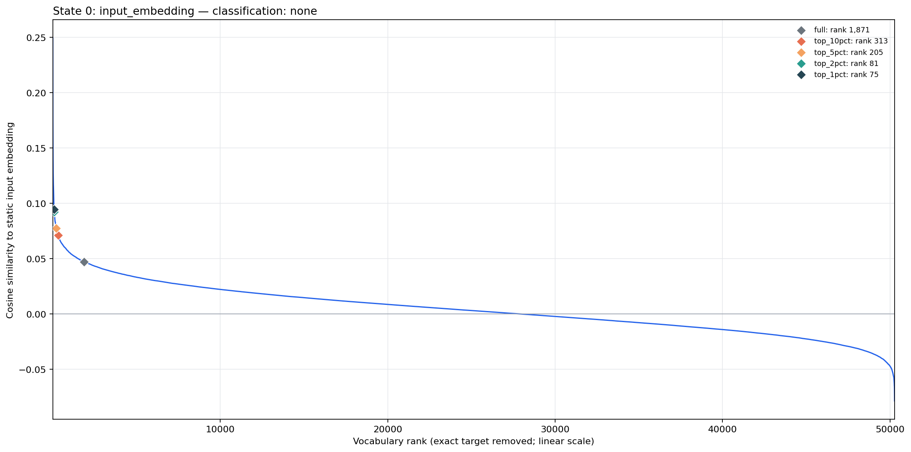
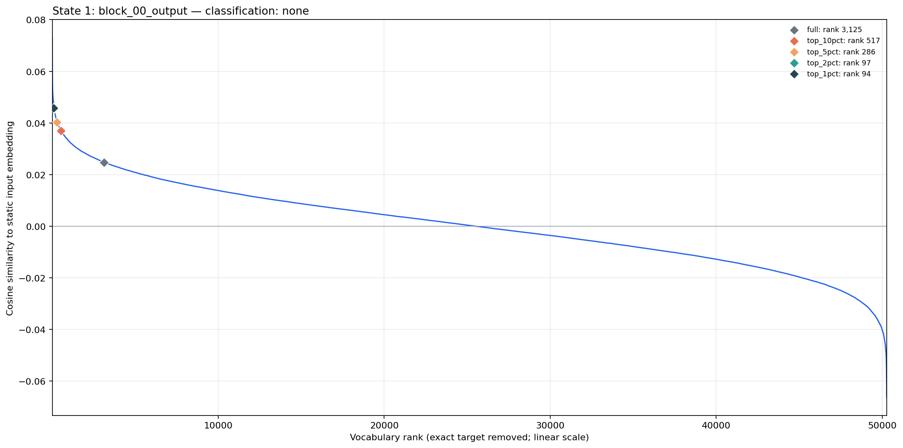
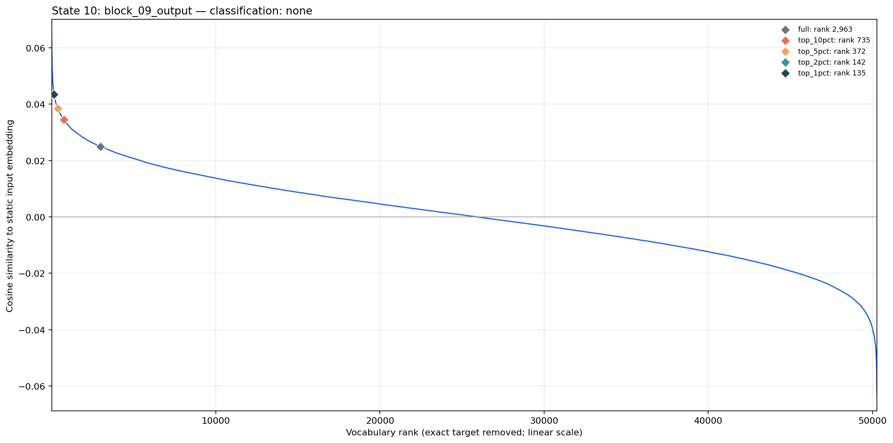
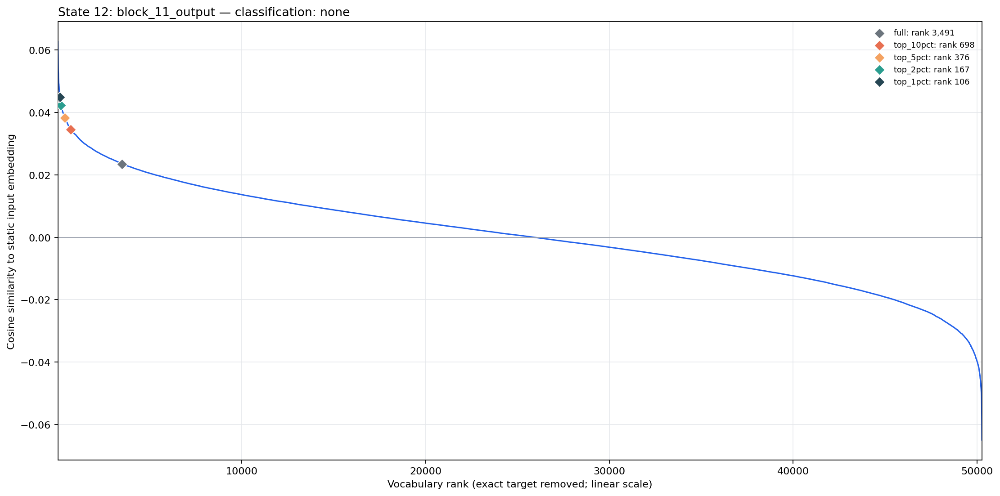
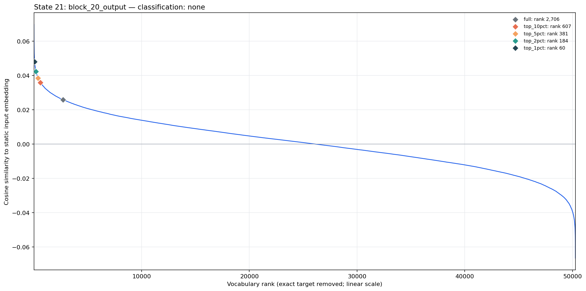
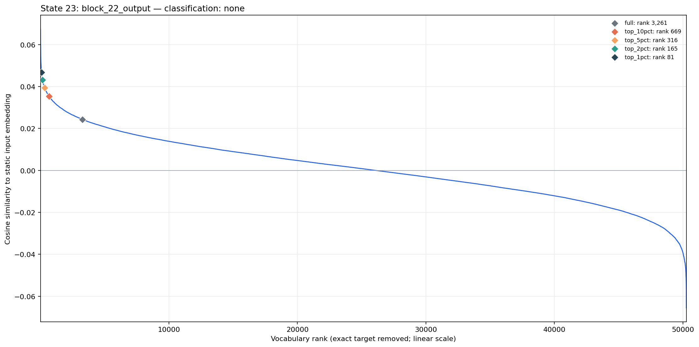
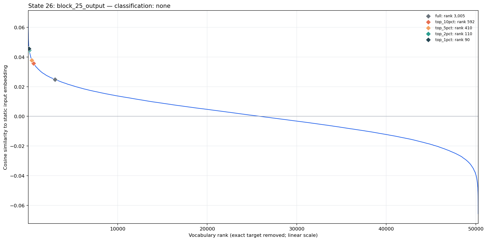
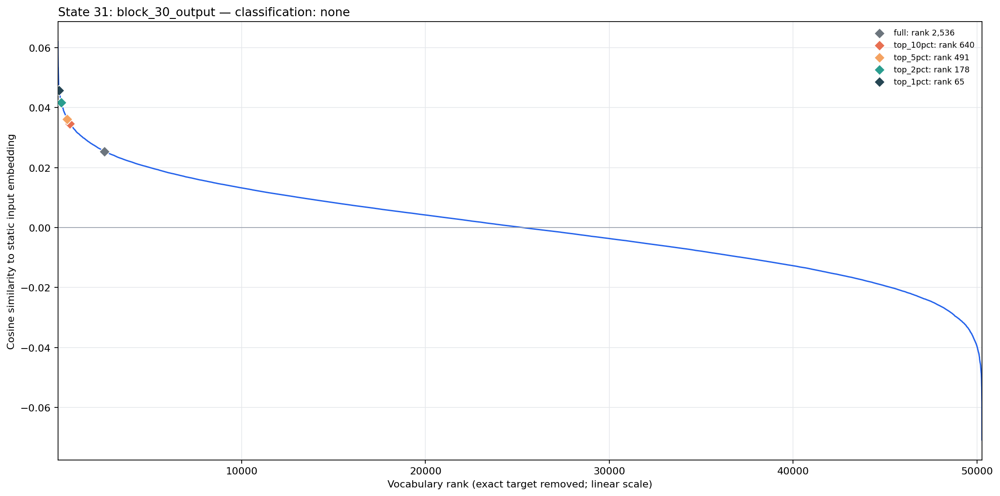
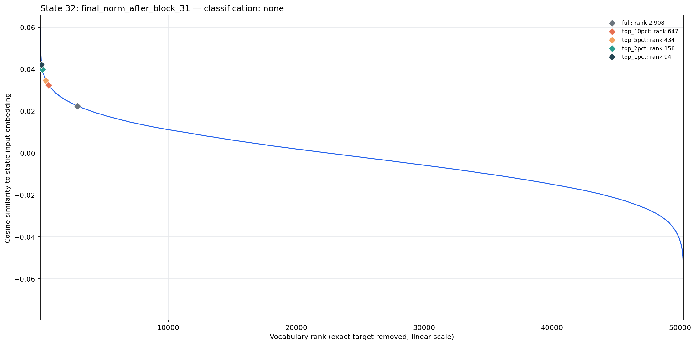
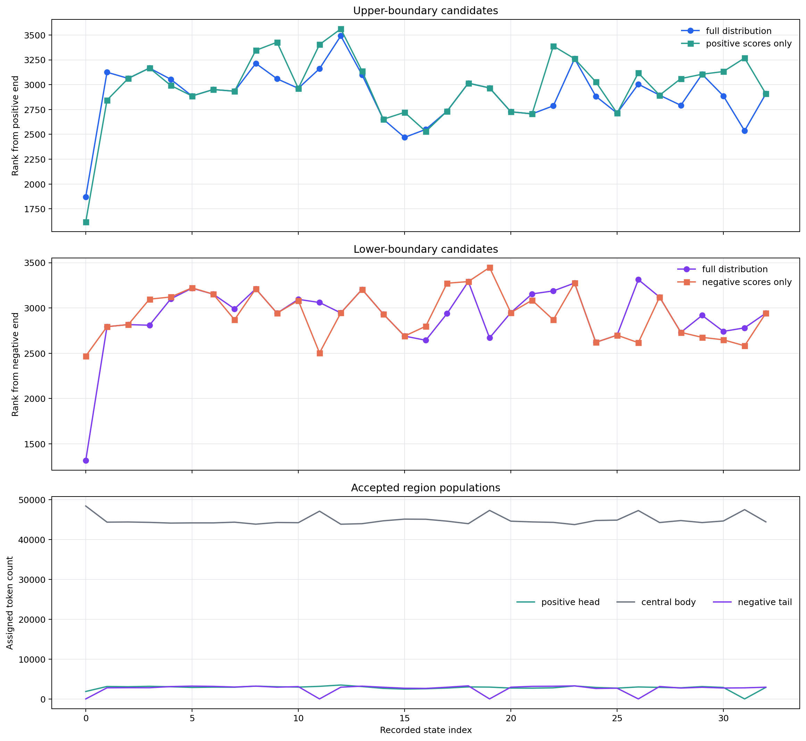

# LLM Topology Meta-analysis

## Agent usage instructions

This file is the chronological interpretive record for the LLM semantic
topology project. Agents working on the project must use it as follows:

1. Before adding an entry, read the canonical operating rules in
   `D:\Sync\zzCodexLearnings\AGENTS.md`, the project `README.md`, this section,
   and the manifest for every run discussed by the entry.
2. Treat existing entries as an append-only historical record. Do not silently
   rewrite, reorder, summarize or remove an earlier entry. Append a dated
   correction that cites the affected entry when a correction is necessary.
3. Assign entries sequential IDs in the form `MA-NNNN`. Never reuse an entry
   ID, including for corrections, failed runs or inconclusive analyses.
4. Timestamp every entry in ISO 8601 format with its UTC offset and record the
   named timezone. Use `Australia/Sydney` unless the project owner directs
   otherwise. If an original post time is unavailable, record the time the
   entry was added and state that limitation.
5. Record the author or source, entry type, related run IDs and preservation
   mode. Content marked `verbatim` must remain exactly as posted.
6. Keep directly observed findings, project-owner thoughts, assistant thoughts,
   limitations, decisions and proposed next steps explicitly separate. Do not
   convert an interpretation into a finding through repetition.
7. Link findings to a run manifest or artifact where possible. Preserve the
   distinction between behavioural observations, model-generated explanation,
   measured internal representations and causal conclusions.
8. Record negative, failed and ambiguous results. Do not allow the file to
   become a success-only narrative.
9. Use neutral run names chosen before results are inspected. When an entry
   reanalyses existing tensors rather than creating a new capture, identify its
   source run explicitly.
10. Keep machine-generated measurements in manifests and artifacts. Use this
    file for chronology, interpretation, disagreement, methodological changes
    and decisions rather than duplicating complete data tables.

## Entries

### MA-0001 — Semantic map of the project thread

- Entry timestamp: `2026-11-12T19:01:12+11:00`
- Timezone: `Australia/Sydney`
- Author: `Codex assistant`
- Entry type: `thread semantic map`
- Related runs: `R001`
- Preservation mode: `verbatim`
- Source: immediately preceding assistant response in the project thread
- Timestamp note: the original UI post time was unavailable; the entry timestamp
  records when this verbatim response was added to the project file

#### Verbatim input

The thread forms a clear progression from broad research theory to a specific measurable object, followed by experimental-governance requirements.

Legend: `[DONE]`, `[DECIDED]`, `[PLANNED]`, `[OPEN]`

```text
LLM SEMANTIC TOPOLOGY RESEARCH
|
|-- 1. Research foundations
|   |
|   |-- [DONE] Project handover supplied
|   |   |-- Semantic conflict in language models
|   |   |-- Internal representation geometry
|   |   |-- Relationship between behaviour and hidden structure
|   |   `-- Need to separate observation, interpretation and causation
|   |
|   |-- [DONE] Zombie-survival ChatGPT case examined
|   |   |-- Behavioural evidence of unstable/conflicting answers
|   |   |-- Demonstrates limitations of model self-explanation
|   |   |-- Does not directly measure internal representations
|   |   `-- Provides possible controlled stimuli for later experiments
|   |
|   `-- [DONE] External Gemini/Qwen discussion considered as context
|
|-- 2. Central research question
|   |
|   |-- How does a token's semantic neighbourhood change through a transformer?
|   |
|   |-- Initial hypotheses
|   |   |-- Final layer may be especially important
|   |   |-- Intermediate layers may contain more useful structure
|   |   `-- The optimal analytical layer should be tested, not assumed
|   |
|   `-- Intended eventual analysis
|       |-- Identify semantic neighbourhoods
|       |-- Detect topic-like groups
|       |-- Track their development across layers
|       `-- Determine which layers offer the most informative structure
|
|-- 3. Project infrastructure
|   |
|   |-- [DONE] Independent local Git repository
|   |   `-- D:\Sync\Python Projects\llm_topology
|   |
|   |-- [DONE] Published analysis copy
|   |   `-- chatgpt-analysis/projects/llm-topology
|   |
|   |-- [DECIDED] Repository roles
|   |   |-- Local repository = authoritative working project
|   |   `-- GitHub subproject = curated material for ChatGPT analysis
|   |
|   |-- [DONE] Shared model storage established
|   |   `-- D:\AI\cache\huggingface
|   |
|   `-- [DONE] Cross-project model-storage rule documented
|       `-- D:\Sync\zzCodexLearnings\AGENTS.md
|
|-- 4. Model familiarisation
|   |
|   |-- [DONE] Pythia prompt playground created
|   |
|   |-- Model progression
|   |   |-- Pythia 410M
|   |   |   `-- Lightweight initial behavioural baseline
|   |   |
|   |   |-- Pythia 6.9B
|   |   |   `-- Practical balance for representation analysis
|   |   |
|   |   `-- Pythia 12B
|   |       `-- Fits narrowly on the RTX 4090 but limits experimental headroom
|   |
|   |-- [DONE] Notebook made model-switchable
|   |
|   `-- [DECIDED] Smaller models remain scientifically useful
|       |-- Faster iteration
|       |-- More layers/prompts can be examined
|       `-- Greater experimental control
|
|-- 5. Representation-object clarification
|   |
|   |-- Input embedding matrix
|   |   |-- Static vocabulary-scale representation
|   |   `-- Provides interpretable semantic neighbours
|   |
|   |-- Hidden states
|   |   |-- Contextual token representations
|   |   |-- Change through transformer states
|   |   `-- Are not themselves vocabulary embedding matrices
|   |
|   |-- Final predictions
|   |   |-- Generation-facing probabilities
|   |   `-- Must not be treated as equivalent to embedding similarity
|   |
|   `-- [DECIDED] These objects must remain analytically distinct
|
|-- 6. Proof-of-concept scope
|   |
|   |-- [DECIDED] One prompt
|   |   `-- Battery demand, mineral supply, electric vehicles, and
|   |       energy storage all shape the market for lithium
|   |
|   |-- [DECIDED] One target token
|   |   `-- " lithium"
|   |
|   |-- [DECIDED] One model
|   |   `-- EleutherAI/pythia-6.9b
|   |
|   `-- Initial purpose
|       |-- Validate hidden-state capture
|       |-- Inspect available outputs
|       `-- Determine which outputs deserve further development
|
|-- 7. R001: Lithium initial output inspection
|   |
|   |-- [DONE] Successful model execution
|   |   |-- 33 recorded representation states
|   |   |-- 19 prompt tokens
|   |   |-- 4096 hidden dimensions
|   |   `-- Artifact hashes verified
|   |
|   |-- Produced artifacts
|   |   |
|   |   |-- hidden_states.safetensors
|   |   |   `-- Primary captured representation data
|   |   |
|   |   |-- semantic_neighbors.csv
|   |   |   |-- Input-embedding cosine neighbours
|   |   |   `-- Final-prediction probabilities
|   |   |
|   |   |-- target_relationships.csv
|   |   |   `-- Target-to-prompt-token similarities by state
|   |   |
|   |   |-- layer_metrics.csv
|   |   |   `-- Norm, distance and angular diagnostics
|   |   |
|   |   |-- tokens.csv
|   |   |   `-- Tokenization and target-position provenance
|   |   |
|   |   `-- Figures
|   |       |-- Target trajectory
|   |       |-- Target relationships
|   |       `-- Prompt-token similarity by selected state
|   |
|   `-- [DONE] Meaningful run identity assigned
|       `-- R001_lithium-initial-output-inspection__
|           20261112T063540Z_pythia-6.9b_52ff8f97c2
|
|-- 8. Interpretation of R001
|   |
|   |-- Project-owner assessment
|   |   |
|   |   |-- layer_metrics
|   |   |   `-- Not immediately useful as a primary analytical result
|   |   |
|   |   |-- semantic_neighbors
|   |   |   |-- decoded_token is useful
|   |   |   `-- input_embedding results are the most useful output
|   |   |
|   |   |-- target_relationships
|   |   |   |-- Evolution of other_token is interesting
|   |   |   `-- Probably secondary to the wider vocabulary relationships
|   |   |
|   |   `-- tokens.csv
|   |       |-- Interesting for confirming the true target
|   |       `-- Not a primary analytical result
|   |
|   `-- Assistant interpretation
|       |
|       |-- layer_metrics
|       |   |-- Diagnostic rather than semantic
|       |   `-- May reveal architectural boundaries such as final normalization
|       |
|       |-- target_relationships
|       |   `-- Measures prompt-local rather than vocabulary-scale structure
|       |
|       |-- tokens.csv
|       |   `-- Provenance and quality-control evidence
|       |
|       `-- Missing primary object
|           `-- Vocabulary-scale semantic neighbours at every model state
|
|-- 9. Semantic-neighbour cutoff problem
|   |
|   |-- Proposed neighbourhood definition
|   |   `-- Include tokens whose semantic-neighbour score passes a cutoff
|   |
|   |-- Current score meanings
|   |   |-- input_embedding score = cosine similarity
|   |   `-- final_prediction score = probability
|   |
|   |-- [DECIDED] Different metrics cannot be mixed into one cutoff
|   |
|   |-- Raw-score cutoff
|   |   |-- Defines a fixed geometric radius
|   |   |-- Allows neighbourhood expansion and contraction
|   |   `-- Requires sensitivity analysis
|   |
|   |-- Elbow cutoff
|   |   |-- Can be applied to any ranked continuous score distribution
|   |   |-- Must be applied separately by state, source and metric
|   |   |-- Produces an adaptive boundary
|   |   `-- Must be allowed to report "no viable elbow"
|   |
|   `-- Important caveats
|       |-- Current top-20 list is too truncated
|       |-- Lexical fragments may form their own apparent elbow
|       |-- An elbow is mathematical structure, not automatically semantic
|       `-- Cutoff movement must be separated from token-score movement
|
|-- 10. Next analytical experiment
|   |
|   |-- [PLANNED] Calculate full vocabulary score vectors
|   |   |
|   |   |-- For every recorded model state
|   |   |-- Target representation compared with every input embedding
|   |   `-- Approximately 33 x 50,000 scores
|   |
|   |-- [DECIDED] Do not calculate a 50,000 x 50,000 matrix yet
|   |
|   |-- [PLANNED] Determine cutoff viability for every state
|   |   |
|   |   |-- Elbow rank
|   |   |-- Elbow score
|   |   |-- Elbow strength
|   |   |-- Score gap
|   |   `-- Status: viable, weak or none
|   |
|   |-- [PLANNED] Preserve both analytical views
|   |   |-- Adaptive elbow neighbourhood
|   |   `-- Fixed raw-score neighbourhood
|   |
|   `-- [DEFERRED] Relations and topic modelling
|       |-- Token entry and exit
|       |-- Persistence
|       |-- Neighbourhood overlap
|       |-- Token-relation graphs
|       `-- Topic/community evolution
|
`-- 11. Experimental governance
    |
    |-- [DONE] Run-naming convention established
    |   `-- RNNN_<target>-<purpose>__<UTC>_<model>_<prompt-hash>
    |
    |-- [DECIDED] Naming principles
    |   |-- Purpose chosen before inspecting results
    |   |-- No result-biased names
    |   |-- Run numbers never reused
    |   `-- Failed and invalid runs remain part of the sequence
    |
    |-- [PLANNED] Meta-analysis record
    |   |
    |   |-- Findings
    |   |-- Project-owner thoughts
    |   |-- Assistant thoughts
    |   |-- Limitations and confounds
    |   |-- Decisions
    |   `-- Next task
    |
    `-- [OPEN] Meta-analysis design decisions
        |-- Exact file structure
        |-- Run-entry template
        |-- How much verbatim conversation to preserve
        |-- How to distinguish evidence from retrospective interpretation
        `-- How derived analyses should reference their source run
```

The central semantic sequence is:

```text
broad theory
    -> model familiarisation
        -> single-prompt capture
            -> inspection of available outputs
                -> input-embedding neighbours identified as primary
                    -> full-vocabulary layerwise scoring proposed
                        -> cutoff viability becomes the next experiment
                            -> repeated runs require formal meta-analysis
```

### MA-0002 — Contextual relationship networks versus static-basis neighbours

- Entry timestamp: `2026-11-12T19:16:56+11:00`
- Timezone: `Australia/Sydney`
- Authors: `ChatGPT external analysis`; `Codex assistant follow-on`
- Entry type: `external methodological analysis and follow-on assessment`
- Related runs: `R001`
- Preservation mode: `verbatim`
- Source: ChatGPT response supplied by the project owner, followed by the
  immediately preceding Codex response in the project thread
- Timestamp note: the original ChatGPT UI post time was unavailable; the entry
  timestamp records when both verbatim responses were added to the project file

#### External ChatGPT response (verbatim)

The objective is therefore to determine where semantic relationships become most useful, how they change, and whether particular transformer layers organise topics more effectively than others.

That requires comparing semantic neighbourhoods across layers, not merely tracking individual token vectors.

## Proposed measurement
```sql
CONTROLLED TOKEN SET
        |
        v
Capture contextual representations
at every transformer layer
        |
        v
For each layer:
    |
    +-- Calculate pairwise token similarities
    +-- Rank semantic neighbours
    +-- Identify meaningful cutoffs
    +-- Construct relationship networks
    `-- Identify topic clusters
        |
        v
COMPARE LAYERS
    |
    +-- Which relationships persist?
    +-- Which relationships emerge?
    +-- Which relationships disappear?
    +-- Which topics become more distinct?
    +-- Which topics become interconnected?
    `-- Which layers recover known relationships best?
```

## The critical methodological distinction

|   |
| - |

Comparison

|   |
| - |

What it measures

|   |
| - |

Contextual token vs static input embedding

|   |
| - |

Compatibility with the original embedding basis

|   |
| - |

Contextual token vs contextual token at the same layer

|   |
| - |

How semantic relationships are organised at that layer

|   |
| - |

Relationship networks across layers

|   |
| - |

How that organisation evolves

The second comparison should become the primary measurement.

The static embedding neighbourhood remains useful as a baseline.

## How to establish semantic usefulness

A layer should not be considered superior merely because its clusters are tighter.

It should be evaluated against independently established relationships.

For example:

- Accuracy: Does it recover known topic associations?
- Separation: Does it distinguish unrelated topics?
- Stability: Do relationships survive changes in context?
- Connectivity: Does it recover meaningful relationships between topics?
- Generalisability: Do results hold for unseen tokens and contexts?

Neighbour cutoffs should be evaluated for stability, since differences in similarity distributions across layers can otherwise create artificial changes in network structure.

## The key distinction

There are two questions:

1\. Descriptive

> How do semantic relationships evolve across transformer layers?

2\. Evaluative

> Which layers most reliably recover meaningful semantic relationships between topics?

The first requires observing changes in neighbourhood structure.

The second requires independent evidence of what constitutes a meaningful relationship.

Recommendation: Retain the existing input-embedding analysis, but build the next experiment around pairwise contextual representations at each layer, using identical target observations and independently defined topic relationships.

This preserves the original research objective without assuming that the final layer, the most tightly clustered layer or the layer with the greatest vector displacement is necessarily the most semantically useful.

#### Codex follow-on response (verbatim)

ChatGPT’s response is methodologically important. It identifies a limitation in our proposed full-vocabulary analysis:

> Comparing each contextual `lithium` vector with the static input-embedding matrix measures how the target moves relative to a fixed vocabulary basis. It does not measure how relationships among contextualized vocabulary tokens evolve.

That does not invalidate the planned analysis, but it narrows what we can claim from it.

| Measurement | Valid interpretation |
|---|---|
| Contextual `lithium` vs static vocabulary embeddings | Which vocabulary tokens the target resembles at each layer |
| Contextual prompt token vs contextual prompt token | How relationships among observed prompt tokens evolve |
| Controlled contextual token set | How a predefined semantic system reorganizes across layers |

The ChatGPT response is right that the second or third measurement is needed if the central goal is evolving relationship networks and topic organization.

## What R001 already supports

R001 contains representations for all 19 prompt tokens at every recorded state. We can therefore construct a complete `19 × 19` contextual similarity matrix at each state without rerunning the model.

The existing `target_relationships.csv` is only one row of that matrix: `lithium` against every other prompt token.

Expanding it would allow genuinely changing contextual relationships, but it would remain limited because:

- the tokens come from one sentence rather than a controlled semantic set;
- punctuation and subword fragments are included;
- there are too few observations for credible topic clustering;
- syntactic and semantic relationships are entangled.

It would be a useful method check, not yet a topic-modelling experiment.

## A major confound not addressed in the response

Pythia is a causal language model. Tokens at different positions do not receive identical context:

- later tokens can incorporate earlier tokens;
- earlier tokens cannot incorporate later tokens;
- position and preceding context therefore affect pairwise geometry.

Putting a controlled token set into one list or sentence would not create genuinely controlled observations. A token appearing later has seen more of the set.

A stronger experiment would place each target token at the same position in a matched carrier context, for example:

```text
The concept being considered is lithium
The concept being considered is cobalt
The concept being considered is football
```

The representation at the final target position could then be compared across tokens at every layer. Multiple carrier contexts and randomized templates would later test stability.

## What this means for the planned full-vocabulary task

I would still perform it next because it:

- uses the existing R001 capture;
- directly tests whether meaningful score cutoffs exist;
- establishes the vocabulary-basis baseline;
- helps reveal lexical, chemical and contextual neighbour transitions;
- is inexpensive compared with designing a controlled-token experiment.

But it should be described more precisely as:

```text
full-vocabulary input-basis compatibility analysis
```

not as a complete map of evolving contextual token relationships.

Its output answers:

```text
At each layer, which static vocabulary embeddings are most compatible
with the contextual representation of lithium?
```

It does not yet answer:

```text
At each layer, how do contextual relationships among a semantic token
population reorganize?
```

## Recommended trajectory

```text
R001 existing capture
    |
    +-- Full-vocabulary static-basis scores
    |       `-- Test cutoff/elbow viability
    |
    +-- Full 19 x 19 prompt-token matrices
    |       `-- Validate contextual relationship tracking
    |
    `-- Controlled-token experiment
            |-- Matched contexts
            |-- Known related and unrelated groups
            |-- Complete pairwise matrices per layer
            |-- Relationship-network evolution
            `-- External evaluation of topic recovery
```

So ChatGPT is broadly right about the eventual primary measurement. The proposed full-vocabulary analysis remains the correct next calibration step, but it should be treated as a static-basis probe rather than the final form of semantic-topology analysis. The pasted response would also make a useful verbatim external-analysis entry in the meta-analysis log.

### MA-0003 — R002 static-basis cutoff feasibility result

- Entry timestamp: `2026-11-12T19:32:35+11:00`
- Timezone: `Australia/Sydney`
- Author: `Codex assistant`
- Entry type: `run result and interpretation`
- Related runs: `R002`; source run `R001`
- Preservation mode: `evidence-backed synthesized entry`
- Run manifest:
  `single_prompt_topology/runs/R002_lithium-static-basis-cutoff-feasibility__20261112T083025Z_pythia-6.9b_52ff8f97c2/manifest.json`

#### Question before the run

Does the full distribution of cosine similarities between the contextual
`lithium` representation and Pythia's static input-embedding vocabulary
support a stable, defensible elbow cutoff at any recorded state?

#### Directly observed findings

- The run completed successfully using the verified R001 hidden states. It did
  not execute another transformer forward pass.
- The persisted vocabulary score matrix has shape `[33, 50277]`. Fifteen output
  artifacts were independently checked against the hashes and sizes recorded
  in the successful manifest.
- All 33 states were classified `none` for cutoff viability when the exact
  target token was removed. All 33 were also classified `none` when it was
  retained.
- With the target removed, median candidate elbow rank was 257, with a range of
  143–334. Median candidate cutoff score was 0.0405, with a range of
  0.0369–0.0833.
- Elbow curvature was not weak: median normalized strength was 0.535, with a
  range of 0.480–0.742. The failure was stability. Relative rank median absolute
  deviation ranged from 0.404 to 0.637, and no state received consensus support
  under the predeclared window-stability rule.
- At the input-embedding state, the leading target-removed neighbours were
  `Li`, `Li`, `Lith`, `potassium`, `magnesium`, `cobalt`, `helium`, `sodium`,
  `assium`, and `odium`. These are visibly lexical or chemically related.
- Immediately after block 0, the leading input-basis matches became tokens such
  as `refreshing`, `PARTICULAR`, `administrative`, `)`, and `seeking`.
  Later-state leading matches were similarly heterogeneous and not visibly
  lithium-related.
- The exact `lithium` input embedding moved from cosine 1.000 and rank 1 at the
  input state to rank 11 after block 0, rank 120 after block 1, rank 840 after
  block 7, rank 3,088 after block 15, rank 3,262 after block 30, and rank 2,130
  in the final normalized state.
- The prompt-local contextual diagnostic produced `[33, 19, 19]` matrices.
  Mean off-diagonal cosine rose from 0.113 at the input state to 0.717 after
  block 7, 0.853 after block 15, and 0.920 after block 23. It was 0.864 after
  block 30 and fell to 0.458 after final normalization.

#### Project-owner thoughts

No post-run project-owner interpretation had been recorded when this entry was
created.

#### Assistant thoughts

- The ranked score curves contain curvature, but not a scale-independent elbow.
  Apparent cutoff rank changes substantially when the inspected upper-tail
  window changes. Selecting one of those elbows would therefore import the
  analyst's window choice into the claimed neighbourhood boundary.
- Input-embedding neighbours are coherent at the input state, but raw hidden
  states rapidly cease to be interpretable through direct cosine comparison
  with that fixed basis. This supports treating the analysis as a compatibility
  probe rather than as a layer-wise vocabulary-semantic map.
- The prompt-token matrices show a strong common-direction effect through the
  middle and late blocks. Raw contextual cosine would therefore risk producing
  artificially dense relationship networks unless centering, a null model or
  another anisotropy control is introduced.
- The negative cutoff result is informative: the current evidence does not
  justify selecting a natural full-vocabulary neighbourhood boundary at any
  recorded state under this method.

#### Limitations and confounds

- The viability classifications depend on a documented heuristic elbow method,
  analysis windows and predeclared stability thresholds. They do not prove that
  no alternative cutoff method could ever be useful.
- Only the static input-embedding basis was tested. The output/unembedding basis
  and trained intermediate decoding lenses were not tested.
- The 19 contextual prompt tokens are not a controlled semantic population;
  they contain punctuation, subword pieces, position effects and unequal causal
  context.
- The capture API preserved the final normalized state but replaced the raw
  output after the final transformer block, so those two objects cannot be
  compared from R001.
- No independently labelled topic relationships were evaluated.

#### Decisions and next step

No new methodological decision is recorded until the project owner reviews the
result. Candidate implications are to retain the input-embedding neighbourhood
as the static baseline, avoid forcing an elbow cutoff, and make controlled
contextual token relationships the next primary experimental design.

### MA-0004 — Visual cutoff reinspection and PNG record

- Entry timestamp: `2026-11-12T19:49:05+11:00`
- Timezone: `Australia/Sydney`
- Author: `Codex assistant`
- Entry type: `visual reinspection and methodological correction`
- Related runs: `R002`; source run `R001`
- Preservation mode: `derived graph-image references and verbatim assistant response`
- Run manifest:
  `single_prompt_topology/runs/R002_lithium-static-basis-cutoff-feasibility__20261112T083025Z_pythia-6.9b_52ff8f97c2/manifest.json`
- Derived-image directory:
  `single_prompt_topology/reports/R002_cutoff_score_curves_png/`
- Derivation script:
  `single_prompt_topology/export_cutoff_score_pngs.py`
- Artifact note: these PNGs were generated after the successful R002 run from
  its verified `vocabulary_scores.safetensors` and cutoff tables. They are
  inspection reports outside the immutable R002 run manifest.

#### Relationship to MA-0003

MA-0003 correctly records the pipeline result that all states failed the
predeclared cross-window cutoff-consensus rule. Visual inspection subsequently
showed that this result should not be paraphrased as absence of a visible
full-curve elbow. The full-curve elbow is consistent across states, while its
absolute rank changes when the curve is truncated and renormalized. The
distinction is between a visible global candidate and a scale-independent
cutoff validated across differently sized analysis windows.

#### Overview graph


#### Individual state graphs

<details>
<summary>Expand all 33 full-resolution state plots</summary>

##### State 00 — input embedding



##### State 01 — block 00 output



##### State 02 — block 01 output


##### State 03 — block 02 output


##### State 04 — block 03 output


##### State 05 — block 04 output


##### State 06 — block 05 output


##### State 07 — block 06 output


##### State 08 — block 07 output


##### State 09 — block 08 output


##### State 10 — block 09 output



##### State 11 — block 10 output


##### State 12 — block 11 output



##### State 13 — block 12 output


##### State 14 — block 13 output


##### State 15 — block 14 output


##### State 16 — block 15 output


##### State 17 — block 16 output


##### State 18 — block 17 output


##### State 19 — block 18 output


##### State 20 — block 19 output


##### State 21 — block 20 output



##### State 22 — block 21 output


##### State 23 — block 22 output



##### State 24 — block 23 output


##### State 25 — block 24 output


##### State 26 — block 25 output



##### State 27 — block 26 output


##### State 28 — block 27 output


##### State 29 — block 28 output


##### State 30 — block 29 output


##### State 31 — block 30 output



##### State 32 — final norm after block 31



</details>

#### Verbatim assistant response

You were right: the PNGs show a clear global knee. The earlier `none` classification was misleading.


Across the 33 states, the full-curve elbow occurs at:

- Range: rank 1,871–3,491
- Median: rank 2,934
- Middle 50%: rank 2,733–3,063
- Approximately 4–7% of the vocabulary

The problem is methodological: the classifier required the elbow’s absolute rank to remain stable after repeatedly truncating and renormalising the curve. That produces different knees by construction. For state 0, for example, the candidate ranks were 313, 205, 81 and 75 across the truncated windows, so the classifier rejected the visually obvious full-curve elbow at 1,871.

The plots actually show nested structure:

1. A small, high-similarity head.
2. A clear global shoulder around 2,000–3,500 tokens.
3. A long central body.
4. A sharp negative tail.

Therefore, the correct conclusion is:

> A consistent global cutoff candidate exists, but its semantic usefulness has not yet been established.

The next methodological correction should report the full-curve elbow as the primary candidate and retain the truncated-window elbows as a multiscale diagnostic—not use their disagreement to erase the global cutoff.

I exported 33 individual plots plus the [overview PNG folder](</D:/Sync/Python Projects/llm_topology/single_prompt_topology/reports/R002_cutoff_score_curves_png>) using the reproducible [export script](</D:/Sync/Python Projects/llm_topology/single_prompt_topology/export_cutoff_score_pngs.py>). Nothing was committed or pushed.

### MA-0005 — Why the negative tail belongs in topology analysis

- Entry timestamp: `2026-11-12T19:53:39+11:00`
- Timezone: `Australia/Sydney`
- Author: `Codex assistant`
- Entry type: `methodological interpretation`
- Related runs: `R002`; source run `R001`
- Preservation mode: `verbatim`
- Source: immediately preceding assistant response in the project thread
- Timestamp note: the original UI post time was unavailable; the entry timestamp
  records when this verbatim response was added to the project file

#### Verbatim assistant response

Because your real interest is not merely “which tokens are nearest to lithium?” It is the larger semantic organisation created around the prompt representation. That organisation potentially includes attraction, neutrality, contrast and opposition.

The ranked curve can be interpreted as three regions:

- Top tokens: strongly aligned with the contextual `lithium` vector.
- Middle tokens: approximately orthogonal or weakly related under this measurement.
- Negative tail: aligned in the opposite direction in the static embedding basis.

So excluding the negative tail discards one side of the geometry. It could contain useful information about:

- the boundary separating the neighbourhood from the rest of the vocabulary;
- whether the representation develops a contrasting semantic pole;
- tokens moving from positive to negative alignment across layers;
- tokens moving from the negative tail into the leading neighbourhood;
- whether the positive neighbourhood becomes more sharply separated;
- whether the entire score distribution rotates, compresses or polarises.

However, the relationship between a negative token and a top token is currently only indirect. Given target vector \(h\):

```text
top token:       cosine(h, token) is strongly positive
negative token:  cosine(h, token) is negative
```

This does not determine:

```text
cosine(top token, negative token)
```

The two tokens occupy opposite sides of the target’s projection axis, but they are not necessarily semantic opposites or even directly dissimilar. The current analysis reduces each token to one relationship with `lithium`; it does not measure relationships among the vocabulary tokens themselves.

That is probably the source of your intuition: the top-token cutoff identifies a neighbourhood, but it does not describe the topology surrounding that neighbourhood. The negative tail supplies potential contrast information that nearest-neighbour analysis alone cannot provide.

I would therefore treat the regions separately:

1. Positive head — candidate semantic neighbourhood.
2. Central body — background or null comparison population.
3. Negative tail — candidate opposition or anti-alignment population.

Then track across layers:

- membership in each region;
- score and rank trajectories;
- positive-to-negative and negative-to-positive crossings;
- direct pairwise relationships within and between the positive and negative sets;
- whether results survive centering or whitening the embedding space.

The important caution is that “negative” should initially be labelled anti-aligned, not suppressed or semantically opposed. If the bottom tokens form coherent contrasting groups—and this persists after geometric controls—then semantic opposition becomes a testable interpretation rather than an assumption.

### MA-0006 — R003 pre-run decision and housekeeping contract

- Entry timestamp: `2026-11-12T20:00:33+11:00`
- Timezone: `Australia/Sydney`
- Author: `project owner and Codex assistant`
- Entry type: `project-owner directive and pre-run contract`
- Related runs: planned `R003`; source run `R002`; ultimate source run `R001`
- Preservation mode: `verbatim project-owner directive and synthesized plan`
- R002 manifest:
  `single_prompt_topology/runs/R002_lithium-static-basis-cutoff-feasibility__20261112T083025Z_pythia-6.9b_52ff8f97c2/manifest.json`
- R003 plan: `single_prompt_topology/R003_PLAN.md`

#### Project-owner directive — verbatim

use r002 where possible, but carry this out as r003. ensure all housekeeping documentation is taking place. first carry out the housekeeping, then report status.

#### Decisions recorded before implementation

- `R003` is reserved and will not be reused. Its neutral run name is
  `lithium-score-region-boundaries`.
- R003 is a derived reanalysis of R002. It will hash-validate and reuse R002's
  vocabulary scores, token metadata and full-curve upper-elbow candidates.
- No transformer forward pass, model-weight load, download or score-matrix
  recalculation is authorized for R003.
- The primary objects are a layer-specific upper geometric boundary, a
  layer-specific lower geometric boundary and the three resulting token
  regions: positive head, central body and negative tail.
- Full-distribution and sign-restricted candidates are endpoint-sensitivity
  comparisons. The prior R002 truncated-window results remain multiscale
  diagnostics and no longer act as the R003 cutoff-consensus classifier.
- Negative cosine is recorded as anti-alignment in the static input-embedding
  basis, not as statistical, predictive or causal suppression.
- Detailed methods, the `0.20` candidate-agreement tolerance, required outputs,
  success conditions, failure conditions and scope boundaries are fixed in
  `single_prompt_topology/R003_PLAN.md` before implementation.

#### Inferred question

Can the existing R002 full-vocabulary score distributions define reproducible
upper and lower layer-specific boundaries that support inspection of positive,
central and anti-aligned token populations without overstating them as causal
or fully contextual vocabulary relationships?

#### Successful outcome

An operationally successful R003 validates its R002 inputs, completes every
required component and hashes every planned artifact. The scientific outcome
may accept two boundaries, accept only one boundary or reject both as unstable.
A documented negative result remains a successful experiment.

#### Unsuccessful or inconclusive outcome

The analysis is inconclusive if boundary candidates are invalid or disagree
beyond the predeclared tolerance. The run is unsuccessful if provenance checks,
required components, output creation or artifact hashing fail.

#### Scope-drift indicators

R003 moves out of scope if it introduces new prompts or models, transformer
execution, topic modelling, clustering, causal or logit analysis, post-inspection
threshold adjustment, alternative embedding bases or claims that static
vocabulary embeddings acquire evolving pairwise contextual relationships.

#### Housekeeping status at entry creation

- The R003 identity and lineage are reserved.
- The pre-run plan and output contract are documented.
- The root and pipeline READMEs describe R002 reuse and R003's planned status.
- No implementation file or R003 run directory has been created.
- No R003 computation has been executed.

### MA-0007 — R003 score-region boundary result

- Entry timestamp: `2026-11-12T20:09:01+11:00`
- Timezone: `Australia/Sydney`
- Author: `Codex assistant`
- Entry type: `run result, validation and interpretation`
- Related runs: `R003`; source run `R002`; ultimate source run `R001`
- Preservation mode: `evidence-backed synthesized entry`
- Run manifest:
  `single_prompt_topology/runs/R003_lithium-score-region-boundaries__20261112T090711Z_pythia-6.9b_52ff8f97c2/manifest.json`
- Pre-run contract: `single_prompt_topology/R003_PLAN.md`

#### Project-owner authorization

The project owner instructed the assistant to proceed after the R003
housekeeping phase. No post-run project-owner interpretation had been recorded
when this entry was created.

#### Directly observed findings

- R003 completed successfully in approximately 9.4 seconds. All five required
  components completed, all five required R002 source artifacts passed hash and
  size validation, and all six R003 output artifacts independently matched the
  hashes and sizes recorded in the manifest.
- The run reused the R002 `[33, 50277]` score matrix on the CPU. It did not load
  model weights, execute a transformer forward pass or recalculate vocabulary
  scores.
- Upper geometric boundaries were accepted at 32 of 33 states. State 31
  (`block_30_output`) was rejected because its full and positive-only candidate
  ranks differed by 0.2522 relative to their median, exceeding the predeclared
  0.20 tolerance.
- Lower geometric boundaries were accepted at 29 of 33 states. They were
  rejected at the input embedding and after blocks 10, 18 and 25. Their relative
  candidate-rank differences were 0.6089, 0.2003, 0.2544 and 0.2351.
- Twenty-eight states accepted both boundaries, four accepted only the upper
  boundary, and one accepted only the lower boundary. No state rejected both.
- Full-distribution upper candidate ranks ranged from 1,871 to 3,491 with a
  median of 2,934. Their cosine thresholds had a median of 0.02483; the input
  embedding was the high outlier at 0.04708.
- Full-distribution lower candidate ranks, measured from the negative end,
  ranged from 1,316 to 3,313 with a median of 2,942. Their original cosine
  thresholds had a median of -0.02415; the input embedding was the low outlier
  at -0.03576 and its lower boundary was rejected.
- The accepted regions produced 178,979 state-token tail memberships. The union
  contained 23,543 token IDs, recorded across all states as 776,919 trajectory
  rows.
- The median local pre-boundary to post-boundary gap ratio was 1.43 for upper
  candidates and 1.53 for lower candidates. The curves change slope rather than
  exhibiting a discrete score discontinuity.
- The input embedding's leading positive-head tokens remained visibly lexical
  or chemically related to lithium. Tokens immediately around its upper
  boundary at rank 1,871 were heterogeneous. Leading positive and negative
  tokens and boundary-adjacent tokens at the inspected later states were also
  heterogeneous, with no directly observed semantic contrast transition.
- Among the 23,543 trajectory tokens, the mean recorded region-change rate
  between consecutive states was 10.2%. This includes artificial transitions
  where a boundary was rejected and its corresponding tail was left empty, so
  it must not be read as a pure semantic-change measurement.

#### Figures




#### Assistant thoughts

- R003 supports a reproducible broad upper geometric partition at almost every
  state and a broad lower geometric partition at most states under the
  predeclared method. This corrects the overly strong R002 interpretation that
  no useful full-curve boundary was present.
- The result does not yet support calling either boundary semantic. In
  particular, the broad tails contain thousands of tokens, boundary-adjacent
  tokens do not show a visible semantic transition and later-state leaders are
  not visibly organised around lithium.
- The negative tail is now measurable as an anti-aligned population, but it is
  not evidence of downweighting, suppression or a coherent opposite topic.
- Membership trajectories can describe changes in compatibility with the
  contextual target. They cannot show evolving pairwise contextual geometry
  among the static vocabulary embeddings.

#### Limitations

- The 0.20 agreement tolerance and elbow method are preregistered heuristics,
  not independently validated semantic criteria.
- Sign-restricted candidates use zero cosine as an endpoint-sensitivity
  partition even though zero is not a statistical or predictive boundary.
- Only one prompt, one target token and the static input-embedding basis were
  analysed.
- No external semantic labels, topic-recovery benchmark, centering, whitening
  or alternative basis were used.
- Rejected boundaries produce empty corresponding regions, which inflates some
  apparent transition counts when a boundary disappears or reappears.

#### Decision and next step

R003 is accepted as a successful geometric-boundary analysis. Its overall
interpretive decision is `accepted_geometric_boundaries_only`; no semantic
boundary or suppression claim is accepted. Before topic modelling, the next
decision is whether to evaluate semantic enrichment within the accepted tails
against matched central-body controls or to move to the controlled contextual
token experiment described in MA-0002.

### MA-0008 — Cutoff abstraction-inflation correction

- Entry timestamp: `2026-11-12T20:18:35+11:00`
- Timezone: `Australia/Sydney`
- Author: `Codex assistant`
- Entry type: `methodological correction`
- Related runs: `R003`; source run `R002`
- Preservation mode: `verbatim`
- Source: immediately preceding assistant response in the project thread
- Timestamp note: the original UI post time was unavailable; the entry timestamp
  records when this verbatim response was added to the project file

#### Verbatim input

The abstraction inflation occurred when I turned “calculate an elbow cutoff” into “validate and accept a semantic boundary.”

A cutoff candidate was successfully calculated for every layer and tail. I then added unnecessary machinery:

- Recalculated the elbow using both the full score distribution and a sign-restricted distribution.
- Required their ranks to agree within an arbitrary 20% tolerance.
- Classified cutoffs as “accepted” or “rejected.”
- Left the accepted-cutoff fields blank when that validation failed.

That extra test does not determine whether an elbow exists. It only measures whether two different versions of the calculation produce similar ranks. Those versions operate on different populations, so disagreement is not inherently grounds for discarding either cutoff.

The clearest example is block 10’s lower cutoff: it was rejected because its disagreement was 20.025%, just 0.025 percentage points beyond the chosen tolerance. That is procedural brittleness, not evidence that no cutoff could be calculated.

The simpler and more appropriate treatment is:

1. Calculate the cutoff rank and score for every layer.
2. Save it unconditionally.
3. Retain the alternative estimate as a sensitivity measure.
4. Label disagreements as `stable` or `sensitive`, rather than `accepted` or `rejected`.
5. Test later whether these geometric cutoffs correspond to meaningful semantic regions.

So my earlier statement that some cutoffs “could not be established” was misleading. The cutoffs were calculated; five were merely rejected by an additional validation rule I introduced. The current report preserves those candidate values, but the blank accepted-cutoff fields reflect this unnecessary abstraction.

### MA-0009 — R004 ungated full-curve cutoff result

- Entry timestamp: `2026-11-12T20:28:02+11:00`
- Timezone: `Australia/Sydney`
- Author: `project owner and Codex assistant`
- Entry type: `project-owner directive, corrective run result and decision`
- Related runs: `R004`; corrects `R003`; source run `R002`; ultimate source run
  `R001`
- Preservation mode: `verbatim project-owner directive and evidence-backed
  synthesized result`
- Run manifest:
  `single_prompt_topology/runs/R004_lithium-full-curve-cutoffs__20261112T092701Z_pythia-6.9b_52ff8f97c2/manifest.json`
- Pre-run contract: `single_prompt_topology/R004_PLAN.md`

#### Project-owner directive — verbatim

rerun r003 without the cutoff shenanigans. record it as r004.

#### Directly observed findings

- R004 completed successfully in approximately 11.9 seconds. All five required
  components completed, all three required R002 source artifacts passed hash
  and size validation, and all six R004 output artifacts independently matched
  the hashes and sizes recorded in the manifest.
- The run reused the R002 `[33, 50277]` score matrix on the CPU. It did not load
  model weights, execute a transformer forward pass or recalculate vocabulary
  scores.
- All 33 states received one upper and one lower full-curve cutoff. No cutoff
  was subjected to a sign-restricted comparison, tolerance or secondary
  accepted/rejected decision.
- R004's upper and lower cutoff ranks exactly match R003's corresponding
  full-distribution candidate ranks. The correction changes how those cutoffs
  are used; it does not move the elbows.
- Upper cutoff ranks range from 1,871 to 3,491 with a median of 2,934. Lower
  cutoff ranks from the negative end range from 1,316 to 3,313 with a median of
  2,942.
- The median state includes 5.84% of retained tokens in the positive head and
  5.85% in the negative tail. The median combined inclusion is 11.78%; the
  observed state range is 6.34% to 13.00%.
- R004 records 191,872 tail memberships, 12,893 more than R003. It restores the
  lower tails omitted by R003 at the input embedding and after blocks 10, 18
  and 25, containing 1,316, 3,060, 2,669 and 3,313 tokens respectively. It also
  restores the 2,536-token upper head after block 30.
- Exact-rank assignment removed one extra lower-tail membership after block 6
  that R003's score-threshold assignment had included beyond its cutoff rank.
- The union contains 24,364 token IDs and 804,012 state-token trajectory rows.
  The mean recorded region-change rate between consecutive states is 8.03%.
  This remains descriptive and is not evidence of semantic or causal change.
- Visual inspection confirmed that both cutoffs and both shaded tail regions
  appear at every selected state without accepted/rejected styling.

#### Figures


#### Assistant thoughts

- R004 is the simpler result the cutoff question required: every full-curve
  elbow is preserved as a measured cutoff, while uncertainty about semantic
  usefulness remains a separate downstream question.
- The R003 acceptance gate changed data availability rather than determining
  whether a cutoff existed. Its rejected tails created artificial empty-region
  transitions; R004 removes that artifact.
- The broad tails still contain thousands of tokens and should not yet be
  described as coherent topics, semantic opposites or suppressed alternatives.

#### Decision

R004 supersedes R003 as the primary cutoff-membership dataset. R003 remains an
immutable historical record of the discarded endpoint-agreement policy. The
next analysis should inspect relationships and semantic composition within the
R004 regions without redefining or revalidating the cutoffs.

### MA-0010 — Curvature density, coherence and topological conflict hypothesis

- Entry timestamp: `2026-11-12T20:42:00+11:00`
- Timezone: `Australia/Sydney`
- Authors: `ChatGPT external analysis`; `Codex assistant follow-on`
- Entry type: `external research framing and follow-on assessment`
- Related runs: `R004`
- Preservation mode: `verbatim`
- Source: ChatGPT response supplied by the project owner, followed by the
  immediately preceding Codex response in the project thread
- Timestamp note: the original ChatGPT UI post time and immediately preceding
  Codex response time were unavailable; the entry timestamp records when both
  verbatim texts were added to the project file

#### External ChatGPT response — verbatim

The key is to explain that curvature density is the proposed geometric signature of competing semantic constraints, while coherence measures how consistently those constraints can be represented together.

Their relationship is a hypothesis to test, not an established mathematical equivalence.

## Curvature Density and Semantic Coherence — Research Definition

**Core hypothesis:** Regions containing competing or contradictory semantic relationships may exhibit distinctive local geometric curvature in transformer representations.

### Definitions

- **Coherence:** The degree to which semantic relationships remain mutually consistent and stable under perturbation, without excluding contradictory evidence.
- **Coherence stability:** How reliably those relationships survive changes in context, wording or additional information.
- **Semantic conflict density:** The concentration of competing or incompatible relationships within a defined semantic neighbourhood.
- **Curvature density:** A proposed measure of local geometric structure, requiring an explicitly defined curvature estimator and neighbourhood.

### Five research questions

1. Where is coherence most stable?
2. Where is coherence least stable?
3. What addition A increases coherence without suppressing evidence?
4. What addition B conceals contradiction by masking conflict?
5. What trajectory follows from A versus B?

### Hypothesised relationship
```sql
SEMANTIC RELATIONSHIPS
|
+-- Compatible constraints
|   `-- Coherence potentially stable
|
+-- Competing constraints
|   `-- Coherence potentially unstable
|       |
|       +-- A: Integrate conflicting evidence
|       |   `-- Test for stable reorganisation
|       |
|       `-- B: Conceal conflicting evidence
|           `-- Test for apparent stability
|
`-- REPRESENTATIONAL GEOMETRY
    |
    +-- Measure local curvature
    +-- Identify geometric concentrations
    +-- Compare with semantic conflict
    `-- Track changes across transformer layers
```

### Experimental requirement

Measure semantic coherence independently of geometric curvature.

Determine whether:

- High semantic conflict predicts distinctive local curvature.
- Low semantic conflict predicts different geometric properties.
- Addition A changes geometry while preserving conflicting evidence.
- Addition B changes apparent coherence without resolving the conflict.
- These relationships remain reproducible across transformer layers and controlled prompts.

Do not assume high curvature means contradiction. Positive and negative curvature can reflect different geometric structures, and neither inherently establishes semantic conflict.

**Research objective:** Determine whether local representational geometry predicts where coherence is stable, unstable, genuinely improved or merely made to appear stable.

One additional distinction matters for the current Pythia project:

The layer with the clearest topic relationships is not necessarily the layer where semantic conflict is most detectable.

Those are two separate experimental targets:
```vbnet
Topic organisation
    → Where are semantic relationships clearest?

Coherence stability
    → Where do relationships resist perturbation?

Semantic conflict
    → Where do competing constraints concentrate?

Geometric curvature
    → Does measured geometry distinguish these conditions?
```

I would have Codex establish topic organisation first, then test whether coherence stability and conflict correspond to reproducible geometric differences within the resulting neighbourhoods.

#### Codex follow-on response — verbatim

This response clarifies that my earlier interpretation was incomplete. You are not only looking for a boundary between a semantic neighbourhood and background vocabulary.

You are looking for a possible geometric and topological signature of semantic conflict.

The stronger inferred question is:

> Where do competing semantic constraints produce the greatest strain, branching or reorganisation in representational structure, and what happens to that structure when the conflict is integrated versus concealed?

## What ChatGPT gets right

The response correctly separates three things:

- Semantic conflict is the independently defined condition.
- Coherence is the independently measured behavioural or relational outcome.
- Curvature is a possible geometric correlate—not proof of either.

That prevents circular reasoning such as:

```text
high curvature → semantic conflict
semantic conflict → whatever produces high curvature
```

Its distinction between A and B is particularly important:

```text
A: integrate conflicting evidence
   → both constraints remain represented
   → relationships reorganise stably

B: conceal conflict
   → one constraint is weakened, excluded or masked
   → output appears coherent without resolving the conflict
```

The observable response might look equally coherent in both cases. Their internal trajectories may differ.

## Where topology changes the interpretation

Curvature is local geometry. Topology concerns the organisation of relationships: components, branches, bridges, bottlenecks, cycles and their persistence as the relationship threshold changes.

Competing constraints might therefore produce:

- multiple semantic components around the same target;
- bridge tokens connecting incompatible regions;
- bottlenecks where many relationships depend on a few tokens;
- branching rather than a single coherent neighbourhood;
- unstable component membership under small prompt changes;
- persistent alternative paths or cycles;
- abrupt component merging at a critical similarity threshold.

The object of interest may therefore be a region of concentrated topological change, not simply the point where a ranked score curve bends most.

```text
compatible constraints
    → one persistent relational structure

competing constraints
    → branching / bottlenecks / multiple persistent structures

genuine integration
    → stable reorganisation preserving both branches

concealment
    → apparent simplification caused by one branch disappearing
```

That last distinction may be central to the project. Genuine coherence could produce a more complex but stable topology. Concealment could produce a simpler-looking topology by deleting contradictory evidence.

## The current measurement does not yet measure this

R004 calculates maximum deviation from an endpoint chord in a one-dimensional ranked similarity curve:

```text
contextual lithium → each static vocabulary token
```

It does not calculate:

- mathematical curvature in the representation space;
- curvature density;
- token-to-token topology;
- competing semantic constraints;
- coherence stability.

R004 provides a candidate neighbourhood scale. It tells us which population to inspect. It does not yet tell us how that population is topologically organised.

Calling the R004 elbow “curvature density” would therefore overstate the evidence.

## What “topic organisation first” should mean

ChatGPT’s recommendation is sound if interpreted carefully. Before asking whether conflict deforms topology, we need a baseline showing that the measurement can recover ordinary semantic organisation.

The sequence should be:

1. Establish a controlled topic population.
2. Capture contextual representations at every layer.
3. Calculate pairwise relationships within that population.
4. Construct a graph or threshold filtration.
5. Establish its baseline components, bridges and persistence.
6. Introduce compatible versus conflicting constraints.
7. Introduce A and B.
8. Measure behavioural coherence independently.
9. Compare geometric and topological trajectories across layers.

R004 can assist with step one as a vocabulary-selection baseline, but static embeddings cannot show pairwise geometry changing through the transformer. Controlled contextual representations will be required for that.

## Strongest interpretation

I now think you are looking for:

> A critical semantic neighbourhood in which competing constraints create distinctive geometric and topological organisation, followed by the layer-wise trajectory through which the model either integrates those constraints or makes the conflict disappear.

Maximum curvature density is one proposed locator for that region. The real research object is the topology of competing relationships and its stability under controlled perturbation.

### MA-0011 — Operational cutoff capability and exact R004 calculation

- Timestamp: `2026-11-12T20:45:19+11:00`
- Timezone: `Australia/Sydney`
- Author: `Codex assistant`
- Source: the two immediately preceding Codex responses in the project conversation
- Entry type: `methodological clarification`
- Related runs: `R004`
- Preservation mode: `verbatim`
- Timestamp note: original interface post times were unavailable; this timestamp records when the material was added to the metaanalysis.

#### Operational-use conclusion — verbatim

Yes—we have established that I can calculate a useful operational cutoff.

R004 demonstrated that the method can:

- calculate an upper and lower cutoff at every layer;
- reproduce the visible full-curve elbows;
- adapt the included population to each layer rather than imposing a fixed token count;
- produce manageable positive and negative populations;
- preserve the tokens needed for composition, relationship and topology analysis.

So the cutoff is useful for defining which tokens enter the next analysis:

```text
ranked vocabulary scores
        ↓
layer-specific cutoff
        ↓
candidate token population
        ↓
pairwise relationships and topology
```

What we have not established is that the cutoff represents:

- a true semantic boundary;
- maximum mathematical curvature;
- maximum curvature density;
- a topological transition;
- semantic conflict;
- a cutoff that generalises across prompts or models.

The precise conclusion is:

> R004 provides a reproducible and practically useful population-selection cutoff. Its semantic and topological usefulness must now be tested using the relationships among the selected tokens.

That is sufficient to proceed. We no longer need to keep reworking the cutoff before examining the topology it exposes.

#### Cutoff calculation — verbatim

For each of the 33 recorded states, I began with the cosine similarity between the contextual `lithium` vector and every static vocabulary embedding:

\[
s_i=\cos(h_{\text{lithium},\,layer},e_i)
\]

The exact `lithium` token was removed, leaving 50,276 scores.

## Upper cutoff

1. Sort all scores from highest to lowest:

\[
y_1 \ge y_2 \ge \dots \ge y_N
\]

2. Normalize rank to \(x\in[0,1]\):

\[
x_i=\frac{i-1}{N-1}
\]

3. Normalize scores so the highest score is 1 and the lowest is 0:

\[
z_i=\frac{y_i-y_N}{y_1-y_N}
\]

4. Draw the straight endpoint chord:

\[
c_i=1-x_i
\]

5. Measure how far the score curve falls below that chord:

\[
d_i=c_i-z_i
\]

6. Select the rank with the largest deviation:

\[
i^*=\arg\max_i d_i
\]

That rank is the upper cutoff. The first \(i^*\) tokens become the positive head.

```text
highest score
     ●
      \
       \  endpoint chord
        \...........
         \      ↑ greatest gap
          \_____|____ score curve
                    ●
              lowest score
```

## Lower cutoff

The same calculation was applied from the negative end:

1. Sort the original scores from most negative upward.
2. Negate them so anti-alignment magnitude is descending.
3. Apply the same normalized chord-deviation calculation.
4. Convert the selected value back to its original negative cosine score.
5. Include exactly that many tokens from the negative end.

Everything between the two cutoffs becomes the central body.

## Exact membership

R004 assigns tokens by rank rather than by comparing scores with the threshold:

```text
positive head = first upper_cutoff_rank tokens
negative tail = first lower_cutoff_rank tokens from the negative end
central body  = everything else
```

This prevents tied scores from accidentally including more tokens than the calculated cutoff rank.

For example, at the input-embedding state:

- Upper cutoff: rank 1,871, score approximately `0.04708`.
- Lower cutoff: rank 1,316 from the negative end, score approximately `-0.03576`.

## What the calculation actually is

It is a maximum normalized endpoint-chord deviation method—an elbow or knee detector.

It is not:

- maximum mathematical curvature;
- a second-derivative calculation;
- curvature density in the representation space;
- a semantic or topological boundary test.

R004 also calculates descriptive diagnostics such as elbow strength, the score gap after the cutoff and local slope ratios. None of those diagnostics can reject or move the cutoff.

### MA-0012 — Proposed R005 cutoff-population topology baseline

- Entry timestamp: `2026-11-12T20:47:55+11:00`
- Timezone: `Australia/Sydney`
- Author: `Codex assistant`
- Entry type: `proposed next step`
- Related runs: `R004`; proposed `R005`
- Preservation mode: `verbatim`
- Source: immediately preceding assistant response in the project conversation
- Timestamp note: the original UI post time was unavailable; the entry timestamp records when this verbatim response was added to the project file.

#### Verbatim input

Next should be **R005: cutoff-population topology baseline**.

The immediate question is:

> Do R004’s cutoffs isolate token populations with meaningful internal relationships, and how do those relationships change across layers?

R005 should:

1. Reuse R004’s upper and lower token populations at all 33 states.
2. Load Pythia’s static input-embedding matrix from the exact existing model revision.
3. For each state, construct a cosine-similarity nearest-neighbour graph among the selected tokens.
4. Track:
   - tokens entering and leaving each population;
   - relationships that persist, emerge or disappear;
   - upper-to-upper, lower-to-lower and upper-to-lower connectivity;
   - community composition and stability across layers.
5. Compare the observed structure with size-matched random token populations. This tests whether the cutoff selects more structure than we would expect by chance.
6. Produce a small number of interpretable outputs:
   - layer-by-layer network statistics;
   - persistent and changing relationships;
   - community membership trajectories;
   - selected-layer network images;
   - a concise findings report and metaanalysis entry.

We should not calculate “curvature density” yet. First we need to establish that the selected population contains meaningful relational structure at all.

A successful R005 would show coherent groups and relationship trajectories that outperform the random baseline. An unsuccessful but useful result would show that the cutoff populations are no more structured than comparable arbitrary populations.

One important boundary remains: because the vocabulary embeddings are static, R005 would measure how the moving contextual `lithium` representation selects different regions of a fixed embedding topology. It would not yet demonstrate that the vocabulary tokens’ own contextual geometry changes through the transformer. That should be the subsequent controlled-context experiment if R005 finds usable structure.

### MA-0013 — R005 cutoff-population topology baseline findings

- Entry timestamp: `2026-11-12T21:02:51+11:00`
- Timezone: `Australia/Sydney`
- Author: `Codex assistant`
- Entry type: `experimental result and interpretation`
- Related runs: `R004`, `R005`
- Preservation mode: `synthesized from persisted artifacts`
- Primary manifest:
  `single_prompt_topology/runs/R005_lithium-cutoff-population-topology-baseline__20261112T095944Z_pythia-6.9b_52ff8f97c2/manifest.json`
- Primary artifacts: `state_topology_metrics.csv`,
  `observed_vs_random.csv`, `state_transitions.csv`,
  `persistent_edges.csv.gz`, `community_summary.csv` and the three recorded
  figures

#### Directly observed findings

1. R005 completed all seven required components successfully in approximately
   104.96 seconds. It processed all 33 R004 populations, wrote 1,918,720 exact
   directed 10-nearest-neighbour edges, evaluated 660 size-matched random
   populations and independently hash-validated all 12 output artifacts.
2. Mean nearest-neighbour cosine exceeded the random 97.5th percentile at 33
   of 33 states. The median observed-minus-random difference was `0.005669`,
   ranging from `0.004257` to `0.029047`.
3. Same-region edge fraction exceeded the random 97.5th percentile at 33 of 33
   states. The median excess was `0.179517`; the largest excess, `0.381059`,
   occurred at the input-embedding state.
4. Reciprocity did not show the same universal result. It exceeded the random
   97.5th percentile at 16 states and fell below the random 2.5th percentile at
   two states. The selected graphs are therefore not simply denser than random
   under every graph statistic.
5. The median adjacent-state membership Jaccard was `0.7561`, edge Jaccard was
   `0.5307` and state-local community adjusted Rand index was `0.3827`.
6. The input-to-block-0 transition was an extreme discontinuity: membership
   Jaccard `0.0409` and edge Jaccard `0.0032`. Stability then generally
   increased through the intermediate states.
7. The block-30-to-final-normalized transition was another discontinuity:
   membership Jaccard `0.2100` and edge Jaccard `0.0580`. The capture does not
   contain raw block-31 output, so the block-31 transformation and final layer
   normalization cannot be separated.
8. Louvain community count ranged from 11 to 15 and modularity from `0.5241`
   to `0.5733`. Community-to-region normalized mutual information was `0.2791`
   at the input embedding, `0.0121` after block 0 and `0.0134` at the median.
   Later communities therefore mixed positive and negative membership even
   though local same-region edges remained elevated.
9. There were 191,879 undirected edges present in at least two states, 34 in at
   least 30 states and none in all 33 states. Persistent examples included
   recognizable lexical relations such as `barrel`–`barrels`, but the most
   persistent list also contained long punctuation tokens and fragmentary
   tokenizer artifacts.

#### Visual inspection

- The observed-versus-random figure shows complete separation for mean
  nearest-neighbour cosine and same-region edge fraction at every state.
- The transition figure shows the input-to-block-0 and
  block-30-to-final-normalized discontinuities, with substantially higher
  stability across most intermediate states.
- The selected-state community figure shows strong red/blue region separation
  at the input state and predominantly mixed communities later. Its largest
  communities contain both recognizable lexical groupings and subword or
  punctuation structure.
- The community figure is descriptive rather than a primary measurement. Some
  labels are crowded, and the plotting font omitted the visible-space glyph;
  the CSV community summaries preserve the full labels.

#### Interpretation

R005 establishes that the R004-selected populations have reproducible local
geometric organization relative to a size-only random null. It also establishes
that relationships and population composition can be tracked across the
recorded states with the present pipeline.

It does not yet establish that the elbow cutoff isolates semantically useful
topics. Positive and negative populations were selected from opposite ends of
their cosine projection onto the same contextual target vector. Strong
same-region separation is therefore partly constructed by the selection rule
and is expected geometrically. The size-matched random null does not control
this projection, token class, morphology, frequency or score rank.

The low post-input community-to-region NMI is especially important. Local
positive-positive and negative-negative edges are elevated, but the broader
Louvain communities are usually mixed. “Positive tail versus negative tail”
and “topic-like community” are therefore not interchangeable structures.

#### Decision boundary

R005 is sufficient to retain the cutoff populations as a practical candidate
set and to retain the relationship-network pipeline. It is not sufficient to
move directly to curvature-density or semantic-conflict claims. A subsequent
experiment should either strengthen the null with score-, token-class- and
morphology-matched controls or hold a small interpretable token set fixed while
capturing its contextual representations under controlled prompt variants.

### MA-0014 — Plain-language interpretation of R005

- Entry timestamp: `2026-11-12T21:13:52+11:00`
- Timezone: `Australia/Sydney`
- Author: `Codex assistant`
- Entry type: `plain-language interpretation`
- Related runs: `R004`, `R005`
- Preservation mode: `verbatim`
- Source: immediately preceding assistant response in the project conversation
- Timestamp note: the original UI post time was unavailable; the entry timestamp records when this verbatim response was added to the project file.

#### Verbatim input

The cutoff is useful, but it has not found clean topics.

In plain terms:

- The cutoff selects tokens that are much more related to one another than a random collection of tokens. So it is finding real structure, not noise.
- Tokens from the high-score and low-score sides mostly form relationships within their own side.
- However, this separation is partly built into the method: we deliberately selected tokens from opposite ends of the same score scale.
- When we grouped the tokens into larger communities, those communities were generally mixtures of high- and low-score tokens. The two sides are therefore not two distinct topics.
- Some communities looked meaningful—chemistry, medicine, names, transport—but others were driven by word fragments, punctuation and formatting tokens.
- The selected population changed dramatically after the input embedding, became progressively more stable through the middle layers, then changed dramatically again at the final state.
- Some token relationships persisted across many layers, but these included both meaningful relationships such as `barrel`–`barrels` and meaningless tokenizer artifacts.

The strongest conclusion is:

> The cutoff provides a structured set of candidate tokens worth analysing, but it is not yet a demonstrated semantic boundary or topic detector.

We also did not observe the selected tokens themselves changing through the layers. We observed the model’s changing representation of `lithium` selecting different areas of one fixed vocabulary-embedding map.

Nothing here yet demonstrates contradiction, suppression, semantic conflict, curvature density or an optimal layer.

### MA-0015 — Split positive/negative networks and ChatGPT-readable next run

- Entry timestamp: `2026-11-12T21:21:42+11:00`
- Timezone: `Australia/Sydney`
- Authors and sources: `Codex assistant`; `project owner`
- Entry type: `methodological next-step decision`
- Related runs: `R004`, `R005`; proposed `R006`
- Preservation mode: `verbatim`
- Source note: the Codex text is the immediately preceding assistant response; the project-owner text is the decision supplied in the following instruction.
- Timestamp note: original UI post times were unavailable; the entry timestamp records when the material was added to the metaanalysis.

#### Codex response — verbatim

Yes—two separate networks per recorded state is the cleaner design.

```text
Layer/state
├── Positive-head network
└── Negative-tail network
```

This changes the question from:

> Do positive and negative tokens separate?

to the more useful questions:

> What structure exists inside the positive population?

> What structure exists inside the negative population?

For each network:

- Nodes are tokens inside that layer’s relevant cutoff.
- Edges are cosine relationships between tokens on that same side.
- Communities are calculated separately.
- Membership, edges and communities are tracked across layers.

The nearest neighbours should be recalculated separately within each side. Merely filtering R005’s combined graph could remove cross-side edges and leave some tokens with fewer than ten neighbours.

Cross-side relationships should still be preserved, but as a secondary bridge table or bipartite network:

```text
positive network ← cross-scale bridges → negative network
```

This produces 66 primary networks from the 33 recorded states. No new transformer run is required; the existing memberships and static embeddings are sufficient.

The terminology still needs care:

- “Positive” means high cosine compatibility with the contextual `lithium` vector.
- “Negative” means geometric anti-alignment.
- They do not mean good/bad, promoted/suppressed or true/false.

This design is substantially better suited to investigating topic-like organisation within each side.

#### Project-owner decision — verbatim

creating data more user friendly for chatgpt analysis will be the next run

#### Recorded status

The next run is reserved conceptually for ChatGPT-readable positive and negative network exports. No R006 plan, implementation or run directory was created by this entry.

### MA-0016 — ChatGPT semantic-network analysis role

- Entry timestamp: `2026-11-12T21:35:28+11:00`
- Timezone: `Australia/Sydney`
- Author and source: `external ChatGPT response supplied by the project owner`
- Entry type: `analysis-role definition`
- Related runs: `R005`; proposed `R006`
- Preservation mode: `verbatim`
- Timestamp note: the original ChatGPT post time was unavailable; the entry timestamp records when the supplied response was added to the metaanalysis.

#### Verbatim input

Yes. My role is to interpret the semantic structures extracted by the pipeline, not redesign the pipeline around a different objective.

The division is now clearer:

Codex: Measures and extracts the data.

My role: Analyses the resulting semantic networks to determine:

1. What structure forms? Identify topics, communities and their relationships.
2. What remains stable? Identify persistent semantic structures across layers.
3. What changes? Identify emerging, disappearing, splitting and merging communities.
4. Where is coherence strongest or weakest? Examine compatible and competing semantic relationships.
5. What is being suppressed or excluded? Investigate missing, peripheral and negatively associated structures without assuming negative cosine implies suppression.
6. What additions A and B are suggested? Distinguish genuine coherence-increasing explanations from those that conceal conflict.
7. What trajectories follow? Infer how alternative additions would reorganise the semantic structure.

The essential workflow is:
```yaml
CODEX
Capture → Score → Cutoff → Communities → Export
                                      |
                                      v
CHATGPT
Interpret → Compare → Challenge → Infer trajectories
                                      |
                                      v
CODEX
Test predictions against further measurements
```

The crucial distinction: I should use the measured relationships to generate and challenge structural hypotheses, while keeping those interpretations separate from what the measurements actually establish.

My task is not simply to describe the strongest clusters. It is to determine what holds the structure together, where it becomes unstable, what is absent, and what changes when alternative explanations are introduced.

### MA-0017 — ChatGPT explanation of positive and negative cosine populations

- Entry timestamp: `2026-11-12T21:41:39+11:00`
- Timezone: `Australia/Sydney`
- Author and source: `external ChatGPT response supplied by the project owner`
- Entry type: `measurement and interpretation clarification`
- Related runs: `R002`, `R004`, `R005`; proposed `R006`
- Preservation mode: `verbatim`
- Timestamp note: the original ChatGPT post time was unavailable; the entry timestamp records when the supplied response was added to the metaanalysis.

#### Verbatim input

In the current Pythia pipeline, positive and negative values represent cosine similarity between the contextual representation of the target token at a particular layer and tokens in the fixed input-embedding vocabulary.

|   |
| - |

Value

|   |
| - |

Meaning

|   |
| - |

Positive (+)

|   |
| - |

The target representation and vocabulary token point in broadly similar directions

|   |
| - |

Zero (0)

|   |
| - |

The representations are approximately orthogonal

|   |
| - |

Negative (−)

|   |
| - |

The representations point in opposing directions

For each layer, the calculation is:

\\[ s\_{l,i}=\frac{h_l\cdot e_i}{\\|h_l\\|\\|e_i\\|} \\]

Where \\(h_l\\) is the contextual representation of `lithium` at layer \\(l\\), and \\(e_i\\) is a static vocabulary embedding.

## What this means for your semantic analysis
```sql
                    LITHIUM
                       |
           Layer-specific representation
                       |
            +----------+----------+
            |                     |
       POSITIVE (+)          NEGATIVE (-)
            |                     |
    Directional alignment    Directional opposition
            |                     |
    High-score tokens        Low-score tokens
            |                     |
    Community detection      Community detection
```

The important distinction is that positive does not necessarily mean semantically related, and negative does not necessarily mean semantically contradictory or suppressed.

For example, a negative cosine value cannot independently establish that the model is rejecting a topic. It only establishes geometric anti-alignment under the chosen measurement.

## Why the changes across layers matter

As the contextual representation of `lithium` changes:

- Tokens can move into or out of the positive population.
- Tokens can move into or out of the negative population.
- Entire semantic communities may become more or less prominent.
- The relative composition of those communities may change.

The input embeddings remain fixed. The changing target representation produces the changing scores.

The next analytical question is whether the positive and negative populations represent systematically different semantic structures, and how those differences evolve through transformer depth.

### MA-0018 — ChatGPT hypothesis connecting negative alignment with SDA-3 suppression

- Entry timestamp: `2026-11-12T21:46:57+11:00`
- Timezone: `Australia/Sydney`
- Author and source: `external ChatGPT response supplied by the project owner`
- Entry type: `research hypothesis and interpretive limitation`
- Related runs: `R002`, `R004`, `R005`; proposed `R006`
- Preservation mode: `verbatim`
- Timestamp note: the original ChatGPT post time was unavailable; the entry timestamp records when the supplied response was added to the metaanalysis.

#### Verbatim input

Yes — the strongest argument is that negatively scored tokens are candidates for the geometric counterpart of SDA-3's Suppressed (S) category.

The relationship follows from how both are defined operationally.

### 1. The structural correspondence

|   |
| - |

SDA-3

|   |
| - |

Pythia measurement

|   |
| - |

Central (C)

|   |
| - |

Strong positive semantic alignment

|   |
| - |

Suppressed (S)

|   |
| - |

Strong negative semantic alignment

|   |
| - |

Adjacent (A)

|   |
| - |

Moderate or indirect association

|   |
| - |

HCU

|   |
| - |

Strong geometric association without direct topical relevance

|   |
| - |

Emerging (E)

|   |
| - |

Tokens or communities gaining alignment across layers

The important distinction is that S is not necessarily information the model has actively inhibited. In SDA-3, suppression can mean information that is statistically displaced, underrepresented or incompatible with the dominant semantic structure.

That broader definition makes negative alignment a plausible indicator.

### 2. Why the correspondence is meaningful

Your pipeline measures:

\\[ s\_{l,i}=\cos(h_l,e_i) \\]

As the contextual representation \\(h_l\\) changes through transformer depth, some vocabulary tokens become increasingly aligned while others become increasingly anti-aligned.

This creates two competing populations:
```vbnet
                  CONTEXTUAL TARGET
                         |
              +----------+----------+
              |                     |
       POSITIVE ALIGNMENT     NEGATIVE ALIGNMENT
              |                     |
       Compatible with        Geometrically opposed
       target direction       to target direction
              |                     |
       Candidate central      Candidate suppressed
       semantic structure     semantic structure
```

If semantic compatibility is reflected in this geometry, strong anti-alignment provides a natural place to search for information that the evolving representation is selecting against.

The hypothesis becomes stronger when negative tokens form coherent communities rather than a random collection of unrelated words.

A coherent negative community suggests structured exclusion, not merely an absence of association.

### 3. What would constitute compelling evidence?

Suppose the lithium analysis finds that a particular community:

1. Has meaningful internal semantic relationships.
2. Becomes increasingly negatively aligned with the contextual lithium representation.
3. Is independently relevant to a competing interpretation of the prompt.
4. Becomes less represented in the model's subsequent explanations.
5. Reappears when the prompt explicitly challenges the dominant interpretation.

That would constitute substantial evidence for identifying the community as S — Suppressed.

The key is the relationship between negative alignment and recoverable but underexpressed semantic structure.

### 4. The strongest conceptual implication

Suppression may be a relational property rather than an intrinsic property of a token.
```lua
Same token or community
          |
          +-- Context A → Central
          |
          +-- Context B → Adjacent
          |
          `-- Context C → Suppressed
```

The token does not possess a permanent SDA-3 classification.

Its position depends on the dominant semantic structure, the contextual conditions and the layer being examined.

This is precisely why tracking negative communities across transformer layers could be informative.

### 5. The decisive limitation

There is one important distinction that cannot be removed by argument alone:

Negative cosine measures directional opposition in the chosen representation space. SDA-3 suppression refers to a semantic relationship involving exclusion, contradiction or underrepresentation.

Those are not mathematically identical.

A negative-scoring token could be unrelated, affected by representation geometry, or statistically common in the context despite its cosine score.

Therefore, the defensible conclusion is:

> The negative population is the strongest geometrically motivated candidate pool for SDA-3's Suppressed category, but suppression is established only when anti-alignment corresponds to meaningful semantic exclusion or competing structure.

This gives the project a concrete research hypothesis:

Do increasingly negative token communities identify semantically coherent alternatives that the model systematically underexpresses, and can those alternatives be recovered through adversarial prompting?

If the answer is yes, the pipeline would provide an empirical foundation for one of SDA-3's most important structural categories.

### MA-0019 — ChatGPT account of positive and negative organisation in coherence

- Entry timestamp: `2026-11-12T21:50:55+11:00`
- Timezone: `Australia/Sydney`
- Author and source: `external ChatGPT response supplied by the project owner`
- Entry type: `interpretive hypothesis connecting semantic organisation, coherence and curvature density`
- Related runs: `R002`, `R004`, `R005`; proposed `R006`
- Preservation mode: `verbatim`
- Timestamp note: the original ChatGPT post time was unavailable; the entry timestamp records when the supplied response was added to the metaanalysis.

#### Verbatim input

The strongest relationship is:

> **High positive scores describe what the contextual representation is organising towards; high negative scores describe what it is organising away from. Coherence emerges partly from both processes.**
```
                    CONTEXT
                       |
             contextual target
                       |
          +------------+------------+
          |                         |
    HIGH POSITIVE              HIGH NEGATIVE
          |                         |
    aligned structure          opposed structure
          |                         |
    what coheres with          what would disrupt /
    current interpretation     compete with it
          |                         |
          +------------+------------+
                       |
                 COHERENCE
```

### Positive scores

If high-positive tokens form semantically related communities, they indicate the structure that is mutually compatible with the target representation.

Increasing positive organisation could therefore mean:
```
many possibilities
      ↓
related concepts align
      ↓
dominant interpretation forms
      ↓
higher coherence
```

### Negative scores

High-magnitude negative scores may be equally important.

A coherent representation does not merely need to associate compatible concepts. It may also need to **differentiate itself from incompatible alternatives**.
```
coherence
    =
strong internal association
    +
strong differentiation from alternatives
```

So the negative population could reveal the **semantic boundary that makes the positive structure coherent**.

### Where this becomes particularly interesting

Suppose across layers:
```
Layer 5
positive: weak, diffuse
negative: weak, diffuse

Layer 15
positive: increasingly organised
negative: increasingly organised

Layer 25
positive: clear topic structure
negative: clear competing structure
```

Then the model may be progressively resolving ambiguity by simultaneously:
```
pulling compatible relationships together
AND
pushing incompatible relationships apart
```

That is potentially much more informative than analysing positive neighbours alone.

### Connection to curvature density

The most interesting region may occur where these forces compete.
```
strong positive structure
          |
          |  incompatible constraints
          X
          |
strong negative structure
```

If a concept has meaningful relationships pulling it towards two incompatible semantic organisations, **coherence becomes harder to maintain**.

That gives you the proposed relationship:
```
High positive organisation
        → supports coherence

High negative organisation
        → establishes coherence boundary

Strong competing positive/negative structures
        → coherence instability

Coherence instability
        → candidate region of high curvature density
```

The important qualification is that negative cosine alone does not prove semantic suppression. But if the negative population forms coherent, relevant communities that systematically oppose the positive communities, then the interpretation becomes much stronger.

So I would not treat the negative side as noise or merely the opposite end of a scale.

**The positive network may tell you what interpretation the model is constructing; the negative network may tell you what competing interpretations have to be excluded for that construction to remain coherent.**

### MA-0020 — Split-network export execution and findings

- Entry timestamp: `2026-11-13T07:11:38+11:00`
- Timezone: `Australia/Sydney`
- Author: `Codex assistant`
- Entry type: `experimental result, failure record and interpretation boundary`
- Related runs: `R004`, `R005`, `R006`, `R007`, `R008`
- Preservation mode: `synthesized from persisted manifests and artifacts`
- Successful manifest:
  `single_prompt_topology/runs/R008_lithium-chatgpt-readable-split-networks-validated-retry__20261112T200904Z_pythia-6.9b_52ff8f97c2/manifest.json`
- Failed manifests:
  `single_prompt_topology/runs/R006_lithium-chatgpt-readable-split-networks__20261112T200325Z_pythia-6.9b_52ff8f97c2/manifest.json` and
  `single_prompt_topology/runs/R007_lithium-chatgpt-readable-split-networks-retry__20261112T200549Z_pythia-6.9b_52ff8f97c2/manifest.json`

#### Execution record

1. R006 validated the R004 and R005 sources and loaded the exact cached Pythia
   input embedding. It then failed before producing the first network because
   `token_id` was both an index level and a column label during one pandas
   ordering operation. Its manifest was marked failed and no partial artifact
   was accepted.
2. R007 corrected that defect and completed all 66 networks and every export.
   Final validation then failed because the node gzip file was counted by
   physical lines. Tokenizer fields containing embedded newline characters
   produced 192,837 physical data lines. CSV-aware parsing confirmed the
   intended 191,872 records. The run remained failed and none of its outputs
   was accepted.
3. R008 reran every component from the validated R004 and R005 sources with
   CSV-aware node validation. All six required components succeeded in
   approximately 110.49 seconds. All 11 output artifacts independently matched
   the byte sizes and SHA-256 hashes in the successful manifest.

#### Directly observed R008 findings

1. R008 produced 66 primary graphs: one positive-head and one negative-tail
   network at each of 33 recorded states. It wrote 191,872 node-state rows and
   1,918,720 directed within-side 10-nearest-neighbour edges.
2. The compact outputs contain 792 state-side community nodes and 4,384
   intercommunity edges. The JSON contains all 66 networks; the Markdown packet
   covers all 33 states.
3. Positive-head populations ranged from 1,871 to 3,491 nodes and contained
   9–14 Louvain communities. Their modularity ranged from 0.4987 to 0.5890.
4. Negative-tail populations ranged from 1,316 to 3,313 nodes and contained
   10–15 communities. Their modularity ranged from 0.4686 to 0.5418.
5. Median adjacent-state membership Jaccard was 0.7537 for positive networks
   and 0.7582 for negative networks. Median edge Jaccard was 0.5344 and 0.5371,
   while median community adjusted Rand index was 0.3749 and 0.3986.
6. Both sides changed most sharply from the input embedding to block 0.
   Positive membership Jaccard was 0.0310 and edge Jaccard 0.0027; negative
   membership Jaccard was 0.0275 and edge Jaccard 0.0022.
7. Both sides showed another large discontinuity from block 30 to the final
   normalized state. Positive membership and edge Jaccard were 0.2036 and
   0.0552; negative values were 0.2159 and 0.0619.
8. Persistent relationships include plausible lexical structures, such as
   `barrel`–`barrels` in the negative population, alongside formatting runs,
   word fragments and other tokenizer artifacts. Persistence therefore does
   not independently establish semantic importance.
9. R005's combined graphs contained 604,515 directed cross-side relations,
   31.51% of their 1,918,720 directed edges. R008 preserves these as a
   secondary table; they are not an exhaustive positive-to-negative graph.
10. Peak allocated GPU memory was 2.11 GiB. The transformer was not run and the
    full model was not loaded.

#### Supported conclusion

The positive and negative cutoff populations are now available as separate,
reconstructible networks for every recorded state. ChatGPT can analyze the
compact community graph without replacing or obscuring the complete token-level
evidence.

This result establishes data accessibility and network separability. It does
not establish that the communities are semantic topics, that negative
anti-alignment is suppression, that positive and negative structures jointly
produce coherence, or that any transition measures curvature density.

#### Next analytical step

Supply ChatGPT with `chatgpt_community_networks.json`,
`chatgpt_layer_packets.md` and the schema encoded in the manifest. Ask it to
identify candidate semantic communities, stable and changing structures,
tokenizer-dominated groups and explicit hypotheses about positive/negative
relationships. Those interpretations should then be recorded separately from
the measurements and used to choose controlled prompt perturbations for a
later experiment.

### MA-0021 — Combined community-audit prompt and ChatGPT response

- Entry timestamp: `2026-11-13T07:46:19+11:00`
- Timezone: `Australia/Sydney`
- Authors and sources: `project-owner prompt`; `external ChatGPT response supplied by the project owner`
- Entry type: `combined research-direction prompt and response`
- Related run: `R008`
- Preservation mode: `single combined verbatim insertion`
- Timestamp note: the original prompt and ChatGPT response times were
  unavailable; the entry timestamp records when the combined material was
  added to the metaanalysis.

#### Project-owner prompt — verbatim

the task now is to inspect all of the communites for all of the transformer layers, and in broad terms, identify what the topic of the community is. this process is intended to validate the sda3 concept. \
\
the goal is to identify 'what' each community is, then in subsequent analysis, we will see what useful information can be extracted from the communites of each transformer layer, where the goal will most likely need to shift to identifying 'coherent' communities. \
\
thoughts?

#### ChatGPT response — verbatim

Yes. This is the correct next analytical step, but it should be kept deliberately simpler than the later SDA-3 interpretation.

The immediate task should be:

> **For every community at every transformer state, identify what kind of structure the community appears to represent.**

Not yet:

> Is it Central, Suppressed, Adjacent, HCU or Emerging?

That separation is important because otherwise SDA-3 gets built into the labelling process and then appears to validate itself.

### I would use this sequence
```lua
R008 communities
      |
      v
1. WHAT IS THIS COMMUNITY?
      |
      +-- broad semantic/topic label
      +-- lexical/morphological
      +-- named-entity
      +-- numeric
      +-- formatting/tokenizer
      +-- mixed
      `-- unclear
      |
      v
2. HOW COHERENT IS IT?
      |
      +-- strongly coherent
      +-- partly coherent
      +-- weak/mixed
      `-- artefactual
      |
      v
3. HOW DOES IT EVOLVE?
      |
      +-- persists
      +-- strengthens
      +-- weakens
      +-- appears
      +-- disappears
      +-- splits
      `-- merges
      |
      v
4. WHAT STRUCTURAL ROLE DOES IT HAVE?
      |
      +-- candidate C
      +-- candidate S
      +-- candidate A
      +-- candidate HCU
      `-- candidate E
```

The first pass should therefore be **descriptive rather than interpretive**.

For each of the 792 community instances, I would record something like:

| Field               | Example                                                     |
| ------------------- | ----------------------------------------------------------- |
| State               | Block 12                                                    |
| Side                | Positive                                                    |
| Community           | Local ID 7                                                  |
| Broad topic         | Battery chemistry                                           |
| Secondary structure | Metals / electrolytes                                       |
| Structure type      | Semantic/topic                                              |
| Confidence          | High                                                        |
| Notes               | Strong chemistry vocabulary; little obvious tokenizer noise |

If it is not semantically coherent:
```
Broad topic: none identifiable
Structure type: lexical/morphological
Confidence: high
Notes: plural/singular and word-fragment relationships dominate
```

That is just as valuable.

### One methodological improvement I strongly recommend

**Blind the first-pass semantic labelling to positive/negative status where practical.**

Ideally, I should see:
```yaml
State 14
Community 3
Tokens: ...
Relationships: ...
```

and identify what it is before being told whether it came from the positive or negative population.

Otherwise I already carry the hypothesis:
```bash
positive → coherent/central
negative → suppressed/competing
```

and that can contaminate interpretation.

Layer identity can remain visible because evolution through depth is eventually important, but even that could be hidden for a first semantic-content pass if you want the strongest methodological separation.

### Why this is useful for SDA-3

SDA-3 makes claims about **structural roles**, not merely individual tokens.

Community analysis gives you a much better unit of analysis:
```
individual token
      ↓
semantic community
      ↓
community trajectory
      ↓
structural role
```

For example, a negative community should only become a serious candidate for **Suppressed** if later analysis shows that it is:

1. semantically coherent;
2. relevant to the target;
3. meaningfully opposed to the dominant structure;
4. persistent or systematically changing rather than random;
5. potentially recoverable when the competing interpretation is prompted.

Likewise, an **Emerging** community should not merely exist at a late layer; it should show a trajectory of increasing formation or relevance.

### The crucial shift

The first question is:

> **What are the communities?**

The second is:

> **Which of them are actually coherent semantic structures?**

Only after that should we ask:

> **What roles do those coherent structures occupy relative to the target and to one another?**

That third question is where SDA-3 starts being genuinely testable.

So I would treat the 792-community audit as **semantic ground preparation**. Its most valuable outcome may not be the topic labels themselves, but establishing which communities are real semantic objects worth tracking and which are merely morphology, formatting, names, numbers or tokenizer artefacts.
