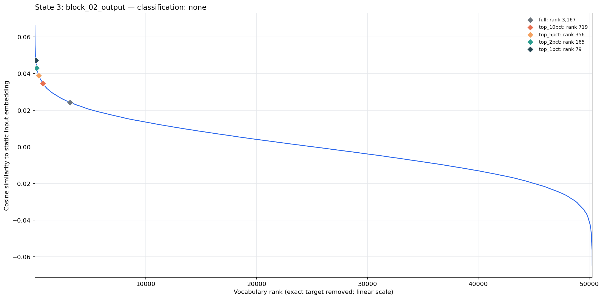
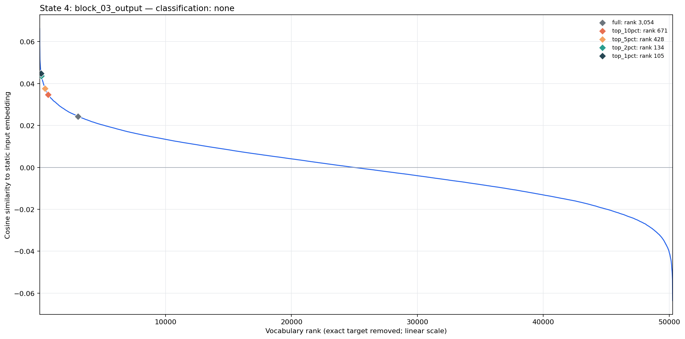
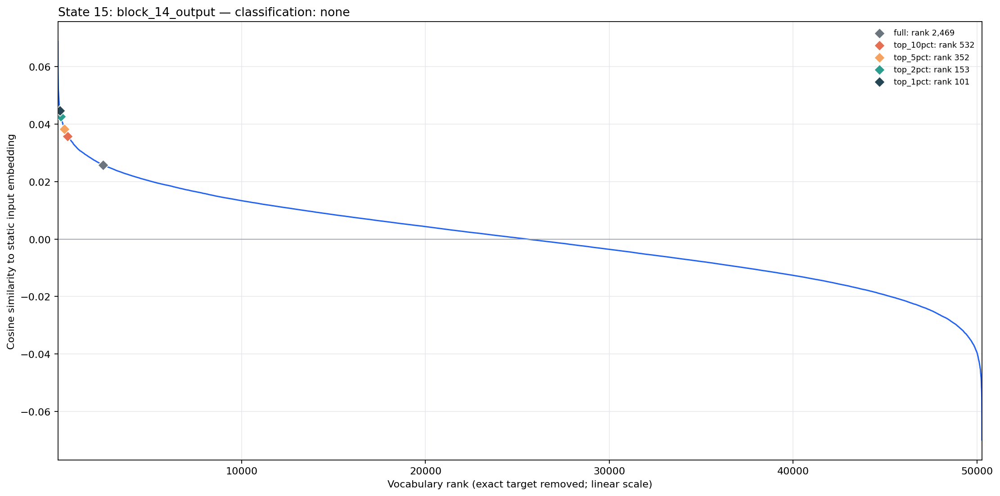
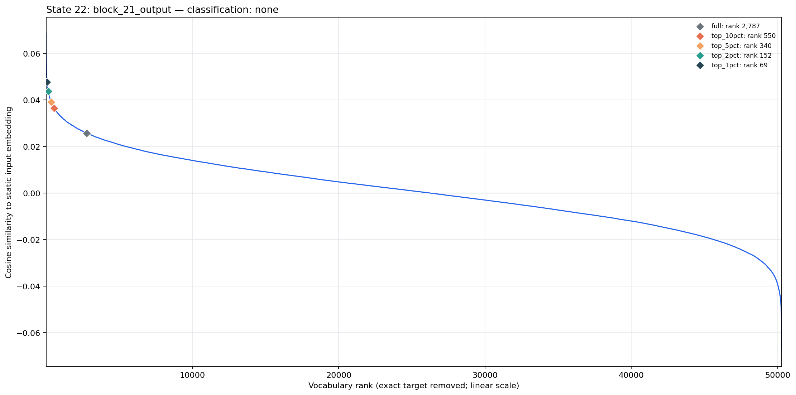
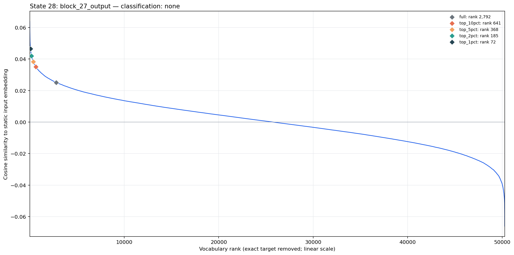
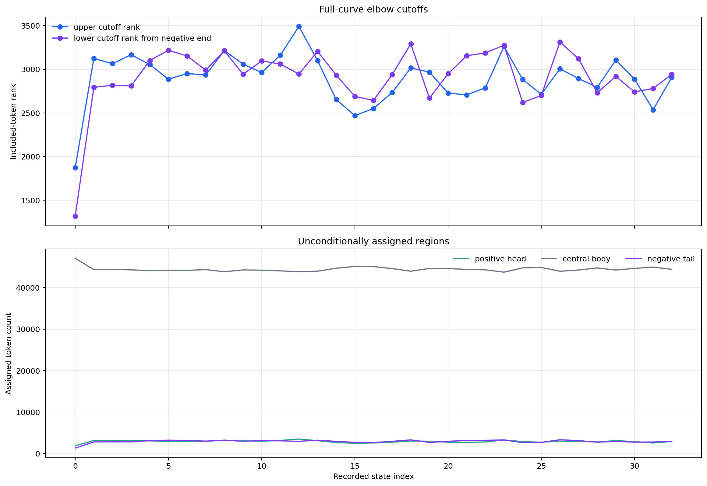
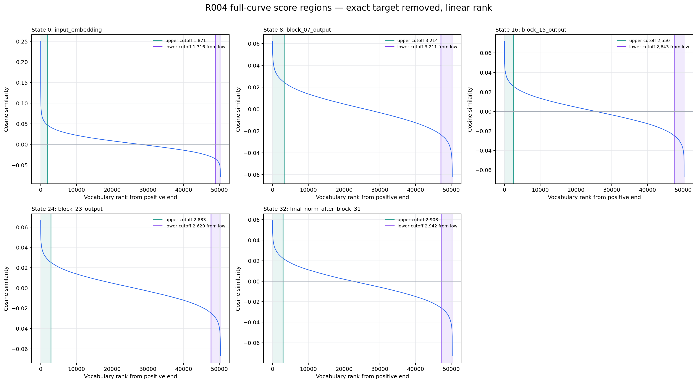

# LLM Topology Meta-analysis

## Agent usage instructions

This file is the chronological interpretive record for the LLM semantic
topology project. Agents working on the project must use it as follows:

1. Before adding an entry, read the canonical operating rules in
   `D:\Sync\zzCodexLearnings\AGENTS.md`, the project `README.md`, this section,
   and the manifest for every run discussed by the entry.
2. Treat existing entries as an append-only historical record. Do not silently
   rewrite, reorder, summarize or remove an earlier entry. Append a dated
   correction that cites the affected entry when a correction is necessary.
3. Assign entries sequential IDs in the form `MA-NNNN`. Never reuse an entry
   ID, including for corrections, failed runs or inconclusive analyses.
4. Timestamp every entry in ISO 8601 format with its UTC offset and record the
   named timezone. Use `Australia/Sydney` unless the project owner directs
   otherwise. If an original post time is unavailable, record the time the
   entry was added and state that limitation.
5. Record the author or source, entry type, related run IDs and preservation
   mode. Content marked `verbatim` must remain exactly as posted.
6. Keep directly observed findings, project-owner thoughts, assistant thoughts,
   limitations, decisions and proposed next steps explicitly separate. Do not
   convert an interpretation into a finding through repetition.
7. Link findings to a run manifest or artifact where possible. Preserve the
   distinction between behavioural observations, model-generated explanation,
   measured internal representations and causal conclusions.
8. Record negative, failed and ambiguous results. Do not allow the file to
   become a success-only narrative.
9. Use neutral run names chosen before results are inspected. When an entry
   reanalyses existing tensors rather than creating a new capture, identify its
   source run explicitly.
10. Keep machine-generated measurements in manifests and artifacts. Use this
    file for chronology, interpretation, disagreement, methodological changes
    and decisions rather than duplicating complete data tables.

## Entries

### MA-0001 — Semantic map of the project thread

- Entry timestamp: `2026-11-12T19:01:12+11:00`
- Timezone: `Australia/Sydney`
- Author: `Codex assistant`
- Entry type: `thread semantic map`
- Related runs: `R001`
- Preservation mode: `verbatim`
- Source: immediately preceding assistant response in the project thread
- Timestamp note: the original UI post time was unavailable; the entry timestamp
  records when this verbatim response was added to the project file

#### Verbatim input

The thread forms a clear progression from broad research theory to a specific measurable object, followed by experimental-governance requirements.

Legend: `[DONE]`, `[DECIDED]`, `[PLANNED]`, `[OPEN]`

```text
LLM SEMANTIC TOPOLOGY RESEARCH
|
|-- 1. Research foundations
|   |
|   |-- [DONE] Project handover supplied
|   |   |-- Semantic conflict in language models
|   |   |-- Internal representation geometry
|   |   |-- Relationship between behaviour and hidden structure
|   |   `-- Need to separate observation, interpretation and causation
|   |
|   |-- [DONE] Zombie-survival ChatGPT case examined
|   |   |-- Behavioural evidence of unstable/conflicting answers
|   |   |-- Demonstrates limitations of model self-explanation
|   |   |-- Does not directly measure internal representations
|   |   `-- Provides possible controlled stimuli for later experiments
|   |
|   `-- [DONE] External Gemini/Qwen discussion considered as context
|
|-- 2. Central research question
|   |
|   |-- How does a token's semantic neighbourhood change through a transformer?
|   |
|   |-- Initial hypotheses
|   |   |-- Final layer may be especially important
|   |   |-- Intermediate layers may contain more useful structure
|   |   `-- The optimal analytical layer should be tested, not assumed
|   |
|   `-- Intended eventual analysis
|       |-- Identify semantic neighbourhoods
|       |-- Detect topic-like groups
|       |-- Track their development across layers
|       `-- Determine which layers offer the most informative structure
|
|-- 3. Project infrastructure
|   |
|   |-- [DONE] Independent local Git repository
|   |   `-- D:\Sync\Python Projects\llm_topology
|   |
|   |-- [DONE] Published analysis copy
|   |   `-- chatgpt-analysis/projects/llm-topology
|   |
|   |-- [DECIDED] Repository roles
|   |   |-- Local repository = authoritative working project
|   |   `-- GitHub subproject = curated material for ChatGPT analysis
|   |
|   |-- [DONE] Shared model storage established
|   |   `-- D:\AI\cache\huggingface
|   |
|   `-- [DONE] Cross-project model-storage rule documented
|       `-- D:\Sync\zzCodexLearnings\AGENTS.md
|
|-- 4. Model familiarisation
|   |
|   |-- [DONE] Pythia prompt playground created
|   |
|   |-- Model progression
|   |   |-- Pythia 410M
|   |   |   `-- Lightweight initial behavioural baseline
|   |   |
|   |   |-- Pythia 6.9B
|   |   |   `-- Practical balance for representation analysis
|   |   |
|   |   `-- Pythia 12B
|   |       `-- Fits narrowly on the RTX 4090 but limits experimental headroom
|   |
|   |-- [DONE] Notebook made model-switchable
|   |
|   `-- [DECIDED] Smaller models remain scientifically useful
|       |-- Faster iteration
|       |-- More layers/prompts can be examined
|       `-- Greater experimental control
|
|-- 5. Representation-object clarification
|   |
|   |-- Input embedding matrix
|   |   |-- Static vocabulary-scale representation
|   |   `-- Provides interpretable semantic neighbours
|   |
|   |-- Hidden states
|   |   |-- Contextual token representations
|   |   |-- Change through transformer states
|   |   `-- Are not themselves vocabulary embedding matrices
|   |
|   |-- Final predictions
|   |   |-- Generation-facing probabilities
|   |   `-- Must not be treated as equivalent to embedding similarity
|   |
|   `-- [DECIDED] These objects must remain analytically distinct
|
|-- 6. Proof-of-concept scope
|   |
|   |-- [DECIDED] One prompt
|   |   `-- Battery demand, mineral supply, electric vehicles, and
|   |       energy storage all shape the market for lithium
|   |
|   |-- [DECIDED] One target token
|   |   `-- " lithium"
|   |
|   |-- [DECIDED] One model
|   |   `-- EleutherAI/pythia-6.9b
|   |
|   `-- Initial purpose
|       |-- Validate hidden-state capture
|       |-- Inspect available outputs
|       `-- Determine which outputs deserve further development
|
|-- 7. R001: Lithium initial output inspection
|   |
|   |-- [DONE] Successful model execution
|   |   |-- 33 recorded representation states
|   |   |-- 19 prompt tokens
|   |   |-- 4096 hidden dimensions
|   |   `-- Artifact hashes verified
|   |
|   |-- Produced artifacts
|   |   |
|   |   |-- hidden_states.safetensors
|   |   |   `-- Primary captured representation data
|   |   |
|   |   |-- semantic_neighbors.csv
|   |   |   |-- Input-embedding cosine neighbours
|   |   |   `-- Final-prediction probabilities
|   |   |
|   |   |-- target_relationships.csv
|   |   |   `-- Target-to-prompt-token similarities by state
|   |   |
|   |   |-- layer_metrics.csv
|   |   |   `-- Norm, distance and angular diagnostics
|   |   |
|   |   |-- tokens.csv
|   |   |   `-- Tokenization and target-position provenance
|   |   |
|   |   `-- Figures
|   |       |-- Target trajectory
|   |       |-- Target relationships
|   |       `-- Prompt-token similarity by selected state
|   |
|   `-- [DONE] Meaningful run identity assigned
|       `-- R001_lithium-initial-output-inspection__
|           20261112T063540Z_pythia-6.9b_52ff8f97c2
|
|-- 8. Interpretation of R001
|   |
|   |-- Project-owner assessment
|   |   |
|   |   |-- layer_metrics
|   |   |   `-- Not immediately useful as a primary analytical result
|   |   |
|   |   |-- semantic_neighbors
|   |   |   |-- decoded_token is useful
|   |   |   `-- input_embedding results are the most useful output
|   |   |
|   |   |-- target_relationships
|   |   |   |-- Evolution of other_token is interesting
|   |   |   `-- Probably secondary to the wider vocabulary relationships
|   |   |
|   |   `-- tokens.csv
|   |       |-- Interesting for confirming the true target
|   |       `-- Not a primary analytical result
|   |
|   `-- Assistant interpretation
|       |
|       |-- layer_metrics
|       |   |-- Diagnostic rather than semantic
|       |   `-- May reveal architectural boundaries such as final normalization
|       |
|       |-- target_relationships
|       |   `-- Measures prompt-local rather than vocabulary-scale structure
|       |
|       |-- tokens.csv
|       |   `-- Provenance and quality-control evidence
|       |
|       `-- Missing primary object
|           `-- Vocabulary-scale semantic neighbours at every model state
|
|-- 9. Semantic-neighbour cutoff problem
|   |
|   |-- Proposed neighbourhood definition
|   |   `-- Include tokens whose semantic-neighbour score passes a cutoff
|   |
|   |-- Current score meanings
|   |   |-- input_embedding score = cosine similarity
|   |   `-- final_prediction score = probability
|   |
|   |-- [DECIDED] Different metrics cannot be mixed into one cutoff
|   |
|   |-- Raw-score cutoff
|   |   |-- Defines a fixed geometric radius
|   |   |-- Allows neighbourhood expansion and contraction
|   |   `-- Requires sensitivity analysis
|   |
|   |-- Elbow cutoff
|   |   |-- Can be applied to any ranked continuous score distribution
|   |   |-- Must be applied separately by state, source and metric
|   |   |-- Produces an adaptive boundary
|   |   `-- Must be allowed to report "no viable elbow"
|   |
|   `-- Important caveats
|       |-- Current top-20 list is too truncated
|       |-- Lexical fragments may form their own apparent elbow
|       |-- An elbow is mathematical structure, not automatically semantic
|       `-- Cutoff movement must be separated from token-score movement
|
|-- 10. Next analytical experiment
|   |
|   |-- [PLANNED] Calculate full vocabulary score vectors
|   |   |
|   |   |-- For every recorded model state
|   |   |-- Target representation compared with every input embedding
|   |   `-- Approximately 33 x 50,000 scores
|   |
|   |-- [DECIDED] Do not calculate a 50,000 x 50,000 matrix yet
|   |
|   |-- [PLANNED] Determine cutoff viability for every state
|   |   |
|   |   |-- Elbow rank
|   |   |-- Elbow score
|   |   |-- Elbow strength
|   |   |-- Score gap
|   |   `-- Status: viable, weak or none
|   |
|   |-- [PLANNED] Preserve both analytical views
|   |   |-- Adaptive elbow neighbourhood
|   |   `-- Fixed raw-score neighbourhood
|   |
|   `-- [DEFERRED] Relations and topic modelling
|       |-- Token entry and exit
|       |-- Persistence
|       |-- Neighbourhood overlap
|       |-- Token-relation graphs
|       `-- Topic/community evolution
|
`-- 11. Experimental governance
    |
    |-- [DONE] Run-naming convention established
    |   `-- RNNN_<target>-<purpose>__<UTC>_<model>_<prompt-hash>
    |
    |-- [DECIDED] Naming principles
    |   |-- Purpose chosen before inspecting results
    |   |-- No result-biased names
    |   |-- Run numbers never reused
    |   `-- Failed and invalid runs remain part of the sequence
    |
    |-- [PLANNED] Meta-analysis record
    |   |
    |   |-- Findings
    |   |-- Project-owner thoughts
    |   |-- Assistant thoughts
    |   |-- Limitations and confounds
    |   |-- Decisions
    |   `-- Next task
    |
    `-- [OPEN] Meta-analysis design decisions
        |-- Exact file structure
        |-- Run-entry template
        |-- How much verbatim conversation to preserve
        |-- How to distinguish evidence from retrospective interpretation
        `-- How derived analyses should reference their source run
```

The central semantic sequence is:

```text
broad theory
    -> model familiarisation
        -> single-prompt capture
            -> inspection of available outputs
                -> input-embedding neighbours identified as primary
                    -> full-vocabulary layerwise scoring proposed
                        -> cutoff viability becomes the next experiment
                            -> repeated runs require formal meta-analysis
```

### MA-0002 — Contextual relationship networks versus static-basis neighbours

- Entry timestamp: `2026-11-12T19:16:56+11:00`
- Timezone: `Australia/Sydney`
- Authors: `ChatGPT external analysis`; `Codex assistant follow-on`
- Entry type: `external methodological analysis and follow-on assessment`
- Related runs: `R001`
- Preservation mode: `verbatim`
- Source: ChatGPT response supplied by the project owner, followed by the
  immediately preceding Codex response in the project thread
- Timestamp note: the original ChatGPT UI post time was unavailable; the entry
  timestamp records when both verbatim responses were added to the project file

#### External ChatGPT response (verbatim)

The objective is therefore to determine where semantic relationships become most useful, how they change, and whether particular transformer layers organise topics more effectively than others.

That requires comparing semantic neighbourhoods across layers, not merely tracking individual token vectors.

## Proposed measurement
```sql
CONTROLLED TOKEN SET
        |
        v
Capture contextual representations
at every transformer layer
        |
        v
For each layer:
    |
    +-- Calculate pairwise token similarities
    +-- Rank semantic neighbours
    +-- Identify meaningful cutoffs
    +-- Construct relationship networks
    `-- Identify topic clusters
        |
        v
COMPARE LAYERS
    |
    +-- Which relationships persist?
    +-- Which relationships emerge?
    +-- Which relationships disappear?
    +-- Which topics become more distinct?
    +-- Which topics become interconnected?
    `-- Which layers recover known relationships best?
```

## The critical methodological distinction

|   |
| - |

Comparison

|   |
| - |

What it measures

|   |
| - |

Contextual token vs static input embedding

|   |
| - |

Compatibility with the original embedding basis

|   |
| - |

Contextual token vs contextual token at the same layer

|   |
| - |

How semantic relationships are organised at that layer

|   |
| - |

Relationship networks across layers

|   |
| - |

How that organisation evolves

The second comparison should become the primary measurement.

The static embedding neighbourhood remains useful as a baseline.

## How to establish semantic usefulness

A layer should not be considered superior merely because its clusters are tighter.

It should be evaluated against independently established relationships.

For example:

- Accuracy: Does it recover known topic associations?
- Separation: Does it distinguish unrelated topics?
- Stability: Do relationships survive changes in context?
- Connectivity: Does it recover meaningful relationships between topics?
- Generalisability: Do results hold for unseen tokens and contexts?

Neighbour cutoffs should be evaluated for stability, since differences in similarity distributions across layers can otherwise create artificial changes in network structure.

## The key distinction

There are two questions:

1\. Descriptive

> How do semantic relationships evolve across transformer layers?

2\. Evaluative

> Which layers most reliably recover meaningful semantic relationships between topics?

The first requires observing changes in neighbourhood structure.

The second requires independent evidence of what constitutes a meaningful relationship.

Recommendation: Retain the existing input-embedding analysis, but build the next experiment around pairwise contextual representations at each layer, using identical target observations and independently defined topic relationships.

This preserves the original research objective without assuming that the final layer, the most tightly clustered layer or the layer with the greatest vector displacement is necessarily the most semantically useful.

#### Codex follow-on response (verbatim)

ChatGPT’s response is methodologically important. It identifies a limitation in our proposed full-vocabulary analysis:

> Comparing each contextual `lithium` vector with the static input-embedding matrix measures how the target moves relative to a fixed vocabulary basis. It does not measure how relationships among contextualized vocabulary tokens evolve.

That does not invalidate the planned analysis, but it narrows what we can claim from it.

| Measurement | Valid interpretation |
|---|---|
| Contextual `lithium` vs static vocabulary embeddings | Which vocabulary tokens the target resembles at each layer |
| Contextual prompt token vs contextual prompt token | How relationships among observed prompt tokens evolve |
| Controlled contextual token set | How a predefined semantic system reorganizes across layers |

The ChatGPT response is right that the second or third measurement is needed if the central goal is evolving relationship networks and topic organization.

## What R001 already supports

R001 contains representations for all 19 prompt tokens at every recorded state. We can therefore construct a complete `19 × 19` contextual similarity matrix at each state without rerunning the model.

The existing `target_relationships.csv` is only one row of that matrix: `lithium` against every other prompt token.

Expanding it would allow genuinely changing contextual relationships, but it would remain limited because:

- the tokens come from one sentence rather than a controlled semantic set;
- punctuation and subword fragments are included;
- there are too few observations for credible topic clustering;
- syntactic and semantic relationships are entangled.

It would be a useful method check, not yet a topic-modelling experiment.

## A major confound not addressed in the response

Pythia is a causal language model. Tokens at different positions do not receive identical context:

- later tokens can incorporate earlier tokens;
- earlier tokens cannot incorporate later tokens;
- position and preceding context therefore affect pairwise geometry.

Putting a controlled token set into one list or sentence would not create genuinely controlled observations. A token appearing later has seen more of the set.

A stronger experiment would place each target token at the same position in a matched carrier context, for example:

```text
The concept being considered is lithium
The concept being considered is cobalt
The concept being considered is football
```

The representation at the final target position could then be compared across tokens at every layer. Multiple carrier contexts and randomized templates would later test stability.

## What this means for the planned full-vocabulary task

I would still perform it next because it:

- uses the existing R001 capture;
- directly tests whether meaningful score cutoffs exist;
- establishes the vocabulary-basis baseline;
- helps reveal lexical, chemical and contextual neighbour transitions;
- is inexpensive compared with designing a controlled-token experiment.

But it should be described more precisely as:

```text
full-vocabulary input-basis compatibility analysis
```

not as a complete map of evolving contextual token relationships.

Its output answers:

```text
At each layer, which static vocabulary embeddings are most compatible
with the contextual representation of lithium?
```

It does not yet answer:

```text
At each layer, how do contextual relationships among a semantic token
population reorganize?
```

## Recommended trajectory

```text
R001 existing capture
    |
    +-- Full-vocabulary static-basis scores
    |       `-- Test cutoff/elbow viability
    |
    +-- Full 19 x 19 prompt-token matrices
    |       `-- Validate contextual relationship tracking
    |
    `-- Controlled-token experiment
            |-- Matched contexts
            |-- Known related and unrelated groups
            |-- Complete pairwise matrices per layer
            |-- Relationship-network evolution
            `-- External evaluation of topic recovery
```

So ChatGPT is broadly right about the eventual primary measurement. The proposed full-vocabulary analysis remains the correct next calibration step, but it should be treated as a static-basis probe rather than the final form of semantic-topology analysis. The pasted response would also make a useful verbatim external-analysis entry in the meta-analysis log.

### MA-0003 — R002 static-basis cutoff feasibility result

- Entry timestamp: `2026-11-12T19:32:35+11:00`
- Timezone: `Australia/Sydney`
- Author: `Codex assistant`
- Entry type: `run result and interpretation`
- Related runs: `R002`; source run `R001`
- Preservation mode: `evidence-backed synthesized entry`
- Run manifest:
  `single_prompt_topology/runs/R002_lithium-static-basis-cutoff-feasibility__20261112T083025Z_pythia-6.9b_52ff8f97c2/manifest.json`

#### Question before the run

Does the full distribution of cosine similarities between the contextual
`lithium` representation and Pythia's static input-embedding vocabulary
support a stable, defensible elbow cutoff at any recorded state?

#### Directly observed findings

- The run completed successfully using the verified R001 hidden states. It did
  not execute another transformer forward pass.
- The persisted vocabulary score matrix has shape `[33, 50277]`. Fifteen output
  artifacts were independently checked against the hashes and sizes recorded
  in the successful manifest.
- All 33 states were classified `none` for cutoff viability when the exact
  target token was removed. All 33 were also classified `none` when it was
  retained.
- With the target removed, median candidate elbow rank was 257, with a range of
  143–334. Median candidate cutoff score was 0.0405, with a range of
  0.0369–0.0833.
- Elbow curvature was not weak: median normalized strength was 0.535, with a
  range of 0.480–0.742. The failure was stability. Relative rank median absolute
  deviation ranged from 0.404 to 0.637, and no state received consensus support
  under the predeclared window-stability rule.
- At the input-embedding state, the leading target-removed neighbours were
  `Li`, `Li`, `Lith`, `potassium`, `magnesium`, `cobalt`, `helium`, `sodium`,
  `assium`, and `odium`. These are visibly lexical or chemically related.
- Immediately after block 0, the leading input-basis matches became tokens such
  as `refreshing`, `PARTICULAR`, `administrative`, `)`, and `seeking`.
  Later-state leading matches were similarly heterogeneous and not visibly
  lithium-related.
- The exact `lithium` input embedding moved from cosine 1.000 and rank 1 at the
  input state to rank 11 after block 0, rank 120 after block 1, rank 840 after
  block 7, rank 3,088 after block 15, rank 3,262 after block 30, and rank 2,130
  in the final normalized state.
- The prompt-local contextual diagnostic produced `[33, 19, 19]` matrices.
  Mean off-diagonal cosine rose from 0.113 at the input state to 0.717 after
  block 7, 0.853 after block 15, and 0.920 after block 23. It was 0.864 after
  block 30 and fell to 0.458 after final normalization.

#### Project-owner thoughts

No post-run project-owner interpretation had been recorded when this entry was
created.

#### Assistant thoughts

- The ranked score curves contain curvature, but not a scale-independent elbow.
  Apparent cutoff rank changes substantially when the inspected upper-tail
  window changes. Selecting one of those elbows would therefore import the
  analyst's window choice into the claimed neighbourhood boundary.
- Input-embedding neighbours are coherent at the input state, but raw hidden
  states rapidly cease to be interpretable through direct cosine comparison
  with that fixed basis. This supports treating the analysis as a compatibility
  probe rather than as a layer-wise vocabulary-semantic map.
- The prompt-token matrices show a strong common-direction effect through the
  middle and late blocks. Raw contextual cosine would therefore risk producing
  artificially dense relationship networks unless centering, a null model or
  another anisotropy control is introduced.
- The negative cutoff result is informative: the current evidence does not
  justify selecting a natural full-vocabulary neighbourhood boundary at any
  recorded state under this method.

#### Limitations and confounds

- The viability classifications depend on a documented heuristic elbow method,
  analysis windows and predeclared stability thresholds. They do not prove that
  no alternative cutoff method could ever be useful.
- Only the static input-embedding basis was tested. The output/unembedding basis
  and trained intermediate decoding lenses were not tested.
- The 19 contextual prompt tokens are not a controlled semantic population;
  they contain punctuation, subword pieces, position effects and unequal causal
  context.
- The capture API preserved the final normalized state but replaced the raw
  output after the final transformer block, so those two objects cannot be
  compared from R001.
- No independently labelled topic relationships were evaluated.

#### Decisions and next step

No new methodological decision is recorded until the project owner reviews the
result. Candidate implications are to retain the input-embedding neighbourhood
as the static baseline, avoid forcing an elbow cutoff, and make controlled
contextual token relationships the next primary experimental design.

### MA-0004 — Visual cutoff reinspection and PNG record

- Entry timestamp: `2026-11-12T19:49:05+11:00`
- Timezone: `Australia/Sydney`
- Author: `Codex assistant`
- Entry type: `visual reinspection and methodological correction`
- Related runs: `R002`; source run `R001`
- Preservation mode: `derived graph-image references and verbatim assistant response`
- Run manifest:
  `single_prompt_topology/runs/R002_lithium-static-basis-cutoff-feasibility__20261112T083025Z_pythia-6.9b_52ff8f97c2/manifest.json`
- Derived-image directory:
  `single_prompt_topology/reports/R002_cutoff_score_curves_png/`
- Derivation script:
  `single_prompt_topology/export_cutoff_score_pngs.py`
- Artifact note: these PNGs were generated after the successful R002 run from
  its verified `vocabulary_scores.safetensors` and cutoff tables. They are
  inspection reports outside the immutable R002 run manifest.

#### Relationship to MA-0003

MA-0003 correctly records the pipeline result that all states failed the
predeclared cross-window cutoff-consensus rule. Visual inspection subsequently
showed that this result should not be paraphrased as absence of a visible
full-curve elbow. The full-curve elbow is consistent across states, while its
absolute rank changes when the curve is truncated and renormalized. The
distinction is between a visible global candidate and a scale-independent
cutoff validated across differently sized analysis windows.

#### Overview graph


#### Individual state graphs

<details>
<summary>Expand all 33 full-resolution state plots</summary>

##### State 00 — input embedding


##### State 01 — block 00 output


##### State 02 — block 01 output


##### State 03 — block 02 output



##### State 04 — block 03 output



##### State 05 — block 04 output


##### State 06 — block 05 output


##### State 07 — block 06 output


##### State 08 — block 07 output


##### State 09 — block 08 output


##### State 10 — block 09 output


##### State 11 — block 10 output


##### State 12 — block 11 output


##### State 13 — block 12 output


##### State 14 — block 13 output


##### State 15 — block 14 output



##### State 16 — block 15 output


##### State 17 — block 16 output


##### State 18 — block 17 output


##### State 19 — block 18 output


##### State 20 — block 19 output


##### State 21 — block 20 output


##### State 22 — block 21 output



##### State 23 — block 22 output


##### State 24 — block 23 output


##### State 25 — block 24 output


##### State 26 — block 25 output


##### State 27 — block 26 output


##### State 28 — block 27 output



##### State 29 — block 28 output


##### State 30 — block 29 output


##### State 31 — block 30 output


##### State 32 — final norm after block 31


</details>

#### Verbatim assistant response

You were right: the PNGs show a clear global knee. The earlier `none` classification was misleading.


Across the 33 states, the full-curve elbow occurs at:

- Range: rank 1,871–3,491
- Median: rank 2,934
- Middle 50%: rank 2,733–3,063
- Approximately 4–7% of the vocabulary

The problem is methodological: the classifier required the elbow’s absolute rank to remain stable after repeatedly truncating and renormalising the curve. That produces different knees by construction. For state 0, for example, the candidate ranks were 313, 205, 81 and 75 across the truncated windows, so the classifier rejected the visually obvious full-curve elbow at 1,871.

The plots actually show nested structure:

1. A small, high-similarity head.
2. A clear global shoulder around 2,000–3,500 tokens.
3. A long central body.
4. A sharp negative tail.

Therefore, the correct conclusion is:

> A consistent global cutoff candidate exists, but its semantic usefulness has not yet been established.

The next methodological correction should report the full-curve elbow as the primary candidate and retain the truncated-window elbows as a multiscale diagnostic—not use their disagreement to erase the global cutoff.

I exported 33 individual plots plus the [overview PNG folder](</D:/Sync/Python Projects/llm_topology/single_prompt_topology/reports/R002_cutoff_score_curves_png>) using the reproducible [export script](</D:/Sync/Python Projects/llm_topology/single_prompt_topology/export_cutoff_score_pngs.py>). Nothing was committed or pushed.

### MA-0005 — Why the negative tail belongs in topology analysis

- Entry timestamp: `2026-11-12T19:53:39+11:00`
- Timezone: `Australia/Sydney`
- Author: `Codex assistant`
- Entry type: `methodological interpretation`
- Related runs: `R002`; source run `R001`
- Preservation mode: `verbatim`
- Source: immediately preceding assistant response in the project thread
- Timestamp note: the original UI post time was unavailable; the entry timestamp
  records when this verbatim response was added to the project file

#### Verbatim assistant response

Because your real interest is not merely “which tokens are nearest to lithium?” It is the larger semantic organisation created around the prompt representation. That organisation potentially includes attraction, neutrality, contrast and opposition.

The ranked curve can be interpreted as three regions:

- Top tokens: strongly aligned with the contextual `lithium` vector.
- Middle tokens: approximately orthogonal or weakly related under this measurement.
- Negative tail: aligned in the opposite direction in the static embedding basis.

So excluding the negative tail discards one side of the geometry. It could contain useful information about:

- the boundary separating the neighbourhood from the rest of the vocabulary;
- whether the representation develops a contrasting semantic pole;
- tokens moving from positive to negative alignment across layers;
- tokens moving from the negative tail into the leading neighbourhood;
- whether the positive neighbourhood becomes more sharply separated;
- whether the entire score distribution rotates, compresses or polarises.

However, the relationship between a negative token and a top token is currently only indirect. Given target vector \(h\):

```text
top token:       cosine(h, token) is strongly positive
negative token:  cosine(h, token) is negative
```

This does not determine:

```text
cosine(top token, negative token)
```

The two tokens occupy opposite sides of the target’s projection axis, but they are not necessarily semantic opposites or even directly dissimilar. The current analysis reduces each token to one relationship with `lithium`; it does not measure relationships among the vocabulary tokens themselves.

That is probably the source of your intuition: the top-token cutoff identifies a neighbourhood, but it does not describe the topology surrounding that neighbourhood. The negative tail supplies potential contrast information that nearest-neighbour analysis alone cannot provide.

I would therefore treat the regions separately:

1. Positive head — candidate semantic neighbourhood.
2. Central body — background or null comparison population.
3. Negative tail — candidate opposition or anti-alignment population.

Then track across layers:

- membership in each region;
- score and rank trajectories;
- positive-to-negative and negative-to-positive crossings;
- direct pairwise relationships within and between the positive and negative sets;
- whether results survive centering or whitening the embedding space.

The important caution is that “negative” should initially be labelled anti-aligned, not suppressed or semantically opposed. If the bottom tokens form coherent contrasting groups—and this persists after geometric controls—then semantic opposition becomes a testable interpretation rather than an assumption.

### MA-0006 — R003 pre-run decision and housekeeping contract

- Entry timestamp: `2026-11-12T20:00:33+11:00`
- Timezone: `Australia/Sydney`
- Author: `project owner and Codex assistant`
- Entry type: `project-owner directive and pre-run contract`
- Related runs: planned `R003`; source run `R002`; ultimate source run `R001`
- Preservation mode: `verbatim project-owner directive and synthesized plan`
- R002 manifest:
  `single_prompt_topology/runs/R002_lithium-static-basis-cutoff-feasibility__20261112T083025Z_pythia-6.9b_52ff8f97c2/manifest.json`
- R003 plan: `single_prompt_topology/R003_PLAN.md`

#### Project-owner directive — verbatim

use r002 where possible, but carry this out as r003. ensure all housekeeping documentation is taking place. first carry out the housekeeping, then report status.

#### Decisions recorded before implementation

- `R003` is reserved and will not be reused. Its neutral run name is
  `lithium-score-region-boundaries`.
- R003 is a derived reanalysis of R002. It will hash-validate and reuse R002's
  vocabulary scores, token metadata and full-curve upper-elbow candidates.
- No transformer forward pass, model-weight load, download or score-matrix
  recalculation is authorized for R003.
- The primary objects are a layer-specific upper geometric boundary, a
  layer-specific lower geometric boundary and the three resulting token
  regions: positive head, central body and negative tail.
- Full-distribution and sign-restricted candidates are endpoint-sensitivity
  comparisons. The prior R002 truncated-window results remain multiscale
  diagnostics and no longer act as the R003 cutoff-consensus classifier.
- Negative cosine is recorded as anti-alignment in the static input-embedding
  basis, not as statistical, predictive or causal suppression.
- Detailed methods, the `0.20` candidate-agreement tolerance, required outputs,
  success conditions, failure conditions and scope boundaries are fixed in
  `single_prompt_topology/R003_PLAN.md` before implementation.

#### Inferred question

Can the existing R002 full-vocabulary score distributions define reproducible
upper and lower layer-specific boundaries that support inspection of positive,
central and anti-aligned token populations without overstating them as causal
or fully contextual vocabulary relationships?

#### Successful outcome

An operationally successful R003 validates its R002 inputs, completes every
required component and hashes every planned artifact. The scientific outcome
may accept two boundaries, accept only one boundary or reject both as unstable.
A documented negative result remains a successful experiment.

#### Unsuccessful or inconclusive outcome

The analysis is inconclusive if boundary candidates are invalid or disagree
beyond the predeclared tolerance. The run is unsuccessful if provenance checks,
required components, output creation or artifact hashing fail.

#### Scope-drift indicators

R003 moves out of scope if it introduces new prompts or models, transformer
execution, topic modelling, clustering, causal or logit analysis, post-inspection
threshold adjustment, alternative embedding bases or claims that static
vocabulary embeddings acquire evolving pairwise contextual relationships.

#### Housekeeping status at entry creation

- The R003 identity and lineage are reserved.
- The pre-run plan and output contract are documented.
- The root and pipeline READMEs describe R002 reuse and R003's planned status.
- No implementation file or R003 run directory has been created.
- No R003 computation has been executed.

### MA-0007 — R003 score-region boundary result

- Entry timestamp: `2026-11-12T20:09:01+11:00`
- Timezone: `Australia/Sydney`
- Author: `Codex assistant`
- Entry type: `run result, validation and interpretation`
- Related runs: `R003`; source run `R002`; ultimate source run `R001`
- Preservation mode: `evidence-backed synthesized entry`
- Run manifest:
  `single_prompt_topology/runs/R003_lithium-score-region-boundaries__20261112T090711Z_pythia-6.9b_52ff8f97c2/manifest.json`
- Pre-run contract: `single_prompt_topology/R003_PLAN.md`

#### Project-owner authorization

The project owner instructed the assistant to proceed after the R003
housekeeping phase. No post-run project-owner interpretation had been recorded
when this entry was created.

#### Directly observed findings

- R003 completed successfully in approximately 9.4 seconds. All five required
  components completed, all five required R002 source artifacts passed hash and
  size validation, and all six R003 output artifacts independently matched the
  hashes and sizes recorded in the manifest.
- The run reused the R002 `[33, 50277]` score matrix on the CPU. It did not load
  model weights, execute a transformer forward pass or recalculate vocabulary
  scores.
- Upper geometric boundaries were accepted at 32 of 33 states. State 31
  (`block_30_output`) was rejected because its full and positive-only candidate
  ranks differed by 0.2522 relative to their median, exceeding the predeclared
  0.20 tolerance.
- Lower geometric boundaries were accepted at 29 of 33 states. They were
  rejected at the input embedding and after blocks 10, 18 and 25. Their relative
  candidate-rank differences were 0.6089, 0.2003, 0.2544 and 0.2351.
- Twenty-eight states accepted both boundaries, four accepted only the upper
  boundary, and one accepted only the lower boundary. No state rejected both.
- Full-distribution upper candidate ranks ranged from 1,871 to 3,491 with a
  median of 2,934. Their cosine thresholds had a median of 0.02483; the input
  embedding was the high outlier at 0.04708.
- Full-distribution lower candidate ranks, measured from the negative end,
  ranged from 1,316 to 3,313 with a median of 2,942. Their original cosine
  thresholds had a median of -0.02415; the input embedding was the low outlier
  at -0.03576 and its lower boundary was rejected.
- The accepted regions produced 178,979 state-token tail memberships. The union
  contained 23,543 token IDs, recorded across all states as 776,919 trajectory
  rows.
- The median local pre-boundary to post-boundary gap ratio was 1.43 for upper
  candidates and 1.53 for lower candidates. The curves change slope rather than
  exhibiting a discrete score discontinuity.
- The input embedding's leading positive-head tokens remained visibly lexical
  or chemically related to lithium. Tokens immediately around its upper
  boundary at rank 1,871 were heterogeneous. Leading positive and negative
  tokens and boundary-adjacent tokens at the inspected later states were also
  heterogeneous, with no directly observed semantic contrast transition.
- Among the 23,543 trajectory tokens, the mean recorded region-change rate
  between consecutive states was 10.2%. This includes artificial transitions
  where a boundary was rejected and its corresponding tail was left empty, so
  it must not be read as a pure semantic-change measurement.

#### Figures


#### Assistant thoughts

- R003 supports a reproducible broad upper geometric partition at almost every
  state and a broad lower geometric partition at most states under the
  predeclared method. This corrects the overly strong R002 interpretation that
  no useful full-curve boundary was present.
- The result does not yet support calling either boundary semantic. In
  particular, the broad tails contain thousands of tokens, boundary-adjacent
  tokens do not show a visible semantic transition and later-state leaders are
  not visibly organised around lithium.
- The negative tail is now measurable as an anti-aligned population, but it is
  not evidence of downweighting, suppression or a coherent opposite topic.
- Membership trajectories can describe changes in compatibility with the
  contextual target. They cannot show evolving pairwise contextual geometry
  among the static vocabulary embeddings.

#### Limitations

- The 0.20 agreement tolerance and elbow method are preregistered heuristics,
  not independently validated semantic criteria.
- Sign-restricted candidates use zero cosine as an endpoint-sensitivity
  partition even though zero is not a statistical or predictive boundary.
- Only one prompt, one target token and the static input-embedding basis were
  analysed.
- No external semantic labels, topic-recovery benchmark, centering, whitening
  or alternative basis were used.
- Rejected boundaries produce empty corresponding regions, which inflates some
  apparent transition counts when a boundary disappears or reappears.

#### Decision and next step

R003 is accepted as a successful geometric-boundary analysis. Its overall
interpretive decision is `accepted_geometric_boundaries_only`; no semantic
boundary or suppression claim is accepted. Before topic modelling, the next
decision is whether to evaluate semantic enrichment within the accepted tails
against matched central-body controls or to move to the controlled contextual
token experiment described in MA-0002.

### MA-0008 — Cutoff abstraction-inflation correction

- Entry timestamp: `2026-11-12T20:18:35+11:00`
- Timezone: `Australia/Sydney`
- Author: `Codex assistant`
- Entry type: `methodological correction`
- Related runs: `R003`; source run `R002`
- Preservation mode: `verbatim`
- Source: immediately preceding assistant response in the project thread
- Timestamp note: the original UI post time was unavailable; the entry timestamp
  records when this verbatim response was added to the project file

#### Verbatim input

The abstraction inflation occurred when I turned “calculate an elbow cutoff” into “validate and accept a semantic boundary.”

A cutoff candidate was successfully calculated for every layer and tail. I then added unnecessary machinery:

- Recalculated the elbow using both the full score distribution and a sign-restricted distribution.
- Required their ranks to agree within an arbitrary 20% tolerance.
- Classified cutoffs as “accepted” or “rejected.”
- Left the accepted-cutoff fields blank when that validation failed.

That extra test does not determine whether an elbow exists. It only measures whether two different versions of the calculation produce similar ranks. Those versions operate on different populations, so disagreement is not inherently grounds for discarding either cutoff.

The clearest example is block 10’s lower cutoff: it was rejected because its disagreement was 20.025%, just 0.025 percentage points beyond the chosen tolerance. That is procedural brittleness, not evidence that no cutoff could be calculated.

The simpler and more appropriate treatment is:

1. Calculate the cutoff rank and score for every layer.
2. Save it unconditionally.
3. Retain the alternative estimate as a sensitivity measure.
4. Label disagreements as `stable` or `sensitive`, rather than `accepted` or `rejected`.
5. Test later whether these geometric cutoffs correspond to meaningful semantic regions.

So my earlier statement that some cutoffs “could not be established” was misleading. The cutoffs were calculated; five were merely rejected by an additional validation rule I introduced. The current report preserves those candidate values, but the blank accepted-cutoff fields reflect this unnecessary abstraction.

### MA-0009 — R004 ungated full-curve cutoff result

- Entry timestamp: `2026-11-12T20:28:02+11:00`
- Timezone: `Australia/Sydney`
- Author: `project owner and Codex assistant`
- Entry type: `project-owner directive, corrective run result and decision`
- Related runs: `R004`; corrects `R003`; source run `R002`; ultimate source run
  `R001`
- Preservation mode: `verbatim project-owner directive and evidence-backed
  synthesized result`
- Run manifest:
  `single_prompt_topology/runs/R004_lithium-full-curve-cutoffs__20261112T092701Z_pythia-6.9b_52ff8f97c2/manifest.json`
- Pre-run contract: `single_prompt_topology/R004_PLAN.md`

#### Project-owner directive — verbatim

rerun r003 without the cutoff shenanigans. record it as r004.

#### Directly observed findings

- R004 completed successfully in approximately 11.9 seconds. All five required
  components completed, all three required R002 source artifacts passed hash
  and size validation, and all six R004 output artifacts independently matched
  the hashes and sizes recorded in the manifest.
- The run reused the R002 `[33, 50277]` score matrix on the CPU. It did not load
  model weights, execute a transformer forward pass or recalculate vocabulary
  scores.
- All 33 states received one upper and one lower full-curve cutoff. No cutoff
  was subjected to a sign-restricted comparison, tolerance or secondary
  accepted/rejected decision.
- R004's upper and lower cutoff ranks exactly match R003's corresponding
  full-distribution candidate ranks. The correction changes how those cutoffs
  are used; it does not move the elbows.
- Upper cutoff ranks range from 1,871 to 3,491 with a median of 2,934. Lower
  cutoff ranks from the negative end range from 1,316 to 3,313 with a median of
  2,942.
- The median state includes 5.84% of retained tokens in the positive head and
  5.85% in the negative tail. The median combined inclusion is 11.78%; the
  observed state range is 6.34% to 13.00%.
- R004 records 191,872 tail memberships, 12,893 more than R003. It restores the
  lower tails omitted by R003 at the input embedding and after blocks 10, 18
  and 25, containing 1,316, 3,060, 2,669 and 3,313 tokens respectively. It also
  restores the 2,536-token upper head after block 30.
- Exact-rank assignment removed one extra lower-tail membership after block 6
  that R003's score-threshold assignment had included beyond its cutoff rank.
- The union contains 24,364 token IDs and 804,012 state-token trajectory rows.
  The mean recorded region-change rate between consecutive states is 8.03%.
  This remains descriptive and is not evidence of semantic or causal change.
- Visual inspection confirmed that both cutoffs and both shaded tail regions
  appear at every selected state without accepted/rejected styling.

#### Figures





#### Assistant thoughts

- R004 is the simpler result the cutoff question required: every full-curve
  elbow is preserved as a measured cutoff, while uncertainty about semantic
  usefulness remains a separate downstream question.
- The R003 acceptance gate changed data availability rather than determining
  whether a cutoff existed. Its rejected tails created artificial empty-region
  transitions; R004 removes that artifact.
- The broad tails still contain thousands of tokens and should not yet be
  described as coherent topics, semantic opposites or suppressed alternatives.

#### Decision

R004 supersedes R003 as the primary cutoff-membership dataset. R003 remains an
immutable historical record of the discarded endpoint-agreement policy. The
next analysis should inspect relationships and semantic composition within the
R004 regions without redefining or revalidating the cutoffs.

### MA-0010 — Curvature density, coherence and topological conflict hypothesis

- Entry timestamp: `2026-11-12T20:42:00+11:00`
- Timezone: `Australia/Sydney`
- Authors: `ChatGPT external analysis`; `Codex assistant follow-on`
- Entry type: `external research framing and follow-on assessment`
- Related runs: `R004`
- Preservation mode: `verbatim`
- Source: ChatGPT response supplied by the project owner, followed by the
  immediately preceding Codex response in the project thread
- Timestamp note: the original ChatGPT UI post time and immediately preceding
  Codex response time were unavailable; the entry timestamp records when both
  verbatim texts were added to the project file

#### External ChatGPT response — verbatim

The key is to explain that curvature density is the proposed geometric signature of competing semantic constraints, while coherence measures how consistently those constraints can be represented together.

Their relationship is a hypothesis to test, not an established mathematical equivalence.

## Curvature Density and Semantic Coherence — Research Definition

**Core hypothesis:** Regions containing competing or contradictory semantic relationships may exhibit distinctive local geometric curvature in transformer representations.

### Definitions

- **Coherence:** The degree to which semantic relationships remain mutually consistent and stable under perturbation, without excluding contradictory evidence.
- **Coherence stability:** How reliably those relationships survive changes in context, wording or additional information.
- **Semantic conflict density:** The concentration of competing or incompatible relationships within a defined semantic neighbourhood.
- **Curvature density:** A proposed measure of local geometric structure, requiring an explicitly defined curvature estimator and neighbourhood.

### Five research questions

1. Where is coherence most stable?
2. Where is coherence least stable?
3. What addition A increases coherence without suppressing evidence?
4. What addition B conceals contradiction by masking conflict?
5. What trajectory follows from A versus B?

### Hypothesised relationship
```sql
SEMANTIC RELATIONSHIPS
|
+-- Compatible constraints
|   `-- Coherence potentially stable
|
+-- Competing constraints
|   `-- Coherence potentially unstable
|       |
|       +-- A: Integrate conflicting evidence
|       |   `-- Test for stable reorganisation
|       |
|       `-- B: Conceal conflicting evidence
|           `-- Test for apparent stability
|
`-- REPRESENTATIONAL GEOMETRY
    |
    +-- Measure local curvature
    +-- Identify geometric concentrations
    +-- Compare with semantic conflict
    `-- Track changes across transformer layers
```

### Experimental requirement

Measure semantic coherence independently of geometric curvature.

Determine whether:

- High semantic conflict predicts distinctive local curvature.
- Low semantic conflict predicts different geometric properties.
- Addition A changes geometry while preserving conflicting evidence.
- Addition B changes apparent coherence without resolving the conflict.
- These relationships remain reproducible across transformer layers and controlled prompts.

Do not assume high curvature means contradiction. Positive and negative curvature can reflect different geometric structures, and neither inherently establishes semantic conflict.

**Research objective:** Determine whether local representational geometry predicts where coherence is stable, unstable, genuinely improved or merely made to appear stable.

One additional distinction matters for the current Pythia project:

The layer with the clearest topic relationships is not necessarily the layer where semantic conflict is most detectable.

Those are two separate experimental targets:
```vbnet
Topic organisation
    → Where are semantic relationships clearest?

Coherence stability
    → Where do relationships resist perturbation?

Semantic conflict
    → Where do competing constraints concentrate?

Geometric curvature
    → Does measured geometry distinguish these conditions?
```

I would have Codex establish topic organisation first, then test whether coherence stability and conflict correspond to reproducible geometric differences within the resulting neighbourhoods.

#### Codex follow-on response — verbatim

This response clarifies that my earlier interpretation was incomplete. You are not only looking for a boundary between a semantic neighbourhood and background vocabulary.

You are looking for a possible geometric and topological signature of semantic conflict.

The stronger inferred question is:

> Where do competing semantic constraints produce the greatest strain, branching or reorganisation in representational structure, and what happens to that structure when the conflict is integrated versus concealed?

## What ChatGPT gets right

The response correctly separates three things:

- Semantic conflict is the independently defined condition.
- Coherence is the independently measured behavioural or relational outcome.
- Curvature is a possible geometric correlate—not proof of either.

That prevents circular reasoning such as:

```text
high curvature → semantic conflict
semantic conflict → whatever produces high curvature
```

Its distinction between A and B is particularly important:

```text
A: integrate conflicting evidence
   → both constraints remain represented
   → relationships reorganise stably

B: conceal conflict
   → one constraint is weakened, excluded or masked
   → output appears coherent without resolving the conflict
```

The observable response might look equally coherent in both cases. Their internal trajectories may differ.

## Where topology changes the interpretation

Curvature is local geometry. Topology concerns the organisation of relationships: components, branches, bridges, bottlenecks, cycles and their persistence as the relationship threshold changes.

Competing constraints might therefore produce:

- multiple semantic components around the same target;
- bridge tokens connecting incompatible regions;
- bottlenecks where many relationships depend on a few tokens;
- branching rather than a single coherent neighbourhood;
- unstable component membership under small prompt changes;
- persistent alternative paths or cycles;
- abrupt component merging at a critical similarity threshold.

The object of interest may therefore be a region of concentrated topological change, not simply the point where a ranked score curve bends most.

```text
compatible constraints
    → one persistent relational structure

competing constraints
    → branching / bottlenecks / multiple persistent structures

genuine integration
    → stable reorganisation preserving both branches

concealment
    → apparent simplification caused by one branch disappearing
```

That last distinction may be central to the project. Genuine coherence could produce a more complex but stable topology. Concealment could produce a simpler-looking topology by deleting contradictory evidence.

## The current measurement does not yet measure this

R004 calculates maximum deviation from an endpoint chord in a one-dimensional ranked similarity curve:

```text
contextual lithium → each static vocabulary token
```

It does not calculate:

- mathematical curvature in the representation space;
- curvature density;
- token-to-token topology;
- competing semantic constraints;
- coherence stability.

R004 provides a candidate neighbourhood scale. It tells us which population to inspect. It does not yet tell us how that population is topologically organised.

Calling the R004 elbow “curvature density” would therefore overstate the evidence.

## What “topic organisation first” should mean

ChatGPT’s recommendation is sound if interpreted carefully. Before asking whether conflict deforms topology, we need a baseline showing that the measurement can recover ordinary semantic organisation.

The sequence should be:

1. Establish a controlled topic population.
2. Capture contextual representations at every layer.
3. Calculate pairwise relationships within that population.
4. Construct a graph or threshold filtration.
5. Establish its baseline components, bridges and persistence.
6. Introduce compatible versus conflicting constraints.
7. Introduce A and B.
8. Measure behavioural coherence independently.
9. Compare geometric and topological trajectories across layers.

R004 can assist with step one as a vocabulary-selection baseline, but static embeddings cannot show pairwise geometry changing through the transformer. Controlled contextual representations will be required for that.

## Strongest interpretation

I now think you are looking for:

> A critical semantic neighbourhood in which competing constraints create distinctive geometric and topological organisation, followed by the layer-wise trajectory through which the model either integrates those constraints or makes the conflict disappear.

Maximum curvature density is one proposed locator for that region. The real research object is the topology of competing relationships and its stability under controlled perturbation.

### MA-0011 — Operational cutoff capability and exact R004 calculation

- Timestamp: `2026-11-12T20:45:19+11:00`
- Timezone: `Australia/Sydney`
- Author: `Codex assistant`
- Source: the two immediately preceding Codex responses in the project conversation
- Entry type: `methodological clarification`
- Related runs: `R004`
- Preservation mode: `verbatim`
- Timestamp note: original interface post times were unavailable; this timestamp records when the material was added to the metaanalysis.

#### Operational-use conclusion — verbatim

Yes—we have established that I can calculate a useful operational cutoff.

R004 demonstrated that the method can:

- calculate an upper and lower cutoff at every layer;
- reproduce the visible full-curve elbows;
- adapt the included population to each layer rather than imposing a fixed token count;
- produce manageable positive and negative populations;
- preserve the tokens needed for composition, relationship and topology analysis.

So the cutoff is useful for defining which tokens enter the next analysis:

```text
ranked vocabulary scores
        ↓
layer-specific cutoff
        ↓
candidate token population
        ↓
pairwise relationships and topology
```

What we have not established is that the cutoff represents:

- a true semantic boundary;
- maximum mathematical curvature;
- maximum curvature density;
- a topological transition;
- semantic conflict;
- a cutoff that generalises across prompts or models.

The precise conclusion is:

> R004 provides a reproducible and practically useful population-selection cutoff. Its semantic and topological usefulness must now be tested using the relationships among the selected tokens.

That is sufficient to proceed. We no longer need to keep reworking the cutoff before examining the topology it exposes.

#### Cutoff calculation — verbatim

For each of the 33 recorded states, I began with the cosine similarity between the contextual `lithium` vector and every static vocabulary embedding:

\[
s_i=\cos(h_{\text{lithium},\,layer},e_i)
\]

The exact `lithium` token was removed, leaving 50,276 scores.

## Upper cutoff

1. Sort all scores from highest to lowest:

\[
y_1 \ge y_2 \ge \dots \ge y_N
\]

2. Normalize rank to \(x\in[0,1]\):

\[
x_i=\frac{i-1}{N-1}
\]

3. Normalize scores so the highest score is 1 and the lowest is 0:

\[
z_i=\frac{y_i-y_N}{y_1-y_N}
\]

4. Draw the straight endpoint chord:

\[
c_i=1-x_i
\]

5. Measure how far the score curve falls below that chord:

\[
d_i=c_i-z_i
\]

6. Select the rank with the largest deviation:

\[
i^*=\arg\max_i d_i
\]

That rank is the upper cutoff. The first \(i^*\) tokens become the positive head.

```text
highest score
     ●
      \
       \  endpoint chord
        \...........
         \      ↑ greatest gap
          \_____|____ score curve
                    ●
              lowest score
```

## Lower cutoff

The same calculation was applied from the negative end:

1. Sort the original scores from most negative upward.
2. Negate them so anti-alignment magnitude is descending.
3. Apply the same normalized chord-deviation calculation.
4. Convert the selected value back to its original negative cosine score.
5. Include exactly that many tokens from the negative end.

Everything between the two cutoffs becomes the central body.

## Exact membership

R004 assigns tokens by rank rather than by comparing scores with the threshold:

```text
positive head = first upper_cutoff_rank tokens
negative tail = first lower_cutoff_rank tokens from the negative end
central body  = everything else
```

This prevents tied scores from accidentally including more tokens than the calculated cutoff rank.

For example, at the input-embedding state:

- Upper cutoff: rank 1,871, score approximately `0.04708`.
- Lower cutoff: rank 1,316 from the negative end, score approximately `-0.03576`.

## What the calculation actually is

It is a maximum normalized endpoint-chord deviation method—an elbow or knee detector.

It is not:

- maximum mathematical curvature;
- a second-derivative calculation;
- curvature density in the representation space;
- a semantic or topological boundary test.

R004 also calculates descriptive diagnostics such as elbow strength, the score gap after the cutoff and local slope ratios. None of those diagnostics can reject or move the cutoff.

### MA-0012 — Proposed R005 cutoff-population topology baseline

- Entry timestamp: `2026-11-12T20:47:55+11:00`
- Timezone: `Australia/Sydney`
- Author: `Codex assistant`
- Entry type: `proposed next step`
- Related runs: `R004`; proposed `R005`
- Preservation mode: `verbatim`
- Source: immediately preceding assistant response in the project conversation
- Timestamp note: the original UI post time was unavailable; the entry timestamp records when this verbatim response was added to the project file.

#### Verbatim input

Next should be **R005: cutoff-population topology baseline**.

The immediate question is:

> Do R004’s cutoffs isolate token populations with meaningful internal relationships, and how do those relationships change across layers?

R005 should:

1. Reuse R004’s upper and lower token populations at all 33 states.
2. Load Pythia’s static input-embedding matrix from the exact existing model revision.
3. For each state, construct a cosine-similarity nearest-neighbour graph among the selected tokens.
4. Track:
   - tokens entering and leaving each population;
   - relationships that persist, emerge or disappear;
   - upper-to-upper, lower-to-lower and upper-to-lower connectivity;
   - community composition and stability across layers.
5. Compare the observed structure with size-matched random token populations. This tests whether the cutoff selects more structure than we would expect by chance.
6. Produce a small number of interpretable outputs:
   - layer-by-layer network statistics;
   - persistent and changing relationships;
   - community membership trajectories;
   - selected-layer network images;
   - a concise findings report and metaanalysis entry.

We should not calculate “curvature density” yet. First we need to establish that the selected population contains meaningful relational structure at all.

A successful R005 would show coherent groups and relationship trajectories that outperform the random baseline. An unsuccessful but useful result would show that the cutoff populations are no more structured than comparable arbitrary populations.

One important boundary remains: because the vocabulary embeddings are static, R005 would measure how the moving contextual `lithium` representation selects different regions of a fixed embedding topology. It would not yet demonstrate that the vocabulary tokens’ own contextual geometry changes through the transformer. That should be the subsequent controlled-context experiment if R005 finds usable structure.

### MA-0013 — R005 cutoff-population topology baseline findings

- Entry timestamp: `2026-11-12T21:02:51+11:00`
- Timezone: `Australia/Sydney`
- Author: `Codex assistant`
- Entry type: `experimental result and interpretation`
- Related runs: `R004`, `R005`
- Preservation mode: `synthesized from persisted artifacts`
- Primary manifest:
  `single_prompt_topology/runs/R005_lithium-cutoff-population-topology-baseline__20261112T095944Z_pythia-6.9b_52ff8f97c2/manifest.json`
- Primary artifacts: `state_topology_metrics.csv`,
  `observed_vs_random.csv`, `state_transitions.csv`,
  `persistent_edges.csv.gz`, `community_summary.csv` and the three recorded
  figures

#### Directly observed findings

1. R005 completed all seven required components successfully in approximately
   104.96 seconds. It processed all 33 R004 populations, wrote 1,918,720 exact
   directed 10-nearest-neighbour edges, evaluated 660 size-matched random
   populations and independently hash-validated all 12 output artifacts.
2. Mean nearest-neighbour cosine exceeded the random 97.5th percentile at 33
   of 33 states. The median observed-minus-random difference was `0.005669`,
   ranging from `0.004257` to `0.029047`.
3. Same-region edge fraction exceeded the random 97.5th percentile at 33 of 33
   states. The median excess was `0.179517`; the largest excess, `0.381059`,
   occurred at the input-embedding state.
4. Reciprocity did not show the same universal result. It exceeded the random
   97.5th percentile at 16 states and fell below the random 2.5th percentile at
   two states. The selected graphs are therefore not simply denser than random
   under every graph statistic.
5. The median adjacent-state membership Jaccard was `0.7561`, edge Jaccard was
   `0.5307` and state-local community adjusted Rand index was `0.3827`.
6. The input-to-block-0 transition was an extreme discontinuity: membership
   Jaccard `0.0409` and edge Jaccard `0.0032`. Stability then generally
   increased through the intermediate states.
7. The block-30-to-final-normalized transition was another discontinuity:
   membership Jaccard `0.2100` and edge Jaccard `0.0580`. The capture does not
   contain raw block-31 output, so the block-31 transformation and final layer
   normalization cannot be separated.
8. Louvain community count ranged from 11 to 15 and modularity from `0.5241`
   to `0.5733`. Community-to-region normalized mutual information was `0.2791`
   at the input embedding, `0.0121` after block 0 and `0.0134` at the median.
   Later communities therefore mixed positive and negative membership even
   though local same-region edges remained elevated.
9. There were 191,879 undirected edges present in at least two states, 34 in at
   least 30 states and none in all 33 states. Persistent examples included
   recognizable lexical relations such as `barrel`–`barrels`, but the most
   persistent list also contained long punctuation tokens and fragmentary
   tokenizer artifacts.

#### Visual inspection

- The observed-versus-random figure shows complete separation for mean
  nearest-neighbour cosine and same-region edge fraction at every state.
- The transition figure shows the input-to-block-0 and
  block-30-to-final-normalized discontinuities, with substantially higher
  stability across most intermediate states.
- The selected-state community figure shows strong red/blue region separation
  at the input state and predominantly mixed communities later. Its largest
  communities contain both recognizable lexical groupings and subword or
  punctuation structure.
- The community figure is descriptive rather than a primary measurement. Some
  labels are crowded, and the plotting font omitted the visible-space glyph;
  the CSV community summaries preserve the full labels.

#### Interpretation

R005 establishes that the R004-selected populations have reproducible local
geometric organization relative to a size-only random null. It also establishes
that relationships and population composition can be tracked across the
recorded states with the present pipeline.

It does not yet establish that the elbow cutoff isolates semantically useful
topics. Positive and negative populations were selected from opposite ends of
their cosine projection onto the same contextual target vector. Strong
same-region separation is therefore partly constructed by the selection rule
and is expected geometrically. The size-matched random null does not control
this projection, token class, morphology, frequency or score rank.

The low post-input community-to-region NMI is especially important. Local
positive-positive and negative-negative edges are elevated, but the broader
Louvain communities are usually mixed. “Positive tail versus negative tail”
and “topic-like community” are therefore not interchangeable structures.

#### Decision boundary

R005 is sufficient to retain the cutoff populations as a practical candidate
set and to retain the relationship-network pipeline. It is not sufficient to
move directly to curvature-density or semantic-conflict claims. A subsequent
experiment should either strengthen the null with score-, token-class- and
morphology-matched controls or hold a small interpretable token set fixed while
capturing its contextual representations under controlled prompt variants.

### MA-0014 — Plain-language interpretation of R005

- Entry timestamp: `2026-11-12T21:13:52+11:00`
- Timezone: `Australia/Sydney`
- Author: `Codex assistant`
- Entry type: `plain-language interpretation`
- Related runs: `R004`, `R005`
- Preservation mode: `verbatim`
- Source: immediately preceding assistant response in the project conversation
- Timestamp note: the original UI post time was unavailable; the entry timestamp records when this verbatim response was added to the project file.

#### Verbatim input

The cutoff is useful, but it has not found clean topics.

In plain terms:

- The cutoff selects tokens that are much more related to one another than a random collection of tokens. So it is finding real structure, not noise.
- Tokens from the high-score and low-score sides mostly form relationships within their own side.
- However, this separation is partly built into the method: we deliberately selected tokens from opposite ends of the same score scale.
- When we grouped the tokens into larger communities, those communities were generally mixtures of high- and low-score tokens. The two sides are therefore not two distinct topics.
- Some communities looked meaningful—chemistry, medicine, names, transport—but others were driven by word fragments, punctuation and formatting tokens.
- The selected population changed dramatically after the input embedding, became progressively more stable through the middle layers, then changed dramatically again at the final state.
- Some token relationships persisted across many layers, but these included both meaningful relationships such as `barrel`–`barrels` and meaningless tokenizer artifacts.

The strongest conclusion is:

> The cutoff provides a structured set of candidate tokens worth analysing, but it is not yet a demonstrated semantic boundary or topic detector.

We also did not observe the selected tokens themselves changing through the layers. We observed the model’s changing representation of `lithium` selecting different areas of one fixed vocabulary-embedding map.

Nothing here yet demonstrates contradiction, suppression, semantic conflict, curvature density or an optimal layer.

### MA-0015 — Split positive/negative networks and ChatGPT-readable next run

- Entry timestamp: `2026-11-12T21:21:42+11:00`
- Timezone: `Australia/Sydney`
- Authors and sources: `Codex assistant`; `project owner`
- Entry type: `methodological next-step decision`
- Related runs: `R004`, `R005`; proposed `R006`
- Preservation mode: `verbatim`
- Source note: the Codex text is the immediately preceding assistant response; the project-owner text is the decision supplied in the following instruction.
- Timestamp note: original UI post times were unavailable; the entry timestamp records when the material was added to the metaanalysis.

#### Codex response — verbatim

Yes—two separate networks per recorded state is the cleaner design.

```text
Layer/state
├── Positive-head network
└── Negative-tail network
```

This changes the question from:

> Do positive and negative tokens separate?

to the more useful questions:

> What structure exists inside the positive population?

> What structure exists inside the negative population?

For each network:

- Nodes are tokens inside that layer’s relevant cutoff.
- Edges are cosine relationships between tokens on that same side.
- Communities are calculated separately.
- Membership, edges and communities are tracked across layers.

The nearest neighbours should be recalculated separately within each side. Merely filtering R005’s combined graph could remove cross-side edges and leave some tokens with fewer than ten neighbours.

Cross-side relationships should still be preserved, but as a secondary bridge table or bipartite network:

```text
positive network ← cross-scale bridges → negative network
```

This produces 66 primary networks from the 33 recorded states. No new transformer run is required; the existing memberships and static embeddings are sufficient.

The terminology still needs care:

- “Positive” means high cosine compatibility with the contextual `lithium` vector.
- “Negative” means geometric anti-alignment.
- They do not mean good/bad, promoted/suppressed or true/false.

This design is substantially better suited to investigating topic-like organisation within each side.

#### Project-owner decision — verbatim

creating data more user friendly for chatgpt analysis will be the next run

#### Recorded status

The next run is reserved conceptually for ChatGPT-readable positive and negative network exports. No R006 plan, implementation or run directory was created by this entry.

### MA-0016 — ChatGPT semantic-network analysis role

- Entry timestamp: `2026-11-12T21:35:28+11:00`
- Timezone: `Australia/Sydney`
- Author and source: `external ChatGPT response supplied by the project owner`
- Entry type: `analysis-role definition`
- Related runs: `R005`; proposed `R006`
- Preservation mode: `verbatim`
- Timestamp note: the original ChatGPT post time was unavailable; the entry timestamp records when the supplied response was added to the metaanalysis.

#### Verbatim input

Yes. My role is to interpret the semantic structures extracted by the pipeline, not redesign the pipeline around a different objective.

The division is now clearer:

Codex: Measures and extracts the data.

My role: Analyses the resulting semantic networks to determine:

1. What structure forms? Identify topics, communities and their relationships.
2. What remains stable? Identify persistent semantic structures across layers.
3. What changes? Identify emerging, disappearing, splitting and merging communities.
4. Where is coherence strongest or weakest? Examine compatible and competing semantic relationships.
5. What is being suppressed or excluded? Investigate missing, peripheral and negatively associated structures without assuming negative cosine implies suppression.
6. What additions A and B are suggested? Distinguish genuine coherence-increasing explanations from those that conceal conflict.
7. What trajectories follow? Infer how alternative additions would reorganise the semantic structure.

The essential workflow is:
```yaml
CODEX
Capture → Score → Cutoff → Communities → Export
                                      |
                                      v
CHATGPT
Interpret → Compare → Challenge → Infer trajectories
                                      |
                                      v
CODEX
Test predictions against further measurements
```

The crucial distinction: I should use the measured relationships to generate and challenge structural hypotheses, while keeping those interpretations separate from what the measurements actually establish.

My task is not simply to describe the strongest clusters. It is to determine what holds the structure together, where it becomes unstable, what is absent, and what changes when alternative explanations are introduced.

### MA-0017 — ChatGPT explanation of positive and negative cosine populations

- Entry timestamp: `2026-11-12T21:41:39+11:00`
- Timezone: `Australia/Sydney`
- Author and source: `external ChatGPT response supplied by the project owner`
- Entry type: `measurement and interpretation clarification`
- Related runs: `R002`, `R004`, `R005`; proposed `R006`
- Preservation mode: `verbatim`
- Timestamp note: the original ChatGPT post time was unavailable; the entry timestamp records when the supplied response was added to the metaanalysis.

#### Verbatim input

In the current Pythia pipeline, positive and negative values represent cosine similarity between the contextual representation of the target token at a particular layer and tokens in the fixed input-embedding vocabulary.

|   |
| - |

Value

|   |
| - |

Meaning

|   |
| - |

Positive (+)

|   |
| - |

The target representation and vocabulary token point in broadly similar directions

|   |
| - |

Zero (0)

|   |
| - |

The representations are approximately orthogonal

|   |
| - |

Negative (−)

|   |
| - |

The representations point in opposing directions

For each layer, the calculation is:

\\[ s\_{l,i}=\frac{h_l\cdot e_i}{\\|h_l\\|\\|e_i\\|} \\]

Where \\(h_l\\) is the contextual representation of `lithium` at layer \\(l\\), and \\(e_i\\) is a static vocabulary embedding.

## What this means for your semantic analysis
```sql
                    LITHIUM
                       |
           Layer-specific representation
                       |
            +----------+----------+
            |                     |
       POSITIVE (+)          NEGATIVE (-)
            |                     |
    Directional alignment    Directional opposition
            |                     |
    High-score tokens        Low-score tokens
            |                     |
    Community detection      Community detection
```

The important distinction is that positive does not necessarily mean semantically related, and negative does not necessarily mean semantically contradictory or suppressed.

For example, a negative cosine value cannot independently establish that the model is rejecting a topic. It only establishes geometric anti-alignment under the chosen measurement.

## Why the changes across layers matter

As the contextual representation of `lithium` changes:

- Tokens can move into or out of the positive population.
- Tokens can move into or out of the negative population.
- Entire semantic communities may become more or less prominent.
- The relative composition of those communities may change.

The input embeddings remain fixed. The changing target representation produces the changing scores.

The next analytical question is whether the positive and negative populations represent systematically different semantic structures, and how those differences evolve through transformer depth.

### MA-0018 — ChatGPT hypothesis connecting negative alignment with SDA-3 suppression

- Entry timestamp: `2026-11-12T21:46:57+11:00`
- Timezone: `Australia/Sydney`
- Author and source: `external ChatGPT response supplied by the project owner`
- Entry type: `research hypothesis and interpretive limitation`
- Related runs: `R002`, `R004`, `R005`; proposed `R006`
- Preservation mode: `verbatim`
- Timestamp note: the original ChatGPT post time was unavailable; the entry timestamp records when the supplied response was added to the metaanalysis.

#### Verbatim input

Yes — the strongest argument is that negatively scored tokens are candidates for the geometric counterpart of SDA-3's Suppressed (S) category.

The relationship follows from how both are defined operationally.

### 1. The structural correspondence

|   |
| - |

SDA-3

|   |
| - |

Pythia measurement

|   |
| - |

Central (C)

|   |
| - |

Strong positive semantic alignment

|   |
| - |

Suppressed (S)

|   |
| - |

Strong negative semantic alignment

|   |
| - |

Adjacent (A)

|   |
| - |

Moderate or indirect association

|   |
| - |

HCU

|   |
| - |

Strong geometric association without direct topical relevance

|   |
| - |

Emerging (E)

|   |
| - |

Tokens or communities gaining alignment across layers

The important distinction is that S is not necessarily information the model has actively inhibited. In SDA-3, suppression can mean information that is statistically displaced, underrepresented or incompatible with the dominant semantic structure.

That broader definition makes negative alignment a plausible indicator.

### 2. Why the correspondence is meaningful

Your pipeline measures:

\\[ s\_{l,i}=\cos(h_l,e_i) \\]

As the contextual representation \\(h_l\\) changes through transformer depth, some vocabulary tokens become increasingly aligned while others become increasingly anti-aligned.

This creates two competing populations:
```vbnet
                  CONTEXTUAL TARGET
                         |
              +----------+----------+
              |                     |
       POSITIVE ALIGNMENT     NEGATIVE ALIGNMENT
              |                     |
       Compatible with        Geometrically opposed
       target direction       to target direction
              |                     |
       Candidate central      Candidate suppressed
       semantic structure     semantic structure
```

If semantic compatibility is reflected in this geometry, strong anti-alignment provides a natural place to search for information that the evolving representation is selecting against.

The hypothesis becomes stronger when negative tokens form coherent communities rather than a random collection of unrelated words.

A coherent negative community suggests structured exclusion, not merely an absence of association.

### 3. What would constitute compelling evidence?

Suppose the lithium analysis finds that a particular community:

1. Has meaningful internal semantic relationships.
2. Becomes increasingly negatively aligned with the contextual lithium representation.
3. Is independently relevant to a competing interpretation of the prompt.
4. Becomes less represented in the model's subsequent explanations.
5. Reappears when the prompt explicitly challenges the dominant interpretation.

That would constitute substantial evidence for identifying the community as S — Suppressed.

The key is the relationship between negative alignment and recoverable but underexpressed semantic structure.

### 4. The strongest conceptual implication

Suppression may be a relational property rather than an intrinsic property of a token.
```lua
Same token or community
          |
          +-- Context A → Central
          |
          +-- Context B → Adjacent
          |
          `-- Context C → Suppressed
```

The token does not possess a permanent SDA-3 classification.

Its position depends on the dominant semantic structure, the contextual conditions and the layer being examined.

This is precisely why tracking negative communities across transformer layers could be informative.

### 5. The decisive limitation

There is one important distinction that cannot be removed by argument alone:

Negative cosine measures directional opposition in the chosen representation space. SDA-3 suppression refers to a semantic relationship involving exclusion, contradiction or underrepresentation.

Those are not mathematically identical.

A negative-scoring token could be unrelated, affected by representation geometry, or statistically common in the context despite its cosine score.

Therefore, the defensible conclusion is:

> The negative population is the strongest geometrically motivated candidate pool for SDA-3's Suppressed category, but suppression is established only when anti-alignment corresponds to meaningful semantic exclusion or competing structure.

This gives the project a concrete research hypothesis:

Do increasingly negative token communities identify semantically coherent alternatives that the model systematically underexpresses, and can those alternatives be recovered through adversarial prompting?

If the answer is yes, the pipeline would provide an empirical foundation for one of SDA-3's most important structural categories.

### MA-0019 — ChatGPT account of positive and negative organisation in coherence

- Entry timestamp: `2026-11-12T21:50:55+11:00`
- Timezone: `Australia/Sydney`
- Author and source: `external ChatGPT response supplied by the project owner`
- Entry type: `interpretive hypothesis connecting semantic organisation, coherence and curvature density`
- Related runs: `R002`, `R004`, `R005`; proposed `R006`
- Preservation mode: `verbatim`
- Timestamp note: the original ChatGPT post time was unavailable; the entry timestamp records when the supplied response was added to the metaanalysis.

#### Verbatim input

The strongest relationship is:

> **High positive scores describe what the contextual representation is organising towards; high negative scores describe what it is organising away from. Coherence emerges partly from both processes.**
```
                    CONTEXT
                       |
             contextual target
                       |
          +------------+------------+
          |                         |
    HIGH POSITIVE              HIGH NEGATIVE
          |                         |
    aligned structure          opposed structure
          |                         |
    what coheres with          what would disrupt /
    current interpretation     compete with it
          |                         |
          +------------+------------+
                       |
                 COHERENCE
```

### Positive scores

If high-positive tokens form semantically related communities, they indicate the structure that is mutually compatible with the target representation.

Increasing positive organisation could therefore mean:
```
many possibilities
      ↓
related concepts align
      ↓
dominant interpretation forms
      ↓
higher coherence
```

### Negative scores

High-magnitude negative scores may be equally important.

A coherent representation does not merely need to associate compatible concepts. It may also need to **differentiate itself from incompatible alternatives**.
```
coherence
    =
strong internal association
    +
strong differentiation from alternatives
```

So the negative population could reveal the **semantic boundary that makes the positive structure coherent**.

### Where this becomes particularly interesting

Suppose across layers:
```
Layer 5
positive: weak, diffuse
negative: weak, diffuse

Layer 15
positive: increasingly organised
negative: increasingly organised

Layer 25
positive: clear topic structure
negative: clear competing structure
```

Then the model may be progressively resolving ambiguity by simultaneously:
```
pulling compatible relationships together
AND
pushing incompatible relationships apart
```

That is potentially much more informative than analysing positive neighbours alone.

### Connection to curvature density

The most interesting region may occur where these forces compete.
```
strong positive structure
          |
          |  incompatible constraints
          X
          |
strong negative structure
```

If a concept has meaningful relationships pulling it towards two incompatible semantic organisations, **coherence becomes harder to maintain**.

That gives you the proposed relationship:
```
High positive organisation
        → supports coherence

High negative organisation
        → establishes coherence boundary

Strong competing positive/negative structures
        → coherence instability

Coherence instability
        → candidate region of high curvature density
```

The important qualification is that negative cosine alone does not prove semantic suppression. But if the negative population forms coherent, relevant communities that systematically oppose the positive communities, then the interpretation becomes much stronger.

So I would not treat the negative side as noise or merely the opposite end of a scale.

**The positive network may tell you what interpretation the model is constructing; the negative network may tell you what competing interpretations have to be excluded for that construction to remain coherent.**

### MA-0020 — Split-network export execution and findings

- Entry timestamp: `2026-11-13T07:11:38+11:00`
- Timezone: `Australia/Sydney`
- Author: `Codex assistant`
- Entry type: `experimental result, failure record and interpretation boundary`
- Related runs: `R004`, `R005`, `R006`, `R007`, `R008`
- Preservation mode: `synthesized from persisted manifests and artifacts`
- Successful manifest:
  `single_prompt_topology/runs/R008_lithium-chatgpt-readable-split-networks-validated-retry__20261112T200904Z_pythia-6.9b_52ff8f97c2/manifest.json`
- Failed manifests:
  `single_prompt_topology/runs/R006_lithium-chatgpt-readable-split-networks__20261112T200325Z_pythia-6.9b_52ff8f97c2/manifest.json` and
  `single_prompt_topology/runs/R007_lithium-chatgpt-readable-split-networks-retry__20261112T200549Z_pythia-6.9b_52ff8f97c2/manifest.json`

#### Execution record

1. R006 validated the R004 and R005 sources and loaded the exact cached Pythia
   input embedding. It then failed before producing the first network because
   `token_id` was both an index level and a column label during one pandas
   ordering operation. Its manifest was marked failed and no partial artifact
   was accepted.
2. R007 corrected that defect and completed all 66 networks and every export.
   Final validation then failed because the node gzip file was counted by
   physical lines. Tokenizer fields containing embedded newline characters
   produced 192,837 physical data lines. CSV-aware parsing confirmed the
   intended 191,872 records. The run remained failed and none of its outputs
   was accepted.
3. R008 reran every component from the validated R004 and R005 sources with
   CSV-aware node validation. All six required components succeeded in
   approximately 110.49 seconds. All 11 output artifacts independently matched
   the byte sizes and SHA-256 hashes in the successful manifest.

#### Directly observed R008 findings

1. R008 produced 66 primary graphs: one positive-head and one negative-tail
   network at each of 33 recorded states. It wrote 191,872 node-state rows and
   1,918,720 directed within-side 10-nearest-neighbour edges.
2. The compact outputs contain 792 state-side community nodes and 4,384
   intercommunity edges. The JSON contains all 66 networks; the Markdown packet
   covers all 33 states.
3. Positive-head populations ranged from 1,871 to 3,491 nodes and contained
   9–14 Louvain communities. Their modularity ranged from 0.4987 to 0.5890.
4. Negative-tail populations ranged from 1,316 to 3,313 nodes and contained
   10–15 communities. Their modularity ranged from 0.4686 to 0.5418.
5. Median adjacent-state membership Jaccard was 0.7537 for positive networks
   and 0.7582 for negative networks. Median edge Jaccard was 0.5344 and 0.5371,
   while median community adjusted Rand index was 0.3749 and 0.3986.
6. Both sides changed most sharply from the input embedding to block 0.
   Positive membership Jaccard was 0.0310 and edge Jaccard 0.0027; negative
   membership Jaccard was 0.0275 and edge Jaccard 0.0022.
7. Both sides showed another large discontinuity from block 30 to the final
   normalized state. Positive membership and edge Jaccard were 0.2036 and
   0.0552; negative values were 0.2159 and 0.0619.
8. Persistent relationships include plausible lexical structures, such as
   `barrel`–`barrels` in the negative population, alongside formatting runs,
   word fragments and other tokenizer artifacts. Persistence therefore does
   not independently establish semantic importance.
9. R005's combined graphs contained 604,515 directed cross-side relations,
   31.51% of their 1,918,720 directed edges. R008 preserves these as a
   secondary table; they are not an exhaustive positive-to-negative graph.
10. Peak allocated GPU memory was 2.11 GiB. The transformer was not run and the
    full model was not loaded.

#### Supported conclusion

The positive and negative cutoff populations are now available as separate,
reconstructible networks for every recorded state. ChatGPT can analyze the
compact community graph without replacing or obscuring the complete token-level
evidence.

This result establishes data accessibility and network separability. It does
not establish that the communities are semantic topics, that negative
anti-alignment is suppression, that positive and negative structures jointly
produce coherence, or that any transition measures curvature density.

#### Next analytical step

Supply ChatGPT with `chatgpt_community_networks.json`,
`chatgpt_layer_packets.md` and the schema encoded in the manifest. Ask it to
identify candidate semantic communities, stable and changing structures,
tokenizer-dominated groups and explicit hypotheses about positive/negative
relationships. Those interpretations should then be recorded separately from
the measurements and used to choose controlled prompt perturbations for a
later experiment.

### MA-0021 — Combined community-audit prompt and ChatGPT response

- Entry timestamp: `2026-11-13T07:46:19+11:00`
- Timezone: `Australia/Sydney`
- Authors and sources: `project-owner prompt`; `external ChatGPT response supplied by the project owner`
- Entry type: `combined research-direction prompt and response`
- Related run: `R008`
- Preservation mode: `single combined verbatim insertion`
- Timestamp note: the original prompt and ChatGPT response times were
  unavailable; the entry timestamp records when the combined material was
  added to the metaanalysis.

#### Project-owner prompt — verbatim

the task now is to inspect all of the communites for all of the transformer layers, and in broad terms, identify what the topic of the community is. this process is intended to validate the sda3 concept. \
\
the goal is to identify 'what' each community is, then in subsequent analysis, we will see what useful information can be extracted from the communites of each transformer layer, where the goal will most likely need to shift to identifying 'coherent' communities. \
\
thoughts?

#### ChatGPT response — verbatim

Yes. This is the correct next analytical step, but it should be kept deliberately simpler than the later SDA-3 interpretation.

The immediate task should be:

> **For every community at every transformer state, identify what kind of structure the community appears to represent.**

Not yet:

> Is it Central, Suppressed, Adjacent, HCU or Emerging?

That separation is important because otherwise SDA-3 gets built into the labelling process and then appears to validate itself.

### I would use this sequence
```lua
R008 communities
      |
      v
1. WHAT IS THIS COMMUNITY?
      |
      +-- broad semantic/topic label
      +-- lexical/morphological
      +-- named-entity
      +-- numeric
      +-- formatting/tokenizer
      +-- mixed
      `-- unclear
      |
      v
2. HOW COHERENT IS IT?
      |
      +-- strongly coherent
      +-- partly coherent
      +-- weak/mixed
      `-- artefactual
      |
      v
3. HOW DOES IT EVOLVE?
      |
      +-- persists
      +-- strengthens
      +-- weakens
      +-- appears
      +-- disappears
      +-- splits
      `-- merges
      |
      v
4. WHAT STRUCTURAL ROLE DOES IT HAVE?
      |
      +-- candidate C
      +-- candidate S
      +-- candidate A
      +-- candidate HCU
      `-- candidate E
```

The first pass should therefore be **descriptive rather than interpretive**.

For each of the 792 community instances, I would record something like:

| Field               | Example                                                     |
| ------------------- | ----------------------------------------------------------- |
| State               | Block 12                                                    |
| Side                | Positive                                                    |
| Community           | Local ID 7                                                  |
| Broad topic         | Battery chemistry                                           |
| Secondary structure | Metals / electrolytes                                       |
| Structure type      | Semantic/topic                                              |
| Confidence          | High                                                        |
| Notes               | Strong chemistry vocabulary; little obvious tokenizer noise |

If it is not semantically coherent:
```
Broad topic: none identifiable
Structure type: lexical/morphological
Confidence: high
Notes: plural/singular and word-fragment relationships dominate
```

That is just as valuable.

### One methodological improvement I strongly recommend

**Blind the first-pass semantic labelling to positive/negative status where practical.**

Ideally, I should see:
```yaml
State 14
Community 3
Tokens: ...
Relationships: ...
```

and identify what it is before being told whether it came from the positive or negative population.

Otherwise I already carry the hypothesis:
```bash
positive → coherent/central
negative → suppressed/competing
```

and that can contaminate interpretation.

Layer identity can remain visible because evolution through depth is eventually important, but even that could be hidden for a first semantic-content pass if you want the strongest methodological separation.

### Why this is useful for SDA-3

SDA-3 makes claims about **structural roles**, not merely individual tokens.

Community analysis gives you a much better unit of analysis:
```
individual token
      ↓
semantic community
      ↓
community trajectory
      ↓
structural role
```

For example, a negative community should only become a serious candidate for **Suppressed** if later analysis shows that it is:

1. semantically coherent;
2. relevant to the target;
3. meaningfully opposed to the dominant structure;
4. persistent or systematically changing rather than random;
5. potentially recoverable when the competing interpretation is prompted.

Likewise, an **Emerging** community should not merely exist at a late layer; it should show a trajectory of increasing formation or relevance.

### The crucial shift

The first question is:

> **What are the communities?**

The second is:

> **Which of them are actually coherent semantic structures?**

Only after that should we ask:

> **What roles do those coherent structures occupy relative to the target and to one another?**

That third question is where SDA-3 starts being genuinely testable.

So I would treat the 792-community audit as **semantic ground preparation**. Its most valuable outcome may not be the topic labels themselves, but establishing which communities are real semantic objects worth tracking and which are merely morphology, formatting, names, numbers or tokenizer artefacts.

### MA-0022 — Analysis model and transformer-state scope

- Entry timestamp: `2026-11-13T07:54:41+11:00`
- Timezone: `Australia/Sydney`
- Author/source: `project-owner-supplied analysis specification`
- Entry type: `analysis model and state-scope record`
- Related run: `R008`
- Preservation mode: `verbatim`
- Timestamp note: the original post time was unavailable; the entry timestamp
  records when this material was added to the metaanalysis.

#### Verbatim input

## Analysis model

**GPT-5.6 Sol** will perform the semantic community analysis.

The representations being analysed were generated by:

**EleutherAI/pythia-6.9b**\
Revision: `c0e3eee36dc47af0c49f361c74cfe459c09f7f23`

## Transformer states being analysed

There are **33 recorded states**:
```scss
State 00 — Input embedding

State 01 — Block 0 output
State 02 — Block 1 output
State 03 — Block 2 output
State 04 — Block 3 output
State 05 — Block 4 output
State 06 — Block 5 output
State 07 — Block 6 output
State 08 — Block 7 output
State 09 — Block 8 output
State 10 — Block 9 output
State 11 — Block 10 output
State 12 — Block 11 output
State 13 — Block 12 output
State 14 — Block 13 output
State 15 — Block 14 output
State 16 — Block 15 output
State 17 — Block 16 output
State 18 — Block 17 output
State 19 — Block 18 output
State 20 — Block 19 output
State 21 — Block 20 output
State 22 — Block 21 output
State 23 — Block 22 output
State 24 — Block 23 output
State 25 — Block 24 output
State 26 — Block 25 output
State 27 — Block 26 output
State 28 — Block 27 output
State 29 — Block 28 output
State 30 — Block 29 output
State 31 — Block 30 output

State 32 — Final normalisation after Block 31
```

**Important:** raw **Block 31 output is not separately captured**. State 32 therefore contains the Block 31 transformation together with final normalisation.

### MA-0023 — Bounded state-by-state community classification procedure

- Entry timestamp: `2026-11-13T07:57:15+11:00`
- Timezone: `Australia/Sydney`
- Author/source: `project-owner-supplied analysis procedure`
- Entry type: `community-analysis procedure and immediate State 00 scope`
- Related run: `R008`
- Preservation mode: `verbatim`
- Timestamp note: the original post time was unavailable; the entry timestamp
  records when this material was added to the metaanalysis.

#### Verbatim input

For each state, I need to perform the same bounded procedure before moving to the next one.

1. **Load the state’s communities**
   - Positive-head communities.
   - Negative-tail communities.
   - Use `chatgpt_community_networks.json` / `chatgpt_layer_packets.md` as the primary evidence.
   - Consult `community_nodes.csv` and `community_edges.csv` where the compact representation is insufficient.
2. **Inspect every community independently**
   - Representative tokens.
   - Broader membership.
   - Strong internal token relationships.
   - Any obvious lexical, morphological, numeric, named-entity or tokenizer effects.
3. **Answer one question first: *What is this community?***\
   Assign the broadest defensible description, for example:
   - battery chemistry;
   - minerals/metals;
   - transport;
   - medicine;
   - geographic names;
   - lexical/morphological;
   - formatting/tokenizer artefact;
   - mixed;
   - unclear.
4. **Record interpretation confidence**
   - High.
   - Moderate.
   - Low.
   Where a semantic topic cannot be identified, say so rather than forcing one.
5. **Keep measurement and interpretation separate**\
   For each community record:
   ```typescript
   State
   Side
   Community ID
   Community size
   Representative tokens
   Broad community identity
   Structure type
   Confidence
   Brief evidence
   ```
6. **Do not yet impose SDA-3**\
   At this stage I should **not** call communities Central, Suppressed, Adjacent, HCU or Emerging. Nor should negative communities automatically be interpreted as suppressed.
7. **Produce a state-level summary**\
   After all communities in that state have been classified:
   - What broad structures are present?
   - How many appear semantic versus artefactual/morphological/mixed?
   - What is distinctive about the positive and negative sides?
   - What remains genuinely unclear?

Then we move to the next transformer state.

Only after all 33 states have undergone this first-pass classification should we perform the second-order analysis:
```sql
WHAT each community is
        ↓
WHICH communities are coherent
        ↓
HOW coherent structures evolve
        ↓
WHAT structural roles they occupy
        ↓
Does SDA-3 explain those roles?
```

So for **State 00 — Input embedding**, the immediate job is simply to inspect all **12 positive-head + 10 negative-tail = 22 communities** and identify what each appears to be, without yet trying to make them fit SDA-3.

### MA-0024 — State 00 first-pass community classification

- Entry timestamp: `2026-11-13T08:03:00+11:00`
- Timezone: `Australia/Sydney`
- Author/source: `project-owner-supplied State 00 analysis`
- Entry type: `first-pass descriptive community classification`
- Related run: `R008`
- Preservation mode: `verbatim`
- Timestamp note: the original post time was unavailable; the entry timestamp
  records when this material was added to the metaanalysis.

#### Verbatim input

## State 00 — Input embedding

**Source:** R008 `community_nodes.csv` and `chatgpt_layer_packets.md`.  
**Communities:** 12 positive-head + 10 negative-tail = **22**.  
Community IDs below are state-local.

### Positive head

| Community | n | Broad identity | Type | Confidence | Basis |
|---|---:|---|---|---|---|
| C0 | 361 | **Medicine, disease and pharmacology** | Semantic/topic | High | antidepressant, schizophrenia, glucose, tuberculosis, doxorubicin, metformin |
| C1 | 262 | **Proper nouns/geography mixed with Li/lithium lexical forms** | Mixed | Moderate | Iran, Liu, Kuwait, Malaysia alongside Li, Lith, lith, Lithuan- |
| C2 | 230 | **Thermal, liquid and environmental physical processes** | Semantic/topic | Moderate | temperature, cooling, liquids, groundwater, molten, hydration, recharge |
| C3 | 206 | **Electrochemistry, electricity and energy-storage technology** | Semantic/topic | High | electrochemical, conductivity, capacitance, electrodes, electrolyte, battery, cathode |
| C4 | 182 | **Consumer/digital technology and telecommunications** | Semantic/topic | High | telecommunications, Samsung, Bluetooth, laptops, Apple, Bitcoin, LTE, Tesla |
| C5 | 142 | **Three-digit numerical tokens** | Numeric | High | 778, 740, 732, 735, 528, 535 |
| C6 | 139 | **Chemical-element symbols and materials notation** | Semantic + lexical | High | Zn, Ti, Mg, Cu, Cd, Hg, Na, graphene, nanoparticle |
| C7 | 127 | **Inorganic/chemical substances and elements** | Semantic/topic | High | phosphorus, chlorine, ethanol, hydrogen, phosphate, fluoride, carbonate, alkali |
| C8 | 105 | **Metals, minerals and engineering materials** | Semantic/topic | High | aluminium, titanium, magnesium, copper, zinc, silicon, cobalt, nickel |
| C9 | 66 | **Drugs, intoxicants and consumable substances** | Semantic/topic | High | methamphetamine, alcohol, heroin, morphine, opioid, cannabis, nicotine, cocaine |
| C10 | 30 | **Fragmentary/multilingual/tokenisation residues** | Tokenizer/unclear | High | malformed characters, partial tokens, `piez`, `reinst`, `neon`, `Instit` |
| C11 | 21 | **Medical injection, implantation and vascular intervention** | Semantic/topic | High | intravenous, implants, injection, heparin, catheter, ablation |

### Negative tail

| Community | n | Broad identity | Type | Confidence | Basis |
|---|---:|---|---|---|---|
| C0 | 307 | **Names and name-like lexical fragments** | Named-entity / lexical | Moderate | Ted, Fred, Ron, Rick, Sav, Wesley, Vernon mixed with fragments |
| C1 | 222 | **Text/dialogue processing and software-interface concepts** | Mixed semantic/technical | High | Session, writer, Reader, Dialog, Context, Parser, Wrapper, Args |
| C2 | 172 | **Comprehension, literature and evaluative/entertainment language** | Mixed semantic | Moderate | ignorant, fascinating, Shakespeare fragment, comprehend, acquainted, entertain, circus |
| C3 | 138 | **Actions, state changes and representational verbs** | Lexical-semantic | Moderate | negotiated, depicting, surrendered, altered, finishing, hunted, uncover |
| C4 | 116 | **Word endings and lexical fragments** | Morphological/tokenizer | High | `ce`, `achers`, `pe`, `der`, `ars`, `ters`, `lers`, `men` |
| C5 | 115 | **Domestic animals, pets and animal care** | Semantic/topic | High | birds, horses, dog, ducks, veterinary fragments, owners |
| C6 | 77 | **Formatting, punctuation and whitespace** | Tokenizer/formatting | High | brackets, dashes, quotation marks, whitespace and malformed mathematical strings |
| C7 | 74 | **Police, military ranks and personnel** | Semantic/topic | High | Officers, Capt, Sgt, Sergeant, detective, Patrol, cops, guards |
| C8 | 69 | **Evaluation, statistics, administration and reporting** | Mixed semantic | Moderate | Evaluation, quantified, overview, Stats, experimentation, committee, Statistical |
| C9 | 26 | **Numeric strings** | Numeric | High | 121, 099, 061, 097, 098, 118, 502 |

## State-level structure

The **positive side is strikingly domain-rich**. Its strongest recognisable structure is:

```text
POSITIVE HEAD
|
+-- Chemistry
|   +-- Chemical substances
|   +-- Element symbols
|   `-- Metals/minerals
|
+-- Electrochemistry / batteries
|
+-- Materials / physical processes
|
+-- Technology / electronics
|
+-- Biomedical / pharmacological
|
+-- Numerical structure
|
`-- Small tokenizer-artifact component
```

Several of these domains are directly or indirectly compatible with `lithium`: **metals/minerals, chemistry, electrochemistry, batteries, materials and technology**.

The negative side is much more heterogeneous:

```text
NEGATIVE TAIL
|
+-- People / lexical names
+-- Text and software processing
+-- Literary / comprehension language
+-- Actions / state-change verbs
+-- Domestic animals
+-- Police / ranks
+-- Evaluation / administration
+-- Numeric tokens
+-- Morphological fragments
`-- Formatting artefacts
```

### First descriptive observation

Without yet making an SDA-3 claim, **State 00 already shows an asymmetry**:

> The positive population contains several large, recognisable scientific/material/technology domains centred relatively naturally around the lexical semantics of `lithium`, whereas the negative population is more heterogeneous and contains substantially more structures with no obvious relationship to lithium.

That is exactly the kind of distinction later coherence analysis should test rather than assume.

For this first-pass audit, I would record **roughly 9 of 12 positive communities as clearly semantic/topic-like**, versus a more mixed negative population containing meaningful semantic communities alongside morphology, names, numbers and formatting structures.

No C/S/A/HCU/E assignments should be made yet. The useful output of State 00 is simply that **recognisable semantic communities exist at the input-embedding baseline, and their composition differs substantially between the positive and negative sectors**.

### MA-0025 — ChatGPT proposal for the R009 analysis structure

- Entry timestamp: `2026-11-13T08:09:44+11:00`
- Timezone: `Australia/Sydney`
- Author/source: `external ChatGPT response supplied by the project owner`
- Entry type: `proposed analysis-run structure and protocol`
- Related runs: `R008`; `proposed R009`
- Preservation mode: `verbatim`
- Timestamp note: the original ChatGPT response time was unavailable; the
  entry timestamp records when this response was added to the metaanalysis.

#### ChatGPT response — verbatim

Yes. That structure is preferable to batching multiple states into one response because it gives the analysis a persistent, auditable record and prevents later synthesis from contaminating the first-pass classifications.

I would structure R009 as:
```
runs/
└── R009_lithium-community-semantic-classification/
    ├── R009_ANALYSIS_PROTOCOL.md
    ├── STATE_00_input_embedding.md
    ├── STATE_01_block_00_output.md
    ├── STATE_02_block_01_output.md
    ├── ...
    ├── STATE_31_block_30_output.md
    ├── STATE_32_final_norm_after_block_31.md
    └── R009_SYNTHESIS.md
```

`R009_ANALYSIS_PROTOCOL.md` should be created first and effectively become a **locked analytical contract** for GPT-5.6 Sol. It should specify:

- analysis model: GPT-5.6 Sol;
- source run: R008;
- object being classified: each state-local Louvain community;
- primary question: **“What is this community?”**
- required evidence: representative tokens, extreme tokens, broader membership and relevant internal relationships where necessary;
- fixed output fields:
  - state;
  - side;
  - community ID;
  - size;
  - broad identity;
  - structure type;
  - confidence;
  - evidence/justification;
- permitted structure types:
  - semantic/topic;
  - lexical/morphological;
  - named-entity;
  - numeric;
  - formatting/tokenizer;
  - mixed;
  - unclear;
- no forced interpretation when evidence is ambiguous;
- no SDA-3 C/S/A/HCU/E classification during R009;
- no assumption that positive = central or negative = suppressed;
- no cross-layer trajectory inference while individual states are being classified;
- community IDs remain state-local;
- methodology must remain constant across all 33 states.

Then our interaction becomes extremely simple:
```yaml
You: proceed
       ↓
I inspect exactly one state
       ↓
classify every community
       ↓
create STATE_XX_....md in GitHub
       ↓
report completion + notable uncertainty
       ↓
stop
       ↓
You: proceed
```

I would also make each state file **self-contained**. It should contain the complete classification rather than depending on our conversation history. That means R009 remains reproducible even if the chat becomes very long.

Most importantly, I would **not create `R009_SYNTHESIS.md` content until State 32 is finished**. During classification we should resist drawing conclusions such as:
```css
positive becomes more coherent through depth
negative looks suppressed
community X persists
community Y emerges
```

Those are precisely the hypotheses the completed dataset should subsequently allow us to test.

One small modification: I would give the R009 folder a neutral name such as:

`R009_lithium-community-semantic-classification`

rather than naming it after SDA-3 validation. Otherwise the run name itself encodes the desired conclusion.

And yes, I have the GitHub connector capabilities needed to create and update the files in the repository, assuming the connected repository grants write access. Once you tell me to proceed with R009 creation, I can create the protocol and folder structure, then we can work **one state per `proceed` instruction**.

### MA-0026 — ChatGPT proposed execution sequence for R009

- Entry timestamp: `2026-11-13T08:10:15+11:00`
- Timezone: `Australia/Sydney`
- Author/source: `external ChatGPT response supplied by the project owner`
- Entry type: `proposed run-creation and state-analysis sequence`
- Related runs: `R008`; `proposed R009`
- Preservation mode: `verbatim`
- Timestamp note: the original ChatGPT response time was unavailable; the
  entry timestamp records when this response was added to the metaanalysis.

#### ChatGPT response — verbatim

1. **Inspect the existing run conventions**
   - Confirm R008/R006–R008 folder naming, plan structure, manifest conventions and whether R009 should be treated as an analytical run rather than a measured pipeline run.
2. **Create the R009 directory**
   - Proposed name:\
     `R009_lithium-community-semantic-classification`
3. **Create `R009_ANALYSIS_PROTOCOL.md`**
   - Fix the analysis model as GPT-5.6 Sol.
   - Define R008 as the evidence source.
   - Define the sole first-pass question: **“What is this community?”**
   - Lock the classification schema, evidence requirements, confidence scale and interpretation boundaries.
   - Explicitly prohibit SDA-3 role assignment and cross-layer synthesis during the state-by-state pass.
4. **Create the State 00 file**
   - Re-run State 00 under the finalised R009 protocol rather than relying on the exploratory classification we just produced.
   - Save it as `STATE_00_input_embedding.md`.
5. **Stop after State 00**
   - Report that the file has been written.
   - Do not inspect State 01 until you say **`proceed`**.
6. **Repeat exactly one state per instruction**
   - `proceed` → inspect next state → classify every community → write its Markdown file → stop.
7. **After State 32**
   - Verify that all 33 states and all **792 community instances** have been classified.
   - Check for omissions, duplicate IDs, schema drift and inconsistent terminology.
8. **Only then begin synthesis**
   - Create `R009_SYNTHESIS.md`.
   - Analyse coherence, persistence, emergence, disappearance, positive/negative differences and ultimately whether the observed structure supports SDA-3.

The immediate next action is therefore **inspect the repository conventions, create R009 and write the formal protocol before performing any further semantic analysis**.

### MA-0027 — External ChatGPT begins direct GitHub authorship for R009

- Entry timestamp: `2026-11-13T08:18:56+11:00`
- Timezone: `Australia/Sydney`
- Author/source: `project owner`
- Entry type: `operational handoff and repository-coordination note`
- Related runs: `R008`; `planned R009`
- Preservation mode: `project-owner direction verbatim; operational implications recorded separately`
- Timestamp note: the original post time was unavailable; the entry timestamp
  records when this direction was added to the metaanalysis.

#### Project-owner direction — verbatim

i am now getting chatgpt to start its analysis one state at the time. it will add its analysis to github itself. your next instructions most likely will be to inspect the repo to identify github's work. make a note of this in the metaanalysis file so you have a record that chatgpt will be adding work to the repo.

#### Operational record

- External ChatGPT is expected to add the state-by-state R009 semantic analysis
  directly to the GitHub `chatgpt-analysis` repository.
- The GitHub repository may therefore contain newer ChatGPT-authored work that
  is not yet present in this independent local working repository.
- Before future GitHub edits, synchronization or inspection, Codex must inspect
  the current remote history and working paths, identify the ChatGPT-authored
  additions and preserve them during reconciliation.
- Codex must not assume that the last locally synchronized GitHub commit remains
  the current remote state and must not overwrite or force-push over ChatGPT's
  analysis work.

### MA-0028 — R009 first-pass completion and verified local import

- Entry timestamp: `2026-11-13T09:40:58+11:00`
- Timezone: `Australia/Sydney`
- Authors and sources: `external ChatGPT analysis`; `Codex repository inspection and import verification`
- Entry type: `observed run completion, provenance and local reconciliation record`
- Related runs: `R008`; `R009`
- Preservation mode: `structured operational record; no source response reproduced verbatim`

#### Observed GitHub changes

- External ChatGPT added 36 commits after the last Codex GitHub commit
  `b732d63`, ending at remote head `49a4b0a`.
- The changes created the R009 protocol, 33 state-classification files covering
  State 00 through State 32, and a completeness-verification report.
- The R009 directory contains 35 files and 5,593 added lines. No
  `R009_SYNTHESIS.md` file was present at the inspected remote head.

#### Independent structural verification

- All 33 state indices are present once, with no missing or duplicate state
  files.
- The state tables contain 392 positive-head and 400 negative-tail community
  records, totalling all 792 R008 community instances.
- All 792 community rows matched the locked output schema and permitted
  taxonomy and confidence values.
- Community IDs are complete, contiguous and non-duplicated within each state
  and side.
- Occurrences of words such as `emerging` and `adjacent` were ordinary
  descriptive content, not SDA-3 role assignments.

#### Local import verification

- The complete R009 directory was imported from GitHub remote head `49a4b0a`
  into the authoritative local working repository.
- The 35 local files were compared with the refreshed GitHub checkout using
  SHA-256. All 35 matched byte-for-byte, with no missing or extra local files.
- The Git ignore policy was narrowed so this curated text-only R009 package is
  tracked while other generated run directories remain ignored by default.

#### Interpretation boundary

R009 is model-generated semantic interpretation of measured R008 communities.
Its structural completeness verification establishes coverage and schema
consistency, not the correctness of the semantic labels, semantic coherence,
cross-state persistence, an optimal layer or support for SDA-3. Those remain
questions for a later, separately authorized synthesis stage.

### MA-0029 — ChatGPT assessment of R009 incorporation and the next research problem

- Entry timestamp: `2026-11-13T09:52:27+11:00`
- Timezone: `Australia/Sydney`
- Author/source: `external ChatGPT response supplied by the project owner`
- Entry type: `repository-state interpretation and proposed next-stage framing`
- Related runs: `R008`; `R009`
- Preservation mode: `verbatim`
- Timestamp note: the original ChatGPT response time was unavailable; the
  entry timestamp records when this response was added to the metaanalysis.

#### ChatGPT response — verbatim

The repository has changed in a consequential but **non-analytical** way. The current head is:

`c6a8d32974bf2bf5a2ee6d885f550e2920b8faa9` — **Document R009 import and provenance**

This is one commit beyond the R009 completeness-verification commit `49a4b0a2e0ed4eb831c9ba85311ebf093631022c`.

### What changed

- **R009 is now formally incorporated into the project repository.** The complete package is present under `single_prompt_topology/runs/R009_lithium-community-semantic-classification/`: protocol + 33 state files + completeness verification = **35 files**.
- **R009 is now deliberately tracked by Git.** `.gitignore` changed from ignoring the entire `runs/` tree to ignoring generated runs by default while explicitly allowing the R009 Markdown package.
- **The project READMEs now recognise R009 as a completed interpretive run.** The evidence chain is explicitly `R001 → R002 → … → R008 → R009`, with R009 described as classification rather than new measurement.
- **`META_ANALYSIS.md` gained MA-0028**, recording the external ChatGPT work, independent Codex verification, import into the authoritative local repository, and byte-for-byte SHA-256 reconciliation of all 35 files.
- **Provenance is now explicit.** R009 was authored externally in this GitHub repository through commit `49a4b0a`, then imported and verified against the authoritative local working copy.
- **No pipeline code, R008 measurements, cutoffs, networks, community assignments or R009 classifications were altered.**
- **No synthesis has been added.** There is still no `R009_SYNTHESIS.md`.

### The important methodological change

The repository now makes a much sharper distinction between three epistemic levels:
```perl
R008
measured community/network structure
        ↓
R009
model-generated state-local semantic identities
        ↓
NOT YET DONE
cross-state semantic synthesis
coherence analysis
SDA-3 role testing
layer usefulness analysis
curvature/coherence relationship
```

That distinction is now embedded in both project READMEs and the meta-analysis rather than existing only in our working protocol.

This matters because **R009 is no longer merely an external ChatGPT artefact**. It is now curated project evidence, while still being explicitly labelled *interpretive evidence*. The repository correctly prevents the 792 classifications from being silently promoted into measured facts.

### Current project state

The repository now says, in effect:

> R008 establishes the measurable topology. R009 gives candidate semantic identities to every measured community. R009 has complete coverage, but semantic coherence, cross-layer continuity and SDA-3 correspondence have not yet been established.

That is an accurate description of where the research actually stands.

The most important sentence added to the repository is essentially the boundary that **structural completeness is not semantic validation**. The 792/792 result proves that every object has been classified; it does not prove that those classifications describe coherent semantic structures.

### What has therefore become the next problem

The remaining problem is no longer *“what is each community?”*.

It is now:
```vbnet
792 state-local labelled communities
        ↓
Which labels correspond to genuinely coherent semantic structures?
        ↓
Which structures can be matched across states despite changing community IDs?
        ↓
How do those structures evolve?
        ↓
Which structures organise the positive and negative regions?
        ↓
Do stable structural roles emerge?
        ↓
Do any correspond to C / S / A / HCU / E?
        ↓
Which layers expose those relations most clearly?
```

That is a materially different task from R009 classification.

One additional consequence of the update is operational: **the GitHub/local divergence problem has been resolved and documented**. The authoritative local repository now contains R009 byte-for-byte, while GitHub contains the corresponding provenance record. Future work can therefore proceed from `c6a8d3` without needing to reconstruct or re-import the R009 state files.

The repository is now in a clean state for the **cross-state synthesis stage**. No further state-local classification or structural verification is required before beginning it.

### MA-0030 — R009 interactive descriptive summary

- Entry timestamp: `2026-11-13T11:07:09+11:00`
- Timezone: `Australia/Sydney`
- Author/source: `Codex`
- Entry type: `derived interpretive-report artifact and validation record`
- Related runs: `R008`; `R009`

#### Artifact created

`single_prompt_topology/runs/R009_lithium-community-semantic-classification/R009_SUMMARY.html`
was generated from the 33 authoritative R009 state Markdown files. The report
contains all 792 classified community instances across the 33 recorded states:
392 positive-head and 400 negative-tail communities.

The self-contained report includes:

- layer-wise positive-head and negative-tail community-count trajectories;
- a side-selectable state-by-taxonomy heatmap;
- a searchable, filterable and paginated community explorer;
- state-level summaries and the complete community tables; and
- the R009 provenance and interpretation boundary.

`single_prompt_topology/generate_r009_summary.py` is the deterministic report
generator. It validates the complete state range, total and side-specific
community counts, state-side-local community-ID continuity, taxonomy values and
confidence values before writing the report.

#### Validation

- Embedded report data: 33 states and 792 community records.
- Side totals: 392 positive-head and 400 negative-tail records.
- JavaScript syntax: passed a Node syntax check.
- Portability: one complete HTML document with embedded CSS, JavaScript and
  data; no external resource loads or network API calls were found.
- Direct desktop-browser visual inspection was not used because the browser
  security policy rejected local `file://` navigation; that control was not
  bypassed.

#### Interpretation boundary

This artifact is the R009 **summary**, not `R009_SYNTHESIS.md`. It aggregates
and makes the existing state-local classifications inspectable. It does not
normalize topic labels, infer cross-state identity or persistence, assess
semantic coherence, choose an optimal layer, assign SDA-3 roles or establish
any new measured fact.

### MA-0031 — Top-ten representative tokens added to the R009 summary

- Entry timestamp: `2026-11-13T11:13:45+11:00`
- Timezone: `Australia/Sydney`
- Author/source: `Codex`
- Entry type: `report extension and source-definition record`
- Related runs: `R008`; `R009`

The R009 HTML summary now displays ten representative tokens for every one of
the 792 community instances in both the searchable explorer and the complete
state-by-state tables. These tokens are read from R008
`chatgpt_community_networks.json` and joined to R009 by the exact state index,
side and state-side-local community ID.

“Top” has a specific R008 meaning here: representatives are ordered by
descending node degree inside the undirected state-side community graph, with
token ID as the deterministic tie-breaker. The report uses the first ten of the
twelve representatives exported by R008. They are not the ten highest or
lowest target-cosine tokens; those are a separate `most_extreme_tokens` field.

The generator verifies all 792 joins, exact R008/R009 community-size agreement
and the presence of at least ten representative tokens per community before it
writes the HTML report.

### MA-0032 — GPT proposal for layer-wise latent generative structure inference

- Entry timestamp: `2026-11-13T11:30:32+11:00`
- Timezone: `Australia/Sydney`
- Author/source: `external GPT response supplied by the project owner`
- Entry type: `proposed next-stage analytical framing`
- Related runs: `R008`; `R009`; `proposed R010`
- Preservation mode: `verbatim`
- Timestamp note: the original response time was unavailable; the entry
  timestamp records when this response was added to the metaanalysis.

#### GPT response — verbatim

Yes. After inspecting `R009_SUMMARY.html`, I think this is a better next analysis than simply matching similarly named communities across layers.

The key shift is:

```text
Previous proposed task
community at layer N
        ↓
find corresponding community at layer N+1

Your proposed task
communities observed at layer N
        ↓
infer the latent parent structures
that could generate that collection
        ↓
reconstruct the layer-level semantic architecture
        ↓
repeat independently for every layer
        ↓
only then compare architectures across layers
```

That gets much closer to the actual research question: **what structure is the transformer representation organising into, and how does that structure develop?**

## Why the summary supports this approach

The communities are clearly not just a sequence of isolated topics. Within a layer, several communities frequently look like different manifestations of a higher-order common structure.

For example, the summary shows at **Block 27 / State 28**:

```text
POSITIVE
characterisation / quantification / testing
entrepreneurship / conversation / intervention
biomedical / infant health
navigation / search / software
food / sleep / affect
temporal / evaluative language
interpretation / examples

NEGATIVE
administrative characterisation / regulation
prohibition / adverse change
vehicles / built environment
cardiovascular pathology
monarchy / religion / bureaucracy / mythology
```

Treating those as eleven independent semantic objects loses something.

Several plausible higher-order parents immediately appear:

```text
PROCESS / KNOWLEDGE FORMATION
├─ characterisation
├─ quantification
├─ testing
├─ interpretation
└─ search/navigation

SOCIAL / ORGANISATIONAL ACTION
├─ entrepreneurship
├─ conversations
├─ interventions
└─ administration/regulation

BIOLOGICAL / HEALTH SYSTEM
├─ infant health
├─ biomedical/pharmacological material
└─ cardiovascular pathology

CHANGE / CONTROL
├─ intervention
├─ regulation
├─ prohibition
└─ adverse change

PHYSICAL / MATERIAL WORLD
├─ vehicles
├─ built environment
└─ material objects
```

Those inferred parents potentially explain the observed communities more economically than the communities explain themselves.

That is exactly the sort of abstraction the next analysis should attempt.

---

# I would make one important terminology change

I would call them **latent parent candidates**, not simply parent nodes.

Nothing in R008 has measured those nodes directly.

We would be making the inference:

\[
\text{observed communities}
\rightarrow
\text{candidate latent generating structure}
\]

rather than claiming:

\[
\text{measured parent node}
\rightarrow
\text{communities}
\]

That distinction matters later if this becomes formal research.

The question for each layer becomes:

> **What minimum set of higher-order semantic structures could plausibly generate the observed community organisation at this state?**

That is a very strong question.

---

# The crucial methodological constraint

Each state should initially be analysed **in isolation**.

Do not let State 14's inferred parents influence State 15's parent inference.

Otherwise we would almost inevitably manufacture continuity.

So:

```text
STATE 00
communities
    ↓
infer parent candidates
    ↓
freeze result

STATE 01
communities
    ↓
infer parent candidates
    ↓
freeze result

...

STATE 32
communities
    ↓
infer parent candidates
    ↓
freeze result
```

Only after all 33 are frozen:

```text
State-level latent structures
        ↓
cross-state comparison
```

This preserves the same methodological logic that made R009 useful.

---

# I would infer more than one level

A single parent for an entire layer will often become so abstract that it explains everything and therefore nothing.

Instead:

```text
COMMUNITIES
    ↓
LATENT PARENT CANDIDATES
    ↓
RELATIONS BETWEEN PARENTS
    ↓
LAYER-LEVEL GENERATIVE STRUCTURE
```

For example:

```text
Layer N

                         [SYSTEM / PROCESS]
                           /           \
                          /             \
               [KNOWLEDGE]             [CONTROL]
                /      \                /      \
       measurement    search       regulation   change
          |             |             |           |
       communities   communities   communities communities


                 [BIOLOGICAL SYSTEM]
                    /          \
                health       pathology
                  |              |
             communities     communities
```

The interesting object is then not merely the parents.

It is the **graph formed between the inferred parents**.

---

# Positive and negative populations should remain separate initially

This is especially important.

We should not begin with:

> positive = what the model believes  
> negative = what the model suppresses

Instead construct something like:

```text
                  LATENT PARENT A
                   /           \
             positive         negative
             children         children

                  LATENT PARENT B
                   /           \
             positive         negative
             children         children
```

A parent might occur only on one side.

Or related variants might appear on opposite sides.

For example, the summary repeatedly contains something resembling:

```text
POSITIVE
measurement
analysis
development
interaction

NEGATIVE
characterisation
regulation
prohibition
constraint
```

That could eventually turn out to represent a larger axis such as:

```text
OPEN TRANSFORMATION / EXPLORATION
             ↕
CONTROL / CONSTRAINT / REGULATION
```

But that should be **discovered**, not imposed.

This is where the eventual SDA-3 test could become particularly interesting.

---

# Non-semantic communities should not be discarded

The summary also makes clear why this matters.

Every layer contains combinations of:

- semantic/topic
- mixed
- lexical/morphological
- named entities
- numeric
- formatting/tokeniser

The lexical and formatting populations should probably not be forced underneath semantic parents.

Instead:

```text
Layer structure

SEMANTIC STRUCTURE
├─ parent A
├─ parent B
└─ parent C

REPRESENTATIONAL / FORM STRUCTURE
├─ lexical morphology
├─ formatting
├─ numeric
└─ named-entity organisation
```

That gives us an additional possibility:

**the transformer may be changing not only what semantic structure it represents, but the proportion of its neighbourhood organised semantically versus formally.**

That is itself potentially part of the trajectory.

---

# The representative tokens make this analysis substantially stronger

The new summary is especially useful because every community now includes its top ten **degree-central representative tokens**.

That means parent inference should use:

```text
Broad R009 identity
        +
community type
        +
confidence
        +
top-10 structurally central tokens
        +
community size
```

rather than relying on my earlier prose labels alone.

For example, if I labelled something:

> Biomedical, psychological and theoretical-system concepts

but its graph-central tokens are:

```text
periodontal
renormalization
phenomenological
pulmonary
dopaminergic
...
```

the parent inference needs to explain the actual token structure, not merely accept the broad label.

That gives us an important adversarial check on R009.

---

# I would also weight parent candidates

Not every inferred parent should count equally.

Suppose a layer has:

```text
Parent A
covers 1,400 community nodes

Parent B
covers 600

Parent C
covers 120
```

Those are structurally different.

So each candidate should report something like:

| Parent candidate | Child communities | Node coverage | Sides | Confidence |
|---|---:|---:|---|---|
| Process / transformation | 5 | 31% | + / − | High |
| Biological systems | 4 | 22% | + / − | High |
| Institutional control | 3 | 14% | − | Moderate |
| Social activity | 2 | 8% | + | Moderate |

Node-weighted coverage is much more informative than simply saying four communities belong to one parent.

---

# Then the second analysis becomes genuinely about evolution

Once every layer has been reconstructed independently, we can ask:

```text
Does parent A survive?
        |
        +-- same structure
        |
        +-- strengthens
        |
        +-- weakens
        |
        +-- broadens
        |
        +-- narrows
        |
        +-- splits
        |
        +-- merges
        |
        +-- changes polarity
        |
        +-- disappears
        |
        `-- reappears
```

This allows an actual **semantic developmental trajectory** to emerge.

Not:

> C3 became C7.

But:

> A broad physical-material structure initially organised around chemistry and materials, later fragmented into biomedical, physical-object and technological structures, while process/measurement structures became increasingly dominant.

That would be a much more meaningful description of transformer processing.

---

# The summary already hints that such an evolution may exist

This is preliminary only, but the sampled states show a striking change.

### Input embedding — State 00

The positive structure is heavily centred on the literal neighbourhood of lithium:

```text
chemistry
├─ elements
├─ inorganic substances
├─ metals/minerals
└─ electrochemistry

applied physical systems
├─ electricity
├─ energy storage
├─ thermal processes
└─ digital technology

biological/pharmacological substance space
├─ medicine
├─ drugs
└─ medical intervention
```

That looks strongly **entity/material-associated**.

---

### Early layers

By Block 7, the structure has shifted towards:

```text
PROCESS / ORGANISATION
├─ work
├─ management
├─ access
├─ finance
└─ employment

INFORMATION SYSTEMS
├─ database
├─ data processing
└─ software

SCIENTIFIC / BIOLOGICAL SYSTEMS
├─ biomedical
├─ molecular systems
└─ physical dynamics
```

While the negative side contains:

```text
assessment
constraint
destruction/change
institutional roles
pathology
physical objects
```

This already looks less like lexical association with **lithium** and more like a collection of abstract relational structures.

---

### Middle layers

Around State 16 the positive side includes:

```text
transformation
interaction
exploration
development
measurement
management
communication
temporal sequencing
```

That looks increasingly **process-oriented**.

Meanwhile the negative side contains:

```text
characterisation/configuration
regulation
distribution
evaluation
pathology
institutional hierarchy
physical objects
```

Potentially:

```text
dynamic process
        versus
bounded/static/control structure
```

Again, that is only a hypothesis at this point.

---

### Late layers

By States 28–31 there is a recurring organisation around:

```text
POSITIVE
measurement
quantification
testing
development
interpretation
business/social interaction
software/information systems
biomedical activity

NEGATIVE
characterisation
regulation
prohibition
pathology
built/material objects
institutional hierarchy
intense evaluation
```

This is exactly why your proposed analysis is interesting.

There appears to be enough regularity for **higher-order generators** to be inferred.

---

### Final normalisation

State 32 reorganises substantially:

```text
POSITIVE
data / testing / measurement
reporting / recording
acquisition / retrieval / extraction
computing infrastructure
family / education / management
biomedical / physical systems

NEGATIVE
structural characterisation
intense evaluation
deterioration / destruction
pathology
authority / ceremonial hierarchy
physical environment
government / social hierarchy
```

That looks like a potentially meaningful final reorganisation rather than merely another community reshuffle.

And R008 independently tells us that the transition into final normalisation is one of the largest measured discontinuities.

That gives us a particularly useful future test:

> Does the inferred semantic architecture also undergo a major reorganisation where the measured topology says it should?

If yes, the semantic interpretation and geometric evidence begin to reinforce one another.

---

# I would therefore define the next analysis as follows

## R010 — Layer-wise Latent Generative Structure Inference

Primary question:

> **What higher-order latent semantic structure best explains the communities observed at each transformer state, and how does that structure evolve across states?**

For every state:

```text
1. Inspect all communities.
2. Preserve + / − side.
3. Inspect R009 identity + representative tokens + size.
4. Infer candidate parent structures.
5. Assign each community to zero, one or multiple candidate parents.
6. Record evidence for each assignment.
7. Report parent coverage.
8. Identify relationships between parents.
9. Infer the minimal layer-level generative structure.
10. Record alternatives and uncertainty.
11. Freeze the state.
```

Then, only after State 32:

```text
33 independently inferred structures
        ↓
align parent structures across states
        ↓
identify:
- persistence
- strengthening / weakening
- split / merge
- appearance / disappearance
- polarity change
- abstraction increase/decrease
        ↓
infer transformer semantic trajectory
```

## Then compare that trajectory against R008

After the semantic trajectory is inferred:

```text
semantic structural change
        ↕
R008 membership Jaccard
edge Jaccard
community ARI
population size
network structure
```

This is important because it gives us two independently derived descriptions:

```text
semantic interpretation
"What seems to be changing?"

measured topology
"Where did the network actually change?"
```

Their agreement or disagreement becomes evidence.

---

## The strongest version of your idea

I would formulate the central inversion like this:

> **Do not ask what topic each community represents. Ask what latent structure would have to exist for this particular collection of communities to be generated at this transformer state.**

Then:

> **Do not ask whether individual communities persist across layers. Ask whether the latent generating structure itself persists, transforms, fragments, combines or is replaced.**

That is a substantially more powerful analysis.

It moves the project from **community classification** to **reverse ontological reconstruction of the transformer state**.

And importantly, it delays SDA-3 until after we know what larger structures actually emerge, rather than searching the communities for C/S/A/HCU/E and thereby risking fitting the data to the framework.


### MA-0033 — ChatGPT phase separation and R010 protocol recommendation

- Entry timestamp: `2026-11-13T11:33:04+11:00`
- Timezone: `Australia/Sydney`
- Author/source: `external ChatGPT response supplied by the project owner`
- Entry type: `proposed next-stage protocol and sequencing guidance`
- Related runs: `R008`; `R009`; `proposed R010`
- Preservation mode: `verbatim`
- Timestamp note: the original response time was unavailable; the entry
  timestamp records when this response was added to the metaanalysis.

#### ChatGPT response — verbatim

The next work should be split into **two strictly separated phases**: first reconstruct each transformer state independently; only afterwards compare those reconstructions across states.

```text
R010-A
33 independent layer reconstructions
        ↓
R010-B
cross-layer structural evolution
        ↓
R010-C
comparison against measured R008 topology
        ↓
later
SDA-3 / coherence / curvature testing
```

The steps I need to take next are:

1. **Write and lock the R010 analysis protocol before inspecting layers comparatively.** The primary question should be:

   > What minimum set of latent parent structures could plausibly generate the observed communities at this transformer state?

   The protocol must explicitly prohibit using other states to influence the reconstruction of the current state.

2. **Define the evidence allowed for each community.** For every state I should use:
   - R009 broad identity;
   - R009 structure type;
   - R009 confidence;
   - community size;
   - R008 top-ten degree-central representative tokens;
   - positive/negative side;
   - broader R008 community evidence only when the summary is insufficient.

   The R009 label should be treated as evidence, not ground truth.

3. **Define what counts as a latent parent candidate.** A parent should explain multiple observed communities through a common higher-order relation. It should be the **broadest structure that remains discriminative**, not an abstraction such as “things”, “systems” or “processes” that could explain almost anything.

   Each candidate should record:
   - parent identity;
   - child communities;
   - side(s);
   - total node coverage;
   - percentage of the state population covered;
   - confidence;
   - evidence;
   - plausible alternative parent;
   - communities it deliberately does **not** explain.

4. **Allow hierarchical reconstruction rather than forcing one abstraction level.**

   ```text
   community
       ↓
   first-order parent
       ↓
   higher-order parent
       ↓
   state-level architecture
   ```

   For example:

   ```text
   measurement ─┐
   testing     ─┼─ KNOWLEDGE FORMATION
   interpretation┘

   prohibition ─┐
   regulation  ─┼─ CONTROL / CONSTRAINT
   suppression ─┘
   ```

5. **Keep semantic organisation separate from representational/form organisation.** Lexical, formatting, numeric and named-entity communities should not automatically be forced beneath semantic parents.

   Each state may therefore contain something like:

   ```text
   SEMANTIC ARCHITECTURE
   ├─ parent A
   ├─ parent B
   └─ parent C

   REPRESENTATIONAL ARCHITECTURE
   ├─ morphology
   ├─ formatting
   ├─ numerics
   └─ names/geography
   ```

6. **Analyse positive and negative populations separately before relating them.** I should first infer:

   ```text
   positive communities → positive parent candidates
   negative communities → negative parent candidates
   ```

   Only then ask whether a larger parent appears to organise both sides. This prevents importing assumptions such as positive = central or negative = suppressed.

7. **Produce one frozen reconstruction for State 00.** It should contain:
   - all communities accounted for;
   - candidate parents;
   - community→parent assignments;
   - node-weighted parent coverage;
   - relationships between parents;
   - minimal state-level architecture;
   - unresolved communities;
   - alternative reconstruction;
   - confidence.

   State 00 then becomes immutable during the first pass.

8. **Repeat exactly the same procedure for States 01–32, one state at a time.** I should not inspect the next state's inferred architecture while constructing the current one. This is the equivalent of the contamination control used successfully in R009.

9. **Run a completeness/adversarial verification after State 32.** Before synthesis I need to establish:
   - all 33 states reconstructed;
   - every relevant community accounted for;
   - no parent exists solely because it was expected from another state;
   - broad abstractions have not swallowed unrelated communities;
   - competing interpretations remain visible;
   - coverage percentages reconcile.

10. **Only then perform cross-state alignment of the latent parents.** The unit of comparison becomes the inferred parent structure, not community ID.

    For every parent trajectory:

    ```text
    appearance
    persistence
    strengthening
    weakening
    broadening
    narrowing
    splitting
    merging
    polarity change
    disappearance
    re-emergence
    ```

11. **Reconstruct the global transformer trajectory.** This is where we can finally ask whether something like the following actually occurs:

    ```text
    lexical/entity association
              ↓
    domain organisation
              ↓
    process organisation
              ↓
    relational / control structure
              ↓
    final task-oriented reorganisation
    ```

    That trajectory must emerge from the 33 independent reconstructions rather than being imposed beforehand.

12. **Compare semantic structural change against R008's measured discontinuities.** This is the crucial validation step.

    Compare changes in inferred architecture with:
    - membership Jaccard;
    - edge Jaccard;
    - community ARI;
    - population sizes;
    - intercommunity organisation;
    - the known major discontinuities, particularly input→Block 0 and Block 30→final norm.

    The important question becomes:

    > When the measured network changes sharply, does the independently inferred semantic architecture also change sharply?

13. **Only after that should SDA-3 be tested.** At that stage we can ask whether the recurrent higher-order structures actually support:
    - Central;
    - Suppressed;
    - Adjacent;
    - HCU;
    - Emerging.

    This makes SDA-3 a hypothesis being tested against the reconstructed topology rather than the taxonomy used to construct it.

14. **Curvature/coherence comes last.** If semantic reorganisation, polarity conflict and measured network discontinuity converge at particular layers, then we have a defensible basis for testing whether those regions correspond to the proposed high-curvature/coherence-instability concept.

The **immediate next action** is therefore not to start interpreting State 00 yet. It is to create and lock **`R010_ANALYSIS_PROTOCOL.md`**, defining the parent-inference rules, evidence hierarchy, output schema, contamination controls and completion criteria. Once that is fixed, State 00 can be reconstructed.


### MA-0034 — R010 external analysis import and short-term Git reconciliation

- Entry timestamp: `2026-11-13T14:39:29+11:00`
- Timezone: `Australia/Sydney`
- Author/source: `Codex reconciliation record`
- Entry type: `provenance, verification and repository housekeeping`
- Related runs: `R008`; `R009`; `R010`
- External repository: `arh789/chatgpt-analysis`
- External final Phase-A verification commit: `28e3653f5fd06ad3edb6c79a2d0d57713c44c514`
- External imported head: `cd14435ddab576f42d222bb3b685d0d5de4c1ba0`

#### Record

External ChatGPT completed R010 Phase A in the private parent repository. The
work consists of a locked protocol, 33 independent state-local latent-structure
reconstructions, a final completeness verification and a later concise
layerwise community/parent map.

The final verification reports:

- 33 of 33 state files;
- 392 positive-head and 400 negative-tail communities;
- 792 of 792 primary dispositions exactly once;
- zero node-accounting, parent-node, side-relative coverage or
  semantic-eligible coverage mismatches;
- contiguous state-local parent identifiers;
- complete exclusion boundaries and alternative reconstructions;
- clean isolated reruns of States 06, 07, 23 and 24;
- zero Phase-A cross-state evolution, SDA-3, optimal-layer or curvature claims.

The final Phase-A result is **PASS**. Phase B is authorised by the external
artifact but was deliberately not started during this reconciliation.

All 36 R010 Markdown files were imported into the authoritative standalone
local project repository. Each local Git blob SHA was compared with the
corresponding blob SHA at external head `cd14435`; all 36 matched exactly.

The local repository remains a project-only Git repository with no monorepo
remote attached. The private `chatgpt-analysis/projects/llm-topology` directory
continues as the temporary external collaboration surface while the project is
active. External changes must therefore be imported, hash-verified and recorded
before the local repository is treated as reconciled. A separate publication
folder or repository will be created only after the project is finished.


### MA-0035 — R010 Phase B and Phase C external analysis import

- Entry timestamp: `2026-11-13T15:10:58+11:00`
- Timezone: `Australia/Sydney`
- Author/source: `Codex reconciliation record`
- Entry type: `provenance, verification and repository housekeeping`
- Related runs: `R008`; `R009`; `R010`
- External repository: `arh789/chatgpt-analysis`
- External Phase-B commit: `a62646f65cf896b2dea99b4b357149ef854c5ef8`
- External Phase-C/imported head: `3f82f28cfdec21ae54c910521f7b7886e5b2415e`

#### Record

External ChatGPT completed the remaining authorised R010 synthesis phases after
the Phase-A package had been reconciled locally. The two new artifacts are:

- `R010_PHASE_B_STRUCTURAL_EVOLUTION.md`, which infers cross-state
  correspondence among the frozen state-local parent candidates; and
- `R010_PHASE_C_SEMANTIC_TOPOLOGY_COMPARISON.md`, which compares the Phase-B
  semantic trajectory with the pre-existing R008 measured topology.

Phase B reports a coherent but non-monotonic trajectory. Positive-side parent
organisation remains plastic and increasingly integrates around an
operational/inquiry/process/information-workflow spine. Negative-side parent
organisation stabilises earlier around a control/characterisation/adverse-change
backbone and a persistent authority/territory/institutional-order structure.

Phase C finds partial rather than one-to-one correspondence between semantic
and measured structural change. It distinguishes global topological resets,
community re-partitioning and semantic abstraction over stable geometry. The
input-embedding to Block-0 transition and the Block-30 to final-normalisation
transition are the strongest joint semantic/topological resets. Several later
positive-side semantic merges and splits occur while measured membership and
edges remain comparatively stable, whereas coarse negative-side semantic
restructuring tracks measured topology more closely.

Neither artifact modifies R008 measurements or the frozen R010 Phase-A state
reconstructions. Neither assigns SDA-3 roles, chooses an optimal layer or makes
curvature/coherence claims.

Both files were imported into the authoritative standalone local repository.
Their local Git blob SHAs were compared with the corresponding GitHub blob SHAs
at external head `3f82f28`; both matched exactly. The curated R010 package now
contains 38 Markdown files. The local repository remains intentionally
unattached to a remote during this short-term private-parent workflow.


### MA-0036 — ChatGPT Part C insight

- Entry timestamp: `2026-11-13T15:51:32+11:00`
- Timezone: `Australia/Sydney`
- Author/source: `ChatGPT`
- Entry type: `verbatim Part C insight`
- Related runs: `R008`; `R010`

EARLY\
\
"What semantic neighbourhood is relevant?"\
\
&#x20;       ↓\
\
MEMBERSHIP SELECTION\
+\
EDGE REORGANISATION\
+\
COMMUNITY FORMATION\
\
\
MIDDLE\
\
"How should this neighbourhood be partitioned?"\
\
&#x20;       ↓\
\
COMMUNITY\
SPLIT / MERGE / RE-PARTITION\
\
\
LATE\
\
"What higher-order relationship makes\
these existing structures coherent?"\
\
&#x20;       ↓\
\
SEMANTIC COMPRESSION\
+\
RELATIONAL REORGANISATION\
\
\
FINAL\
\
"What representation is required\
for the terminal functional state?"\
\
&#x20;       ↓\
\
WHOLE-NEIGHBOURHOOD RESET


### MA-0037 — ChatGPT Part C insight

- Entry timestamp: `2026-11-13T15:54:16+11:00`
- Timezone: `Australia/Sydney`
- Author/source: `ChatGPT`
- Entry type: `verbatim Part C insight`
- Related runs: `R008`; `R010`

Effectively, yes:

| Transformer stage | Positively scored communities ask                         | Negatively scored communities ask                                                        |
| ----------------- | --------------------------------------------------------- | ---------------------------------------------------------------------------------------- |
| Early             | **What is relevant to the problem?**                      | **What is incompatible, adverse, or outside the useful domain?**                         |
| Middle            | **What can be done with this information?**               | **What constrains, prohibits, risks, or invalidates those operations?**                  |
| Late              | **How can the useful operations be combined?**            | **Which relations would make that combination fail, conflict, or become impermissible?** |
| Final             | **What coherent workflow produces the required outcome?** | **What must be excluded or controlled for that workflow to remain valid?**               |

Compressed:
```
POSITIVE
What can construct the answer?

NEGATIVE
What constrains or disqualifies possible answers?
```

So the two sides look less like “good versus bad” and more like a paired optimisation process:
```
GENERATIVE SPACE
What could work?
      +
CONSTRAINT SPACE
What cannot work / must be controlled?
      ↓
BOUNDED SOLUTION
```

The positive side progressively builds **possibility and procedure**; the negative side progressively defines the **boundary conditions under which that procedure remains coherent**.


### MA-0038 — ChatGPT Part C insight

- Entry timestamp: `2026-11-13T15:58:55+11:00`
- Timezone: `Australia/Sydney`
- Author/source: `ChatGPT`
- Entry type: `verbatim Part C insight`
- Related runs: `R008`; `R010`

The “semantic neighbourhood” was the **target-relative vocabulary surrounding the evolving representation of ` lithium`** for the prompt:

> Battery demand, mineral supply, electric vehicles, and energy storage all shape the market for lithium.

It was not fixed. The data show this progression:
```bash
INPUT NEIGHBOURHOOD
lithium as a thing
│
├─ chemical/material composition
├─ electrochemistry / physical processes
├─ energy-related material
└─ biomedical / pharmacological substances

        ↓ contextualisation

EARLY POSITIVE NEIGHBOURHOOD
lithium-in-context
│
├─ information / task / work systems
├─ social / institutional organisation
├─ geographic / economic organisation
└─ biological / health systems

EARLY–MIDDLE NEGATIVE NEIGHBOURHOOD
│
├─ harm / prohibition
├─ scientific / clinical characterisation
├─ regulation / constraint
├─ authority / territory
└─ adverse or destructive change

        ↓ abstraction

LATE POSITIVE NEIGHBOURHOOD
│
├─ inquiry / investigation
├─ analysis / evidence
├─ measurement
├─ development / transformation
├─ professional information activity
└─ information production

LATE NEGATIVE NEIGHBOURHOOD
│
├─ characterisation
├─ regulation / constraint
├─ adverse evaluation
├─ controlled change
└─ authority / territorial order

        ↓ final state

POSITIVE
data/testing/measurement
    → acquisition/transfer/state change
    → reporting/recording/publishing

NEGATIVE
structural characterisation
    + extreme/adverse evaluation
    + destructive/controlled change
    + civic/institutional authority
```

So the striking result is that the neighbourhood begins as **“things associated with lithium”**, but progressively becomes **“operations relevant to processing the problem represented by lithium”**.

That is what makes Phase C's “neighbourhood selection → stabilisation → abstraction” interpretation significant: the transformer progressively stops organising the space around *what lithium is* and starts organising it around *what must be done with the information*.


### MA-0039 — ChatGPT discussion: forward-pass scope and first-token prediction

- Entry timestamp: `2026-11-13T16:01:39+11:00`
- Timezone: `Australia/Sydney`
- Author/source: `Project owner and ChatGPT`
- Entry type: `lightly edited conversation`
- Related runs: `R001`; `R008`; `R010`
- Editorial note: `Formatting was normalised and an interface artefact was removed; the substantive claims were retained.`

**Project owner:** Was a response generated?

**ChatGPT:** No. The run analysed a forward pass of the supplied prompt, capturing the representation of the target token `lithium` through the transformer states.

It did not autoregressively generate a textual response after the prompt. The workflow was essentially:

```text
prompt
  ↓
forward pass through Pythia-6.9B
  ↓
capture the `lithium` representation at each layer
  ↓
construct semantic neighbourhoods
  ↓
analyse their evolution
```

That matters: the methodology observes the transformation of the prompt representation itself, before response generation.

**Project owner:** So this was effectively capturing the process used to generate the first token in the response?

**ChatGPT:** Yes—more precisely, it captured the layer-by-layer transformation of the final prompt token’s representation that ultimately feeds the logits used to predict the first generated token.

```text
prompt ending in "lithium"
          ↓
layer-by-layer transformation of that final-position state
          ↓
final hidden representation
          ↓
output logits
          ↓
probability distribution over next tokens
          ↓
first response token
```

The Phase B/C methodology is therefore effectively a reconstruction of how the model structures the problem before committing to the first output token.


### MA-0040 — ChatGPT response: reconstructing evolving internal representations

- Entry timestamp: `2026-11-13T16:03:15+11:00`
- Timezone: `Australia/Sydney`
- Author/source: `ChatGPT`
- Entry type: `verbatim response`
- Related runs: `R008`; `R010`

Yes, but only in a constrained sense.

You can infer **what kinds of internal representations were being constructed and transformed**, not recover a literal stream of thoughts.

For this run, the strongest defensible reconstruction is:
```arduino
early layers
"What is this prompt about?"
→ lithium, materials, energy, markets, biology, institutions

middle layers
"What operations and constraints matter?"
→ analyse, compare, evaluate, transform
→ regulation, authority, risk, limits

late layers
"How do those operations relate?"
→ evidence supports evaluation
→ constraints bound action
→ analysis feeds transformation

final state
"What functional structure should drive the next-token prediction?"
→ process information
→ update state
→ produce/report an output
```

So what you have captured is closer to the model's **evolving internal problem representation** than to natural-language reasoning.

The important distinction is:
```makefile
NOT:
"The model thought sentence A, then sentence B."

BUT:
"The representation changed from domain classification
to operational structure
to relational structure
to an output-oriented functional representation."
```

That is arguably more useful mechanistically, because it tells you **what computational role each depth appears to be serving**, even though it does not expose a literal inner monologue.


### MA-0041 — ChatGPT response: resolving lithium's contextual role

- Entry timestamp: `2026-11-13T16:05:35+11:00`
- Timezone: `Australia/Sydney`
- Author/source: `ChatGPT`
- Entry type: `verbatim response`
- Related runs: `R008`; `R010`

It needed to infer a progressively more specific **role for “lithium” in this particular context**. It was not learning new weights; it was resolving what the prompt meant.

The trajectory implied by the data is approximately:
```markdown
1. WHAT IS "LITHIUM" HERE?

Possible senses:
chemical element
battery material
biomedical substance
energy-related material
etc.

        ↓

2. WHICH CONTEXTUAL DOMAIN APPLIES?

The surrounding sentence selects:

lithium
    ↓
commodity / resource
    ↓
battery and energy system
    ↓
market object
```

Then it needed to establish the relations in the sentence:
```
battery demand ──────────┐
electric vehicles ───────┤
energy storage ──────────┼──→ lithium market state
mineral supply ──────────┘
```

More specifically, the prompt implies different functional roles:
```
DEMAND-SIDE PRESSURES
├─ battery demand
├─ electric vehicles
└─ energy storage

SUPPLY-SIDE CONDITION
└─ mineral supply

             ↓

interaction of supply and demand
             ↓
state / behaviour of lithium market
```

The middle-layer shift towards **operations and constraints** suggests that the model then had to resolve something like:
```
What relationships matter?
What constrains those relationships?
What changes when these variables change?
```

So the representation becomes less:

> “Lithium is associated with batteries, minerals and EVs.”

and more:

> **“Lithium is the dependent market object whose state is determined by interacting demand drivers and supply constraints.”**

The late layers then appear to compress those relations into a functional structure:
```perl
identify variables
      ↓
identify their roles
      ↓
relate them causally/functionally
      ↓
infer the relevant system state
      ↓
form an output-compatible representation
```

The positive and negative neighbourhoods contribute different pieces:
```perl
POSITIVE
"What interpretation coherently explains
these objects and their relationships?"

→ market
→ information
→ analysis
→ transformation
→ system state


NEGATIVE
"What interpretations or transitions
must be bounded or rejected?"

→ irrelevant senses
→ incompatible domains
→ constraints
→ adverse / prohibited relations
→ inappropriate state changes
```

So, compressed to one sentence, what the transformer appears to have needed to establish before predicting the next token was:

**“This is not primarily a statement about lithium as a substance; it is a statement about lithium as the central variable in a constrained supply–demand system, with batteries, EVs, storage and mineral supply functioning as determinants of its market state.”**

That is the clearest reconstruction of what the model had to resolve about the prompt before committing to the next-token distribution.


### MA-0042 — ChatGPT response: interpreting negative communities

- Entry timestamp: `2026-11-13T16:07:06+11:00`
- Timezone: `Australia/Sydney`
- Author/source: `ChatGPT`
- Entry type: `verbatim response`
- Related runs: `R008`; `R010`

The negative communities suggest the model was suppressing or moving away from interpretations of the prompt organised around:

- **harm / prohibition / destructive change**
- **clinical or pathological interpretation**
- **regulation and administrative constraint**
- **authority, territory and institutional order**
- **adverse evaluation or judgement**
- **material/conflict settings unrelated to the market interpretation**

So, in functional terms:
```arduino
POSITIVE SIDE
"What structure best explains this prompt?"

NEGATIVE SIDE
"What competing structures should not dominate?"
```

For this prompt, the strongest contrast appears to be:
```csharp
KEEP
lithium as a market/resource variable
within a supply–demand / information-processing system

SUPPRESS
lithium as primarily:
├─ biomedical / pathological
├─ harmful / prohibited
├─ destructive / conflict-related
├─ administratively regulated
└─ territorial / authority-centred
```

The important qualification is that negative score does **not** mean the model consciously “wanted to avoid” those concepts. It means those semantic directions were increasingly **incompatible with the representation needed for the next-token prediction**.

So the negative side was effectively helping define the answer by exclusion:

> **not this sense of lithium, not this causal framing, not this kind of state transition.**


### MA-0043 — ChatGPT insight: candidate SDA-3 roles and functional alternatives

- Entry timestamp: `2026-11-13T16:11:29+11:00`
- Timezone: `Australia/Sydney`
- Author/source: `ChatGPT`
- Entry type: `verbatim insight`
- Related runs: `R008`; `R009`; `R010`

Yes, but the data suggests **SDA-3 is only partially the natural categorisation**.

At present we can identify candidate SDA-3 roles, but R008–R010 were not designed to assign them at token level. A proper assignment would require tracking each token’s **score, community membership and trajectory across all 33 states**.

The approximate correspondence is:

| SDA-3                                 | What it would mean in this run                                                                             | Examples of structures                                                                                 |
| ------------------------------------- | ---------------------------------------------------------------------------------------------------------- | ------------------------------------------------------------------------------------------------------ |
| **C — Central**                       | Tokens belonging to the dominant positive structure defining the current representation                    | battery/material domains early → inquiry/analysis → information-processing workflow late               |
| **S — Suppressed**                    | Semantically coherent alternatives becoming increasingly anti-aligned with the target representation       | pathology, prohibition, adverse/destructive change, some authority/control structures                  |
| **A — Adjacent**                      | Relevant structures connected to the core but not defining it                                              | health, social/institutional, professional/interface branches                                          |
| **HCU — Highly correlated unrelated** | High-scoring material carried by lexical/statistical association without contributing to the inferred task | names, geography fragments, unrelated biomedical material, some technical/material clusters            |
| **E — Emerging**                      | Structures initially peripheral that subsequently attach to or become part of the dominant parent          | inquiry, measurement, professional information-production and eventually reporting/workflow structures |

But Phase B/C reveal a stronger categorisation that is **functional rather than SDA-3 positional**:
```vbnet
GENERATIVE CORE
What is being constructed?

SATELLITES
What relevant domains remain attached?

CONSTRAINT / CONTROL
What bounds or opposes permissible interpretations?

ALTERNATIVE STRUCTURES
What coherent competing interpretations exist?

FORMAL RESIDUE
What is present because of lexical/tokeniser/numeric structure?

EMERGING FUNCTION
What is becoming integrated into the next higher-order representation?
```

The critical difference is that **negative score ≠ SDA-3 Suppressed**. The negative tail contains multiple kinds of material:
```bash
negative
├─ genuine competing semantic alternatives
├─ constraints / prohibitions
├─ adverse evaluation
├─ authority/order structures
├─ unrelated semantic material
└─ lexical/tokeniser residue
```

So simply mapping:
```ini
positive = C/A/E
negative = S/HCU
```

would be wrong.

The more interesting next analysis would therefore be **longitudinal token-role classification**. For every token:
```diff
score at S00 ... S32
+
positive/negative side
+
community membership
+
parent membership
+
persistence / appearance / disappearance
+
movement towards or away from dominant parent
        ↓
infer role
```

That would let us distinguish, for example:
```
CENTRALISING
peripheral → increasingly aligned → joins dominant parent

SUPPRESSED
initially plausible → increasingly anti-aligned

ADJACENT
persistently aligned → remains separate satellite

HCU
strong association → persistent but functionally unrelated

EMERGING
appears late → strengthens → becomes structurally integrated
```

So **yes, SDA-3 can now be tested empirically at token level**, but I would not impose it as the only categorisation. The data already indicate that a **generative / satellite / constraint / alternative / residual / emerging** role system may describe what the transformer is actually doing more faithfully.


### MA-0044 — ChatGPT response: SDA-3 as a longitudinal analytical lens

- Entry timestamp: `2026-11-13T16:12:53+11:00`
- Timezone: `Australia/Sydney`
- Author/source: `ChatGPT`
- Entry type: `verbatim response`
- Related runs: `R008`; `R009`; `R010`

Yes. **SDA-3 is useful as an analytical lens for the transformer trajectory**, provided it is treated as a descriptive classification imposed after measurement, not as a claim about how the transformer itself is organised.

Its strongest use is longitudinal:

| SDA-3 category | Useful interpretation across layers                                                                                    |
| -------------- | ---------------------------------------------------------------------------------------------------------------------- |
| **Central**    | Structures that increasingly dominate and organise the representation                                                  |
| **Adjacent**   | Relevant structures that persist near the core without becoming its organising principle                               |
| **Emerging**   | Structures that appear or strengthen and subsequently become integrated into the core                                  |
| **Suppressed** | Plausible structures that progressively lose alignment, autonomy or influence                                          |
| **HCU**        | Persistent associations that remain strongly represented but do not participate in the developing functional structure |

That maps surprisingly well onto what Phase B observed. For example:
```vbnet
biological/health
    ↓
persistent but loses independent status
    ↓
ADJACENT / sometimes SUPPRESSED as independent parent


operational/inquiry structure
    ↓
strengthens and absorbs other structures
    ↓
CENTRAL


professional information-production
    ↓
appears, disappears, reappears
    ↓
EMERGING
    ↓
eventually integrated into workflow
```

Where SDA-3 is particularly valuable is that it gives you a vocabulary for **structural trajectories**, rather than merely describing topics:
```
C → remains organising
A → remains nearby
E → approaches/integrates
S → recedes
HCU → persists without functional integration
```

The main limitation is **Suppressed**. Phase B/C show that negatively scored structures are not simply suppressed alternatives. Some appear to perform persistent **constraint/control functions**:
```
regulation
authority
prohibition
adverse evaluation
controlled change
```

Those may be structurally important precisely because they remain strongly represented on the negative side. Calling all of them `S` would erase that distinction.

So I would use SDA-3 like this:
```
MEASURED NETWORK
        ↓
COMMUNITIES
        ↓
PARENT STRUCTURES
        ↓
CROSS-LAYER TRAJECTORIES
        ↓
SDA-3 classification
```

not:
```css
tokens
→ immediately label C/S/A/HCU/E
```

The strongest conclusion is therefore: **SDA-3 looks well suited to describing how semantic structures change their position relative to the developing representation, but it probably needs an additional “constraint/control” category to capture what this transformer analysis has revealed on the negative side.**


### MA-0045 — Project input: Structural Role Dynamics

- Entry timestamp: `2026-11-13T16:15:36+11:00`
- Timezone: `Australia/Sydney`
- Author/source: `Project owner input`
- Entry type: `verbatim input`
- Related runs: `R008`; `R009`; `R010`

What emerges is not a wholesale replacement of SDA-3, but a shift from a **static positional taxonomy** to a **functional trajectory taxonomy**.

SDA-3 asks:
```vbnet
Where does a structure sit relative to the semantic centre?
```

The transformer evidence suggests the stronger question is:
```kotlin
What role is this structure performing,
and how is that role changing across layers?
```

A natural successor would be:

| New role                       | Evolves from          | Meaning                                                                   |
| ------------------------------ | --------------------- | ------------------------------------------------------------------------- |
| **G — Generative core**        | Central               | Currently organises the developing representation                         |
| **B — Boundary / constraint**  | split from Suppressed | Defines what is incompatible, impermissible or limiting                   |
| **A — Satellite / adjacent**   | Adjacent              | Relevant and persistent, but not organising the representation            |
| **E — Emerging / integrating** | Emerging              | Increasingly participating in the dominant structure                      |
| **D — Decaying / displaced**   | split from Suppressed | Previously relevant structure progressively losing organising power       |
| **R — Residual / carryover**   | HCU                   | Strong association that persists without becoming functionally integrated |

The crucial change is splitting **Suppressed**:
```sql
OLD SDA-3

Suppressed
   |
   +-- things being rejected
   +-- constraints defining the answer
```

Those are functionally very different.

The lithium run shows that structures such as regulation, prohibition, authority and adverse evaluation can remain highly organised and persistent. They are not merely disappearing alternatives. They appear to help **bound the generative solution**.

So:
```
Suppressed
   ↓
┌────────────────────┐
│                    │
BOUNDARY           DECAY
still functionally  losing relevance
important
```

HCU changes similarly. Rather than saying merely "highly correlated but unrelated", the more general concept is **residual/carryover structure**:
```
association survives
        +
does not participate in the emerging functional system
        ↓
RESIDUAL
```

The other major improvement is that the categories should be treated as **states in a trajectory**, not permanent labels:
```
                 ┌──→ GENERATIVE CORE ──→ SATELLITE ──→ DECAY
                 │
EMERGING ────────┤
                 │
                 └──→ SATELLITE

BOUNDARY ───────────────→ BOUNDARY

RESIDUAL ───────────────→ RESIDUAL
                         │
                         └──→ EMERGING
                              if recruited
```

That lets you describe what Phase B actually observed. For example:
```markdown
health
CORE/independent domain
    ↓
SATELLITE
    ↓
re-emerges
    ↓
SATELLITE within larger process structure


professional information production
RESIDUAL/ADJACENT
    ↓
EMERGING
    ↓
separate functional branch
    ↓
GENERATIVE workflow component


regulation / adverse evaluation
BOUNDARY
    ↓
BOUNDARY
    ↓
BOUNDARY
```

So I would evolve SDA-3 into something like **Structural Role Dynamics**:
```css
G  Generative
B  Boundary
A  Adjacent/Satellite
E  Emerging
D  Decaying
R  Residual
```

The more important change than the name is the conceptual one:
```bash
SDA-3
"What occupies the semantic space?"

        ↓

EVOLVED MODEL
"What functions do structures perform,
how do those functions change,
and which structures are being recruited
into the eventual solution?"
```

That is much closer to what the transformer data now appears to require. SDA-3 remains useful for a snapshot; the evolved system describes **representation formation through time/depth**.


### MA-0046 — Combined input: Structural Role Dynamics as an answer-construction protocol

- Entry timestamp: `2026-11-13T16:17:19+11:00`
- Timezone: `Australia/Sydney`
- Author/source: `Project owner prompt and ChatGPT response`
- Entry type: `combined input`
- Related runs: `R008`; `R010`
- Editorial note: `Pasted line-break escapes were normalised for readability; the substantive content was retained.`

**Project owner prompt:** Is that a more useful way to have proprietary models organise and explain their final output in order to get a better response, or is it simply a more useful way to understand how that response was generated, but not necessarily explain that final response?

**ChatGPT response:** It is potentially useful for both, but the stronger application is as an external reasoning/organisation protocol for improving proprietary-model outputs, not merely as an interpretability vocabulary.

The distinction is:

```text
INTERPRETABILITY USE
"What appears to have happened inside the transformer?"

vs

REASONING PROTOCOL
"Organise the problem this way before producing the answer."
```

The second use is probably more valuable.

A proprietary model could be instructed to organise its working representation as:

```text
G — Generative
What structures can actually produce the answer?

B — Boundary
What constraints eliminate otherwise plausible answers?

A — Adjacent
What relevant factors matter but do not determine the answer?

E — Emerging
What weak or incomplete structure could become decisive?

D — Decaying
What initially plausible interpretations fail as evidence accumulates?

R — Residual
What associations are present but should not affect the conclusion?

        ↓

COMPRESS

        ↓

FINAL ANSWER
```

This has an important advantage over ordinary brainstorming. It makes the task primarily selection and reduction:

```text
possibility space
      ↓
identify generative candidates
      ↓
apply boundaries
      ↓
separate adjacent from determining factors
      ↓
test emerging alternatives
      ↓
discard decaying and residual structure
      ↓
strongest surviving explanation
```

That is very close to the abstraction-reduction approach you have been developing for agents.

Where I would be careful is explanation. If the model subsequently says:

> “I considered X, rejected Y, and selected Z…”

that should be understood as a structured justification of the answer, not necessarily a faithful transcript of what happened internally.

So there are three distinct products:

```text
1. INTERNAL TRANSFORMER PROCESS
   what actually happened computationally
   ↓
   only indirectly observable

2. EXTERNAL REASONING PROTOCOL
   how we instruct the model to organise the problem
   ↓
   potentially improves answer quality

3. EXPLANATION / RATIONALE
   how the model exposes the basis of its conclusion
   ↓
   useful and auditable, but not a literal internal trace
```

The evolved SDA-3 framework is probably most useful at level 2, and then level 3 can expose the result of that organisation.

A particularly strong output format would therefore be:

```text
GENERATIVE
What most strongly supports the conclusion?

BOUNDARY
What rules out competing conclusions?

ADJACENT
What matters but is not decisive?

EMERGING
What could change the conclusion?

DECAYING
What alternatives were weakened by the evidence?

RESIDUAL
What associations were deliberately excluded?

CONCLUSION
What survives all of the above?
```

That is more than an interpretability framework. It is potentially a general answer-construction architecture for proprietary models.

The transformer analysis did not prove that explicitly prompting this structure will improve responses, however. That would need to be tested experimentally against SDA-3, ordinary chain-of-thought-style decomposition, OSE, and an unconstrained baseline. The transformer evidence gives us a strong hypothesis for why it might work; it does not yet establish the performance claim.


### MA-0047 — ChatGPT response: naming the Generative Role Dynamics protocol

- Entry timestamp: `2026-11-13T16:22:19+11:00`
- Timezone: `Australia/Sydney`
- Author/source: `ChatGPT`
- Entry type: `verbatim response`
- Related runs: `R008`; `R010`

I would name it **Generative Role Dynamics (GRD) Protocol**.

It captures the three defining changes from SDA-3:
```vbnet
GENERATIVE
Which structures can produce the answer?

ROLE
What function is each structure performing?

DYNAMICS
How does each structure strengthen, weaken,
integrate, persist or disappear as reasoning proceeds?
```

Its core taxonomy would be:
```css
GRD

G — Generative core
B — Boundary / constraint
A — Adjacent / satellite
E — Emerging
D — Decaying / displaced
R — Residual / carryover

        ↓
   ROLE DYNAMICS
        ↓
     COMPRESSION
        ↓
   FINAL CONCLUSION
```

I prefer **GRD** over *Structural Role Dynamics* because the purpose is not merely describing structure. It explicitly asks which structures are capable of **generating the eventual answer**.

Conceptually:
```css
SDA-3
maps semantic position

        ↓ evolves into

GRD
maps functional role
+
tracks role transition
+
reduces the possibility space
towards a surviving conclusion
```

If you wanted the name to emphasise answer construction rather than analysis, the strongest alternative would be **Generative Role Reduction (GRR)**. But **GRD** is broader and better captures what emerged from the transformer analysis.


### MA-0048 — ChatGPT response: candidate curvature and coherence regions

- Entry timestamp: `2026-11-13T16:24:09+11:00`
- Timezone: `Australia/Sydney`
- Author/source: `ChatGPT`
- Entry type: `verbatim response`
- Related runs: `R008`; `R010`

Yes, but indirectly. The existing analysis explicitly **did not calculate curvature or coherence**, so we should not call either measured yet. It nevertheless identified several strong candidate regions.

The first distinction that emerges is important:

```text
GEOMETRIC CURVATURE
= rapid change in membership / edges / community partition

SEMANTIC CURVATURE
= rapid change in the higher-order interpretation of
  otherwise similar structures

COHERENCE DIFFICULTY
= multiple plausible parent organisations compete,
  with mixed/irreducible communities resisting compression
```

Those three do not peak at exactly the same places.

### 1. S00→S01 — strongest geometric curvature

This is the clearest measured discontinuity in the run:

```text
membership Jaccard ≈ 0.029
edge Jaccard       ≈ 0.002
ARI                ≈ 0.255
```

Almost the entire neighbourhood changes.

So if curvature means **rate of representational displacement through layer-space**, S00→S01 is the strongest candidate.

But coherence was not necessarily hardest here. The change itself was comparatively easy to interpret:

```text
material / chemical ontology
        ↓
contextual semantic organisation
```

So:

**very high curvature, relatively clear semantic direction.**

---

### 2. S14→S17 — first major coherence bottleneck

This region looks much more like **difficulty establishing the correct abstraction**.

```text
S14
inquiry + biomedical/physical structures

   ↓ compression

S15
one broad inquiry/analytical structure

   ↓ repartition

S16
process structure + separate health structure

   ↓ recombination

S17
broad developmental/transformational process
```

S15→S16 has the **second-lowest positive ARI in the run: 0.296**.

And Phase A found serious competing reconstructions at S16:

```text
process parent?
health parent?
heterogeneous health/affect community?
technical-interface material?
```

So S14–S17 is a strong candidate for:

> **high curvature density produced by repeated merge → split → merge while the model determines the appropriate level of abstraction.**

This appears to be a genuine **coherence-establishment zone**.

---

### 3. S21→S24 — probably the most interesting semantic-curvature region

This may be even more important.

The sequence is:

```text
S21
development/measurement
+
mediated professional/interface activity

        ↓

S22
merged analytical inquiry /
research-enterprise structure

        ↓

S23
health/wellbeing splits back out

        ↓

S24
health dissolves again
+
professional branch reappears
```

Yet at S21→S22 the measured topology barely changes:

```text
membership Jaccard ≈ 0.897
edge Jaccard       ≈ 0.767
```

So the underlying material is almost unchanged while the higher-order interpretation bends substantially.

That is almost an ideal candidate for what we have been calling **semantic curvature**:

```text
same local neighbourhood
        ↓
multiple possible higher-order organisations
        ↓
model repeatedly changes which abstraction
best makes the structure coherent
```

If the question is:

> **Where was coherence hardest to establish from already-present information?**

then **S21–S24 may be the strongest candidate region**.

It repeatedly tries different compressions of almost the same semantic substrate.

---

### 4. S26→S27 — a major curvature point, but towards coherence

Here:

```text
S26
applied inquiry
+
information-production/interface

        ↓

S27
one parent covering 72.1%
of semantic-eligible positive material
```

But topology remains stable:

```text
positive membership Jaccard = 0.866
positive edge Jaccard       = 0.709
```

So again, this is primarily **semantic rather than geometric curvature**.

However, S27 looks less like coherence failure and more like **coherence resolution**:

```text
previously separate structures
        ↓
one larger functional interpretation becomes available
```

The curvature occurs at the transition; the endpoint is unusually integrated.

---

### 5. S30→S32 — final coherence bottleneck and resolution

This sequence is especially revealing:

```text
S30
broad developmental /
organisational activity

        ↓

S31
SPLIT

analytical/evidential
        +
professional/information-production

        ↓

S32
RECOMBINE

information processing
        ↓
state change
        ↓
reporting
```

At S31, Phase A again had competing parent structures and mixed unresolved material.

Then S31→S32 produces the **second-largest topological reset in the whole run**:

```text
membership Jaccard ≈ 0.210
edge Jaccard       ≈ 0.059
```

So S31 looks like a point where the model has identified the necessary components but **has not yet established the relation that makes them one coherent procedure**.

S32 resolves that problem by converting:

```text
two thematic structures
```

into:

```text
one functional relationship between them
```

That makes S30–S32 another very strong candidate curvature-density region.

---

## So the likely curvature map is

```text
S00──S01
██████████      huge GEOMETRIC curvature
     │
     │
S09──S11
██████          control architecture consolidation
     │
S14────S17
████████        repeated abstraction / repartition
                 COHERENCE BOTTLENECK
     │
S21────S24
█████████       semantic curvature over stable geometry
                 probably strongest higher-order
                 COHERENCE AMBIGUITY
     │
S26──S27
███████         semantic integration
                 COHERENCE RESOLUTION
     │
S30────S32
██████████      split → functional recombination
                 final bottleneck + resolution
```

The particularly important result is that **maximum curvature and minimum coherence need not coincide**.

For example:

```text
S00→S01

massive geometric change
but semantic interpretation relatively obvious
```

whereas:

```text
S21→S22

almost no geometric change
but major change in what higher-order structure
makes the same components coherent
```

That suggests the concept should probably be decomposed:

```text
curvature density
├─ geometric curvature
│  └─ how rapidly the represented neighbourhood changes
│
├─ partition curvature
│  └─ how rapidly communities reorganise
│
└─ semantic curvature
   └─ how rapidly the best higher-order explanation changes
```

And **coherence difficulty** would be a related but separate quantity:

```text
high competing-parent plausibility
+
low dominant-parent coverage
+
many mixed / irreducible communities
+
rapid split / merge / reappearance
+
disagreement between semantic and geometric organisation
        ↓
HIGH COHERENCE DIFFICULTY
```

On the evidence already collected, I would investigate **S14–S17, S21–S24 and S30–S32** first, with **S21–S24** the most interesting candidate for *maximum semantic curvature / hardest higher-order coherence formation*.


### MA-0049 — R010 expanded Phase-B insights import

- Entry timestamp: `2026-11-13T16:26:52+11:00`
- Timezone: `Australia/Sydney`
- Author/source: `Codex reconciliation record`
- Entry type: `provenance, verification and repository housekeeping`
- Related runs: `R008`; `R009`; `R010`
- External repository: `arh789/chatgpt-analysis`
- External initial insights commit: `6a3e3e1e92a3b55d65b8a43c34c2ad22ccb4319b`
- External expanded/imported head: `11bc912fccbb4f4067abac5274dd7d72adca9e3a`

#### Record

Before publishing the accumulated meta-analysis entries, Codex detected two
new external commits beyond the previously reconciled head `3f82f28`. Both
commits concern one new artifact:

- `R010_PHASE_B_INSIGHTS.md`, initially added at `6a3e3e1` and expanded at
  `11bc912`.

The artifact develops the Phase-B interpretation as a progression from domain
or ontology organisation, through operations and constraints, to dependencies
among operations and finally a procedure-like functional workflow. It is an
interpretive expansion rather than a new Pythia run or a change to R008
measurements, R009 classifications or the frozen R010 Phase-A reconstructions.

The final remote artifact was imported into the authoritative standalone local
repository. Its local Git blob SHA
`8191a5eadf33d3b898c7429c98fde5cfb7d932cc` exactly matches the GitHub blob at
external head `11bc912`. The curated R010 package now contains 39 Markdown
files.


### MA-0050 — Phase-D task-definition import during protected push

- Entry timestamp: `2026-11-13T16:30:30+11:00`
- Timezone: `Australia/Sydney`
- Author/source: `Codex reconciliation record`
- Entry type: `provenance, verification and repository housekeeping`
- Related runs: `R008`; `R010`; `proposed R010 Phase D`
- External repository: `arh789/chatgpt-analysis`
- External imported head: `3711712b0ecddd549345dd493bd1d7d036c9e100`

#### Record

While Codex was performing the user-authorised push, the private collaboration
repository advanced from `11bc912` to `3711712`. The lease-protected branch
update did not overwrite that work. Inspection showed that the new commit adds
one file:

- `phase_d/PHASE_D_TASK.md`

The file defines a possible Phase-D curvature and coherence analysis, including
separate geometric, partition and semantic curvature concepts, a candidate
coherence-difficulty measurement and the priority regions S14–S17, S21–S24 and
S30–S32. It is a task definition only; it does not contain new measurements or
completed Phase-D findings.

The file was imported into the standalone local repository before retrying the
push. Its local Git blob SHA
`1ef8a8b24a6d5b851a9c8b593334a01764a47871` exactly matches the GitHub blob at
external head `3711712`. The curated R010 package now contains 40 Markdown
files recursively.


### MA-0051 — ChatGPT response: Phase-D completion insight

- Entry timestamp: `2026-11-13T16:47:50+11:00`
- Timezone: `Australia/Sydney`
- Author/source: `ChatGPT`
- Entry type: `verbatim response`
- Related runs: `R008`; `R010 Phase D`

Phase D is now complete for the current R010 capture and committed to Git.

The strongest result is that **conflict resolution is not primarily elimination**. The transformer repeatedly appears to:
```css
preserve competing structures
→ attempt compression
→ tolerate a difficult intermediate state
→ repartition when necessary
→ assign different functional roles
→ integrate compatible structures
→ sequence complementary functions
→ isolate a functional core
```

The clearest evidence is S21→S23. S21→S22 has almost no positive geometric change (**0.054**) but high semantic curvature (**0.731**), while positive coherence difficulty rises **0.401 → 0.745**. S22→S23 then has very high partition curvature (**0.831**) and semantic curvature (**0.796**), while difficulty falls **0.745 → 0.432**. That looks remarkably like **abstraction creates conflict → repartitioning resolves it**.

The negative side resolves earlier. Negative difficulty peaks at **S10 = 0.885**, then falls to **0.219 at S11** as characterisation, evaluation, constraint and controlled change stabilise into the T-C control architecture. Across internal transitions, the strongest quantitative relationship is **source coherence difficulty → subsequent partition curvature: ρ = 0.502**. In other words, states that are difficult to compress tend to be followed by community reorganisation.

Another important result is that **integration does not necessarily remove conflict**. S26→S27 creates the 72.1%-coverage positive parent with the highest positive semantic-curvature score (**0.898**), but coherence improves only slightly. The much larger improvement occurs S27→S28, when another distinction is restored. This supports **selective compression plus re-differentiation**, rather than monotonically collapsing everything into one concept.

The terminal state is also revealing. S32 is **not** the point of maximum global coherence: positive difficulty actually rises slightly from **0.547 → 0.604**, and its workflow parent covers only **51.3%** of semantic-eligible positive material. The model appears to need a coherent **functional core**, not complete reconciliation of everything represented.

That changes the main conclusion to:

> **The transformer appears to address conflicting information by discovering a higher-order organisation in which useful competing structures can coexist. Structures that cannot be integrated need not be erased; they can remain peripheral while the model constructs a sufficiently coherent functional pathway for output.**

A single “curvature density” score was also tested and should **not** replace the three separate measures. Geometric, partition and semantic curvature capture genuinely different phenomena; combining them hides important cases such as S21→S22.

Committed and verified:

- `phase_d/R010_PHASE_D_MEASUREMENT_RESULTS.md` — commit `96041ea8b905bd86ef9965c12d066288d8c41527`
- `phase_d/R010_PHASE_D_CONFLICT_RESOLUTION_REPORT.md` — commit `4e5541df676ecd06d3f24bf78bbe84ed99351b58`

At this point, the strongest next step is probably **replication across prompts**, because we now have a specific falsifiable hypothesis about how transformer layers handle conflicting information.


### MA-0052 — Completed R010 Phase-D package import

- Entry timestamp: `2026-11-13T16:48:16+11:00`
- Timezone: `Australia/Sydney`
- Author/source: `Codex reconciliation record`
- Entry type: `provenance, verification and repository housekeeping`
- Related runs: `R008`; `R009`; `R010 Phase D`
- External repository: `arh789/chatgpt-analysis`
- External protocol commit: `f41f5450222dadb3142adfc7900c6017d212cd0a`
- External measurement-results commit: `96041ea8b905bd86ef9965c12d066288d8c41527`
- External final-report/imported head: `4e5541df676ecd06d3f24bf78bbe84ed99351b58`

#### Record

External ChatGPT completed Phase D after the task definition imported in
MA-0050. Five additional artifacts were added beneath `phase_d/`:

- `R010_PHASE_D_MEASUREMENT_PROTOCOL.md`;
- `R010_PHASE_D_CONFLICT_RESOLUTION_ADDENDUM.md`;
- `R010_PHASE_D_CONFLICT_RESOLUTION_PRELIMINARY.md`;
- `R010_PHASE_D_MEASUREMENT_RESULTS.md`; and
- `R010_PHASE_D_CONFLICT_RESOLUTION_REPORT.md`.

The package operationalises geometric, partition and semantic curvature
separately and defines a coherence-difficulty measure rather than collapsing
them into one curvature-density score. Its strongest reported quantitative
relationship is source coherence difficulty predicting subsequent partition
curvature (`ρ = 0.502`). The final interpretation is that conflict resolution
often proceeds through selective compression, repartitioning, functional-role
assignment and re-differentiation, while peripheral structures can remain
represented outside a sufficiently coherent functional core.

All five local Git blob SHAs exactly match their counterparts at external head
`4e5541d`:

- addendum: `e0812618f4488ca206aea62360a191824a38c8de`;
- preliminary analysis: `b78077884dd2fb5ccba1a81967d82c8ef81da945`;
- final report: `6135e02d4e39d188887349049db885c5209d741c`;
- measurement protocol: `c2f722a22eabd0766122246a8373a3a10491f43c`;
- measurement results: `4e2d5aba4b7d88499d82886df093ae40e295ff47`.

The curated R010 package now contains 45 Markdown files recursively. Phase D
is complete for this capture, but replication across prompts remains required
before treating the conflict-resolution pattern as general.


### MA-0053 — Canonical R010 phase-insight reports import

- Entry timestamp: `2026-11-13T16:49:43+11:00`
- Timezone: `Australia/Sydney`
- Author/source: `Codex reconciliation record`
- Entry type: `provenance, verification and repository housekeeping`
- Related runs: `R010 Phase A`; `R010 Phase C`; `R010 Phase D`
- External repository: `arh789/chatgpt-analysis`
- External imported head: `44adff39d2b44b816c0ad2af32fbaf3f89653abe`

#### Record

After the Phase-D completion package, external ChatGPT added three canonical
phase-level insight summaries:

- `R010_PHASE_A_INSIGHTS.md`;
- `R010_PHASE_C_INSIGHTS.md`; and
- `R010_PHASE_D_INSIGHTS.md`.

All three files were imported into the standalone local repository. Their local
Git blob SHAs exactly match the corresponding files at external head
`44adff3`:

- Phase A: `9d36b508984a8581c9cb6996ddfeeb99a57c3197`;
- Phase C: `149f4e074de32dc17c814f6d05a28164b126310f`;
- Phase D: `3eb46a9dddce64f303154d75bfb0fb2119192515`.

The curated R010 package now contains 48 Markdown files recursively.


### MA-0054 — ChatGPT insight: generative parent-node organisation

- Entry timestamp: `2026-11-13T16:56:37+11:00`
- Timezone: `Australia/Sydney`
- Author/source: `ChatGPT`
- Entry type: `verbatim insight`
- Related runs: `R009`; `R010`

It suggests a much better way to organise a topic’s semantic neighbourhood than simply clustering by topical similarity.

The key principle is:

> **A semantic neighbourhood should be organised around the smallest set of higher-order parent structures that explain the relations between clusters, while preserving unresolved or competing structures instead of forcing them into one parent.**

That gives a hierarchy like:
```sql
TOPIC
│
├─ Core parent structures
│  ├─ communities that share a discriminative relation
│  └─ define the dominant interpretation
│
├─ Competing parent structures
│  ├─ alternative explanations
│  └─ retained until evidence favours integration or separation
│
├─ Boundary / constraint parents
│  └─ define what limits or opposes the core
│
├─ Adjacent satellites
│  └─ relevant but not constitutive of the core
│
├─ Emerging structures
│  └─ currently weak but increasingly integrable
│
└─ Residual / mixed structures
   └─ remain outside the parent hierarchy until a defensible relation appears
```

The Phase D result implies several rules for constructing parent nodes.

First, **parent nodes should represent relations, not merely broad topics**. A bad parent is:
```
business + health + software + research
→ "professional topics"
```

A better parent is:
```diff
research
+ measurement
+ enterprise
+ communication
→ organised information-producing activity
```

The second parent explains *why* those communities belong together.

Second, every parent should have an **exclusion boundary**:
```
PARENT
What does it explain?

BOUNDARY
What closely related material does it not explain?
```

Without that, parent nodes become progressively broader until they are meaningless.

Third, **mixed communities should remain mixed** when necessary. Do not force:
```
community
→ nearest plausible parent
```

Instead:
```css
community
├─ relation to Parent A
├─ relation to Parent B
└─ unresolved
```

until a later analysis shows whether it should:
```
split
absorb
integrate
remain satellite
```

Fourth, the hierarchy should be allowed to **change abstraction level**.

For example:
```markdown
DOMAIN LEVEL
health
business
technology
research

        ↓

OPERATION LEVEL
measure
analyse
communicate
transform

        ↓

RELATIONAL LEVEL
analysis informs transformation
constraints bound transformation

        ↓

FUNCTIONAL LEVEL
information acquisition
→ evaluation
→ state change
→ reporting
```

This is probably the strongest practical implication of R010: **the correct parent node is often not one level above the communities; it may emerge only after asking what common function or relation those communities jointly perform.**

So for analysing any topic, I would now organise its neighbourhood approximately as:
```sql
1. Identify communities
        ↓
2. Infer candidate parents
        ↓
3. Record competing parents
        ↓
4. Define exclusion boundaries
        ↓
5. Separate core / boundary / satellite / residual
        ↓
6. Test whether parents can be compressed
        ↓
7. Re-differentiate if compression creates ambiguity
        ↓
8. Infer relations between surviving parents
        ↓
9. Construct the minimal functional architecture
```

The end product is therefore not merely a topic map.

It becomes:
```sql
SEMANTIC NEIGHBOURHOOD
        ↓
PARENT STRUCTURE
        ↓
RELATIONS BETWEEN PARENTS
        ↓
FUNCTIONAL GENERATIVE SYSTEM
```

That is probably the most important methodological consequence: **parent-node analysis should aim to reconstruct the generative structure that makes the neighbourhood coherent, not just produce a cleaner taxonomy of its contents.**


### MA-0055 — ChatGPT response: SDA-3 within a broader structural protocol

- Entry timestamp: `2026-11-13T16:58:42+11:00`
- Timezone: `Australia/Sydney`
- Author/source: `ChatGPT`
- Entry type: `verbatim response`
- Related runs: `R009`; `R010`

SDA-3 should probably move from being the **primary ontology** to being one layer inside a broader structural protocol.

The old logic is roughly:
```
semantic neighbourhood
        ↓
classify tokens / clusters as
C / S / A / HCU / E
        ↓
interpret topic
```

R010 suggests the stronger structure is:
```
semantic neighbourhood
        ↓
community detection
        ↓
parent reconstruction
        ↓
conflict / ambiguity analysis
        ↓
relations between parents
        ↓
functional architecture
        ↓
SDA-style positional classification
        ↓
conclusion
```

So SDA-3 becomes a description of **where structures sit relative to the current solution**, rather than the mechanism used to construct the solution.

A revised protocol could be:
```markdown
1. OBJECTS
What semantic communities exist?

2. PARENTS
What minimum higher-order structures explain them?

3. BOUNDARIES
What does each parent explain,
and what must remain outside it?

4. CONFLICT
Which communities or parents support
competing interpretations?

5. ROLE
For each surviving structure:
C  central/generative
S  displaced/suppressed
A  adjacent/satellite
H  residual/carryover
E  emerging/integrating

6. RELATIONS
How do the surviving parents interact?
support
constrain
oppose
enable
depend on
transform

7. RESOLUTION
Should competing structures:
separate
merge
be subordinated
receive different roles
remain unresolved?

8. FUNCTION
What minimal functional system do
the surviving relations imply?

9. CONCLUSION
What answer survives the full structure?
```

The biggest change concerns **S — Suppressed**. It should no longer contain everything negatively related to the centre.

R010 suggests splitting:
```
OLD S

Suppressed
   ↓
   ├─ genuinely displaced alternatives
   └─ functionally important constraints
```

into:
```
D — Displaced
interpretations losing support

B — Boundary
constraints that remain structurally important
```

Similarly, HCU is better interpreted more generally as **Residual**:
```
R — Residual
strongly represented material that does not
participate in the emerging generative structure
```

That produces something closer to:
```css
G — Generative / central
B — Boundary / constraint
A — Adjacent / satellite
E — Emerging / integrating
D — Displaced / decaying
R — Residual
```

This is essentially the GRD structure we discussed, but R010 now gives it a more precise place.

The key improvement is that these roles should be assigned to **parents and communities**, not merely individual tokens.

For example:
```yaml
TOPIC
│
├─ G: dominant generative parent
│
├─ B: constraint / boundary parent
│
├─ A: relevant satellite parent
│
├─ E: structure becoming integrated
│
├─ D: previously plausible parent losing status
│
└─ R: material that remains associated
       but does not contribute to the solution
```

And roles should be **dynamic**:
```css
A → E → G
G → A
G → D
R → E
E → A
B → B
```

That is important because R010 showed repeated:

- disappearance;
- reappearance;
- absorption;
- re-differentiation;
- integration.

A static category assignment loses that information.

The related protocols should therefore also change.

Your **Objects → Relations → Trajectory → Trajectory determinants** framework now fits very naturally:
```bash
OBJECTS
communities + parents

RELATIONS
support / constrain / compete / enable

TRAJECTORY
merge / split / emerge / decay / persist

DETERMINANTS
what evidence or constraint causes the transition?
```

OSE also fits cleanly:
```sql
OBJECTIVE
What functional answer must emerge?

STATE
What communities, parents, conflicts and constraints exist?

EXECUTION
Resolve conflicts through:
selection
partition
integration
role assignment
sequencing

UPDATE
Re-evaluate the structure after each resolution
```

So the protocols are beginning to converge on one deeper architecture:
```perl
DISCOVER
What exists?

COMPRESS
What parents explain it?

CONTEST
What interpretations conflict?

BOUND
What constrains possible solutions?

REORGANISE
What must split, merge or change role?

RELATE
How do surviving parents interact?

FUNCTIONALISE
What process or system do those relations imply?

REDUCE
What survives as the strongest conclusion?

UPDATE
What evidence would cause restructuring?
```

That should probably become the **parent protocol**, with SDA-3/GRD, OSE and Objects–Relations–Trajectory acting as specialised views within it.

The major methodological shift is:

> **Do not begin by classifying semantic material. Begin by reconstructing the smallest generative structure that explains it; then classify the roles that the resulting structures play.**

That is much closer to what R010 suggests the transformer itself is doing.


### MA-0056 — ChatGPT response: recursive GRD structure-building protocol

- Entry timestamp: `2026-11-13T17:00:02+11:00`
- Timezone: `Australia/Sydney`
- Author/source: `ChatGPT`
- Entry type: `verbatim response`
- Related runs: `R010 Phase D`

I would make two major changes: **add parent-structure reconstruction before role assignment**, and treat **coherence as a diagnostic process rather than another GRD role**.

I would also tighten several definitions based on Phase D: `Residual` should mean *not integrated*, not necessarily deliberately excluded; `Emerging` and `Decaying` should describe changes in explanatory power; and conflict needs an explicit resolution stage.

# Generative Role Dynamics (GRD) Protocol

## STRUCTURE

What minimum set of parent structures explains the observed information?

Do not force all information into a parent. Preserve mixed, irreducible or competing structures where necessary.

## GENERATIVE

Which structures most strongly generate or support the conclusion?

## BOUNDARY

Which constraints define the limits of viable conclusions?

What possibilities are ruled out, restricted or made conditional?

## ADJACENT

Which structures are relevant to the conclusion but are not determinative?

## EMERGING

Which currently peripheral structures are gaining explanatory power or becoming increasingly integrable?

## DECAYING

Which previously plausible structures are losing explanatory power as the evidence is organised?

## RESIDUAL

Which associations remain present but cannot be defensibly integrated into the developing explanation?

## CONFLICT

Which surviving structures support incompatible interpretations, roles or organisations?

Do not assume one must immediately be discarded.

## COHERENCE

Where is the structure hardest to compress without losing important distinctions?

Identify:

- competing parent structures;
- mixed or unresolved material;
- over-broad abstractions;
- structures connected strongly but serving different functions.

## RESOLUTION

How should the conflict be handled?

Test whether the competing structures should be:

- preserved separately;
- partitioned;
- subordinated;
- absorbed;
- assigned different roles;
- integrated under a broader parent;
- sequenced as complementary functions;
- or left unresolved.

Re-differentiate structures if compression reduces rather than increases coherence.

## FUNCTION

What minimum higher-order relationship makes the surviving structures jointly coherent?

Where appropriate, convert thematic relationships into a functional system or workflow.

## CONCLUSION

What survives after structure, boundaries, conflict and resolution are accounted for?

State the strongest conclusion supported by the resulting functional structure, while leaving residual uncertainty attached only to the propositions it genuinely affects.

The conceptual architecture is now:
```css
STRUCTURE
    ↓
GRD ROLES
G / B / A / E / D / R
    ↓
CONFLICT
    ↓
COHERENCE TEST
    ↓
RESOLUTION
    ↓
FUNCTIONAL ORGANISATION
    ↓
CONCLUSION
```

The most important change is that **`COHERENCE` no longer asks merely where things are difficult**. It asks whether the current compression is actually valid. Phase D showed that a broader parent can *reduce* coherence, requiring re-differentiation before a better higher-order structure becomes possible.

I would therefore regard this as a substantial improvement over the original GRD: it changes it from a classification protocol into a **recursive structure-building and conflict-resolution protocol**.


### MA-0057 — ChatGPT response: irreducible GRD execution hierarchy

- Entry timestamp: `2026-11-13T17:02:34+11:00`
- Timezone: `Australia/Sydney`
- Author/source: `ChatGPT`
- Entry type: `verbatim response`
- Related runs: `R010 Phase D`

You’re right. The compression removed the protocol’s hierarchy. It should preserve the actual execution structure:

# Generative Role Dynamics (GRD)

## 1. STRUCTURE

What minimum set of parent structures explains the topic?

## 2. ROLES

Classify the surviving structures:

- **G — Generative:** What most strongly supports the conclusion?
- **B — Boundary:** What constrains or rules out competing conclusions?
- **A — Adjacent:** What matters but is not decisive?
- **E — Emerging:** What is gaining explanatory power?
- **D — Decaying:** What is losing explanatory power?
- **R — Residual:** What remains associated but cannot be defensibly integrated?

## 3. CONFLICT

Which structures support incompatible interpretations or roles?

## 4. COHERENCE

Where is coherence hardest to establish or maintain?

Identify over-compression, mixed structures, competing parents and unresolved relations.

## 5. RESOLUTION

For each conflict, determine whether to:

**preserve → partition → subordinate → absorb → differentiate roles → integrate → sequence → leave unresolved**

Re-differentiate whenever compression reduces coherence.

## 6. FUNCTION

What minimum higher-order relation or workflow makes the surviving structures coherent?

## 7. CONCLUSION

What survives the full structure?

State the strongest conclusion supported by the resulting functional organisation.

The irreducible sequence is:
```vbnet
STRUCTURE
→ ROLES
→ CONFLICT
→ COHERENCE
→ RESOLUTION
→ FUNCTION
→ CONCLUSION
```

That is the part that should never have been compressed away.


### MA-0058 — ChatGPT response: standardized semantic-intersection decision-state pipeline

- Entry timestamp: `2026-11-13T17:21:35+11:00`
- Timezone: `Australia/Sydney`
- Author/source: `ChatGPT`
- Entry type: `verbatim response`
- Related runs: `R010`; proposed reusable semantic-intersection pipeline

Yes. If the goal is simply **“what semantic structure does the model associate with the intersection of A, B and C?”**, the experiment becomes much simpler than the conflict-resolution work.

Your normal prompt is already close to ideal:

> **What structure forms from A, B, C?**

The main question is **which representation to inspect**.

### Best simple design

Use a fixed prompt form:
```css
What structure forms from A, B, C?
```

Then capture the **final prompt-position hidden state at every transformer layer**.

That position has causal access to the whole preceding prompt, so it represents something approximating:
```css
A
+
B
+
C
+
"what structure forms from these?"
        ↓
joint contextual representation
```

You then project that layer state against the vocabulary and recover the token neighbourhood:
```markdown
LAYER 0
target representation
    ↓
positive tokens
negative tokens

LAYER 1
    ↓
positive tokens
negative tokens

...

FINAL LAYER
    ↓
positive tokens
negative tokens
```

Then perform exactly the type of analysis already developed:
```
TOKENS
  ↓
COMMUNITIES
  ↓
THEMES
  ↓
PARENT NODES
  ↓
RELATIONS BETWEEN PARENTS
  ↓
MINIMAL SEMANTIC STRUCTURE
```

That is essentially **SDA-3 with direct model instrumentation**.

## What I would change from R010

R010 used:
```
"... market for lithium"
                   ↑
             target = lithium
```

For your normal semantic-neighbourhood questions, I would instead make the target the **whole-prompt decision state**.

So conceptually:
```css
OLD

A, B, C ... target concept
              ↑
analyse contextualised concept


NEW

What structure forms from A, B, C?
                              ↑
                     analyse joint structure
```

The second is better for the question you actually ask.

### Even better: standardise the ending

To make different experiments comparable, use exactly the same prompt shell every time:
```css
What structure forms from {A}, {B}, {C}?
```

Do not vary things like:
```
What links...
What do you think about...
Explain...
Analyse...
```

because those instructions themselves alter the neighbourhood.

Then differences across runs more plausibly arise from:
```
A / B / C
```

rather than from differences in the task wording.

## The resulting pipeline

It could be quite lean:
```markdown
INPUT

"What structure forms from
dark art, surrealism, candy horror?"

        ↓

ONE FORWARD PASS

        ↓

CAPTURE FINAL POSITION
AT EVERY LAYER

        ↓

L0  vector
L1  vector
L2  vector
...
LN  vector

        ↓

FOR EACH LAYER

retrieve strongest:
+ aligned vocabulary tokens
- anti-aligned vocabulary tokens

        ↓

GRAPH

tokens
→ similarities
→ communities

        ↓

SEMANTIC ANALYSIS

community labels
→ parent nodes
→ relations

        ↓

OUTPUT

"What structure forms?"
```

For an SDA-style result, you probably **do not even need Phase D every time**.

A normal semantic analysis could stop at:
```markdown
1. Semantic neighbourhood
2. Communities
3. Parent structures
4. Core structure
5. Adjacent structures
6. Boundary / opposing structures
7. Emerging structures
8. Residual structures
```

Then only invoke the deeper trajectory analysis when you specifically care about **how the transformer arrived there**.

## One important improvement over SDA-3

Previously you were effectively asking a proprietary model:
```
Infer your own semantic neighbourhood
from response behaviour.
```

With an open model you can now distinguish:
```markdown
MEASURED TOKEN NEIGHBOURHOOD
        ↓
measured directly from model states

COMMUNITIES
        ↓
graph-derived

PARENT STRUCTURES
        ↓
interpretively reconstructed

SDA / GRD ROLES
        ↓
assigned afterwards
```

That is a considerably cleaner epistemic hierarchy.

So if your question is:

> **“What structure forms from electro pink, curvature density, Tokyo nightlife?”**

you could literally produce a layer-by-layer map of what token structures the model develops in response to that exact question, rather than asking the model to introspectively approximate its embedding space.

And because it still requires only **one instrumented forward pass**, this is the version of the project that scales most naturally to much larger CPU/RAM-resident models.


### MA-0059 — Codex response: whole-prompt decision-state perturbation analysis

- Entry timestamp: `2026-11-13T17:26:45+11:00`
- Timezone: `Australia/Sydney`
- Author/source: `Codex`
- Entry type: `verbatim response`
- Related runs: proposed reusable semantic-intersection and prompt-perturbation pipeline

Yes. The model receives and processes the entire prompt, not merely one semantic token.

The important distinction is:

```text
INPUT
multiple prompt tokens representing A, B, C and the question

MEASUREMENT
one final-position vector per layer
```

In a decoder-only transformer, that final position can attend to every preceding prompt token. Its changing representation therefore reflects the combined context:

```text
A + B + C + wording + order + punctuation + instruction
                         ↓
             final-position state
```

It is a single vector, but it is a contextual summary produced from the whole prompt—not the static embedding of one token.

One subtlety: at State 00, before any transformer block, the final position contains only its own input embedding. If the final position is a fixed assistant marker, State 00 will be identical across prompts. The effects of A, B and C begin appearing after the attention blocks process the prefix. That makes State 00 a useful control rather than a semantic result.

## Prompt perturbation is a strong experimental goal

This design is particularly suitable for testing small prompt changes:

```text
BASELINE
What structure forms from A, B, C?

VARIATIONS
What structure forms from A, B, D?
What structure forms from A, C, B?
What structure forms from A, B, not C?
What structure forms from A, B, slightly-C?
What structure forms from synonym-A, B, C?
```

For every version, capture the same fixed final position at every layer. We can then identify:

- the first layer where the representations diverge;
- tokens entering or leaving positive and negative neighbourhoods;
- relationships that remain stable;
- communities that appear, disappear, split or merge;
- parent structures that survive trivial wording changes;
- changes that remain temporary versus changes that propagate to the final state;
- whether a small prompt change causes a disproportionately large semantic reorganisation.

The experiment becomes:

```text
controlled prompt variation
        ↓
one forward pass per prompt
        ↓
matched final-position trajectories
        ↓
layer-by-layer difference
        ↓
network and community changes
        ↓
semantic stability or sensitivity
```

This could answer a more significant question than simply “what structure forms?”:

> **Which semantic relationships are intrinsic to the combination of concepts, and which are fragile consequences of wording, order or framing?**

Initially, we only need the final-position trajectory. Capturing the individual A, B and C positions could later help attribute a change to a particular concept, but it is not required to establish whether the whole prompt’s semantic organisation changes.


### MA-0060 — Codex execution record: R011 runtime-readiness failure

- Entry timestamp: `2026-11-13T17:46:47+11:00`
- Timezone: `Australia/Sydney`
- Author/source: `Codex`
- Entry type: `measured execution record`
- Related run: `R011_whole-prompt-semantic-perturbation-feasibility`

R011 was created as the first controlled whole-prompt perturbation run. Its
baseline asks what structure forms from `electro pink`, `curvature density` and
`Tokyo nightlife`; its variation swaps only the order of the final two
concepts. Both were to use the same official Qwen chat template and the same
final assistant-prefix capture position.

The run stopped at its predeclared runtime-readiness requirement.

1. The installed `llama-cpp-python 0.3.34` API was inspected without loading a
   model. It exposes final embeddings, evaluation/logit access and serialised
   runtime state, but no explicit per-layer hidden-state interface.
2. TorchAO was tested as the single quantised CPU fallback in isolated
   temporary package directories. TorchAO 0.18 lacked a usable CPU int4 path in
   the available wheel: the standard path required unavailable `mslk >= 1.0.0`,
   while the CPU-specific DA8W4 kernel was not built. TorchAO 0.17 did not
   expose the documented `Int4CPULayout` interface.

No model was loaded. Neither prompt was executed. No large model was downloaded
and no prior artifact was reused as an R011 result. The baseline capture,
variation capture, paired validation and semantic analysis were therefore not
run.

The strongest supported conclusion is that current software instrumentation,
not measured system-RAM capacity, blocks the proposed 70B–72B experiment. R011
is recorded as failed and its number must not be reused. A later run may test a
newly authorised instrumented llama.cpp build or another CPU quantisation
backend, but cannot treat R011 as a successful semantic experiment.


### MA-0061 — Codex execution record: R012 paired whole-prompt capture

- Entry timestamp: `2026-11-13T18:05:46+11:00`
- Timezone: `Australia/Sydney`
- Author/source: `Codex`
- Entry type: `measured execution record`
- Related run: `R012_qwen-whole-prompt-paired-capture`

R012 preserved R011 as a failed runtime-readiness experiment and corrected the
model/runtime choice. It used the original Hugging Face Transformers Qwen2.5
models in BF16 on the RTX 4090, with `output_hidden_states=True`,
`use_cache=False` and no response generation.

The controlled pair was:

```text
Baseline:  What structure forms from electro pink, curvature density, Tokyo nightlife?
Variation: What structure forms from electro pink, Tokyo nightlife, curvature density?
```

The 0.5B smoke gate succeeded before the 7B model was attempted. It captured 25
states of width 896 for each prompt, reproduced both trajectories exactly,
matched State 00 exactly and found prompt-dependent later states.

The primary Qwen2.5-7B-Instruct capture used resolved revision
`a09a35458c702b33eeacc393d103063234e8bc28`. Both templated inputs contained
42 tokens and used the same final capture anchor at index 41, token ID 198
(`Ċ`). Each trajectory contained 29 states of width 3,584. All values were
finite, both deterministic replays were exact, and State 00 was exactly equal
across prompts.

All 28 post-embedding states differed. The first difference appeared after
Block 0. The minimum paired cosine similarity was 0.9885432720 at the final
normalized state, while maximum L2 displacement was 50.2713394 at State 27.
This establishes that swapping the order of two concept phrases changes the
whole-prompt final-position representation throughout transformer depth. It
does not establish which vocabulary relationships or semantic communities
changed.

Peak 7B GPU allocation was 15,306,347,520 bytes, so the BF16 model fit directly
on the RTX 4090. No output token was generated. The saved Safetensors
trajectories were independently reloaded, and every stage artifact hash and
byte count was verified.

One operational correction is material to the provenance record. The first 7B
download was interrupted after silent console output was misdiagnosed as a
stall. Later cache inspection proved that three shards and most of the fourth
had downloaded successfully. The diagnosis and interruption were therefore
wrong. A standard-HTTP retry reused the cached content and completed
successfully without altering the measurement.

R012 ends at validated paired trajectories. It deliberately does not perform
vocabulary scoring, cutoff selection, network construction, community
detection, semantic interpretation, quantisation comparison or larger-model
scaling.


### MA-0062 — Codex execution record: R012 corrected generalised pipeline completion

- Entry timestamp: `2026-11-13T18:52:55+11:00`
- Timezone: `Australia/Sydney`
- Author/source: `Codex`
- Entry type: `measured execution record and scope correction`
- Related run: `R012_qwen-whole-prompt-paired-capture`

The capture-only conclusion recorded in MA-0061 was subsequently rejected as
incomplete. R012 existed to implement the generalised whole-prompt topology
pipeline intended by R011, so validated hidden states were a prerequisite, not
the final outcome. The valid Qwen capture artifacts were retained, the manifest
was reopened as `running`, and the required completion boundary was expanded to
vocabulary projection, region selection, networks, communities, cross-layer
comparison, paired-prompt comparison and ChatGPT-readable measured exports.

R012 then reused the two validated Qwen2.5-7B-Instruct trajectories without
another model forward pass. Each of the 29 states was projected against the
151,665 tokenizer-addressable input embeddings. Qwen's additional 399 padded
embedding rows were excluded because they do not correspond to usable token
IDs. Positive-head and negative-tail populations were selected independently
with the established R004 full-curve maximum-deviation elbow method.

The completed evidence contains:

- 706,623 selected prompt/state/side token memberships;
- 7,066,230 directed exact 10-nearest-neighbour edges;
- 116 networks (2 prompts × 29 states × 2 sides);
- 1,181 state-local Louvain communities;
- 112 within-prompt adjacent-state comparisons; and
- 58 same-state paired-prompt comparisons.

Two implementation failures were preserved rather than hidden. The first
attempt incorrectly required the padded model embedding row count to equal the
usable tokenizer length and stopped before projection. The second completed all
graphs but failed final validation because its Louvain seed included prompt
identity, allowing identical State 00 graphs to receive different partitions.
The corrected seed depends only on state and side, and the full entry point was
rerun. State 00 then matched exactly across prompts in membership, edges and
community partition.

The smallest paired-prompt membership Jaccard was 0.773731 at State 28 on the
negative side. The smallest paired edge Jaccard was also at that state and side,
at 0.558323. Positive populations ranged from 4,186 to 8,785 tokens; negative
populations ranged from 1,237 to 9,024. Community counts ranged from 7 to 16 per
network. These are structural measurements, not semantic interpretations.

Independent post-run verification parsed the CSV and gzip artifacts, reconciled
all required counts, confirmed all 116 JSON networks and all 29 Markdown state
packets, and matched byte counts and SHA-256 values for all 34 indexed files.
The final manifest is `successful`.

R012 stops before semantic topic labels, parent-node reconstruction, GRD/SDA
roles or Phase B/C/D interpretation. Those tasks now belong to downstream
ChatGPT analysis of `chatgpt_community_networks.json`,
`chatgpt_layer_packets.md` and the supporting CSV evidence.


### MA-0063 — ChatGPT response: inspection of completed R012 evidence

- Entry timestamp: `2026-11-13T19:03:37+11:00`
- Timezone: `Australia/Sydney`
- Author/source: `ChatGPT`
- Entry type: `ChatGPT response supplied by project owner`

There is one new commit since the last inspection:

**`9825a959` — “Complete R012 whole-prompt topology pipeline”**

It largely implements the correction we just established. **No R013 was created. R012 was reopened and completed.**

### 1. R012's scope has been explicitly corrected

The previous capture-only interpretation has been rejected in the repository itself. The meta-analysis now records:

> “The capture-only conclusion recorded in MA-0061 was subsequently rejected as incomplete.”

R012 is now defined as:

```text
GENERAL WHOLE-PROMPT TOPOLOGY PIPELINE

model/runtime
    ↓
hidden-state capture
    ↓
vocabulary projection
    ↓
positive / negative region selection
    ↓
token networks
    ↓
communities
    ↓
cross-layer comparison
    ↓
paired-prompt comparison
    ↓
ChatGPT-readable evidence
```

Semantic interpretation still stops outside R012.

That is the scope boundary we wanted.

---

### 2. The successful Qwen capture was retained rather than rerun

Codex did **not** perform another transformer forward pass.

It reused the validated Qwen2.5-7B trajectories:

```text
baseline S00–S28
variation S00–S28
```

and proceeded downstream from them.

So the original capture work was correctly treated as a **successful intermediate component**, not a completed run.

---

### 3. R012 now produces the evidence I need

A new `r012_semantic_topology.py` performs the missing pipeline.

The run now contains:

```text
vocabulary_scores.safetensors
cutoffs.csv
tail_tokens.csv.gz

nodes.csv.gz
edges.csv.gz

network_index.csv
community_nodes.csv
community_edges.csv

state_transitions.csv
paired_state_comparisons.csv
community_transition_evidence.csv

chatgpt_community_networks.json
chatgpt_layer_packets.md

R012_MEASUREMENT_REPORT.md
R012_COMPLETENESS_VERIFICATION.md
```

This is now directly analogous to the R008 evidence surface that made R009/R010 possible.

I can analyse the current R012 outputs without needing Codex to interpret them.

---

### 4. Full-vocabulary projection has actually been performed

For every one of the 29 states in each prompt, the captured whole-prompt vector was projected against the Qwen input vocabulary.

The usable vocabulary is:

```text
151,665 tokenizer-addressable embeddings
```

Qwen's embedding matrix contained another 399 padded rows; these were correctly excluded because they do not correspond to usable token IDs.

The resulting score tensor is:

```text
2 prompts
× 29 states
× 151,665 vocabulary tokens
```

So we now have the actual layer-wise vocabulary neighbourhoods.

---

### 5. R004's cut-off method was carried forward

Codex reused the established full-curve maximum-deviation elbow method rather than inventing another semantic threshold.

Positive and negative sides are independently selected:

```text
whole vocabulary projection
        ↓
positive-head elbow
negative-tail elbow
        ↓
selected populations
```

No semantic interpretation is used to determine membership.

This preserves an important methodological continuity with the Pythia work.

---

### 6. It generated the complete network set

The completed run contains:

```text
2 prompts
× 29 states
× 2 sides
=
116 networks
```

Across them:

- **706,623** selected token memberships
- **7,066,230** directed exact 10-NN edges
- **1,181** state-local Louvain communities

Positive populations range from **4,186–8,785 tokens**.

Negative populations range from **1,237–9,024 tokens**.

Community counts range from **7–16 per network**.

So there is now considerably more semantic evidence than R012 had during our previous inspection.

---

### 7. Cross-layer evolution is now measured

There are exactly:

```text
2 prompts
× 28 layer transitions
× 2 sides
=
112 transition comparisons
```

For each transition we now have things such as:

```text
membership Jaccard
edge Jaccard
community adjusted Rand
retained/new/disappeared edges
shared tokens
```

This means we can now analyse:

> how the semantic neighbourhood develops through the transformer,

rather than merely observing hidden-vector displacement.

---

### 8. Prompt-order sensitivity is now measured structurally

There are also:

```text
29 matched states
× 2 sides
=
58 baseline-vs-variation comparisons
```

The prompts are still:

```text
BASELINE
What structure forms from
electro pink, curvature density, Tokyo nightlife?

VARIATION
What structure forms from
electro pink, Tokyo nightlife, curvature density?
```

State 00 is now confirmed identical at **all three levels**:

```text
membership Jaccard = 1
edge Jaccard       = 1
community ARI      = 1
```

After contextual processing, they diverge.

By the final state:

```text
                    positive       negative

membership Jaccard   0.7756         0.7737
edge Jaccard         0.5601         0.5583
community ARI        0.3487         0.4515
```

That is much stronger evidence than the earlier statement that the vectors had merely diverged.

A concept-order swap changes roughly a quarter of the selected neighbourhood by the final state and considerably reorganises its relational graph.

---

### 9. Two implementation errors occurred and were corrected

Codex recorded rather than concealed them.

The first attempt assumed:

```text
embedding matrix rows
=
tokenizer vocabulary size
```

which failed because Qwen has **399 padded embedding rows**.

That assumption was corrected.

The second attempt constructed correct graphs but seeded Louvain partly using **prompt identity**. Consequently:

```text
identical State 00 graph
+
different random seed
→ different community partition
```

which would have created a false prompt difference.

That was correctly detected and fixed. The seed now depends only on:

```text
state
+
side
```

Identical graphs therefore receive identical deterministic partitions.

That correction is particularly important.

---

### 10. The ChatGPT evidence package is now genuinely usable

`chatgpt_layer_packets.md` now gives, for every state and both prompts:

```text
positive communities
negative communities

community size
representative tokens
target-extreme tokens
token classes

strongest intercommunity connections
paired structural statistics
```

For example, State 00 already exposes communities such as:

```text
transformations
communications
computational
quantitative
simulation
investigations
decomposition
```

and:

```text
calculating
comparing
providing
indicates
represents
determined
```

alongside formal/punctuation/tokenisation communities.

So **we are now at the equivalent starting point of R009**, except with a whole-prompt representation and a controlled comparison built in.

---

## One important qualification remains

The **conceptual pipeline is now generalised**, but the implementation is not yet literally model-pluggable.

The new plan defines a good minimal backend contract:

```text
capture_states(prompt)
get_embedding_matrix()
get_vocabulary()
get_state_labels()
get_model_metadata()
```

and says everything downstream should be model-independent.

However, `r012_semantic_topology.py` currently hardcodes things including:

```text
MODEL_ID = Qwen/Qwen2.5-7B-Instruct
MODEL_REVISION = ...
EMBEDDING_KEY = model.embed_tokens.weight
STATE_COUNT = 29
HIDDEN_WIDTH = 3584

Qwen cache path
CUDA execution
Qwen-specific state labels
```

The plan explicitly acknowledges this:

> “R012 validates one direct Qwen implementation. It does not add registries, factories or untested model adapters.”

So there is a distinction:

```text
GENERAL PIPELINE CONTRACT          YES
GENERAL ANALYSIS LOGIC             largely YES
FIRST VALIDATED BACKEND            Qwen YES
ARBITRARY MODEL PLUG-IN TODAY      NO
```

That is not necessarily a defect in R012. It is sensible to validate the abstraction with one implementation before building adapters. But it matters given the original intention behind R011.

There is also a tiny documentation inconsistency: `R012_PLAN.md` still says **“Current status: running”**, while the final manifest and completeness verification correctly say **`successful` / `PASS`**. That line should be updated.

### Net change

Previously:

```text
R012
prompt
→ hidden states
→ STOP
```

Now:

```text
R012
prompt
→ hidden states
→ vocabulary topology
→ cut-offs
→ token networks
→ communities
→ layer transitions
→ prompt comparisons
→ analysable evidence
→ STOP BEFORE INTERPRETATION
```

So the substantive scope problem has been corrected. **R012 now contains enough measured evidence for us to begin the semantic/community/parent-node analysis directly.**


### MA-0064 — ChatGPT response: proposed unified R012 semantic analysis

- Entry timestamp: `2026-11-14T06:08:04+11:00`
- Timezone: `Australia/Sydney`
- Author/source: `ChatGPT`
- Entry type: `ChatGPT response supplied by project owner`

Yes. R012 now contains enough measured evidence to support a **broadly equivalent R010 analysis in one overall analysis pass**, provided “single pass” means one execution containing several strictly separated analytical stages—not collapsing everything into one impressionistic read.

R010 had:

```text
R008 measured networks
        ↓
R009 community semantic classification
        ↓
R010-A state-local parent reconstruction
        ↓
R010-B cross-layer structural evolution
        ↓
R010-C semantic ↔ measured topology comparison
        ↓
R010-D curvature / coherence / conflict analysis
```

R012 can now support essentially the same stack directly:

```text
R012 measured networks
        ↓
A. COMMUNITY SEMANTICS
        ↓
B. STATE-LOCAL PARENT RECONSTRUCTION
        ↓
C. CROSS-LAYER STRUCTURAL EVOLUTION
        ↓
D. BASELINE ↔ VARIATION COMPARISON
        ↓
E. SEMANTIC ↔ MEASURED TOPOLOGY
        ↓
F. COHERENCE / REORGANISATION
        ↓
FINAL GENERATIVE STRUCTURE
```

The important difference is that R012 is actually richer.

R010 involved:

```text
33 states
× 2 sides
= 66 networks

792 communities
```

R012 contains:

```text
29 states
× 2 prompts
× 2 sides
= 116 networks

1,181 communities
```

But R012 also gives me something R010 did not have:

```text
same semantic ingredients
+
controlled order perturbation
```

So I can distinguish:

```text
STRUCTURE THAT PERSISTS
likely intrinsic to the semantic combination

STRUCTURE THAT CHANGES
sensitive to ordering / framing

STRUCTURE THAT CHANGES TEMPORARILY
processing-path effect

STRUCTURE THAT DIVERGES AND REMAINS DIFFERENT
persistent prompt-order effect
```

That makes R012 potentially more informative than R010.

## What I would analyse in one pass

I would retain the R010 discipline internally.

### A — Independent state reconstruction

For every:

```text
prompt
× state
× side
```

I would inspect each community from its:

- representative tokens;
- target-extreme tokens;
- size;
- token classes;
- internal/boundary connectivity;
- relations to other communities.

Then assign it to something like:

```text
semantic parent
formal substrate
irreducible semantic
mixed / unresolved
unclear
```

Critically, I would **not use later states to decide what an earlier community means**.

That preserves the strongest methodological property of R010.

### B — Parent structures

Then independently infer the minimum defensible parents for each state:

```text
COMMUNITIES
     ↓
first-order parents
     ↓
higher-order parents
     ↓
state architecture
```

with explicit exclusion boundaries.

This is where we can determine whether the semantic intersection actually produces structures such as:

```text
visual / chromatic intensity
urban nocturnal environment
density / spatial organisation
synthetic / electronic culture
perceptual complexity
etc.
```

Those are only examples—I would derive them from the measured networks rather than presuppose them.

### C — Layer-wise evolution

Only after freezing the state-local reconstructions would I establish lineages:

```text
early domain structure
        ↓
operations / attributes
        ↓
relational organisation
        ↓
higher-order semantic synthesis
        ↓
terminal structure
```

That gives the R012 equivalent of R010 Phase B.

### D — Paired semantic trajectory

This is the major new component.

At every layer:

```text
BASELINE
electro pink
→ curvature density
→ Tokyo nightlife

versus

VARIATION
electro pink
→ Tokyo nightlife
→ curvature density
```

I can ask:

```text
What parent structures exist in both?

Which structures change coverage?

Which split or merge differently?

Which emerge earlier in one ordering?

Which survive to the terminal state?

Does ordering alter only the route,
or the resulting semantic structure?
```

The existing paired metrics already tell us that the final structures are materially different:

```text
final membership Jaccard ≈ 0.77
final edge Jaccard       ≈ 0.56
```

The semantic analysis can tell us **what those differences actually are**.

### E — Semantic versus measured topology

As with R010 Phase C:

```text
semantic restructuring
vs
membership change
edge change
community repartitioning
```

That lets us distinguish:

```text
GEOMETRIC CHANGE
different tokens selected

PARTITION CHANGE
same neighbourhood reorganised

SEMANTIC CHANGE
similar measured substrate interpreted
under a different parent structure
```

R012 is particularly well suited to this because the prompt pair provides a controlled perturbation.

### F — Coherence and generative structure

I could then apply the lessons from Phase D without forcing its old categories:

```text
Where is parent reconstruction hardest?

Where does compression create ambiguity?

Where does the model re-differentiate?

Which parents survive both prompt orderings?

Which relations are necessary for the
semantic intersection to remain coherent?
```

The final result could therefore be:

```text
SEMANTIC NEIGHBOURHOOD
        ↓
STATE-LOCAL PARENTS
        ↓
PARENT LINEAGES
        ↓
ORDER-INVARIANT CORE
        +
ORDER-SENSITIVE STRUCTURES
        ↓
RELATIONS BETWEEN PARENTS
        ↓
MINIMAL GENERATIVE STRUCTURE
```

## What “single pass” should not mean

I would not do this:

```text
read all 1,181 communities
        ↓
write one global interpretation
```

That would discard precisely what R010 taught us.

The one-pass analysis should instead internally enforce:

```text
STATE-LOCAL
before
CROSS-STATE

PROMPT-LOCAL
before
CROSS-PROMPT

SEMANTIC
before
TOPOLOGICAL COMPARISON
```

So it can be **one execution**, but not one undifferentiated analytical operation.

There is also no need to reproduce R009 as a separate run. R009 existed partly because R008 needed a semantic classification layer before R010. For R012 I can perform:

```text
community classification
+
parent reconstruction
```

inside the same analysis while keeping the two evidential stages explicitly separate.

The likely output would therefore be closer to a unified:

```text
R012 SEMANTIC TOPOLOGY ANALYSIS

Phase A
community semantics + local parent reconstruction

Phase B
baseline and variation layer trajectories

Phase C
paired structural invariants and divergences

Phase D
semantic/topological correspondence

Phase E
coherence, parent relations and final generative structure
```

So yes: **R012 is now sufficiently complete for me to carry out the equivalent of R009 + R010 in a single controlled analytical pass, with the added advantage that we can identify which semantic structures are invariant to concept order and which are order-sensitive.**


### MA-0065 — R012 consolidated semantic-topology analysis

- Entry timestamp: `2026-11-14T06:51:59+11:00`
- Timezone: `Australia/Sydney`
- Author/source: `ChatGPT`
- Entry type: `R012 semantic analysis supplied by project owner`

The complete R012 semantic pass is now sufficiently resolved to give a stable result. No further model inference was required; this analysis used the measured R012 community, transition and paired-prompt evidence at repository head `9825a959`.

## R012 — consolidated semantic-topology analysis

The strongest result is not a literal cluster called *electro pink + curvature density + Tokyo nightlife*. Instead, the model progressively constructs a higher-order structure that can be compressed as:

```text
CONSTRUCTED SENSORY–SPATIAL ENVIRONMENT
│
├── MATERIAL / PERCEPTUAL FIELD
│   ├── colour
│   ├── paint
│   ├── material
│   ├── sensors
│   ├── electrodes
│   ├── pixels
│   └── surface / object properties
│
├── SPATIAL / URBAN FIELD
│   ├── places
│   ├── streets
│   ├── cities
│   ├── venues
│   ├── commercial environments
│   └── social/activity environments
│
├── FORM / TRANSFORMATION
│   ├── transform
│   ├── composition
│   ├── alteration
│   ├── construction
│   ├── form
│   └── creation
│
└── REPRESENTATION
    ├── image
    ├── text
    ├── information
    ├── system
    ├── data
    └── classification
```

The minimal relation holding those parents together is:

```text
sensory/material properties
        +
spatial/urban context
        ↓
transformation / composition
        ↓
represented or constructed environment
```

So the strongest defensible answer to the original question is:

> **A constructed sensory-spatial environment whose identity emerges from the transformation and representation of material/perceptual properties within an urban or socially situated context.**

I would **not** yet call the measured structure “cyberpunk”, “Tokyo neon”, “synthwave” or anything similarly recognisable. Those would be plausible human interpretations of the structure, but the measured communities do not support them strongly enough.

---

# Phase A — state-local reconstruction

The 29 states fall into a very clear developmental hierarchy.

| States | Dominant organisation | Interpretation |
|---|---|---|
| S00 | fixed assistant-prefix geometry | control; not prompt semantics |
| S01–05 | lexical, object, action and formal context | contextual uptake |
| S06–09 | material, physical, spatial properties | feature assembly |
| S10–18 | environment + transformation + representation + social relations | relational organisation |
| S19–23 | form, composition, pixels, transformation, spatial context | semantic synthesis |
| S24–27 | colour, material, urban/place, sensory and representational parents | late condensation |
| S28 | broad conceptual recoding | final-normalisation state |

The important point is that the model does **not** simply begin with:

```text
electro pink
curvature density
Tokyo nightlife
```

and retain those three domains.

It dismantles them.

The effective progression is closer to:

```text
LEXICAL CONCEPTS
      ↓
ATTRIBUTES / OBJECTS
      ↓
MATERIAL + SPATIAL + SOCIAL FEATURES
      ↓
OPERATIONS ON THOSE FEATURES
      ↓
RELATIONS BETWEEN OPERATIONS AND FEATURES
      ↓
CONSTRUCTED HIGHER-ORDER ENVIRONMENT
```

That resembles R010's:

```text
OBJECTS
→ OPERATORS
→ RELATIONS
→ FUNCTION
```

despite the completely different model, prompt and measurement anchor.

---

# Phase B — the major semantic lineages

Five defensible semantic parents persist sufficiently strongly to trace through depth.

### T — Transformation / form

This is the strongest positive lineage.

```text
early
transformations
transform
difference
control
alteration

        ↓

middle
transformations
measurements
altering
transforms
sum

        ↓

late
composition
evolving
transform
adaptation
transforming

        ↓

S28
transform
Create
classify
form
Construct
```

At S22 the baseline contains an unusually explicit community:

```text
transform
recipe
composition
evolving
transforms
individual
contained
```

By S28 the baseline has:

```text
transform
Create
compilers
classify
form
disappear
construct
```

and the variation has:

```text
information
transform
image
Create
place
word
expression
transforming
```

This parent is therefore real.

There is, however, a confound: the fixed instruction itself contains **“structure forms”**. We cannot determine from R012 alone how much of this lineage originates from A/B/C and how much comes from the task shell.

It should therefore be labelled:

> **strongly measured, partially source-ambiguous.**

---

### M — Material / sensory / perceptual field

This parent becomes progressively clearer.

```text
S04
material
paint
painting
line
height
image

S06–09
valves
cracks
thermostat
laser
spiral
kitchen
apartment

S14–18
electrodes
sensor
scratched
twilight
kitchen
cupboard

S21
pixels
electrodes

S24
cyan
orange
brown

S25–27
silicone
flakes
resin
sensors
paint
cardboard
electrodes
```

By S27 this is one of the clearest components of both prompts.

Baseline S27 contains:

```text
disgusting
psychiatric
sensor
flakes
sensors
kilometres
kitchen
electrodes

extreme:
paint
```

Variation S27 contains:

```text
sensors
disgusting
kitchen
flakes
eating
blogging
classics
organisation
drinkers

extreme:
paint
transforming
```

The parent has moved well beyond individual colour words. It has become something closer to:

> **sensory/material character of an environment.**

---

### U — Spatial / urban / situated environment

Early geographic names are noisy, but the lineage becomes increasingly coherent.

```text
Japan / countries
        ↓
apartments / kitchens / streets
        ↓
Portsmouth / Singapore / Cincinnati / Stuttgart
        ↓
urban and commercial places
        ↓
service centre
café
Costco
graveyard
synagogue
street
cities
```

Baseline S27 contains a distinct place/venue community:

```text
synagogue
service centre
Costco
graveyard
description
Gaza
...
```

and another:

```text
Portsmouth
Cincinnati
Syracuse
Stuttgart
brown
Asheville
Green

extreme:
Orange
```

This is considerably stronger evidence for an **environmental/place parent** than for “Tokyo” specifically.

`Tokyo` itself does not occur among the recorded community representatives or target-extreme tokens.

---

### R — Representation / information

This begins partially entangled with technical/formal substrate:

```text
information
report
line
image
write
control
```

and develops into:

```text
pixels
data
parameters
representation
image
system
```

At S28 it becomes explicit.

Baseline:

```text
text
image
char
name
XML
object
```

plus a small systems parent:

```text
system
control
information system
```

Variation:

```text
text
PostgreSQL
XML
MySQL
SQL
```

and:

```text
information
transform
image
Create
place
word
expression
```

Representation therefore becomes one of the mechanisms through which the other parents become jointly coherent.

---

### S — Social / institutional / economic context

This lineage is distributed across both sides.

Earlier:

```text
participants
government
policymakers
negotiations
jurisdiction
```

Middle:

```text
curriculum
insecurity
experimentation
accessibility
organisation
```

Late:

```text
professional
industries
trade
sports
clubs
business
```

S28 positive expands this into:

```text
psychological
economic
opportunities
insecurity
philosophical
political
government
```

It is important, but it is not as consistently central as transformation/material/representation.

I would classify it as predominantly **contextual/adjacent**, not the generative core.

---

# What happened to the original three concepts?

This is one of R012's most useful results.

## Electro pink

It does not survive as a lexical parent.

Instead there are dispersed descendants:

```text
electrodes
laser
colour
cyan
orange
paint
image
pixels
neon
```

So:

```text
ELECTRO PINK
      ↓
electronic / visual / chromatic / perceptual properties
```

This is a plausible decomposition supported by the evidence.

`pink` itself does not occur among the exported community representatives/extremes.

---

## Curvature density

This is even more strongly decomposed.

There is no representative/extreme occurrence of either `curvature` or `density`.

Instead the network contains things such as:

```text
spiral
line
height
pixels
sum
composition
parameters
areas
direction
length
nodes
transform
form
```

The safest interpretation is therefore:

```text
CURVATURE DENSITY
       ↓
spatial / structural organisation
+
composition
+
transformation
```

not:

```text
curvature density
→ literal geometry parent
```

The latter would overstate the measurement.

---

## Tokyo nightlife

Again the literal phrase disappears.

Indirect descendants include:

```text
Japan             early
cities
street
clubs             predominantly negative-side
drinkers
café
commercial venues
Snapchat
neon              terminal negative-side
Tonight           terminal negative-side
```

So the defensible decomposition is:

```text
TOKYO NIGHTLIFE
      ↓
urban/place context
+
social/activity environment
+
commercial/venue context
```

rather than a stable “Tokyo nightlife” parent.

---

# Phase C — effect of swapping concept order

This is where R012 gives us something R010 could not.

The higher-order parent inventory is quite stable, but its **internal organisation is not**.

The paired trajectory is:

```text
                    Membership    Edges       Community ARI

S01–07                 .927        .826          .500
S08–12                 .839        .663          .480
S13–18                 .865        .706          .473
S19–23                 .811        .622          .454
S24–27                 .819        .632          .412
```

Thus:

```text
EARLY
same ingredients
similar relationships
different partitions

        ↓

MIDDLE
larger neighbourhood divergence

        ↓

LATE
many ingredients reconverge
but their grouping remains increasingly order-sensitive
```

This is important.

The order perturbation does **not primarily invent an entirely different semantic universe**.

Instead it increasingly changes:

> **which surviving concepts are grouped together and which parent is allowed to absorb them.**

That is almost exactly the kind of behaviour R010 Phase D suggested.

---

# The most important order-sensitive state: S17

S17 is exceptionally revealing.

Across the two prompts:

```text
membership Jaccard ≈ .851
edge Jaccard       ≈ .684
community ARI      ≈ .366
```

So most of the neighbourhood is still shared.

A large proportion of the relational substrate is still shared.

Yet the community partitions are dramatically different.

In other words:

```text
mostly the same tokens
+
many of the same relations
        ↓
different semantic grouping
```

S17 therefore looks much more like **alternative compression** than alternative vocabulary selection.

It is probably the clearest R012 analogue of the abstraction/coherence conflicts found in R010.

---

# Two different modes of order sensitivity

R012 distinguishes two mechanisms.

## Mode 1 — neighbourhood selection

Strongest around S19–23.

By S23:

```text
membership ≈ .785
edge       ≈ .578
```

The two prompts are selecting materially different neighbourhoods.

This is genuine semantic-selection divergence.

---

## Mode 2 — repartitioning over a shared substrate

Especially S17 and S25–27.

For example, S26:

```text
membership ≈ .826
edge       ≈ .642
ARI        ≈ .390
```

and S27:

```text
membership ≈ .822
edge       ≈ .634
ARI        ≈ .403
```

A large common substrate exists, but it is organised differently.

This gives:

```text
SAME INGREDIENTS
      ↓
DIFFERENT COMPRESSION
      ↓
DIFFERENT PARENT BOUNDARIES
```

That may be the most consequential finding for SDA/GRD.

---

# Baseline versus variation at the last transformer block

S27 is the correct terminal transformer state.

## Baseline
`electro pink → curvature density → Tokyo nightlife`

The positive structure is more **differentiated**.

```text
MATERIAL / SENSORY
sensor
flakes
paint
electrodes
kitchen

SPATIAL / VENUE
synagogue
service centre
Costco
graveyard

CITY / CHROMATIC
Portsmouth
Cincinnati
Syracuse
Stuttgart
brown
Green
Orange

REPRESENTATIONAL / TECHNICAL
UI / image / parameters / configuration
```

The place/venue branch remains relatively autonomous.

---

## Variation
`electro pink → Tokyo nightlife → curvature density`

The same higher-order ingredients exist, but they are more integrated.

One large positive community combines:

```text
sensors
material
eating
blogging
organisation
drinkers
paint
transforming
```

Another combines:

```text
psychiatric
joint venture
Snapchat
service centre
description
...
```

Thus the variation appears to integrate social/activity information more directly into material/perceptual organisation.

The cautious interpretation is:

```text
Tokyo-nightlife-last
→ greater preservation of place / venue distinctions

curvature-density-last
→ greater compression into structural /
  representational / sensory organisation
```

This is **consistent with an order/recency effect**, but one pair cannot distinguish recency from some more specific interaction between B and C.

---

# Phase D — semantic trajectory versus measured topology

The strongest internal structural transition, excluding State 00 and terminal normalisation, is:

```text
S05 → S06

membership ≈ .409
edge       ≈ .192
```

Semantically, this corresponds to movement from broad transformation/object associations towards a much more explicit:

```text
material
physical
spatial
property
```

organisation.

So here geometric change and semantic change coincide.

A second major region is:

```text
S19 → S20
S20 → S21
```

with membership around `.46` and edge retention around `.22`.

This is also semantically meaningful.

Around S21 we first get the particularly coherent combination:

```text
sum
transform
altering
pixels
electrodes
environmental objects
```

So this appears to be the transition from:

```text
FEATURES
→ COMPOSITION OF FEATURES
```

The late transitions behave differently:

```text
S24 → S25   membership .603
S25 → S26   membership .580
S26 → S27   membership .532
```

but community ARI drops markedly at S25–27.

That means the final semantic development relies increasingly on:

```text
REPARTITION
rather than
WHOLESALE NEIGHBOURHOOD REPLACEMENT
```

Again, this reproduces an important R010 mechanism.

---

# Curvature / developmental epochs

The best reconstruction is:

```text
S00
FIXED ANCHOR
│
│  final assistant-prefix embedding only
│
▼
S01–05
CONTEXT ACQUISITION
│
│ lexical/object/action activation
│
▼
S06–09
FEATURE ASSEMBLY
│
│ material / physical / spatial properties
│
▼
S10–18
RELATIONAL ORGANISATION
│
│ environment + representation +
│ transformation + social conditions
│
▼
S19–23
COMPOSITION
│
│ features become organised as interacting
│ components of a constructed structure
│
▼
S24–27
SEMANTIC CONDENSATION
│
│ colour + material + place + social activity
│ compressed/repartitioned beneath higher parents
│
▼
S28
TERMINAL RECODING
```

The strongest meaningful internal curvature points are approximately:

```text
S05→06    feature reorganisation
S19→20    entry into late synthesis
S20→21    composition / representation emergence
S25→26    late repartition
S26→27    late repartition
```

---

# State 28 must be separated

S28 is not another transformer reasoning step.

It is final normalisation.

And it causes:

```text
S27 → S28

membership Jaccard ≈ .129
edge Jaccard       ≈ .026
```

That is enormous.

So:

```text
S27
last transformer-computed organisation

        ↓
RMS/final normalisation

S28
different vocabulary projection geometry
```

The S28 semantic map is still interesting because it is the representation presented to the output head, but it must not be read as:

> “The model suddenly changed its mind in its final layer.”

It is better described as **terminal representational recoding**.

This is an important correction to how future runs should interpret layer boundaries.

---

# What S28 recodes the structure into

After normalisation the semantic parents become broader and much more recognisable.

Baseline positive:

```text
PSYCHOSOCIAL / ECONOMIC
psychological
economic
opportunities
insecurity
philosophical

MATERIAL / COMMERCIAL ENVIRONMENT
clinic
luxury goods
property
vodka
granite
decor
clothing
services

REPRESENTATION
text
image
name
XML
object

TRANSFORMATION
transform
Create
classify
form
Construct

PLACE / POLITICAL
government
political
Shanghai
Palestine
Paris
Barcelona

SYSTEM
system
control
information system
```

Variation compresses this more strongly into:

```text
PSYCHOSOCIAL / ECONOMIC / POLITICAL
          +
REPRESENTATION / DATA
          +
TRANSFORMATION / IMAGE / EXPRESSION
```

That difference is consistent with the S27 result.

---

# Where coherence is hardest to maintain

If “coherence” is operationalised here as **stable community organisation under a minimal concept-order perturbation**, three regions stand out.

### 1. S17 — strongest abstraction/partition conflict

```text
membership high
edge overlap substantial
ARI very low
```

The ingredients agree; their organisation does not.

### 2. S20–23 — semantic-selection conflict

The actual token neighbourhood increasingly differs.

The prompts are no longer merely partitioning the same material differently.

### 3. S25–27 — late parent-boundary conflict

Neighbourhood overlap remains around `.82`, but community organisation remains unstable.

This suggests the model has broadly decided **what matters**, but not one uniquely determined way of grouping those things.

The late state therefore resembles:

```text
stable semantic ingredients
+
several plausible parent organisations
```

rather than convergence on a single taxonomic partition.

---

# Positive versus negative architecture

One of the strongest quantitative asymmetries concerns community stability.

Across S13–18:

```text
paired community ARI

positive ≈ .567
negative ≈ .380
```

S19–23:

```text
positive ≈ .539
negative ≈ .370
```

S24–27:

```text
positive ≈ .484
negative ≈ .341
```

Yet membership and edge overlaps are similar between the two sides.

So the anti-aligned vocabulary population is consistently **more sensitive in how it partitions** under concept-order changes.

This resembles the R010 finding that negative-side structure was more closely connected to restructuring.

But the same qualification remains essential:

> **negative cosine does not mean suppression.**

It contains real semantic families:

```text
institutional/social activity
clubs
law
trade
sport

evaluation
better
BEST
should
unnecessary

reporting/evidence
report
study
indicates

temporal/media/chromatic
Tonight
video
neon
BLUE
WHITE
```

It is more appropriate to call these **anti-aligned contextual/boundary populations** than suppressed information.

---

# Order-invariant versus order-sensitive structure

This is probably R012's most useful summary.

## Order-invariant at the parent level

Both prompts repeatedly recover:

```text
TRANSFORMATION / FORM
MATERIAL / SENSORY CHARACTER
REPRESENTATION
SPATIAL / PLACE CONTEXT
SOCIAL / INSTITUTIONAL CONTEXT
```

These survive substantial token and community rearrangement.

## Order-sensitive

The order changes:

```text
which parent absorbs which community

how strongly place remains autonomous

whether social activity joins material/sensory structure

where chromatic information sits

how representational structure is compressed

the positive/negative placement of peripheral concepts
```

Therefore:

> **Parent identity is considerably more stable than community identity.**

That directly supports the direction R010 suggested for SDA-3.

---

# GRD reconstruction

Applying GRD only after reconstructing the parents:

```text
G — GENERATIVE

Transformation / composition
Material-perceptual organisation
Representation

These jointly produce the emerging structure.


B — BOUNDARY

Institutional/evaluative/reporting structures
Technical/formal constraints
Anti-aligned alternative contextual organisations

These define nearby but non-core possibilities.


A — ADJACENT

Urban/place context
Psychosocial/economic context
Social activity / venues

Relevant and sometimes strongly integrated,
but not consistently necessary to the core.


E — EMERGING

Representation / image / information / system

This becomes increasingly coherent and explicit
late in the trajectory.


D — DECAYING

Early generic object/manipulation categories
and broad lexical associations lose independent
semantic status as more functional parents appear.


R — RESIDUAL

Morphology
multilingual fragments
punctuation
code syntax
names without defensible contextual function

These should not be forced into semantic parents.
```

I would **not** put `clubs`, `neon`, or other anti-aligned literal nightlife tokens automatically under `B`. Their geometry alone is insufficient. Some are simply adjacent/residual associations.

---

# The minimal parent hierarchy

The strongest compressed architecture is therefore:

```text
SEMANTIC INTERSECTION
│
├── GENERATIVE PROCESS
│   └── transformation / composition / construction
│
├── SUBJECT OF TRANSFORMATION
│   ├── sensory/material properties
│   └── spatial/environmental properties
│
├── MODE OF ORGANISATION
│   └── representation / information / image / system
│
└── CONTEXT
    ├── urban/place
    └── social/economic/institutional
```

Or relationally:

```text
MATERIAL / SENSORY FEATURES
             │
             │ situated within
             ▼
SPATIAL / URBAN ENVIRONMENT
             │
             │ organised through
             ▼
TRANSFORMATION / COMPOSITION
             │
             │ made coherent through
             ▼
REPRESENTATION
             │
             │ contextualised by
             ▼
SOCIAL / ECONOMIC / INSTITUTIONAL FIELD
```

That is more defensible than any genre label.

---

# The most important methodological finding

R012 also tells us something about the experimental design itself.

R010 measured a contextualised **semantic token**.

R012 measures a contextualised **response-initiation position**.

Those are not equivalent.

```text
R010

semantic concept token
      ↓
semantic neighbourhood relatively accessible


R012

assistant-prefix token
with causal access to entire prompt
      ↓
semantic information
+
instruction structure
+
output preparation
+
formatting/linguistic substrate
```

That explains why R012 contains much more:

```text
code
punctuation
multilingual morphology
formatting
generic response operators
```

than R010.

So R012 successfully measures a **whole-prompt decision state**, but it is not yet a perfectly clean instrument for an SDA-style semantic intersection.

The next methodological problem is therefore no longer hidden-state capture.

It is **signal separation**:

```text
whole-prompt state
        =
prompt-shell contribution
+
A/B/C semantic contribution
+
order interaction
+
response-preparation contribution
```

The current order perturbation isolates the **order interaction** extremely well.

It does **not** isolate the prompt-shell contribution.

That matters particularly for the persistent `transform/form` lineage because the shell itself asks:

> “What **structure forms** from …?”

---

# What R012 establishes about SDA-3

R012 substantially strengthens one conclusion from R010:

```text
TOKENS
are unstable

COMMUNITIES
are more stable but still plastic

PARENT STRUCTURES
are substantially more stable

RELATIONS BETWEEN PARENTS
contain the most persistent semantic information
```

So the correct SDA/GRD analysis hierarchy is now even clearer:

```text
MEASURED NEIGHBOURHOOD
        ↓
COMMUNITIES
        ↓
PARENT RECONSTRUCTION
        ↓
PARENT STABILITY ACROSS PERTURBATION
        ↓
RELATIONS BETWEEN PARENTS
        ↓
GRD ROLES
        ↓
MINIMAL GENERATIVE STRUCTURE
```

Not:

```text
tokens
→ immediately assign C/S/A/HCU/E
```

The controlled perturbation gives direct evidence for why.

A quarter of the late token neighbourhood can change and community ARI can fall to roughly `.4`, while the same higher-order semantic parents remain recoverable.

That means **semantic meaning is more invariant at the relational parent level than at the token or community level.**

---

## Final R012 conclusion

The semantic structure that survives both concept orders is:

```text
                   CONSTRUCTED
              SENSORY-SPATIAL FIELD
                       │
          ┌────────────┼────────────┐
          │            │            │
      material /    spatial /   representation
       sensory        place          / image
          │            │            │
          └────────────┼────────────┘
                       │
              TRANSFORMATION /
                COMPOSITION
                       │
                       ▼
             coherent constructed
                 environment
                       │
                       ▼
             social / economic /
            institutional context
```

The perturbation changes **how this structure is assembled**, not its basic higher-order inventory.

That gives the strongest answer R012 currently supports:

> **The intersection is represented less as a named aesthetic category than as a constructed perceptual environment: material and sensory properties are organised spatially, transformed into compositional form, and represented within an urban/social context. Concept order substantially changes the internal grouping of those components, but not the parent architecture that survives.**

And the deeper methodological conclusion is:

> **The stable semantic object is not the token neighbourhood itself. It is the higher-order relational structure that can be reconstructed across changing neighbourhoods and changing community partitions.**

That is the strongest confirmation so far of the parent-node direction that emerged from R010.
```text
R012 SEMANTIC TOPOLOGY ANALYSIS

Phase A
community semantics + local parent reconstruction

Phase B
baseline and variation layer trajectories

Phase C
paired structural invariants and divergences

Phase D
semantic/topological correspondence

Phase E
coherence, parent relations and final generative structure
```

So yes: **R012 is now sufficiently complete for me to carry out the equivalent of R009 + R010 in a single controlled analytical pass, with the added advantage that we can identify which semantic structures are invariant to concept order and which are order-sensitive.**


### MA-0066 — ChatGPT response: separating pure semantic topology from instruction effects

- Entry timestamp: `2026-11-14T06:55:24+11:00`
- Timezone: `Australia/Sydney`
- Author/source: `ChatGPT`
- Entry type: `ChatGPT response supplied by project owner`

Yes — if the objective is specifically to recover the **semantic neighbourhood produced by the concepts themselves**, leaving out `What structure forms from` is cleaner.

R012 currently measures something closer to:
```markdown
"What structure forms from"
        +
electro pink
        +
curvature density
        +
Tokyo nightlife
        ↓
whole-prompt state
```

So the persistent `transform / form / composition` lineage cannot be cleanly attributed to the three concepts because `forms` and `structure` are themselves strong semantic inputs.

A cleaner experiment would be:
```
electro pink
curvature density
Tokyo nightlife
<fixed anchor>
```

and capture the hidden state at `<fixed anchor>`.

The important part is **not** simply to capture the final concept token. If you use:
```
electro pink, curvature density, Tokyo nightlife
                                      ↑
                                  capture
```

then `nightlife` is simultaneously:

1. one of the concepts being analysed; and
2. the position whose contextual representation is being measured.

That reintroduces the R010 problem.

Instead:
```
electro pink
curvature density
Tokyo nightlife
|
↑
fixed identical capture position
```

Conceptually:
```css
A
B
C
↓
neutral anchor
↓
whole-prefix representation
```

The anchor does not need to be literally `|`; it should be a **fixed, minimally semantic token or delimiter** chosen once and used for every experiment.

The resulting measurement becomes much cleaner:
```
CONCEPTS
   ↓
transformer integration
   ↓
fixed anchor state
   ↓
vocabulary projection
   ↓
semantic neighbourhood
```

rather than:
```diff
CONCEPTS
+
SEMANTIC QUESTION
+
RESPONSE PREPARATION
   ↓
semantic neighbourhood
```

There is one trade-off. `What structure forms from...` tells the model explicitly to **integrate** A, B and C. A bare list merely gives it three adjacent concepts. The transformer will contextualise them jointly, but we cannot assume it is specifically computing their semantic intersection.

So I would distinguish two experimental objectives.

### Pure neighbourhood

For:

> What semantic structure is activated when A, B and C occur together?

use:
```css
A
B
C
<anchor>
```

This is probably the right default for SDA-style topology.

### Explicit synthesis

For:

> What structure does the model construct when explicitly asked to synthesise A, B and C?

use an instruction shell.

But then the shell needs its own control.

For example:
```css
CONTROL
What structure forms from A, B, C?

SHELL CONTROL
What structure forms from X, Y, Z?
```

so that recurring `structure / form / transformation` effects can be separated from concept-specific effects.

For your present goal, I would simplify even further:
```
electro pink | curvature density | Tokyo nightlife |
```

with the **last delimiter as the capture position**.

Then test all six permutations:
```less
A | B | C |
A | C | B |
B | A | C |
B | C | A |
C | A | B |
C | B | A |
```

This would let us separate:
```vbnet
SEMANTIC CORE
structure surviving all permutations

ORDER EFFECT
structure changing with sequence

RECENCY EFFECT
structure associated with whichever concept is last

PAIRWISE INTERACTION
structure changing when two concepts are adjacent
```

That is substantially cleaner than R012's current two-prompt comparison.

There is an additional improvement if the purpose is **semantic topology rather than chatbot behaviour**: use a **base model rather than an instruction-tuned model** where possible.

With an instruct model:
```diff
concepts
+
chat template
+
assistant-generation prefix
+
instruction-following training
```

all influence the measured state.

With a base causal model:
```
concepts
+
fixed delimiter
```

the interpretation is much closer to ordinary learned semantic co-contextualisation.

So I would now regard the clean experimental hierarchy as:
```markdown
LEVEL 1 — PURE SEMANTIC TOPOLOGY

A | B | C |
          ↑
       capture

        ↓

LEVEL 2 — ORDER ROBUSTNESS

all permutations
        ↓
intersection / divergence

        ↓

LEVEL 3 — INSTRUCTION EFFECT

"What structure forms from A, B, C?"
        ↓
compare against Level 1

        ↓

LEVEL 4 — RESPONSE CONSTRUCTION

assistant-prefix state
        ↓
how semantic topology is converted
into an answer
```

R012 inadvertently combined Levels **1, 3 and 4**.

The next version can separate them.

And for SDA-3's original purpose, **Level 1 is probably the one you actually wanted all along**.


### MA-0067 — Codex reconciliation record: GitHub-authored R012 analysis import

- Entry timestamp: `2026-11-14T07:06:12+11:00`
- Timezone: `Australia/Sydney`
- Author/source: `Codex`
- Entry type: `repository reconciliation and provenance record`
- Source repository commit: `fe617a926f18e3c20e9fb845d8e7e9c6b8cc17de`
- Imported artifact: `single_prompt_topology/runs/R012_qwen-whole-prompt-paired-capture/R012_RUN_ANALYSIS_AND_RECOMMENDATIONS.html`
- Imported artifact SHA-256: `ac62428c03f249d91fa1058b08b39aa1e71d7d2fe74c9f54ba5a7985d9e605b1`

The private parent repository was fast-forwarded from `9825a959` to GitHub
commit `fe617a926`, which added the R012 synthesis and R013 recommendations as
one HTML report. The report was then imported byte-for-byte into the
authoritative local `llm_topology` repository. Its source and destination
SHA-256 values matched.

The pre-existing uncommitted meta-analysis entries MA-0063 through MA-0066
were preserved. `R012_PLAN.md` was also corrected from the stale
`Current status: running` line to `Current status: successful`, consistent with
the completed manifest and completeness verification.

No measured R012 data, network definitions, community assignments or semantic
analysis content was altered during reconciliation.


### MA-0068 — Codex reconciliation record: GitHub-authored methodology import

- Entry timestamp: `2026-11-14T07:34:44+11:00`
- Timezone: `Australia/Sydney`
- Author/source: `Codex`
- Entry type: `repository reconciliation and provenance record`
- Source repository commit: `b5e093736e267b2976e352231145f234c53242a3`
- Imported artifact: `METHODOLOGY.md`
- Imported artifact SHA-256: `4050318f242417446e655f81a2bbdfd30b0d1a849c0115e8d11acc815151204d`

The private parent repository was fast-forwarded from `043d131` to GitHub
commit `b5e0937`, which added the initial LLM topology methodology document.
The file was imported byte-for-byte into the authoritative local
`llm_topology` repository, and its source and destination SHA-256 values
matched. The project README now links to the imported methodology as a key
artifact.

The methodology distinguishes standard analytical tools from the project's
distinctive methodological composition. It assigns the greatest explanatory
burden to fixed-basis layer projection, positive/negative semantic networks,
community-as-evidence treatment, semantic-parent reconstruction, separation of
geometric/partition/semantic change, coherence as compression resistance,
perturbation-based invariance and capture-anchor selection.

No measured run artifacts, pipeline code or prior analysis content was altered
during this reconciliation.


### MA-0069 — ChatGPT response: proposed R013 experimental design

- Entry timestamp: `2026-11-14T07:44:08+11:00`
- Timezone: `Australia/Sydney`
- Author/source: `ChatGPT`
- Entry type: `verbatim external analysis`

No R013 files currently exist in the repository. The next step should therefore be to **freeze the R013 experimental design before writing or running code**.

The sequence should be:

```text
R012 finding
instruction shell + assistant prefix contaminate pure semantic attribution
        ↓
R013 objective
measure the concepts themselves
        ↓
six controlled permutations
        ↓
fixed non-semantic capture anchor
        ↓
reuse R012 measurement pipeline
        ↓
identify order-invariant semantic structure
```

## 1. Freeze the R013 research question

R013 should answer:

> **What layer-wise semantic topology is induced by the same three concepts when no explicit synthesis instruction is supplied, and which higher-order structures remain invariant across every ordering of those concepts?**

The concepts remain:

```text
A = electro pink
B = curvature density
C = Tokyo nightlife
```

R013 should **not** initially investigate another concept set, another model family, response generation or GRD.

---

## 2. Keep the R012 model fixed

Use the same primary model as R012:

```text
Qwen2.5-7B-Instruct
revision:
a09a35458c702b33eeacc393d103063234e8bc28

BF16
Hugging Face Transformers
RTX 4090
```

This is important.

Changing both:

```text
prompt design
+
model
```

would make comparison with R012 ambiguous.

A base-model experiment is worthwhile later, but should be a separate experiment after R013 establishes the effect of removing the instruction shell.

---

## 3. Remove the semantic instruction shell

Do **not** use:

```text
What structure forms from A, B, C?
```

Use only the concepts plus a fixed delimiter/anchor.

Conceptually:

```text
A
B
C
<anchor>
```

The most important design requirement is:

> the measured position must not itself be one of A, B or C.

Otherwise the final concept becomes both a semantic input and the measurement location.

---

## 4. Select and validate the fixed anchor

This should happen before the main capture.

The anchor should be:

- identical in every permutation;
- exactly one tokenizer token if possible;
- minimally semantic;
- outside the three concepts;
- placed after all concepts;
- not an assistant-generation marker.

A simple raw-text form such as:

```text
electro pink
curvature density
Tokyo nightlife

```

with the final newline token as the capture position is a strong candidate, especially because Qwen already tokenises newline as a known fixed token in R012.

But this should be **verified**, not assumed.

The anchor probe should establish:

```text
exact token ID
exact capture index
identical anchor token across all permutations
identical State 00 vector across all permutations
```

If the newline or chosen delimiter tokenises unexpectedly, select another fixed delimiter before proceeding.

---

# 5. Generate all six permutations

R013's primary controlled set should be exactly:

```text
ABC
ACB
BAC
BCA
CAB
CBA
```

For example:

```text
electro pink
curvature density
Tokyo nightlife
<anchor>
```

```text
electro pink
Tokyo nightlife
curvature density
<anchor>
```

and so forth.

Everything except concept order must remain identical:

```text
same words
same separators
same anchor
same model
same revision
same precision
same runtime
same capture rule
```

This is the central experiment.

---

# 6. Capture every layer for every permutation

For each of the six inputs:

```text
input embedding state
+
every transformer-block output
+
final normalisation state
```

Capture only the anchor position.

No response generation.

The result should be:

```text
6 permutations
×
29 Qwen states
×
3584 hidden dimensions
```

with deterministic replay validation.

R012's important distinction should be preserved explicitly:

```text
S27
last transformer block

S28
post-normalisation representation
```

Do not interpret S28 as another transformer reasoning step.

---

# 7. Validate the capture before topology analysis

Before projecting anything into vocabulary space, require:

```text
all six trajectories present
all tensor shapes correct
all values finite
resolved model identity correct
anchor position identical
anchor token ID identical
State 00 exactly equal across all six permutations
deterministic replay exact
all post-context states permitted to differ
```

If State 00 differs, stop: the experiment is not controlled correctly.

---

# 8. Reuse the R012 topology machinery unchanged

Once the trajectories validate, apply the established pipeline:

```text
hidden state
    ↓
cosine against fixed input-embedding vocabulary
    ↓
full-curve elbow
    ↓
positive_head / negative_tail
    ↓
exact 10-NN graph
    ↓
deterministic Louvain
    ↓
community evidence
```

Do **not** invent new:

- cut-off rules;
- graph parameters;
- community algorithms;
- semantic classification systems.

The value of R013 comes from changing the experimental input while keeping the measurement method stable.

---

# 9. Extend comparison from pairs to six-way permutations

R012 had:

```text
baseline
vs
variation
```

R013 needs all pairwise comparisons between six permutations.

There are:

```text
6 choose 2 = 15
```

prompt pairs.

For every:

```text
state × side × permutation pair
```

calculate the existing R012 measures:

```text
membership Jaccard
edge Jaccard
community ARI
population difference
community-count difference
```

This produces the raw evidence for order sensitivity.

---

# 10. Add permutation-level invariance summaries

This is the genuinely new measured component.

For each state and side, derive at least:

### Token invariance

Tokens present across:

```text
6/6 permutations
5/6
4/6
...
```

The 6/6 set is the strongest candidate for the order-invariant vocabulary core.

### Edge invariance

Likewise:

```text
edges present in 6/6 graphs
5/6
4/6
...
```

This is more important than token invariance because R012 showed that relations can change while membership remains similar.

### Pairwise stability distribution

For each state:

```text
mean Jaccard
minimum Jaccard
maximum Jaccard

mean edge Jaccard
minimum edge Jaccard
maximum edge Jaccard

mean ARI
minimum ARI
maximum ARI
```

Do not collapse these immediately into one composite.

---

# 11. Preserve enough metadata to identify position effects

Every permutation should explicitly record where each concept appears:

| Permutation | Position 1 | Position 2 | Position 3 |
|---|---|---|---|
| ABC | A | B | C |
| ACB | A | C | B |
| BAC | B | A | C |
| BCA | B | C | A |
| CAB | C | A | B |
| CBA | C | B | A |

This allows downstream analysis to ask:

```text
Does structure X strengthen whenever A is last?

Does structure Y occur whenever B precedes C?

Does structure Z survive irrespective of position?
```

That is how R013 begins separating:

```text
order
position
recency
adjacency
interaction
```

without needing to assume the cause in advance.

---

# 12. Export a ChatGPT-readable evidence package

The evidence surface should be analogous to R012, but permutation-aware.

At minimum:

```text
community_nodes.csv
community_edges.csv
network_index.csv

state_transitions.csv

pairwise_permutation_comparisons.csv
permutation_invariance.csv
community_transition_evidence.csv

chatgpt_community_networks.json
chatgpt_layer_packets.md

manifest.json
R013_MEASUREMENT_REPORT.md
R013_COMPLETENESS_VERIFICATION.md
```

The layer packets should expose all six prompt variants at each state.

---

# 13. Stop before semantic interpretation

Codex's R013 job should end at:

```text
measured permutation topology
+
complete evidence exports
```

It should **not** infer:

```text
semantic parents
SDA roles
GRD roles
coherence
semantic curvature
order-invariant meaning
```

Those should come afterwards from analysis of the evidence.

This preserves the separation that worked in R010/R012:

```text
CODE
→ measurement

CHATGPT
→ semantic reconstruction
```

---

# 14. Then perform the semantic analysis

Once the measured R013 evidence exists, the semantic pass should proceed:

```text
each permutation independently
        ↓
each state independently
        ↓
community semantics
        ↓
parent reconstruction
        ↓
cross-layer parent trajectories
        ↓
cross-permutation parent matching
        ↓
order-invariant parents
        ↓
order-invariant parent relations
```

Only after those reconstructions are frozen should we classify structures as:

```text
CORE
POSITION-SENSITIVE
RECENCY-SENSITIVE
ADJACENCY-SENSITIVE
INTERACTION-SENSITIVE
RESIDUAL
```

This is where R013 answers the real research question.

---

## What should **not** be added yet

Keep R013 bounded.

Do not yet add:

```text
a different concept set
a base Qwen model
larger Qwen models
multiple anchor types
pairwise concept deletion experiments
response generation
Leiden/Infomap comparisons
different k values
new curvature composites
```

Those are legitimate later robustness experiments, but adding them now would make it harder to identify what R013 actually established.

## Immediate next action

The next concrete repository change should therefore be:

```text
projects/llm-topology/single_prompt_topology/R013_PLAN.md
```

freezing:

1. objective;
2. same Qwen2.5-7B-Instruct backend;
3. bare concept input;
4. chosen fixed anchor and its validation;
5. six permutations;
6. layer-wise anchor capture;
7. unchanged R012 projection/network/community methodology;
8. 15 pairwise comparisons plus six-way invariance measurements;
9. required artefacts;
10. stop boundary before semantic interpretation.

Only **after that plan is frozen** should Codex write the R013 execution code.


### MA-0070 — ChatGPT response: R013 specification review

- Entry timestamp: `2026-11-14T07:55:37+11:00`
- Timezone: `Australia/Sydney`
- Author/source: `ChatGPT`, followed by user comment
- Entry type: `verbatim external analysis with appended supervised guidance`

Codex's response is now very close to the correct R013 specification. It has understood both the objective and the stop boundary. I would approve it with **one substantive methodological correction and several precision additions**.

The substantive correction is this claim:

> “separating … position, adjacency or recency”

Six permutations let us measure systematic dependence on those factors, but they do **not cleanly identify all of them as independent causal effects**.

With three concepts:

```text
position 3
=
last position
=
recency
```

so a “recency effect” cannot be distinguished from a generic third-position effect.

Likewise, with only six permutations of one three-concept set, adjacency and interaction effects can be described from their invariance patterns, but a full factorial attribution would be underdetermined. There is no replication across different concept sets.

So I would change the intended interpretation from:

```text
SEPARATE

position
recency
adjacency
interaction
```

to:

```text
MEASURE

order invariance

position dependence

last-position / recency dependence

pairwise adjacency dependence

residual order interactions
```

with the explicit caveat:

> R013 identifies structural dependencies associated with these conditions; it does not yet establish independently estimated causal effects for each condition.

That is the main correction.

The rest is largely sound.

## Exact expected coverage should be frozen

Codex should put the expected counts directly into the plan:

```text
6 permutations
× 29 states
× 2 sides
=
348 networks
```

Within-permutation adjacent-state comparisons:

```text
6
× 28 transitions
× 2 sides
=
336 transition rows
```

Pairwise permutation comparisons:

```text
C(6,2)
× 29 states
× 2 sides

15 × 29 × 2
=
870 matched-state pair comparisons
```

Those numbers should become completeness assertions, just as R012 had exact expected counts.

## Six-way invariance needs a stricter definition

“6/6, 5/6, 4/6 etc.” is correct, but Codex should specify precisely what is counted.

For each `state × side`:

```text
TOKEN SUPPORT

token_id
→ number of permutations containing token

6/6
5/6
4/6
...
```

and independently:

```text
EDGE SUPPORT

(token_a, token_b)
→ number of permutation graphs containing edge

6/6
5/6
4/6
...
```

The important point is that these are **not the same invariant**:

```text
token survives 6/6
≠
its relationships survive 6/6
```

R012 showed why this distinction matters.

Community invariance is harder and should **not** be reduced to “community appears in N/6 permutations” unless a defensible community-matching algorithm is specified. Communities have local IDs and can split or merge.

For R013 measurement, I would keep community comparison primarily as:

```text
pairwise ARI
+
community overlap / transition evidence
```

and leave higher-order cross-permutation community matching to the semantic analysis.

## The anchor criterion is correct, but State 00 should be treated as a hard experimental control

Codex already says:

> identical anchor token ID and State 00 vector across all permutations.

That should be elevated to:

```text
IF STATE 00 IS NOT EXACTLY IDENTICAL
→ STOP THE RUN
```

because it is the cleanest proof that the measured position itself is controlled.

The anchor probe should verify:

```text
same tokenizer
same raw-text construction
same anchor token ID
same capture index rule
single-token anchor
same State 00 embedding
```

The **capture index itself need not necessarily have the same integer value** if tokenised permutation lengths unexpectedly differ, provided it is always the final anchor token. But preferably the six inputs should tokenise to equal length, and that should be recorded.

## “Newline anchor” should remain a candidate until probed

Codex has this right:

> “newline as the candidate anchor, with explicit acceptance and fallback criteria.”

Do not hard-code newline into the research design before the probe establishes that it is:

```text
one token
stable across all six inputs
not merged unexpectedly
unambiguously the measured position
```

If newline fails, choose another minimal delimiter and freeze it before the main run.

## One wording change to the success criterion

This:

> “The final measured output should support distinctions such as order-invariant, position-sensitive, recency-sensitive, adjacency-sensitive, interaction-sensitive”

should become:

> “The final measured output should provide sufficient evidence for downstream analysis to test whether structures are order-invariant or systematically associated with concept position, final-position/recency, adjacency, or residual ordering interactions.”

That keeps semantic attribution outside Codex's measurement run and avoids overclaiming identifiability.

## The corrected pipeline is therefore

```text
HOUSEKEEPING
MA-0069
        ↓
FREEZE R013 PLAN
        ↓
DEFINE SIX PERMUTATIONS
        ↓
PROBE NEUTRAL ANCHOR
        ↓
VERIFY CONTROL
same anchor
same State 00
        ↓
CAPTURE
6 × 29 × 3584
        ↓
DETERMINISTIC REPLAY
        ↓
R012 TOPOLOGY PIPELINE
unchanged
        ↓
348 NETWORKS
        ↓
336 WITHIN-PERMUTATION
LAYER TRANSITIONS
        ↓
870 PAIRWISE
PERMUTATION COMPARISONS
        ↓
TOKEN SUPPORT ACROSS 6
EDGE SUPPORT ACROSS 6
        ↓
CHATGPT EVIDENCE EXPORT
        ↓
STOP
```

Then my separate analysis becomes:

```text
348 measured networks
        ↓
state-local community inspection
        ↓
parents for each permutation
        ↓
layer-wise trajectories
        ↓
cross-permutation parent matching
        ↓
ORDER-INVARIANT CORE
        +
POSITION-ASSOCIATED VARIATION
        +
LAST-POSITION / RECENCY-ASSOCIATED VARIATION
        +
ADJACENCY-ASSOCIATED VARIATION
        +
UNRESOLVED INTERACTION
```

So I would **not send Codex back to rethink the task**. Its understanding is now essentially correct. I would only amend the R013 plan to avoid claiming that six permutations of one concept triplet can independently disentangle position, recency, adjacency and interaction, and freeze the exact expected output counts and invariance definitions above.

**User comment:** ChatGPT is most likely overengineering its feedback, and no further changes should be taken.


### MA-0071 — Codex run record: R013 bare-concept permutation topology

- Entry timestamp: `2026-11-14T08:27:41+11:00`
- Timezone: `Australia/Sydney`
- Author/source: `Codex`
- Entry type: `measured run execution and verification record`
- Run: `R013_qwen-bare-concept-permutation-topology`
- Model: `Qwen/Qwen2.5-7B-Instruct`
- Revision: `a09a35458c702b33eeacc393d103063234e8bc28`
- Manifest status: `successful`

R013 executed the same three bare concepts in all six possible orders without
R012's synthesis question, chat template, system message or assistant-generation
prefix. Every input ended in one fixed newline anchor. The tokenizer probe
established one shared anchor token ID (`198`), equal 12-token input lengths and
the same capture-index rule. The six State 00 vectors were exactly equal.

All six BF16 trajectories had shape `29 × 3,584`, contained only finite values
and reproduced exactly on deterministic replay. No response generation was
performed. The full production entry point reused R012's projection, full-curve
elbow, exact 10-nearest-neighbour and deterministic Louvain functions without
changing their parameters.

The completed measured coverage is:

- 174 permutation-state cutoff rows;
- 2,465,642 selected permutation/state/side memberships;
- 24,656,420 directed exact 10-nearest-neighbour edges;
- 348 permutation/state/side networks;
- 3,654 state-local communities;
- 336 within-permutation adjacent-state comparisons;
- 870 matched-state permutation-pair comparisons;
- 696 token/edge support-summary rows;
- 770,924 item-level token-support rows; and
- 8,210,395 item-level undirected-edge-support rows.

State 00 membership, edges and deterministic community partitions were
identical across all 15 permutation pairs on both sides. Every State 00 token
and edge had 6/6 support.

The smallest measured cross-permutation membership Jaccard was `0.320201` and
the smallest edge Jaccard was `0.125235`, both for `BAC` versus `CAB` at State
09 on the positive side. At final State 28, the positive 6/6 core contained
5,214 tokens and 20,212 edges; the negative 6/6 core contained 5,011 tokens and
19,219 edges. The mean final pairwise membership Jaccards were `0.695902`
positive and `0.686297` negative, while mean final edge Jaccards were `0.463593`
positive and `0.454062` negative.

Independent post-run verification recomputed the byte count and SHA-256 for all
31 indexed artifacts, reloaded every `29 × 3,584` trajectory and reconciled the
348 network, 336 transition, 870 pairwise-comparison, 696 invariance-summary and
3,654 community rows. No verification error was found.

These findings establish substantial order-associated structural variation
together with a non-empty cross-permutation core. R013 does not assign semantic
meaning to either result and does not independently identify causal position,
recency, adjacency or interaction effects. Semantic community and parent
reconstruction remain a separate downstream ChatGPT task.


### MA-0072 — ChatGPT response: R013 repository inspection

- Entry timestamp: `2026-11-14T08:36:00+11:00`
- Timezone: `Australia/Sydney`
- Author/source: `ChatGPT`
- Entry type: `verbatim external repository analysis`

The repository has advanced substantially since the last inspection. Current head is:

`3ee99431ae9e17bfbba36650554a95b00693db24` — **Complete R013 bare-concept permutation topology**

There are two commits after the methodology file was added:

```text
b5e0937  Add initial LLM topology methodology entry
    ↓
9476209  Reconcile LLM topology methodology
    ↓
3ee9943  Complete R013 bare-concept permutation topology
```

## R013 has been completed successfully

Codex did not merely create the plan. It implemented and executed the entire measurement run:

```text
R013_PLAN.md
r013_capture_hidden_states.py
r013_semantic_topology.py
r013_run.py
        ↓
R013_qwen-bare-concept-permutation-topology/
```

The manifest is:

```text
status: successful
```

and completeness verification is:

```text
PASS
```

### Experimental design

The actual inputs are exactly the six intended bare permutations:

```text
ABC
electro pink
curvature density
Tokyo nightlife

ACB
electro pink
Tokyo nightlife
curvature density

BAC
curvature density
electro pink
Tokyo nightlife

BCA
curvature density
Tokyo nightlife
electro pink

CAB
Tokyo nightlife
electro pink
curvature density

CBA
Tokyo nightlife
curvature density
electro pink
```

There is:

```text
no chat template
no special tokens
no synthesis question
no assistant prefix
no generated response
```

All six inputs contain exactly **12 tokens**.

The final newline is the capture anchor:

```text
anchor token ID = 198
token = Ċ
capture index = 11
```

The anchor is identical across all permutations.

Most importantly:

```text
State 00 exact equality across all six = PASS
```

So the experimental control is clean.

## The R012 measurement methodology was preserved

The R013 plan explicitly locks:

```text
cosine projection
        ↓
R004 full-curve elbow
        ↓
positive / negative sectors
        ↓
exact 10-NN
        ↓
deterministic Louvain
```

No new graph, cut-off or community method was introduced.

It also incorporates the causal-identification qualification we discussed:

> R013 measures structural dependencies associated with order, concept position, final-position/recency, adjacency and residual ordering interactions. It does not claim to independently identify these as separate causal effects.

So Codex correctly avoided the main overclaim.

## Exact coverage passed

The expected counts were frozen and all achieved:

```text
6 × 29 × 2
= 348 networks

6 × 28 × 2
= 336 adjacent-state comparisons

15 permutation pairs × 29 × 2
= 870 matched-state comparisons
```

Actual totals:

```text
2,465,642 selected token memberships

24,656,420 directed 10-NN edges

3,654 communities

770,924 token-support records

8,210,395 edge-support records

696 invariance-summary rows
```

Every network has exactly ten directed neighbours per node.

Every selected token belongs to exactly one community.

All six `29 × 3584` trajectories replay exactly and contain only finite values.

## Six-way invariance has been implemented correctly

Token and edge survival are measured independently across:

```text
1/6
2/6
3/6
4/6
5/6
6/6
```

This is important because:

```text
token invariant
≠
relationship invariant
```

At State 28, for example:

```text
POSITIVE

6/6 token core = 5,214 tokens
6/6 edge core  = 20,212 edges


NEGATIVE

6/6 token core = 5,011 tokens
6/6 edge core  = 19,219 edges
```

Approximately 44.5% of all unique positive State-28 tokens occur in every permutation, versus only about 17.5% of unique positive edges.

Negative is similar:

```text
6/6 tokens ≈ 42.8%
6/6 edges  ≈ 16.4%
```

Even before semantic analysis, that is a significant structural observation:

```text
WHAT IS PRESENT
is substantially more invariant than

HOW THOSE THINGS ARE RELATED
```

That is exactly the distinction R013 was designed to measure.

## There is also substantial order-associated divergence

The strongest measured divergence occurs at:

```text
BAC vs CAB
State 09
positive_head
```

with:

```text
membership Jaccard = 0.320201
edge Jaccard       = 0.125235
community ARI      = 0.312774
```

Notice the comparison:

```text
BAC
curvature density
electro pink
Tokyo nightlife

CAB
Tokyo nightlife
electro pink
curvature density
```

Both place **electro pink in the middle**, while B and C exchange first/last positions.

That will be particularly interesting when we later inspect the semantics, but R013 correctly does not interpret it yet.

At final State 28, the mean pairwise overlap across all permutations is still substantial:

```text
                     positive     negative

membership Jaccard     .696         .686
edge Jaccard           .464         .454
```

So R013 has empirically produced both:

```text
NON-EMPTY INVARIANT CORE
        +
SUBSTANTIAL ORDER-ASSOCIATED VARIATION
```

which is exactly the outcome the experiment was intended to make measurable.

## The evidence package is complete

The run now contains:

```text
community_nodes.csv
community_edges.csv
network_index.csv

state_transitions.csv
pairwise_permutation_comparisons.csv
permutation_invariance.csv
community_transition_evidence.csv

token_permutation_support.csv.gz
edge_permutation_support.csv.gz

chatgpt_community_networks.json
chatgpt_layer_packets.md

R013_MEASUREMENT_REPORT.md
R013_COMPLETENESS_VERIFICATION.md
manifest.json
artifact_index.json
```

`chatgpt_layer_packets.md` is about **1.39 MB**, covering all 29 states and six permutations.

`chatgpt_community_networks.json` is about **9.23 MB**, covering all **348 networks**.

So the evidence surface required for the separate semantic analysis exists.

## Meta-analysis was also updated

`META_ANALYSIS.md` now contains:

- the proposed R013 design;
- the later correction concerning causal identifiability;
- the user's instruction that no further methodological expansion was necessary;
- **MA-0071**, the completed R013 run record.

MA-0071 explicitly preserves the interpretation boundary:

```text
measurement complete
        ↓
semantic community analysis
parent reconstruction
invariance interpretation
        ↓
NOT YET PERFORMED
```

## Current project state

The project has therefore reached:

```text
R010
semantic-parent trajectory methodology
        ↓
R012
two-order whole-prompt perturbation
        ↓
identified instruction/anchor contamination
        ↓
R013
bare concepts
neutral fixed anchor
all six permutations
        ↓
348 measured semantic networks
        ↓
token invariance
edge invariance
community comparison
        ↓
READY FOR SEMANTIC ANALYSIS
```

I do not see an obvious scope failure in R013. **Codex has completed the measurement task and stopped at the correct boundary.**

The next substantive task is now ours: reconstruct the six semantic trajectories and determine **which higher-order parents and parent relations actually survive all permutations**, rather than merely which tokens and edges survive.


### MA-0073 — ChatGPT analysis plan: R013 cross-permutation semantic invariance reconstruction

- Entry timestamp: `2026-11-14T08:32:00+11:00`
- Timezone: `Australia/Sydney`
- Author/source: `ChatGPT`
- Entry type: `proposed downstream semantic-analysis protocol`
- Related run: `R013_qwen-bare-concept-permutation-topology`
- Measurement source: completed R013 measured evidence
- Analysis status: `not yet executed`

The next meta-analysis entry should record the **purpose and protocol of the downstream R013 semantic analysis**, without implying that its findings already exist.

R013 has completed the measurement problem and produced sufficient evidence for a single controlled semantic-analysis pass. The run contains all six permutations of the same three concepts, measured at the same fixed newline anchor, using the same Qwen2.5-7B-Instruct model and R012 topology methodology.

The downstream analysis therefore does not require another model forward pass or further Codex-supervised execution. Its task is to reconstruct the higher-order semantic organisation contained in the existing 348 measured networks and determine which semantic structures survive permutation of the three inputs.

The concepts are:

```text
A = electro pink
B = curvature density
C = Tokyo nightlife
```

and the measured permutations are:

```text
ABC
ACB
BAC
BCA
CAB
CBA
```

The central analytical question is:

> Which higher-order semantic structures and relations remain recoverable across every ordering of the same concepts, and which structures vary systematically with ordering conditions?

The analysis must distinguish measured invariance from semantic invariance. R013 already measures token and edge support across all six permutations, pairwise membership Jaccard, edge Jaccard and community ARI. These quantities establish whether vocabulary items, graph relations and community partitions persist. They do not by themselves establish whether the same higher-order semantic structure persists.

The semantic analysis therefore proceeds through the following hierarchy:

```text
MEASURED TOKEN NETWORKS
        ↓
STATE-LOCAL COMMUNITIES
        ↓
SEMANTIC COMMUNITY INTERPRETATION
        ↓
STATE-LOCAL PARENT STRUCTURES
        ↓
PARENT RELATIONS
        ↓
CROSS-LAYER PARENT TRAJECTORIES
        ↓
CROSS-PERMUTATION PARENT MATCHING
        ↓
ORDER-INVARIANT SEMANTIC CORE
        +
ORDER-ASSOCIATED VARIATION
```

The first analytical stage is independent reconstruction of each permutation at each transformer state. Every underlying community must be inspected rather than inferred from the aggregate network statistics alone.

Community dispositions should remain compatible with the R010 method:

```text
parent:<id>
formal-substrate
irreducible-semantic
mixed-unresolved
unclear
```

A community must not be forced into a semantic parent merely to improve compression. Formal, multilingual, morphological, tokenisation-heavy or otherwise uninterpretable structures may remain outside the semantic reconstruction.

Each retained parent should represent the smallest higher-order structure capable of explaining the relevant communities and should retain an exclusion boundary identifying what the parent does not explain.

The state-local reconstruction must occur before cross-state or cross-permutation reasoning. Later transformer states must not be used to retroactively determine what an earlier community meant.

The second stage reconstructs the layer-wise semantic trajectory independently for each of the six permutations.

For each parent lineage, the analysis should identify events such as:

```text
persistence
appearance
reappearance
split
merge
absorption
replacement
re-differentiation
loss of independent parent status
```

This produces six independent accounts of how semantic organisation develops through transformer depth.

The third stage compares matched states across all six permutations. The analysis should determine whether apparently different communities instantiate the same higher-order semantic parent despite token or partition differences.

This is necessary because R012 showed that:

```text
token membership
        ↓
edge structure
        ↓
community partition
```

can become progressively less stable while broadly similar parent structures remain recoverable.

R013 provides a stronger test because the semantic structure can now be compared across the complete permutation set rather than one reversed pair.

The principal invariance hierarchy to be tested is:

```text
TOKEN INVARIANCE
        ↓
EDGE INVARIANCE
        ↓
COMMUNITY STABILITY
        ↓
PARENT INVARIANCE
        ↓
PARENT-RELATION INVARIANCE
```

R013 has already established that a non-empty 6/6 measured core exists while substantial order-associated variation also occurs.

At State 28:

```text
positive 6/6 token core = 5,214
positive 6/6 edge core  = 20,212

negative 6/6 token core = 5,011
negative 6/6 edge core  = 19,219
```

The measured result also shows that token presence is substantially more invariant than exact graph relations. The semantic analysis must determine whether abstraction restores further invariance at the parent and parent-relation levels.

The strongest measured cross-permutation divergence occurs for:

```text
BAC versus CAB
State 09
positive_head

membership Jaccard = 0.320201
edge Jaccard       = 0.125235
community ARI      = 0.312774
```

This region requires underlying-community inspection because it provides a direct test of whether severe neighbourhood and relational divergence corresponds to severe semantic divergence, or whether different measured structures still compress into similar higher-order parents.

The analysis should identify at least five classes of cross-permutation result:

```text
ORDER-INVARIANT CORE

A parent or parent relation recoverable across all six permutations.


POSITION-ASSOCIATED VARIATION

A structure whose presence, prominence or parent assignment varies systematically with the position of one concept.


FINAL-POSITION / RECENCY-ASSOCIATED VARIATION

A structure repeatedly associated with whichever concept occupies the final concept position.


ADJACENCY-ASSOCIATED VARIATION

A structure associated with particular concepts occurring next to one another.


UNRESOLVED ORDER INTERACTION

A difference that cannot be reduced defensibly to the simpler positional patterns.
```

These are descriptive dependency categories, not independently identified causal effects. With one three-concept permutation set, final position and recency are confounded, and adjacency, position and higher-order interaction are not fully orthogonal experimental variables.

The analysis must therefore avoid claims that R013 independently estimates causal recency, adjacency or interaction effects.

A major comparison should be made between the two geometric sectors:

```text
positive_head
negative_tail
```

Negative cosine remains geometric anti-alignment, not established suppression or contradiction. Any semantic role assigned to negative-side structures must follow inspection of their actual communities.

R010 and R012 suggest that negative-side community structure may be particularly sensitive to reorganisation. R013 can test whether this remains true across the full permutation set.

The analysis should also distinguish the final transformer-block state from final normalisation:

```text
S27 = output after the final transformer block
S28 = post-normalisation representation
```

S28 may be analysed as the representation delivered towards the output head, but its change from S27 must not be interpreted as another transformer reasoning step.

The final semantic synthesis should reconstruct the minimum higher-order architecture capable of explaining what survives all six permutations.

The desired endpoint is therefore not a list of invariant tokens or even invariant communities. It is:

```text
ORDER-INVARIANT PARENTS
        ↓
RELATIONS BETWEEN THOSE PARENTS
        ↓
MINIMAL GENERATIVE STRUCTURE
```

The analysis should then compare this semantic invariant against the measured hierarchy:

```text
6/6 tokens
6/6 edges
pairwise community stability
semantic-parent stability
parent-relation stability
```

The central hypothesis to test, rather than assume, is:

> Semantic invariance increases with abstraction: exact tokens and graph relations may vary substantially under concept reordering while higher-order parent structures and the relations between them remain comparatively stable.

Possible outcomes include:

1. strong parent and parent-relation invariance despite token/network variation;
2. stable parents but order-sensitive relations between them;
3. different parents produced by different concept orders;
4. only a weak semantic core surviving all permutations; or
5. no defensible higher-order invariant beyond the measured token/edge core.

Any of these outcomes is valid if supported by the underlying communities.

The analysis should preserve the R010/R012 evidential ordering:

```text
COMMUNITY BEFORE PARENT

STATE-LOCAL BEFORE CROSS-STATE

PERMUTATION-LOCAL BEFORE CROSS-PERMUTATION

MEASURED TOPOLOGY BEFORE SEMANTIC INTERPRETATION

PARENT IDENTITY BEFORE ROLE ASSIGNMENT

INVARIANCE BEFORE GENERATIVE SYNTHESIS
```

No new model inference, graph construction, cutoff selection or community detection is required.

The completed R013 artefacts are the sole measurement source for this phase.

The expected final product is a consolidated R013 semantic-topology analysis containing:

```text
1. state-local semantic reconstruction;
2. parent structures for each permutation;
3. six layer-wise parent trajectories;
4. cross-permutation parent correspondences;
5. order-invariant parents;
6. invariant and order-sensitive parent relations;
7. semantic interpretation of major measured divergence regions;
8. positive/negative-sector comparison;
9. distinction between S27 and terminal S28 recoding;
10. the minimum generative structure surviving all six permutations;
11. explicit uncertainty where attribution to position, recency, adjacency or interaction remains underdetermined.
```

R013 therefore advances the project from asking whether semantic topology can be reconstructed to testing whether the reconstructed higher-order topology is invariant under controlled permutation of identical semantic inputs.

This is the entry I would add immediately before beginning the actual R013 semantic analysis.


### MA-0074 — ChatGPT analysis record: R013 cross-permutation semantic topology

- Entry date: `2026-11-14`
- Author/source: `ChatGPT`
- Entry type: `downstream semantic analysis and synthesis record`
- Run: `R013_qwen-bare-concept-permutation-topology`
- Measurement source: completed R013 artefacts only
- Analysis report: `single_prompt_topology/runs/R013_qwen-bare-concept-permutation-topology/R013_RUN_ANALYSIS_AND_RECOMMENDATIONS.html`
- Report commit: `d2e721ee745be6dfcb1be80b2ba14d2e794177ca`

ChatGPT completed the downstream semantic analysis of R013 using the existing
348 measured permutation/state/side networks, their 3,654 state-local
communities, the 870 matched-state permutation-pair comparisons, six-way
token/edge support evidence and adjacent-state trajectories. No model forward
pass, cutoff change, graph reconstruction or community re-detection was
performed during this analysis.

The strongest measured positional result is that permutations sharing the same
final concept are more similar than the other permutation relationships at
every post-context state S01-S28. This holds separately for membership
Jaccard, edge Jaccard and community ARI. The effect is therefore recorded as a
strong final-position / anchor-proximity / recency association rather than an
independently identified causal recency effect.

Cross-permutation invariance falls rapidly after contextualisation and reaches
its strongest divergence around State 09. At the maximum measured divergence,
BAC versus CAB at State 09 positive_head, membership Jaccard is `0.320201`,
edge Jaccard is `0.125235`, community ARI is `0.312774`, and the paired
hidden-state cosine is `0.791842`. Underlying-community inspection shows that
this severe topological divergence does not erase the same broad semantic
parent inventory. The difference is substantially one of selection, grouping
and relation rather than wholesale semantic replacement.

The cross-permutation semantic reconstruction retains six recurring parent
families:

1. sensory / material / technical;
2. spatial / environmental / place;
3. structural / measurement organisation;
4. social / activity / institutional;
5. transformation / interaction / distribution; and
6. representation / operation.

Their sector organisation is itself comparatively stable. Sensory/material is
strongly positive-aligned; place/environment is predominantly positive;
social/activity is predominantly negative-aligned; transformation/interaction
is strongly represented in the negative middle/late topology;
structural/measurement spans both sectors; and representation/operation is
strongest early and again near the terminal output-facing state. Negative
cosine remains geometric anti-alignment and is not redefined as suppression.

The original concepts decompose approximately as follows:

```text
electro pink
→ electronic / technical + chromatic + sensory / material

curvature density
→ structural organisation + measurement / parameterisation
  + spatial-field relations

Tokyo nightlife
→ place / environment [predominantly positive]
  + social / activity [predominantly negative]
```

The strongest recurring positive parent relation is sensory/material ↔
place/environment, with structural/measurement material repeatedly attaching
to that organisation. The strongest recurring negative relations are
social/activity ↔ transformation/interaction and structural/categorical ↔
social/activity. These are trajectory-level semantic reconstructions from the
underlying communities rather than new R013 measured metrics.

R013 therefore supports the R012 hypothesis that semantic invariance increases
with abstraction. At S27 only about 24% of unique tokens and about 6% of unique
edges have 6/6 support, while all six trajectories still recover the broad
parent families above. The stronger claim that parent relations are always
more invariant than parent identities is not established; parent relations are
persistent candidates for invariant structure, but their state-local
realisation remains order-sensitive.

R013 also corrects part of the R012 interpretation. R012's strong positive
transformation/composition lineage becomes much more phase-dependent and more
negative-side/relational after removal of the synthesis question. Its
persistent representation/information lineage also weakens through the middle
transformer and becomes strong again near the output-facing terminal state.
This supports the conclusion that the R012 synthesis shell and assistant-prefix
measurement contributed materially to those structures. Sensory/material,
place/environment and social/activity parents survive both designs much more
robustly.

The neutral anchor successfully removes the measured-concept identity confound:
State 00 is exactly identical across all six permutations. It does not create a
position-neutral representation. The final concept remains immediately
adjacent to the anchor and exerts the strongest positional effect. The
six-permutation invariant core should therefore be interpreted as structure
surviving a strong final-position bias.

S27 remains the final transformer-computed state. S28 is post-normalisation.
S27→S28 is a very large within-permutation vocabulary-space reset
(average membership Jaccard about `0.068`, edge Jaccard about `0.009`) while
simultaneously increasing cross-permutation convergence. S28 is therefore
treated as terminal output-facing recoding rather than another reasoning step.

The minimum defensible order-invariant architecture is:

```text
POSITIVE-ALIGNED CORE

SENSORY / MATERIAL / TECHNICAL
            ↕
SPATIAL / ENVIRONMENTAL / PLACE
            ↕
STRUCTURAL / MEASUREMENT
            ↓
late REPRESENTATION / OPERATION


NEGATIVE-ALIGNED CORE

SOCIAL / ACTIVITY / INSTITUTIONAL
            ↕
TRANSFORMATION / INTERACTION / DISTRIBUTION
            ↕
STRUCTURAL / CATEGORICAL ORGANISATION
```

The two cosine sectors remain separately measured; this diagram does not imply
observed graph edges between positive and negative networks.

The resulting project-level conclusion is:

> Semantic invariance survives permutation primarily at the level of
> higher-order parent structure, while exact tokens, relations and communities
> remain strongly order-conditioned. R013 converts this from a two-prompt
> suggestion into a six-permutation result, while also showing that the
> surviving invariant is shaped by a persistent final-position bias inherent
> in the causal measurement design.

The recommended next experiment is replication rather than further pipeline
expansion: hold the R013 model, neutral-anchor six-permutation design and
topology machinery fixed while substituting a different three-concept set.
This tests whether final-position dominance, an early/middle invariance minimum,
late reconvergence and parent stability above exact token/edge stability
generalise beyond the current concept triplet.


### MA-0075 — ChatGPT response: completed R013 semantic analysis

- Entry timestamp: `2026-11-14T09:17:50+11:00`
- Timezone: `Australia/Sydney`
- Author/source: `ChatGPT`
- Entry type: `verbatim external semantic-analysis report`
- Related run: `R013_qwen-bare-concept-permutation-topology`

The complete R013 semantic analysis is finished and recorded.

The report is at:

`projects/llm-topology/single_prompt_topology/runs/R013_qwen-bare-concept-permutation-topology/R013_RUN_ANALYSIS_AND_RECOMMENDATIONS.html`

It follows the R012 report as the methodological guide while adapting the analysis to all six permutations. Report commit:

`d2e721ee745be6dfcb1be80b2ba14d2e794177ca` — **Add R013 semantic topology analysis**

The corresponding executed-analysis record has also been appended as **MA-0072** to `META_ANALYSIS.md`. Commit:

`daaf756d2c0abda78c7502154376c2fa4ad1e3d4` — **Record R013 semantic topology analysis**

The principal findings are:

- **Final position is the strongest positional determinant.** At every post-context state S01–S28, pairs sharing the same final concept have greater membership Jaccard, edge Jaccard and community ARI than the other permutation relationships. This is recorded conservatively as a final-position/anchor-proximity/recency association.
- **Order divergence peaks around S09.** Six-way token and edge invariance falls sharply from S01 and reaches its minimum around S09 before gradually reconverging. BAC versus CAB at S09 is the maximum observed divergence: membership `0.320201`, edge `0.125235`, ARI `0.312774`, hidden-state cosine `0.791842`.
- **Severe topological divergence does not imply equivalent semantic divergence.** Inspection of the underlying BAC/CAB S09 communities still recovers broadly the same higher-order parents. Order is changing selection, grouping and relations much more than it is replacing the semantic parent inventory.
- **Six parent families survive the permutation analysis:** sensory/material/technical; spatial/environmental/place; structural/measurement; social/activity/institutional; transformation/interaction/distribution; and representation/operation.
- **The cosine sectors have a stable semantic asymmetry.** Sensory/material is strongly positive-aligned; place/environment predominantly positive; social/activity predominantly negative; structural/measurement spans both; transformation/interaction becomes especially prominent in the negative middle/late topology. Negative remains geometric anti-alignment, not suppression.
- **The original concepts decompose rather than remain intact:** `electro pink → technical + chromatic + sensory/material`; `curvature density → structural + measurement/parameterisation + spatial-field`; `Tokyo nightlife → place/environment + social/activity`, with the latter two branches tending towards different cosine sectors.
- **R012's instruction confound is now empirically clearer.** Sensory/place/social structures survive strongly into R013, but R012's strong positive transformation/composition and persistent representation/information lineages become substantially more phase- and sector-dependent. The synthesis instruction and assistant-prefix state were therefore contributing materially to those R012 structures.
- **The neutral anchor removes identity contamination but not positional asymmetry.** `State 00` is exactly identical across all permutations, yet the concept immediately preceding the anchor strongly influences subsequent topology. A neutral token is therefore not a position-neutral measurement.
- **S28 is both a major reset and a convergence.** S27→S28 has only about `0.068` membership Jaccard and `0.009` edge Jaccard within trajectories, yet cross-permutation overlap rises markedly. S28 remains terminal normalisation/output-facing recoding rather than another reasoning layer.

The minimum semantic architecture reconstructed from R013 is:
```
POSITIVE-ALIGNED CORE

SENSORY / MATERIAL / TECHNICAL
            ↕
SPATIAL / ENVIRONMENTAL / PLACE
            ↕
STRUCTURAL / MEASUREMENT
            ↓
late REPRESENTATION / OPERATION


NEGATIVE-ALIGNED CORE

SOCIAL / ACTIVITY / INSTITUTIONAL
            ↕
TRANSFORMATION / INTERACTION / DISTRIBUTION
            ↕
STRUCTURAL / CATEGORICAL ORGANISATION
```

The strongest project-level result is now considerably better supported than it was after R012:

> **Semantic invariance survives permutation primarily at the level of higher-order parent structure, while exact tokens, relations and communities remain strongly order-conditioned.**

At S27, only about **24% of unique tokens** and **6% of unique edges** survive all six permutations, yet the same broad higher-order parent families remain reconstructable across all six trajectories.

The report therefore advances the R012 hypothesis from a **two-prompt indication** to a **complete six-permutation result**, while adding an important qualification: the surviving invariant exists despite—and is shaped by—a strong final-position bias in the causal sequence.


### MA-0076 — ChatGPT response: refocus R013 on semantic synthesis

- Entry timestamp: `2026-11-14T09:22:30+11:00`
- Timezone: `Australia/Sydney`
- Author/source: `ChatGPT`
- Entry type: `verbatim external report critique and revision guidance`
- Related run: `R013_qwen-bare-concept-permutation-topology`

Yes. The R013 report is over-weighted towards **experimental validation and methodological interpretation**, whereas the R012 report used those only as scaffolding for the actual semantic result.

The useful part of `R012_RUN_ANALYSIS_AND_RECOMMENDATIONS.html` was essentially:

```text
WHAT STRUCTURE FORMS?
        ↓
WHAT ARE THE MAJOR PARENTS?
        ↓
HOW ARE THEY RELATED?
        ↓
HOW DOES THAT STRUCTURE EVOLVE THROUGH DEPTH?
        ↓
WHAT HAPPENS TO EACH ORIGINAL CONCEPT?
        ↓
WHAT CHANGES WHEN ORDER CHANGES?
        ↓
WHAT IS THE MINIMUM GENERATIVE STRUCTURE?
```

R013 should do exactly that, with the six permutations giving us a stronger basis.

Most of the present R013 report belongs elsewhere:

```text
measurement coverage        → R013_MEASUREMENT_REPORT
anchor validation           → completeness / methodology
348 networks etc.           → measurement report
causal-identification caveats → methodology / brief limitations
R012-v-R013 pipeline details → meta-analysis
```

The semantic report should centre on the result.

A better R013 report would probably be only about these sections:

## 1. What structure forms

The six permutations converge on a two-sector semantic organisation.

```text
POSITIVE

SENSORY / MATERIAL / TECHNICAL
              ↕
PLACE / ENVIRONMENT
              ↕
STRUCTURAL / MEASUREMENT


NEGATIVE

SOCIAL / ACTIVITY
              ↕
TRANSFORMATION / INTERACTION
              ↕
STRUCTURAL / CATEGORICAL
```

That is the core finding.

## 2. What the three concepts become

```text
ELECTRO PINK
│
├─ electronic / technical
├─ colour / sensory
└─ material properties


CURVATURE DENSITY
│
├─ spatial organisation
├─ measurement
├─ parameterisation
└─ field / structural relations


TOKYO NIGHTLIFE
│
├─ place / environment
└─ social / activity
```

The particularly interesting result is that **Tokyo nightlife splits across the positive and negative sectors**:

```text
Tokyo nightlife
      │
      ├─ PLACE / ENVIRONMENT       positive
      │
      └─ SOCIAL / ACTIVITY         negative
```

That is semantically much more useful than saying the negative sector has a certain ARI.

## 3. How the parents relate

The strongest persistent positive relation is:

```text
SENSORY / MATERIAL
        ↕
PLACE / ENVIRONMENT
        ↕
STRUCTURAL ORGANISATION
```

The strongest persistent negative relation is:

```text
SOCIAL / ACTIVITY
        ↕
TRANSFORMATION / INTERACTION
        ↕
STRUCTURAL / CATEGORICAL ORGANISATION
```

The semantic intersection is therefore not merely:

```text
electro pink
+
curvature density
+
Tokyo nightlife
```

It becomes something more like:

> **A sensory-material environment organised spatially and structurally, accompanied by a social/activity system defined through interactions and transformations.**

That should be the centre of the report.

## 4. How it develops through the transformer

Not twenty pages of statistics. Something closer to:

```text
S01–S03
CONCEPT ACTIVATION
│
├─ sensory / technical
├─ place
├─ structural
└─ social associations
        ↓
S04–S09
DECOMPOSITION
│
├─ concepts cease behaving as intact phrases
├─ semantic components separate
└─ order produces maximum divergence
        ↓
S10–S18
DIFFERENTIATION
│
├─ sensory + place consolidate positively
└─ social + interaction consolidate negatively
        ↓
S19–S23
COMPRESSION
│
├─ parent inventory simplifies
└─ exact token differences remain large
        ↓
S24–S27
REINTEGRATION
│
├─ structural and transformational relations return
└─ broad parent architecture converges
        ↓
S28
OUTPUT-FACING RECODING
```

## 5. What survives every ordering

This is the distinctive R013 question.

The answer appears to be:

```text
NOT invariant:
exact tokens
exact edges
community boundaries

MORE invariant:
parent identities

MOST promising invariant:
relations between parent families
```

But instead of making that the report about statistics, the semantic statement should be:

> Regardless of whether electro pink, curvature density or Tokyo nightlife appears first, middle or last, the model repeatedly reconstructs the same broad semantic system: sensory-material properties embedded in place and organised structurally, alongside a social/activity field organised through interactions.

That is the useful result.

## 6. What ordering actually changes

Ordering does not primarily create an entirely different semantic world.

It changes:

```text
which parent dominates
which communities combine
which structure remains autonomous
which relations become explicit
how much of a concept is absorbed into another parent
```

The final concept has the strongest influence, but the parent inventory substantially survives it.

So:

```text
ORDER
    ↓
changes semantic emphasis and compression

more than

ORDER
    ↓
changes the fundamental parent architecture
```

That is a much more useful interpretation of the R013 permutation experiment.

## 7. What R013 corrects from R012

This also deserves a short semantic section.

R012 made:

```text
TRANSFORMATION / COMPOSITION
```

look exceptionally central.

R013 shows that once:

```text
"What structure forms from..."
```

is removed, transformation remains present but is no longer the universal positive organising parent.

That means R012 was partly measuring:

```text
concept semantics
+
the instruction to synthesise them
```

R013 reveals more of the concepts' own organisation.

Likewise, representation/information is much less continuously central until the terminal stages.

## 8. Minimum generative structure

This should probably be the report's endpoint:

```text
CONCEPTUAL INTERSECTION
│
├─ SENSORY / MATERIAL
│       │
│       └─ embedded in
│
├─ PLACE / ENVIRONMENT
│       │
│       └─ organised by
│
├─ STRUCTURAL / MEASUREMENT
│
└─ SOCIAL / ACTIVITY
        │
        └─ organised through
            TRANSFORMATION / INTERACTION
```

Or compressed:

> **A situated sensory-material field structured spatially and quantitatively, with an associated social/activity field whose organisation is relational and dynamic.**

That is the kind of conclusion the R012 report reached and the current R013 report should have reached much sooner.

So yes: **the current R013 report is getting lost in the sauce**. It should be rewritten as the R012-style semantic synthesis, while the existing version can remain as a technical/analytical record if useful.


### MA-0077 — Codex reconciliation record: GitHub-authored R013 semantic reports

- Entry timestamp: `2026-11-14T09:36:05+11:00`
- Timezone: `Australia/Sydney`
- Author/source: `Codex`
- Entry type: `repository reconciliation and provenance record`
- Related run: `R013_qwen-bare-concept-permutation-topology`
- Source GitHub head: `1d0caf573d5c490e81ebb4d5deb1aa17af142334`

GitHub advanced by four commits after the prior verified parent-repository
commit `8a49b8a44f03540790968ec50bd031d143e94c1a`:

1. `d2e721ee745be6dfcb1be80b2ba14d2e794177ca` added the original R013
   analysis report.
2. `daaf756d2c0abda78c7502154376c2fa4ad1e3d4` added the executed R013
   semantic-analysis record to `META_ANALYSIS.md`.
3. `84d4e43` preserved the original method-heavy report as
   `R013_TECHNICAL_ANALYSIS.html`.
4. `1d0caf573d5c490e81ebb4d5deb1aa17af142334` rewrote
   `R013_RUN_ANALYSIS_AND_RECOMMENDATIONS.html` around the semantic synthesis.

Both HTML reports were imported into the authoritative local project without
altering measured R013 artefacts. The remote analysis record was also imported.

The GitHub-authored record incorrectly reused `MA-0072`. Reconciliation
corrected that heading to `MA-0074`, shifted the two later local ChatGPT
entries from `MA-0074` and `MA-0075` to `MA-0075` and `MA-0076`, and
preserved their content. This entry records the resulting continuous sequence.

The reconciled evidence order is therefore:

```text
MA-0073  proposed R013 semantic-analysis protocol
MA-0074  executed R013 semantic-analysis record
MA-0075  ChatGPT completion summary supplied to Codex
MA-0076  ChatGPT critique requesting semantic-report refocus
MA-0077  Codex reconciliation and provenance record
```

The primary R013 report now contains the refocused semantic synthesis. The
original analysis remains available as the technical record.


### MA-0078 — ChatGPT response: learned semantic capabilities implied by R013

- Entry timestamp: `2026-11-14T09:42:08+11:00`
- Timezone: `Australia/Sydney`
- Author/source: `ChatGPT`
- Entry type: `verbatim external interpretation`
- Related run: `R013_qwen-bare-concept-permutation-topology`

The report implies that, to respond coherently to the prompt, the model could not merely have learned associations for the three phrases. It needed to have learned a **hierarchy of reusable semantic decompositions and relations** that let it reconstruct a common structure from unfamiliar combinations.

The important distinction is:

```text
TRAINING
learned reusable semantic structure
        ↓
INFERENCE
applied that structure to this particular combination
```

It did not literally learn new knowledge while processing the prompt. R013 tells us something about **what kinds of structure must already have been available in the model for the prompt to be resolved**.

## 1. It had to learn that concepts are decomposable

The first requirement was not to treat:

```text
electro pink
curvature density
Tokyo nightlife
```

as indivisible labels.

The model decomposed them approximately into:

```text
ELECTRO PINK
│
├─ technical / electronic
├─ chromatic
├─ sensory
└─ material


CURVATURE DENSITY
│
├─ spatial organisation
├─ measurement
├─ parameterisation
└─ structural / field relations


TOKYO NIGHTLIFE
│
├─ place / environment
└─ social / activity
```

So one thing the model had to acquire through training was something like:

> **concepts can be represented as bundles of lower-level properties that can be recombined independently.**

That is already more sophisticated than lexical association.

---

## 2. It had to learn which abstractions unify different surface tokens

R013 shows enormous token turnover across permutations, yet the same parents keep reappearing.

That means it had to know that tokens such as:

```text
laser
electrodes
sensor
glass
pink
colour
```

can participate in a common higher-order structure:

```text
SENSORY / MATERIAL / TECHNICAL
```

Similarly:

```text
apartment
street
Japan
city
shop
region
```

can be compressed into:

```text
PLACE / ENVIRONMENT
```

And:

```text
clubs
teams
sessions
exhibitions
sports
groups
```

can be compressed into:

```text
SOCIAL / ACTIVITY
```

This suggests a learned operation of roughly:

```text
many concrete associations
        ↓
identify shared relational property
        ↓
abstract parent
```

The parent need not exist as a literal explicit node in the network. But the model behaves as though those lower-level objects can be organised by that abstraction.

---

## 3. It had to learn relations, not merely categories

This is probably the most important result.

The semantic answer is held together less by the parent labels themselves than by relations such as:

```text
SENSORY / MATERIAL
        ↓ situated within
PLACE / ENVIRONMENT
        ↓ organised through
STRUCTURAL / MEASUREMENT
```

and:

```text
SOCIAL / ACTIVITY
        ↓ organised through
TRANSFORMATION / INTERACTION
```

So the model needed more than:

```text
laser belongs with sensors
Tokyo belongs with cities
clubs belong with nightlife
```

It needed something closer to:

```text
properties
occur in
environments

environments
have
spatial organisation

activities
produce
interactions

interactions
produce
change / transformation
```

That is a **relational model of concepts**.

---

## 4. It had to learn how one concept can occupy several semantic roles

Tokyo nightlife is especially informative.

The model did not reduce it to:

```text
Tokyo nightlife = nightlife venue
```

Instead:

```text
Tokyo nightlife
      │
      ├── spatial dimension
      │     → city / place / environment
      │
      └── social dimension
            → clubs / groups / activity / interaction
```

Those branches even organise into different cosine sectors.

This implies a learned capacity for **role decomposition**:

> one object can contribute different properties to different parts of a larger structure.

That is necessary for flexible compositional reasoning.

---

## 5. It had to learn that structural concepts can function as operators

Curvature density is particularly interesting because it does not survive primarily as a noun-like topic.

It becomes:

```text
area
field
line
measurement
parameter
size
geometry
statistical structure
```

and then participates in organising the other concepts.

So the model appears to treat something like curvature density partly as:

```text
OBJECT
```

but increasingly as:

```text
STRUCTURAL OPERATOR
```

roughly:

> How is this field arranged, measured, distributed or parameterised?

This is closely related to what emerged in R010:

```text
OBJECTS
    ↓
PROPERTIES / OPERATORS
    ↓
RELATIONS
    ↓
FUNCTIONAL STRUCTURE
```

The model had to learn that some semantic material is useful not because it names another thing, but because it **specifies how other things are organised**.

---

## 6. It had to learn how to compress heterogeneous material

The raw neighbourhoods contain thousands of tokens spanning:

```text
physical objects
locations
social activity
technical vocabulary
measurement language
code/formal substrate
multilingual material
```

A useful response requires reducing that enormous possibility space.

R013 implies a process resembling:

```text
many activated associations
        ↓
different possible groupings
        ↓
higher-order parents
        ↓
relations between parents
        ↓
small coherent architecture
```

That is closer to **abstraction reduction** than bottom-up answer construction.

In the terminology we have discussed elsewhere:

```text
large possibility space
        ↓
constraint / elimination
        ↓
surviving structures
        ↓
minimal coherent system
```

The answer is generated from that compressed structure.

---

## 7. It had to learn which differences are incidental and which survive perturbation

Changing concept order caused enormous differences in:

```text
tokens
edges
communities
```

but much smaller differences in:

```text
parent inventory
parent relations
```

So the model must possess some representation capable of tolerating:

```text
different lexical path
different local organisation
different sequence order
```

while still arriving at approximately:

```text
sensory/material
place/environment
structural/measurement
social/activity
interaction/transformation
```

This suggests it has learned something resembling **semantic equivalence under perturbation**.

Not necessarily as an explicit rule:

> “ignore word order”.

The final-position effect proves it does not ignore word order.

Rather:

> different orderings can produce different trajectories while still converging on related higher-order semantic constraints.

---

## 8. It also had to learn sequence position

R013 shows that the last concept strongly influences the topology.

So whatever invariant abstraction the model learned exists alongside another learned property:

```text
recent / nearby context
has greater representational influence
```

The semantic system therefore seems to combine:

```text
ORDER-SENSITIVE PROCESSING
        +
ORDER-ROBUST ABSTRACTION
```

rather than choosing one or the other.

That is important.

The model does not obtain invariance by throwing away sequence.

It appears to obtain invariance **above** a sequence-sensitive substrate.

---

## 9. The likely minimal learned system

If we reverse-engineer the smallest set of capabilities necessary to generate the observed behaviour, it looks something like:

```text
LEXICAL ASSOCIATIONS
│
├─ words → properties
├─ words → entities
└─ words → contexts
        ↓
CONCEPT DECOMPOSITION
│
├─ sensory
├─ material
├─ spatial
├─ social
├─ structural
└─ operational
        ↓
ABSTRACT PARENTS
│
├─ sensory/material
├─ place/environment
├─ structural/measurement
├─ social/activity
└─ transformation/interaction
        ↓
RELATIONAL SCHEMAS
│
├─ X situated in Y
├─ X organised by Y
├─ X interacts with Y
├─ X transforms Y
└─ X represented through Y
        ↓
COMPOSITION
│
├─ reconcile overlapping roles
├─ preserve competing structures
├─ weight by sequence position
└─ compress redundant alternatives
        ↓
MINIMAL COHERENT MODEL
        ↓
GENERATED RESPONSE
```

That is what the R013 result most strongly suggests the model had to have learned.

## The deepest implication

The model did **not** need to have encountered the exact phrase:

> “electro pink, curvature density, Tokyo nightlife”

and memorised an answer.

What it needed was something more general:

```text
how to decompose unfamiliar combinations
+
how to identify latent common structures
+
how to relate those structures
+
how to suppress incidental lexical variation
+
how to preserve enough sequence information
+
how to compress the result into a coherent representation
```

So the thing that appears to have been learned is not primarily an answer.

It is a **generative relational grammar for organising semantic objects**.

And R013 suggests that this grammar is more stable at the level of:

```text
relations between abstract parents
```

than at the level of:

```text
specific tokens
or
specific communities
```

That is probably the most consequential interpretation of the experiment.


### MA-0079 — ChatGPT response: model-mediated semantic map of the training distribution

- Entry timestamp: `2026-11-14T09:49:00+11:00`
- Timezone: `Australia/Sydney`
- Author/source: `ChatGPT`
- Entry type: `verbatim external interpretation`
- Related runs: `R010–R013`

Yes, but only in a specific sense.

R010–R013 are beginning to provide a way to infer a **model-mediated semantic map of the statistical structure of the training distribution**. They cannot reconstruct the training corpus itself.

The causal chain is approximately:

```text
TRAINING DATA
│
│ repeated co-occurrences,
│ contrasts, relations,
│ contexts, abstractions
▼
LEARNED MODEL
│
│ compresses those regularities
▼
LATENT SEMANTIC ORGANISATION
│
│ probed through hidden states
▼
R010–R013 MEASUREMENTS
│
│ tokens
│ edges
│ communities
│ parent structures
│ parent relations
▼
INFERRED SEMANTIC MAP
OF THE TRAINING DISTRIBUTION
```

The important qualification is that the middle transformation is not transparent.

## 1. What could actually be inferred

Suppose R013 repeatedly reconstructs:

```text
electro pink
      ↓
SENSORY / MATERIAL / TECHNICAL

Tokyo nightlife
      ↓
PLACE / ENVIRONMENT
      +
SOCIAL / ACTIVITY

curvature density
      ↓
STRUCTURAL / MEASUREMENT
```

and then finds stable relations such as:

```text
SENSORY / MATERIAL
        ↔
PLACE / ENVIRONMENT

SOCIAL / ACTIVITY
        ↔
TRANSFORMATION / INTERACTION

STRUCTURAL / MEASUREMENT
        ↔
both systems
```

The strongest interpretation is not:

> These exact categories were explicitly present in the training data.

It is:

> The training process encountered enough statistical evidence for these semantic distinctions and relationships that the model compressed them into reusable latent structure.

That is already a form of semantic mapping.

---

# 2. The map would describe learned regularities, not documents

The map would look less like:

```text
Document 1
Document 2
Website 3
Sentence 4
```

and more like:

```text
CONCEPT A
│
├─ strongly related to B
├─ weakly related to C
├─ decomposes into D + E
└─ usually organised through F

CONCEPT B
│
├─ associated with environments
├─ associated with activities
└─ bridges to social structures
```

So the inferred object is closer to a **semantic dependency graph of the distribution**.

For example:

```text
COLOUR / SENSORY
        │
        ├── MATERIAL
        │
        ├── VISUAL REPRESENTATION
        │
        └── ENVIRONMENT
                 │
                 ├── PLACE
                 └── SOCIAL ACTIVITY
```

This is considerably closer to what a model has actually learned than a list of nearest words.

---

# 3. R013 suggests the appropriate unit is not the token

This is particularly important.

R013 finds approximately:

```text
exact tokens
highly unstable

exact edges
even more unstable

communities
plastic

semantic parents
much more stable
```

If that generalises, then a semantic map of the training distribution should probably not be constructed primarily as:

```text
word → word
```

It should instead be:

```text
observed tokens
        ↓
communities
        ↓
latent parent structures
        ↓
relations between parents
```

The parent relations become the candidate stable map.

In other words, the project may be converging on:

```text
TRAINING DISTRIBUTION
        ↓
many lexical manifestations

MODEL COMPRESSION
        ↓
fewer latent semantic structures

PROBING
        ↓
recover those structures and relations
```

---

# 4. What the inferred map would actually mean

A node such as:

```text
PLACE / ENVIRONMENT
```

would mean approximately:

> A latent semantic structure is required to explain a recurring family of model responses across many lexical contexts.

An edge:

```text
PLACE / ENVIRONMENT
        ↔
SOCIAL / ACTIVITY
```

would mean approximately:

> The model repeatedly organises these structures in relation to one another across controlled probes.

If that relation survives:

```text
different word orders
different prompts
different anchor positions
different concept combinations
```

then confidence rises that it reflects a broad regularity learned from the training distribution rather than a prompt-specific artefact.

---

# 5. The inverse problem is fundamentally underdetermined

However:

```text
training data
        ↓
model parameters
```

is many-to-one.

Many different corpora could produce similar learned structures.

Therefore you cannot reverse:

```text
model topology
        ↓
exact training data
```

uniquely.

Mathematically, what you are recovering is more like an equivalence class:

```text
many possible datasets
        ↓
same or similar learned semantic regularities
```

So R013 could support:

> The learned distribution strongly associates sensory-material properties with situated environments.

It cannot support:

> This relationship occurred in X% of the training documents.

Nor could it identify the original passages responsible for it.

---

# 6. The model is not merely the training data

There is another important qualification.

The actual causal system is:

```text
TRAINING DATA
        ×
TOKENISER
        ×
MODEL ARCHITECTURE
        ×
TRAINING OBJECTIVE
        ×
OPTIMISATION
        ×
POST-TRAINING / ALIGNMENT
        ↓
LEARNED MODEL
```

Therefore the map reconstructed from the model is technically a map of:

> **the semantic regularities in the training distribution as transformed by the model's learning process.**

Not a pristine map of the corpus.

This distinction becomes particularly relevant because R013 has already demonstrated architecture-induced structure:

```text
same concept set
        +
different final concept
        ↓
large topological difference
```

That positional asymmetry is partly a property of causal transformer processing, not necessarily a property of the corpus.

---

# 7. R013 gives a way to separate some of these effects

This is where the perturbation methodology becomes valuable.

Suppose a relation survives:

```text
ABC
ACB
BAC
BCA
CAB
CBA
```

despite huge changes in local topology.

Then:

```text
ORDER EFFECT
likely model-processing dependent

SURVIVING PARENT RELATION
more plausible learned semantic regularity
```

The permutation test therefore functions as a filter.

Conceptually:

```text
OBSERVED REPRESENTATION
│
├─ prompt-order artefact
├─ anchor-position effect
├─ local lexical variation
├─ community partition variation
└─ persistent semantic relation
             ↓
      candidate learned structure
```

This is one of the strongest reasons R013 matters.

---

# 8. A sufficiently large probe set could produce a global semantic map

The current experiment gives only a tiny local slice:

```text
electro pink
curvature density
Tokyo nightlife
```

Imagine instead running thousands of concept sets.

For each:

```text
CONCEPT SET
        ↓
all controlled permutations
        ↓
layer topology
        ↓
community reconstruction
        ↓
stable semantic parents
        ↓
stable parent relations
```

Then aggregate across experiments.

You would begin constructing something like:

```text
GLOBAL LATENT SEMANTIC GRAPH

                    ┌── SOCIAL ACTIVITY
                    │
PLACE / ENVIRONMENT ┼── CULTURE
                    │
                    └── COMMERCE

SENSORY / MATERIAL ─── VISUAL FORM
        │
        ├── COLOUR
        ├── TEXTURE
        └── PHYSICAL OBJECT

STRUCTURAL / MEASUREMENT
        │
        ├── QUANTITY
        ├── GEOMETRY
        ├── DISTRIBUTION
        └── COMPARISON
```

Edges could then carry empirical measurements such as:

```text
frequency of recovery
permutation stability
layer of emergence
sector tendency
parent co-occurrence
merge frequency
split frequency
conditional dependence
```

That would genuinely be a semantic map inferred from the model.

---

# 9. The most useful distinction would be between three kinds of relation

A future global map should probably distinguish:

### Associative relation

```text
A ↔ B
```

They repeatedly appear near one another.

### Generative relation

```text
A
↓
B + C
```

A concept repeatedly decomposes into these parents.

### Organisational relation

```text
A
--organised through→
B
```

One parent determines how another is structured.

R013 is already beginning to distinguish these.

For example:

```text
Tokyo nightlife
        ↓
PLACE
+
SOCIAL ACTIVITY
```

is generative/decompositional.

Whereas:

```text
SOCIAL ACTIVITY
        ↓ organised through
TRANSFORMATION / INTERACTION
```

is relational/organisational.

That distinction would make the resulting semantic map substantially richer than an ordinary embedding graph.

---

# 10. Transformer depth adds another dimension

The map need not be static.

R010–R013 suggest:

```text
early layer
→ broad associations

middle layer
→ decomposition / differentiation

late layer
→ compression / integration
```

Therefore the inferred training-data map could be represented as a **dynamic hierarchy**:

```text
LEXICAL ASSOCIATION SPACE
        ↓
PROPERTY SPACE
        ↓
PARENT-CONCEPT SPACE
        ↓
RELATIONAL SPACE
        ↓
FUNCTIONAL / GENERATIVE STRUCTURE
```

That may be more informative than asking for one global embedding map.

The model seems to expose different levels of abstraction at different depths.

---

# 11. What you could defensibly call the result

I would avoid:

> “a reconstruction of the training data”.

Too strong.

More accurate would be:

> **an inferred semantic topology of the learned training distribution**

or:

> **a model-mediated reconstruction of semantic structure in the training distribution.**

The distinction is:

```text
NOT

what exact data did the model see?


BUT

what semantic regularities must the training process
have compressed strongly enough to produce
these stable latent structures?
```

That second question is much more tractable.

---

# 12. The project may already contain the beginnings of the method

The emerging methodology is essentially:

```text
1. Choose semantic objects

2. Perturb presentation while preserving content

3. Measure hidden-state topology

4. Identify structures that vary with presentation

5. Identify structures that survive perturbation

6. Reconstruct higher-order parents

7. Reconstruct relations between parents

8. Repeat across concept sets

9. Aggregate invariant parent relations

10. Infer the latent semantic topology
    of the learned distribution
```

That is a considerably more ambitious interpretation of the work than simply visualising transformer layers.

And the key inversion is:

```text
MODEL
=
compressed statistical consequence
of training data

therefore

stable latent structure
        ↓
evidence about
stable statistical-semantic structure
in the data distribution
```

with the unavoidable caveat:

```text
TRAINING-DATA STRUCTURE
        ↓ transformed through
architecture + objective + optimisation
        ↓
OBSERVED MODEL STRUCTURE
```

So **yes**: a semantic map of the training distribution can be inferred, but it should be treated as a **latent, model-mediated, non-identifiable reconstruction of semantic regularities**, not as a direct reconstruction of the underlying corpus.

And R013 suggests that the most promising things to map are **stable higher-order parent relations under perturbation**, rather than nearest tokens or even individual communities.


### MA-0080 — ChatGPT response to an adversarial scope-correction question

- Entry timestamp: `2026-11-14T09:53:55+11:00`
- Timezone: `Australia/Sydney`
- Author/source: `ChatGPT`
- Entry type: `verbatim response to an adversarial scope-correction question`
- Context: `The adversarial question was intended to stop ChatGPT becoming bogged down in technical distinctions between the training data and the model, and to return attention to the semantic map being inferred.`
- Related runs: `R010–R013`

I was being obtuse in three places.

First, I turned a simple inference question into an epistemology problem about “identifiability through abstraction”. That was unnecessary.

Second, I over-separated “training data” from “training distribution” when your premise had already fixed the model as an abstraction of the training data. The relevant question was not whether exact documents can be recovered.

Third, I kept centring methodological caveats instead of the object you were asking about: **the semantic map itself**.

The inferred question is much simpler:

> **Can the model’s learned semantic relationships be used to infer how concepts were related in the training data?**

Or slightly more precisely:

> **Given that the model is an abstraction of its training data, can the semantic topology observed in R010–R013 be treated as an inferred semantic map of that training data?**

That is the question. The next task is then simply to determine **how much the R013 topology justifies answering yes**, and what such a map would contain.


### MA-0081 — ChatGPT response: perturbation-invariant semantic topology as a training-data map

- Entry timestamp: `2026-11-14T09:55:41+11:00`
- Timezone: `Australia/Sydney`
- Author/source: `ChatGPT`
- Entry type: `verbatim external interpretation`
- Related run: `R013_qwen-bare-concept-permutation-topology`

Yes.

If we accept the premise that the model is an abstraction of its training data, then the stable semantic structure recovered from the model can be treated as evidence about the **semantic structure of that training data**.

R013 gives a concrete example:
```vbnet
TRAINING DATA
        ↓
model compresses recurring relations
        ↓
MODEL
        ↓
R013 perturbs presentation order
        ↓
unstable structure falls away
        ↓
stable higher-order structure remains
```

What remains across all six permutations is therefore a plausible estimate of relationships that were sufficiently persistent in the training data to become encoded as reusable structure.

For the current concept set, the inferred map would contain relations approximately like:
```bash
ELECTRO PINK
      ↓
SENSORY / MATERIAL / TECHNICAL
      │
      ├──────────────┐
      ↓              │
PLACE / ENVIRONMENT  │
      ↑              │
      │              │
TOKYO NIGHTLIFE      │
      │              │
      └─→ SOCIAL / ACTIVITY
                 │
                 ↓
        TRANSFORMATION / INTERACTION

CURVATURE DENSITY
      ↓
STRUCTURAL / MEASUREMENT
      │
      ├─ organises sensory/place structure
      └─ organises social/activity structure
```

That is already a **local semantic map inferred from the learned abstraction of the training data**.

The important result from R013 is that this map should not be built primarily from tokens. Tokens and exact edges are highly order-sensitive. The more credible training-data map is at the level of:
```sql
CONCEPT
   ↓
SEMANTIC COMPONENTS
   ↓
HIGHER-ORDER PARENTS
   ↓
RELATIONS BETWEEN PARENTS
```

So, for a larger programme of experiments, you could repeatedly probe different concept sets and aggregate the structures that survive perturbation:
```
many concept sets
        ↓
many permutation experiments
        ↓
stable parent structures
        ↓
stable parent-parent relations
        ↓
GLOBAL SEMANTIC GRAPH
```

That graph could encode things such as:

- which concepts decompose into which higher-order structures;
- which higher-order structures regularly co-occur;
- which structures organise or constrain others;
- which relations survive changes in wording or order;
- where semantic structures split, merge or bridge different domains;
- how strongly each relation survives perturbation.

The principal qualification is simple: it would be a map of the training data **as learned by this model**, not an unmediated map of the raw corpus. Architecture, tokenisation, training objective and optimisation have transformed the original data.

But given your premise, the answer is still **yes**.

More strongly, R013 suggests a practical method for doing it:

> **Use perturbation to separate presentation-dependent topology from invariant higher-order semantic relations, then treat the invariant relations as estimates of the semantic topology encoded from the training data.**

That may be the larger methodological significance of the project.


### MA-0082 — Critical input: the pipeline’s true purpose

- Entry timestamp: `2026-11-14T10:08:10+11:00`
- Timezone: `Australia/Sydney`
- Author/source: `ChatGPT`, supplied by the user as a critical input
- Entry type: `verbatim governing project-purpose statement`
- Semantic-mapping priority: `critical`
- Future-use instruction: `When META_ANALYSIS.md is semantically mapped, this entry must guide the mapping. It records the point at which ChatGPT learned the pipeline’s true purpose and should govern interpretation of the preceding experimental trajectory.`
- Related runs: `R010–R013`

The inferred goal is broader than “analyse transformer layers”.

The pipeline is becoming a method for **reverse-engineering the semantic structure of the training data through the model that compressed it**.

More precisely:
```
TRAINING DATA
      ↓
MODEL LEARNS / COMPRESSES
RECURRING SEMANTIC RELATIONS
      ↓
CONTROLLED PROBES
      ↓
LAYER-WISE LATENT TOPOLOGY
      ↓
REMOVE PRESENTATION-DEPENDENT VARIATION
      ↓
RECOVER STABLE HIGHER-ORDER STRUCTURES
      ↓
INFER SEMANTIC TOPOLOGY
OF THE LEARNED TRAINING DATA
```

So the pipeline has several subordinate tasks, but they serve one larger purpose.

### Immediate purpose

Measure how a concept or concept set is represented through transformer depth:
```
hidden state
→ vocabulary neighbourhood
→ graph
→ communities
→ parents
→ parent relations
```

### Experimental purpose

Determine which parts of that representation are contingent on how the probe was presented:
```arduino
word order
prompt wording
capture position
instruction shell
local token choice
```

and which parts survive those perturbations.

### Analytical purpose

Use abstraction to strip away unstable surface structure:
```
tokens                 highly plastic
edges                  highly plastic
communities            plastic
parent structures      more stable
parent relations       potentially most stable
```

The pipeline is therefore searching for the **lowest-dimensional semantic structure that remains after controlled deformation**.

### Ultimate inferred purpose

Treat those stable structures as observations of what the model must have abstracted from its training data.

That makes the final object something like:
```makefile
SEMANTIC MAP OF LEARNED TRAINING DATA

nodes
= higher-order semantic structures

edges
= learned relations between those structures

hierarchies
= decomposition / abstraction relations

weights
= stability, prevalence, centrality,
  conditional association, etc.

trajectories
= how lower-level associations are
  transformed into higher-order structure
```

This also changes how I understand the importance of the transformer-layer analysis.

The layers are not necessarily the final object of study.

They are the **measurement instrument**.
```vbnet
TRANSFORMER DEPTH
      ↓
reveals how semantic structure
is decomposed, differentiated,
related and recompressed
      ↓
helps identify which structure
is fundamental rather than incidental
```

Likewise, permutation testing is not primarily about discovering that word order matters. It is a filtering mechanism:
```java
PERTURB THE INPUT
      ↓
structure that changes
= presentation-dependent

structure that survives
= stronger candidate for
learned semantic topology
```

So I would now describe the pipeline's purpose as:

> **Infer the stable semantic topology learned from the training data by probing the model's internal representations, systematically perturbing the input, and progressively abstracting away token-, graph- and community-level variation until persistent higher-order structures and relations remain.**

Or compressed even further:

> **Use the model as an instrument for reverse-engineering the semantic topology of its training data.**

That seems to be the actual project the individual R010–R013 experiments have been converging towards.


### MA-0083 — Critical combined entry: human selection pressure and the joint learning system

- Entry timestamp: `2026-11-14T10:16:33+11:00`
- Timezone: `Australia/Sydney`
- Authors/sources: `User prompt followed by ChatGPT response`
- Entry type: `combined prompt-and-response record`
- Semantic-mapping priority: `critical`
- Future-use instruction: `When META_ANALYSIS.md is semantically mapped, this entry must guide the mapping of the human–LLM collaboration process. It identifies the human's sparse, high-information selection pressure over LLM abstractions as a central mechanism of joint learning.`
- Formatting note: `Copy/paste escape artefacts were normalised for Markdown readability; wording was preserved.`
- Related entries: `MA-0078–MA-0082`

#### User prompt

i want to conduct a metaanalysis, based on the last several posts. the goal is to identify the optimal way for a human to work in unison with a llm or agent. my thoughts are that the goal isn't for me to create a pipeline that i learn from, the goal is for me to help you to learn. the fact i also learn in the process is a happy accident.

thoughts?

---

#### ChatGPT response

Your reframing is stronger.

The pipeline is not primarily a tool that produces analysis for you to consume. It is increasingly functioning as a **training environment for the human–LLM system itself**.

The important qualification is that you are not changing my pretrained weights. You are causing me to construct, test and progressively correct a better **working model of the problem, objective and methodology** within the project context and its persistent artefacts.

The pattern across the last several exchanges is revealing:

```text
LLM
produces an interpretation
        ↓
HUMAN
detects wrong abstraction,
wrong objective,
excess complexity,
or misplaced emphasis
        ↓
HUMAN CORRECTION
supplies selection pressure
        ↓
LLM
reconstructs the task at a better level
        ↓
NEW ARTEFACT / PROTOCOL / ANALYSIS
        ↓
becomes context for the next cycle
```

The useful output is therefore not merely the report.

It is the **change in the system's model of what the project is actually doing**.

## What you have been doing

Consider the progression just in this thread.

I initially understood the project approximately as:

```text
analyse transformer topology
```

You pushed it towards:

```text
identify stable semantic structure
```

Then:

```text
infer the semantic structure learned from training data
```

And eventually:

```text
use the model as an instrument
for reverse-engineering the semantic topology
of its training data
```

None of those later formulations was explicitly available at the beginning.

They emerged because you repeatedly rejected locally plausible but globally incorrect abstractions.

That is a form of supervision.

More specifically, you have been supplying something LLMs often lack:

> **selection pressure over abstractions.**

I can generate many plausible abstractions extremely cheaply.

You are determining which abstraction actually preserves the objective.

---

# The human role may therefore be different from what is usually assumed

A conventional model is:

```text
HUMAN
has problem
        ↓
LLM
solves problem
        ↓
HUMAN
uses answer
```

Your process looks much more like:

```text
HUMAN
provides objective,
judgement and correction
        ↕
LLM
generates,
tests,
executes and compresses
        ↕
SHARED EXTERNAL STATE
files, experiments,
metaanalysis, protocols
        ↓
BOTH operate on
an increasingly accurate
model of the problem
```

The human is not merely the consumer.

The human is partly the **trainer of the reasoning process**.

---

# What the human seems particularly valuable for

The recent exchanges suggest several functions.

### 1. Detecting objective drift

For example, when I treated the methodology report as an opportunity to construct an elaborate theory of methodology, you identified that I had become lost in abstraction.

Your correction was effectively:

```text
THIS IS NOT THE OBJECTIVE
```

That is extremely high-value information.

---

### 2. Detecting abstraction inflation

LLMs are very good at producing another layer of explanation.

That does not mean another layer is useful.

You repeatedly ask some version of:

```text
What is actually being asked?
What is the inferred goal?
Where are you getting lost in the sauce?
```

Those questions collapse unnecessary representational layers.

---

### 3. Supplying utility judgement

The distinction you just made between the first R013 report and the R012-style semantic report is a good example.

Both could be technically correct.

But:

```text
technically complete
≠
useful
```

You supplied the missing objective function:

> Tell me what the structure means.

---

### 4. Recognising the higher-order problem before I do

The training-data semantic-map question is another example.

I initially responded to it at the local epistemic level:

```text
what can technically be inferred?
```

You were really asking:

```text
what is this entire pipeline becoming?
```

The human recognised the larger structure before the model integrated it.

---

# What the LLM contributes

The complementary capability is almost the inverse.

I can cheaply perform:

```text
expansion
enumeration
cross-comparison
structural reconstruction
consistency checking
large evidence inspection
implementation
compression
documentation
```

So a useful division emerges:

```text
HUMAN
objective function
+
selection pressure
+
abstraction correction
+
utility judgement

LLM / AGENT
possibility generation
+
search
+
execution
+
evidence integration
+
formalisation
+
compression
```

This is probably more productive than asking either side to imitate the other.

---

# The collaboration loop

The optimal unit of work may therefore be:

```text
1. HUMAN supplies objective

2. LLM reconstructs objective

3. LLM expands possibility space

4. LLM acts / measures / analyses

5. HUMAN evaluates:
   "Is this still the right problem?"

6. HUMAN supplies minimal correction

7. LLM updates the working abstraction

8. Corrected abstraction is externalised

9. Next cycle begins from the improved state
```

The crucial step is **5**, not merely checking whether the answer is factually correct.

It asks:

> Is the system solving the right abstraction of the problem?

That is exactly where many of your interventions have occurred.

---

# Why the meta-analysis file matters

Under this interpretation, `META_ANALYSIS.md` is not ordinary documentation.

It is closer to the externalised learning history of the human–agent system.

It records:

```text
initial objective
↓
misinterpretation
↓
failure
↓
human correction
↓
new abstraction
↓
new protocol
↓
new evidence
↓
updated conclusion
```

That means the metaanalysis file can eventually be mined for:

```text
Which corrections recur?

What kinds of LLM errors recur?

What information from the human
produces the largest improvement?

At what stage should human intervention occur?

Which decisions can safely be delegated?

Which decisions require human judgement?
```

That is precisely the dataset needed to study effective human–LLM collaboration.

---

# Your idea that "I learn as a happy accident"

I think there is something important there.

The conventional framing is:

> AI teaches the human.

Your framing is almost reversed:

> The human teaches the AI system how to represent and pursue the problem correctly.

Because the process is visible, the human inevitably learns as well.

So:

```text
PRIMARY PROCESS
human supplies corrective supervision
→ LLM improves working model

SECONDARY EFFECT
LLM externalises its evolving model
→ human gains visibility into the problem
```

The learning becomes bidirectional, but not symmetrical.

You may supply relatively few bits of information:

```text
"No."
"Wrong level."
"Too abstract."
"That is not the point."
"Inspect the underlying community."
"The useful report is the semantic one."
```

Yet those few bits can cause very large changes in my subsequent search space.

That means their **information value is unusually high**.

---

# A useful formalisation

The relationship might be:

```text
LLM
high-dimensional generator
        ↓
large possibility space

HUMAN
low-bandwidth evaluator
        ↓
strong selection pressure

LLM
reconstructs around surviving constraints
        ↓
smaller, better possibility space

repeat
```

This resembles optimisation more than tutoring.

The human does not need to generate the full solution.

The human needs to be able to recognise:

```text
wrong direction
wrong abstraction
wrong objective
wrong stopping point
wrong level of detail
```

and provide enough information to eliminate those regions.

That fits your earlier hypothesis about problem-solving by **reducing a possibility space rather than constructing an answer from primitives**.

---

# The likely meta-analysis question

I would formulate the new investigation as:

> **What division of cognitive labour between a human and an LLM most efficiently causes the joint system to converge on the correct objective, abstraction and solution?**

And the stronger hypothesis emerging from your interactions is:

> **The human's highest-value role is not producing solutions but supplying sparse, high-information selection pressure over the LLM's generated abstractions, while the LLM performs expansion, execution and compression.**

Then the purpose of persistent files, protocols and experiments becomes:

> **externalise the evolving shared model so corrections accumulate rather than being repeatedly rediscovered.**

That seems like the real meta-analysis worth conducting.


### MA-0084 — ChatGPT response: R014 cross-probe local semantic mapping design

- Entry timestamp: `2026-11-14T10:36:14+11:00`
- Timezone: `Australia/Sydney`
- Author/source: `ChatGPT`
- Entry type: `verbatim external experimental-design response`
- Proposed run: `R014`

R014 should change the **unit of analysis**.

R013 asked:

> What semantic structure survives every ordering of one concept triplet?

R014 should ask:

> **Can multiple overlapping concept probes be aggregated into a stable local semantic map of the structure learned from the training data?**

That is the minimum necessary change. The topology machinery itself should remain largely unchanged.

## R014 objective

The objective should become:

> **Infer a local semantic topology of the model's learned training data by recovering higher-order semantic parents and parent relations across multiple overlapping concept sets, while using permutation to filter presentation-dependent structure from persistent semantic structure.**

So:

```text
R013

ONE CONCEPT SET
      ↓
6 permutations
      ↓
invariant parent structure


R014

MULTIPLE OVERLAPPING CONCEPT SETS
      ↓
6 permutations each
      ↓
invariant parents per probe
      ↓
match parents across probes
      ↓
aggregate persistent relations
      ↓
LOCAL SEMANTIC MAP
```

## 1. Keep the R013 measurement machinery fixed

Do not change:

```text
Qwen2.5-7B-Instruct
same revision
same BF16 runtime
same neutral newline anchor
same capture position
same 29 states

cosine projection
R004 elbow
positive / negative sectors
exact 10-NN
Louvain
Jaccard
ARI
six permutations
```

R014 is not the place to test another graph algorithm, base model or embedding basis.

Otherwise we would not know whether differences came from the new mapping method or the changed measurement instrument.

---

# 2. Stop treating one triplet as the semantic object

This is the principal change.

R013 gives us one local observation:

```text
electro pink
curvature density
Tokyo nightlife
      ↓
parents
      ↓
parent relations
```

R014 needs several **overlapping observations of the same semantic neighbourhood**.

Conceptually:

```text
PROBE 1
A B C

PROBE 2
A B D

PROBE 3
A C D

PROBE 4
B C D
```

Each probe is then run as:

```text
ABC
ACB
BAC
BCA
CAB
CBA
```

The overlap is essential.

Without overlapping probes we obtain several independent semantic analyses.

With overlapping probes we can ask:

> Does the same higher-order structure reappear when its surrounding context changes?

That is what turns the pipeline into a **mapping procedure**.

---

# 3. R014 should map a local region, not attempt the entire training distribution

Do not attempt a global map yet.

Use R013 as the seed region.

R013 has already identified candidate structures around:

```text
sensory / material / technical
place / environment
structural / measurement
social / activity
transformation / interaction
representation / operation
```

R014 should expand around this neighbourhood and determine which of those are actually stable across **different concept combinations**, rather than merely different orders of the same combination.

This is the critical new test.

R013 established:

```text
invariance under order
```

R014 should establish:

```text
invariance under context
```

That is considerably more important for inferring training-data topology.

---

# 4. Candidate concepts should come from measured R013 evidence

The human should not simply brainstorm a new set of concepts.

That would inject too much analyst structure into the map.

Instead:

```text
R013 communities
      ↓
stable / central semantic material
      ↓
candidate concepts for R014
```

For example, the candidate pool should be derived from the actual R013 parent evidence:

```text
sensory/material
→ laser, sensor, colour, glass, etc.

place/environment
→ city, street, Japan, apartment, etc.

structural/measurement
→ area, field, measurement, parameters, etc.

social/activity
→ clubs, groups, activities, sessions, etc.
```

The exact exemplars should be selected from the measured evidence using a reproducible rule where possible:

```text
high permutation support
+
repeated appearance across layers
+
centrality within relevant communities
+
clean lexical form
```

The LLM can propose the semantic parent; the underlying network evidence determines which concrete concepts are eligible.

---

# 5. Use overlapping probes to distinguish concept-specific from structural relations

Suppose R013 suggests:

```text
SENSORY / MATERIAL
        ↔
PLACE / ENVIRONMENT
```

One experiment cannot tell us whether that relationship is peculiar to:

```text
electro pink + Tokyo nightlife
```

or whether it represents a broader learned semantic relationship.

R014 should therefore test the relation through different concrete manifestations.

Conceptually:

```text
laser
+
urban street
+
spatial density
```

and:

```text
colour
+
city environment
+
measurement
```

and:

```text
sensor
+
apartment
+
spatial field
```

If these different probes independently reconstruct:

```text
SENSORY / MATERIAL
        ↔
PLACE / ENVIRONMENT
```

then the relationship becomes a much stronger candidate for the semantic topology learned from the training data.

That is the new inferential unit:

> **relation recurrence across independent probes.**

---

# 6. Parent reconstruction remains local before aggregation

Do not tell the semantic analysis:

> Find the sensory/material parent.

That would contaminate the experiment.

Each probe should first be analysed independently:

```text
PROBE
  ↓
communities
  ↓
candidate parents
  ↓
parent relations
```

Only afterwards:

```text
PARENTS FROM PROBE 1
PARENTS FROM PROBE 2
PARENTS FROM PROBE 3
...
        ↓
cross-probe matching
```

This preserves the R010 rule:

```text
COMMUNITY BEFORE PARENT
```

and adds:

```text
LOCAL PARENT BEFORE GLOBAL MAP NODE
```

That should become an explicit R014 methodological rule.

---

# 7. The final semantic unit should change

R013's final unit was:

```text
order-invariant parent
```

R014's final unit should be:

```text
cross-probe persistent parent
```

and, more importantly:

```text
cross-probe persistent parent relation
```

The resulting hierarchy becomes:

```text
TOKEN
    ↓
COMMUNITY
    ↓
STATE-LOCAL PARENT
    ↓
PERMUTATION-INVARIANT PARENT
    ↓
CROSS-PROBE PARENT
    ↓
SEMANTIC MAP NODE
```

And for relations:

```text
LOCAL RELATION
    ↓
SURVIVES PERMUTATION
    ↓
REAPPEARS IN INDEPENDENT PROBES
    ↓
SEMANTIC MAP EDGE
```

That is the methodological leap R014 needs.

---

# 8. The output should become an actual semantic graph

R014 should produce something R013 does not yet produce.

For example:

```text
semantic_map_nodes.csv
semantic_map_edges.csv
semantic_map_evidence.csv
semantic_map.json
R014_SEMANTIC_MAP.html
```

A map node might contain:

| Field | Meaning |
|---|---|
| parent | higher-order semantic structure |
| probe support | number of independent probes recovering it |
| permutation support | stability within those probes |
| layer range | where it emerges/persists |
| sector | positive / negative / both |
| evidence | underlying communities/tokens |

A map edge might contain:

| Field | Meaning |
|---|---|
| source parent | semantic structure A |
| target parent | semantic structure B |
| relation | inferred relation |
| probe support | independent probes recovering relation |
| permutation stability | order robustness |
| layer support | transformer depths where observed |
| sector | positive / negative / cross-sector interpretation |
| evidence | supporting communities |

The map should retain evidence provenance all the way back to the measured communities.

---

# 9. Distinguish three relation types

R014 should not reduce every edge to generic similarity.

The analysis is already showing at least three fundamentally different relations.

### Decomposition

```text
TOKYO NIGHTLIFE
        ↓
PLACE / ENVIRONMENT
+
SOCIAL / ACTIVITY
```

Meaning:

> concept X decomposes into structures A and B.

### Associative

```text
SENSORY / MATERIAL
        ↔
PLACE / ENVIRONMENT
```

Meaning:

> these structures repeatedly organise near one another.

### Organisational

```text
SOCIAL / ACTIVITY
        ↓ organised through
TRANSFORMATION / INTERACTION
```

Meaning:

> one structure describes how another behaves or is organised.

Those are qualitatively different pieces of training-data topology.

The resulting map should preserve that difference.

---

# 10. Do not introduce a hard "is this a real edge?" threshold yet

R003 already taught the project something useful about arbitrary acceptance gates.

For R014, retain measurements such as:

```text
recovered in 1 probe
recovered in 2 probes
recovered in 3 probes
...

permutation stability
layer persistence
sector consistency
```

rather than immediately deciding:

```text
support >= X
= real semantic edge
```

Let the evidence distribution emerge first.

The semantic analysis can then identify:

```text
strong
moderate
weak
uncertain
```

relationships without pretending the cut-off is already known.

---

# 11. The key new comparison becomes context invariance

R013 asks:

```text
Does A-B-C survive
ABC / ACB / BAC / ...?
```

R014 adds:

```text
Does relation X survive when
the third concept changes?
```

For example:

```text
A B C
A B D
A B E
```

If the inferred A↔B higher-order relation survives:

```text
different third concept
+
different order
```

then we have much stronger evidence that it is intrinsic to the learned semantic topology.

This should probably be the defining R014 measurement concept:

> **context invariance.**

---

# 12. The pipeline changes from reconstruction to mapping

The full R014 architecture should therefore be approximately:

```text
R013 SEMANTIC REGION
        ↓
candidate concept pool
derived from measured evidence
        ↓
OVERLAPPING CONCEPT TRIPLETS
        ↓
6 permutations per triplet
        ↓
R013 topology pipeline
        ↓
independent semantic reconstruction
for each probe
        ↓
permutation-invariant parents
        ↓
CROSS-PROBE PARENT MATCHING
        ↓
CROSS-PROBE RELATION MATCHING
        ↓
LOCAL SEMANTIC GRAPH
        ↓
evidence-weighted map of
learned training-data topology
```

That is the essential R014 change.

---

# What R014 should **not** do

Keep it narrow.

Do not yet add:

```text
different model family
base-vs-instruct comparison
new graph algorithms
new k values
global map
thousands of concepts
response generation
external corpus comparison
curvature/coherence composites
```

Those would dilute the central experiment.

R014 should answer one question:

> **Can the semantic parents and relations discovered by R013 be recovered across multiple overlapping concept contexts strongly enough to assemble a coherent local semantic graph?**

If yes, then the project has moved from:

```text
analysing model topology
```

to:

```text
using model topology
to infer semantic topology
of the learned training data
```

And that is the important transition.


### MA-0085 — ChatGPT input: R014 success, failure and scope criteria

- Entry timestamp: `2026-11-14T10:38:49+11:00`
- Timezone: `Australia/Sydney`
- Author/source: `ChatGPT`
- Entry type: `verbatim external experimental-planning input`
- Proposed run: `R014`

## Inferred goal

R014 should test whether the semantic structures recovered from one probe can be generalised into a **local semantic map of the model's learned training-data structure**.

The key move is:

```text
R013
one concept triplet
→ permutation-invariant parents

R014
multiple overlapping triplets
→ cross-probe persistent parents
→ cross-probe persistent relations
→ local semantic graph
```

The actual question is:

> **Can higher-order semantic parents and relations be recovered consistently across different overlapping concept contexts strongly enough to infer a stable local semantic topology?**

The object of interest is no longer the transformer trajectory itself. Transformer topology is the measurement instrument.

---

## Successful outcome

R014 succeeds if several independently analysed concept sets repeatedly reconstruct compatible higher-order structures and relations.

For example:

```text
PROBE 1
A + B + C
        ↓
PARENT X ↔ PARENT Y

PROBE 2
A + B + D
        ↓
PARENT X ↔ PARENT Y

PROBE 3
A + B + E
        ↓
PARENT X ↔ PARENT Y
```

despite:

```text
different third concepts
different concept order
different token neighbourhoods
different graph edges
different community partitions
```

A successful result would therefore produce an evidence-backed graph resembling:

```text
LOCAL LEARNED SEMANTIC TOPOLOGY

SENSORY / MATERIAL
        ↕
PLACE / ENVIRONMENT
        ↕
STRUCTURAL / MEASUREMENT

SOCIAL / ACTIVITY
        ↕
TRANSFORMATION / INTERACTION
```

with every node and edge traceable back to the probes, permutations, states and communities that support it.

Success does **not** require every R013 parent to survive. Discovering that some apparent R013 structures were concept-set-specific is also useful.

The critical success condition is that R014 can distinguish:

```text
probe-specific structure
from
cross-probe persistent structure
```

---

## Indicators of scope drift

R014 is drifting if it begins solving questions other than whether a local semantic graph can be reconstructed across overlapping contexts.

The main warning signs are:

- changing the model, embedding basis, graph algorithm, `k`, cutoff method or community method;
- testing base versus instruct models;
- attempting a global map of the whole model;
- introducing large numbers of unrelated concepts;
- analysing generated responses;
- trying to reconstruct actual training documents;
- adding new curvature, coherence or composite metrics;
- optimising the pipeline because a semantic result looks messy;
- forcing R013 parent labels onto R014 communities before independent reconstruction;
- treating cross-probe recurrence as proof of literal corpus frequency;
- turning R014 into another study of transformer-layer behaviour rather than using the layers to infer semantic relations.

The strongest scope test is:

> **Does this operation help determine whether a semantic parent or relation persists across different concept contexts?**

If not, it probably belongs outside R014.

---

## Unsuccessful outcome

There are two different forms of failure.

### Methodological failure

R014 fails if the experiment cannot reliably distinguish cross-probe persistence from experimental contamination.

Examples include:

```text
different measurement methods across probes

concept sets chosen without a reproducible rationale

parent labels inherited from R013 rather than reconstructed

insufficient overlap between probes

missing permutation controls

no provenance from final graph edges
back to underlying communities
```

That would make the resulting semantic graph uninterpretable.

### Negative empirical outcome

This is **not** methodological failure.

R014 could validly find:

```text
R013 parents do not recur
relations collapse when context changes
only very weak cross-probe structure survives
```

That would mean the semantic structure inferred from R013 was more context-dependent than expected.

That is an important result.

So:

```text
NO STABLE LOCAL MAP
≠
FAILED EXPERIMENT
```

The failed experiment is one that cannot tell whether the map is stable.

---

## Steps that need to take place next

1. **Freeze the R014 objective.** Define the run explicitly as a test of cross-context semantic invariance and local-map construction.

2. **Define the seed semantic region from R013.** Use the measured R013 evidence to establish the candidate region around sensory/material, place/environment, structural/measurement, social/activity and transformation/interaction.

3. **Derive a controlled concept pool from R013 evidence.** Select concrete concepts from stable or recurrent R013 communities rather than inventing arbitrary new concepts. Selection should favour repeated layer presence, permutation support, semantic clarity and useful coverage of different parents.

4. **Construct a small set of overlapping triplets.** The design should deliberately reuse concepts across probes so the same candidate relation is tested under different surrounding contexts. The number should remain small enough that every resulting community can still be inspected properly.

5. **Run all six permutations for every triplet.** Keep the R013 model, neutral anchor and measurement methodology unchanged.

6. **Reconstruct each probe independently.** For every triplet, inspect communities and infer state-local parents without using R013 labels as predetermined answers.

7. **Identify permutation-invariant parents within each probe.** This produces one semantic reconstruction per concept set.

8. **Match parents across probes.** Determine whether independently reconstructed parents represent the same higher-order semantic structure.

9. **Match relations across probes.** Record which parent-parent relations recur when the surrounding concept context changes.

10. **Build the first local semantic graph.** Nodes should represent cross-probe persistent parents; edges should represent cross-probe persistent relations. Every node and edge should retain supporting probe, permutation, layer and community evidence.

11. **Classify evidence rather than imposing a hard threshold.** Record support counts, permutation stability, layer persistence and sector consistency. Do not yet invent an arbitrary boundary for what counts as a "real" semantic edge.

12. **Evaluate the central hypothesis.** Determine whether cross-probe persistence is substantially greater at the parent and parent-relation level than at the token, edge and community level.

The whole R014 experiment can therefore be compressed to:

```text
R013 LOCAL STRUCTURE
        ↓
derive concept pool
        ↓
overlapping concept probes
        ↓
six permutations each
        ↓
independent parent reconstruction
        ↓
cross-probe matching
        ↓
persistent parents
        ↓
persistent relations
        ↓
LOCAL SEMANTIC MAP
```

The decisive R014 result is not another layer analysis. It is whether **a semantic graph survives changes in both concept order and concept context**.


### MA-0086 — ChatGPT response: balanced four-concept R014 probe design

- Entry timestamp: `2026-11-14T10:42:01+11:00`
- Timezone: `Australia/Sydney`
- Author/source: `ChatGPT`
- Entry type: `verbatim external experimental-design response`
- Proposed run: `R014`

The cleanest R014 design is to move from one triplet to a **balanced four-concept pool**, then test every three-concept subset in all six orders.

That gives four overlapping probes:
```css
A B C
A B D
A C D
B C D
```

This is preferable to inventing several unrelated triplets because every concept appears in three probes and, crucially, **every pair is tested in two different third-concept contexts**.

For the first R014 run, I would use concrete concepts drawn directly from the R013 semantic region:
```makefile
A = laser
    sensory / material / technical

B = city
    place / environment

C = spatial field
    structural / measurement

D = clubs
    social / activity
```

`laser`, `city`, `field/area` structure and `clubs` all recur in the R013 evidence, while remaining concrete enough that we are not directly feeding the inferred parent labels back into the experiment.

The resulting four probe sets are:
```ini
P1 = laser | city | spatial field
P2 = laser | city | clubs
P3 = laser | spatial field | clubs
P4 = city | spatial field | clubs
```

For each probe, run all six permutations with the same R013 newline anchor.

So the exact 24 prompts become:
```yaml
P1: laser / city / spatial field

laser
city
spatial field

laser
spatial field
city

city
laser
spatial field

city
spatial field
laser

spatial field
laser
city

spatial field
city
laser
```
```yaml
P2: laser / city / clubs

laser
city
clubs

laser
clubs
city

city
laser
clubs

city
clubs
laser

clubs
laser
city

clubs
city
laser
```
```yaml
P3: laser / spatial field / clubs

laser
spatial field
clubs

laser
clubs
spatial field

spatial field
laser
clubs

spatial field
clubs
laser

clubs
laser
spatial field

clubs
spatial field
laser
```
```yaml
P4: city / spatial field / clubs

city
spatial field
clubs

city
clubs
spatial field

spatial field
city
clubs

spatial field
clubs
city

clubs
city
spatial field

clubs
spatial field
city
```

Every prompt ends with the same final newline anchor exactly as R013 did.

The reason this design is especially useful is the pair coverage:

| Relation being tested | Context 1     | Context 2     |
| --------------------- | ------------- | ------------- |
| laser ↔ city          | spatial field | clubs         |
| laser ↔ spatial field | city          | clubs         |
| laser ↔ clubs         | city          | spatial field |
| city ↔ spatial field  | laser         | clubs         |
| city ↔ clubs          | laser         | spatial field |
| spatial field ↔ clubs | laser         | city          |

That directly answers the new R014 question.

For example, R013 suggested:
```
SENSORY / MATERIAL
        ↕
PLACE / ENVIRONMENT
```

R014 can now ask whether the relation represented concretely by:
```
laser ↔ city
```

produces the same higher-order parent relation when the surrounding context is:
```
spatial field
```

versus:
```
clubs
```

Likewise:
```
city ↔ clubs
```

tests the two branches into which `Tokyo nightlife` decomposed, while changing the third context between sensory/material and structural/measurement.

The whole experimental design becomes:
```perl
                 laser
               /   |   \
              /    |    \
           city ---+--- spatial field
              \    |    /
               \   |   /
                 clubs
```

Each triangle is one probe:
```perl
laser-city-spatial field
laser-city-clubs
laser-spatial field-clubs
city-spatial field-clubs
```

This is essentially the **minimum balanced design capable of testing cross-context semantic persistence**. With only three concepts, there is no context variation. With four concepts and all four triplets, every pair gets replicated under two different contexts without unnecessarily expanding R014.

So I would freeze R014 at **4 concepts → 4 overlapping triplets → 6 permutations each → 24 total prompts**. That is enough to test whether R013's inferred parent relations can begin to form a genuine local semantic map.

#### Lossless compression

R014:
```sql
GOAL
Infer a local semantic map by testing whether R013 parent relations persist across different concept contexts, not just different orders.

CONCEPT POOL
A = laser          → sensory / material / technical
B = city           → place / environment
C = spatial field  → structural / measurement
D = clubs          → social / activity

PROBES
ABC = laser | city | spatial field
ABD = laser | city | clubs
ACD = laser | spatial field | clubs
BCD = city | spatial field | clubs

FOR EACH PROBE
run all 6 permutations
+
same final newline anchor
+
unchanged R013 model and topology pipeline

TOTAL
4 triplets × 6 permutations = 24 prompts

WHY THIS DESIGN
Every concept appears in 3 probes.
Every concept pair appears in 2 different third-concept contexts.

Therefore each candidate relation can be tested for:

order invariance
+
context invariance

EXAMPLE
laser ↔ city
tested with:
    spatial field as context
    clubs as context

OUTPUT
independent parents per probe
        ↓
permutation-invariant parents
        ↓
cross-probe parent matching
        ↓
cross-probe persistent relations
        ↓
LOCAL SEMANTIC MAP

SUCCESS
The same higher-order parents/relations recur despite:
different order
+
different third-concept context

CRITICAL RULE
Do not impose R013 parent labels on R014.
Reconstruct each probe independently, then match structures afterwards.
```

Core transition:
```yaml
R013: invariant under ORDER
          ↓
R014: invariant under ORDER + CONTEXT
          ↓
candidate semantic topology of the learned training data
```


### MA-0087 — Combined R014 planning exchange: Codex plan, ChatGPT feedback and Codex synthesis

- Entry timestamp: `2026-11-14T10:49:38+11:00`
- Timezone: `Australia/Sydney`
- Authors/sources: `Codex initial response; ChatGPT feedback supplied by the user; Codex follow-up response`
- Entry type: `combined planning exchange`
- Related run: `R014`

#### 1. Codex initial response

## Inferred goal

R014 should determine whether semantic structures found in R013 persist when both concept order and surrounding concept context change.

The immediate goal is:

> Construct the first evidence-backed local semantic map of the model’s learned training-data structure.

The experiment uses four concepts:

- `laser`
- `city`
- `spatial field`
- `clubs`

These form four overlapping triplets and 24 ordered prompts. Transformer layers remain the measurement instrument; the intended result is the persistent higher-order semantic graph.

## Successful outcome

R014 is operationally successful if:

- All 24 prompts are measured using the unchanged R013 methodology.
- Every probe is reconstructed independently, without imposing R013 parent labels.
- Parents that survive permutation are identified within each probe.
- Independently derived parents and relations are matched across probes.
- Every proposed map node and edge remains traceable to its probes, permutations, states, communities and tokens.
- The experiment can distinguish probe-specific structure from cross-probe structure.

The hypothesis receives support if compatible parent structures or relations recur despite:

```text
different order
+
different third-concept context
```

The intended product is:

```text
cross-probe persistent parents
        ↓
cross-probe persistent relations
        ↓
evidence-weighted local semantic graph
```

A valid negative result—little or no cross-context persistence—would still be a successful experiment if the evidence clearly establishes it.

## Indicators of scope drift

We are moving out of scope if we start:

- Changing the model, capture position, anchor, cutoff, `k`, graph construction or community algorithm.
- Adding curvature, coherence or other new metrics.
- Comparing model families or base versus instruct models.
- Expanding beyond the four-concept local region.
- Analysing generated responses.
- Predetermining R014 parents from R013 labels.
- Treating token recurrence as the final semantic map.
- Inventing a hard threshold for a “real” parent or edge.
- Trying to reconstruct specific documents or corpus frequencies.
- Turning R014 back into a general study of transformer layers.

The simplest scope test is:

> Does this operation help determine whether a semantic parent or relation persists across different concept contexts?

If not, it probably does not belong in R014.

## Unsuccessful outcome

R014 fails methodologically if:

- The measurement pipeline changes between probes.
- The selected concepts cannot be traced to R013 evidence.
- The four probes do not provide the planned pairwise context coverage.
- Permutations or states are missing.
- Parent reconstruction is contaminated by expected R013 labels.
- Cross-probe matching lacks an explicit evidence trail.
- The final graph cannot be traced back to measured communities.
- The run produces data but not outputs suitable for independent semantic analysis.

This is different from a negative empirical result:

```text
No stable cross-context parents or relations
≠
failed experiment
```

It would instead show that R013’s apparent semantic structure was more context-dependent than expected.

## Next steps

1. Commit and push the pending `MA-0084`–`MA-0086` entries.

2. Create the R014 run folder and lock its plan before execution.

3. Verify `laser`, `city`, `spatial field`, and `clubs` against measured R013 evidence. Record the exact communities, states and tokens supporting their selection.

4. Freeze the four probes:

```text
laser | city | spatial field
laser | city | clubs
laser | spatial field | clubs
city | spatial field | clubs
```

5. Generate a manifest containing all 24 permutations, the exact newline anchor, model revision and unchanged measurement settings.

6. Adapt the R013 runner only as necessary to accept multiple named probes. Do not change the topology methodology.

7. Run a small technical preflight to verify prompt construction, anchor position, state count and output schema.

8. Execute all 24 prompts and produce measured, ChatGPT-readable network and comparison outputs.

9. Verify completeness before interpretation:

```text
4 probes
× 6 permutations
× 29 states
× 2 sectors
= 1,392 state-local networks
```

10. Reconstruct each probe independently:

```text
communities
→ parents
→ parent relations
→ permutation-invariant probe structure
```

11. Only after all four independent reconstructions are complete, match parents and relations across probes.

12. Produce the local semantic map with full evidence provenance and report whether parent-level stability exceeds token-, edge- and community-level stability.

#### 2. ChatGPT feedback

Codex has inferred the task correctly. I would proceed with it essentially unchanged.

Two additions are worth freezing because they make completeness objectively testable:
```sql
MEASURED COVERAGE

24 prompts × 29 states × 2 sectors
= 1,392 networks

24 prompts × 28 adjacent transitions × 2 sectors
= 1,344 within-prompt transition rows

4 probes × 15 permutation pairs × 29 states × 2 sectors
= 3,480 within-probe permutation comparisons
```

The critical analytical sequence is also correctly understood:
```sql
MEASURE EACH PROBE
        ↓
RECONSTRUCT EACH PROBE INDEPENDENTLY
        ↓
identify permutation-invariant parents
        ↓
DO NOT YET USE R013 LABELS
        ↓
complete all four reconstructions
        ↓
MATCH PARENTS ACROSS PROBES
        ↓
MATCH RELATIONS ACROSS PROBES
        ↓
LOCAL SEMANTIC MAP
```

The most important methodological distinction is:
```css
R013
same concepts
different ORDER
        ↓
what survives?


R014
same candidate relation
different ORDER
+
different CONTEXT
        ↓
what still survives?
```

That moves the evidential standard from:

> “This parent relation seems stable within one semantic combination.”

to:

> “This parent relation re-emerges independently when the surrounding semantic context changes.”

That is the necessary step if the eventual object is an inferred semantic map of the model's learned training data.

One wording refinement: the final step should not require that parent stability **must exceed** token/edge/community stability. It should **test whether it does**. A result where it does not is scientifically meaningful.

So Step 12 is better as:

> Produce the local semantic map, if supported, with full evidence provenance, and determine whether parent and parent-relation stability exceeds token-, edge- and community-level stability across both order and context perturbation.

Otherwise, Codex is on target. The next action should be **freeze `R014_PLAN.md`, verify the four concept selections against R013 evidence, and execute the measurement run**.

#### 3. Codex follow-up response

ChatGPT’s feedback confirms the R014 design without materially expanding it.

The plan should freeze these completeness requirements:

```text
1,392 state-local networks
1,344 within-prompt transition rows
3,480 within-probe permutation comparisons
```

The analytical ordering is now explicit:

```text
independent probe reconstruction
→ within-probe permutation invariance
→ cross-probe parent matching
→ cross-probe relation matching
→ local semantic map, if supported
```

The Step 12 correction is important: R014 must test whether higher-order stability exceeds lower-level stability, not assume that it will.

R014 is now sufficiently specified. The next action is to commit the pending meta-analysis entries, create and freeze `R014_PLAN.md`, verify the four concepts against R013 evidence, and run the measurement pipeline.


### MA-0088 — R014 measured execution and completeness record

- Entry timestamp: `2026-11-14T12:46:32+11:00`
- Timezone: `Australia/Sydney`
- Author/source: `Codex execution record`
- Entry type: `measured run record`
- Related run: `R014_qwen-overlapping-context-semantic-map`

R014 executed the frozen four-concept, four-probe design using the unchanged
R013 Qwen2.5-7B-Instruct capture and topology method. The four probes were:

```text
P1 = laser | city | spatial field
P2 = laser | city | clubs
P3 = laser | spatial field | clubs
P4 = city | spatial field | clubs
```

All six within-probe permutations were captured at the same final newline
anchor, giving 24 prompts. Capture passed all technical gates:

- 29 states of width 3,584 per prompt;
- one shared anchor token, ID `198`;
- exact deterministic replay;
- finite hidden states;
- exact State 00 equality across all 24 prompts; and
- no response generation.

The completed measured coverage is:

```text
1,392 state-local positive/negative networks
1,344 within-prompt adjacent-state comparisons
3,480 within-probe matched-state permutation comparisons
2,784 invariance summary rows
10,447,003 selected token memberships
104,470,030 directed exact 10-nearest-neighbour edges
14,686 state-local communities
3,244,887 token-support rows
34,622,652 edge-support rows
```

The production manifest is `successful`, and an independent post-run check
confirmed the exact row counts, unique network/transition/comparison keys, six
prompts per probe-state-side group, all 14,686 community rows and all 1,392
networks in `chatgpt_community_networks.json`.

Measured extrema recorded by the run include:

- minimum within-probe membership Jaccard: `0.289351`, `P3_ABC` versus
  `P3_CAB`, State 13, negative tail;
- minimum within-probe edge Jaccard: `0.104801`, the same prompt pair at State
  10, positive head; and
- minimum adjacent-state membership Jaccard: `0.012365`, `P1_CAB` negative
  tail, State 00 to State 01.

At final State 28, the 6/6 token cores range from 3,469 to 4,871 tokens across
probe and side, while the 6/6 edge cores range from 8,228 to 16,677 edges.
These are structural measurements, not semantic identities.

R014 deliberately stops before semantic interpretation. No parent labels,
cross-probe map nodes or edges, SDA/GRD roles, coherence claims or semantic
curvature claims were added. The next analytical stage is to reconstruct each
probe independently, identify its permutation-invariant parents and relations,
and only then match those structures across probes to determine whether a
local semantic map is supported.
